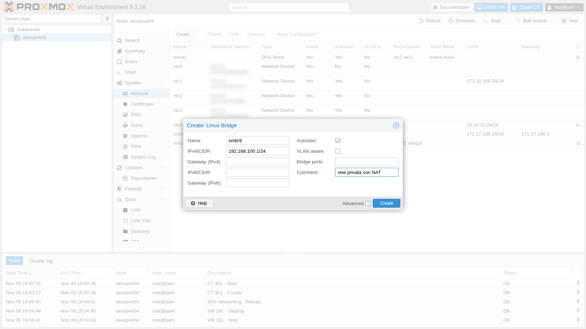
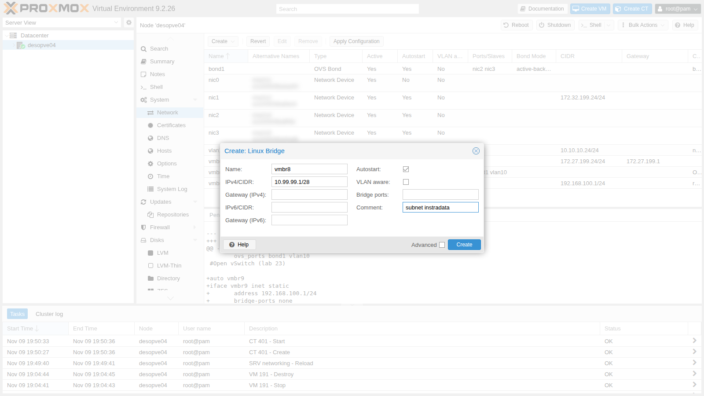
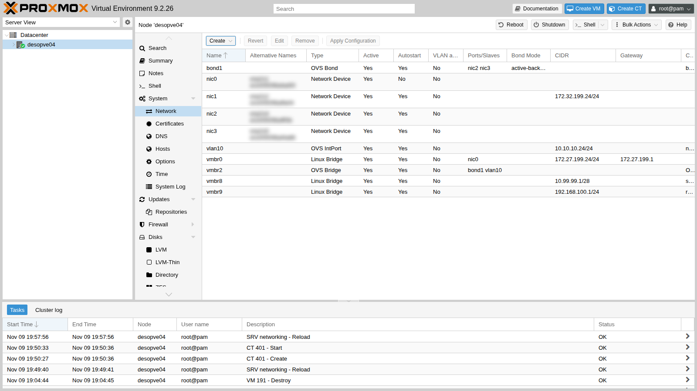

# Lab 24 – Routing e NAT sull'host: masquerading, port forwarding e configurazione routed

**Livello:** avanzato · **Durata:** 1 ora e 15 minuti

## Dipendenze

- **Lab precedenti:**
  - [Lab 20](20-bridges-stable-names-vlans.md): Linux bridge e anatomia di `/etc/network/interfaces`;
  - [Lab 23](23-open-vswitch.md): stato di partenza di `desopve04`.
- **Nodo:** `desopve04`, il nodo autonomo: le prove non toccano il cluster.
- **Router:** `rtr-core` (172.27.199.1), il router MikroTik RouterOS del laboratorio, gateway della rete di gestione: la sua configurazione di base è nel [Lab 01](01-lab-architecture.md) e ci si accede con `ssh admin@172.27.199.1`. In questo lab fa la parte del router del provider.
- **Template:** `debian-13-standard_13.6-1_amd64.tar.zst` nello storage `local` di `desopve04` ([Lab 09](09-lvm-and-lvm-thin.md), oppure `pveam download local debian-13-standard_13.6-1_amd64.tar.zst`).
- **Client di prova:** `desopve01` e il DC `desopve-dc01` (172.27.199.20).
- **Proxy:** `proxy.proxmox.community:3128` per i pacchetti nei container.
- **Credenziali:** `root` / `<password-lab>` sui nodi, `admin` / `<password-lab>` su `rtr-core` → [Appendice B](b-credentials-and-addresses.md).

## Obiettivi

- Dare ai guest una rete privata che esce verso il resto della rete con l'indirizzo del nodo (masquerading).
- Pubblicare un servizio di un guest privato su una porta del nodo (port forwarding).
- Instradare verso il nodo una subnet "aggiuntiva", come fanno i provider con i server dedicati, e dare ai guest indirizzi propri senza NAT.
- Scrivere regole `post-up` che non si duplicano quando la rete viene ricaricata.

## Come funziona

### Tre modi di collegare i guest

| Modo | Come vedono i guest gli altri | Come vedono gli altri i guest | Quando si usa |
|---|---|---|---|
| **Bridged** (lab 20) | i guest sono sulla stessa rete fisica del nodo | con il loro indirizzo | quasi sempre: datacenter, LAN aziendale |
| **Masquerading (NAT)** | escono con l'indirizzo del nodo | non li vedono (solo con il port forwarding) | un solo indirizzo disponibile, laboratori, reti di test |
| **Routed** | il nodo fa da router tra la loro subnet e la rete esterna | con il loro indirizzo, se qualcuno instrada la subnet verso il nodo | server dedicati presso un provider, che non accetta MAC sconosciuti sulla sua rete |

### Il nodo come router

Per inoltrare pacchetti tra le sue interfacce, il nodo deve avere attivo l'**IP forwarding** (`net.ipv4.ip_forward = 1`). Un bridge **senza porte** (`bridge-ports none`) è una rete che esiste solo dentro il nodo: i guest collegati lì escono solo passando dal nodo, che li instrada.

### Masquerading e port forwarding

Il **masquerading** è un NAT sorgente: i pacchetti dei guest escono da `vmbr0` con l'indirizzo del nodo al posto del loro. La tabella *conntrack* del kernel ricorda ogni connessione e riporta le risposte al guest giusto. Gli altri host non vedono la rete privata e non hanno bisogno di conoscerla.

Il **port forwarding** è un NAT di destinazione (DNAT): una connessione che arriva a una porta del nodo viene girata a un indirizzo e una porta della rete privata.

### Configurazione routed

Un provider assegna al server un indirizzo principale e, spesso, una subnet aggiuntiva instradata **verso l'indirizzo principale**. Il nodo mette la subnet su un bridge interno e la instrada: i guest hanno indirizzi propri, raggiungibili dall'esterno, senza NAT. Nel laboratorio la route sul router del provider la mettiamo noi su `rtr-core`.

Una variante della documentazione di Proxmox usa il **proxy ARP** (`proxy_arp` sull'interfaccia esterna): il nodo risponde alle richieste ARP per gli indirizzi dei guest, così il router del provider li raggiunge anche senza una route dedicata. In questo lab si usa la route statica, che è la forma più chiara.

### Le regole nel file di rete

La GUI non gestisce il NAT: le regole si aggiungono a mano in `/etc/network/interfaces` con `post-up` (eseguite quando l'interfaccia sale) e `post-down` (quando scende). Proxmox conserva queste righe anche quando poi modifichi la rete dalla GUI.

> Se attivi il firewall di Proxmox (lab 32), la documentazione chiede di separare il tracciamento delle connessioni dei guest con le zone *conntrack* (`iptables -t raw -I PREROUTING -i fwbr+ -j CT --zone 1`), altrimenti il NAT e il firewall si disturbano. In questo lab il firewall è spento.

## Procedura

### 1. I due bridge interni dalla GUI

1. Copia di sicurezza della rete:

   ```console
   root@desopve04:~# cp /etc/network/interfaces /root/interfaces.bak-lab24
   ```

2. Nodo **desopve04** → **System** → **Network** → **Create** → **Linux Bridge**. **Name** `vmbr9`, **IPv4/CIDR** `192.168.100.1/24`, **Bridge ports** vuoto, nessun gateway. Commento `rete privata con NAT`.

   

3. Un secondo bridge per la configurazione routed: **Name** `vmbr8`, **IPv4/CIDR** `10.99.99.1/28` (la "subnet aggiuntiva" del provider), **Bridge ports** vuoto, commento `subnet instradata`.

   

4. **Apply Configuration**:

   

5. Attiva l'IP forwarding in modo permanente:

   ```console
   root@desopve04:~# echo "net.ipv4.ip_forward = 1" > /etc/sysctl.d/80-ip-forward.conf
   root@desopve04:~# sysctl -p /etc/sysctl.d/80-ip-forward.conf
   net.ipv4.ip_forward = 1
   ```

### 2. Masquerading

1. Aggiungi al blocco di `vmbr9` in `/etc/network/interfaces` le due righe del NAT e ricarica la rete:

   ```text
   auto vmbr9
   iface vmbr9 inet static
   	address 192.168.100.1/24
   	bridge-ports none
   	bridge-stp off
   	bridge-fd 0
   	post-up   iptables -t nat -A POSTROUTING -s 192.168.100.0/24 -o vmbr0 -j MASQUERADE
   	post-down iptables -t nat -D POSTROUTING -s 192.168.100.0/24 -o vmbr0 -j MASQUERADE
   #rete privata con NAT
   ```

   ```console
   root@desopve04:~# ifreload -a
   root@desopve04:~# iptables -t nat -S POSTROUTING
   -P POSTROUTING ACCEPT
   -A POSTROUTING -s 192.168.100.0/24 -o vmbr0 -j MASQUERADE
   ```

2. Crea il CT 402 sulla rete privata, con il nodo come gateway:

   ```console
   root@desopve04:~# pct create 402 local:vztmpl/debian-13-standard_13.6-1_amd64.tar.zst \
       --hostname nat-ct1 --memory 512 --cores 1 --rootfs local-lvm:4 \
       --net0 name=eth0,bridge=vmbr9,ip=192.168.100.10/24,gw=192.168.100.1 \
       --nameserver 172.27.199.20 --searchdomain proxmox.community \
       --unprivileged 1 --features nesting=1 --password '<password-lab>' --start 1
   ```

3. Il container raggiunge il DC e risolve i nomi:

   ```console
   root@desopve04:~# pct exec 402 -- ip route
   default via 192.168.100.1 dev eth0 proto kernel onlink
   192.168.100.0/24 dev eth0 proto kernel scope link src 192.168.100.10
   root@desopve04:~# pct exec 402 -- ping -c3 -W1 172.27.199.20 | tail -2
   3 packets transmitted, 3 received, 0% packet loss, time 2074ms
   rtt min/avg/max/mdev = 0.743/0.820/0.862/0.054 ms
   root@desopve04:~# pct exec 402 -- getent hosts desopve-dc01.proxmox.community
   172.27.199.20   desopve-dc01.proxmox.community
   172.32.199.20   desopve-dc01.proxmox.community
   ```

4. Su `vmbr0` i pacchetti escono con l'indirizzo del **nodo**, e la tabella conntrack ricorda a chi riportare la risposta:

   ```console
   root@desopve04:~# tcpdump -ni vmbr0 icmp and host 172.27.199.20
   19:59:00.253879 IP 172.27.199.24 > 172.27.199.20: ICMP echo request, id 347, seq 1, length 64
   19:59:00.254872 IP 172.27.199.20 > 172.27.199.24: ICMP echo reply, id 347, seq 1, length 64
   root@desopve04:~# conntrack -L -p icmp
   icmp     1 24 src=192.168.100.10 dst=172.27.199.20 type=8 code=0 id=347 src=172.27.199.20 dst=172.27.199.24 type=0 code=0 id=347 mark=0 use=1
   ```

   La riga di conntrack ha due metà: la richiesta come l'ha mandata il container (`src=192.168.100.10`) e la risposta come arriva dal DC (`dst=172.27.199.24`).

5. **Prova senza masquerading.** Togli la regola e riprova:

   ```console
   root@desopve04:~# iptables -t nat -D POSTROUTING -s 192.168.100.0/24 -o vmbr0 -j MASQUERADE
   root@desopve04:~# pct exec 402 -- ping -c3 -W1 172.27.199.20 | tail -1
   3 packets transmitted, 0 received, 100% packet loss, time 2055ms
   root@desopve04:~# tcpdump -ni vmbr0 icmp and host 172.27.199.20
   19:59:08.670035 IP 192.168.100.10 > 172.27.199.20: ICMP echo request, id 348, seq 1, length 64
   19:59:09.700834 IP 192.168.100.10 > 172.27.199.20: ICMP echo request, id 348, seq 2, length 64
   19:59:10.725095 IP 192.168.100.10 > 172.27.199.20: ICMP echo request, id 348, seq 3, length 64
   ```

   Il nodo inoltra le richieste con l'indirizzo privato: il DC non sa dove si trovi la `192.168.100.0/24`, manda le risposte al suo gateway, e queste si perdono. Rimetti la regola (`iptables -t nat -A ...`) e il ping torna a funzionare.

6. Il container installa i pacchetti attraverso il NAT e il proxy del laboratorio:

   ```console
   root@desopve04:~# pct exec 402 -- sh -c 'echo "Acquire::http::Proxy \"http://proxy.proxmox.community:3128\";" > /etc/apt/apt.conf.d/80proxy'
   root@desopve04:~# pct exec 402 -- apt-get update
   root@desopve04:~# pct exec 402 -- apt-get install -y nginx
   root@desopve04:~# pct exec 402 -- sh -c 'echo "nat-ct1: servizio raggiunto con il port forwarding" > /var/www/html/index.html'
   ```

### 3. Port forwarding

1. Aggiungi a `vmbr9` le righe del DNAT: la porta 8080 del nodo va alla porta 80 del container.

   ```text
   	post-up   iptables -t nat -A PREROUTING -i vmbr0 -p tcp --dport 8080 -j DNAT --to-destination 192.168.100.10:80
   	post-down iptables -t nat -D PREROUTING -i vmbr0 -p tcp --dport 8080 -j DNAT --to-destination 192.168.100.10:80
   ```

2. **Attenzione al `ifreload`.** Ricaricando la rete dopo la modifica, ifupdown2 riesegue i `post-up` di `vmbr9`: anche la regola di masquerading già presente viene aggiunta una seconda volta.

   ```console
   root@desopve04:~# ifreload -a
   root@desopve04:~# iptables -t nat -S | grep -E "DNAT|MASQ"
   -A PREROUTING -i vmbr0 -p tcp -m tcp --dport 8080 -j DNAT --to-destination 192.168.100.10:80
   -A POSTROUTING -s 192.168.100.0/24 -o vmbr0 -j MASQUERADE
   -A POSTROUTING -s 192.168.100.0/24 -o vmbr0 -j MASQUERADE
   ```

   Il DNAT, appena aggiunto al file, compare una volta; il masquerading, che c'era già, due. `ifreload -a` riesegue **tutti** i `post-up` del bridge a ogni ricarica, anche se il file non è cambiato: con un'altra ricarica i DNAT diventerebbero due e i MASQUERADE tre. Le regole doppie non rompono nulla subito, ma si accumulano, e un `post-down` ne toglie una sola. La soluzione è aggiungere una regola **solo se manca**: `iptables -C` (*check*) fallisce se la regola non c'è, e solo allora `-A` la aggiunge. Il blocco finale di `vmbr9`:

   ```text
   auto vmbr9
   iface vmbr9 inet static
   	address 192.168.100.1/24
   	bridge-ports none
   	bridge-stp off
   	bridge-fd 0
   	post-up   iptables -t nat -C POSTROUTING -s 192.168.100.0/24 -o vmbr0 -j MASQUERADE 2>/dev/null || iptables -t nat -A POSTROUTING -s 192.168.100.0/24 -o vmbr0 -j MASQUERADE
   	post-down iptables -t nat -D POSTROUTING -s 192.168.100.0/24 -o vmbr0 -j MASQUERADE
   	post-up   iptables -t nat -C PREROUTING -i vmbr0 -p tcp --dport 8080 -j DNAT --to-destination 192.168.100.10:80 2>/dev/null || iptables -t nat -A PREROUTING -i vmbr0 -p tcp --dport 8080 -j DNAT --to-destination 192.168.100.10:80
   	post-down iptables -t nat -D PREROUTING -i vmbr0 -p tcp --dport 8080 -j DNAT --to-destination 192.168.100.10:80
   #rete privata con NAT
   ```

   Tolte a mano le copie in più (`iptables -t nat -D ...` una volta per regola), due ricariche di fila non duplicano più nulla:

   ```console
   root@desopve04:~# ifreload -a; ifreload -a
   root@desopve04:~# iptables -t nat -S | grep -E "DNAT|MASQ"
   -A PREROUTING -i vmbr0 -p tcp -m tcp --dport 8080 -j DNAT --to-destination 192.168.100.10:80
   -A POSTROUTING -s 192.168.100.0/24 -o vmbr0 -j MASQUERADE
   ```

3. Il servizio del container è raggiungibile dalla rete di gestione sulla porta 8080 del nodo:

   ```console
   root@desopve01:~# curl -s http://172.27.199.24:8080/
   nat-ct1: servizio raggiunto con il port forwarding
   root@desopve01:~# curl -s -i http://172.27.199.24:8080/ | head -3
   HTTP/1.1 200 OK
   Server: nginx
   Date: Mon, 09 Nov 2026 18:59:43 GMT
   ```

4. Dal nodo stesso, invece, non funziona:

   ```console
   root@desopve04:~# curl -s -m 5 http://172.27.199.24:8080/ || echo "nessuna risposta (codice $?)"
   nessuna risposta (codice 7)
   root@desopve04:~# iptables -t nat -L PREROUTING -n -v
   Chain PREROUTING (policy ACCEPT 41 packets, 2952 bytes)
    pkts bytes target     prot opt in     out     source               destination
       2   120 DNAT       tcp  --  vmbr0  *       0.0.0.0/0            0.0.0.0/0            tcp dpt:8080 to:192.168.100.10:80
   ```

   Le connessioni che nascono sul nodo non passano dalla catena `PREROUTING` (passano da `OUTPUT`), e la regola chiede pacchetti in arrivo da `vmbr0`. I contatori mostrano i 2 pacchetti arrivati dagli altri host.

### 4. Configurazione routed

1. Crea il CT 403 sulla subnet instradata, con il nodo come gateway:

   ```console
   root@desopve04:~# pct create 403 local:vztmpl/debian-13-standard_13.6-1_amd64.tar.zst \
       --hostname routed-ct1 --memory 512 --cores 1 --rootfs local-lvm:4 \
       --net0 name=eth0,bridge=vmbr8,ip=10.99.99.2/28,gw=10.99.99.1 \
       --nameserver 172.27.199.20 --searchdomain proxmox.community \
       --unprivileged 1 --features nesting=1 --password '<password-lab>' --start 1
   ```

2. Finché il router non sa che la subnet sta dietro `desopve04`, il container è irraggiungibile:

   ```console
   root@desopve01:~# ping -c2 -W1 10.99.99.2 | tail -1
   2 packets transmitted, 0 received, +2 errors, 100% packet loss, time 1001ms
   ```

3. Sul router (qui `rtr-core`, in produzione il router del provider) si instrada la subnet verso l'indirizzo principale del nodo:

   ```console
   [admin@rtr-core] > /ip route add dst-address=10.99.99.0/28 gateway=172.27.199.24 comment="subnet instradata verso desopve04 (lab 24)"
   [admin@rtr-core] > /ip route print where dst-address=10.99.99.0/28
   Flags: A - ACTIVE; s - STATIC
   Columns: DST-ADDRESS, GATEWAY, ROUTING-TABLE, DISTANCE
   #    DST-ADDRESS    GATEWAY        ROUTING-TABLE  DISTANCE
   ;;; subnet instradata verso desopve04 (lab 24)
   0 As 10.99.99.0/28  172.27.199.24  main                  1
   ```

4. Ora il container è raggiungibile con il **suo** indirizzo, e `traceroute` mostra il percorso: router, nodo, container.

   ```console
   root@desopve01:~# ping -c3 -W1 10.99.99.2 | tail -2
   3 packets transmitted, 3 received, 0% packet loss, time 2052ms
   rtt min/avg/max/mdev = 0.633/0.776/0.907/0.112 ms
   root@desopve01:~# traceroute -n -w1 -q1 10.99.99.2
   traceroute to 10.99.99.2 (10.99.99.2), 30 hops max, 60 byte packets
    1  172.27.199.1  0.440 ms
    2  172.27.199.24  0.684 ms
    3  10.99.99.2  0.783 ms
   ```

5. Al contrario del masquerading, chi riceve il traffico vede l'indirizzo vero del container. Avvia la cattura su `vmbr0` e, da un secondo terminale, fai partire un ping dal container (`pct exec 403 -- ping -c1 172.27.199.20`):

   ```console
   root@desopve04:~# tcpdump -ni vmbr0 icmp and host 172.27.199.20
   20:00:13.717794 IP 10.99.99.2 > 172.27.199.20: ICMP echo request, id 344, seq 1, length 64
   20:00:13.718992 IP 172.27.199.20 > 10.99.99.2: ICMP echo reply, id 344, seq 1, length 64
   root@desopve04:~# ip route | grep -E "vmbr8|vmbr9"
   10.99.99.0/28 dev vmbr8 proto kernel scope link src 10.99.99.1
   192.168.100.0/24 dev vmbr9 proto kernel scope link src 192.168.100.1
   ```

   Il nodo non ha regole di NAT per la `10.99.99.0/28`: si limita a instradare, perché le due reti sono collegate alle sue interfacce.

## Verifica e test

| Prova | Risultato |
|---|---|
| CT sulla rete privata verso il DC, con masquerading | 0% di perdita; su `vmbr0` si vede l'indirizzo del nodo |
| Stesso test senza la regola MASQUERADE | 100% di perdita: il DC non sa dove rispondere |
| `apt` nel container privato | funziona tramite il NAT e il proxy |
| Port forwarding 8080 → CT 402:80 da `desopve01` | pagina del container, HTTP 200 |
| Port forwarding dal nodo stesso | non funziona: il traffico locale non passa da `PREROUTING` |
| `ifreload` con `post-up iptables -A` | regole duplicate; con `-C ... \|\| -A` nessun duplicato |
| Subnet instradata senza route sul router | irraggiungibile |
| Subnet instradata con la route su `rtr-core` | raggiungibile in 3 salti, senza NAT |

## Stato finale del lab

- **`desopve04`:**
  - `vmbr9` 192.168.100.1/24 senza porte, con masquerading verso `vmbr0` e DNAT `172.27.199.24:8080` → `192.168.100.10:80`;
  - `vmbr8` 10.99.99.1/28 senza porte, subnet instradata;
  - IP forwarding attivo (`/etc/sysctl.d/80-ip-forward.conf`);
  - copia della rete precedente in `/root/interfaces.bak-lab24`;
  - OVS (`vmbr2`, `bond1`, `vlan10`) invariato dal lab 23.
- **Container su `desopve04`, tutti accesi:**
  - CT 401 `ovs-ct1` (lab 23);
  - CT 402 `nat-ct1` su `vmbr9`, 192.168.100.10, con nginx;
  - CT 403 `routed-ct1` su `vmbr8`, 10.99.99.2/28.
- **`rtr-core`:** route statica `10.99.99.0/28` via `172.27.199.24`.

## Cosa hai imparato

- Un bridge senza porte è una rete interna al nodo; con l'IP forwarding il nodo la instrada.
- Il masquerading nasconde i guest dietro l'indirizzo del nodo: conntrack riporta le risposte, gli altri host non vedono la rete privata.
- Il port forwarding pubblica un servizio privato su una porta del nodo, ma non vale per le connessioni che nascono sul nodo stesso.
- Con la configurazione routed i guest hanno indirizzi propri senza NAT: serve che il router a monte instradi la subnet verso il nodo.
- Le regole `post-up` vengono rieseguite a ogni `ifreload`: con `iptables -C ... || iptables -A ...` non si duplicano.

## Riferimenti

- [Proxmox VE – Masquerading (NAT) with iptables](https://pve.proxmox.com/pve-docs/pve-admin-guide.html#sysadmin_network_masquerading)
- [Proxmox VE – Routed Configuration](https://pve.proxmox.com/pve-docs/pve-admin-guide.html#sysadmin_network_routed)
- [iptables-extensions – MASQUERADE e DNAT](https://manpages.debian.org/trixie/iptables/iptables-extensions.8.en.html)
- [RouterOS – IP routing](https://help.mikrotik.com/docs/spaces/ROS/pages/328084/IP+Routing)
