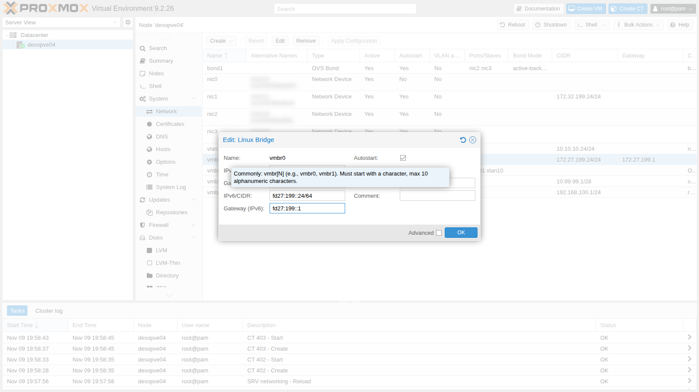
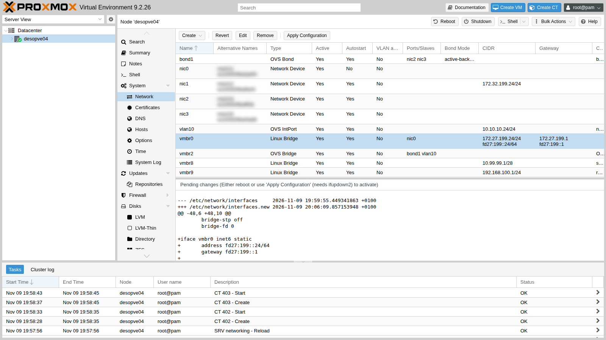
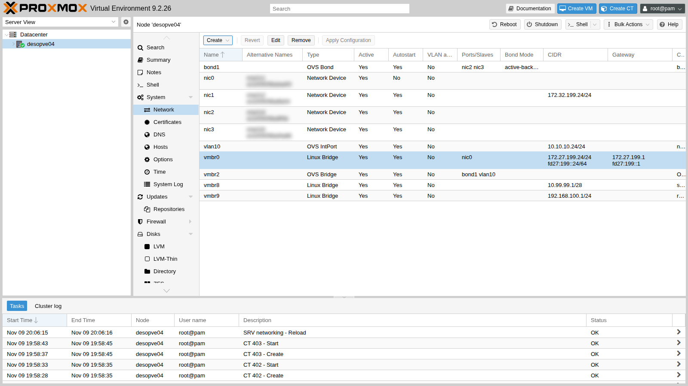
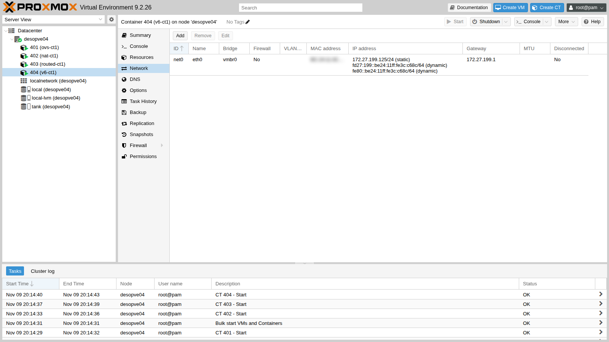

# Lab 25 – IPv6: dual stack, RA e SLAAC

**Livello:** avanzato · **Durata:** 1 ora e 15 minuti

## Dipendenze

- **Lab precedenti:**
  - [Lab 02](02-domain-controller.md): DC e DNS di `proxmox.community`;
  - [Lab 17](17-ceph-installation.md): Ceph, per i controlli di salute dopo le modifiche di rete;
  - [Lab 20](20-bridges-stable-names-vlans.md) e [Lab 21](21-bonding.md): rete dei nodi, con `vmbr0` e `vmbr1`;
  - [Lab 24](24-routing-nat.md): stato di partenza di `desopve04`.
- **Nodi:** `desopve01-04` per gli indirizzi statici; `desopve04` (autonomo) per il riavvio di prova e per il container dual stack.
- **Router:** `rtr-core`, il router MikroTik RouterOS del laboratorio ([Lab 01](01-lab-architecture.md), accesso con `ssh admin@172.27.199.1`), che diventa anche il gateway IPv6 della rete di gestione e annuncia il prefisso.
- **Template:** `debian-13-standard_13.6-1_amd64.tar.zst` nello storage `local` di `desopve04` ([Lab 09](09-lvm-and-lvm-thin.md), oppure `pveam download local debian-13-standard_13.6-1_amd64.tar.zst`).
- **Credenziali:** `root` / `<password-lab>` sui nodi, `admin` / `<password-lab>` su `rtr-core`, `Administrator` sul DC → [Appendice B](b-credentials-and-addresses.md).

## Obiettivi

- Capire come un host ottiene un indirizzo IPv6: indirizzi statici, *Router Advertisement* (RA) e SLAAC.
- Mettere la rete di gestione in **dual stack** (IPv4 e IPv6) con un prefisso privato (ULA).
- Dare ai nodi indirizzi statici e impedire che si autoconfigurino, con link-local non derivati dal MAC.
- Dare ai guest indirizzi automatici (SLAAC) dal router del laboratorio.
- Aggiungere i nomi IPv6 al DNS e accedere alla GUI di Proxmox in IPv6.

## Come funziona

### Gli indirizzi IPv6 in breve

| Tipo | Esempio | Uso |
|---|---|---|
| **Link-local** | `fe80::…/64` | sempre presente su ogni interfaccia, vale solo sul link (la rete locale); serve a Neighbor Discovery e come gateway |
| **ULA** (*Unique Local Address*) | `fd27:199::/64` | privato, come le reti 10.x o 192.168.x in IPv4: non va su Internet |
| **GUA** (*Global Unicast*) | `2001:db8::/32` (documentazione) | pubblico, assegnato dal provider |

Una rete IPv6 per host è quasi sempre una `/64`. Nel laboratorio la rete di gestione diventa `fd27:199::/64`, con lo stesso ultimo numero di IPv4 dove possibile: il nodo `172.27.199.21` diventa `fd27:199::21`.

### Neighbor Discovery, RA e SLAAC

In IPv6 non c'è ARP: c'è **Neighbor Discovery** (ND), fatto di messaggi ICMPv6. Due di questi messaggi servono alla configurazione automatica:

- il router manda periodicamente un **Router Advertisement** (RA), oppure lo manda su richiesta (*Router Solicitation*): "sono il gateway, il prefisso di questa rete è `fd27:199::/64`";
- un host che accetta gli RA si costruisce da solo un indirizzo nel prefisso (**SLAAC**, *Stateless Address Autoconfiguration*) e usa il link-local del router come gateway.

| Chi | Come si configura | Perché |
|---|---|---|
| **Nodi Proxmox, DC, server** | indirizzo statico, RA ignorati | l'indirizzo non deve cambiare: DNS, cluster, firewall e accessi si basano su di esso |
| **Guest** (VM, container) | SLAAC dagli RA del router | nessuna configurazione nel guest, come il DHCP in IPv4 |

### Indirizzi derivati dal MAC

Con il metodo classico (EUI-64) l'host costruisce l'ultima metà dell'indirizzo dal **MAC** della scheda, con `ff:fe` in mezzo. Il MAC finisce così negli indirizzi link-local e SLAAC, e rivela il produttore della scheda. Il kernel Linux può invece generare indirizzi **stable privacy** (RFC 7217) con `addr_gen_mode`, non legati al MAC. Con `addr_gen_mode = 3` il segreto da cui derivano è casuale e viene scelto a ogni avvio: gli indirizzi restano gli stessi finché il nodo è acceso, ma cambiano dopo un riavvio. Per averli uguali anche tra un riavvio e l'altro si imposta un segreto fisso (`stable_secret`) con `addr_gen_mode = 2`. Per i nodi è comunque una buona pratica di privacy.

Nei guest di Proxmox il MAC è casuale con il prefisso `BC:24:11` di Proxmox: l'indirizzo SLAAC di un container (`fd27:199::be24:11ff:fe…`) rivela solo che è un guest Proxmox.

### Gli RA e gli switch

Molti switch hanno una protezione (*RA Guard*) che scarta gli RA che non arrivano dalle porte autorizzate, per evitare che un host qualsiasi si annunci come router. Se i guest non ricevono gli RA del router, controlla per prima cosa lo switch.

### IPv6 e firewall

IPv6 non usa il NAT come IPv4: con indirizzi raggiungibili, il firewall diventa ancora più importante. Neighbor Discovery è ICMPv6, quindi un firewall che blocca tutto l'ICMPv6 rompe la rete. Il firewall di Proxmox (lab 32-33) ha regole che valgono per entrambe le famiglie e un'opzione dedicata, **NDP**, attiva per default, che lascia passare Neighbor Discovery.

## Procedura

### 1. Prima degli RA: i nodi li ignorano

1. **Prima** di accendere gli RA sul router conviene dire ai nodi di ignorarli: altrimenti ogni interfaccia collegata alla rete si costruisce un indirizzo SLAAC e un default gateway che nessuno ha scelto (e che restano anche dopo aver cambiato idea). Il file `/etc/sysctl.d/90-ipv6-host.conf`, uguale su tutti i nodi:

   ```text
   # Indirizzi IPv6 del nodo solo statici: nessuna interfaccia accetta gli RA o si autoconfigura (SLAAC).
   # Il carattere * vale anche per le schede che compaiono dopo l'avvio (systemd le applica a ogni nuova interfaccia).
   net.ipv6.conf.*.accept_ra = 0
   net.ipv6.conf.*.autoconf = 0
   # Link-local non derivati dal MAC (RFC 7217, "stable privacy" con segreto casuale)
   net.ipv6.conf.all.addr_gen_mode = 3
   net.ipv6.conf.default.addr_gen_mode = 3
   ```

   ```console
   root@desopve01:~# /usr/lib/systemd/systemd-sysctl /etc/sysctl.d/90-ipv6-host.conf
   root@desopve01:~# grep -l 1 /proc/sys/net/ipv6/conf/*/accept_ra | wc -l
   0
   ```

   > **Perché il carattere `*`.** Con le sole chiavi `all` e `default`, dopo un riavvio la scheda `nic1`, che esiste prima che il file venga letto, avrebbe di nuovo `accept_ra = 1`, e si prenderebbe un default gateway IPv6 dall'RA (`default via fe80::1 dev nic1 proto ra`). `default` vale solo per le interfacce create dopo, `all` non cambia quelle esistenti. Con `*` systemd applica l'impostazione a **ogni** interfaccia, anche a quelle che compaiono durante l'avvio.

   Se un nodo ha già ricevuto degli RA (per esempio perché il router li annunciava già), togli gli indirizzi e le route che si è preso:

   ```console
   root@desopve01:~# ip -6 addr flush scope global dynamic
   root@desopve01:~# ip -6 route flush proto ra
   ```

### 2. Il prefisso e gli RA sul router

1. Su `rtr-core` si assegna l'indirizzo `fd27:199::1/64` alla porta della rete di gestione con `advertise=yes`, così il router annuncia il prefisso negli RA. Nel laboratorio l'intervallo degli RA si accorcia a 20-60 secondi:

   ```console
   [admin@rtr-core] > /ipv6 address add address=fd27:199::1/64 interface=ether1 advertise=yes comment="lab 25: rete di gestione"
   [admin@rtr-core] > /ipv6 nd set [find default=yes] ra-interval=20s-60s
   ```

2. Un link-local fisso e facile da ricordare per il gateway, `fe80::1`, al posto di quello generato dal MAC. Si disattiva la generazione automatica e si aggiunge l'indirizzo a mano:

   ```console
   [admin@rtr-core] > /ipv6 settings set disable-link-local-address=yes
   [admin@rtr-core] > /ipv6 address add address=fe80::1/64 interface=ether1 advertise=no comment="link-local fisso del gateway"
   ```

   Il link-local generato sparisce al successivo riavvio della porta del router (o del router stesso). Dalla **console** del router, non da una sessione SSH che passa da quella porta, disattiva e riattiva `ether1` per 2 secondi; la rete di gestione si interrompe per quel tempo:

   ```console
   [admin@rtr-core] > /interface disable ether1; :delay 2s; /interface enable ether1
   ```

   ```console
   [admin@rtr-core] > /ipv6 address print
   Flags: D - DYNAMIC; G - GLOBAL, L - LINK-LOCAL
   Columns: ADDRESS, INTERFACE, VRF, ADVERTISE, VALID, PREFERRED
   #    ADDRESS         INTERFACE  VRF   ADVERTISE  VALID    PREFERRED
   0 D  ::1/128         lo         main  no
   ;;; lab 25: rete di gestione
   1  G fd27:199::1/64  ether1     main  yes        forever  forever
   ;;; link-local fisso del gateway
   2  L fe80::1/64      ether1     main  no         forever  forever
   ```

3. Verifica da un nodo che l'RA arrivi, con `rdisc6` (pacchetto `ndisc6`). `rdisc6` chiede e mostra gli RA anche se il nodo è configurato per ignorarli:

   ```console
   root@desopve04:~# apt install ndisc6
   root@desopve04:~# rdisc6 vmbr0
   Soliciting ff02::2 (ff02::2) on vmbr0...

   Hop limit                 :    undefined (      0x00)
   Stateful address conf.    :           No
   Stateful other conf.      :           No
   Mobile home agent         :           No
   Router preference         :       medium
   Neighbor discovery proxy  :           No
   Router lifetime           :         1800 (0x00000708) seconds
   Reachable time            :  unspecified (0x00000000)
   Retransmit time           :  unspecified (0x00000000)
    Source link-layer address: <MAC del router>
    Prefix                   : fd27:199::/64
     On-link                 :          Yes
     Autonomous address conf.:          Yes
     Valid time              :     infinite (0xffffffff)
     Pref. time              :     infinite (0xffffffff)
    from fe80::1
   ```

   `Autonomous address conf.: Yes` significa "costruitevi un indirizzo con SLAAC". `Stateful … No` significa che non c'è DHCPv6.

### 3. I nodi: indirizzi statici e link-local non derivati dal MAC

Prima di modificare la rete, salva una copia del file su ogni nodo:

```console
root@desopve01:~# cp /etc/network/interfaces /root/interfaces.bak-lab25
```

1. **desopve04 dalla GUI.** **System** → **Network** → **vmbr0** → **Edit**: **IPv6/CIDR** `fd27:199::24/64`, **Gateway (IPv6)** `fd27:199::1`.

   

   

   **Apply Configuration**:

   

   In `/etc/network/interfaces` compare un secondo blocco per `vmbr0`, con la famiglia `inet6`:

   ```text
   iface vmbr0 inet6 static
   	address fd27:199::24/64
   	gateway fd27:199::1
   ```

2. **desopve01-03 da riga di comando.** Lo stesso blocco (`fd27:199::21`, `::22`, `::23`) subito dopo il blocco `iface vmbr0 inet static`, poi `ifreload -a`. Aggiungere un indirizzo a `vmbr0` non interrompe Corosync né Ceph:

   ```console
   root@desopve01:~# ifreload -a
   root@desopve01:~# ip -6 addr show dev vmbr0 scope global | grep inet6
       inet6 fd27:199::21/64 scope global
   root@desopve01:~# ip -6 route | grep default
   default via fd27:199::1 dev vmbr0 proto kernel metric 1024 onlink pref medium
   root@desopve01:~# ping -6 -c2 -W1 fd27:199::24 | tail -1
   rtt min/avg/max/mdev = 0.502/1.256/2.010/0.754 ms
   root@desopve01:~# pvecm status | grep ^Quorate; ceph -s | grep health
   Quorate:          Yes
       health: HEALTH_OK
   ```

3. **Il riavvio di prova** su `desopve04` conferma tre cose: le impostazioni restano, nessuna interfaccia accetta gli RA, e i link-local non contengono più il MAC.

   ```console
   root@desopve04:~# ip -6 addr show dev vmbr0 scope link | grep inet6     # prima
       inet6 fe80::<derivato dal MAC, con ff:fe in mezzo>/64 scope link proto kernel_ll
   root@desopve04:~# systemctl reboot
   ...
   root@desopve04:~# grep -l 1 /proc/sys/net/ipv6/conf/*/accept_ra | wc -l
   0
   root@desopve04:~# ip -6 route | grep default
   default via fd27:199::1 dev vmbr0 proto kernel metric 1024 onlink pref medium
   root@desopve04:~# ip -6 addr show dev nic1 scope link | grep inet6
       inet6 fe80::3aea:589e:ff57:62eb/64 scope link stable-privacy proto kernel_ll
   ```

   Il link-local ora è `stable-privacy`, senza `ff:fe` e senza il MAC (e, con `addr_gen_mode = 3`, cambierà a ogni riavvio). Sui nodi del cluster il file è già attivo per gli RA; i nuovi link-local si applicheranno al prossimo riavvio, che non serve fare ora.

   Al riavvio tornano anche le configurazioni dei lab 23 e 24 (OVS, NAT e port forwarding): sono tutte nei file di rete. I container non hanno l'avvio automatico e vanno riaccesi con `pct start`.

### 4. Un guest dual stack con SLAAC

1. Il CT 404 su `vmbr0`, con IPv4 statico e IPv6 automatico (`ip6=auto`, cioè SLAAC):

   ```console
   root@desopve04:~# pct create 404 local:vztmpl/debian-13-standard_13.6-1_amd64.tar.zst \
       --hostname v6-ct1 --memory 512 --cores 1 --rootfs local-lvm:4 \
       --net0 name=eth0,bridge=vmbr0,ip=172.27.199.125/24,gw=172.27.199.1,ip6=auto \
       --nameserver 172.27.199.20 --searchdomain proxmox.community \
       --unprivileged 1 --features nesting=1 --password '<password-lab>' --start 1
   ```

   Dalla GUI: scheda di rete del container → **IPv6** → **SLAAC**.

   

2. Il container si è costruito l'indirizzo dal prefisso annunciato e usa il link-local del router come gateway:

   ```console
   root@desopve04:~# pct exec 404 -- ip -6 addr show dev eth0
   2: eth0@if19: <BROADCAST,MULTICAST,UP,LOWER_UP> mtu 1500 qdisc noqueue state UP group default qlen 1000 link-netnsid 0
       inet6 fd27:199::be24:11ff:fe3c:c68c/64 scope global dynamic mngtmpaddr proto kernel_ra
          valid_lft forever preferred_lft forever
       inet6 fe80::be24:11ff:fe3c:c68c/64 scope link proto kernel_ll
          valid_lft forever preferred_lft forever
   root@desopve04:~# pct exec 404 -- ip -6 route
   fd27:199::/64 dev eth0 proto kernel metric 256 pref medium
   fe80::/64 dev eth0 proto kernel metric 256 pref medium
   default via fe80::1 dev eth0 proto ra metric 1024 expires 1791sec pref medium
   root@desopve04:~# pct exec 404 -- ping -6 -c2 -W1 fd27:199::21 | tail -1
   rtt min/avg/max/mdev = 0.320/0.579/0.838/0.259 ms
   root@desopve04:~# pct exec 404 -- ping -c2 -W1 172.27.199.20 | tail -1
   rtt min/avg/max/mdev = 0.903/1.349/1.795/0.446 ms
   ```

   `proto kernel_ra` e `proto ra` indicano indirizzo e gateway arrivati dall'RA; `expires` è la durata annunciata dal router (1800 s), rinnovata a ogni RA.

### 5. Il DC: un effetto inatteso degli RA

Windows accetta gli RA per default. Appena il router ha cominciato ad annunciare il prefisso, il DC si è dato un indirizzo SLAAC **su entrambe le schede**, e il servizio DNS lo ha registrato per il dominio:

```console
PS C:\> Get-NetIPAddress -AddressFamily IPv6 | Where-Object { $_.IPAddress -notlike 'fe80*' -and $_.IPAddress -ne '::1' } | Format-Table InterfaceAlias,IPAddress,PrefixOrigin,SuffixOrigin
InterfaceAlias IPAddress                            PrefixOrigin SuffixOrigin
-------------- ---------                            ------------ ------------
MGMT           fd27:199::e3db:db3d:17e2:9d9a RouterAdvertisement         Link
CLUSTER        fd27:199::3a51:9d70:251b:f8a3 RouterAdvertisement         Link
PS C:\> Get-DnsServerResourceRecord -ZoneName proxmox.community -RRType AAAA | Format-Table HostName,@{n='IPv6';e={$_.RecordData.IPv6Address}}
HostName       IPv6
--------       ----
@              fd27:199::e3db:db3d:17e2:9d9a
desopve-dc01   fd27:199::e3db:db3d:17e2:9d9a
DomainDnsZones fd27:199::e3db:db3d:17e2:9d9a
ForestDnsZones fd27:199::e3db:db3d:17e2:9d9a
```

Un DC con un indirizzo che dipende da un router non va bene: diamogli un indirizzo statico, disattiviamo gli RA sulle due schede e puliamo i record vecchi. I comandi in PowerShell, sul DC:

```powershell
foreach ($i in 'MGMT','CLUSTER') { Set-NetIPInterface -InterfaceAlias $i -AddressFamily IPv6 -RouterDiscovery Disabled -Dhcp Disabled }
New-NetIPAddress -InterfaceAlias MGMT -IPAddress fd27:199::20 -PrefixLength 64 -DefaultGateway fd27:199::1
Set-DnsClientServerAddress -InterfaceAlias MGMT -ServerAddresses 127.0.0.1,::1
ipconfig /registerdns
foreach ($z in 'proxmox.community','_msdcs.proxmox.community') {
  Get-DnsServerResourceRecord -ZoneName $z -RRType AAAA |
    Where-Object { $_.RecordData.IPv6Address.IPAddressToString -notmatch '^fd27:199::(20|21|22|23|24)$' } |
    Remove-DnsServerResourceRecord -ZoneName $z -Force
}
```

Nel [Lab 02](02-domain-controller.md) il server DNS ascolta solo su `172.27.199.20`. Perché risponda anche in IPv6, aggiungi il nuovo indirizzo all'elenco di ascolto:

```powershell
$s = Get-DnsServerSetting -All
$s.ListeningIPAddress = @('172.27.199.20','fd27:199::20')
Set-DnsServerSetting -InputObject $s
Restart-Service DNS
(Get-DnsServerSetting -All).ListeningIPAddress
```

```text
172.27.199.20
fd27:199::20
```

Poi i record AAAA dei nodi, come i record A del lab 02:

```powershell
foreach ($n in 21,22,23,24) {
  Add-DnsServerResourceRecordAAAA -ZoneName proxmox.community -Name ("desopve0" + ($n-20)) -IPv6Address ("fd27:199::" + $n)
}
```

Il risultato:

```console
PS C:\> Get-NetIPAddress -AddressFamily IPv6 | Where-Object { $_.IPAddress -notlike 'fe80*' -and $_.IPAddress -ne '::1' } | Format-Table InterfaceAlias,IPAddress,PrefixOrigin
InterfaceAlias IPAddress    PrefixOrigin
-------------- ---------    ------------
MGMT           fd27:199::20       Manual
PS C:\> Get-DnsServerResourceRecord -ZoneName proxmox.community -RRType AAAA | Format-Table HostName,@{n='IPv6';e={$_.RecordData.IPv6Address}}
HostName       IPv6
--------       ----
@              fd27:199::20
desopve-dc01   fd27:199::20
desopve01      fd27:199::21
desopve02      fd27:199::22
desopve03      fd27:199::23
desopve04      fd27:199::24
DomainDnsZones fd27:199::20
ForestDnsZones fd27:199::20
```

Il DNS ora risponde anche interrogato sul suo indirizzo IPv6:

```console
PS C:\> Resolve-DnsName desopve01.proxmox.community -Type AAAA -Server fd27:199::20 -DnsOnly | Format-Table Name,Type,IPAddress -AutoSize
Name                        Type IPAddress
----                        ---- ---------
desopve01.proxmox.community AAAA fd27:199::21
```

### 6. La GUI di Proxmox in IPv6

`pveproxy` ascolta su tutti gli indirizzi, IPv4 e IPv6 (`*`):

```console
root@desopve01:~# ss -ltn '( sport = :8006 )'
State  Recv-Q Send-Q Local Address:Port Peer Address:Port
LISTEN 0      4096               *:8006            *:*
```

Dal container dual stack, per nome (il DNS ora restituisce anche il record AAAA, che ha la precedenza):

```console
root@desopve04:~# pct exec 404 -- getent ahosts desopve01.proxmox.community | sort -u -k1,1
172.27.199.21   STREAM
fd27:199::21    STREAM desopve01.proxmox.community
root@desopve04:~# pct exec 404 -- wget -6 --no-check-certificate -S -O /dev/null https://desopve01.proxmox.community:8006/ 2>&1 | grep -E "Connecting|HTTP/"
Connecting to desopve01.proxmox.community (desopve01.proxmox.community)|fd27:199::21|:8006... connected.
  HTTP/1.1 200 OK
```

Da un browser l'indirizzo IPv6 si scrive tra parentesi quadre: `https://[fd27:199::21]:8006`.

## Verifica e test

| Prova | Risultato |
|---|---|
| RA del router sulla rete di gestione | ricevuto, prefisso `fd27:199::/64`, SLAAC sì, DHCPv6 no, mittente `fe80::1` |
| Nodi con indirizzo statico | `fd27:199::21-24`, default gateway `fd27:199::1`, nessun indirizzo dinamico |
| Interfacce dei nodi che accettano gli RA | 0, anche dopo un riavvio (con le chiavi `*`) |
| Link-local dopo il riavvio | `stable-privacy`, senza MAC |
| Container con `ip6=auto` | indirizzo SLAAC e gateway `fe80::1`, raggiunge i nodi in IPv6 e il DC in IPv4 |
| DC con gli RA attivi | indirizzi SLAAC su due schede, registrati nel DNS del dominio |
| DC dopo la correzione | solo `fd27:199::20` statico, record AAAA puliti |
| GUI di `desopve01` per nome dal container | connessione in IPv6, HTTP 200 |
| Cluster dopo le modifiche | quorum 3/3, Ceph `HEALTH_OK`, iSCSI con 2 percorsi |

## Stato finale del lab

- **Rete di gestione dual stack:** `172.27.199.0/24` e `fd27:199::/64`.
- **`rtr-core`:** `fd27:199::1/64` su `ether1` con RA (intervallo 20-60 s), link-local fisso `fe80::1`, link-local automatici disattivati.
- **Nodi `desopve01-04`:** `fd27:199::21-24/64` statici su `vmbr0`, gateway `fd27:199::1`; `/etc/sysctl.d/90-ipv6-host.conf` (RA ignorati, `addr_gen_mode` 3). Copie della rete precedente in `/root/interfaces.bak-lab25`. Su `desopve01-03` i link-local stable privacy si applicheranno al prossimo riavvio.
- **DC:** `fd27:199::20` statico su `MGMT`, RA disattivati su `MGMT` e `CLUSTER`, DNS `127.0.0.1` e `::1`; server DNS in ascolto su `172.27.199.20` e `fd27:199::20`; record AAAA per `desopve-dc01` e `desopve01-04`.
- **Container su `desopve04`, accesi:**
  - CT 404 `v6-ct1` su `vmbr0`, 172.27.199.125/24 e SLAAC;
  - CT 401-403 invariati dai lab 23-24.

## Cosa hai imparato

- In IPv6 il router annuncia il prefisso con gli RA, e i guest si configurano da soli con SLAAC.
- I nodi e i server vogliono indirizzi statici: gli RA vanno ignorati in modo esplicito, su **tutte** le interfacce, anche quelle che esistono all'avvio.
- Con `addr_gen_mode` gli indirizzi non contengono più il MAC della scheda.
- Accendere gli RA su una rete esistente ha effetti su tutti: Windows li accetta per default, e un DC registra subito il nuovo indirizzo nel DNS.
- La GUI di Proxmox risponde in IPv6 senza configurazioni particolari; basta l'indirizzo sul nodo e, per i nomi, il record AAAA.

## Riferimenti

- [Proxmox VE – Network Configuration](https://pve.proxmox.com/pve-docs/pve-admin-guide.html#sysadmin_network_configuration)
- [Proxmox VE – Firewall, IPv6 e NDP](https://pve.proxmox.com/pve-docs/pve-admin-guide.html#pve_firewall_ipv6)
- [RFC 4862 – IPv6 Stateless Address Autoconfiguration](https://www.rfc-editor.org/rfc/rfc4862)
- [RFC 7217 – Stable and opaque IPv6 interface identifiers](https://www.rfc-editor.org/rfc/rfc7217)
- [Linux – ip-sysctl, parametri IPv6](https://docs.kernel.org/networking/ip-sysctl.html)
- [RouterOS – IPv6 Neighbor Discovery](https://help.mikrotik.com/docs/spaces/ROS/pages/328118/IPv6+Neighbor+Discovery)
