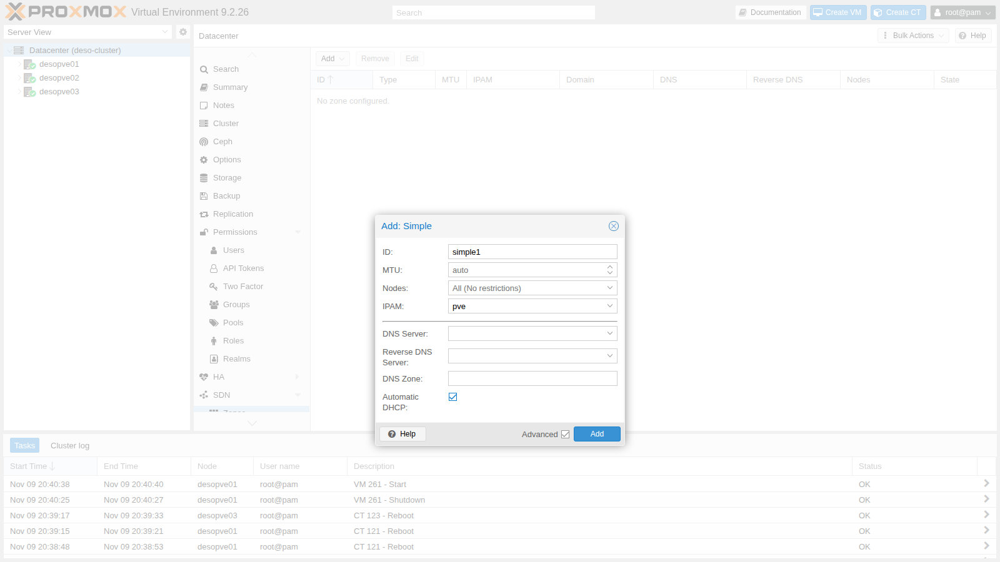
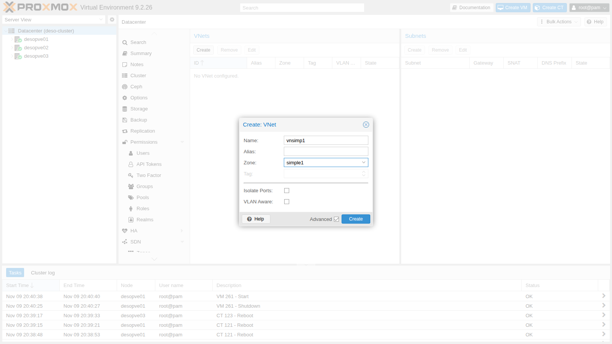
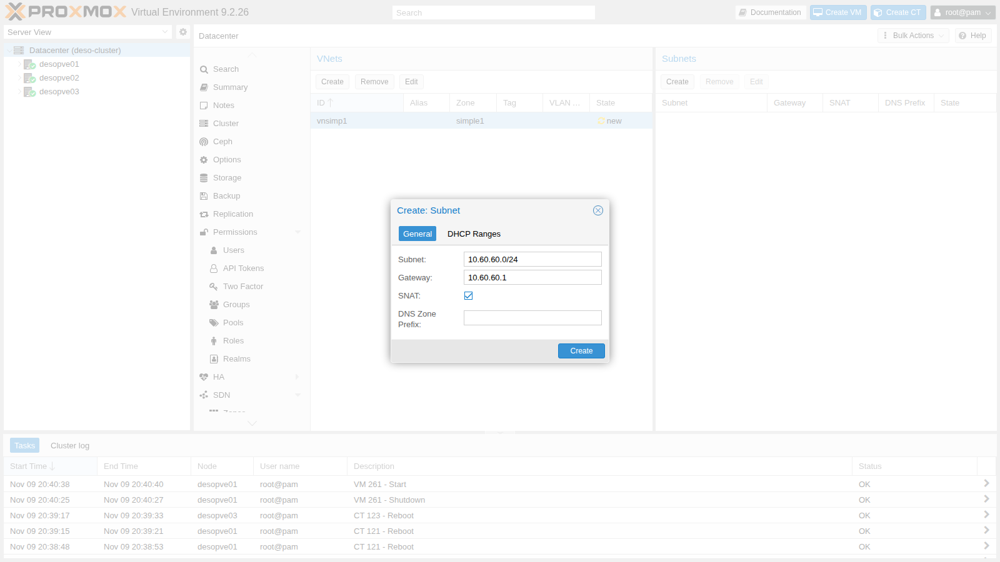
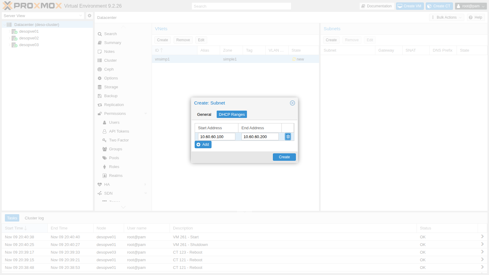
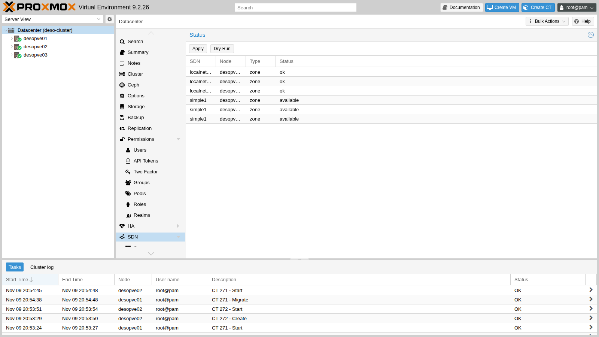
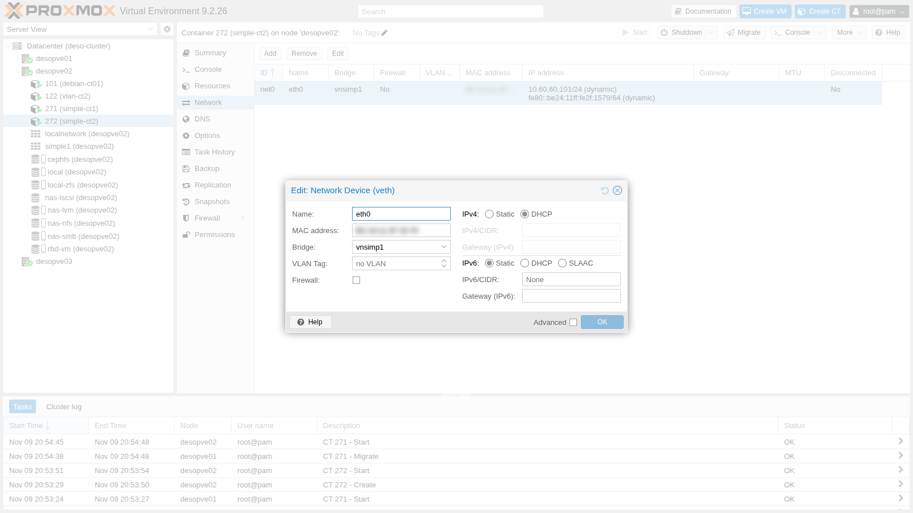
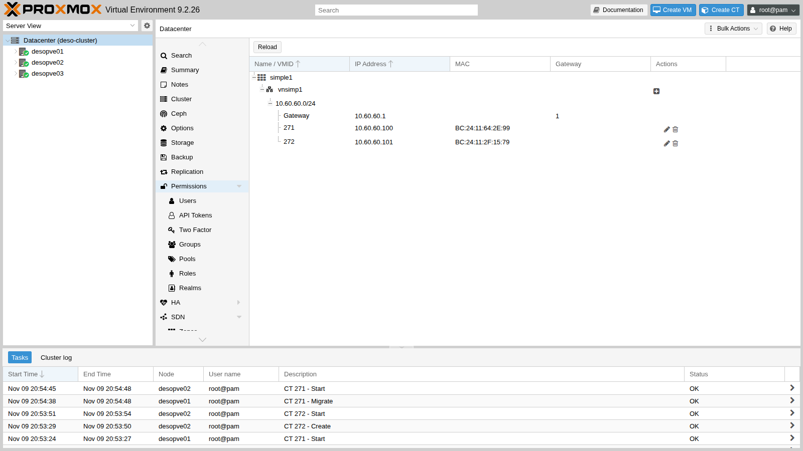

# Lab 27 – SDN 1: zona Simple con SNAT, DHCP e IPAM

**Livello:** avanzato · **Durata:** 1 ora

## Dipendenze

- **Lab precedenti:**
  - [Lab 06](06-cluster-corosync.md): cluster `deso-cluster` con `desopve01`-`desopve03`;
  - [Lab 17](17-ceph-installation.md): storage `rbd-vm` per i dischi dei container e `cephfs`;
  - [Lab 20](20-bridges-stable-names-vlans.md): il template Debian su `cephfs`;
  - [Lab 21](21-bonding.md) e [Lab 22](22-dedicated-networks.md): `vmbr1` su `bond0` e le reti dedicate di Corosync, citate nelle verifiche;
  - [Lab 24](24-routing-nat.md): routing e NAT sull'host, da confrontare con quello generato dall'SDN.
- **Nodi:** `desopve01`, `desopve02` e `desopve03`. `desopve04` è fuori dal cluster e non riceve la configurazione SDN.
- **Template:** `cephfs:vztmpl/debian-13-standard_13.6-1_amd64.tar.zst`.
- **Proxy:** `proxy.proxmox.community:3128` per i pacchetti.
- **Credenziali:** `root` / `<password-lab>` sui nodi e nei container → [Appendice B](b-credentials-and-addresses.md).

## Obiettivi

- Conoscere i mattoni dell'SDN di Proxmox VE: zona, VNet, subnet, IPAM e DHCP.
- Creare dalla GUI una rete privata presente su tutti i nodi, senza modificare a mano i file di rete.
- Dare ai guest indirizzi automatici con il DHCP dell'SDN e vederli nell'IPAM.
- Capire il limite della zona Simple: la rete esiste su ogni nodo, ma i nodi non sono collegati tra loro.

## Come funziona

### I mattoni dell'SDN

| Oggetto | Cos'è | Dove si configura |
|---|---|---|
| **Zona** | il *tipo* di separazione: Simple, VLAN, QinQ, VXLAN, EVPN. Decide come le VNet arrivano ai nodi | Datacenter → SDN → Zones |
| **VNet** | una rete virtuale. Su ogni nodo diventa un bridge Linux con lo stesso nome, che si sceglie come *Bridge* nelle schede dei guest | Datacenter → SDN → VNets |
| **Subnet** | l'indirizzamento della VNet: rete, gateway, SNAT, intervalli DHCP | Datacenter → SDN → VNets → Subnets |
| **IPAM** | il registro degli indirizzi assegnati. `pve` è quello integrato; si possono usare NetBox o phpIPAM | Datacenter → SDN → IPAM |
| **DHCP** | un server DHCP automatico per la zona, basato su `dnsmasq` | opzione *Automatic DHCP* della zona |

La configurazione vive nel filesystem del cluster (`/etc/pve/sdn/*.cfg`) e **non è attiva finché non si preme Apply**. Con Apply ogni nodo genera `/etc/network/interfaces.d/sdn` e ricarica la rete; lo stato di ogni zona su ogni nodo compare nella pagina **SDN**.

### La zona Simple

La zona Simple crea su ogni nodo un bridge **isolato**, senza porte fisiche. Il nodo ha l'indirizzo del gateway sul bridge e instrada il traffico dei guest; con **SNAT** lo fa uscire con il proprio indirizzo, come il masquerading del lab 24, ma senza scrivere regole a mano.

Ogni nodo ha **lo stesso gateway** (10.60.60.1 in questo lab) sul **proprio** bridge. I guest di nodi diversi sono nella stessa subnet ma non si vedono: non c'è nessun collegamento di livello 2 tra i nodi. Per una rete che attraversa i nodi servono le zone VLAN, QinQ, VXLAN o EVPN (lab 28-30).

### DHCP e IPAM

Con *Automatic DHCP* Proxmox VE avvia sui nodi un'istanza di `dnsmasq` per la zona (`dnsmasq@simple1`). Non è un DHCP "classico" con un pool libero:

1. quando si aggiunge a un guest una scheda su una VNet con DHCP, Proxmox VE **riserva un indirizzo nell'IPAM** e lo lega al MAC della scheda;
2. sul nodo dove gira il guest, `dnsmasq` riceve la coppia MAC → indirizzo e risponde **solo ai MAC conosciuti**, con un lease senza scadenza;
3. `dnsmasq` fa anche da DNS per i guest: inoltra le richieste ai DNS del nodo.

Il pacchetto `dnsmasq` va installato su tutti i nodi, con il suo servizio predefinito disattivato: Proxmox VE avvia le istanze per zona.

## Procedura

### 1. `dnsmasq` sui nodi

Su `desopve01`, `desopve02` e `desopve03`:

```bash title="root@desopve01"
apt-get install -y dnsmasq
```

``` { .text .no-copy title="Output" }
...
Setting up dnsmasq-base (2.91-1+deb13u2) ...
Setting up dns-root-data (2025080400~deb13u1) ...
Setting up dnsmasq (2.91-1+deb13u2) ...
```

```bash title="root@desopve01"
systemctl disable --now dnsmasq
```

``` { .text .no-copy title="Output" }
Removed '/etc/systemd/system/multi-user.target.wants/dnsmasq.service'.
```

```bash title="root@desopve01"
systemctl is-enabled dnsmasq; systemctl is-active dnsmasq
```

``` { .text .no-copy title="Output" }
disabled
inactive
```

### 2. La zona

**Datacenter** → **SDN** → **Zones** → **Add** → **Simple**. **ID** `simple1`, **IPAM** `pve`. Spunta **Advanced** e attiva **Automatic DHCP**:



### 3. La VNet

**SDN** → **VNets** → **Create**. **Name** `vnsimp1`, **Zone** `simple1`. Il nome della VNet diventa il nome del bridge Linux sui nodi, quindi deve essere breve.



### 4. La subnet con SNAT e DHCP

1. Seleziona `vnsimp1` e, nel pannello **Subnets**, premi **Create**. **Subnet** `10.60.60.0/24`, **Gateway** `10.60.60.1`, **SNAT** attivo:

   

2. Scheda **DHCP Ranges** → **Add**: da `10.60.60.100` a `10.60.60.200`.

   

3. Il risultato nei file del cluster:

   ```bash title="root@desopve01"
   cat /etc/pve/sdn/zones.cfg /etc/pve/sdn/vnets.cfg /etc/pve/sdn/subnets.cfg
   ```

   ``` { .text .no-copy title="Output" }
   simple: simple1
   	dhcp dnsmasq
   	ipam pve

   vnet: vnsimp1
   	zone simple1

   subnet: simple1-10.60.60.0-24
   	vnet vnsimp1
   	dhcp-range start-address=10.60.60.100,end-address=10.60.60.200
   	gateway 10.60.60.1
   	snat 1
   ```

### 5. Apply

**SDN** → **Apply**. Ogni nodo ricarica la rete (attività *SRV networking - Reload*) e la zona passa a `available`:



La zona `localnetwork`, sempre presente, rappresenta i bridge già configurati sui nodi (`vmbr0`, `vmbr1`).

```bash title="root@desopve01"
for n in desopve01 desopve02 desopve03; do echo "$n $(pvesh get /nodes/$n/sdn/zones --output-format json | python3 -c 'import sys,json; print([(z["zone"], z["status"]) for z in json.load(sys.stdin)])')"; done
```

``` { .text .no-copy title="Output" }
desopve01 [('simple1', 'available')]
desopve02 [('simple1', 'available')]
desopve03 [('simple1', 'available')]
```

### 6. Cosa ha generato l'SDN

1. Il bridge, con il gateway, l'IP forwarding e la regola di SNAT verso l'indirizzo del nodo. È quello che nel lab 24 abbiamo scritto a mano:

   ```bash title="root@desopve01"
   cat /etc/network/interfaces.d/sdn
   ```

   ``` { .text .no-copy title="Output" }
   #version:1

   auto vnsimp1
   iface vnsimp1
   	address 10.60.60.1/24
   	post-up iptables -t nat -A POSTROUTING -s '10.60.60.0/24' -o vmbr0 -j SNAT --to-source 172.27.199.21
   	post-down iptables -t nat -D POSTROUTING -s '10.60.60.0/24' -o vmbr0 -j SNAT --to-source 172.27.199.21
   	post-up iptables -t raw -I PREROUTING -i fwbr+ -j CT --zone 1
   	post-down iptables -t raw -D PREROUTING -i fwbr+ -j CT --zone 1
   	bridge_ports none
   	bridge_stp off
   	bridge_fd 0
   	ip-forward on
   ```

   ```bash title="root@desopve01"
   iptables -t nat -S | grep 10.60.60
   ```

   ``` { .text .no-copy title="Output" }
   -A POSTROUTING -s 10.60.60.0/24 -o vmbr0 -j SNAT --to-source 172.27.199.21
   ```

   La regola nella tabella `raw` separa il tracciamento delle connessioni dei guest con firewall (le *conntrack zone* citate nel lab 24).

2. L'istanza di `dnsmasq` per la zona. L'intervallo è `static`: si risponde solo ai MAC registrati nel file `ethers`.

   ```bash title="root@desopve01"
   systemctl is-active dnsmasq@simple1
   ```

   ``` { .text .no-copy title="Output" }
   active
   ```

   ```bash title="root@desopve01"
   ls /etc/dnsmasq.d/simple1/
   ```

   ``` { .text .no-copy title="Output" }
   00-default.conf  10-vnsimp1.conf
   ```

   ```bash title="root@desopve01"
   cat /etc/dnsmasq.d/simple1/10-vnsimp1.conf
   ```

   ``` { .text .no-copy title="Output" }
   dhcp-range=set:simple1-10.60.60.0-24,10.60.60.0,static,255.255.255.0,infinite
   dhcp-option=tag:simple1-10.60.60.0-24,option:router,10.60.60.1
   interface=vnsimp1
   ```

   ```bash title="root@desopve01"
   grep -E "hostsfile|ignore=tag" /etc/dnsmasq.d/simple1/00-default.conf
   ```

   ``` { .text .no-copy title="Output" }
   dhcp-hostsfile=/etc/dnsmasq.d/simple1/ethers
   dhcp-ignore=tag:!known
   ```

### 7. Due container sulla VNet

1. Un container su `desopve01` e uno su `desopve02`, con la scheda su `vnsimp1` in DHCP:

   ```bash title="root@desopve01"
   pct create 271 cephfs:vztmpl/debian-13-standard_13.6-1_amd64.tar.zst --hostname simple-ct1 \
     --unprivileged 1 --features nesting=1 --cores 1 --memory 512 --rootfs rbd-vm:4 \
     --net0 name=eth0,bridge=vnsimp1,ip=dhcp --password
   pct start 271
   ```

   ```bash title="root@desopve02"
   pct create 272 cephfs:vztmpl/debian-13-standard_13.6-1_amd64.tar.zst --hostname simple-ct2 \
     --unprivileged 1 --features nesting=1 --cores 1 --memory 512 --rootfs rbd-vm:4 \
     --net0 name=eth0,bridge=vnsimp1,ip=dhcp --password
   pct start 272
   ```

   Nella GUI la VNet compare tra i bridge selezionabili:

   

2. I container ricevono il primo e il secondo indirizzo dell'intervallo, con il gateway del nodo:

   ```bash title="root@desopve01"
   pct exec 271 -- ip -4 -brief addr show eth0
   ```

   ``` { .text .no-copy title="Output" }
   eth0@if72        UP             10.60.60.100/24 
   ```

   ```bash title="root@desopve01"
   pct exec 271 -- ip route
   ```

   ``` { .text .no-copy title="Output" }
   default via 10.60.60.1 dev eth0 
   10.60.60.0/24 dev eth0 proto kernel scope link src 10.60.60.100 
   ```

   ```bash title="root@desopve02"
   pct exec 272 -- ip -4 -brief addr show eth0
   ```

   ``` { .text .no-copy title="Output" }
   eth0@if28        UP             10.60.60.101/24 
   ```

### 8. L'IPAM

**SDN** → **IPAM** mostra, per zona, VNet e subnet, il gateway e gli indirizzi assegnati con VMID e MAC:



Lo stesso dalla riga di comando. Il file `ethers` di ogni nodo contiene solo i guest che girano su quel nodo:

```bash title="root@desopve01"
pvesh get /cluster/sdn/ipams/pve/status --output-format json | python3 -c "import sys,json; [print(e.get('ip'), e.get('mac',''), e.get('vmid',''), e.get('hostname',''), 'gateway' if e.get('gateway') else '') for e in json.load(sys.stdin)]"
```

``` { .text .no-copy title="Output" }
10.60.60.1    gateway
10.60.60.100 BC:24:11:64:2E:99 271 simple-ct1 
10.60.60.101 BC:24:11:2F:15:79 272 simple-ct2 
```

```bash title="root@desopve01"
cat /etc/dnsmasq.d/simple1/ethers
```

``` { .text .no-copy title="Output" }
BC:24:11:64:2E:99,10.60.60.100
```

## Verifica e test

1. **Gateway, DNS e SNAT.** Il container raggiunge il gateway e il DC; il DNS è il gateway stesso, cioè `dnsmasq`:

   ```bash title="root@desopve01"
   pct exec 271 -- ping -c2 -W1 10.60.60.1
   ```

   ``` { .text .no-copy title="Output" }
   2 packets transmitted, 2 received, 0% packet loss, time 1026ms
   ```

   ```bash title="root@desopve01"
   pct exec 271 -- grep nameserver /etc/resolv.conf
   ```

   ``` { .text .no-copy title="Output" }
   nameserver 10.60.60.1
   ```

   ```bash title="root@desopve01"
   pct exec 271 -- ping -c3 -W1 172.27.199.20
   ```

   ``` { .text .no-copy title="Output" }
   3 packets transmitted, 3 received, 0% packet loss, time 2047ms
   ```

   Sulla rete di gestione il traffico esce con l'indirizzo del nodo:

   ```bash title="root@desopve01"
   tcpdump -lni vmbr0 -c2 icmp and host 172.27.199.20
   ```

   ``` { .text .no-copy title="Output" }
   20:54:22.383353 IP 172.27.199.21 > 172.27.199.20: ICMP echo request, id 372, seq 1, length 64
   20:54:22.384284 IP 172.27.199.20 > 172.27.199.21: ICMP echo reply, id 372, seq 1, length 64
   ```

2. **Pacchetti dal proxy:** il nome del proxy si risolve tramite `dnsmasq` e `apt` funziona:

   ```bash title="root@desopve01"
   pct exec 271 -- sh -c 'echo "Acquire::http::Proxy \"http://proxy.proxmox.community:3128\";" > /etc/apt/apt.conf.d/80proxy && apt-get update'
   ```

   ``` { .text .no-copy title="Output" }
   ...
   Reading package lists...
   ```

3. **I nodi non sono collegati.** Il container 271 su `desopve01` non raggiunge il 272 su `desopve02`, anche se sono nella stessa subnet:

   ```bash title="root@desopve01"
   pct exec 271 -- ping -c3 -W1 10.60.60.101
   ```

   ``` { .text .no-copy title="Output" }
   3 packets transmitted, 0 received, 100% packet loss, time 2043ms
   ```

4. **Migrazione.** Spostato su `desopve02` (migrazione con riavvio, disco su Ceph), il container mantiene l'indirizzo, perché l'IPAM è del cluster, e ora vede il 272:

   ```bash title="root@desopve01"
   pct migrate 271 desopve02 --restart
   ```

   ``` { .text .no-copy title="Output" }
   ...
   2026-11-09 20:54:48 migration finished successfully (duration 00:00:09)
   ```

   ```bash title="root@desopve02"
   cat /etc/dnsmasq.d/simple1/ethers
   ```

   ``` { .text .no-copy title="Output" }
   BC:24:11:2F:15:79,10.60.60.101
   BC:24:11:64:2E:99,10.60.60.100
   ```

   ```bash title="root@desopve02"
   pct exec 271 -- ip -4 -brief addr show eth0
   ```

   ``` { .text .no-copy title="Output" }
   eth0@if29        UP             10.60.60.100/24 
   ```

   ```bash title="root@desopve02"
   pct exec 271 -- ping -c3 -W1 10.60.60.101
   ```

   ``` { .text .no-copy title="Output" }
   3 packets transmitted, 3 received, 0% packet loss, time 2068ms
   ```

   ```bash title="root@desopve02"
   pct exec 271 -- getent hosts proxy.proxmox.community
   ```

   ``` { .text .no-copy title="Output" }
   172.27.199.250  netsvc.proxmox.community proxy.proxmox.community
   ```

   Anche sul nuovo nodo il DNS del container è il `dnsmasq` locale, che inoltra al DC.

| Prova | Risultato |
|---|---|
| Apply della zona | `available` su `desopve01`-`desopve03` |
| Indirizzi DHCP | .100 e .101 dall'IPAM, gateway 10.60.60.1 |
| Container → DC | 0% di perdita, con l'indirizzo del nodo (SNAT) |
| DNS e `apt` tramite `dnsmasq` e proxy | funzionano |
| Container su nodi diversi | 100% di perdita: nessun collegamento tra i nodi |
| Migrazione su `desopve02` | 9 s, stesso indirizzo; ora i due container si vedono |

## Stato finale del lab

- **Pacchetti:** `dnsmasq` installato su `desopve01`-`desopve03`, servizio predefinito disattivato.
- **SDN:**
  - zona `simple1` (Simple, DHCP `dnsmasq`, IPAM `pve`);
  - VNet `vnsimp1` con subnet `10.60.60.0/24`, gateway `10.60.60.1`, SNAT, DHCP `.100`-`.200`;
  - applicata su `desopve01`-`desopve03`, con l'istanza `dnsmasq@simple1` attiva.
- **Container su `desopve02`**, entrambi accesi, senza avvio automatico, disco su `rbd-vm`:
  - CT 271 `simple-ct1`, 10.60.60.100 (migrato da `desopve01`), con il proxy di `apt` configurato;
  - CT 272 `simple-ct2`, 10.60.60.101.
- La rete dei nodi (`vmbr0`, `vmbr1`, Corosync, Ceph) non è cambiata: l'SDN aggiunge solo il file `interfaces.d/sdn`.

## Cosa hai imparato

- L'SDN separa *come* si trasporta la rete (zona) da *quale* rete è (VNet) e da come è indirizzata (subnet).
- La configurazione SDN è del cluster ma diventa attiva solo con Apply, che genera i file di rete su ogni nodo.
- La zona Simple dà a ogni nodo la stessa rete isolata, con gateway, SNAT e DHCP senza regole scritte a mano.
- Il DHCP dell'SDN assegna gli indirizzi dall'IPAM, legati al MAC del guest; `dnsmasq` risponde solo ai MAC conosciuti.
- In una zona Simple i guest di nodi diversi non si vedono: per una rete che attraversa i nodi servono le altre zone.

## Riferimenti

- [Proxmox VE – Software-Defined Network](https://pve.proxmox.com/pve-docs/chapter-pvesdn.html)
- [Proxmox VE – SDN: Simple Zones](https://pve.proxmox.com/pve-docs/chapter-pvesdn.html#pvesdn_zone_plugin_simple)
- [Proxmox VE – SDN: DHCP](https://pve.proxmox.com/pve-docs/chapter-pvesdn.html#pvesdn_config_dhcp)
- [dnsmasq – man page](https://manpages.debian.org/trixie/dnsmasq-base/dnsmasq.8.en.html)
