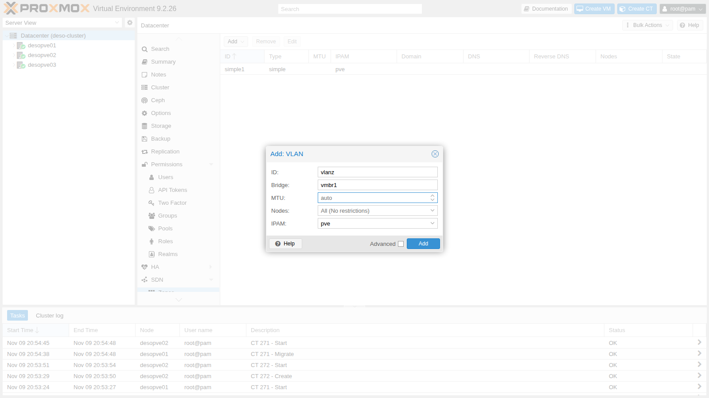
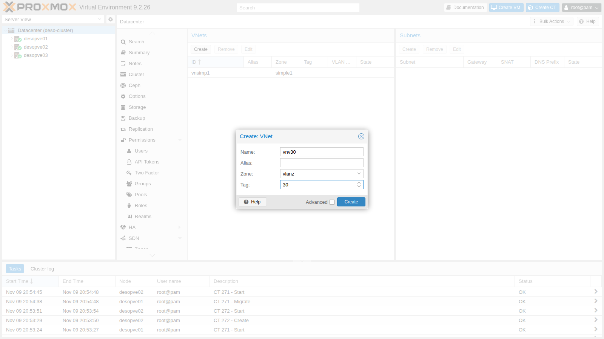
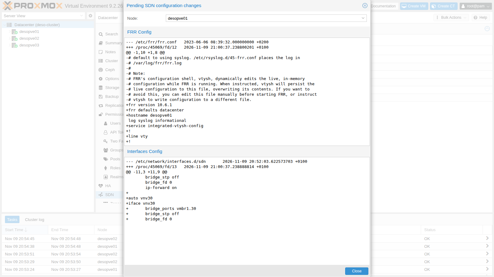
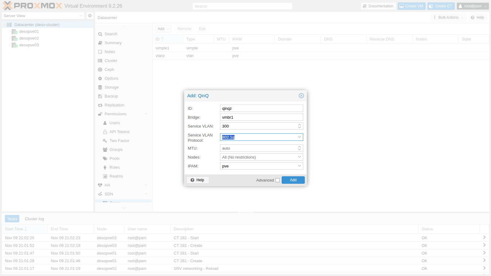
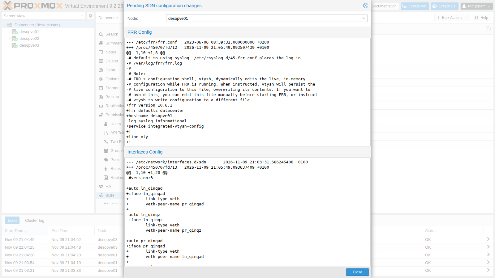
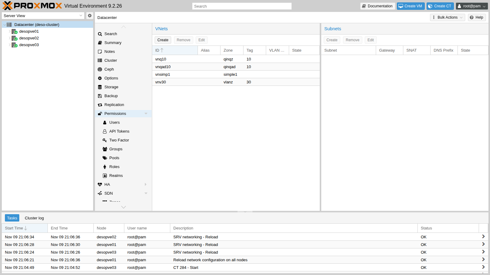

# Lab 28 – SDN 2: zone VLAN e QinQ

**Livello:** avanzato · **Durata:** 1 ora

## Dipendenze

- **Lab precedenti:**
  - [Lab 27](27-sdn-simple.md): zone, VNet, Apply e stato dell'SDN;
  - [Lab 20](20-bridges-stable-names-vlans.md) e [Lab 21](21-bonding.md): `vmbr1` VLAN-aware su `bond0`, il bridge che porta il traffico delle VM;
  - [Lab 22](22-dedicated-networks.md): la rete di migrazione, controllata nella verifica finale.
- **Rete fisica:** le porte dei nodi verso la rete sono un trunk che lascia passare qualsiasi tag. In produzione, sugli switch, si configurano come trunk con le VLAN ammesse.
- **Nodi:** `desopve01`, `desopve02`, `desopve03`.
- **Template:** `cephfs:vztmpl/debian-13-standard_13.6-1_amd64.tar.zst`.
- **Credenziali:** `root` / `<password-lab>` → [Appendice B](b-credentials-and-addresses.md).

## Obiettivi

- Creare reti VLAN come VNet dell'SDN invece che con il tag sulla scheda del guest.
- Usare **Dry-Run** per vedere quali file l'SDN cambierà prima di applicare.
- Capire il QinQ: una VLAN di servizio che contiene le VLAN dei clienti, con ethertype 802.1Q o 802.1ad.
- Verificare con `tcpdump` i tag che passano davvero tra i nodi e il problema dell'MTU.

## Come funziona

### Zona VLAN

Nel lab 20 il tag si scriveva sulla scheda del guest (`tag=10`). Con una **zona VLAN** il tag lo decide la VNet: si crea una VNet `vnv30` con tag 30 e chi crea la VM sceglie *vnv30* come bridge, senza sapere nulla di VLAN. Sui nodi la VNet diventa un bridge Linux che ha come porta `vmbr1.30`, la sottointerfaccia VLAN del bridge esistente. Con le VNet si possono anche dare permessi per singola rete (lab 44).

### Zona QinQ

Il **QinQ** impila due tag:

- il tag esterno, la **service VLAN**, è uno per zona: separa per esempio due clienti o due ambienti;
- il tag interno, la **customer VLAN**, è quello della VNet.

Due zone QinQ possono usare entrambe la VLAN 10 senza vedersi, perché viaggiano in service VLAN diverse.

| Zona | Frame sul trunk tra i nodi |
|---|---|
| VLAN, VNet tag 30 | `MAC` · 802.1Q **30** · IPv4 |
| QinQ, service VLAN 300 (802.1q) | `MAC` · 802.1Q **300** · 802.1Q **10** · IPv4 |
| QinQ, service VLAN 301 (802.1ad) | `MAC` · 802.1ad **301** (ethertype `0x88a8`) · 802.1Q **10** · IPv4 |

Il protocollo della service VLAN è `802.1q` per default; `802.1ad` è quello previsto dallo standard per il tag esterno e va scelto se gli switch lo richiedono.

**MTU:** ogni tag aggiunge 4 byte al frame. Con due tag un pacchetto IP di 1500 byte produce un frame di 1526 byte (1522 senza FCS, come li conta `tcpdump`), contro i 1518 di un frame senza tag e i 1522 di un frame con un solo tag 802.1Q. La documentazione di Proxmox VE indica di ridurre l'MTU delle VNet QinQ a 1496 se la rete fisica ha MTU 1500, oppure di alzare l'MTU della rete fisica.

## Procedura

### 1. Zona e VNet VLAN

1. **Datacenter** → **SDN** → **Zones** → **Add** → **VLAN**. **ID** `vlanz`, **Bridge** `vmbr1`:

   

2. **VNets** → **Create**: **Name** `vnv30`, **Zone** `vlanz`, **Tag** `30`:

   

### 2. Dry-Run prima di applicare

1. Nella pagina **SDN** premi **Dry-Run**: per ogni nodo mostra le differenze tra i file attuali e quelli che Apply scriverà.

   

   Due cose da notare:

   - in **Interfaces Config** compare il nuovo bridge `vnv30` con porta `vmbr1.30`;
   - in **FRR Config** il Dry-Run mostra il `frr.conf` che l'SDN genera al posto di quello di default. Il file sul nodo viene scritto davvero quando servono un controller o una fabric (lab 30-31): da quel momento FRR lo gestisce l'SDN, e chi usa FRR a mano per altro deve farlo dall'SDN.

2. Applica, anche da riga di comando, e verifica lo stato:

   ```bash title="root@desopve01"
   pvesh set /cluster/sdn
   ```

   ``` { .text .no-copy title="Output" }
   UPID:desopve01:00027B63:0023AE2B:6AF22680:reloadnetworkall::root@pam:
   ```

   ```bash title="root@desopve01"
   ip -d link show vmbr1.30 | grep -v link/ether
   ```

   ``` { .text .no-copy title="Output" }
   73: vmbr1.30@vmbr1: <BROADCAST,MULTICAST,UP,LOWER_UP> mtu 1500 qdisc noqueue master vnv30 state UP mode DEFAULT group default qlen 1000
       vlan protocol 802.1Q id 30 <REORDER_HDR> 
   ```

### 3. Guest su nodi diversi nella VLAN 30

1. Un container su `desopve01` e uno su `desopve03`, con indirizzo statico. La VNet non ha subnet: è una rete di livello 2, e un eventuale gateway è un router sulla VLAN, come `router01` del lab 26.

   ```bash title="root@desopve01"
   pct create 281 cephfs:vztmpl/debian-13-standard_13.6-1_amd64.tar.zst --hostname vlan30-ct1 \
     --unprivileged 1 --features nesting=1 --cores 1 --memory 512 --rootfs rbd-vm:4 \
     --net0 name=eth0,bridge=vnv30,ip=10.30.30.11/24 --password
   pct start 281
   ```

   ```bash title="root@desopve03"
   pct create 282 cephfs:vztmpl/debian-13-standard_13.6-1_amd64.tar.zst --hostname vlan30-ct2 \
     --unprivileged 1 --features nesting=1 --cores 1 --memory 512 --rootfs rbd-vm:4 \
     --net0 name=eth0,bridge=vnv30,ip=10.30.30.12/24 --password
   pct start 282
   ```

2. I due container si vedono, e sul bond il traffico ha il tag 30. La cattura va avviata prima del ping, in un secondo terminale; in questo e nei lab successivi il `tcpdump` compare dopo il comando che genera il traffico solo per leggere l'output nell'ordine giusto:

   ```bash title="root@desopve01"
   tcpdump -lnei bond0 -c2 "vlan 30 and icmp"      # secondo terminale, prima del ping
   pct exec 281 -- ping -c3 -W1 10.30.30.12
   ```

   ``` { .text .no-copy title="Output" }
   3 packets transmitted, 3 received, 0% packet loss, time 2016ms
   ```

   ``` { .text .no-copy title="Output" }
   16:26:01.301288 bc:24:11:53:8e:d8 > bc:24:11:ed:d7:ff, ethertype 802.1Q (0x8100), length 102: vlan 30, p 0, ethertype IPv4 (0x0800), 10.30.30.11 > 10.30.30.12: ICMP echo request, id 326, seq 1, length 64
   16:26:01.301592 bc:24:11:ed:d7:ff > bc:24:11:53:8e:d8, ethertype 802.1Q (0x8100), length 102: vlan 30, p 0, ethertype IPv4 (0x0800), 10.30.30.12 > 10.30.30.11: ICMP echo reply, id 326, seq 1, length 64
   ```

   Finita la prova i due container si spengono: restano pronti per la migrazione del [Lab 48](48-migrations.md).

   ```bash title="root@desopve01"
   pct shutdown 281
   ```

   ```bash title="root@desopve03"
   pct shutdown 282
   ```

### 4. Zona QinQ con service VLAN 802.1q

1. **Zones** → **Add** → **QinQ**. **ID** `qinqz`, **Bridge** `vmbr1`, **Service VLAN** `300`, **Service VLAN Protocol** `802.1q`:

   

2. La VNet (VLAN cliente 10) e l'Apply, da riga di comando:

   ```bash title="root@desopve01"
   pvesh create /cluster/sdn/vnets --vnet vnq10 --zone qinqz --tag 10
   pvesh set /cluster/sdn
   ```

3. Cosa genera l'SDN su ogni nodo: un bridge VLAN-aware per la zona (`z_qinqz`), collegato a `vmbr1.300` (la service VLAN), e dentro di esso la VLAN cliente `z_qinqz.10`, porta della VNet:

   ```text
   # estratto di /etc/network/interfaces.d/sdn su desopve01
   auto vmbr1.300
   iface vmbr1.300
   	vlan-protocol 802.1q

   auto z_qinqz
   iface z_qinqz
   	bridge-stp off
   	bridge-ports vmbr1.300 ln_qinqz
   	bridge-fd 0
   	bridge-vlan-aware yes
   	bridge-vids 2-4094

   auto vnq10
   iface vnq10
   	bridge_ports z_qinqz.10
   	bridge_stp off
   	bridge_fd 0
   ```

   ```bash title="root@desopve01"
   ip -d link show | grep -A2 -E "vmbr1.300|z_qinqz|qinqz" | grep -E "^[0-9]+:|vlan protocol" | head -10
   ```

   ``` { .text .no-copy title="Output" }
   76: vmbr1.300@vmbr1: <BROADCAST,MULTICAST,UP,LOWER_UP> mtu 1500 qdisc noqueue master z_qinqz state UP mode DEFAULT group default qlen 1000
       vlan protocol 802.1Q id 300 <REORDER_HDR> 
   77: ln_qinqz@pr_qinqz: <BROADCAST,MULTICAST,UP,LOWER_UP> mtu 1500 qdisc noqueue master z_qinqz state UP mode DEFAULT group default qlen 1000
   78: pr_qinqz@ln_qinqz: <BROADCAST,MULTICAST,UP,LOWER_UP> mtu 1500 qdisc noqueue state UP mode DEFAULT group default qlen 1000
   79: z_qinqz: <BROADCAST,MULTICAST,UP,LOWER_UP> mtu 1500 qdisc noqueue state UP mode DEFAULT group default qlen 1000
   80: z_qinqz.10@z_qinqz: <BROADCAST,MULTICAST,UP,LOWER_UP> mtu 1500 qdisc noqueue master vnq10 state UP mode DEFAULT group default qlen 1000
       vlan protocol 802.1Q id 10 <REORDER_HDR> 
   ```

   La coppia `veth` `ln_qinqz`/`pr_qinqz` collega il bridge della zona: è un dettaglio interno dell'implementazione.

4. Due container (CT 283 su `desopve01`, CT 284 su `desopve03`, indirizzi 10.31.10.11 e .12) su `vnq10`, creati come quelli della VLAN 30:

   ```bash title="root@desopve01"
   pct create 283 cephfs:vztmpl/debian-13-standard_13.6-1_amd64.tar.zst --hostname qinq-ct1 \
     --unprivileged 1 --features nesting=1 --cores 1 --memory 512 --rootfs rbd-vm:4 \
     --net0 name=eth0,bridge=vnq10,ip=10.31.10.11/24 --password
   pct start 283
   ```

   ```bash title="root@desopve03"
   pct create 284 cephfs:vztmpl/debian-13-standard_13.6-1_amd64.tar.zst --hostname qinq-ct2 \
     --unprivileged 1 --features nesting=1 --cores 1 --memory 512 --rootfs rbd-vm:4 \
     --net0 name=eth0,bridge=vnq10,ip=10.31.10.12/24 --password
   pct start 284
   ```

   Il ping passa e sul bond i frame hanno **due** tag, 300 fuori e 10 dentro:

   ```bash title="root@desopve01"
   pct exec 283 -- ping -c3 -W1 10.31.10.12
   ```

   ``` { .text .no-copy title="Output" }
   3 packets transmitted, 3 received, 0% packet loss, time 2002ms
   ```

   ```bash title="root@desopve01"
   tcpdump -lnei bond0 -c2 "vlan 300 and vlan 10 and icmp"
   ```

   ``` { .text .no-copy title="Output" }
   21:04:57.411769 bc:24:11:af:71:cf > bc:24:11:7c:50:ed, ethertype 802.1Q (0x8100), length 106: vlan 300, p 0, ethertype 802.1Q (0x8100), vlan 10, p 0, ethertype IPv4 (0x0800), 10.31.10.11 > 10.31.10.12: ICMP echo request, id 342, seq 2, length 64
   21:04:57.413112 bc:24:11:7c:50:ed > bc:24:11:af:71:cf, ethertype 802.1Q (0x8100), length 106: vlan 300, p 0, ethertype 802.1Q (0x8100), vlan 10, p 0, ethertype IPv4 (0x0800), 10.31.10.12 > 10.31.10.11: ICMP echo reply, id 342, seq 2, length 64
   ```

5. **MTU.** La scheda del container ha MTU 1500: l'SDN non l'ha ridotta da solo. Con il bit *don't fragment* si prova un pacchetto IP di 1500 e uno di 1496 byte:

   ```bash title="root@desopve01"
   pct exec 283 -- ip link show eth0 | grep -o "mtu [0-9]*"
   ```

   ``` { .text .no-copy title="Output" }
   mtu 1500
   ```

   ```bash title="root@desopve01"
   pct exec 283 -- ping -c3 -W1 -M do -s 1472 10.31.10.12
   ```

   ``` { .text .no-copy title="Output" }
   3 packets transmitted, 3 received, 0% packet loss, time 2081ms
   ```

   ```bash title="root@desopve01"
   pct exec 283 -- ping -c3 -W1 -M do -s 1468 10.31.10.12
   ```

   ``` { .text .no-copy title="Output" }
   3 packets transmitted, 3 received, 0% packet loss, time 2060ms
   ```

   Nel laboratorio passano entrambi: la rete tra i nodi accetta frame ben più grandi (nel [Lab 21](21-bonding.md) pacchetti fino a 8938 byte). Su uno switch che scarta i frame oltre i 1518 byte il primo andrebbe perso senza alcun errore visibile, il caso peggiore da diagnosticare. Prima di usare il QinQ in produzione si verifica l'MTU di tutto il percorso (lab 34), oppure si imposta l'MTU della zona a 1496.

### 5. Service VLAN 802.1ad

1. Una seconda zona QinQ con service VLAN 301 e protocollo `802.1ad`, con la sua VNet. Prima di applicare, il **Dry-Run** mostra che su `vmbr1` si aggiunge solo la sottointerfaccia della service VLAN (`vmbr1.301` con `vlan-protocol 802.1ad`): il bridge `vmbr1` e le sue VLAN 802.1Q non vengono toccati.

   ```bash title="root@desopve01"
   pvesh create /cluster/sdn/zones --type qinq --zone qinqad --bridge vmbr1 --tag 301 --vlan-protocol 802.1ad
   pvesh create /cluster/sdn/vnets --vnet vnqad10 --zone qinqad --tag 10
   ```

   

2. Dopo l'Apply il bridge resta 802.1Q (`0x8100`) e la service VLAN è 802.1ad:

   ```bash title="root@desopve01"
   pvesh set /cluster/sdn
   cat /sys/class/net/vmbr1/bridge/vlan_protocol
   ```

   ``` { .text .no-copy title="Output" }
   0x8100
   ```

   ```bash title="root@desopve01"
   ip -d link show vmbr1.301 | grep -o "vlan protocol [^ ]* id [0-9]*"
   ```

   ``` { .text .no-copy title="Output" }
   vlan protocol 802.1ad id 301
   ```

3. I due container passano sulla VNet `vnqad10` (stesso MAC e indirizzo) e il tag esterno ora ha ethertype `0x88a8`:

   ```bash title="root@desopve01"
   pct set 283 --net0 name=eth0,bridge=vnqad10,hwaddr=BC:24:11:AF:71:CF,ip=10.31.10.11/24
   ```

   ```bash title="root@desopve03"
   pct set 284 --net0 name=eth0,bridge=vnqad10,hwaddr=BC:24:11:7C:50:ED,ip=10.31.10.12/24
   ```

   ```bash title="root@desopve01"
   pct exec 283 -- ping -c3 -W1 10.31.10.12
   ```

   ``` { .text .no-copy title="Output" }
   3 packets transmitted, 3 received, 0% packet loss, time 2061ms
   ```

   ```bash title="root@desopve01"
   tcpdump -lnei bond0 -c2 "ether proto 0x88a8"
   ```

   ``` { .text .no-copy title="Output" }
   21:06:55.911301 bc:24:11:af:71:cf > bc:24:11:7c:50:ed, ethertype 802.1Q-QinQ (0x88a8), length 106: vlan 301, p 0, ethertype 802.1Q (0x8100), vlan 10, p 0, ethertype IPv4 (0x0800), 10.31.10.11 > 10.31.10.12: ICMP echo request, id 346, seq 1, length 64
   21:06:56.948753 bc:24:11:af:71:cf > bc:24:11:7c:50:ed, ethertype 802.1Q-QinQ (0x88a8), length 106: vlan 301, p 0, ethertype 802.1Q (0x8100), vlan 10, p 0, ethertype IPv4 (0x0800), 10.31.10.11 > 10.31.10.12: ICMP echo request, id 346, seq 2, length 64
   ```

4. Il resto della rete non ha risentito della nuova zona: VLAN 10 dei container, rete di migrazione e Ceph funzionano.

   ```bash title="root@desopve01"
   pct exec 121 -- ping -c2 -W1 10.10.10.122
   ```

   ``` { .text .no-copy title="Output" }
   2 packets transmitted, 2 received, 0% packet loss, time 1002ms
   ```

   ```bash title="root@desopve01"
   ping -c2 -W1 10.100.10.22
   ```

   ``` { .text .no-copy title="Output" }
   2 packets transmitted, 2 received, 0% packet loss, time 1058ms
   ```

   ```bash title="root@desopve01"
   ceph health
   ```

   ``` { .text .no-copy title="Output" }
   HEALTH_OK
   ```

### 6. Il quadro delle VNet e la pulizia

1. Le VNet create in questo lab e nel precedente:

   

2. Le zone QinQ servivano solo come prova: si eliminano i container, le VNet e le zone, poi si applica. Le zone si eliminano solo dopo le loro VNet.

   ```bash title="root@desopve01"
   pct stop 283 && pct destroy 283 --purge
   ```

   ```bash title="root@desopve03"
   pct stop 284 && pct destroy 284 --purge
   ```

   ```bash title="root@desopve01"
   for v in vnqad10 vnq10; do pvesh delete /cluster/sdn/vnets/$v; done
   for z in qinqad qinqz; do pvesh delete /cluster/sdn/zones/$z; done
   pvesh set /cluster/sdn
   ip link show vmbr1.300
   ```

   ``` { .text .no-copy title="Output" }
   Device "vmbr1.300" does not exist.
   ```

## Verifica e test

| Prova | Risultato |
|---|---|
| VNet VLAN 30 tra `desopve01` e `desopve03` | 0% di perdita, un tag 802.1Q 30 sul bond |
| Dry-Run | mostra il nuovo bridge e la sostituzione di `frr.conf` |
| QinQ 802.1q, service VLAN 300 | 0% di perdita, due tag 802.1Q (300 e 10) |
| QinQ, pacchetto IP di 1500 byte (frame di 1522) | passa nel laboratorio; su uno switch che non accetta il doppio tag andrebbe perso |
| QinQ 802.1ad, service VLAN 301 | 0% di perdita, tag esterno `0x88a8` |
| VLAN dei guest, migrazione e Ceph dopo le zone QinQ | invariati |

## Stato finale del lab

- **SDN:**
  - zona `simple1` con VNet `vnsimp1` (lab 27), invariata;
  - zona `vlanz` (VLAN su `vmbr1`) con VNet `vnv30`, tag 30, senza subnet;
  - zone QinQ `qinqz` e `qinqad` eliminate.
- **Container nella VLAN 30**, spenti, senza avvio automatico, disco su `rbd-vm`:
  - CT 281 `vlan30-ct1` su `desopve01`, 10.30.30.11/24;
  - CT 282 `vlan30-ct2` su `desopve03`, 10.30.30.12/24.
- CT 283 e 284 eliminati.
- `vmbr1` resta VLAN-aware 802.1Q; `/etc/frr/frr.conf` è ancora quello del pacchetto: l'SDN lo scrive con il controller EVPN e la fabric dei lab 30-31.

## Cosa hai imparato

- Con una zona VLAN il tag lo decide la VNet: i guest scelgono una rete per nome, il bridge esistente porta il traffico.
- Dry-Run mostra per ogni nodo le modifiche ai file di rete e a FRR prima di applicarle.
- Il QinQ incapsula le VLAN dei clienti in una service VLAN per zona; la service VLAN può essere 802.1Q o 802.1ad.
- Il doppio tag allunga il frame di 8 byte: con MTU 1500 sulla rete fisica le VNet QinQ vanno a 1496, oppure si alza l'MTU del percorso.
- Le zone si eliminano dopo le loro VNet, e anche la rimozione diventa effettiva solo con Apply.

## Riferimenti

- [Proxmox VE – SDN: VLAN Zones](https://pve.proxmox.com/pve-docs/chapter-pvesdn.html#pvesdn_zone_plugin_vlan)
- [Proxmox VE – SDN: QinQ Zones](https://pve.proxmox.com/pve-docs/chapter-pvesdn.html#pvesdn_zone_plugin_qinq)
- [IEEE 802.1ad – Provider Bridges (QinQ)](https://en.wikipedia.org/wiki/IEEE_802.1ad)
