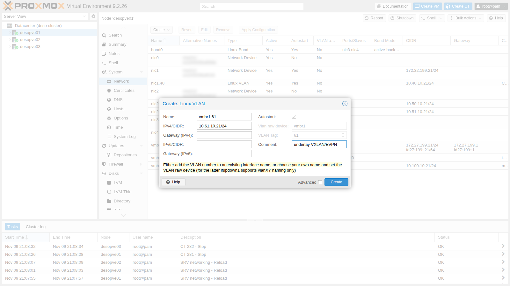
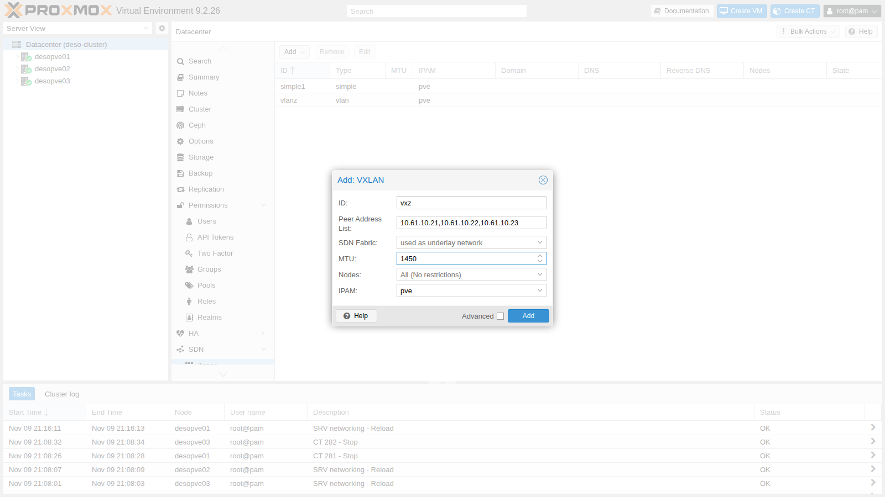
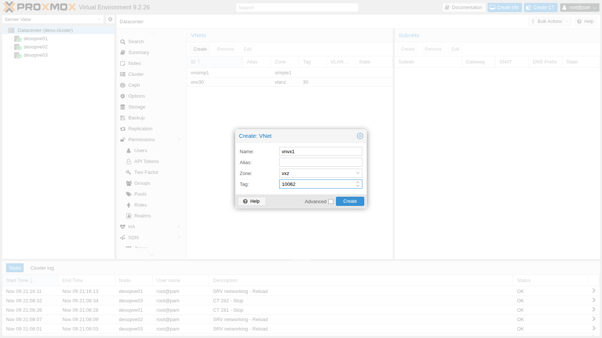
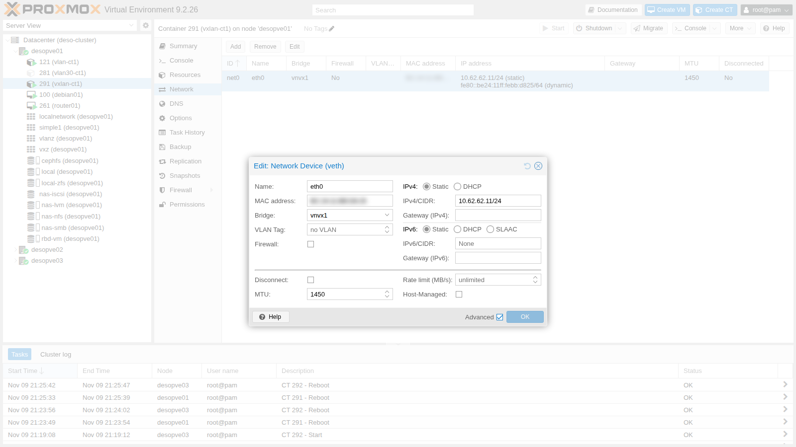

# Lab 29 – SDN 3: zona VXLAN

**Livello:** avanzato · **Durata:** 1 ora

## Dipendenze

- **Lab precedenti:**
  - [Lab 28](28-sdn-vlan-qinq.md): zone, VNet, Dry-Run e Apply dell'SDN;
  - [Lab 20](20-bridges-stable-names-vlans.md) e [Lab 21](21-bonding.md): `vmbr1` VLAN-aware su `bond0`, che porterà la rete underlay su una VLAN;
  - [Lab 22](22-dedicated-networks.md): reti dedicate come sottointerfacce VLAN;
  - [Lab 17](17-ceph-installation.md): storage `rbd-vm` per i dischi dei container e `cephfs`; il template Debian su `cephfs` viene dal [Lab 20](20-bridges-stable-names-vlans.md).
- **Rete fisica:** le porte dei nodi sono un trunk; in questo lab si usa la **VLAN 61** per la rete underlay `10.61.10.0/24`.
- **Nodi:** `desopve01`, `desopve02`, `desopve03`.
- **Template:** `cephfs:vztmpl/debian-13-standard_13.6-1_amd64.tar.zst`.
- **Credenziali:** `root` / `<password-lab>` sui nodi e nei container → [Appendice B](b-credentials-and-addresses.md).

## Obiettivi

- Capire come VXLAN trasporta una rete di livello 2 sopra una rete IP.
- Preparare una rete underlay dedicata e misurarne l'MTU.
- Creare una zona VXLAN con una VNet presente su tutti i nodi e collegarci guest su nodi diversi.
- Vedere con `tcpdump` i pacchetti VXLAN tra i nodi.
- Capire cosa succede quando l'MTU dei guest è sbagliata e come impostarla correttamente.

## Come funziona

### Overlay e underlay

**VXLAN** (RFC 7348) prende il frame Ethernet di un guest, gli aggiunge un'intestazione VXLAN di 8 byte e lo spedisce dentro un pacchetto **UDP** (porta **4789**) da un nodo all'altro. Il nodo che incapsula e decapsula si chiama **VTEP** (*VXLAN Tunnel End Point*).

- La rete tra i VTEP è l'**underlay**: una normale rete IP tra i nodi.
- La rete che vedono i guest è l'**overlay**: un unico segmento di livello 2 che esiste su tutti i nodi, anche se l'underlay passasse per un router.
- Ogni rete overlay ha un **VNI** (*VXLAN Network Identifier*) di 24 bit: fino a 16 milioni di reti, contro le 4094 delle VLAN.

### La zona VXLAN di Proxmox VE

Nella zona VXLAN si elencano gli indirizzi underlay di tutti i nodi (*Peer Address List*). Non c'è un protocollo di controllo:

- broadcast, multicast e destinazioni sconosciute (per esempio le richieste ARP) vengono **copiate verso ogni peer** (*head-end replication*);
- ogni nodo impara da quale VTEP arriva un MAC osservando il traffico (*flood and learn*), come uno switch.

Per reti grandi, o per avere routing e gateway distribuiti, c'è la zona EVPN, che usa BGP come piano di controllo (lab 30).

### Il costo in byte: l'MTU

| Intestazione aggiunta | Byte |
|---|---|
| Ethernet del guest (portata dentro il tunnel) | 14 |
| VXLAN | 8 |
| UDP | 8 |
| IPv4 esterno | 20 |
| **Totale** | **50** |

Con un'underlay da 1500 byte, al guest restano **1450** byte di MTU. In produzione si alza l'MTU dell'underlay (almeno 1550, di solito i jumbo frame da 9000), così i guest tengono 1500.

### Perché una VLAN dedicata per l'underlay

- **Isolamento:** VXLAN non è cifrato né autenticato. Chi raggiunge la porta UDP 4789 dei nodi può iniettare frame nelle reti dei guest, quindi l'underlay va tenuta lontana dalle reti raggiungibili da altri.
- **Nessun router in mezzo:** sulla stessa VLAN i VTEP si parlano direttamente, senza passare dal gateway del laboratorio.
- **Prestazioni e MTU separate:** il traffico dei guest non si mescola con la gestione e con Corosync, e l'MTU dell'underlay si può alzare senza toccare le altre reti.

## Procedura

### 1. La rete underlay sulla VLAN 61

1. Su `desopve01`: **System** → **Network** → **Create** → **Linux VLAN**. **Name** `vmbr1.61` (la VLAN 61 del bridge del bond), **IPv4/CIDR** `10.61.10.21/24`, nessun gateway. Poi **Apply Configuration**.

   

2. Su `desopve02` e `desopve03` lo stesso blocco in `/etc/network/interfaces`, con l'indirizzo .22 e .23, prima della riga `source`:

   ```text
   auto vmbr1.61
   iface vmbr1.61 inet static
   	address 10.61.10.22/24
   #underlay VXLAN/EVPN
   ```

   ```console
   root@desopve02:~# ifreload -a
   root@desopve02:~# ip -br -4 addr show vmbr1.61
   vmbr1.61@vmbr1   UP             10.61.10.22/24
   ```

3. Si misura l'MTU dell'underlay con il bit *don't fragment*: un pacchetto IP di 1500 byte (1472 di dati + 28 di intestazioni) passa, uno di 1501 non esce nemmeno dal nodo.

   ```console
   root@desopve01:~# ping -c2 -W1 -M do -s 1472 10.61.10.23
   2 packets transmitted, 2 received, 0% packet loss, time 1024ms
   root@desopve01:~# ping -c1 -W1 -M do -s 1473 10.61.10.23
   PING 10.61.10.23 (10.61.10.23) 1473(1501) bytes of data.
   ping: sendmsg: Message too long
   ```

   L'underlay ha MTU 1500: la VNet VXLAN dovrà avere MTU 1450.

### 2. Zona e VNet VXLAN

1. **Datacenter** → **SDN** → **Zones** → **Add** → **VXLAN**:
   - **ID** `vxz`;
   - **Peer Address List** `10.61.10.21,10.61.10.22,10.61.10.23`: gli indirizzi underlay di **tutti** i nodi, compreso il proprio;
   - **MTU** `1450`.

   Il campo **SDN Fabric** è l'alternativa alla lista dei peer: si usa una fabric come underlay (lab 31).

   

2. **VNets** → **Create**: **Name** `vnvx1`, **Zone** `vxz`, **Tag** `10062`. In una zona VXLAN il tag è il VNI.

   

3. Apply e stato delle zone; lo stesso risultato su tutti e tre i nodi:

   ```console
   root@desopve01:~# pvesh set /cluster/sdn
   root@desopve01:~# pvesh get /nodes/desopve03/sdn/zones
   ┌───────────┬─────────┐
   │ status    │ zone    │
   ╞═══════════╪═════════╡
   │ available │ simple1 │
   ├───────────┼─────────┤
   │ available │ vlanz   │
   ├───────────┼─────────┤
   │ available │ vxz     │
   └───────────┴─────────┘
   ```

### 3. Cosa genera l'SDN su ogni nodo

1. Un'interfaccia VXLAN con il VNI, l'indirizzo locale e gli altri due nodi come destinazioni, e il bridge della VNet che la usa come porta, entrambi con MTU 1450:

   ```text
   # estratto di /etc/network/interfaces.d/sdn su desopve01
   auto vnvx1
   iface vnvx1
   	bridge_ports vxlan_vnvx1
   	bridge_stp off
   	bridge_fd 0
   	mtu 1450

   auto vxlan_vnvx1
   iface vxlan_vnvx1
   	vxlan-id 10062
   	vxlan-local-tunnelip 10.61.10.21
   	vxlan_remoteip 10.61.10.22
   	vxlan_remoteip 10.61.10.23
   	mtu 1450
   ```

2. Il kernel conferma VNI, indirizzo locale e porta UDP:

   ```console
   root@desopve01:~# ip -d link show vxlan_vnvx1 | grep -o "vxlan id .* dstport [0-9]*"
   vxlan id 10062 local 10.61.10.21 srcport 0 0 dstport 4789
   ```

3. Le due voci con MAC tutto zero sono la *head-end replication*: ogni frame broadcast o diretto a un MAC sconosciuto parte in copia verso entrambi gli altri nodi.

   ```console
   root@desopve01:~# bridge fdb show dev vxlan_vnvx1 | grep 00:00:00:00:00:00
   00:00:00:00:00:00 dst 10.61.10.22 self permanent
   00:00:00:00:00:00 dst 10.61.10.23 self permanent
   ```

### 4. Due guest su nodi diversi

1. Un container su `desopve01` e uno su `desopve03` nella VNet `vnvx1`, con indirizzo statico:

   ```console
   root@desopve01:~# pct create 291 cephfs:vztmpl/debian-13-standard_13.6-1_amd64.tar.zst --hostname vxlan-ct1 \
     --unprivileged 1 --features nesting=1 --cores 1 --memory 512 --rootfs rbd-vm:4 \
     --net0 name=eth0,bridge=vnvx1,ip=10.62.62.11/24 --password
   root@desopve01:~# pct start 291
   root@desopve03:~# pct create 292 cephfs:vztmpl/debian-13-standard_13.6-1_amd64.tar.zst --hostname vxlan-ct2 \
     --unprivileged 1 --features nesting=1 --cores 1 --memory 512 --rootfs rbd-vm:4 \
     --net0 name=eth0,bridge=vnvx1,ip=10.62.62.12/24 --password
   root@desopve03:~# pct start 292
   root@desopve01:~# pct exec 291 -- ping -c3 -W1 10.62.62.12
   3 packets transmitted, 3 received, 0% packet loss, time 2042ms
   ```

2. Sull'underlay si vede il tunnel: pacchetti UDP verso la porta 4789 con VNI 10062 e, dentro, la richiesta ARP del guest.

   ```console
   root@desopve01:~# tcpdump -lnni vmbr1.61 -c2 udp port 4789
   21:19:27.662568 IP 10.61.10.23.38568 > 10.61.10.21.4789: VXLAN, flags [I] (0x08), vni 10062
   ARP, Request who-has 10.62.62.11 tell 10.62.62.12, length 28
   21:19:27.662669 IP 10.61.10.21.52130 > 10.61.10.23.4789: VXLAN, flags [I] (0x08), vni 10062
   ARP, Reply 10.62.62.11 is-at bc:24:11:bb:d8:25, length 28
   ```

### 5. Cosa succede con l'MTU sbagliata

1. La VNet ha MTU 1450 e l'host ha portato a 1450 anche il suo lato della coppia `veth` del container. Dentro il container, però, la scheda è rimasta a **1500**:

   ```console
   root@desopve01:~# ip link show veth291i0 | grep -o "mtu [0-9]*"
   mtu 1450
   root@desopve01:~# pct exec 291 -- ip link show eth0 | grep -o "mtu [0-9]*"
   mtu 1500
   ```

2. Fino a 1450 byte tutto passa; un pacchetto di 1500 il guest lo spedisce, ma l'host lo scarta:

   ```console
   root@desopve01:~# pct exec 291 -- ping -c3 -W1 -M do -s 1422 10.62.62.12
   3 packets transmitted, 3 received, 0% packet loss, time 2034ms
   root@desopve01:~# pct exec 291 -- ping -c3 -W1 -M do -s 1472 10.62.62.12
   ping: sendmsg: No buffer space available
   ping: sendmsg: No buffer space available
   ping: sendmsg: No buffer space available
   3 packets transmitted, 0 received, 100% packet loss, time 3081ms
   ```

   Qui il container riceve almeno un errore perché condivide il kernel dell'host. Con altri guest lo scarto può essere del tutto silenzioso: i ping piccoli funzionano, quelli grandi spariscono.

3. Il TCP invece sembra funzionare. Il motivo si vede catturando sul lato host del container: al primo segmento troppo grande è l'host stesso a rispondere con un ICMP *fragmentation needed* (MTU 1450) a nome del tunnel. Il guest lo memorizza e da lì in poi usa segmenti più piccoli.

   ```console
   root@desopve01:~# pct exec 291 -- ip route flush cache
   root@desopve01:~# tcpdump -lnni veth291i0 -c3 "icmp or (tcp port 5001 and tcp[tcpflags] & tcp-syn != 0)"
   21:22:50.971022 IP 10.62.62.11.47094 > 10.62.62.12.5001: Flags [S], seq 2687240530, win 64240, options [mss 1460,sackOK,TS val 566963034 ecr 0,nop,wscale 10], length 0
   21:22:50.971630 IP 10.62.62.12.5001 > 10.62.62.11.47094: Flags [S.], seq 1554622400, ack 2687240531, win 65160, options [mss 1460,sackOK,TS val 2751837441 ecr 566963034,nop,wscale 10], length 0
   21:22:50.971801 IP 10.62.62.12 > 10.62.62.11: ICMP 10.62.62.12 unreachable - need to frag (mtu 1450), length 556
   root@desopve01:~# pct exec 291 -- ip route get 10.62.62.12
   10.62.62.12 dev eth0 src 10.62.62.11 uid 0
       cache expires 591sec mtu 1450
   ```

   La cattura va avviata prima del trasferimento che la provoca: 2 MB con `nc` dal CT 291 al CT 292, arrivati completi. `nc` è già nel template Debian:

   ```console
   root@desopve03:~# pct exec 292 -- sh -c 'nc -l -p 5001 > /dev/null'
   root@desopve01:~# pct exec 291 -- sh -c 'head -c 2M /dev/urandom | nc -q1 10.62.62.12 5001'
   ```

   È il *Path MTU Discovery*: funziona finché l'ICMP arriva al guest. Basta un firewall che blocca l'ICMP (lab 32-33), o un'applicazione UDP che manda pacchetti grandi, perché le connessioni si blocchino senza un errore chiaro. Per questo l'MTU si imposta sui guest, invece di contare sull'ICMP.

### 6. Impostare l'MTU corretta sui guest

1. Nella scheda di rete del container, con **Advanced** attivo, il campo **MTU** va a `1450`. Da riga di comando: `pct set 291 --net0 name=eth0,bridge=vnvx1,hwaddr=BC:24:11:BB:D8:25,ip=10.62.62.11/24,mtu=1450`.

   

2. **Trappola con i container Debian 13:** anche dopo un riavvio la scheda nel container resta a 1500. Proxmox VE crea la `veth` con l'MTU giusta, ma non la scrive nel file di rete del container, e `ifupdown2` (presente nel template) all'avvio riporta a 1500 le interfacce senza un'MTU esplicita.

   ```console
   root@desopve01:~# grep mtu /var/lib/lxc/291/config
   lxc.net.0.mtu = 1450
   root@desopve01:~# pct exec 291 -- ip link show eth0 | grep -o "mtu [0-9]*"
   mtu 1500
   ```

   Il rimedio è aggiungere `mtu 1450` all'interfaccia nel file del container. Proxmox VE conserva la riga quando riscrive il file a ogni avvio:

   ```console
   root@desopve01:~# pct exec 291 -- sed -i '/address 10.62.62.11/a\	mtu 1450' /etc/network/interfaces
   root@desopve01:~# pct reboot 291
   root@desopve01:~# pct exec 291 -- cat /etc/network/interfaces | sed -n '/eth0/,$p'
   auto eth0
   iface eth0 inet static
   	address 10.62.62.11/24
   	mtu 1450
   root@desopve01:~# pct exec 291 -- ip link show eth0 | grep -o "mtu [0-9]*"
   mtu 1450
   ```

   Lo stesso per il CT 292 su `desopve03`.

3. Ora il pacchetto troppo grande viene rifiutato subito dal guest, e il TCP annuncia da solo un MSS di 1410 byte (1450 − 40) in entrambe le direzioni, senza bisogno di ICMP:

   ```console
   root@desopve01:~# pct exec 291 -- ping -c1 -W1 -M do -s 1423 10.62.62.12
   PING 10.62.62.12 (10.62.62.12) 1423(1451) bytes of data.
   ping: sendmsg: Message too long
   root@desopve01:~# pct exec 291 -- ping -c3 -W1 -M do -s 1422 10.62.62.12
   3 packets transmitted, 3 received, 0% packet loss, time 2038ms
   root@desopve01:~# tcpdump -lnni veth291i0 -c2 "icmp or (tcp port 5001 and tcp[tcpflags] & tcp-syn != 0)"
   21:27:11.768115 IP 10.62.62.11.45450 > 10.62.62.12.5001: Flags [S], seq 4032040915, win 64860, options [mss 1410,sackOK,TS val 3643972739 ecr 0,nop,wscale 10], length 0
   21:27:11.768786 IP 10.62.62.12.5001 > 10.62.62.11.45450: Flags [S.], seq 3506410363, ack 4032040916, win 64308, options [mss 1410,sackOK,TS val 4258233405 ecr 3643972739,nop,wscale 10], length 0
   ```

   Un trasferimento di 200 MB tra i due container sulla VXLAN richiede circa 2 secondi, compreso l'avvio di `pct exec` (con il ricevitore di nuovo in ascolto sul CT 292):

   ```console
   root@desopve01:~# time pct exec 291 -- sh -c 'head -c 200M /dev/zero | nc -q1 10.62.62.12 5001'
   real	0m2.497s
   ```

4. **Per le VM** il campo è lo stesso, nella scheda di rete VirtIO. Secondo la documentazione di Proxmox VE, il valore `1` fa ereditare alla scheda l'MTU del bridge, quindi 1450 su questa VNet.

### 7. Il resto della rete non è cambiato

```console
root@desopve01:~# ceph health
HEALTH_OK
root@desopve01:~# pct exec 121 -- ping -c2 -W1 10.10.10.122
2 packets transmitted, 2 received, 0% packet loss, time 1001ms
root@desopve01:~# ping -c2 -W1 10.100.10.23
2 packets transmitted, 2 received, 0% packet loss, time 1058ms
```

## Verifica e test

| Prova | Risultato |
|---|---|
| Underlay VLAN 61, ping con DF da 1500 byte | passa; 1501 byte: `Message too long` |
| Zona `vxz` su 3 nodi | `available` su tutti |
| CT 291 (`desopve01`) → CT 292 (`desopve03`) | 0% di perdita, VXLAN con VNI 10062 sull'underlay |
| Guest a MTU 1500, ping da 1500 byte | 100% di perdita |
| Guest a MTU 1500, TCP | funziona solo grazie all'ICMP *need to frag* dell'host |
| Guest a MTU 1450 | 1423 byte rifiutati dal guest, MSS 1410, 200 MB in 1,6 s |
| Ceph, VLAN 10 dei guest, rete di migrazione | invariati |

## Stato finale del lab

- **Rete underlay:** `vmbr1.61` su `desopve01`-`desopve03`, 10.61.10.21-23/24, VLAN 61, senza gateway.
- **SDN:**
  - zona `vxz` (VXLAN, peer 10.61.10.21-23, MTU 1450) con VNet `vnvx1`, VNI 10062, senza subnet;
  - zone `simple1` e `vlanz` invariate.
- **Container sulla VXLAN**, accesi, senza avvio automatico, disco su `rbd-vm`, MTU 1450 anche nel file di rete del container:
  - CT 291 `vxlan-ct1` su `desopve01`, 10.62.62.11/24;
  - CT 292 `vxlan-ct2` su `desopve03`, 10.62.62.12/24.

## Cosa hai imparato

- VXLAN porta una rete di livello 2 dentro pacchetti UDP tra i nodi: il VNI identifica la rete, l'underlay è una normale rete IP.
- La zona VXLAN di Proxmox VE usa una lista statica di peer e la replica dei broadcast verso tutti; EVPN aggiunge un piano di controllo.
- L'incapsulamento costa 50 byte: con l'underlay a 1500 l'overlay va a 1450, oppure si alza l'MTU dell'underlay.
- Un guest con l'MTU sbagliata perde i pacchetti grandi, e il TCP regge solo finché l'ICMP *fragmentation needed* arriva.
- Nei container Debian 13 l'MTU va scritta anche nel file di rete del container, altrimenti `ifupdown2` la riporta a 1500.

## Riferimenti

- [Proxmox VE – SDN: VXLAN Zones](https://pve.proxmox.com/pve-docs/chapter-pvesdn.html#pvesdn_zone_plugin_vxlan)
- [Proxmox VE – Container network](https://pve.proxmox.com/pve-docs/chapter-pct.html#pct_container_network)
- [RFC 7348 – Virtual eXtensible Local Area Network (VXLAN)](https://www.rfc-editor.org/rfc/rfc7348)
- [Linux kernel – VXLAN](https://docs.kernel.org/networking/vxlan.html)
