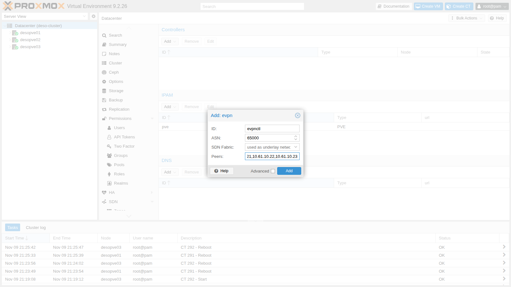
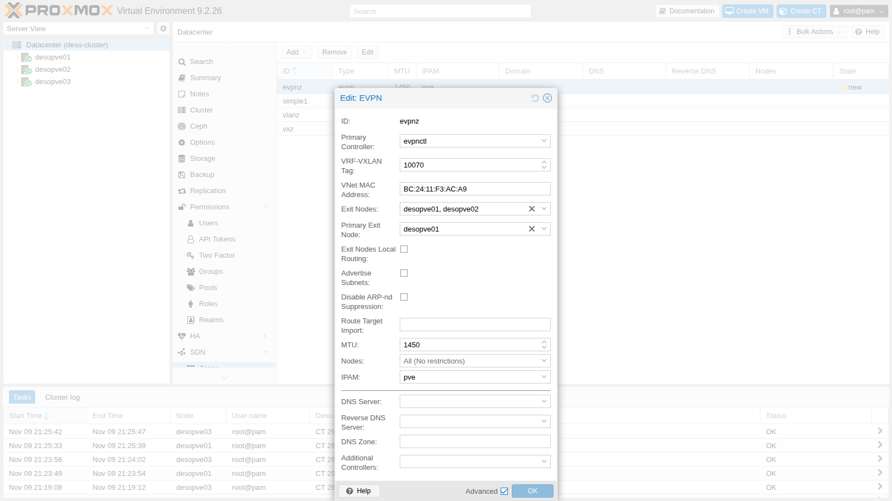
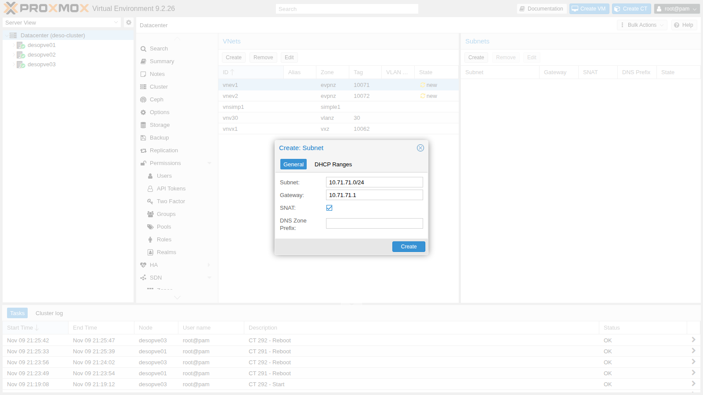

# Lab 30 – SDN 4: EVPN con BGP, exit node e anycast gateway

**Livello:** esperto · **Durata:** 1 ora e 30 minuti

## Dipendenze

- **Lab precedenti:**
  - [Lab 29](29-sdn-vxlan.md): VXLAN, rete underlay `vmbr1.61` (10.61.10.0/24) e MTU dei guest;
  - [Lab 27](27-sdn-simple.md): subnet, gateway, SNAT e IPAM dell'SDN;
  - [Lab 22](22-dedicated-networks.md): rete di migrazione dedicata;
  - [Lab 17](17-ceph-installation.md): storage `rbd-vm` per i dischi dei guest.
- **Pacchetti:** `frr` e `frr-pythontools` sono installati dalla ISO di Proxmox VE; l'SDN abilita il servizio e scrive `/etc/frr/frr.conf` all'Apply. Si verifica con `dpkg -l frr frr-pythontools` e `systemctl is-enabled frr`:

  ```text
  ii  frr             10.6.1-1+pve3 amd64        FRRouting suite of internet protocols (BGP, OSPF, IS-IS, ...)
  ii  frr-pythontools 10.6.1-1+pve3 all          FRRouting suite - Python tools
  enabled
  ```

- **Nodi:** `desopve01`, `desopve02`, `desopve03`.
- **Immagini:** template `cephfs:vztmpl/debian-13-standard_13.6-1_amd64.tar.zst` ([Lab 20](20-bridges-stable-names-vlans.md)) e immagine cloud `local:import/debian-13-genericcloud-amd64.qcow2` su `desopve01`, scaricata nel [Lab 19](19-fio-benchmark.md).
- **Credenziali:** `root` / `<password-lab>` → [Appendice B](b-credentials-and-addresses.md).

## Obiettivi

- Capire cosa aggiunge EVPN alla VXLAN: un piano di controllo BGP al posto della replica dei broadcast.
- Creare un controller EVPN, una zona con VRF e due VNet con gateway distribuito (*anycast gateway*).
- Instradare tra VNet su nodi diversi e far uscire i guest dagli *exit node* con SNAT.
- Leggere lo stato di BGP ed EVPN con `vtysh`.
- Migrare a caldo una VM senza che cambi il suo gateway, e simulare la caduta dell'exit node principale.

## Come funziona

### Il piano di controllo

Nella zona VXLAN del lab 29 ogni nodo scopriva i MAC dal traffico e copiava i broadcast verso tutti. Con **EVPN** (RFC 7432 e 8365) i nodi si scambiano queste informazioni con **BGP** (famiglia `l2vpn evpn`): quando un guest si accende, il suo nodo annuncia agli altri il MAC e l'IP del guest.

| Tipo di route | Cosa annuncia | Esempio nel lab |
|---|---|---|
| Tipo 2 (MAC/IP) | MAC e IP di un guest e il VTEP dietro cui si trova | `bc:24:11:ca:34:84` / 10.71.71.11 dietro 10.61.10.21 |
| Tipo 3 (multicast) | quali VTEP partecipano a un VNI | i tre nodi per ogni VNet |
| Tipo 5 (prefisso IP) | una rete instradabile, per esempio la route di default di un exit node | 0.0.0.0/0 da `desopve01` |

I nodi formano tra loro sessioni **iBGP** con un ASN privato (65000) sugli indirizzi della rete underlay. Proxmox VE attiva anche **BFD**, che si accorge in meno di un secondo se un vicino sparisce.

### VRF, anycast gateway e routing distribuito

- **Zona EVPN = VRF.** Ogni zona è una tabella di routing separata (`vrf_evpnz`), cioè un tenant: le sue reti non si mescolano con quelle dell'host né con quelle di altre zone.
- **Anycast gateway.** Il gateway di ogni VNet esiste su **tutti** i nodi, con lo stesso IP e lo stesso MAC. Un guest parla sempre con il gateway del nodo su cui gira, e se migra trova lo stesso gateway.
- **Routing simmetrico.** Il traffico tra due VNet viene instradato dal nodo di partenza e attraversa la rete tra i nodi dentro il VNI di livello 3 della zona (**VRF-VXLAN tag**). Il nodo di arrivo lo consegna nella VNet di destinazione.

### Exit node

Per uscire dalla zona servono uno o più **exit node**: nodi che annunciano nella zona una route di default e collegano la VRF alla rete dell'host. Con **SNAT** nella subnet i guest escono con l'IP dell'exit node. Con un **Primary Exit Node** tutto il traffico in uscita usa quel nodo e gli altri restano di riserva.

## Procedura

### 1. Il controller EVPN

**Datacenter** → **SDN** → **Options** → **Controllers** → **Add** → **EVPN**:

- **ID** `evpnctl`;
- **ASN** `65000`, privato;
- **Peers** `10.61.10.21,10.61.10.22,10.61.10.23`: gli indirizzi underlay dei nodi.

Anche qui **SDN Fabric** è l'alternativa alla lista dei peer (lab 31).



### 2. La zona EVPN

1. **Zones** → **Add** → **EVPN**, con **Advanced** attivo:
   - **ID** `evpnz`, **Controller** `evpnctl`;
   - **VRF-VXLAN Tag** `10070`: il VNI di livello 3 della zona;
   - **Exit Nodes** `desopve01`, `desopve02`; **Primary Exit Node** `desopve01`;
   - **MTU** `1450`, come nel lab 29.

   Il **VNet MAC Address** lo genera Proxmox VE: è il MAC del gateway anycast, uguale su tutti i nodi.

   

   Il nodo principale si può impostare anche da riga di comando:

   ```console
   root@desopve01:~# pvesh set /cluster/sdn/zones/evpnz --exitnodes-primary desopve01
   ```

### 3. Due VNet con subnet e SNAT

1. **VNets** → **Create**: `vnev1`, zona `evpnz`, **Tag** (VNI) `10071`. Nel pannello **Subnets** → **Create**: **Subnet** `10.71.71.0/24`, **Gateway** `10.71.71.1`, **SNAT** attivo:

   

2. La seconda VNet da riga di comando, poi Apply:

   ```console
   root@desopve01:~# pvesh create /cluster/sdn/vnets --vnet vnev2 --zone evpnz --tag 10072
   root@desopve01:~# pvesh create /cluster/sdn/vnets/vnev2/subnets --subnet 10.72.72.0/24 --type subnet --gateway 10.72.72.1 --snat 1
   root@desopve01:~# pvesh set /cluster/sdn
   ```

### 4. Cosa genera l'SDN: FRR, VRF e gateway

1. In `/etc/frr/frr.conf` l'SDN scrive la VRF con il suo VNI, l'iBGP tra i nodi con BFD e l'annuncio di tutti i VNI. Sugli exit node aggiunge la route di default annunciata nella zona:

   ```text
   # estratto di /etc/frr/frr.conf su desopve01 (exit node)
   vrf vrf_evpnz
    vni 10070
   exit-vrf
   !
   router bgp 65000
    bgp router-id 10.61.10.21
    neighbor VTEP peer-group
    neighbor VTEP remote-as 65000
    neighbor VTEP bfd
    neighbor 10.61.10.22 peer-group VTEP
    neighbor 10.61.10.23 peer-group VTEP
    !
    address-family l2vpn evpn
     neighbor VTEP activate
     neighbor VTEP route-map MAP_VTEP_IN in
     neighbor VTEP route-map MAP_VTEP_OUT out
     advertise-all-vni
    exit-address-family
   exit
   !
   router bgp 65000 vrf vrf_evpnz
    !
    address-family l2vpn evpn
     default-originate ipv4
     default-originate ipv6
    exit-address-family
   exit
   ```

2. Le sessioni BGP con gli altri due nodi e i VNI conosciuti:

   ```console
   root@desopve01:~# vtysh -c "show bgp l2vpn evpn summary"
   BGP router identifier 10.61.10.21, local AS number 65000 VRF default vrf-id 0
   ...
   Neighbor               V         AS   MsgRcvd   MsgSent   TblVer  InQ OutQ  Up/Down State/PfxRcd   PfxSnt Desc
   desopve02(10.61.10.22) 4      65000        25        31        3    0    0 00:00:37            3        7 FRRouting/10.6.1
   desopve03(10.61.10.23) 4      65000        25        24        3    0    0 00:00:30            5        7 FRRouting/10.6.1
   root@desopve01:~# vtysh -c "show evpn vni"
   VNI        Type VxLAN IF              # MACs   # ARPs   # Remote VTEPs  Tenant VRF      VLAN       BRIDGE
   10072      L2   vxlan_vnev2           0        0        2               vrf_evpnz       1          vnev2
   10071      L2   vxlan_vnev1           0        0        2               vrf_evpnz       1          vnev1
   10062      L2   vxlan_vnvx1           2        2        2               default         1          vnvx1
   10070      L3   vrfvx_evpnz           0        0        n/a             vrf_evpnz       1          vrfbr_evpnz
   ```

   I due VNI L2 sono le VNet, il VNI L3 è quello della VRF. Compare anche il VNI 10062 della zona VXLAN del lab 29: con `advertise-all-vni`, FRR annuncia ogni interfaccia VXLAN del nodo.

3. Il gateway anycast: stesso IP e stesso MAC su `desopve01` e `desopve03`:

   ```console
   root@desopve01:~# ip -br link show vnev1
   vnev1            UP             bc:24:11:f3:ac:a9 <BROADCAST,MULTICAST,UP,LOWER_UP>
   root@desopve03:~# ip -br link show vnev1
   vnev1            UP             bc:24:11:f3:ac:a9 <BROADCAST,MULTICAST,UP,LOWER_UP>
   root@desopve03:~# ip -br -4 addr show vnev1
   vnev1            UP             10.71.71.1/24
   ```

### 5. Guest in VNet diverse su nodi diversi

1. CT 301 su `desopve01` nella VNet `vnev1` e CT 302 su `desopve03` nella VNet `vnev2`, con il gateway della subnet e MTU 1450. Come nel lab 29, l'MTU va scritta anche nel file di rete del container, poi si riavvia:

   ```console
   root@desopve01:~# pct create 301 cephfs:vztmpl/debian-13-standard_13.6-1_amd64.tar.zst --hostname evpn-ct1 \
     --unprivileged 1 --features nesting=1 --cores 1 --memory 512 --rootfs rbd-vm:4 \
     --net0 name=eth0,bridge=vnev1,ip=10.71.71.11/24,gw=10.71.71.1,mtu=1450 --password
   root@desopve01:~# pct start 301
   root@desopve01:~# pct exec 301 -- sed -i '/address 10.71.71.11/a\	mtu 1450' /etc/network/interfaces
   root@desopve01:~# pct reboot 301
   root@desopve03:~# pct create 302 cephfs:vztmpl/debian-13-standard_13.6-1_amd64.tar.zst --hostname evpn-ct2 \
     --unprivileged 1 --features nesting=1 --cores 1 --memory 512 --rootfs rbd-vm:4 \
     --net0 name=eth0,bridge=vnev2,ip=10.72.72.12/24,gw=10.72.72.1,mtu=1450 --password
   root@desopve03:~# pct start 302
   root@desopve03:~# pct exec 302 -- sed -i '/address 10.72.72.12/a\	mtu 1450' /etc/network/interfaces
   root@desopve03:~# pct reboot 302
   ```

2. Il CT 302 raggiunge il CT 301 in un'altra VNet e su un altro nodo. Il primo salto è il gateway anycast sul nodo locale; il secondo, il nodo remoto, non risponde ai traceroute:

   ```console
   root@desopve03:~# pct exec 302 -- ping -c3 -W1 10.71.71.11
   3 packets transmitted, 3 received, 0% packet loss, time 2031ms
   root@desopve03:~# pct exec 302 -- apt-get install -y traceroute    # il CT esce dall'exit node; proxy di apt impostato come negli altri guest
   root@desopve03:~# pct exec 302 -- traceroute -n -w1 -q1 10.71.71.11
   traceroute to 10.71.71.11 (10.71.71.11), 30 hops max, 60 byte packets
    1  10.72.72.1  0.130 ms
    2  *
    3  10.71.71.11  1.096 ms
   root@desopve03:~# pct exec 302 -- ip neigh show 10.72.72.1
   10.72.72.1 dev eth0 lladdr bc:24:11:f3:ac:a9 REACHABLE
   ```

3. Sul nodo `desopve03`, che non è exit node, la tabella della VRF contiene la route di default verso l'exit node principale e una route /32 per ogni guest remoto, imparata da BGP:

   ```console
   root@desopve03:~# vtysh -c "show ip route vrf vrf_evpnz"
   ...
   B>* 0.0.0.0/0 [200/0] via 10.61.10.21, vrfbr_evpnz onlink, weight 1, 00:02:34
   K * 0.0.0.0/0 [255/8192] unreachable (ICMP unreachable), weight 1, 00:02:39
   C>* 10.71.71.0/24 is directly connected, vnev1, weight 1, 00:02:39
   L>* 10.71.71.1/32 is directly connected, vnev1, weight 1, 00:02:39
   B>* 10.71.71.11/32 [200/0] via 10.61.10.21, vrfbr_evpnz onlink, weight 1, 00:00:19
   C>* 10.72.72.0/24 is directly connected, vnev2, weight 1, 00:00:30
   L>* 10.72.72.1/32 is directly connected, vnev2, weight 1, 00:00:30
   ```

4. Le route di tipo 2 con MAC e IP dei guest:

   ```console
   root@desopve01:~# vtysh -c "show bgp l2vpn evpn route type macip"
   ...
   Route Distinguisher: 10.61.10.21:4
    *>  [2]:[0]:[48]:[bc:24:11:ca:34:84]:[32]:[10.71.71.11] RD 10.61.10.21:4
   Route Distinguisher: 10.61.10.23:5
    *>i [2]:[0]:[48]:[bc:24:11:46:74:e2]:[32]:[10.72.72.12] RD 10.61.10.23:5
   ```

### 6. Uscita dall'exit node con SNAT

1. Il CT 302 raggiunge il domain controller, fuori dalla zona. Sulla rete di gestione di `desopve01`, l'exit node principale, il traffico esce con l'indirizzo del nodo:

   ```console
   root@desopve03:~# pct exec 302 -- ping -c3 -W1 172.27.199.20
   3 packets transmitted, 3 received, 0% packet loss, time 2003ms
   root@desopve01:~# tcpdump -lnni vmbr0 -c2 "icmp[icmptype]=icmp-echo and dst host 172.27.199.20"
   21:40:37.078886 IP 172.27.199.21 > 172.27.199.20: ICMP echo request, id 282, seq 1, length 64
   21:40:38.080689 IP 172.27.199.21 > 172.27.199.20: ICMP echo request, id 282, seq 2, length 64
   ```

2. Le regole SNAT le ha scritte l'SDN, su ogni exit node con il proprio indirizzo:

   ```console
   root@desopve01:~# iptables -t nat -S POSTROUTING | grep -E "10.7[12]"
   -A POSTROUTING -s 10.71.71.0/24 -o vmbr0 -j SNAT --to-source 172.27.199.21
   -A POSTROUTING -s 10.72.72.0/24 -o vmbr0 -j SNAT --to-source 172.27.199.21
   root@desopve02:~# iptables -t nat -S POSTROUTING | grep -E "10.7[12]"
   -A POSTROUTING -s 10.71.71.0/24 -o vmbr0 -j SNAT --to-source 172.27.199.22
   -A POSTROUTING -s 10.72.72.0/24 -o vmbr0 -j SNAT --to-source 172.27.199.22
   ```

### 7. Migrazione a caldo con il gateway anycast

1. Una VM dall'immagine cloud Debian, con cloud-init (approfondito nel lab 40) e la scheda che eredita l'MTU della VNet (`mtu=1`):

   ```console
   root@desopve01:~# qm create 303 --name evpn-vm1 --ostype l26 --memory 1024 --cores 1 \
     --net0 virtio,bridge=vnev1,mtu=1 --scsihw virtio-scsi-single \
     --scsi0 rbd-vm:0,import-from=local:import/debian-13-genericcloud-amd64.qcow2 \
     --ide2 rbd-vm:cloudinit --ipconfig0 ip=10.71.71.30/24,gw=10.71.71.1 \
     --ciuser labuser --cipassword '<password-lab>' --boot order=scsi0 --serial0 socket --vga serial0
   root@desopve01:~# qm start 303
   root@desopve01:~# qm showcmd 303 | grep -o 'host_mtu=[0-9]*'
   host_mtu=1450
   ```

   `host_mtu=1450` conferma che con `mtu=1` Proxmox VE passa alla scheda VirtIO l'MTU del bridge.

2. Prima della migrazione, `desopve03` vede il MAC della VM (`bc:24:11:45:63:6d`) dietro il VTEP di `desopve01`:

   ```console
   root@desopve03:~# vtysh -c "show evpn mac vni 10071"
   MAC               Type   Flags Intf/Remote ES/VTEP                     VLAN  Seq #'s
   bc:24:11:ca:34:84 remote       10.61.10.21                                   0/0
   bc:24:11:45:63:6d remote       10.61.10.21                                   1/0
   ```

3. Dal CT 302 un ping ogni 100 ms verso la VM, mentre la VM migra a caldo da `desopve01` a `desopve02`:

   ```console
   root@desopve03:~# pct exec 302 -- ping -i 0.1 -c 450 -q 10.71.71.30
   root@desopve01:~# qm migrate 303 desopve02 --online
   ...
   2026-11-09 21:42:03 average migration speed: 512.4 MiB/s - downtime 45 ms
   2026-11-09 21:42:03 migration status: completed
   2026-11-09 21:42:07 migration finished successfully (duration 00:00:10)
   ```

   ```text
   450 packets transmitted, 440 received, 2.22222% packet loss, time 45465ms
   ```

   La VM è rimasta ferma 45 ms. Si perdono 10 ping, circa un secondo: il tempo perché la nuova posizione del MAC arrivi via BGP a tutti i nodi. La VM non ha dovuto cambiare nulla: il gateway 10.71.71.1, con lo stesso MAC, esiste anche su `desopve02`.

4. Dopo la migrazione il MAC è dietro il VTEP di `desopve02` e il numero di sequenza è salito: è il meccanismo di *MAC mobility* di EVPN.

   ```console
   root@desopve03:~# vtysh -c "show evpn mac vni 10071"
   MAC               Type   Flags Intf/Remote ES/VTEP                     VLAN  Seq #'s
   bc:24:11:ca:34:84 remote       10.61.10.21                                   0/0
   bc:24:11:45:63:6d remote       10.61.10.22                                   2/1
   ```

5. La VM serviva solo per questa prova: `qm stop 303 && qm destroy 303 --purge`.

### 8. Caduta dell'exit node principale

1. Dal CT 302 un ping continuo verso il domain controller. Su `desopve01` si spegne l'interfaccia underlay, come se il nodo sparisse dalla rete tra i nodi:

   ```console
   root@desopve03:~# pct exec 302 -- ping -i 0.1 -c 300 -q 172.27.199.20
   root@desopve01:~# ip link set vmbr1.61 down
   ```

2. In pochi istanti BFD chiude le sessioni: su `desopve03` la route di default passa all'exit node di riserva, e su `desopve02` il traffico esce con il suo indirizzo:

   ```console
   root@desopve03:~# vtysh -c "show ip route vrf vrf_evpnz 0.0.0.0/0"
   Routing entry for 0.0.0.0/0
     Known via "bgp", distance 200, metric 200, vrf vrf_evpnz, best
     * 10.61.10.22, via vrfbr_evpnz onlink, weight 1
   root@desopve02:~# tcpdump -lnni vmbr0 -c2 "icmp and host 172.27.199.20"
   21:44:53.644292 IP 172.27.199.22 > 172.27.199.20: ICMP echo request, id 294, seq 37, length 64
   21:44:53.644875 IP 172.27.199.20 > 172.27.199.22: ICMP echo reply, id 294, seq 37, length 64
   ```

3. Il risultato **non** è stato uguale in tutte le prove. Su quattro tentativi:

   | Prova | Ping persi | Interruzione del ping in corso |
   |---|---|---|
   | 1 | 152 su 400 (ogni 100 ms) | per tutto il guasto, circa 15 s |
   | 2 | 4 su 150 (ogni 200 ms) | circa 0,8 s |
   | 3 | 132 su 300 (ogni 100 ms) | per tutto il guasto, circa 13 s |
   | 4 | 9 su 200 (ogni 100 ms) | circa 0,9 s |

   Nelle prove 1 e 3 il connection tracking di `desopve02` aveva registrato il flusso **senza NAT**: le risposte tornavano verso 10.72.72.12, un indirizzo che fuori dalla zona nessuno sa raggiungere.

   ```console
   root@desopve02:~# conntrack -L -p icmp | grep 10.72.72.12
   icmp     1 29 src=10.72.72.12 dst=172.27.199.20 type=8 code=0 id=295 [UNREPLIED] src=172.27.199.20 dst=10.72.72.12 type=0 code=0 id=295 mark=0 use=1
   ```

   I primi pacchetti erano arrivati a `desopve02` quando aveva ancora la route di default verso `desopve01`, quindi senza passare dalla regola SNAT su `vmbr0`. Quella voce è rimasta valida finché il ping la teneva viva. Un ping **nuovo**, lanciato durante il guasto, funzionava senza perdite:

   ```console
   root@desopve03:~# pct exec 302 -- ping -c5 -W1 172.27.199.20
   5 packets transmitted, 5 received, 0% packet loss, time 4006ms
   ```

4. Si ripristina il collegamento e le sessioni BGP si ristabiliscono:

   ```console
   root@desopve01:~# ip link set vmbr1.61 up
   root@desopve01:~# vtysh -c "show bgp l2vpn evpn summary" | grep ^desopve
   desopve02(10.61.10.22) 4      65000       231       253       40    0    0 00:00:46            3        8 FRRouting/10.6.1
   desopve03(10.61.10.23) 4      65000       231       247       40    0    0 00:00:46            8        8 FRRouting/10.6.1
   ```

**La lezione:** l'SNAT è *stateful*. Quando l'uscita passa a un altro exit node, le connessioni già aperte cambiano indirizzo di origine e cadono comunque, e un flusso che continua può restare bloccato. In produzione, per un'uscita senza interruzioni si evita l'SNAT: gli exit node annunciano le subnet della zona via BGP ai router della rete, che così sanno instradare le risposte verso qualunque exit node. In questo laboratorio il router di upstream `rtr-core` resta fuori dal BGP, per non toccare l'infrastruttura.

## Verifica e test

| Prova | Risultato |
|---|---|
| Sessioni iBGP EVPN tra i 3 nodi | stabilite, con BFD |
| Gateway anycast | stesso IP e MAC (`bc:24:11:f3:ac:a9`) su ogni nodo |
| CT 302 (`vnev2`, `desopve03`) → CT 301 (`vnev1`, `desopve01`) | 0% di perdita, instradato nella VRF |
| Uscita verso il DC | SNAT con l'indirizzo dell'exit node principale |
| Migrazione a caldo di una VM | 45 ms di fermo VM, circa 1 s di ping persi, MAC spostato via BGP |
| Caduta dell'exit node principale | uscita su `desopve02` in circa 1 s; in 2 prove su 4 il flusso già aperto si è bloccato per lo stato SNAT |

## Stato finale del lab

- **SDN:**
  - controller `evpnctl` (EVPN, ASN 65000, peer 10.61.10.21-23 sulla VLAN 61);
  - zona `evpnz` (VRF `vrf_evpnz`, VRF-VXLAN 10070, MTU 1450, exit node `desopve01` principale e `desopve02`);
  - VNet `vnev1` (VNI 10071, 10.71.71.0/24, gateway .1, SNAT) e `vnev2` (VNI 10072, 10.72.72.0/24, gateway .1, SNAT);
  - zone `simple1`, `vlanz` e `vxz` invariate.
- **Container**, accesi, senza avvio automatico, MTU 1450:
  - CT 301 `evpn-ct1` su `desopve01`, 10.71.71.11/24;
  - CT 302 `evpn-ct2` su `desopve03`, 10.72.72.12/24.
- VM 303 eliminata. `vmbr1.61` è di nuovo attiva su `desopve01`.

## Cosa hai imparato

- EVPN usa BGP per distribuire MAC, IP e reti tra i nodi: niente più *flood and learn* sull'underlay.
- Una zona EVPN è una VRF; il gateway anycast porta il routing su ogni nodo e rende la migrazione trasparente per i guest.
- Gli exit node collegano la zona al resto della rete; con SNAT i guest escono con l'IP del nodo.
- `vtysh` mostra sessioni BGP, VNI, route di tipo 2 e 5 e la posizione di ogni MAC.
- La commutazione tra exit node è rapida, ma lo stato dell'SNAT può bloccare i flussi già aperti: per un'uscita robusta si instrada senza SNAT.

## Riferimenti

- [Proxmox VE – SDN: EVPN Zones](https://pve.proxmox.com/pve-docs/chapter-pvesdn.html#pvesdn_zone_plugin_evpn)
- [Proxmox VE – SDN: EVPN Controller](https://pve.proxmox.com/pve-docs/chapter-pvesdn.html#pvesdn_controller_plugin_evpn)
- [RFC 7432 – BGP MPLS-Based Ethernet VPN](https://www.rfc-editor.org/rfc/rfc7432)
- [RFC 8365 – A Network Virtualization Overlay Solution Using EVPN](https://www.rfc-editor.org/rfc/rfc8365)
- [FRRouting – EVPN](https://docs.frrouting.org/en/latest/evpn.html)
