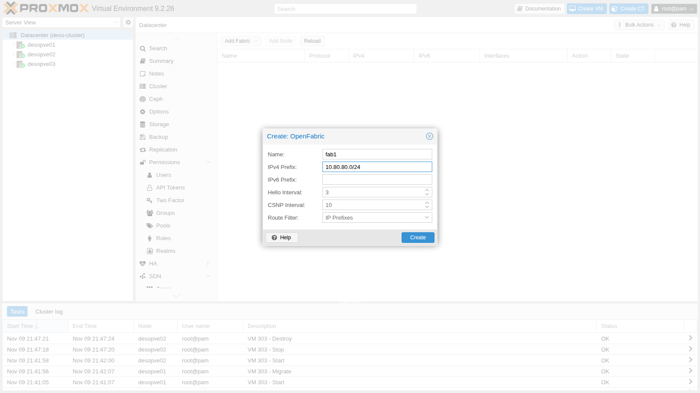
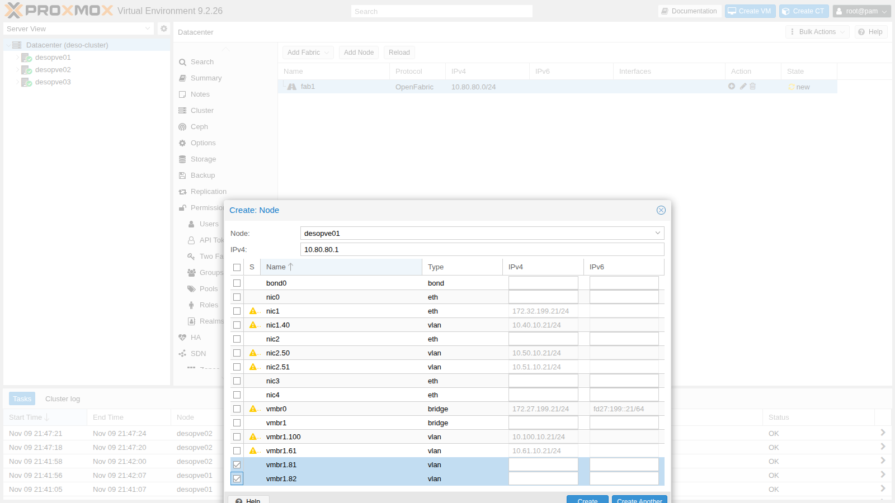
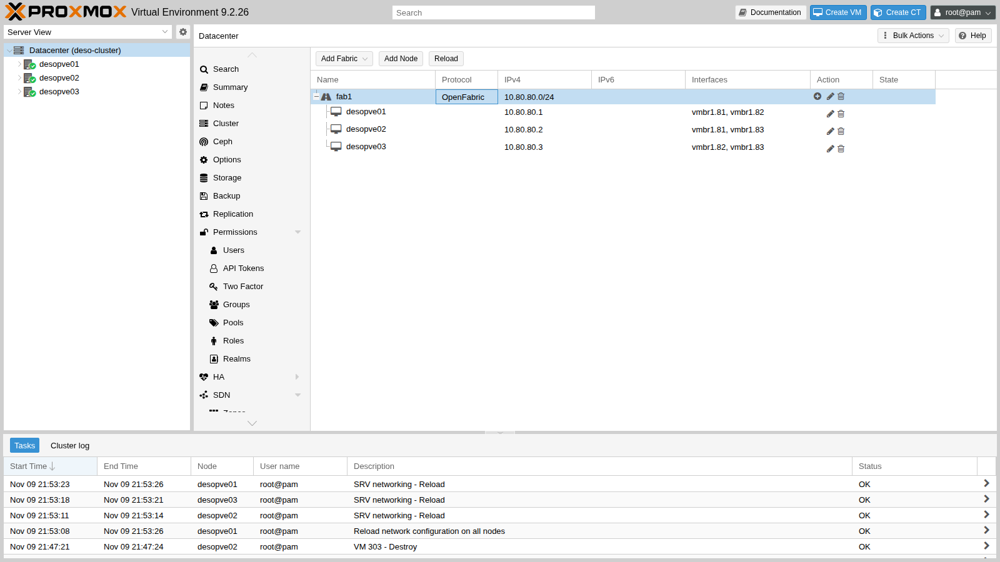
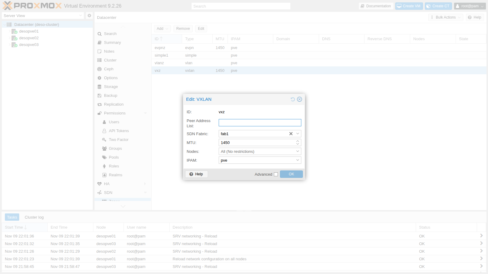

# Lab 31 – SDN 5: Fabrics (OpenFabric) e full mesh instradato

**Livello:** esperto · **Durata:** 1 ora e 30 minuti

## Dipendenze

- **Lab precedenti:**
  - [Lab 29](29-sdn-vxlan.md): zona VXLAN `vxz` con i CT 291 e 292;
  - [Lab 30](30-sdn-evpn.md): FRR gestito dall'SDN, sessioni BGP e lettura dello stato con `vtysh`;
  - [Lab 20](20-bridges-stable-names-vlans.md) e [Lab 21](21-bonding.md): `vmbr1` VLAN-aware su `bond0`, su cui si creano i collegamenti punto-punto.
- **Rete fisica:** il trunk dei nodi porta le **VLAN 81, 82 e 83**, una per ogni collegamento tra due nodi.
- **Nodi:** `desopve01`, `desopve02`, `desopve03`.
- **Credenziali:** `root` / `<password-lab>` → [Appendice B](b-credentials-and-addresses.md).

## Obiettivi

- Capire cos'è una *fabric*: una rete instradata tra i nodi, con un indirizzo per nodo e un protocollo di routing che trova da solo i percorsi.
- Creare una fabric OpenFabric dalla GUI su collegamenti punto-punto senza indirizzi propri.
- Verificare adiacenze, database e rotte con `vtysh` e `ip route`.
- Misurare la riconvergenza quando un collegamento cade, e capire il ruolo dei timer.
- Usare la fabric come underlay della zona VXLAN.

## Come funziona

### Che cos'è una fabric

Una fabric collega i nodi con una rete **instradata** invece che con un'unica rete di livello 2:

- ogni nodo ha un indirizzo `/32` tutto suo, l'equivalente di un *router ID* (qui 10.80.80.1-3), su un'interfaccia di loopback;
- i collegamenti tra i nodi sono **punto-punto** e non hanno una subnet propria (*unnumbered*): il nodo usa il suo `/32` anche lì;
- un protocollo di routing dinamico si scambia gli indirizzi dei nodi e lo stato dei collegamenti, e installa le rotte; se un collegamento cade, il traffico passa da un altro nodo.

Il caso tipico è il **full mesh**: tre nodi collegati direttamente tra loro, due cavi per nodo, senza switch. È la configurazione che la guida di Proxmox VE propone per la rete di Ceph in cluster piccoli. La stessa fabric si usa come underlay per VXLAN ed EVPN.

### I tipi di fabric di Proxmox VE 9.2

Il menu **Add Fabric** offre quattro protocolli; in questo lab si usa OpenFabric.

| Protocollo | In breve |
|---|---|
| **OpenFabric** | variante di IS-IS pensata per le fabric dei data center: si configurano solo prefisso, nodi e interfacce |
| **OSPF** | il classico protocollo link-state, con il concetto di *area* |
| **BGP** | sessioni BGP tra i nodi della fabric |
| **WireGuard** | tunnel cifrati tra i nodi, anche verso nodi esterni |

### Il laboratorio: tre VLAN come tre cavi

```text
            VLAN 81
 desopve01 ───────── desopve02
 10.80.80.1          10.80.80.2
      \                 /
   VLAN 82          VLAN 83
        \             /
         desopve03
         10.80.80.3
```

Ogni VLAN ha solo due membri, quindi si comporta come un cavo diretto. Con una differenza importante: spegnere l'interfaccia su un nodo **non** stacca il cavo dall'altra parte. L'altro capo si accorge del guasto solo quando smette di ricevere i messaggi del vicino, come quando si guasta un transceiver o uno switch in mezzo.

## Procedura

### 1. I collegamenti punto-punto

Su ogni nodo due sottointerfacce VLAN di `vmbr1`, senza indirizzo, prima della riga `source` di `/etc/network/interfaces`. Prima di modificare il file se ne fa una copia, su ogni nodo: `cp /etc/network/interfaces /root/interfaces.bak-lab31`. Per `desopve01` (collegamenti con 02 e 03):

```text
auto vmbr1.81
iface vmbr1.81 inet manual
#fabric punto-punto

auto vmbr1.82
iface vmbr1.82 inet manual
#fabric punto-punto
```

Su `desopve02` le VLAN 81 e 83, su `desopve03` le VLAN 82 e 83. Poi su ogni nodo `ifreload -a`.

Sui nodi con la zona EVPN del lab 30, `ifreload` stampa un avviso innocuo: tenta di cancellare una rotta della VRF che non esiste più.

```text
warning: vrf_evpnz: post-up cmd 'ip route del vrf vrf_evpnz unreachable default metric 4278198272' failed: returned 2 (RTNETLINK answers: No such process
)
```

### 2. La fabric OpenFabric

**Datacenter** → **SDN** → **Fabrics** → **Add Fabric** → **OpenFabric**: **Name** `fab1`, **IPv4 Prefix** `10.80.80.0/24`, l'intervallo da cui verranno gli indirizzi dei nodi. Hello e CSNP interval restano ai valori predefiniti (si cambiano al punto 6).



### 3. I nodi della fabric

1. Selezionata la fabric, **Add Node**: **Node** `desopve01`, **IPv4** `10.80.80.1` e, nella tabella, le due interfacce punto-punto `vmbr1.81` e `vmbr1.82`. Le interfacce con un indirizzo già configurato sono segnate da un avviso: un'interfaccia unnumbered usa l'indirizzo del nodo.

   

2. Gli altri due nodi da riga di comando:

   ```console
   root@desopve01:~# pvesh create /cluster/sdn/fabrics/node/fab1 --node_id desopve02 --protocol openfabric \
     --ip 10.80.80.2 --interfaces name=vmbr1.81 --interfaces name=vmbr1.83
   root@desopve01:~# pvesh create /cluster/sdn/fabrics/node/fab1 --node_id desopve03 --protocol openfabric \
     --ip 10.80.80.3 --interfaces name=vmbr1.82 --interfaces name=vmbr1.83
   root@desopve01:~# cat /etc/pve/sdn/fabrics.cfg
   openfabric_fabric: fab1
   	ip_prefix 10.80.80.0/24

   openfabric_node: fab1_desopve01
   	interfaces name=vmbr1.81
   	interfaces name=vmbr1.82
   	ip 10.80.80.1

   openfabric_node: fab1_desopve02
   	interfaces name=vmbr1.81
   	interfaces name=vmbr1.83
   	ip 10.80.80.2

   openfabric_node: fab1_desopve03
   	interfaces name=vmbr1.82
   	interfaces name=vmbr1.83
   	ip 10.80.80.3
   root@desopve01:~# pvesh set /cluster/sdn
   ```

3. La fabric con i tre nodi e le loro interfacce:

   

### 4. Cosa genera l'SDN

1. L'indirizzo del nodo sta su un'interfaccia `dummy_fab1`, la loopback della fabric, e lo stesso `/32` compare sulle interfacce punto-punto:

   ```console
   root@desopve01:~# ip -br -4 addr show dummy_fab1
   dummy_fab1       UNKNOWN        10.80.80.1/32
   root@desopve01:~# ip -br -4 addr show vmbr1.81
   vmbr1.81@vmbr1   UP             10.80.80.1/32
   ```

2. In FRR c'è un'istanza `router openfabric` con l'identificativo del nodo (NET) derivato dall'indirizzo. La loopback è *passive*: annunciata, ma senza adiacenze. Una route-map fa usare il `/32` del nodo come sorgente per le rotte della fabric.

   ```text
   # estratto di /etc/frr/frr.conf su desopve01
   router openfabric fab1
    net 49.0001.0100.8008.0001.00
   exit
   !
   interface dummy_fab1
    ip router openfabric fab1
    openfabric passive
   exit
   !
   interface vmbr1.81
    ip router openfabric fab1
   exit
   !
   interface vmbr1.82
    ip router openfabric fab1
   exit
   !
   access-list pve_openfabric_fab1_ips permit 10.80.80.0/24
   !
   route-map pve_openfabric permit 100
    match ip address pve_openfabric_fab1_ips
    set src 10.80.80.1
   exit
   !
   ip protocol openfabric route-map pve_openfabric
   ```

3. Per fare da transito, un nodo deve inoltrare i pacchetti. L'SDN attiva l'inoltro **solo** sulle interfacce della fabric e lascia spento quello generale:

   ```console
   root@desopve02:~# sysctl -n net.ipv4.ip_forward net.ipv4.conf.vmbr1/81.forwarding net.ipv4.conf.vmbr1/83.forwarding
   0
   1
   1
   ```

### 5. Adiacenze, database e rotte

1. Ogni nodo vede i due vicini. *Holdtime* è il tempo dopo il quale un vicino muto viene considerato perso:

   ```console
   root@desopve01:~# vtysh -c "show openfabric neighbor"
   Area fab1:
    System Id           Interface   L  State         Holdtime SNPA
    desopve02           vmbr1.81    2  Up            29       2020.2020.2020
    desopve03           vmbr1.82    2  Up            30       2020.2020.2020
   ```

2. Il database contiene la descrizione (LSP) di ognuno dei tre nodi; ogni nodo calcola da lì i percorsi migliori:

   ```console
   root@desopve01:~# vtysh -c "show openfabric database"
   Area fab1:
   IS-IS Level-2 link-state database:
   LSP ID                  PduLen  SeqNumber   Chksum  Holdtime  ATT/P/OL
   desopve01.00-00      *    123   0x00000002  0x13b8    1183    0/0/0
   desopve02.00-00           123   0x00000002  0x7c48    1172    0/0/0
   desopve03.00-00           123   0x00000002  0xdae2    1128    0/0/0
       3 LSPs
   root@desopve01:~# ip route | grep 10.80.80
   10.80.80.2 nhid 72 via 10.80.80.2 dev vmbr1.81 proto openfabric src 10.80.80.1 metric 20 onlink
   10.80.80.3 nhid 73 via 10.80.80.3 dev vmbr1.82 proto openfabric src 10.80.80.1 metric 20 onlink
   ```

3. Gli indirizzi dei nodi si raggiungono direttamente, in un salto:

   ```console
   root@desopve01:~# ping -c3 -W1 -I 10.80.80.1 10.80.80.3
   3 packets transmitted, 3 received, 0% packet loss, time 2065ms
   root@desopve01:~# traceroute -n -w1 -q1 -s 10.80.80.1 10.80.80.3
    1  10.80.80.3  0.396 ms
   ```

### 6. Guasti e riconvergenza

Per ogni prova un ping ogni 100 ms da `desopve01` (sorgente 10.80.80.1) a `desopve03` (10.80.80.3), in un secondo terminale: `ping -i 0.1 -c 400 -q -I 10.80.80.1 10.80.80.3`. Poi si spegne il collegamento VLAN 82 tra i due e lo si riaccende dopo qualche decina di secondi con `ip link set vmbr1.82 up`, sul nodo (o sui nodi) dove era stato spento.

1. **Guasto da un solo lato, timer predefiniti.** Si spegne `vmbr1.82` solo su `desopve03`, mentre su `desopve01` resta accesa:

   ```console
   root@desopve03:~# ip link set vmbr1.82 down
   ```

   ```text
   600 packets transmitted, 335 received, 44.1667% packet loss, time 61696ms
   ```

   Si perdono 265 ping, circa 26 secondi: `desopve01` continua a mandare verso `desopve03` dalla VLAN 82 finché il vicino non scade (*holdtime* di circa 30 s). Lo stesso succede alle risposte se si spegne l'interfaccia solo su `desopve01`: è `desopve03` a non accorgersene.

2. **Timer più stretti.** L'holdtime è un multiplo dell'*hello interval*. Portando l'hello a 1 secondo dalla configurazione della fabric, l'holdtime scende a 10 s:

   ```console
   root@desopve01:~# pvesh set /cluster/sdn/fabrics/fabric/fab1 --protocol openfabric --hello_interval 1
   root@desopve01:~# pvesh set /cluster/sdn
   root@desopve01:~# grep -A3 "^interface vmbr1.81" /etc/frr/frr.conf
   interface vmbr1.81
    ip router openfabric fab1
    openfabric hello-interval 1
   exit
   root@desopve01:~# vtysh -c "show openfabric neighbor" | grep Up
    desopve02           vmbr1.81    2  Up            10       2020.2020.2020
    desopve03           vmbr1.82    2  Up            10       2020.2020.2020
   ```

   La stessa prova da un solo lato:

   ```text
   400 packets transmitted, 338 received, +27 errors, 15.5% packet loss, time 53488ms
   ```

   Ora si perdono 62 ping, circa 6 secondi. Gli *errors* sono gli ICMP di destinazione irraggiungibile ricevuti nel frattempo.

3. **Collegamento tagliato da entrambi i lati**, come quando si stacca davvero un cavo. Ciascun nodo vede l'interfaccia spenta e ricalcola subito i percorsi; dopo un secondo `desopve03` si raggiunge attraverso `desopve02`:

   ```console
   root@desopve01:~# ip link set vmbr1.82 down
   root@desopve03:~# ip link set vmbr1.82 down
   root@desopve01:~# ip route get 10.80.80.3
   10.80.80.3 via 10.80.80.2 dev vmbr1.81 src 10.80.80.1 uid 0
   ```

   ```text
   400 packets transmitted, 384 received, 4% packet loss, time 40516ms
   ```

   16 ping persi: 1,6 secondi.

   Una prima prova di questo tipo, fatta subito dopo il ripristino di un altro guasto, aveva perso 9 secondi, con la rotta per qualche istante finita sul gateway predefinito: la fabric non si era ancora assestata. Le misure vanno ripetute a regime.

### 7. La fabric come underlay della VXLAN

1. La zona `vxz` del lab 29 passa dalla lista dei peer sulla VLAN 61 alla fabric:

   ```console
   root@desopve01:~# pvesh set /cluster/sdn/zones/vxz --fabric fab1 --delete peers
   root@desopve01:~# pvesh set /cluster/sdn
   ```

   

2. Ora il tunnel parte dalla loopback della fabric verso quelle degli altri nodi:

   ```text
   # estratto di /etc/network/interfaces.d/sdn su desopve01
   auto vxlan_vnvx1
   iface vxlan_vnvx1
   	vxlan-id 10062
   	vxlan-local-tunnelip 10.80.80.1
   	vxlan_remoteip 10.80.80.2
   	vxlan_remoteip 10.80.80.3
   	mtu 1450
   ```

   ```console
   root@desopve01:~# pct exec 291 -- ping -c3 -W1 10.62.62.12
   3 packets transmitted, 3 received, 0% packet loss, time 2056ms
   root@desopve01:~# tcpdump -lnni vmbr1.82 -c2 udp port 4789
   22:02:00.587760 IP 10.80.80.1.47640 > 10.80.80.3.4789: VXLAN, flags [I] (0x08), vni 10062
   IP 10.62.62.11 > 10.62.62.12: ICMP echo request, id 382, seq 1, length 64
   22:02:00.588181 IP 10.80.80.3.48661 > 10.80.80.1.4789: VXLAN, flags [I] (0x08), vni 10062
   IP 10.62.62.12 > 10.62.62.11: ICMP echo reply, id 382, seq 1, length 64
   ```

3. Con il collegamento 01-03 tagliato da entrambi i lati, il tunnel tra i due container passa da `desopve02` (si vede su `vmbr1.81`) e il ping tra i guest continua:

   ```console
   root@desopve01:~# tcpdump -lnni vmbr1.81 -c2 "udp port 4789 and host 10.80.80.3"
   22:02:17.378878 IP 10.80.80.1.47640 > 10.80.80.3.4789: VXLAN, flags [I] (0x08), vni 10062
   IP 10.62.62.11 > 10.62.62.12: ICMP echo request, id 383, seq 75, length 64
   22:02:17.380197 IP 10.80.80.3.48661 > 10.80.80.1.4789: VXLAN, flags [I] (0x08), vni 10062
   IP 10.62.62.12 > 10.62.62.11: ICMP echo reply, id 383, seq 75, length 64
   ```

   ```text
   250 packets transmitted, 246 received, 1.6% packet loss, time 25188ms
   ```

   Sono stati persi 4 ping, 0,4 secondi, senza toccare nulla nei guest né nella zona. Finita la prova si riaccende il collegamento su entrambi i nodi e si controlla che i vicini siano di nuovo tutti su:

   ```console
   root@desopve01:~# ip link set vmbr1.82 up
   root@desopve03:~# ip link set vmbr1.82 up
   root@desopve01:~# vtysh -c "show openfabric neighbor"
   ```

4. Anche il controller EVPN ha il campo **SDN Fabric**. In questo laboratorio resta sulla lista dei peer della VLAN 61, così la zona `evpnz` del lab 30 non cambia.

### 8. E Ceph?

Con un full mesh fisico, la guida *Full Mesh Network for Ceph Server* di Proxmox VE usa proprio una fabric: le reti public e cluster di Ceph diventano il prefisso della fabric, e ogni monitor e OSD usa il `/32` del suo nodo. Se un cavo si rompe, Ceph continua a passare per il terzo nodo. In questo laboratorio Ceph resta sulle VLAN 50 e 51 del lab 17: spostare una rete Ceph in uso richiede di ricreare i monitor, ed esula da questo lab.

### 9. Il resto della rete non è cambiato

```console
root@desopve01:~# ceph health
HEALTH_OK
root@desopve01:~# pvecm status | grep Quorate:
Quorate:          Yes
root@desopve01:~# pct exec 121 -- ping -c2 -W1 10.10.10.122
2 packets transmitted, 2 received, 0% packet loss, time 1001ms
root@desopve01:~# ping -c2 -W1 10.100.10.23
2 packets transmitted, 2 received, 0% packet loss, time 1004ms
root@desopve03:~# pct exec 302 -- ping -c2 -W1 10.71.71.11
2 packets transmitted, 2 received, 0% packet loss, time 1044ms
```

## Verifica e test

| Prova | Hello | Ping persi (ogni 100 ms) |
|---|---|---|
| Collegamento spento da un solo lato | 3 s (predefinito) | 265 su 600, circa 26 s |
| Collegamento spento da un solo lato | 1 s | 62 su 400, circa 6 s |
| Collegamento tagliato da entrambi i lati | 1 s | 16 su 400, circa 1,6 s |
| VXLAN sulla fabric, collegamento tagliato | 1 s | 4 su 250, circa 0,4 s |
| Ceph, Corosync, VLAN dei guest, migrazione, EVPN | – | invariati |

## Stato finale del lab

- **Collegamenti punto-punto** su `vmbr1`, senza indirizzo: VLAN 81 (01-02), 82 (01-03), 83 (02-03).
- **Fabric** `fab1` (OpenFabric, prefisso 10.80.80.0/24, hello 1 s): `desopve01` 10.80.80.1, `desopve02` 10.80.80.2, `desopve03` 10.80.80.3, sulle interfacce `dummy_fab1`.
- **Zona `vxz`:** ora usa la fabric `fab1` come underlay, al posto della lista dei peer. CT 291 e 292 invariati.
- **Zona `evpnz`:** invariata, con il controller sui peer della VLAN 61 (`vmbr1.61`).
- Backup delle configurazioni di rete dei nodi in `/root/interfaces.bak-lab31`.

## Cosa hai imparato

- Una fabric dà a ogni nodo un indirizzo `/32` e instrada tra i nodi su collegamenti punto-punto, trovando da sola i percorsi alternativi.
- Proxmox VE 9.2 crea fabric OpenFabric, OSPF, BGP e WireGuard dalla GUI e genera interfacce, FRR e inoltro.
- Un guasto visto da entrambi i capi si recupera in circa un secondo; uno visto da un solo capo dura quanto l'holdtime, che si riduce abbassando l'hello interval.
- Zone VXLAN e controller EVPN possono usare una fabric come underlay, e il traffico dei guest ne eredita la ridondanza.
- Il full mesh per Ceph è un uso tipico della fabric.

## Riferimenti

- [Proxmox VE – SDN: Fabrics](https://pve.proxmox.com/pve-docs/chapter-pvesdn.html#pvesdn_config_fabrics)
- [Proxmox VE Wiki – Full Mesh Network for Ceph Server](https://pve.proxmox.com/wiki/Full_Mesh_Network_for_Ceph_Server)
- [FRRouting – OpenFabric (fabricd)](https://docs.frrouting.org/en/latest/fabricd.html)
- [IETF draft – OpenFabric](https://datatracker.ietf.org/doc/html/draft-white-openfabric)
