# Lab 32 – Firewall 1: livelli, regole, security group, IPSet, alias e log

**Livello:** intermedio · **Durata:** 1 ora e 30 minuti

## Dipendenze

- **Lab precedenti:**
  - [Lab 05](05-ssh-shell-cli.md): chiave SSH del DC caricata nell'agente, che lo script di prova usa per entrare nei nodi;
  - [Lab 15](15-iscsi-lvm-multipath.md), [Lab 17](17-ceph-installation.md), [Lab 22](22-dedicated-networks.md), [Lab 27](27-sdn-simple.md) e [Lab 29](29-sdn-vxlan.md)-[31](31-sdn-fabrics.md): multipath, Ceph, Corosync su due link, migrazione, `dnsmasq` e SDN. Il passo 2 li elenca e il passo 8 li verifica: se non hai svolto uno di questi lab, salta la verifica corrispondente;
  - [Lab 20](20-bridges-stable-names-vlans.md): bridge e VLAN;
  - [Lab 24](24-routing-nat.md): la subnet instradata 10.99.99.0/28 di `desopve04`, con il CT 403;
  - [Lab 25](25-ipv6.md): indirizzi IPv6 `fd27:199::/64` dei nodi e del DC;
  - [Lab 26](26-virtual-router.md): `router01`, che porta in NAT il traffico delle VLAN 10 e 20 verso la rete di gestione.
- **Guest usati:**
  - CT 101 `debian-ct01` (172.27.199.101 su `desopve02`): diventa il server protetto, con nginx;
  - CT 121 `vlan-ct1` (VLAN 10): client che arriva attraverso `router01`;
  - CT 403 `routed-ct1` (10.99.99.2 su `desopve04`): client da una rete instradata;
  - il DC `desopve-dc01` (172.27.199.20): postazione di amministrazione.
- **Nodi:** cluster `desopve01`-`desopve03` e il nodo autonomo `desopve04`.
- **Credenziali:** `root` / `<password-lab>` → [Appendice B](b-credentials-and-addresses.md).

## Obiettivi

- Capire i livelli del firewall di Proxmox VE (Datacenter, Nodo, VM/CT) e cosa attiva cosa.
- Attivare il firewall del datacenter **senza** bloccare i servizi tra i nodi.
- Usare alias, IPSet e security group per scrivere regole leggibili e riutilizzabili.
- Proteggere un container con regole in ingresso e in uscita, e verificarle con prove positive e negative.
- Leggere il log del firewall.
- Proteggere l'host e capire il ruolo dell'IPSet `management`, anche per IPv6.

## Come funziona

### I livelli e i file

Il firewall di Proxmox VE è distribuito: ogni nodo applica le regole che lo riguardano, ma la configurazione sta nel filesystem del cluster (`/etc/pve`), quindi è unica per tutto il cluster.

| Livello | Dove si configura | File | Cosa protegge |
|---|---|---|---|
| **Datacenter** | Datacenter → Firewall | `/etc/pve/firewall/cluster.fw` | Interruttore generale, policy di default, alias, IPSet e security group condivisi |
| **Nodo** | Nodo → Firewall | `/etc/pve/nodes/<nodo>/host.fw` | Il traffico diretto al nodo stesso (GUI, SSH, servizi del cluster) |
| **VM/CT** | VM/CT → Firewall | `/etc/pve/firewall/<vmid>.fw` | Il traffico da e verso una singola scheda di rete del guest |
| **VNet** | SDN → VNet Firewall | `/etc/pve/sdn/firewall/<vnet>.fw` | Il traffico instradato attraverso una VNet (→ [Lab 33](33-firewall-2.md)) |

Tre regole da ricordare:

1. **L'interruttore del Datacenter accende tutto.** Finché `Firewall` del Datacenter è `No`, non si applica nessuna regola, a nessun livello. Quando diventa `Yes`, si attiva anche il firewall di **ogni nodo**, salvo i nodi in cui è stato disattivato esplicitamente.
2. **Il firewall di un guest vale solo se è acceso in due punti:** l'opzione `Firewall` del guest e il flag `firewall=1` sulla singola scheda di rete (`net0`). Senza il flag, il traffico di quella scheda non passa dal firewall.
3. **Le regole si valutano dall'alto verso il basso e vince la prima che corrisponde.** Se nessuna corrisponde, decide la policy di default della direzione (`Input Policy`, `Output Policy`).

### Le policy di default

| Livello | Ingresso | Uscita |
|---|---|---|
| Datacenter/nodi | `DROP` | `ACCEPT` |
| VM/CT | `DROP` | `ACCEPT` |

Per i nodi, Proxmox VE aggiunge da solo le regole indispensabili: GUI (8006), SSH (22), console (5900-5999, 3128) e migrazione (60000-60050) dalla rete di gestione, più il traffico Corosync tra i nodi del cluster. La rete di gestione è il set `management`; se non lo si definisce, vale la **rete locale** rilevata dall'indirizzo del nodo (`local_network`).

### Gli strumenti per scrivere regole leggibili

- **Alias:** un nome per un indirizzo o una rete (`dc01` = 172.27.199.20). Se l'indirizzo cambia, si aggiorna l'alias e tutte le regole lo seguono.
- **IPSet:** un elenco di indirizzi e reti con un nome (`admin`). Nelle regole si richiama con il `+` davanti: `+dc/admin`.
- **Security group:** un pacchetto di regole con un nome (`web-server`), da inserire in più guest con una sola riga `GROUP`.
- **Macro:** un servizio predefinito (`HTTP`, `SSH`, `Ping`, `Ceph`...) che corrisponde a protocolli e porte, così non si devono ricordare i numeri.

In Proxmox VE 9 i riferimenti hanno un **ambito**: `dc/` per quelli del Datacenter e `guest/` per quelli definiti nel singolo guest. Nella GUI e nei file compaiono come `dc/dc01` e `+dc/admin`.

### Come viene applicato al guest

Quando una scheda ha `firewall=1`, Proxmox VE non la collega direttamente al bridge: in mezzo mette un piccolo bridge dedicato (`fwbr<vmid>i<n>`) e una coppia di interfacce (`fwln`/`fwpr`). Le regole del guest si agganciano lì. Nel log questi nomi compaiono come `IN=fwbr101i0` e `PHYSOUT=veth101i0`.

Il demone `pve-firewall` ricompila le regole circa ogni **10 secondi**: una regola appena salvata non è attiva nello stesso istante.

## Procedura

### 1. Lo stato iniziale

**Datacenter → Firewall → Options**: il firewall è spento, con le policy di default.

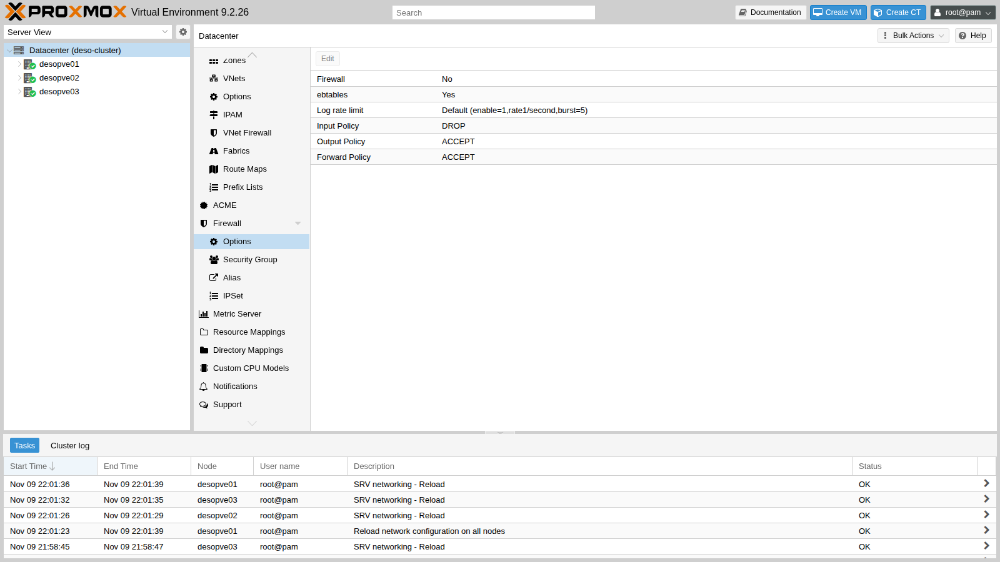

### 2. Prima di accendere: mettere al sicuro i nodi

Accendere il firewall del Datacenter accende anche quello dei nodi, con la policy di ingresso `DROP`. Le regole automatiche coprono la rete di gestione e Corosync, ma in questo cluster ci sono servizi su altre reti che verrebbero bloccati:

- Ceph sulle VLAN 50 e 51 (10.50.10.0/24 e 10.51.10.0/24);
- il secondo collegamento di Corosync sulla VLAN 40;
- BGP, BFD e VXLAN dell'SDN sulla VLAN 61 e sulla fabric;
- la migrazione sulla VLAN 100;
- DHCP e DNS di `dnsmasq` per la zona SDN `simple1`.

In questo lab il firewall serve per i **guest**, quindi prima di tutto si disattiva quello dei nodi: **Nodo → Firewall → Options → Firewall: No**. Il firewall degli host del cluster, con tutte le regole per i servizi, si costruisce nel [Lab 33](33-firewall-2.md).

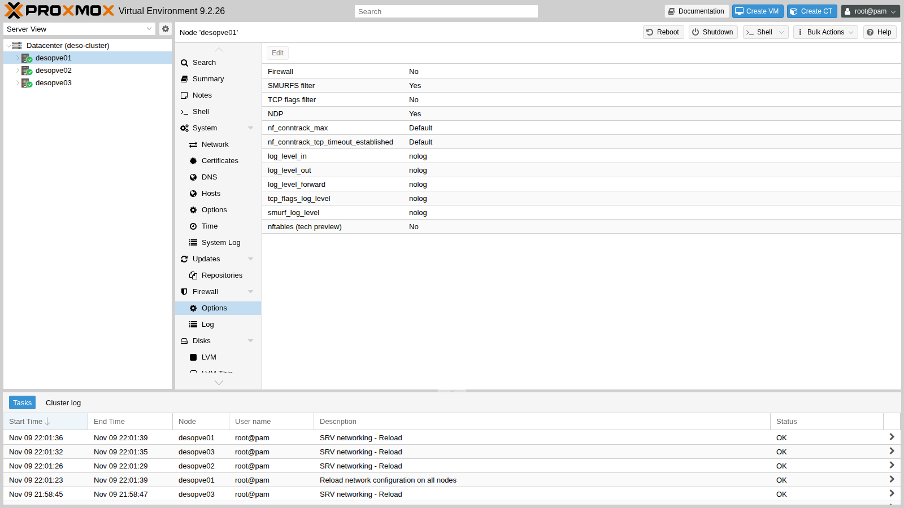

Lo stesso, per tutti e tre i nodi, da riga di comando:

```bash
for n in desopve01 desopve02 desopve03; do
  pvesh set /nodes/$n/firewall/options --enable 0
done
cat /etc/pve/nodes/desopve02/host.fw
```

``` { .text .no-copy title="Output" }
[OPTIONS]

enable: 0
```

### 3. Gli alias

**Datacenter → Firewall → Alias → Add**: un nome per ogni indirizzo o rete che compare nelle regole.

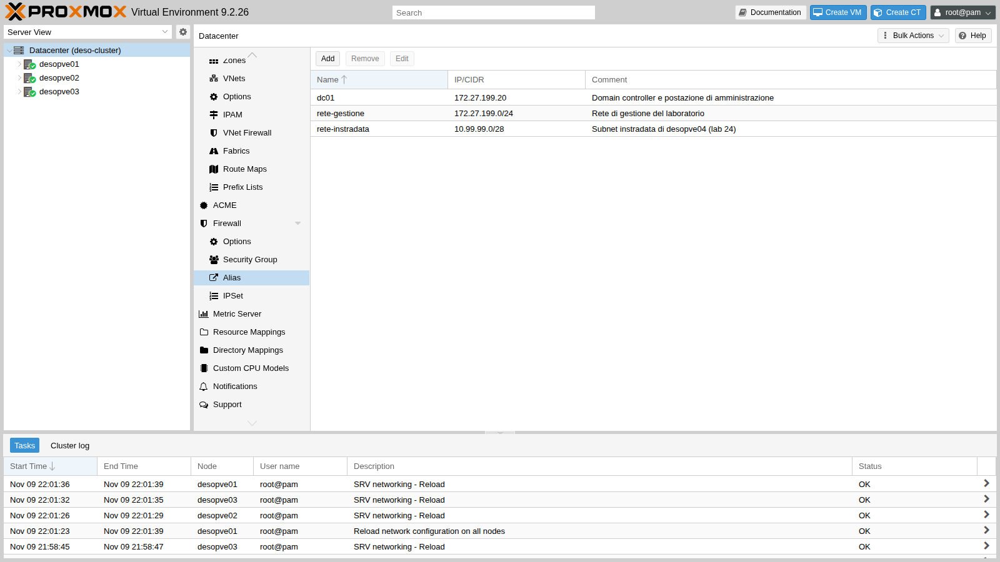

Da riga di comando:

```bash
pvesh create /cluster/firewall/aliases --name dc01 --cidr 172.27.199.20 \
  --comment "Domain controller e postazione di amministrazione"
pvesh create /cluster/firewall/aliases --name rete-gestione --cidr 172.27.199.0/24 \
  --comment "Rete di gestione del laboratorio"
pvesh create /cluster/firewall/aliases --name rete-instradata --cidr 10.99.99.0/28 \
  --comment "Subnet instradata di desopve04 (lab 24)"
```

### 4. L'IPSet degli amministratori

**Datacenter → Firewall → IPSet → Create** `admin`, poi a destra **Add** con l'alias `dc/dc01`. Domani, per aggiungere un'altra postazione, basta un'altra riga nel set.

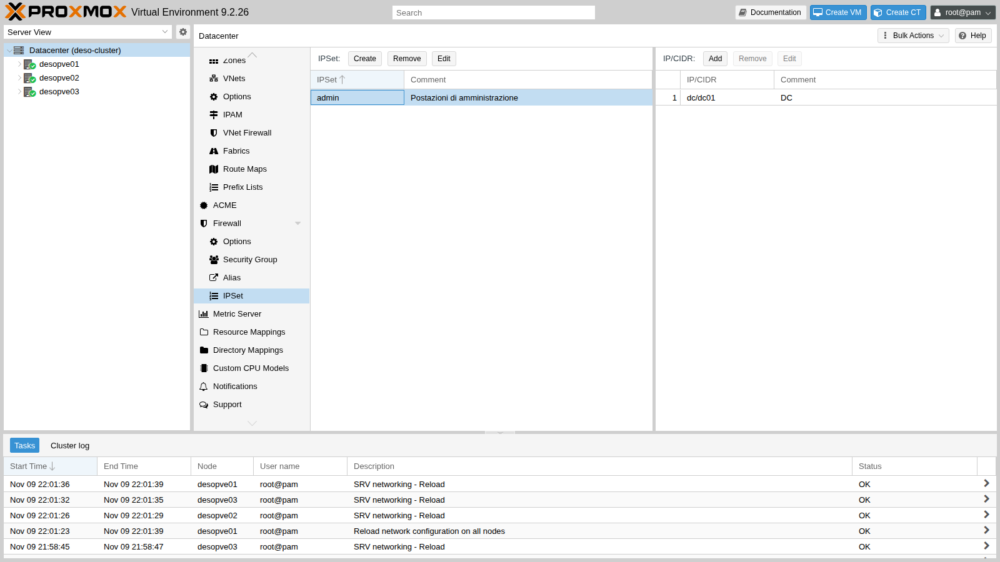

```bash
pvesh create /cluster/firewall/ipset --name admin --comment "Postazioni di amministrazione"
pvesh create /cluster/firewall/ipset/admin --cidr dc/dc01 --comment "DC"
```

### 5. I security group

**Datacenter → Firewall → Security Group → Create**. Si creano due gruppi:

- `web-server`: HTTP dalla rete di gestione;
- `accesso-admin`: SSH e ping solo dal set `admin`.

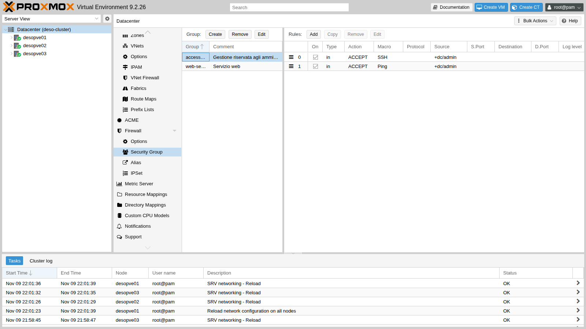

Ogni regola si crea con **Add** nel pannello di destra. Il dettaglio della regola SSH:

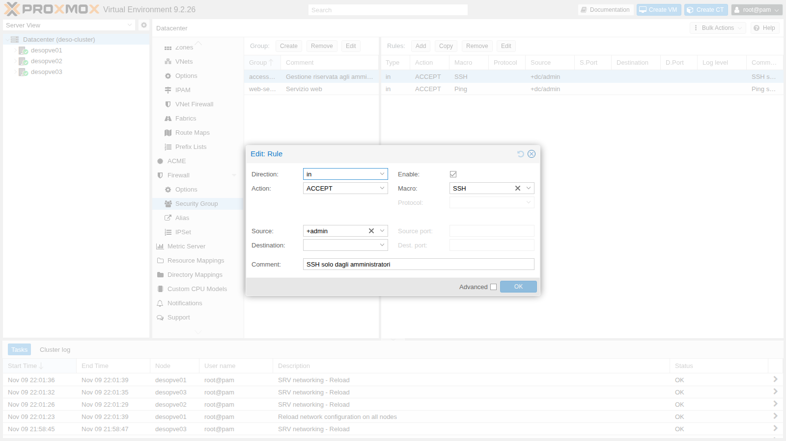

Da riga di comando:

```bash
pvesh create /cluster/firewall/groups --group web-server --comment "Servizio web"
pvesh create /cluster/firewall/groups/web-server --type in --action ACCEPT \
  --macro HTTP --source dc/rete-gestione --enable 1 --comment "HTTP solo dalla rete di gestione"
pvesh create /cluster/firewall/groups --group accesso-admin --comment "Gestione riservata agli amministratori"
pvesh create /cluster/firewall/groups/accesso-admin --type in --action ACCEPT \
  --macro Ping --source +dc/admin --enable 1 --comment "Ping solo dagli amministratori"
pvesh create /cluster/firewall/groups/accesso-admin --type in --action ACCEPT \
  --macro SSH --source +dc/admin --enable 1 --comment "SSH solo dagli amministratori"
```

Il risultato in `cluster.fw`:

```text
[ALIASES]

dc01 172.27.199.20 # Domain controller e postazione di amministrazione
rete-gestione 172.27.199.0/24 # Rete di gestione del laboratorio
rete-instradata 10.99.99.0/28 # Subnet instradata di desopve04 (lab 24)

[IPSET admin] # Postazioni di amministrazione

dc/dc01 # DC

[group accesso-admin] # Gestione riservata agli amministratori

IN SSH(ACCEPT) -source +dc/admin # SSH solo dagli amministratori
IN Ping(ACCEPT) -source +dc/admin # Ping solo dagli amministratori

[group web-server] # Servizio web

IN HTTP(ACCEPT) -source dc/rete-gestione # HTTP solo dalla rete di gestione
```

> **Nota:** un `pvesh create` sulle regole inserisce la regola **in cima** (posizione 0). Per questo nel file SSH viene prima di Ping, anche se è stata creata dopo. Per scegliere il punto si usa l'opzione `--pos`.

### 6. Il server da proteggere

Sul CT 101 si installa un server web di prova:

```bash
pct exec 101 -- bash -c 'apt-get -qq update; apt-get -y -qq install nginx curl
  echo "debian-ct01 - web di prova (lab 32)" > /var/www/html/index.html'
pct exec 101 -- ss -ltn
```

``` { .text .no-copy title="Output" }
LISTEN 0      511          0.0.0.0:80        0.0.0.0:*
LISTEN 0      511             [::]:80           [::]:*
LISTEN 0      4096               *:22              *:*
```

La scheda del CT ha già il flag del firewall, impostato alla creazione:

```text
net0: name=eth0,bridge=vmbr0,firewall=1,gw=172.27.199.1,hwaddr=BC:24:11:0C:31:84,ip=172.27.199.101/24,type=veth
```

Prima di attivare qualsiasi regola si misura la situazione di partenza con lo script di prova [`fwtest.ps1`](../files/32/fwtest.ps1). Si copia sul DC, per esempio in `C:\lab`, e si lancia in PowerShell con `.\fwtest.ps1`. Per le prove dai container lo script entra nei nodi con la chiave SSH del DC ([Lab 05](05-ssh-shell-cli.md)) ed esegue `nc` e `ping` dentro il CT. Prova HTTP, SSH e ping da tre sorgenti:

- il DC;
- il CT 121, che arriva dalla VLAN 10 attraverso il NAT di `router01` (sorgente 172.27.199.26);
- il CT 403, che arriva dalla rete instradata senza NAT (sorgente 10.99.99.2).

```text
DC 172.27.199.20 (admin)           HTTP ok        SSH ok        ping ok
CT 121 VLAN 10 (via router01, NAT) HTTP ok        SSH ok        ping ok
CT 403 10.99.99.2 (rete instradata) HTTP ok        SSH ok        ping ok
```

### 7. Le regole del CT 101

**CT 101 → Firewall → Insert: Security Group**, una volta per `web-server` e una per `accesso-admin`. Poi **Firewall → Options**:

- `Firewall`: `Yes`;
- `log_level_in`: `info`, per registrare i pacchetti scartati dalla policy di ingresso.

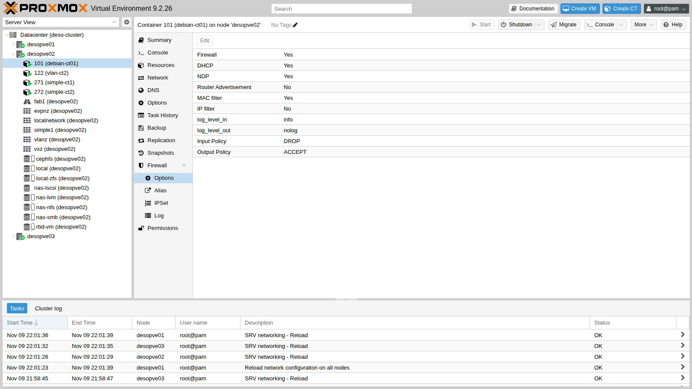

Da riga di comando:

```bash
pvesh create /nodes/desopve02/lxc/101/firewall/rules --type group --action accesso-admin --enable 1
pvesh create /nodes/desopve02/lxc/101/firewall/rules --type group --action web-server --enable 1
pvesh set /nodes/desopve02/lxc/101/firewall/options --enable 1 --log_level_in info
cat /etc/pve/firewall/101.fw
```

``` { .text .no-copy title="Output" }
[OPTIONS]

enable: 1
log_level_in: info

[RULES]

GROUP web-server
GROUP accesso-admin
```

### 8. Accendere il firewall del datacenter

**Datacenter → Firewall → Options**, doppio clic su `Firewall`, spunta e **OK**.

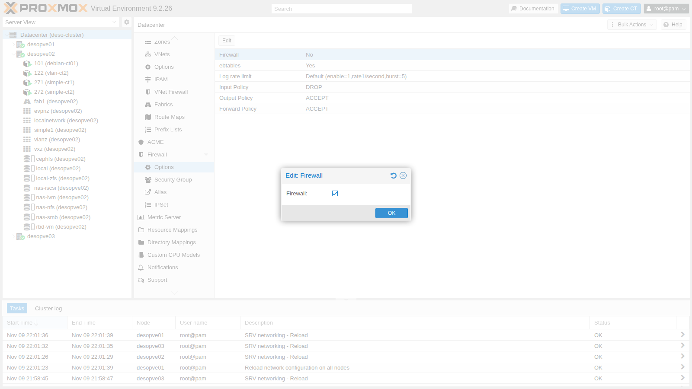

Subito dopo si verifica che i nodi **non** abbiano regole proprie e che i servizi del cluster non abbiano subito interruzioni:

```bash
for n in desopve01 desopve02 desopve03; do
  ssh $n 'echo "== $(hostname)"; pve-firewall status; echo "regole host: $(iptables -S PVEFW-HOST-IN 2>/dev/null | wc -l)"'
done
pvecm status | grep Quorate; corosync-cfgtool -s | grep -c connected
ceph health; multipath -ll | grep -c "active ready"
vtysh -c "show bgp summary" | grep ^desopve
```

``` { .text .no-copy title="Output" }
== desopve01
Status: enabled/running
regole host: 0
== desopve02
Status: enabled/running
regole host: 0
== desopve03
Status: enabled/running
regole host: 0
Quorate:          Yes
4
HEALTH_OK
2
desopve02(10.61.10.22) 4      65000       519       529       16    0    0 00:25:09            3        5 FRRouting/10.6.1
desopve03(10.61.10.23) 4      65000       528       529       16    0    0 00:25:09            6        5 FRRouting/10.6.1
```

Il servizio è `enabled/running`, ma la catena delle regole dell'host è vuota: i nodi non filtrano niente. Corosync ha i due collegamenti attivi (4 righe `connected`), Ceph è sano, entrambi i percorsi iSCSI sono attivi e le sessioni BGP sono su.

### 9. Le prove

```text
DC 172.27.199.20 (admin)           HTTP ok        SSH ok        ping ok
CT 121 VLAN 10 (via router01, NAT) HTTP ok        SSH BLOCCATO  ping BLOCCATO
CT 403 10.99.99.2 (rete instradata) HTTP BLOCCATO  SSH BLOCCATO  ping BLOCCATO
```

Ogni risultato si spiega con una regola:

- **DC:** è nel set `admin`, quindi passano SSH e ping (`accesso-admin`); è nella rete di gestione, quindi passa HTTP (`web-server`).
- **CT 121:** il NAT di `router01` lo fa arrivare con l'indirizzo 172.27.199.26. È nella rete di gestione, quindi HTTP passa; non è nel set `admin`, quindi SSH e ping finiscono sulla policy `DROP`.
- **CT 403:** arriva con il suo vero indirizzo 10.99.99.2, che non corrisponde a nessuna regola. Tutto bloccato.

> **Il NAT nasconde l'origine.** Per il firewall del CT 101 i guest delle VLAN 10 e 20 sono tutti "172.27.199.26". Se servono regole diverse per ciascuna VLAN, il traffico deve arrivare senza NAT, come quello della rete instradata.

### 10. Il log

**CT 101 → Firewall → Log** mostra i pacchetti scartati, grazie a `log_level_in: info`.

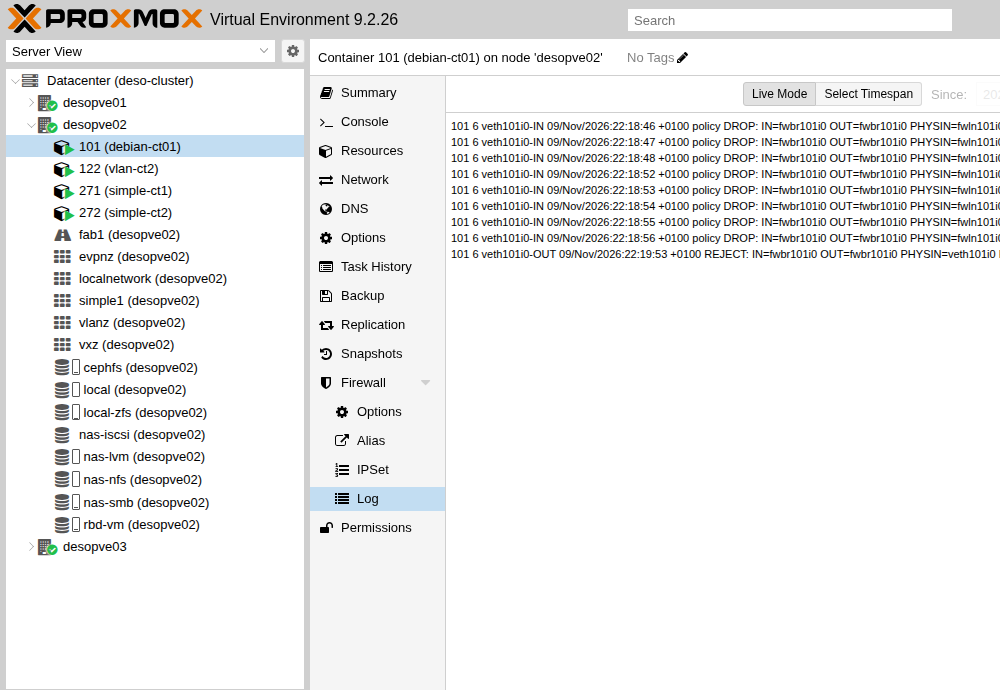

Lo stesso log si legge sul nodo che ospita il guest, in `/var/log/pve-firewall.log`. Nelle righe qui sotto il campo `MAC` (destinazione, origine e tipo del frame) è abbreviato:

```text
101 6 veth101i0-IN 09/Nov/2026:22:18:48 +0100 policy DROP: IN=fwbr101i0 OUT=fwbr101i0 PHYSIN=fwln101i0 PHYSOUT=veth101i0 MAC=… SRC=172.27.199.26 DST=172.27.199.101 LEN=84 TOS=0x00 PREC=0x00 TTL=63 ID=61663 DF PROTO=ICMP TYPE=8 CODE=0 ID=404 SEQ=1
101 6 veth101i0-IN 09/Nov/2026:22:18:52 +0100 policy DROP: IN=fwbr101i0 OUT=fwbr101i0 PHYSIN=fwln101i0 PHYSOUT=veth101i0 MAC=… SRC=10.99.99.2 DST=172.27.199.101 LEN=60 TOS=0x00 PREC=0x00 TTL=63 ID=64893 DF PROTO=TCP SPT=55866 DPT=80 SEQ=2496087703 ACK=0 WINDOW=64240 SYN
```

Come si legge una riga:

- `101` è il guest e `6` il livello di log (`info`);
- `veth101i0-IN` è la catena: ingresso della scheda `net0`;
- `policy DROP` vuol dire che nessuna regola ha accettato il pacchetto ed è intervenuta la policy di default;
- `SRC`, `DST`, `PROTO`, `DPT` dicono chi, verso chi e che cosa.

Il log è limitato a 1 riga al secondo con raffiche di 5 (`Log rate limit` nelle opzioni del Datacenter), per non riempire il disco durante un attacco.

### 11. Una regola in uscita

La policy di uscita dei guest è `ACCEPT`, ma si possono vietare destinazioni precise. Per esempio: il server web non deve aprire connessioni SMB verso il DC.

```bash
pvesh create /nodes/desopve02/lxc/101/firewall/rules --type out --action REJECT \
  --dest dc/dc01 --proto tcp --dport 445 --enable 1 --log info \
  --comment "Nessuna connessione SMB verso il DC"
```

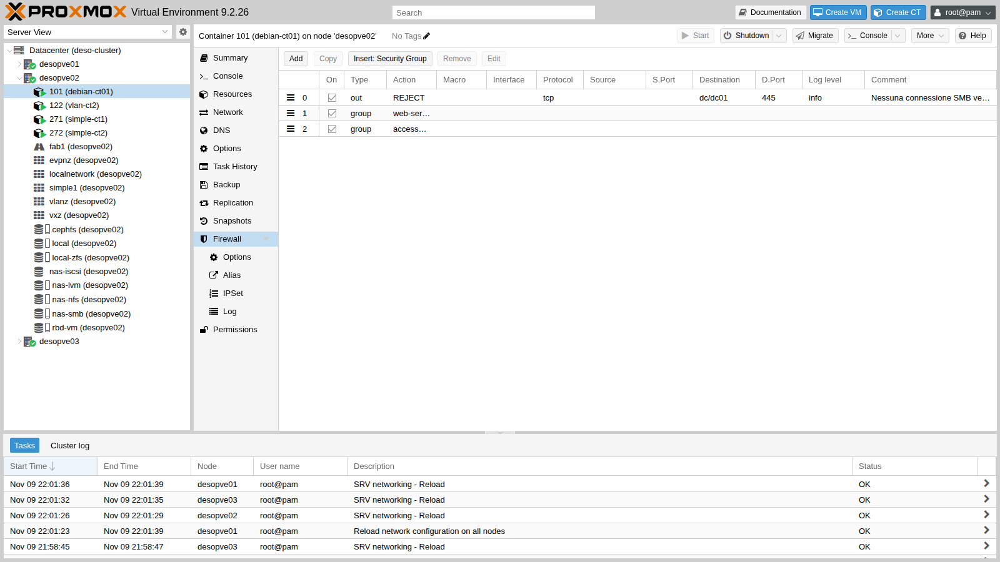

Prima e dopo, dall'interno del CT 101, con `pct exec 101 -- nc -zv -w2 desopve-dc01.proxmox.community 445 53`. Il secondo controllo è stato fatto una decina di secondi dopo il salvataggio, il tempo di un ciclo di `pve-firewall`:

```text
# prima
desopve-dc01.proxmox.community [172.27.199.20] 445 (microsoft-ds) open
desopve-dc01.proxmox.community [172.27.199.20] 53 (domain) open
# dopo
desopve-dc01.proxmox.community [172.27.199.20] 445 (microsoft-ds) : Connection refused
desopve-dc01.proxmox.community [172.27.199.20] 53 (domain) open
```

`REJECT` risponde subito con un rifiuto (`Connection refused`), mentre `DROP` lascia il client in attesa fino al timeout. Per il traffico interno `REJECT` rende più rapida la diagnosi; verso l'esterno si preferisce `DROP`, che non conferma l'esistenza del servizio.

Le regole compilate si vedono sul nodo:

```bash
iptables -S veth101i0-OUT
```

``` { .text .no-copy title="Output" }
-N veth101i0-OUT
-A veth101i0-OUT -j CONNMARK --set-xmark 0x65/0xffffffff
-A veth101i0-OUT -p udp -m udp --sport 68 --dport 67 -g PVEFW-SET-ACCEPT-MARK
-A veth101i0-OUT -m mac ! --mac-source BC:24:11:0C:31:84 -j DROP
-A veth101i0-OUT -j MARK --set-xmark 0x0/0x80000000
-A veth101i0-OUT -d 172.27.199.20/32 -p tcp -m tcp --dport 445 -m limit --limit 1/sec -j NFLOG --nflog-prefix ":101:6:veth101i0-OUT: REJECT: "
-A veth101i0-OUT -d 172.27.199.20/32 -p tcp -m tcp --dport 445 -j PVEFW-reject
-A veth101i0-OUT -j GROUP-web-server-OUT
-A veth101i0-OUT -m mark --mark 0x80000000/0x80000000 -j RETURN
-A veth101i0-OUT -j GROUP-accesso-admin-OUT
-A veth101i0-OUT -m mark --mark 0x80000000/0x80000000 -j RETURN
-A veth101i0-OUT -g PVEFW-SET-ACCEPT-MARK
```

La riga con `--mac-source` è il **filtro MAC**, attivo di default: il guest non può uscire con un MAC diverso dal suo. Si approfondisce nel [Lab 33](33-firewall-2.md).

### 12. Il firewall dell'host su desopve04

`desopve04` è un nodo autonomo, cioè un datacenter a sé, con il proprio `cluster.fw`. È il posto giusto per vedere il firewall dell'host in azione senza rischi per il cluster.

Quale rete considera "di gestione":

```bash
pve-firewall localnet
```

``` { .text .no-copy title="Output" }
local hostname: desopve04
local IP address: 172.27.199.24
network auto detect: 172.27.199.0/24
using detected local_network: 172.27.199.0/24
```

Si accende il firewall del datacenter di `desopve04`. Il nodo non ha opzioni proprie, quindi il suo firewall segue l'interruttore generale:

```bash
pvesh set /cluster/firewall/options --enable 1
iptables -S PVEFW-HOST-IN
```

``` { .text .no-copy title="Output" }
-A PVEFW-HOST-IN -i lo -j ACCEPT
-A PVEFW-HOST-IN -m conntrack --ctstate INVALID -j DROP
-A PVEFW-HOST-IN -m conntrack --ctstate RELATED,ESTABLISHED -j ACCEPT
-A PVEFW-HOST-IN -m conntrack --ctstate INVALID,NEW -j PVEFW-smurfs
-A PVEFW-HOST-IN -p 2 -j RETURN
-A PVEFW-HOST-IN -p tcp -m set --match-set PVEFW-0-management-v4 src -m tcp --dport 8006 -j RETURN
-A PVEFW-HOST-IN -p tcp -m set --match-set PVEFW-0-management-v4 src -m tcp --dport 5900:5999 -j RETURN
-A PVEFW-HOST-IN -p tcp -m set --match-set PVEFW-0-management-v4 src -m tcp --dport 3128 -j RETURN
-A PVEFW-HOST-IN -p tcp -m set --match-set PVEFW-0-management-v4 src -m tcp --dport 22 -j RETURN
-A PVEFW-HOST-IN -p tcp -m set --match-set PVEFW-0-management-v4 src -m tcp --dport 60000:60050 -j RETURN
-A PVEFW-HOST-IN -j PVEFW-Drop
-A PVEFW-HOST-IN -j DROP
```

Sono le regole automatiche: GUI, console, SSH e migrazione solo dal set `management`, e tutto il resto scartato. Le prove partono dal DC, in PowerShell, e dal CT 403:

```powershell
'== dal DC (172.27.199.20)'
foreach ($p in 22, 8006) {
  $ok = Test-NetConnection 172.27.199.24 -Port $p -InformationLevel Quiet -WarningAction SilentlyContinue
  'tcp/{0} {1}' -f $p, $(if ($ok) {'ok'} else {'BLOCCATO'})
}
'ping ' + $(if (Test-Connection 172.27.199.24 -Count 1 -Quiet) {'ok'} else {'BLOCCATO'})
```

```bash
# su desopve04
pct exec 403 -- bash -c 'echo "== dal CT 403 (10.99.99.2) verso il nodo 10.99.99.1"
  nc -zw2 10.99.99.1 22 && echo "tcp/22 ok" || echo "tcp/22 BLOCCATO"
  ping -c1 -W2 10.99.99.1 >/dev/null && echo "ping ok" || echo "ping BLOCCATO"
  echo "-- inoltro verso il DC:"
  nc -zw2 172.27.199.20 53 && echo "dc tcp/53 ok" || echo "dc tcp/53 BLOCCATO"'
```

``` { .text .no-copy title="Output" }
== dal DC (172.27.199.20)
tcp/22 ok
tcp/8006 ok
ping BLOCCATO
== dal CT 403 (10.99.99.2) verso il nodo 10.99.99.1
tcp/22 BLOCCATO
ping BLOCCATO
-- inoltro verso il DC:
dc tcp/53 ok
== dal DC: port forwarding 8080 e GUI in IPv4
172.27.199.24:8080 (DNAT verso CT 402) ok
172.27.199.24:8006 (GUI, IPv4)       ok
```

Tre osservazioni:

- **Il ping verso il nodo è bloccato anche dalla rete di gestione:** le regole automatiche non lo aprono.
- **Il traffico che il nodo inoltra non passa dalle regole dell'host:** il routing del CT 403 verso il DC e il port forwarding del [Lab 24](24-routing-nat.md) funzionano ancora. Le regole dell'host riguardano solo i pacchetti destinati al nodo (catena di ingresso).
- **IPv6 resta fuori:** la rete locale rilevata è solo IPv4, quindi la GUI raggiunta via `fd27:199::24` è bloccata.

Per IPv6 non basta la rete locale: serve un set `management` esplicito. **Datacenter → Firewall → IPSet → Create** `management`, con la rete di gestione IPv4 e quella IPv6.

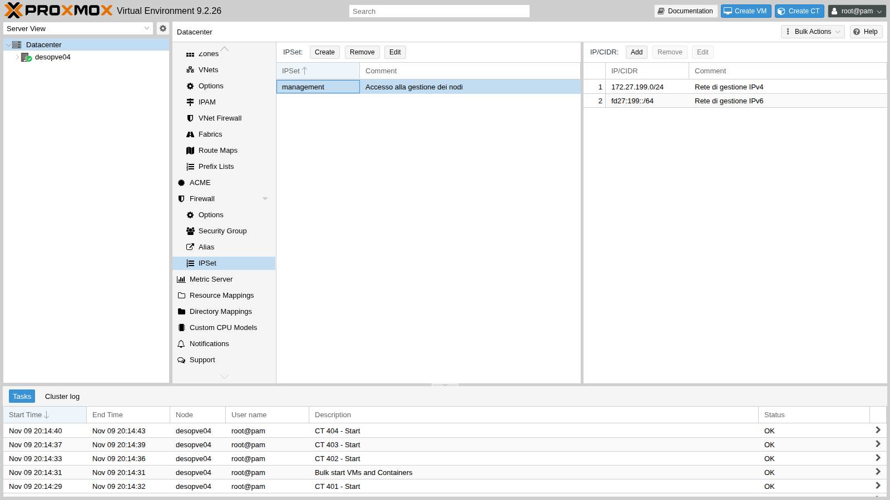

```bash
pvesh create /cluster/firewall/ipset --name management --comment "Accesso alla gestione dei nodi"
pvesh create /cluster/firewall/ipset/management --cidr 172.27.199.0/24 --comment "Rete di gestione IPv4"
pvesh create /cluster/firewall/ipset/management --cidr fd27:199::/64 --comment "Rete di gestione IPv6"
```

L'effetto è stato verificato dal DC togliendo e rimettendo la riga IPv6:

```text
== senza la rete IPv6 nel set management
GUI via IPv6 [fd27:199::24]:8006 -> False
== con la rete IPv6 nel set management
GUI via IPv6 [fd27:199::24]:8006 -> True
```

Infine due regole del **nodo**, in **Nodo → Firewall → Add**:

- ping dalla rete di gestione;
- SSH dalla subnet instradata, per amministrare il nodo dal CT 403.

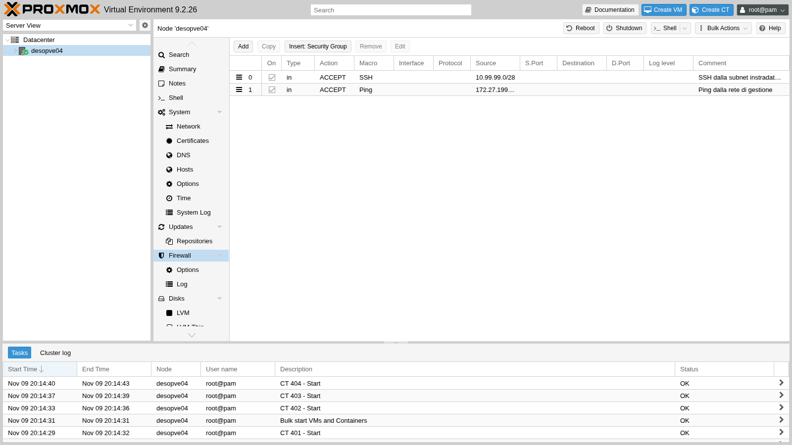

```bash
pvesh create /nodes/desopve04/firewall/rules --type in --action ACCEPT --macro Ping \
  --source 172.27.199.0/24 --enable 1 --comment "Ping dalla rete di gestione"
pvesh create /nodes/desopve04/firewall/rules --type in --action ACCEPT --macro SSH \
  --source 10.99.99.0/28 --enable 1 --comment "SSH dalla subnet instradata (amministrazione del CT 403)"
```

``` { .text .no-copy title="Output" }
ping dal DC ok
CT403 tcp/22 ok
```

## Verifica e test

| Prova | Atteso | Risultato |
|---|---|---|
| Firewall del Datacenter attivo, host del cluster senza regole | `regole host: 0` sui tre nodi | ok |
| Quorum, Corosync (2 link), Ceph, iSCSI, BGP dopo l'attivazione | invariati | ok |
| HTTP, SSH, ping dal DC al CT 101 | tutto permesso | ok |
| HTTP dal CT 121 (NAT 172.27.199.26) | permesso; SSH e ping bloccati | ok |
| HTTP, SSH, ping dal CT 403 (10.99.99.2) | tutto bloccato e registrato nel log | ok |
| SMB dal CT 101 verso il DC | `Connection refused`; DNS ancora permesso | ok |
| GUI e SSH di `desopve04` dalla rete di gestione | permessi; ping bloccato fino alla regola del nodo | ok |
| GUI di `desopve04` via IPv6 | bloccata senza `fd27:199::/64` in `management`, permessa con | ok |
| Routing e port forwarding attraverso `desopve04` | non toccati dal firewall dell'host | ok |

## Stato finale del lab

- **Cluster `deso-cluster`:**
  - firewall del Datacenter **attivo**;
  - firewall degli host **disattivato** su `desopve01`, `desopve02` e `desopve03` (`host.fw`: `enable: 0`), finché il [Lab 33](33-firewall-2.md) non costruisce le regole per i servizi del cluster;
  - alias `dc01`, `rete-gestione`, `rete-instradata`; IPSet `admin`; security group `web-server` e `accesso-admin`.
- **CT 101 `debian-ct01`:**
  - nginx installato, con la pagina di prova;
  - firewall attivo con `log_level_in: info`;
  - regole: `OUT REJECT` verso `dc/dc01` porta 445, `GROUP web-server`, `GROUP accesso-admin`.
- **Altri guest:** nessuna regola; il loro firewall resta spento.
- **`desopve04`:** firewall del suo datacenter attivo, IPSet `management` con 172.27.199.0/24 e `fd27:199::/64`, regole del nodo per Ping (rete di gestione) e SSH (10.99.99.0/28).
- **DC:** script di prova [`fwtest.ps1`](../files/32/fwtest.ps1) in `C:\lab`.

## Cosa hai imparato

- L'interruttore del Datacenter accende il firewall di tutti i nodi: va preparato prima, oppure si disattiva esplicitamente sui nodi.
- Il firewall di un guest richiede due interruttori: l'opzione del guest e `firewall=1` sulla scheda.
- Alias, IPSet e security group rendono le regole leggibili e riutilizzabili; in Proxmox VE 9 si richiamano con l'ambito (`dc/`, `+dc/`).
- Le prove vanno fatte da più sorgenti, e il NAT a monte cambia ciò che il firewall vede.
- `log_level_in` e il log del guest mostrano esattamente quale pacchetto è stato scartato e perché.
- Le regole automatiche dell'host coprono GUI, SSH e console dalla sola rete locale IPv4: per IPv6, e per i servizi su altre reti, servono regole esplicite.

## Riferimenti

- [Proxmox VE – Proxmox VE Firewall](https://pve.proxmox.com/pve-docs/chapter-pve-firewall.html)
- [Proxmox VE – Firewall: IP Sets e Standard IP Set management](https://pve.proxmox.com/pve-docs/chapter-pve-firewall.html#pve_firewall_ip_sets)
- [Proxmox VE – Firewall: Security Groups](https://pve.proxmox.com/pve-docs/chapter-pve-firewall.html#pve_firewall_security_groups)
- [Proxmox VE – Firewall: Ports used by Proxmox VE](https://pve.proxmox.com/pve-docs/chapter-pve-firewall.html#_ports_used_by_proxmox_ve)
