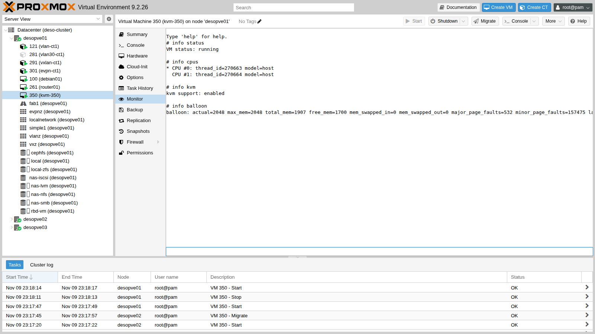
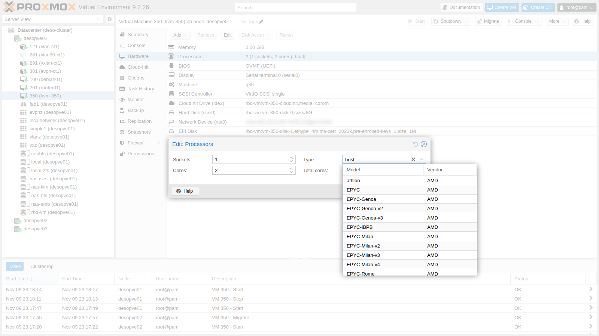
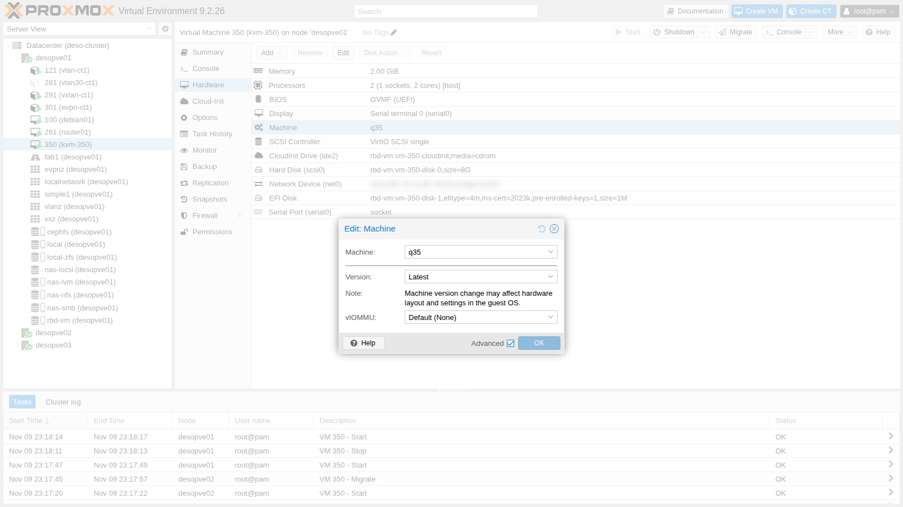

# Lab 35 – KVM e QEMU sotto il cofano

**Livello:** avanzato · **Durata:** 1 ora e 15 minuti

## Dipendenze

- **Lab precedenti:**
  - [Lab 06](06-cluster-corosync.md): cluster a tre nodi, perché la migrazione a caldo richiede almeno due nodi;
  - [Lab 17](17-ceph-installation.md): pool Ceph `rbd-vm`, condiviso, così la migrazione non deve copiare il disco;
  - [Lab 22](22-dedicated-networks.md): rete di migrazione dedicata (VLAN 100).
- **Risorse:** l'immagine cloud `debian-13-genericcloud-amd64.qcow2` in `local:import` di `desopve01`, scaricata nel [Lab 19](19-fio-benchmark.md); la chiave SSH del DC ([Lab 05](05-ssh-shell-cli.md)), autorizzata sui nodi. Con l'immagine si crea una VM di prova con cloud-init; cloud-init si approfondisce nel Lab 40.
- **Indirizzi:** VM di prova `kvm-350` su 172.27.199.150.
- **Credenziali:** `root` / `<password-lab>` sui nodi → [Appendice B](b-credentials-and-addresses.md).

## Obiettivi

- Riconoscere i pezzi di una VM in esecuzione: processo QEMU, thread delle vCPU, thread `vhost`, scope di systemd, interfaccia `tap`.
- Interrogare una VM dal monitor di QEMU.
- Scegliere il **tipo di CPU** sapendo cosa vede il guest e cosa cambia per la migrazione.
- Creare un **modello di CPU personalizzato** per un cluster con processori diversi.
- Capire **machine type**, versioni pinnate, **SeaBIOS** e **OVMF** con Secure Boot.
- Verificare la **virtualizzazione annidata** dentro una VM.

## Come funziona

Una VM di Proxmox VE è un normale **processo QEMU** (`/usr/bin/kvm`) avviato da `qemu-server`. Il processo usa il modulo **KVM** del kernel per eseguire il codice del guest direttamente sulla CPU, con le estensioni di virtualizzazione Intel VT-x o AMD-V.

```text
qm start 350
   └─► systemd crea lo scope 350.scope (cgroup: limiti CPU, memoria, I/O)
         └─► processo kvm (QEMU) ──── thread "CPU 0/KVM", "CPU 1/KVM"  ← una vCPU = un thread
                │                ├── thread vhost-<pid>                ← rete VirtIO nel kernel
                │                └── thread di I/O (qui: librbd per Ceph)
                ├─► /dev/kvm (modulo kvm + kvm_intel / kvm_amd)
                └─► tap350i0 ──► vmbr0                                 ← scheda di rete
```

**Tipo di CPU.** QEMU decide quale CPU mostrare al guest: modello, istruzioni (flag) e livello di compatibilità.

- **`host`:** passa al guest la CPU fisica così com'è. È la più veloce, ma lega la VM a quel modello di processore.
- **Modelli generici (`x86-64-v2-AES`, `x86-64-v3`, `kvm64`):** espongono un insieme fisso di istruzioni, identico su qualsiasi nodo che lo supporti.

Durante una migrazione a caldo il guest **non si riavvia**: le istruzioni che ha visto all'avvio devono esistere anche sul nodo di destinazione. Per questo `x86-64-v2-AES` è il default delle nuove VM.

**Machine type.** È la scheda madre virtuale: `pc` (i440FX, chipset del 1996) o `q35` (ICH9, PCI Express nativo). Ogni versione di QEMU ne porta una versione nuova. Proxmox VE aggiunge il suffisso `+pveN`. La versione si può **pinnare** per tenere fisso l'hardware visto dal guest: Proxmox VE lo fa in automatico per le VM Windows.

**Firmware.** **SeaBIOS** è il BIOS tradizionale; **OVMF** è il firmware UEFI. OVMF ha bisogno di un piccolo disco `efidisk0` per le variabili UEFI, compresi i certificati per il Secure Boot.

## Procedura

### 1. La VM di prova

Una VM Debian 13 creata dall'immagine cloud, con disco su Ceph e CPU `host`. Nessun `machine` o `bios` nella configurazione: si usano i default, i440FX e SeaBIOS.

```bash
qm create 350 --name kvm-350 --memory 2048 --cores 2 --cpu host --ostype l26 \
  --net0 virtio,bridge=vmbr0 --scsihw virtio-scsi-single \
  --scsi0 rbd-vm:0,import-from=local:import/debian-13-genericcloud-amd64.qcow2 \
  --ide2 rbd-vm:cloudinit --boot order=scsi0 \
  --ipconfig0 ip=172.27.199.150/24,gw=172.27.199.1 --nameserver 172.27.199.20 \
  --searchdomain proxmox.community --ciuser labuser --sshkeys /root/.ssh/authorized_keys \
  --serial0 socket --vga serial0
qm resize 350 scsi0 8G
qm start 350
```

`--sshkeys` copia nella VM le chiavi già autorizzate sul nodo, tra cui quella del DC: dal DC si entra nel guest con `ssh labuser@172.27.199.150`. I comandi indicati con «nel guest» si lanciano lì.

### 2. Il comando di QEMU

`qm showcmd` stampa il comando esatto con cui Proxmox VE avvia la VM. È il modo migliore per capire cosa produce ogni opzione della configurazione. Le righe principali:

```bash
qm showcmd 350 --pretty
```

``` { .text .no-copy title="Output" }
/usr/bin/kvm \
  -id 350 \
  -name kvm-350 \
  -chardev 'socket,id=qmp,path=/var/run/qemu-server/350.qmp,server=on,wait=off' \
  -pidfile /var/run/qemu-server/350.pid \
  -daemonize \
  -smp '2,sockets=1,cores=2,maxcpus=2' \
  -cpu host,+kvm_pv_eoi,+kvm_pv_unhalt \
  -m 2048 \
  -device 'virtio-balloon-pci,id=balloon0,bus=pci.0,addr=0x3,free-page-reporting=on' \
  -device 'virtio-scsi-pci,id=virtioscsi0,bus=pci.3,addr=0x1' \
  -blockdev '{"detect-zeroes":"on","discard":"ignore","driver":"throttle", ... "driver":"rbd","image":"vm-350-disk-0","pool":"rbd-vm" ...}' \
  -device 'scsi-hd,bus=virtioscsi0.0,channel=0,scsi-id=0,lun=0,drive=drive-scsi0,id=scsi0,...,write-cache=on' \
  -netdev 'type=tap,id=net0,ifname=tap350i0,script=/usr/libexec/qemu-server/pve-bridge,downscript=/usr/libexec/qemu-server/pve-bridgedown,vhost=on' \
  -device 'virtio-net-pci,mac=BC:24:11:BC:39:B2,netdev=net0,bus=pci.0,addr=0x12,id=net0,...' \
  -machine 'hpet=off,smm=off,type=pc+pve0'
```

Da leggere:

- **`-cpu host,+kvm_pv_eoi,+kvm_pv_unhalt`:** CPU dell'host più due ottimizzazioni paravirtualizzate che Proxmox VE aggiunge sempre per Linux.
- **`-blockdev` con driver `rbd`:** QEMU parla direttamente con Ceph tramite librbd, senza passare dal kernel del nodo.
- **`vhost=on`:** la rete VirtIO è gestita da un thread del kernel (`vhost`), non dal processo QEMU in user space.
- **`-machine type=pc+pve0`:** i440FX, ultima versione disponibile.
- **`virtio-balloon-pci`:** presente di default, si usa nel [Lab 36](36-memory.md).

### 3. Processo, thread e cgroup

```bash
PID=$(cat /var/run/qemu-server/350.pid)
ps -o pid,ppid,user,nlwp,rss,etime,comm -p $PID
ps -T -o spid,comm -p $PID
```

``` { .text .no-copy title="Output" }
    PID    PPID USER     NLWP   RSS     ELAPSED COMMAND
 263691       1 root       36 1097572     02:17 kvm

   SPID COMMAND
 263691 kvm
 263692 call_rcu
 263695 msgr-worker-0
 263702 io_context_pool
 263704 ceph_timer
 263711 taskfin_librbd
 ...
 263757 vhost-263691
 263758 CPU 0/KVM
 263759 CPU 1/KVM
 263761 kvm-nx-lpage-re
```

- **Thread `CPU 0/KVM` e `CPU 1/KVM`:** ogni vCPU è un thread Linux. Lo scheduler del nodo li tratta come qualsiasi altro thread, e da qui vengono `cpulimit`, `cpuunits` e l'affinità (`affinity`) che si vedono nel Lab 42.
- **Thread `vhost-263691`:** con i kernel recenti il lavoro di `vhost` appare come un thread del processo QEMU e non più come processo del kernel separato.
- **Thread `msgr-worker`, `ceph_timer`, `taskfin_librbd`…:** sono di librbd, perché il disco è su Ceph. Con uno storage a file o a blocchi non ci sono.
- **RSS di circa 1 GiB su 2 configurati:** la memoria della VM viene allocata solo quando il guest la usa.

Ogni VM ha il suo **scope di systemd**, cioè un cgroup dedicato, e la sua interfaccia `tap` collegata al bridge:

```text
● 350.scope
     Loaded: loaded (/run/systemd/transient/350.scope; transient)
     Active: active (running) since Mon 2026-11-09 23:10:23 CET; 2min 17s ago
      Tasks: 36 (limit: 35002)

tap350i0         UNKNOWN        36:42:93:1e:22:31 <BROADCAST,MULTICAST,PROMISC,UP,LOWER_UP>
```

### 4. Il monitor di QEMU

Il monitor è la console di controllo di QEMU. Dalla GUI: **VM → Monitor**; dalla riga di comando: `qm monitor 350`.



```text title="qm monitor"
info status
```

``` { .text .no-copy title="Output" }
VM status: running
```

```text title="qm monitor"
info cpus
```

``` { .text .no-copy title="Output" }
* CPU #0: thread_id=263758 model=host
  CPU #1: thread_id=263759 model=host
```

```text title="qm monitor"
info kvm
```

``` { .text .no-copy title="Output" }
kvm support: enabled
```

```text title="qm monitor"
info balloon
```

``` { .text .no-copy title="Output" }
balloon: actual=2048 max_mem=2048 total_mem=1974 free_mem=1111 ...
```

```text title="qm monitor"
info version
```

``` { .text .no-copy title="Output" }
11.1.3pve-qemu-kvm_11.1.3-1
```

I `thread_id` di `info cpus` sono proprio i thread `CPU 0/KVM` e `CPU 1/KVM` visti con `ps`. `info block` mostra la modalità di cache di ogni disco:

```text
drive-scsi0: json:{... "driver": "rbd", "image": "vm-350-disk-0" ...} (throttle)
    Cache mode:       writeback
    Detect zeroes:    on
ecc0604f325c130c767a85510231093: json:{"pool": "rbd-vm", "image": "vm-350-disk-0", ...} (rbd)
    Cache mode:       writeback, direct
```

`writeback, direct` è la traduzione interna di `cache=none`, il default: QEMU apre il disco in modalità diretta (*direct*), senza la page cache del nodo, e lascia al guest la gestione della propria cache di scrittura. Le modalità di cache si confrontano nel [Lab 37](37-virtual-disks-controllers.md).

### 5. Che CPU vede il guest

**Hardware → Processors → Edit → Type** elenca tutti i modelli disponibili: generici, Intel, AMD e quelli personalizzati.



Si prova lo stesso guest con quattro tipi di CPU. Ogni cambio richiede un riavvio completo della VM (`qm reboot`, che ferma e riavvia il processo QEMU). Nel guest si leggono il modello, alcune istruzioni chiave e il **livello x86-64** che il loader di glibc riconosce come supportato:

```bash
qm set 350 --cpu x86-64-v3 && qm reboot 350
# nel guest
grep -m1 "model name" /proc/cpuinfo
grep -m1 ^flags /proc/cpuinfo | wc -w
/lib64/ld-linux-x86-64.so.2 --help | grep x86-64-v
```

Il riepilogo qui sotto raccoglie, per ogni tipo, il modello, le istruzioni chiave presenti (`grep -o -w -E 'aes|avx|avx2|avx512f|hypervisor|pcid|popcnt|sse4_2|vmx|x2apic'` sulla riga `flags`) e il numero totale di flag:

```text
=== cpu: host
  model name	: <modello-CPU-del-nodo>
  flag: aes avx avx2 avx512f hypervisor pcid popcnt sse4_2 vmx x2apic
  totale flag: 101
  x86-64-v4 (supported, searched)
  x86-64-v3 (supported, searched)
  x86-64-v2 (supported, searched)
=== cpu: x86-64-v2-AES
  model name	: QEMU Virtual CPU version 2.5+
  flag: aes hypervisor popcnt sse4_2 x2apic
  totale flag: 44
  x86-64-v2 (supported, searched)
=== cpu: x86-64-v3
  model name	: QEMU Virtual CPU version 2.5+
  flag: aes avx avx2 hypervisor popcnt sse4_2 x2apic
  totale flag: 53
  x86-64-v3 (supported, searched)
  x86-64-v2 (supported, searched)
=== cpu: kvm64
  model name	: Common KVM processor
  flag: hypervisor x2apic
  totale flag: 40
  x86-64-v4
  x86-64-v3
  x86-64-v2
```

Con `host` il guest vede il modello reale del processore del nodo, qui sostituito da un segnaposto (vedi *Dati hardware oscurati* nel [Lab 01](01-lab-architecture.md#piano-degli-indirizzi)); con gli altri tipi vede un modello generico.

| Tipo | Flag | Livello | Quando usarlo |
|---|---|---|---|
| `host` | 101 | v4 | Cluster con CPU identiche, massime prestazioni, virtualizzazione annidata |
| `x86-64-v3` | 53 | v3 | Cluster con CPU recenti (AVX2), anche di generazioni diverse |
| `x86-64-v2-AES` | 44 | v2 | Default: compatibile con quasi tutte le CPU x86 degli ultimi 10-15 anni |
| `kvm64` | 40 | nessuno | Solo per sistemi molto vecchi |

Con `kvm64` mancano anche `sse4_2` e `popcnt`, quindi il guest non arriva nemmeno al livello v2. Le distribuzioni moderne richiedono almeno v2, alcune già v3: un modello troppo "basso" rallenta il guest o gli impedisce di partire.

### 6. Migrazione con CPU `host` tra nodi uguali

I tre nodi del cluster hanno lo stesso processore, quindi `host` si può migrare a caldo. Durante la migrazione, da `netsvc`, il server di servizi di rete del laboratorio, si fa un ping ogni 0,2 secondi verso la VM (`ping -i 0.2 -c 200 172.27.199.150`):

```bash
qm migrate 350 desopve02 --online
```

``` { .text .no-copy title="Output" }
2026-11-09 23:16:09 starting migration of VM 350 to node 'desopve02' (10.100.10.22)
2026-11-09 23:16:14 starting online/live migration on unix:/run/qemu-server/350.migrate
2026-11-09 23:16:14 migration downtime limit: 100 ms
2026-11-09 23:16:15 migration active, transferred 248.7 MiB of 2.0 GiB VM-state, 2.9 GiB/s
2026-11-09 23:16:16 average migration speed: 1.0 GiB/s - downtime 74 ms
2026-11-09 23:16:16 migration status: completed
2026-11-09 23:16:20 migration finished successfully (duration 00:00:11)

--- 172.27.199.150 ping statistics ---
200 packets transmitted, 196 received, 2% packet loss, time 40101ms
```

La migrazione passa sulla rete dedicata (10.100.10.22, [Lab 22](22-dedicated-networks.md)). Il disco è su Ceph, quindi si copia solo la RAM: la copia dei 2 GiB dura circa 2 secondi e l'intero task 11, con un fermo del guest di 74 ms. Al ping mancano 4 risposte, poco meno di un secondo: oltre al fermo c'è il tempo in cui la rete impara dove si trova ora la VM.

**Con nodi diversi.** Se il nodo di destinazione ha una CPU con meno istruzioni, la VM con `host` resta "convinta" di averle ancora. Al primo uso di un'istruzione mancante il guest va in errore o si blocca. Nei cluster con CPU diverse ci sono due soluzioni:

- un modello generico (`x86-64-v2-AES` o `x86-64-v3`) che tutti i nodi supportano;
- un **modello personalizzato**, basato sulla CPU più vecchia del cluster.

### 7. Un modello di CPU personalizzato

I modelli personalizzati stanno in `/etc/pve/virtual-guest/cpu-models.conf`, condiviso in tutto il cluster. Qui se ne crea uno basato sul modello QEMU `Cascadelake-Server-noTSX`, cioè la generazione della CPU dei nodi, con l'istruzione AES:

```bash
cat > /etc/pve/virtual-guest/cpu-models.conf <<'EOF'
cpu-model: lab-cascadelake
	flags +aes
	phys-bits host
	reported-model Cascadelake-Server-noTSX
EOF
qm set 350 --cpu custom-lab-cascadelake
qm reboot 350
```

Nella VM:

```text
model name	: Intel Xeon Processor (Cascadelake)
flag: 87
  x86-64-v4 (supported, searched)
  x86-64-v3 (supported, searched)
  x86-64-v2 (supported, searched)
```

Il guest vede un processore "Cascadelake" generico, con 87 istruzioni invece delle 101 di `host`, ma con lo stesso livello v4. Nella GUI il modello compare nell'elenco dei tipi con il prefisso `custom-`. La migrazione a caldo funziona come prima:

```text
2026-11-09 23:17:51 migration downtime limit: 100 ms
2026-11-09 23:17:53 average migration speed: 1.0 GiB/s - downtime 9 ms
2026-11-09 23:17:57 migration finished successfully (duration 00:00:11)
```

Se nel cluster entrasse un nodo con una CPU più vecchia, basterebbe cambiare `reported-model` nel file: tutte le VM che usano il modello si allineerebbero al successivo riavvio.

### 8. Machine type, versioni e firmware

Con i default, il guest vede una scheda madre i440FX e il BIOS tradizionale:

```text
-machine 'hpet=off,smm=off,type=pc+pve0'
00:00.0 Host bridge: Intel Corporation 440FX - 82441FX PMC [Natoma] (rev 02)
00:01.0 ISA bridge: Intel Corporation 82371SB PIIX3 ISA [Natoma/Triton II]
firmware: BIOS
```

QEMU elenca le versioni disponibili: `pc` e `q35` sono alias dell'ultima.

```bash
kvm -machine help | grep -E "^pc-q35-1[0-9]|^q35 |^pc "
```

``` { .text .no-copy title="Output" }
pc                   Standard PC (i440FX + PIIX, 1996) (alias of pc-i440fx-11.1)
q35                  Standard PC (Q35 + ICH9, 2009) (alias of pc-q35-11.1)
pc-q35-11.1          Standard PC (Q35 + ICH9, 2009)
pc-q35-11.0          Standard PC (Q35 + ICH9, 2009)
pc-q35-10.2          Standard PC (Q35 + ICH9, 2009)
pc-q35-10.1          Standard PC (Q35 + ICH9, 2009)
pc-q35-10.0          Standard PC (Q35 + ICH9, 2009)
```

Si passa a **q35** con firmware **OVMF** e un disco EFI con le chiavi del Secure Boot già caricate. Il cambio di firmware vale dal successivo avvio, quindi serve uno stop e start:

```bash
qm set 350 --machine q35 --bios ovmf --efidisk0 rbd-vm:1,efitype=4m,pre-enrolled-keys=1
qm stop 350 && qm start 350
```

``` { .text .no-copy title="Output" }
efidisk0: successfully created disk 'rbd-vm:vm-350-disk-1,efitype=4m,ms-cert=2023k,pre-enrolled-keys=1,size=1M'
  -blockdev '{"driver":"raw","file":{"driver":"file","filename":"/usr/share/pve-edk2-firmware//OVMF_CODE_4M.secboot.fd"},"node-name":"pflash0","read-only":true}' \
  -machine 'pflash0=pflash0,pflash1=drive-efidisk0,hpet=off,type=q35+pve0'
```

- **`OVMF_CODE_4M.secboot.fd`:** il codice del firmware, in sola lettura, comune a tutte le VM.
- **`efidisk0`:** le variabili UEFI di questa VM.
- **`ms-cert=2023k`:** il disco EFI contiene già i certificati Microsoft del 2023, necessari per avviare i sistemi firmati con le chiavi nuove.

Nel guest:

```text
00:00.0 Host bridge: Intel Corporation 82G33/G31/P35/P31 Express DRAM Controller
00:1a.0 USB controller: Intel Corporation 82801I (ICH9 Family) USB UHCI Controller #4 (rev 03)
firmware: UEFI
[    0.000000] Kernel is locked down from EFI Secure Boot; see man kernel_lockdown.7
[    0.000000] secureboot: Secure boot enabled
SecureBoot efivar: 1
```

L'immagine cloud di Debian contiene sia il boot BIOS sia quello UEFI, per questo riparte senza modifiche. Un sistema installato con SeaBIOS di solito **non** ha la partizione EFI: il cambio di firmware va fatto prima dell'installazione.

**Versione pinnata.** In **Hardware → Machine → Edit**, con **Advanced**, compare la versione: `Latest` segue sempre l'ultima versione di QEMU installata.



Una versione fissa (`machine: pc-q35-11.0+pve0`) mantiene identico l'hardware visto dal guest anche dopo gli aggiornamenti di QEMU. Serve soprattutto a Windows, che può vedere "nuovo hardware" e reimpostare la rete o chiedere una nuova attivazione: per questo Proxmox VE pinna in automatico la versione delle VM Windows alla loro creazione.

### 9. Virtualizzazione annidata

Con la CPU `host` il guest vede l'istruzione `vmx` (Intel VT-x) e può caricare KVM a sua volta:

```bash
cat /sys/module/kvm_intel/parameters/nested   # sul nodo
```

``` { .text .no-copy title="Output" }
Y
```

```bash
sudo modprobe kvm_intel     # nel guest
ls -l /dev/kvm
cat /sys/module/kvm_intel/parameters/nested
```

``` { .text .no-copy title="Output" }
crw-rw---- 1 root kvm 10, 232 Nov  9 22:15 /dev/kvm
Y
```

Con i modelli generici `vmx` non c'è (vedi tabella del passo 5): la virtualizzazione annidata richiede `host`, oppure un modello personalizzato con `+vmx`. Serve per laboratori, CI, sandbox, Proxmox VE dentro Proxmox VE. Le prestazioni di un guest annidato sono inferiori e la migrazione a caldo di una VM che ospita a sua volta delle VM non è supportata.

## Verifica e test

- `qm showcmd` e `info cpus`: il numero di thread `CPU n/KVM` corrisponde alle vCPU configurate.
- Ogni tipo di CPU produce nel guest il modello e il livello x86-64 attesi, e `kvm64` non raggiunge nemmeno v2.
- Migrazione a caldo con `host` e con il modello personalizzato riuscita tra nodi uguali, con fermo di 74 e 9 ms.
- Dopo il passaggio a q35 e OVMF il guest si avvia in UEFI con Secure Boot attivo.

## Stato finale del lab

- **VM 350 `kvm-350`:** eliminata al termine con `qm stop 350 && qm destroy 350 --purge`.
- **Modello di CPU personalizzato `lab-cascadelake`:** resta in `/etc/pve/virtual-guest/cpu-models.conf`, disponibile per i lab successivi; non è usato da nessuna VM.
- Nessun'altra modifica ai nodi.

## Cosa hai imparato

- Una VM è un processo QEMU con un thread per vCPU, un thread `vhost` per la rete e un cgroup dedicato: tutti strumenti Linux normali per osservarla.
- `qm showcmd` e il monitor di QEMU mostrano cosa diventa davvero la configurazione.
- `host` è il tipo di CPU più veloce, ma vincola la migrazione a nodi con la stessa CPU; i modelli generici e quelli personalizzati rendono il cluster eterogeneo migrabile.
- Machine type e versione definiscono l'hardware visto dal guest; pinnare la versione evita sorprese ai sistemi sensibili come Windows.
- OVMF con `efidisk0` e chiavi pre-caricate dà UEFI e Secure Boot; il firmware si sceglie prima di installare il sistema.

## Riferimenti

- [Proxmox VE – Virtual Machines: CPU](https://pve.proxmox.com/pve-docs/chapter-qm.html#qm_cpu)
- [Proxmox VE – Custom CPU models (`cpu-models.conf`)](https://pve.proxmox.com/pve-docs/cpu-models.conf.5.html)
- [Proxmox VE – Machine Type e BIOS/UEFI](https://pve.proxmox.com/pve-docs/chapter-qm.html#qm_machine_type)
- [QEMU – CPU models](https://www.qemu.org/docs/master/system/i386/cpu.html)
- [x86-64 microarchitecture levels](https://gitlab.com/x86-psABIs/x86-64-ABI)
