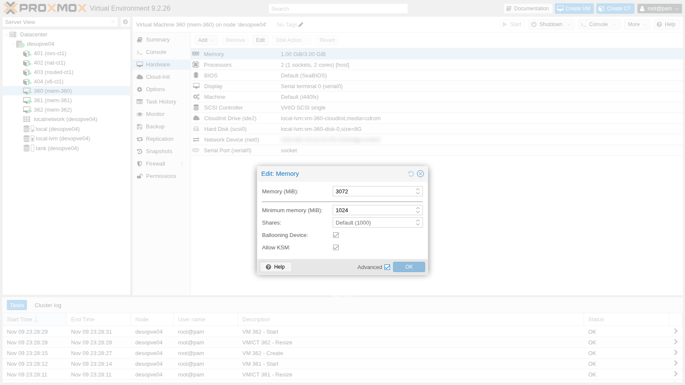
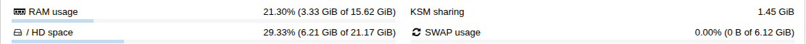

# Lab 36 – Memoria: ballooning, KSM, hugepages, NUMA e overcommit

**Livello:** avanzato · **Durata:** 1 ora e 30 minuti

## Dipendenze

- **Lab precedenti:**
  - [Lab 35](35-kvm-qemu.md): processo QEMU e monitor;
  - [Lab 18](18-ceph-growth-maintenance-failures.md): `desopve04` è tornato un nodo autonomo, con `local-lvm` e 16 GiB di RAM. Tutte le prove di questo lab si fanno lì, così la pressione sulla memoria non tocca il cluster;
  - [Lab 19](19-fio-benchmark.md): l'immagine cloud in `local:import` di `desopve04`;
  - [Lab 23](23-open-vswitch.md), [Lab 24](24-routing-nat.md) e [Lab 25](25-ipv6.md): i CT 401-404 accesi su `desopve04`, che contano nella memoria occupata del nodo;
  - [Lab 05](05-ssh-shell-cli.md): chiave SSH del DC, autorizzata sul nodo e copiata nelle VM.
- **Risorse:** l'immagine cloud `debian-13-genericcloud-amd64.qcow2` in `local:import` di `desopve04`, con cui si creano tre VM identiche con cloud-init, approfondito nel Lab 40.
- **Indirizzi:** VM di prova 360, 361 e 362 su 172.27.199.160-162.
- **Credenziali:** `root` / `<password-lab>` → [Appendice B](b-credentials-and-addresses.md).

## Obiettivi

- Capire come Proxmox VE usa il **ballooning** e quando lo attiva da solo.
- Misurare il risparmio di **KSM** su VM identiche.
- Usare **hugepages** da 2 MiB e da 1 GiB e sapere cosa si perde.
- Dare a una VM una **topologia NUMA** e leggerla dal guest.
- Vedere cosa succede quando la memoria delle VM supera quella del nodo, **con e senza ballooning**.

## Come funziona

La RAM di una VM è memoria del processo QEMU sul nodo. Viene allocata solo quando il guest la usa davvero; per questo la somma della memoria configurata può superare quella fisica (**overcommit**). I meccanismi per gestirla:

- **Ballooning.** Nel guest c'è un driver, `virtio_balloon`, che può "gonfiare" un pallone di memoria: si prende pagine dal guest e le restituisce al nodo. In Proxmox VE si configurano due valori: **Memory**, il massimo, e **Minimum memory**, il minimo. Il servizio `pvestatd` controlla la RAM del nodo ogni 10 secondi:
  - sopra l'**80%** di utilizzo, abbassa il bersaglio del pallone delle VM, in proporzione alle loro **Shares**, fino al minimo;
  - sotto l'80%, riporta tutte le VM al massimo.
- **KSM** (*Kernel Samepage Merging*). Il thread del kernel `ksmd` cerca pagine di memoria identiche fra processi diversi e ne tiene una copia sola, in copia-su-scrittura. Con molte VM uguali si risparmia parecchio. Il servizio `ksmtuned` lo accende solo quando la RAM libera del nodo scende sotto il 20%.
- **Hugepages.** Pagine da 2 MiB o 1 GiB invece che da 4 KiB: meno voci nelle tabelle delle pagine e nella TLB della CPU, quindi meno overhead per VM grandi con molta memoria attiva. Sono memoria **riservata**: niente ballooning, niente KSM, niente swap.
- **NUMA.** Nei server con più processori ogni socket ha la sua memoria "vicina". Una VM che vede la stessa topologia (`numa: 1`) può tenere processi e memoria sullo stesso nodo NUMA.

## Procedura

### 1. Le VM di prova

Tre VM Debian 13 identiche su `desopve04`, 3 GiB di memoria massima e 1 GiB minimo, disco su `local-lvm`:

```bash
for id in 360 361 362; do
  qm create $id --name mem-$id --memory 3072 --balloon 1024 --cores 2 --cpu host --ostype l26 \
    --net0 virtio,bridge=vmbr0 --scsihw virtio-scsi-single \
    --scsi0 local-lvm:0,import-from=local:import/debian-13-genericcloud-amd64.qcow2 \
    --ide2 local-lvm:cloudinit --boot order=scsi0 \
    --ipconfig0 ip=172.27.199.$((id-200))/24,gw=172.27.199.1 --nameserver 172.27.199.20 \
    --ciuser labuser --sshkeys /root/.ssh/authorized_keys --serial0 socket --vga serial0
  qm resize $id scsi0 8G
  qm start $id
done
```

Nei guest si entra dal DC con `ssh labuser@172.27.199.160` (e `.161`, `.162`) e si installano `stress-ng` e `numactl` tramite il proxy del laboratorio:

```bash
echo 'Acquire::http::Proxy "http://proxy.proxmox.community:3128";' | sudo tee /etc/apt/apt.conf.d/90proxy
sudo apt-get update && sudo apt-get install -y stress-ng numactl
```

In **Hardware → Memory → Edit**, con **Advanced**, ci sono tutte le opzioni:



- **Ballooning Device:** il dispositivo `virtio-balloon`. Serve anche se massimo e minimo coincidono, perché fornisce le statistiche di memoria del guest alla GUI.
- **Allow KSM:** permette a KSM di unire le pagine di questa VM. Si toglie per le VM con dati sensibili, per evitare i rischi di *side channel* fra VM che condividono pagine.

### 2. Il pallone in azione

Il driver è caricato nel guest, e il monitor mostra la memoria che il guest possiede davvero (`actual`):

```text
virtio_balloon         32768  0
               total        used        free      shared  buff/cache   available
Mem:            2979         248        2176           0         703        2731

balloon: actual=3072 max_mem=3072 total_mem=2979 free_mem=2179 ...
```

Si chiede al pallone di portare la VM a 1,5 GiB e si legge `actual` ogni 2 secondi:

```bash
printf "balloon 1536\nquit\n" | qm monitor 360
```

```text
 2s actual=2886
 4s actual=2886
 6s actual=2886
 8s actual=2986
10s actual=2986
12s actual=2986
14s actual=2986
16s actual=3072
```

```text
Mem:            2793         333        1905           0         703        2459      ← nel guest, dopo 5 s
```

Il guest comincia a cedere memoria (il totale scende a 2793 MiB), ma dopo pochi secondi torna a 3072. Il motivo: il nodo è scarico, sotto l'80%, quindi `pvestatd` al giro successivo riporta il bersaglio al massimo. Con Proxmox VE il pallone **non** si comanda a mano: lo gestisce il nodo in base alla sua RAM. Lo si vede all'opera nel passo 6.

### 3. KSM su tre VM identiche

`ksmtuned` è attivo ma KSM è fermo, perché il nodo ha più del 20% di RAM libera:

```text
/sys/kernel/mm/ksm/run: 0
KSM_THRES_COEF=20 (default)
Mem:           15991        5230        9647          47        1447       10760
```

Per la prova si ferma `ksmtuned`, che altrimenti spegnerebbe KSM entro un minuto, e si accende KSM con una scansione più veloce:

```bash
systemctl stop ksmtuned
K=/sys/kernel/mm/ksm
echo 1000 > $K/pages_to_scan; echo 20 > $K/sleep_millisecs; echo 1 > $K/run
```

```text
 30s  pages_shared=82740   pages_sharing=98328   risparmio=384 MiB
 60s  pages_shared=165975  pages_sharing=378346  risparmio=1477 MiB
 90s  pages_shared=166168  pages_sharing=379811  risparmio=1483 MiB
120s  pages_shared=166168  pages_sharing=380078  risparmio=1484 MiB
180s  pages_shared=166170  pages_sharing=380495  risparmio=1486 MiB
general_profit: 1443 MiB
Mem:           15991        3395       11483          48        1447       12596
360 RSS=915 MiB
361 RSS=951 MiB
362 RSS=954 MiB
```

- **`pages_shared`:** le pagine uniche tenute in memoria.
- **`pages_sharing`:** quante pagine dei processi puntano a quelle copie, cioè le pagine risparmiate.
- **`general_profit`:** il guadagno netto, tolti i costi di gestione: 1443 MiB.

In tre minuti la RAM usata del nodo è scesa da 5230 a 3395 MiB: tre VM che occupavano circa 2,8 GiB ne usano ora la metà. Sono tre VM con lo stesso sistema operativo appena avviato, quindi kernel, librerie e pagine azzerate coincidono quasi tutte. Con VM diverse e carichi reali il risparmio è minore. Il valore si legge anche nel **Summary** del nodo, alla voce **KSM sharing**:



Il costo è CPU: `ksmd` scansiona continuamente la memoria. Per questo `ksmtuned` lo accende solo sotto pressione. Si torna alla situazione di partenza separando le pagine unite e riavviando il servizio:

```bash
echo 2 > $K/run          # separa tutte le pagine unite e ferma ksmd
echo 100 > $K/pages_to_scan
systemctl start ksmtuned
```

### 4. Hugepages da 2 MiB e da 1 GiB

Si riservano 1600 pagine da 2 MiB (3,1 GiB) e si configura la VM 362. Le hugepages richiedono la NUMA attiva; il ballooning non si può usare, quindi lo si disattiva:

```bash
qm shutdown 362
echo 1600 > /proc/sys/vm/nr_hugepages
qm set 362 --numa 1 --hugepages 2 --balloon 0
qm start 362
```

```text
HugePages_Total:    1600         ← prima dell'avvio
HugePages_Free:     1600
  -object 'memory-backend-file,id=ram-node0,size=3072M,mem-path=/run/hugepages/kvm/2048kB,share=on,prealloc=yes' \
  -numa 'node,nodeid=0,cpus=0-1,memdev=ram-node0' \
HugePages_Total:    1536         ← dopo l'avvio
HugePages_Free:        0
```

La memoria della VM ora è un file nel filesystem `hugetlbfs` (`/run/hugepages/kvm/2048kB`), allocato tutto all'avvio (`prealloc=yes`). Il totale è sceso da 1600 a 1536, esattamente 3072 MiB: Proxmox VE alloca e libera le hugepages da solo all'avvio e allo spegnimento della VM, nel numero che serve. Con `keephugepages: 1` le tiene anche dopo lo spegnimento, per essere sicuro di ritrovarle.

Le pagine da **1 GiB** sono ancora più efficienti, ma la memoria va trovata in blocchi contigui. Con la CPU che ha il flag `pdpe1gb`, e subito dopo l'avvio del nodo, si possono riservare anche a caldo:

```bash
qm shutdown 362      # era accesa con le pagine da 2 MiB, che Proxmox VE libera allo spegnimento
H=/sys/kernel/mm/hugepages/hugepages-1048576kB
echo 3 > $H/nr_hugepages
qm set 362 --hugepages 1024 && qm start 362
```

```text
1G richieste 3, allocate 3, libere 3
  -object 'memory-backend-file,id=ram-node0,size=3072M,mem-path=/run/hugepages/kvm/1048576kB,share=on,prealloc=yes' \
1G libere dopo l'avvio: 0
```

Su un nodo acceso da tempo la memoria è frammentata e l'allocazione a caldo può fallire. In produzione le pagine da 1 GiB si riservano all'avvio, nella riga di comando del kernel (`hugepagesz=1G hugepages=N` in `/etc/kernel/cmdline` con systemd-boot, o in GRUB). Hanno senso per VM grandi con molta memoria attiva (database, analisi), non per VM piccole.

Al termine la VM 362 torna normale: niente hugepages, NUMA spenta, ballooning a 1 GiB. Le pagine riservate vengono rilasciate:

```bash
qm shutdown 362
qm set 362 --delete hugepages,numa --balloon 1024
echo 0 > $H/nr_hugepages
qm start 362
```

### 5. NUMA

Il nodo ha un solo nodo NUMA:

```bash
numactl -H | grep -E "available|size"
```

```text
available: 1 nodes (0)
node 0 size: 15991 MB
```

Alla VM 361 si danno due socket virtuali con un nodo NUMA ciascuno. Ogni nodo virtuale è legato (`policy=bind`) al nodo 0 dell'host:

```bash
qm set 361 --sockets 2 --cores 1 --numa 1 \
  --numa0 cpus=0,hostnodes=0,memory=1536,policy=bind \
  --numa1 cpus=1,hostnodes=0,memory=1536,policy=bind
qm reboot 361
```

```text
  -smp '2,sockets=2,cores=1,maxcpus=2' \
  -object 'memory-backend-ram,id=ram-node0,size=1536M,host-nodes=0,policy=bind' \
  -numa 'node,nodeid=0,cpus=0,memdev=ram-node0' \
  -object 'memory-backend-ram,id=ram-node1,size=1536M,host-nodes=0,policy=bind' \
  -numa 'node,nodeid=1,cpus=1,memdev=ram-node1' \
```

Nel guest:

```text
available: 2 nodes (0-1)
node 0 cpus: 0
node 0 size: 1335 MB
node 1 cpus: 1
node 1 size: 1511 MB
node distances:
node     0    1
   0:   10   20
   1:   20   10
Socket(s):                               2
NUMA node(s):                            2
```

Il guest vede due nodi con la tabella delle distanze (10 locale, 20 remoto) e può scegliere dove mettere processi e memoria. Su questo nodo è una dimostrazione; su un server a due socket la regola è:

- se la VM sta dentro un socket fisico (vCPU e RAM), basta `numa: 1`;
- se è più grande di un socket, le si dà la stessa topologia dell'host, con `numaN` e `hostnodes` corrispondenti ai nodi fisici.

Così le vCPU usano la memoria vicina e non attraversano il collegamento tra i socket.

### 6. Overcommit: con e senza ballooning

Le tre VM passano a **5 GiB** ciascuna, 15 GiB in totale su un nodo da 16 GiB che ospita anche quattro container e il sistema. In ogni VM si avvia un processo che occupa e tiene 4,5 GiB per quasi tre minuti:

```bash
stress-ng --vm 1 --vm-bytes 4500M --vm-keep --timeout 170s
```

Sul nodo, ogni 20 secondi, si leggono RAM, swap e la memoria che ogni VM possiede davvero (`actual`).

**Prova 1 – ballooning attivo** (minimo 1 GiB):

```text
  0s host usato= 7322 MiB libero= 7555 MiB swap=   0 MiB | balloon(MiB): 360=5081 361=4449 362=4842
 20s host usato=14643 MiB libero= 1194 MiB swap= 974 MiB | balloon(MiB): 360=5020 361=4449 362=4842
 40s host usato=15217 MiB libero=  619 MiB swap= 972 MiB | balloon(MiB): 360=5020 361=4178 362=4642
 60s host usato=14553 MiB libero= 1282 MiB swap= 971 MiB | balloon(MiB): 360=5020 361=4149 362=4442
 80s host usato=15003 MiB libero=  828 MiB swap= 970 MiB | balloon(MiB): 360=5020 361=4149 362=4242
100s host usato=13914 MiB libero= 1916 MiB swap= 970 MiB | balloon(MiB): 360=5020 361=4104 362=3942
120s host usato=13249 MiB libero= 2582 MiB swap= 969 MiB | balloon(MiB): 360=4920 361=3849 362=3742
140s host usato=10535 MiB libero= 5295 MiB swap= 969 MiB | balloon(MiB): 360=5020 361=3849 362=3642
```

Nei guest 361 e 362:

```text
[  193.834654] Out of memory: Killed process 753 (stress-ng-vm) total-vm:3627660kB, anon-rss:3538844kB, ... oom_score_adj:1000
[  174.139589] Out of memory: Killed process 749 (stress-ng-vm) total-vm:3405184kB, anon-rss:3331028kB, ... oom_score_adj:1000
```

Superato l'80%, `pvestatd` gonfia i palloni di 361 e 362 (da 4,4-4,8 a 3,6-3,8 GiB). I guest, che non hanno swap, restano senza memoria e il loro OOM killer termina il processo più grande. Il nodo resta in piedi, con meno di 1 GiB di swap usato.

**Prova 2 – ballooning disattivato** (`balloon: 0`, memoria fissa):

```text
  0s host usato= 3034 MiB libero=12731 MiB swap=  909 MiB load=1.50
 20s host usato=15672 MiB libero=  215 MiB swap= 1585 MiB load=2.22
 40s host usato=15713 MiB libero=  195 MiB swap= 2043 MiB load=2.88
 80s host usato=15759 MiB libero=  148 MiB swap= 2043 MiB load=3.98
120s host usato=15675 MiB libero=  232 MiB swap= 2043 MiB load=4.48
160s host usato=15707 MiB libero=  199 MiB swap= 2043 MiB load=4.45
```

```text
stress-ng: info:  [737] successful run completed in 2 mins, 50.18 secs    ← tutte e tre le VM
```

Nessun processo terminato nei guest, ma il nodo lavora al limite: meno di 250 MiB liberi per tre minuti, 2 GiB in swap e carico in crescita. A quel punto il nodo è fragile: un container che parte, un backup o la cache di ZFS che cresce possono far scattare l'OOM killer **del nodo**, che di solito sceglie il processo più grande, cioè una VM intera, spenta senza preavviso.

| | Ballooning attivo | Ballooning disattivato |
|---|---|---|
| RAM libera minima del nodo | 619 MiB | 148 MiB |
| Swap del nodo | circa 1 GiB | 2 GiB e oltre |
| Effetto | i guest perdono il processo più grande | i guest completano, il nodo rischia di perdere una VM |
| Chi paga | il guest che consuma | tutto il nodo |

Il ballooning sposta il problema dentro le VM che consumano troppo, dove un amministratore lo vede e lo gestisce, invece di lasciarlo al nodo. Non sostituisce il dimensionamento: la somma dei **minimi** delle VM deve stare comodamente nella RAM del nodo.

## Verifica e test

- Il driver `virtio_balloon` è caricato nel guest e `info balloon` riporta la memoria effettiva.
- KSM: oltre 380.000 pagine condivise e 1,44 GiB di guadagno netto su tre VM identiche, visibili anche nel Summary del nodo.
- Hugepages da 2 MiB e 1 GiB usate dalla VM (`memory-backend-file` su `hugetlbfs`) e rilasciate allo spegnimento.
- Il guest con `numa: 1` e due socket vede due nodi NUMA con le distanze corrette.
- Overcommit misurato in entrambe le modalità.

## Stato finale del lab

- **VM 360, 361 e 362:** eliminate con `qm stop <id> && qm destroy <id> --purge`; la swap del nodo è stata svuotata con `swapoff -a && swapon -a`.
- **desopve04:** tornato come prima.
  - KSM: `run=0`, controllato da `ksmtuned` attivo, parametri di default.
  - Hugepages: nessuna riservata.
  - Swap: svuotata (`swapoff -a && swapon -a`).
  - CT 401-404: accesi e non toccati.
- Nessuna modifica al cluster.

## Cosa hai imparato

- In Proxmox VE il pallone lo comanda `pvestatd` in base alla RAM del nodo: sotto l'80% le VM tornano al massimo, sopra si riducono verso il minimo secondo le Shares.
- KSM può far risparmiare molta memoria con VM simili, a costo di CPU; `ksmtuned` lo accende solo sotto pressione, e l'opzione **Allow KSM** lo esclude per le VM sensibili.
- Le hugepages riducono l'overhead per VM grandi ma sono memoria riservata: niente ballooning, KSM o swap. Proxmox VE le alloca all'avvio della VM; quelle da 1 GiB si riservano meglio all'avvio del nodo.
- La topologia NUMA della VM conta quando la VM supera un socket fisico.
- L'overcommit funziona finché le VM non usano davvero tutta la memoria; con il ballooning il problema resta nei guest, senza mettere a rischio l'intero nodo.

## Riferimenti

- [Proxmox VE – Virtual Machines: Memory](https://pve.proxmox.com/pve-docs/chapter-qm.html#qm_memory)
- [Proxmox VE – Kernel Samepage Merging (KSM)](https://pve.proxmox.com/pve-docs/chapter-sysadmin.html#kernel_samepage_merging)
- [Proxmox VE – NUMA](https://pve.proxmox.com/pve-docs/chapter-qm.html#qm_cpu)
- [Linux kernel – Kernel Samepage Merging](https://docs.kernel.org/admin-guide/mm/ksm.html)
- [Linux kernel – HugeTLB Pages](https://docs.kernel.org/admin-guide/mm/hugetlbpage.html)
