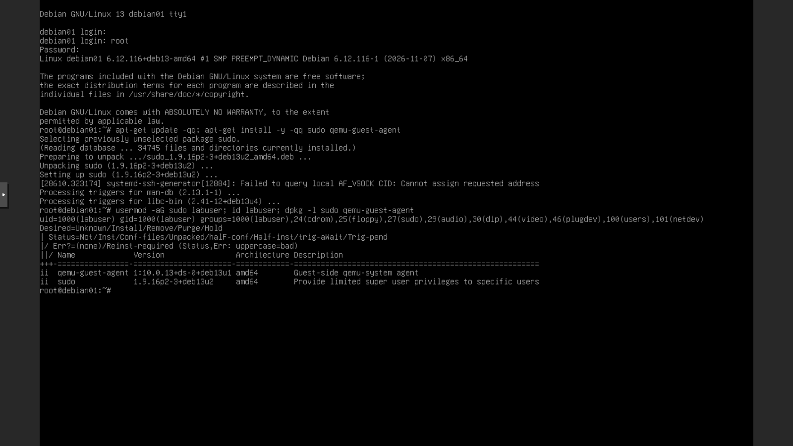
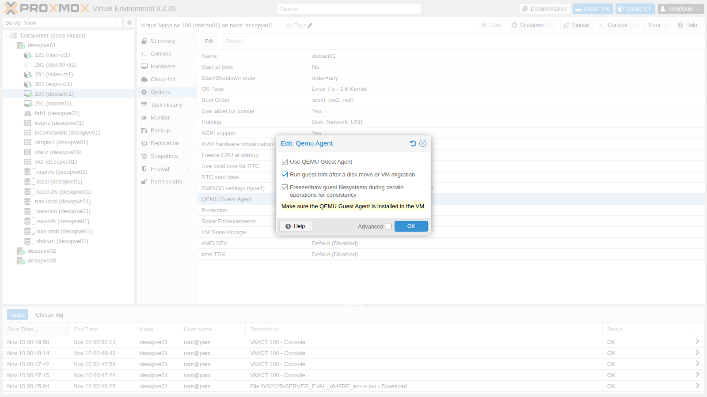
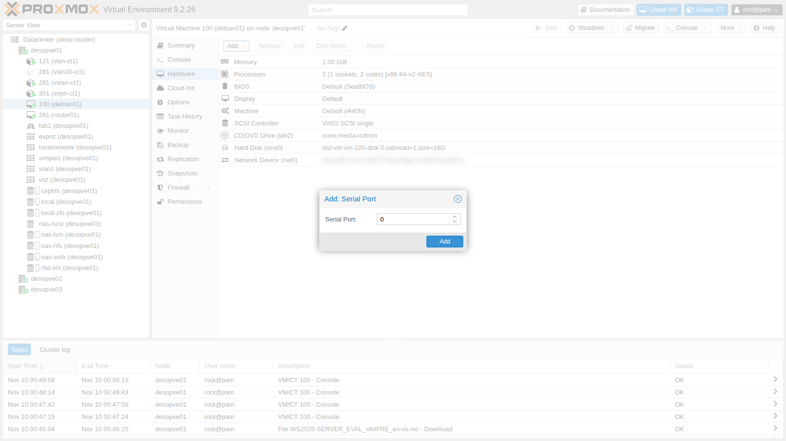
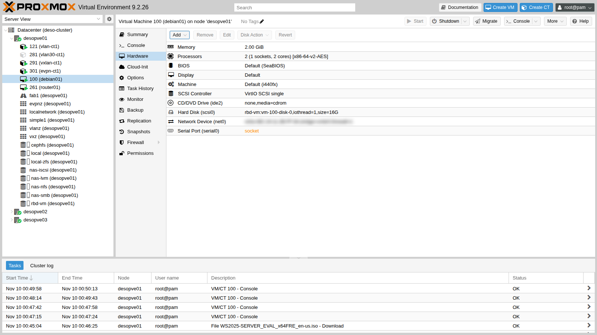
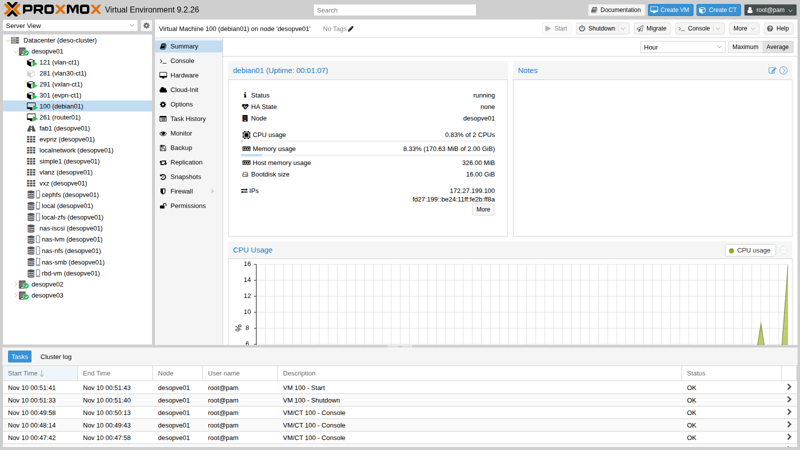
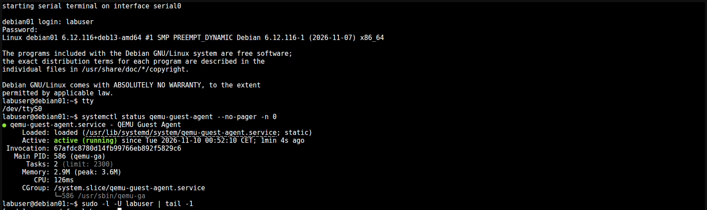
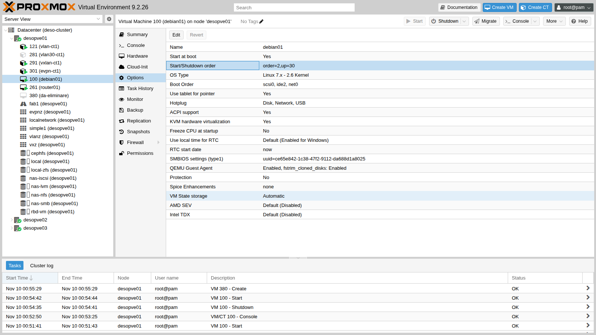
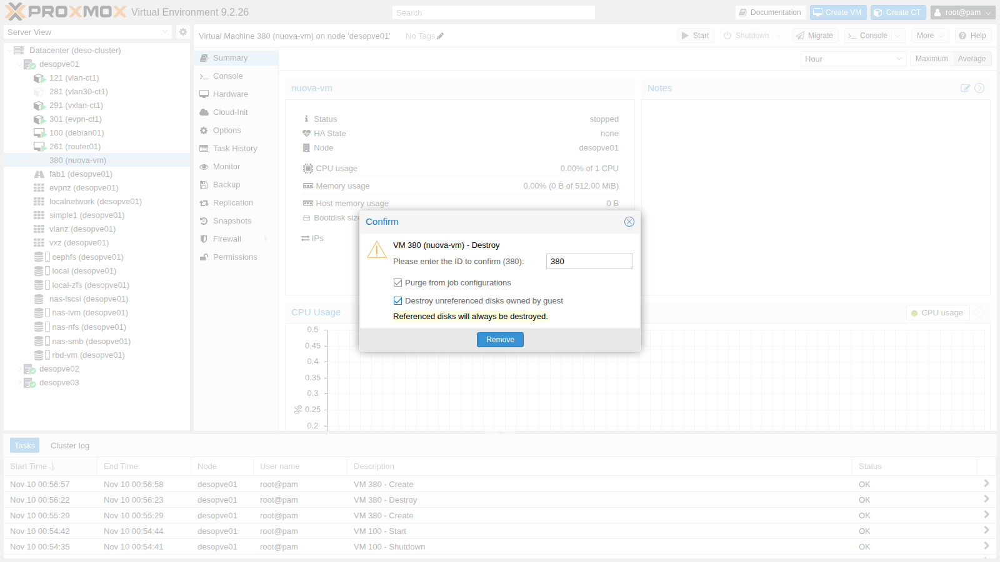

# Lab 38 – VM Linux e QEMU Guest Agent: console seriale, opzioni, spegnimento, fsfreeze e rimozione

**Livello:** intermedio · **Durata:** 1 ora

## Dipendenze

- **Lab precedenti:**
  - [Lab 07](07-first-vm-and-container.md): la VM 100 `debian01` (Debian 13), installata da ISO;
  - [Lab 05](05-ssh-shell-cli.md): SSH e comandi `qm`;
  - [Lab 35](35-kvm-qemu.md): processo QEMU, `qm showcmd` e monitor.
- **VM e servizi:** VM 100 `debian01` su `desopve01`, disco su `rbd-vm` (Ceph, [Lab 17](17-ceph-installation.md)); storage `nas-nfs` ([Lab 13](13-nfs.md)) per un job di backup di prova.
- **Indirizzi:** VM 100 su 172.27.199.100; VM di prova 380 senza rete.
- **Credenziali:** `root` e `labuser` / `<password-lab>` → [Appendice B](b-credentials-and-addresses.md).

## Obiettivi

- Usare le due console di una VM: **noVNC** (schermo grafico) e **xterm.js** (porta seriale).
- Installare e attivare il **QEMU Guest Agent** e capire cosa ci fa Proxmox VE: indirizzi IP, spegnimento pulito, comandi nel guest, password, freeze dei filesystem.
- Vedere con una prova reale come il **fsfreeze** blocca le scritture del guest durante un backup.
- Impostare **avvio automatico**, **ordine di avvio** e **protezione** di una VM.
- Eliminare una VM in modo completo con **purge**, e capire cosa succede senza.

## Come funziona

**Il guest agent.** `qemu-ga` è un piccolo servizio che gira dentro il guest. Proxmox VE gli parla attraverso un canale dedicato, senza passare dalla rete:

```text
nodo:  /var/run/qemu-server/100.qga  (socket Unix)
QEMU:  dispositivo virtio-serial ──► porta "org.qemu.guest_agent.0"
guest: qemu-ga legge i comandi dalla porta e risponde
```

Con l'agent attivo Proxmox VE:

- mostra gli **IP del guest** nel Summary, senza doverli cercare;
- **spegne** la VM chiedendolo al sistema operativo, invece di simulare il tasto di accensione (ACPI);
- **congela i filesystem** prima di uno snapshot o di un backup, così i dati su disco sono coerenti;
- dopo uno spostamento del disco o una migrazione può lanciare **`fstrim`** nel guest per restituire lo spazio allo storage thin ([Lab 37](37-virtual-disks-controllers.md));
- esegue **comandi** nel guest (`qm guest exec`) e ne cambia le **password** (`qm guest passwd`).

L'agent va attivato da entrambe le parti: il pacchetto nel guest e l'opzione **QEMU Guest Agent** nella VM. L'opzione aggiunge il dispositivo virtio-serial, quindi diventa effettiva solo con un nuovo avvio del processo QEMU.

**Le console.**

- **noVNC** mostra lo schermo grafico della VM (la scheda video emulata). Funziona sempre, anche durante l'avvio e senza rete.
- **xterm.js** è un terminale testuale collegato alla **porta seriale** della VM. Richiede una porta `serial0` e un `getty` in ascolto su `ttyS0` nel guest. Rispetto a noVNC permette copia e incolla e non ha problemi di layout della tastiera.

**Rimozione.** `qm destroy` elimina configurazione e dischi. I riferimenti alla VM in altre configurazioni del cluster (job di backup, replica, HA) restano, a meno di chiedere il **purge**.

## Procedura

### 1. Il punto di partenza: `labuser` senza sudo

Nella VM 100 del [Lab 07](07-first-vm-and-container.md) l'utente `labuser` non può diventare amministratore. Non è un errore: se nell'installer Debian si imposta una password per `root`, l'installer **non** installa `sudo` e non aggiunge il primo utente al gruppo `sudo`. Per `root` invece l'accesso SSH con password è disattivato di default (`PermitRootLogin prohibit-password`).

Si rimedia dalla **console noVNC** (VM 100 → **Console**), entrando come `root`:

```bash
apt-get update -qq; apt-get install -y -qq sudo qemu-guest-agent
usermod -aG sudo labuser; id labuser; dpkg -l sudo qemu-guest-agent
```



- `id labuser` ora mostra il gruppo `27(sudo)`.
- `qemu-guest-agent` risulta **già installato** (`ii`): apt ha installato solo `sudo`. Nella VM manca ancora solo l'attivazione dal lato Proxmox.

> La console noVNC trasmette i **tasti**, non i caratteri: con un layout diverso tra client e guest i simboli escono sbagliati. Per digitare comandi lunghi conviene la console seriale (sezione 5) o SSH.

### 2. Attivare l'agent nella VM

**Options → QEMU Guest Agent → Edit:**



- **Use QEMU Guest Agent:** aggiunge il canale virtio-serial e fa usare l'agent a Proxmox VE.
- **Run guest-trim after a disk move or VM migration:** dopo *Move disk* o migrazione lancia `fstrim` nel guest.
- **Freeze/thaw guest filesystems… for consistency:** attivo di default, è il freeze usato da backup e snapshot (sezione 6).

Da CLI:

```bash
qm set 100 --agent enabled=1,fstrim_cloned_disks=1
```

### 3. Aggiungere la porta seriale

**Hardware → Add → Serial Port**, porta `0`:



Le due modifiche richiedono nuovo hardware nella VM, quindi restano **in sospeso**: nella vista Hardware la porta seriale appare in arancione.



Nel guest serve un terminale di login sulla seriale:

```bash
sudo systemctl enable serial-getty@ttyS0.service
```

``` { .text .no-copy title="Output" }
Created symlink '/etc/systemd/system/getty.target.wants/serial-getty@ttyS0.service' → '/usr/lib/systemd/system/serial-getty@.service'.
```

Un riavvio dall'interno del guest **non basta**: il processo QEMU resta lo stesso e il nuovo hardware non compare. Serve spegnere e riaccendere la VM:

```bash
qm shutdown 100 && qm start 100
```

### 4. Verificare l'agent

Sul nodo compaiono il socket dell'agent e quello della seriale, e la riga di comando di QEMU contiene i nuovi dispositivi:

```text
srwxr-x--- 1 root root  0 Nov 10 00:54 /var/run/qemu-server/100.qga
srwxr-x--- 1 root root  0 Nov 10 00:54 /var/run/qemu-server/100.serial0
```

```text
  -chardev 'socket,id=serial0,path=/var/run/qemu-server/100.serial0,server=on,wait=off' \
  -device 'isa-serial,chardev=serial0' \
  -chardev 'socket,path=/var/run/qemu-server/100.qga,server=on,wait=off,id=qga0' \
  -device 'virtio-serial,id=qga0,bus=pci.0,addr=0x8' \
  -device 'virtserialport,chardev=qga0,name=org.qemu.guest_agent.0' \
```

I comandi dell'agent (`qm agent` è un sinonimo di `qm guest cmd`):

```bash
qm agent 100 ping            # nessun output e codice di uscita 0 se l'agent risponde
qm guest cmd 100 get-osinfo
```

``` { .text .no-copy title="Output" }
{
   "id" : "debian",
   "kernel-release" : "6.12.116+deb13-amd64",
   "kernel-version" : "#1 SMP PREEMPT_DYNAMIC Debian 6.12.116-1 (2026-11-07)",
   "machine" : "x86_64",
   "name" : "Debian GNU/Linux",
   "pretty-name" : "Debian GNU/Linux 13 (trixie)",
   "version" : "13 (trixie)",
   "version-id" : "13"
}
```

`network-get-interfaces` restituisce schede e indirizzi; riassunto:

```text
lo 00:00:00:00:00:00 ['127.0.0.1/8', '::1/128']
ens18 bc:24:11:2b:ff:8a ['172.27.199.100/24', 'fd27:199::be24:11ff:fe2b:ff8a/64', 'fe80::be24:11ff:fe2b:ff8a/64']
```

L'indirizzo IPv6 globale è quello SLAAC ricevuto dal router del laboratorio ([Lab 25](25-ipv6.md)). Gli stessi indirizzi compaiono nel **Summary** della VM, alla voce **IPs**:



Un comando eseguito nel guest, con l'output restituito al nodo:

```bash
qm guest exec 100 -- uname -r
```

``` { .text .no-copy title="Output" }
{
   "exitcode" : 0,
   "exited" : 1,
   "out-data" : "6.12.116+deb13-amd64\n",
   "out-truncated" : 0
}
```

`get-fsinfo` elenca i filesystem del guest e i dischi su cui stanno: il disco è riconosciuto come `drive-scsi0`, lo stesso nome usato da Proxmox VE.

```text
/ ext4 sda1 ['0QEMU_QEMU_HARDDISK_drive-scsi0'] 1315024896 15046635520
```

### 5. La console seriale con xterm.js

**Console → xterm.js** (o il menu a tendina del pulsante **Console**). Si apre direttamente il terminale della porta seriale:



`tty` risponde `/dev/ttyS0`: è la porta seriale, non lo schermo. Il testo si copia e incolla come in un terminale SSH, ma la console funziona anche senza rete nel guest.

### 6. fsfreeze: cosa vede il guest durante un backup

Un backup in modalità *snapshot* (Lab 46) fa questo: congela i filesystem, crea lo snapshot del disco, scongela. Così il disco salvato è coerente, come dopo un `sync`. La prova con i comandi dell'agent:

- dal nodo: `fsfreeze-freeze`, attesa di 12 secondi, `fsfreeze-thaw`;
- nel guest, in una sessione SSH già aperta, una scrittura con `sync` che parte durante il freeze.

```bash
# sul nodo
qm guest cmd 100 fsfreeze-freeze      # risponde con il numero di filesystem congelati
qm guest cmd 100 fsfreeze-status
sleep 12
qm guest cmd 100 fsfreeze-thaw
# nel guest, subito dopo il freeze
date +%T; dd if=/dev/zero of=~/prova bs=1M count=10 && sync; date +%T
```

``` { .text .no-copy title="Output" }
nodo: 00:53:50 freeze
1
frozen
Agent error: Command guest-exec has been disabled: the command is not allowed
nodo: 00:54:06 thaw
1
thawed
guest: inizio scrittura 00:53:54
guest: fine scrittura 00:54:08
```

- `fsfreeze-freeze` risponde con il numero di filesystem congelati (1) e lo stato diventa `frozen`.
- **Durante il freeze l'agent rifiuta gli altri comandi**, come `guest-exec`: accetta solo stato e thaw.
- La scrittura nel guest è iniziata alle 00:53:54 ed è **rimasta bloccata** fino al thaw delle 00:54:06: le applicazioni non ricevono errori, aspettano.

Per questo un backup con agent dura pochi secondi di "pausa" in scrittura. Per i database, `qemu-ga` può eseguire uno script prima e dopo il freeze (*fsfreeze hook*), per esempio per far scrivere al database un checkpoint coerente.

### 7. Spegnimento pulito

Con l'agent attivo `qm shutdown` (e il pulsante **Shutdown**) chiede lo spegnimento al guest attraverso l'agent. Il tempo si misura con `time qm shutdown 100`:

```text
spenta in 7 s
```

Nel journal del guest, dopo il riavvio, si vede chi ha chiesto lo spegnimento:

```bash
qm guest exec 100 -- journalctl -b -1 --no-pager -g "guest-shutdown|System is powering down"
```

``` { .text .no-copy title="Output" }
Nov 10 00:54:35 debian01 qemu-ga[586]: info: guest-shutdown called, mode: (null)
Nov 10 00:54:35 debian01 systemd-logind[596]: System is powering down (hypervisor initiated shutdown).
```

Senza agent Proxmox VE invia un evento ACPI, come la pressione del tasto di accensione: funziona solo se il guest lo gestisce (con systemd sì). Se il guest non risponde entro il timeout, il task fallisce e serve **Stop**, che equivale a togliere la corrente.

### 8. Cambiare la password con l'agent

`qm guest passwd` imposta la password di un utente del guest senza entrarci. Legge la nuova password due volte da standard input:

```bash
qm guest passwd 100 labuser
```

La prova con una password temporanea e un login SSH:

```text
login con la nuova password: ok (labuser@debian01)
```

Poi la password è stata riportata a `<password-lab>` con lo stesso comando. È utile quando una password è persa e la VM non ha altri accessi: basta che l'agent sia attivo.

### 9. Avvio automatico, ordine e protezione

In **Options**:

- **Start at boot** (`onboot`): la VM parte quando si avvia il nodo.
- **Start/Shutdown order** (`startup`): `order` è la posizione nella sequenza (prima i numeri bassi; allo spegnimento l'ordine si inverte), `up` i secondi da aspettare dopo l'avvio prima della VM successiva, `down` il timeout di spegnimento.

Per la VM 100: avvio automatico, posizione 2, 30 secondi di attesa.



```bash
qm set 100 --onboot 1 --startup order=2,up=30
```

**Protection** impedisce di eliminare la VM e i suoi dischi. Prova su una VM usa e getta, la 380, creata vuota con un disco da 1 GiB:

```bash
qm create 380 --name prova-380 --memory 512 --scsihw virtio-scsi-single --scsi0 rbd-vm:1 --ostype l26
qm set 380 --protection 1
qm destroy 380
```

``` { .text .no-copy title="Output" }
can't remove VM 380 - protection mode enabled
```

Si toglie con `qm set 380 --delete protection`.

### 10. Rimozione: senza e con purge

La VM 380 viene inserita in un job di backup (disattivato, solo per la prova):

```bash
pvesh create /cluster/backup --vmid 380 --storage nas-nfs --schedule "sun 03:00" --enabled 0 --mode snapshot --comment "lab 38 prova purge"
```

**Prima rimozione, con le opzioni di default.** Nel dialogo di rimozione (**More → Remove**) **Purge from job configurations** è disattivato. La VM sparisce, il volume su Ceph pure, ma il job resta:

```text
vzdump: 7da86c4c-424f-44c6-98bf-08d52b3a8af1
	comment lab 38 prova purge
	schedule sun 03:00
	enabled 0
	mode snapshot
	storage nas-nfs
	vmid 380
```

Il problema si vede creando una **nuova** VM con lo stesso ID:

```bash
qm create 380 --name nuova-vm --memory 512 --scsihw virtio-scsi-single --scsi0 rbd-vm:1 --ostype l26
pvesh get /cluster/backup/7da86c4c-424f-44c6-98bf-08d52b3a8af1 --output-format json \
  | python3 -c 'import json,sys; print("job vmid:", json.load(sys.stdin)["vmid"])'
```

``` { .text .no-copy title="Output" }
job vmid: 380
```

La VM nuova **eredita senza avviso** il job della vecchia: con un job attivo verrebbe salvata (o, se lo storage non ha spazio, farebbe fallire il job).

**Seconda rimozione, con purge.** Si attivano **Purge from job configurations** e **Destroy unreferenced disks owned by guest** (cerca e cancella anche dischi della VM non collegati nella configurazione):



```bash
echo "--- dopo la rimozione con purge"; cat /etc/pve/jobs.cfg; echo "(fine jobs.cfg)"
```

``` { .text .no-copy title="Output" }
--- dopo la rimozione con purge
(fine jobs.cfg)
```

`/etc/pve/jobs.cfg` è vuoto: il job conteneva solo la VM 380, e il purge lo ha **eliminato del tutto**. Da CLI:

```bash
qm destroy 380 --purge 1 --destroy-unreferenced-disks 1
```

Il purge toglie la VM anche da replica e HA.

## Verifica e test

- `labuser` è nel gruppo `sudo`; `qemu-guest-agent` è attivo nel guest.
- `qm agent 100 ping` risponde; il Summary mostra gli IP della VM.
- La console xterm.js apre un login su `/dev/ttyS0`.
- `qm shutdown` spegne la VM in 7 secondi e il guest registra `guest-shutdown called`.
- Durante un `fsfreeze` le scritture nel guest restano in attesa fino al thaw e l'agent rifiuta `guest-exec`.
- `qm guest passwd` cambia la password e il login con la nuova funziona.
- Una VM protetta non si può eliminare.
- Senza purge un job di backup conserva l'ID della VM eliminata e lo applica a una VM nuova con lo stesso ID; con purge il riferimento sparisce.

## Stato finale del lab

- **VM 100 `debian01`** su `desopve01`, accesa: `sudo` per `labuser`, agent attivo (`agent: 1,fstrim_cloned_disks=1`), porta `serial0` con getty su `ttyS0`, `onboot: 1`, `startup: order=2,up=30`. Password di `labuser` uguale a prima.
- **VM 380:** eliminata, con il job di backup di prova.
- Nessun'altra modifica al cluster.

## Cosa hai imparato

- Il guest agent comunica con il nodo su un canale virtio-serial e va attivato sia nel guest sia nelle opzioni della VM; l'hardware nuovo richiede spegnimento e riaccensione.
- Con l'agent Proxmox VE conosce gli IP del guest, lo spegne in modo pulito, esegue comandi e cambia password.
- Il freeze dei filesystem mette in attesa le scritture del guest per il tempo dello snapshot: è ciò che rende coerenti i backup.
- La console xterm.js usa la porta seriale e si comporta come un terminale vero; noVNC resta l'accesso di emergenza.
- `onboot`, `startup` e `protection` regolano avvio automatico, sequenza e sicurezza delle VM.
- Eliminare una VM senza purge lascia riferimenti orfani nei job, che una VM nuova con lo stesso ID eredita.

## Riferimenti

- [Proxmox VE – Virtual Machines: QEMU Guest Agent](https://pve.proxmox.com/pve-docs/chapter-qm.html#qm_qemu_agent)
- [Proxmox VE wiki – Qemu-guest-agent](https://pve.proxmox.com/wiki/Qemu-guest-agent)
- [Proxmox VE wiki – Serial Terminal](https://pve.proxmox.com/wiki/Serial_Terminal)
- [Proxmox VE – qm(1)](https://pve.proxmox.com/pve-docs/qm.1.html)
- [QEMU – Guest Agent protocol reference](https://www.qemu.org/docs/master/interop/qemu-ga-ref.html)
