# Lab 39 – VM Windows e driver VirtIO: Windows Server 2025 con UEFI, TPM, VirtIO SCSI e guest agent

**Livello:** intermedio · **Durata:** 1 ora e 30 minuti, di cui circa 40 minuti di installazione

## Dipendenze

- **Lab precedenti:**
  - [Lab 02](02-domain-controller.md): le schermate iniziali dell'installazione di Windows Server 2025 (lingua, edizione, licenza);
  - [Lab 35](35-kvm-qemu.md): machine type, OVMF e Secure Boot;
  - [Lab 37](37-virtual-disks-controllers.md): VirtIO SCSI, IO thread, discard;
  - [Lab 38](38-linux-vm-guest-agent.md): QEMU Guest Agent.
- **Nodo e storage:** VM su `desopve02`; dischi su `rbd-vm`; ISO su `cephfs`, condiviso tra i nodi ([Lab 17](17-ceph-installation.md)).
- **Rete:** il proxy del laboratorio per scaricare le ISO ([Lab 01](01-lab-architecture.md)). Nella whitelist del proxy servono `software-static.download.prss.microsoft.com` e `go.microsoft.com` per la ISO di Windows Server, `fedorapeople.org` per quella dei driver VirtIO.
- **Indirizzi:** VM 390 `win2025` su 172.27.199.190. L'indirizzo era della VM 190 del [Lab 19](19-fio-benchmark.md), eliminata a fine lab, quindi è libero.
- **Credenziali:** `Administrator` / `<password-lab>` → [Appendice B](b-credentials-and-addresses.md).

## Obiettivi

- Scaricare le ISO ufficiali di **Windows Server 2025 Evaluation** e dei **driver VirtIO** direttamente negli storage di Proxmox VE.
- Creare una VM Windows con le impostazioni consigliate: UEFI con Secure Boot, TPM 2.0, VirtIO SCSI single, scheda di rete VirtIO.
- Caricare il driver del disco **durante** l'installazione, quando Windows non vede nessun disco.
- Installare tutti i driver e il guest agent con **virtio-win-guest-tools** e verificarli in Device Manager e da Proxmox VE.
- Usare l'agent per configurare Windows dal nodo con PowerShell.

## Come funziona

Windows non contiene i driver dei dispositivi **paravirtualizzati** VirtIO, quelli che danno le prestazioni migliori ([Lab 37](37-virtual-disks-controllers.md)). Senza driver:

- il programma di installazione **non vede il disco** su VirtIO SCSI;
- dopo l'installazione la **scheda di rete** VirtIO, il **balloon** e la **porta del guest agent** restano dispositivi sconosciuti.

I driver stanno nella ISO `virtio-win`, mantenuta dal progetto Fedora e firmata per Windows. La procedura standard:

1. due lettori CD: la ISO di Windows e quella dei driver;
2. durante l'installazione si carica solo il driver del disco (`vioscsi`);
3. a sistema installato, `virtio-win-guest-tools.exe` installa tutti gli altri driver, il QEMU Guest Agent e il servizio balloon.

**Le impostazioni per Windows moderni:**

| Impostazione | Valore | Perché |
|---|---|---|
| OS type | `win11` (Windows 11/2022/2025) | Proxmox VE applica i default giusti per Windows: machine q35 con versione bloccata, orologio in ora locale, ottimizzazioni Hyper-V |
| BIOS | OVMF (UEFI) con EFI disk e chiavi Microsoft preinstallate | Secure Boot attivo, come su un server fisico moderno |
| TPM | v2.0 | obbligatorio per Windows 11, utile per BitLocker anche su Windows Server |
| Controller e disco | VirtIO SCSI single, IO thread, Discard, SSD emulation | prestazioni migliori e spazio restituito allo storage thin |
| Scheda di rete | VirtIO (paravirtualized) | prestazioni migliori, driver NetKVM |

## Procedura

### 1. Le ISO negli storage

Le ISO vanno su `cephfs`, così sono disponibili su tutti i nodi.

**Windows Server 2025 Evaluation.** Lo storage `cephfs` → **ISO Images** → **Download from URL**, con l'indirizzo diretto della ISO Evaluation (inglese) e **Query URL**, che legge nome e dimensione. L'indirizzo usato nel laboratorio è quello che la pagina Evaluation Center di Windows Server 2025 propone per la ISO in inglese a 64 bit: `https://software-static.download.prss.microsoft.com/dbazure/888969d5-f34g-4e03-ac9d-1f9786c66749/26100.1742.240906-0331.ge_release_svc_refresh_SERVER_EVAL_x64FRE_en-us.iso`. Microsoft lo cambia a ogni nuova build: conviene ricopiarlo dalla pagina ufficiale.

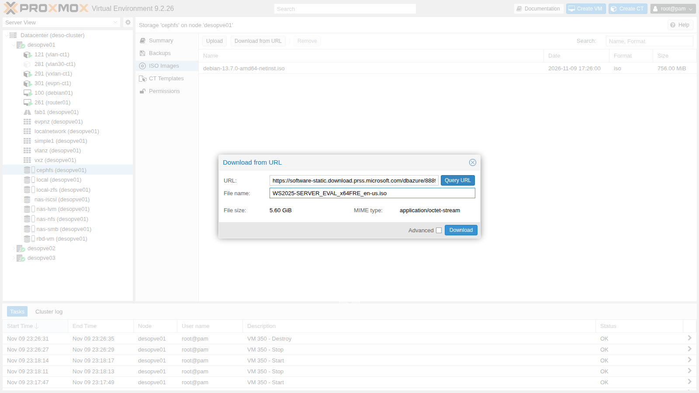

Il nodo la scarica attraverso il proxy configurato nel [Lab 04](04-first-access-repositories-updates.md):

```text
2026-11-10 00:46:25 (71.2 MB/s) - '/mnt/pve/cephfs/template/iso/WS2025-SERVER_EVAL_x64FRE_en-us.iso.tmp_dwnl.329677' saved [6014152704/6014152704]
TASK OK
```

**Driver VirtIO.** La versione *stable* da riga di comando, con la stessa API:

```bash
pvesh create /nodes/desopve02/storage/cephfs/download-url --content iso \
  --filename virtio-win-0.1.302.iso \
  --url https://fedorapeople.org/groups/virt/virtio-win/direct-downloads/archive-virtio/virtio-win-0.1.302-1/virtio-win-0.1.302.iso
```

```text
2026-11-10 01:03:01 (12.8 MB/s) - '/mnt/pve/cephfs/template/iso/virtio-win-0.1.302.iso.tmp_dwnl.261762' saved [877373440/877373440]
```

L'indirizzo `.../stable-virtio/virtio-win.iso` reindirizza sempre all'ultima versione stabile: qui si usa l'indirizzo esatto, così il lab è ripetibile. Le impronte, da annotare per verificare eventuali copie successive:

```text
303f7ae40dad495d6ae474fdc571df58958a4dbc5c37a522d80f9a203867949d  virtio-win-0.1.302.iso
d0ef4502e350e3c6c53c15b1b3020d38a5ded011bf04998e950720ac8579b23d  WS2025-SERVER_EVAL_x64FRE_en-us.iso
```

Niente versioni "alleggerite" o rimaneggiate di Windows: si usano solo le ISO ufficiali Microsoft.

### 2. La VM con il wizard

**Create VM** in alto a destra.

- **General:** nodo `desopve02`, VM ID `390`, nome `win2025`.
- **OS:** ISO di Windows da `cephfs`; Type **Microsoft Windows**, Version **11/2022/2025**; **Add additional drive for VirtIO drivers** con la ISO `virtio-win`. Il wizard aggiunge così il secondo lettore CD.

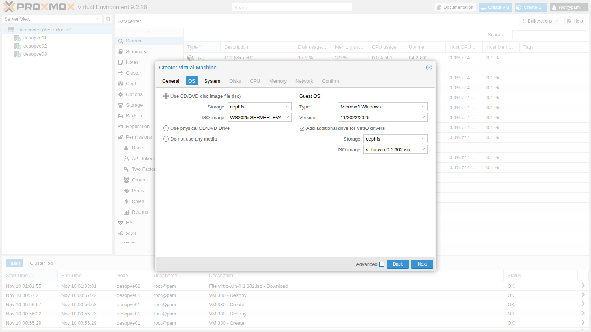

- **System:** scegliendo Windows 11/2022/2025 il wizard propone da solo **q35**, **OVMF (UEFI)**, **EFI disk** con **Pre-Enroll keys** e **TPM v2.0**. Si cambia solo lo storage di EFI disk e TPM in `rbd-vm`. **Qemu Agent** si può spuntare qui; in questo lab lo si attiva dopo l'installazione dei driver (sezione 7).

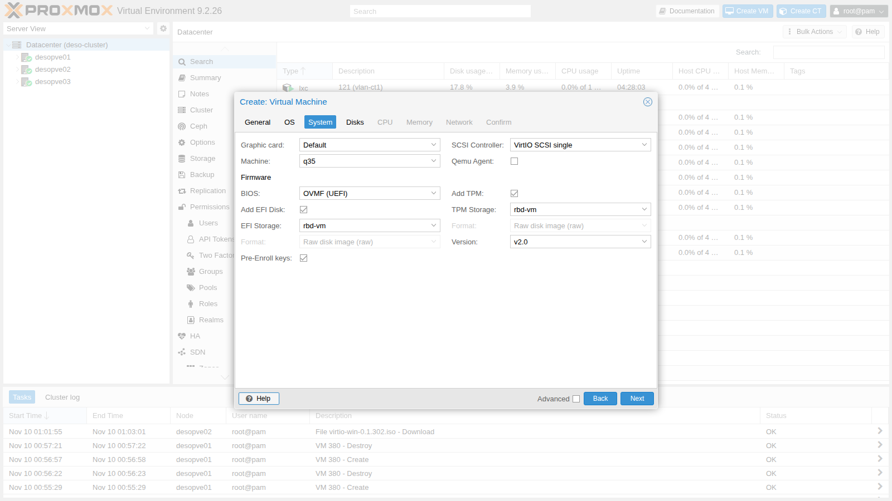

- **Disks:** bus SCSI, `rbd-vm`, 32 GiB, **Discard**, **SSD emulation** e **IO thread** (con **Advanced** attivo).

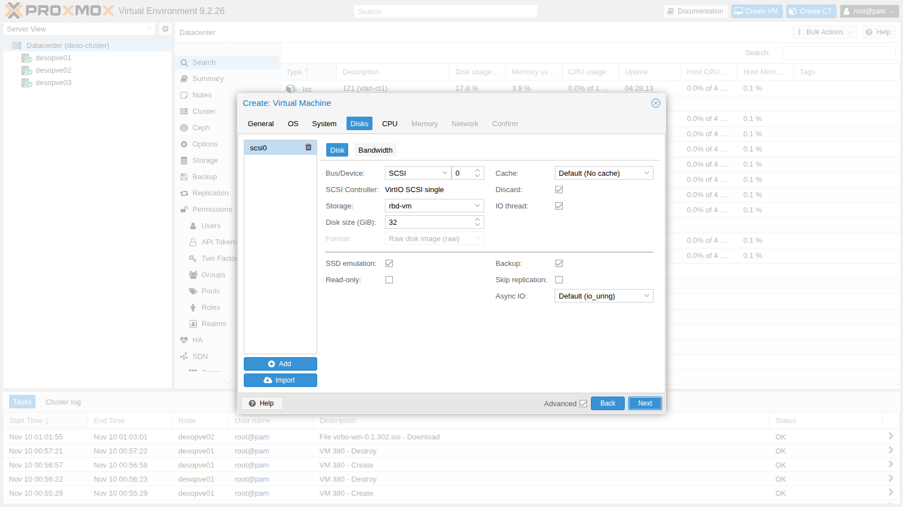

- **CPU:** 4 core, tipo `x86-64-v2-AES`. **Memory:** 4096 MiB. **Network:** `vmbr0`, modello **VirtIO (paravirtualized)**.

La configurazione risultante:

```text
bios: ovmf
boot: order=scsi0;ide2;ide0;net0
cores: 4
cpu: x86-64-v2-AES
efidisk0: rbd-vm:vm-390-disk-0,efitype=4m,ms-cert=2023k,pre-enrolled-keys=1,size=1M
ide0: cephfs:iso/virtio-win-0.1.302.iso,media=cdrom,size=856810K
ide2: cephfs:iso/WS2025-SERVER_EVAL_x64FRE_en-us.iso,media=cdrom,size=5873196K
machine: pc-q35-11.1
memory: 4096
name: win2025
net0: virtio=BC:24:11:C6:80:3D,bridge=vmbr0,firewall=1
ostype: win11
scsi0: rbd-vm:vm-390-disk-1,discard=on,iothread=1,size=32G,ssd=1
scsihw: virtio-scsi-single
tpmstate0: rbd-vm:vm-390-disk-2,size=4M,version=v2.0
```

- **`machine: pc-q35-11.1`:** con Windows la versione della macchina viene bloccata, così un aggiornamento di QEMU non cambia l'hardware visto da Windows ([Lab 35](35-kvm-qemu.md)).
- **`ms-cert=2023k`:** l'EFI disk contiene i certificati Microsoft per Secure Boot, compresi quelli del 2023.

### 3. Il primo avvio da CD: attenzione al tempo

Con UEFI il CD di Windows chiede di premere un tasto entro pochi secondi (**Press any key to boot from CD or DVD**). Al primo avvio OVMF inizializza l'EFI disk nuovo e può impiegare più del solito: se in quel momento non si guarda la console, la richiesta scade e il firmware non trova altro da avviare:

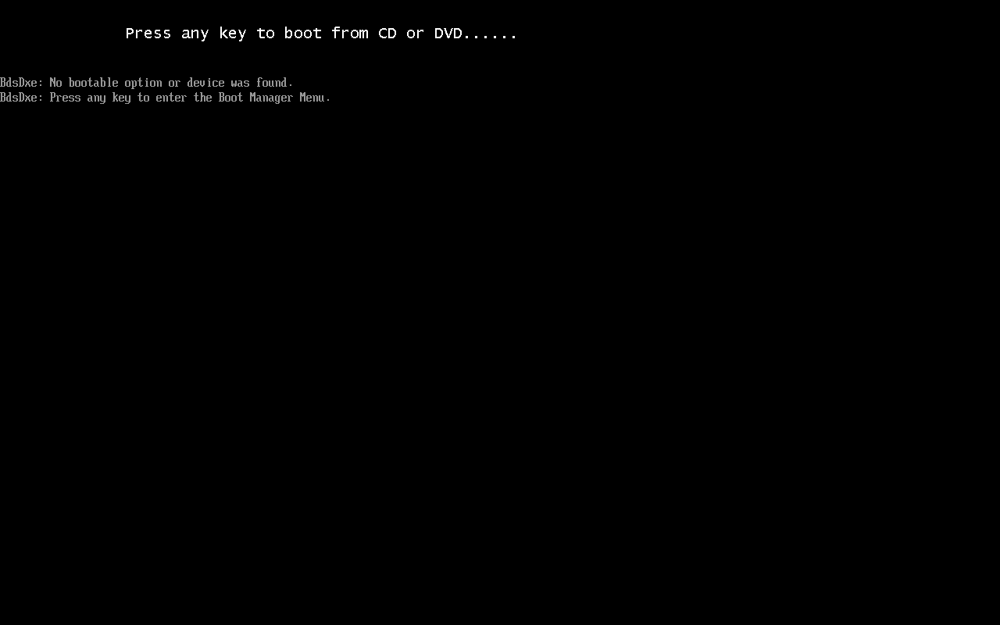

Il firmware non trova nient'altro da avviare e propone il **Boot Manager** con un tasto qualsiasi. Si sceglie il lettore con la ISO di Windows e si preme subito un tasto:

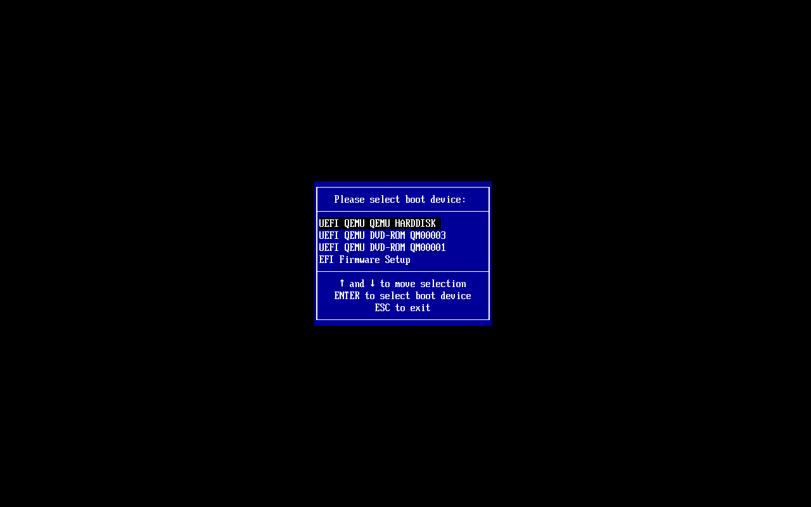

- **QM00003** è `ide2`, la ISO di Windows; **QM00001** è `ide0`, i driver.
- Dal secondo avvio in poi OVMF è molto più veloce (circa 30 secondi fino al sistema operativo).

### 4. L'installazione: il disco non c'è

Le prime schermate sono le stesse del [Lab 02](02-domain-controller.md): lingua, tastiera, **Install Windows Server**, edizione **Windows Server 2025 Standard Evaluation (Desktop Experience)**, licenza. Alla scelta del disco l'elenco è **vuoto**: Windows non ha il driver del controller VirtIO SCSI.

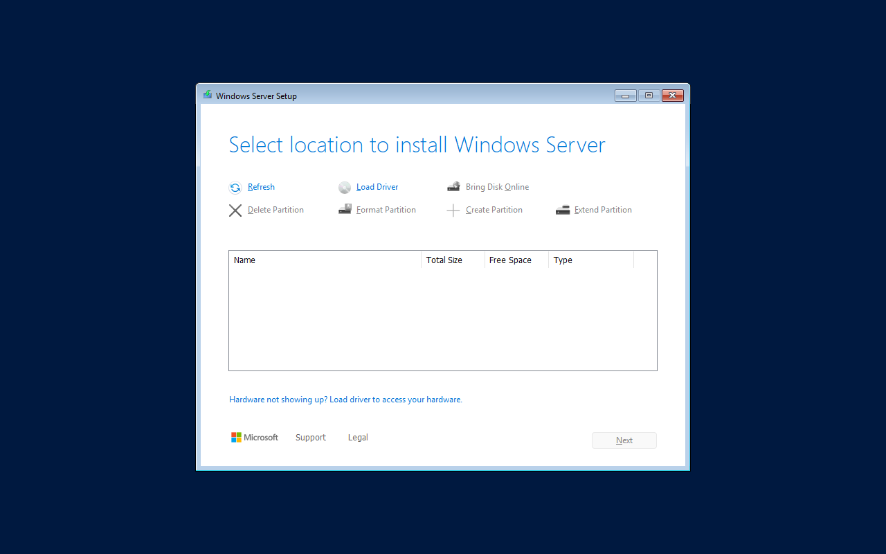

**Load Driver** → **Browse**. I lettori CD sono `D:` (`virtio-win`) ed `E:` (Windows). Si scende nella cartella del driver per il sistema giusto: `D:\vioscsi\2k25\amd64`.

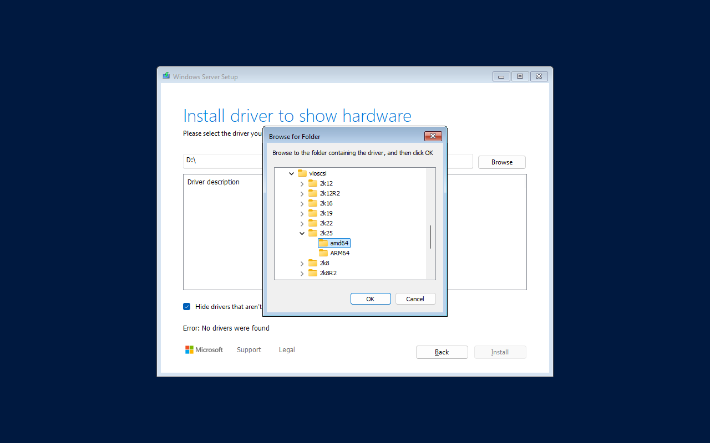

> Scegliendo la radice `D:\` il setup risponde **"Error: No drivers were found"**: non cerca nelle sottocartelle. Serve la cartella esatta: `vioscsi` (VirtIO SCSI), `2k25` (Windows Server 2025), `amd64`.

Il setup mostra **Red Hat VirtIO SCSI pass-through controller**; si seleziona e si clicca **Install**:

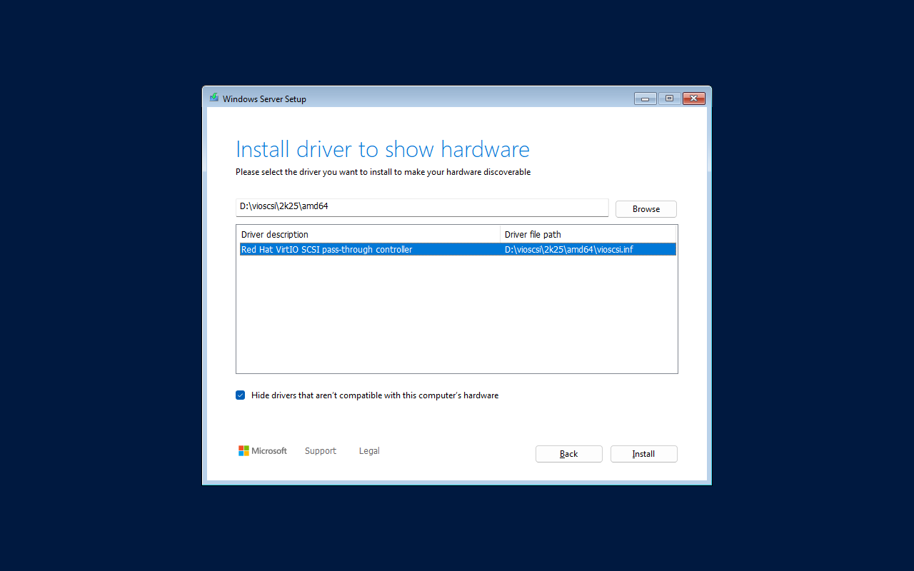

Ora il disco da 32 GB compare:

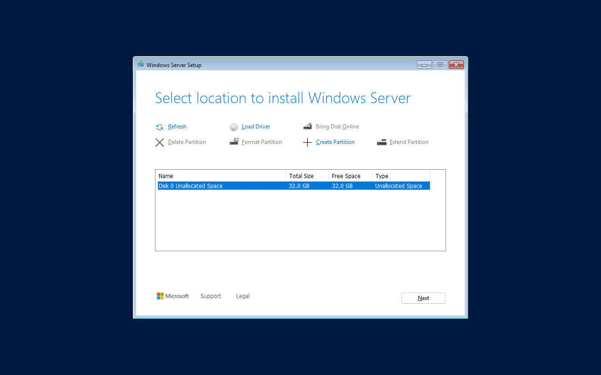

Da qui l'installazione prosegue normalmente: **Next**, **Install**. Nel laboratorio, su Ceph, ha richiesto circa 40 minuti. Se il setup viene riavviato prima di installare, il driver va **caricato di nuovo**: vive solo in memoria finché Windows non è installato.

Al primo accesso: password di `Administrator`, poi **Send diagnostic data** con **Required only**, come nel [Lab 02](02-domain-controller.md).

### 5. Device Manager prima dei driver

`Win+R` → `devmgmt.msc`:


- **Ethernet Controller:** la scheda di rete VirtIO, quindi Windows non ha rete.
- **PCI Device:** il dispositivo balloon.
- Il disco funziona perché il driver `vioscsi` è stato installato insieme al sistema.

### 6. virtio-win-guest-tools

Dal CD dei driver: `Win+R` → `D:\virtio-win-guest-tools.exe`. Si accetta la licenza e si clicca **Install**:

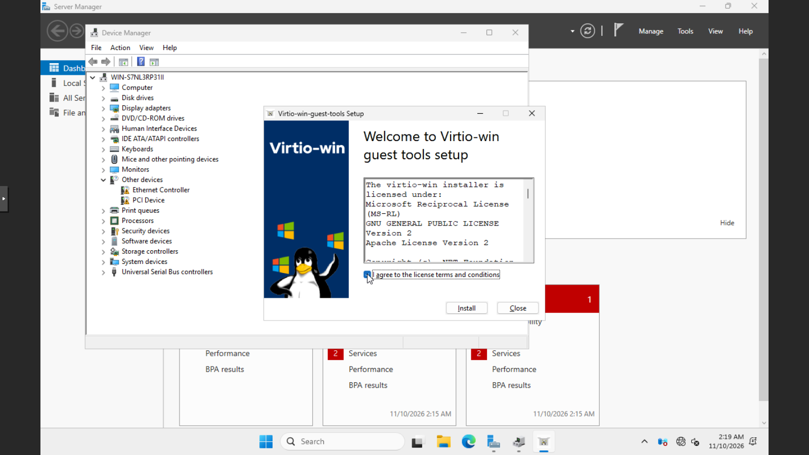

Si apre la procedura del pacchetto dei driver (**Next**, licenza, **Custom Setup** con tutti i componenti, **Install**, **Finish**); il pacchetto installa poi il guest agent e chiude con:

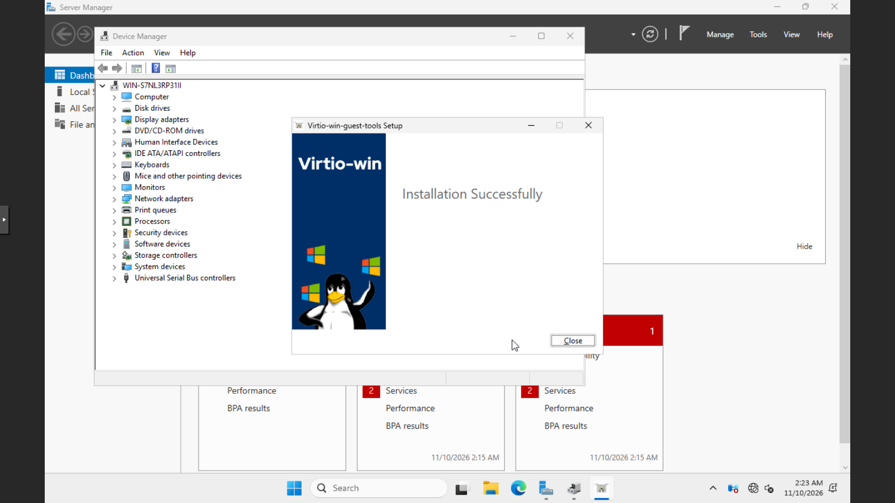

In Device Manager non ci sono più dispositivi sconosciuti: **Network adapters → Red Hat VirtIO Ethernet Adapter** e **Storage controllers → Red Hat VirtIO SCSI pass-through controller**.

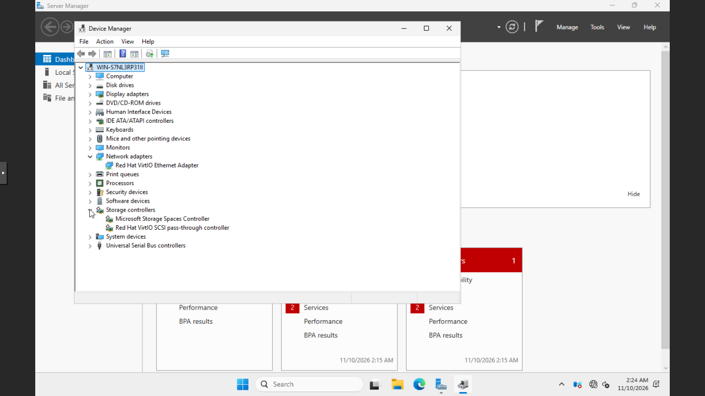

> Per installazioni ripetute la stessa installazione si fa senza interazione: `virtio-win-guest-tools.exe /install /passive /norestart`.

### 7. Attivare l'agent e togliere le ISO

La VM si spegne da Proxmox VE con `time qm shutdown 390`. Senza agent, il comando invia l'evento ACPI del tasto di accensione, e Windows lo gestisce:

```text
spenta via ACPI in 29 s
```

Poi si attiva l'agent, si svuota il lettore di Windows e si toglie quello dei driver:

```bash
qm set 390 --agent enabled=1 --ide2 none,media=cdrom --delete ide0
qm start 390
qm guest cmd 390 get-osinfo
```

L'agent risponde circa 30 secondi dopo l'avvio:

```text
{
   "id" : "mswindows",
   "kernel-release" : "26100",
   "kernel-version" : "10.0",
   "machine" : "x86_64",
   "name" : "Microsoft Windows",
   "pretty-name" : "Windows Server 2025 Standard Evaluation",
   "variant" : "server",
   "variant-id" : "server",
   "version" : "Microsoft Windows Server 2025",
   "version-id" : "2025"
}
```

### 8. Configurare Windows dal nodo con l'agent

`qm guest exec` esegue PowerShell nel guest. IP statico, DNS, fuso orario e nome, senza aprire la console:

```bash
qm guest exec 390 --timeout 90 -- powershell -NoProfile -Command \
 "\$a=Get-NetAdapter | Select-Object -First 1;
  New-NetIPAddress -InterfaceIndex \$a.ifIndex -IPAddress 172.27.199.190 -PrefixLength 24 -DefaultGateway 172.27.199.1 | Out-Null;
  Set-DnsClientServerAddress -InterfaceIndex \$a.ifIndex -ServerAddresses 172.27.199.20;
  Set-TimeZone -Id 'W. Europe Standard Time';
  Rename-Computer -NewName WIN2025 -Force -WarningAction SilentlyContinue;
  \$a.Name + ' | ' + \$a.InterfaceDescription"
```

Nel JSON restituito `exitcode` è `0` e `out-data` contiene:

```text
Ethernet | Red Hat VirtIO Ethernet Adapter
```

Il riavvio passa anch'esso dall'agent (`qm reboot 390`): 67 secondi fino all'agent di nuovo attivo. Poi nome e indirizzo:

```bash
qm guest cmd 390 get-host-name
qm guest cmd 390 network-get-interfaces    # riassunto: solo IPv4
```

```text
{
   "host-name" : "WIN2025"
}
Ethernet ['172.27.199.190/24']
```

I dispositivi VirtIO e i servizi installati, letti con l'agent:

```bash
qm guest exec 390 --timeout 90 -- powershell -NoProfile -Command \
 "Get-PnpDevice -PresentOnly | Where-Object FriendlyName -match 'VirtIO|Balloon|QEMU' |
    Sort-Object Class | Format-Table -AutoSize Status,Class,FriendlyName | Out-String -Width 120;
  Get-Service QEMU-GA,BalloonService | Format-Table -AutoSize Status,Name,DisplayName | Out-String -Width 120"
```

```text
Status Class       FriendlyName
------ -----       ------------
OK     CDROM       QEMU QEMU DVD-ROM
OK     Computer    QEMU Standard PC (Q35 + ICH9, 2009)
OK     DiskDrive   QEMU QEMU HARDDISK SCSI Disk Device
OK     Net         Red Hat VirtIO Ethernet Adapter
OK     Processor   QEMU Virtual CPU version 2.5+
OK     Processor   QEMU Virtual CPU version 2.5+
OK     Processor   QEMU Virtual CPU version 2.5+
OK     Processor   QEMU Virtual CPU version 2.5+
OK     SCSIAdapter Red Hat VirtIO SCSI pass-through controller
OK     System      VirtIO Balloon Driver
OK     System      QEMU FwCfg Device
OK     System      VirtIO Serial Driver

 Status Name           DisplayName
 ------ ----           -----------
Running BalloonService BalloonService
Running QEMU-GA        QEMU Guest Agent
```

Le quattro righe *Processor* sono le quattro vCPU. La rete funziona: `Test-NetConnection 172.27.199.20 -Port 53` dal guest risponde `True`. Il ping dalla rete del laboratorio verso la VM invece non risponde: il firewall di Windows blocca ICMP di default.

Nel **Summary** compaiono gli indirizzi riportati dall'agent:

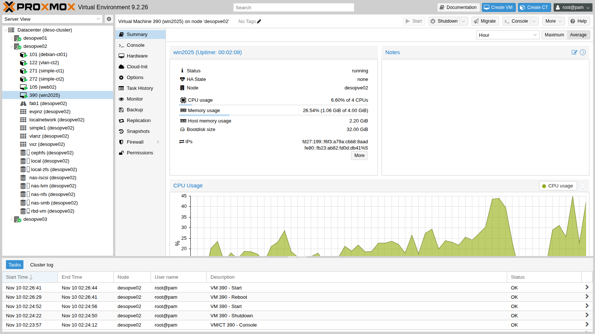

e la vista **Hardware** riassume la configurazione finale, senza lettori di driver:

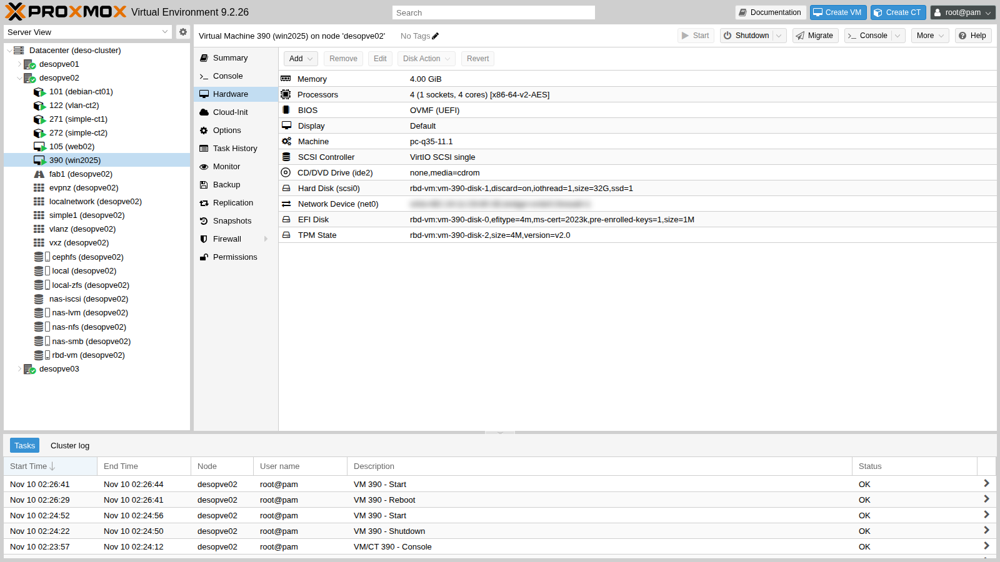

Spegnimento finale, ora attraverso l'agent, ancora con `time qm shutdown 390`:

```text
VM 390 spenta via agent in 10 s
```

## Verifica e test

- Le ISO ufficiali di Windows Server 2025 Evaluation e virtio-win 0.1.302 sono su `cephfs` con le impronte annotate.
- Il wizard con Windows 11/2022/2025 configura q35, OVMF con Secure Boot e TPM 2.0.
- Senza driver il setup non vede il disco VirtIO SCSI; con `vioscsi\2k25\amd64` sì. La radice del CD non basta.
- Dopo `virtio-win-guest-tools` non ci sono dispositivi sconosciuti: rete, balloon, seriale e guest agent sono attivi.
- L'agent risponde, riporta sistema e indirizzi, esegue PowerShell, riavvia e spegne la VM.

## Stato finale del lab

- **VM 390 `win2025`** su `desopve02`, **spenta**: Windows Server 2025 Standard Evaluation (Desktop Experience), nome `WIN2025`, IP 172.27.199.190, fuso W. Europe; driver VirtIO e QEMU Guest Agent installati; dischi su `rbd-vm`; nessuna ISO collegata. È la VM Windows di riferimento per i lab successivi (backup, migrazioni, HA).
- **ISO su `cephfs`:** `WS2025-SERVER_EVAL_x64FRE_en-us.iso` e `virtio-win-0.1.302.iso`.
- **Proxy del laboratorio:** whitelist estesa a `go.microsoft.com` e `software-static.download.prss.microsoft.com`.
- La versione Evaluation dura 180 giorni.

## Cosa hai imparato

- Le ISO si scaricano direttamente negli storage con **Download from URL** o `pvesh ... download-url`, anche dietro un proxy.
- Per Windows il wizard con il tipo 11/2022/2025 imposta UEFI, Secure Boot, TPM e machine q35 bloccata, e aggiunge il CD dei driver VirtIO.
- Il disco VirtIO richiede il driver `vioscsi` durante l'installazione, scelto nella cartella esatta della versione di Windows.
- Con un firmware UEFI lento al primo avvio si rischia di perdere il "Press any key": il Boot Manager di OVMF rimedia.
- `virtio-win-guest-tools` installa in un colpo driver, balloon e guest agent.
- Con l'agent Windows si configura e si gestisce dal nodo, anche senza rete funzionante.

## Riferimenti

- [Proxmox VE wiki – Windows 2022 guest best practices](https://pve.proxmox.com/wiki/Windows_2022_guest_best_practices) (valide anche per Windows Server 2025)
- [Proxmox VE wiki – Windows VirtIO Drivers](https://pve.proxmox.com/wiki/Windows_VirtIO_Drivers)
- [Proxmox VE – OS type e impostazioni delle VM](https://pve.proxmox.com/pve-docs/chapter-qm.html#qm_os_settings)
- [Fedora – virtio-win direct downloads](https://fedorapeople.org/groups/virt/virtio-win/direct-downloads/)
- [Microsoft – Windows Server 2025 Evaluation Center](https://www.microsoft.com/en-us/evalcenter/evaluate-windows-server-2025)
