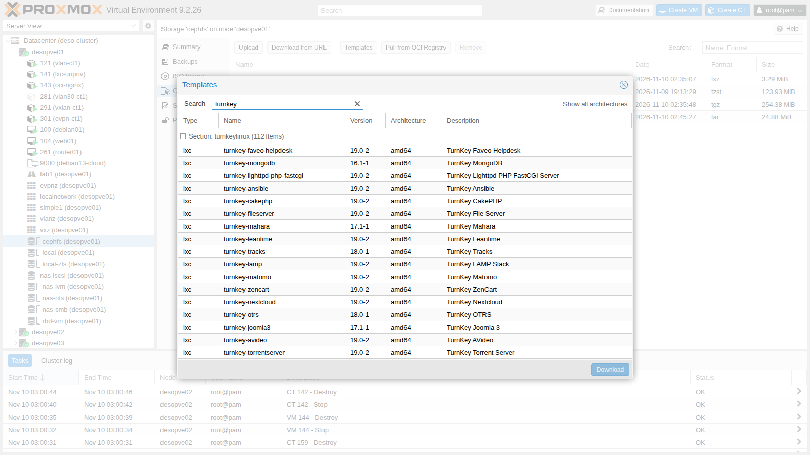
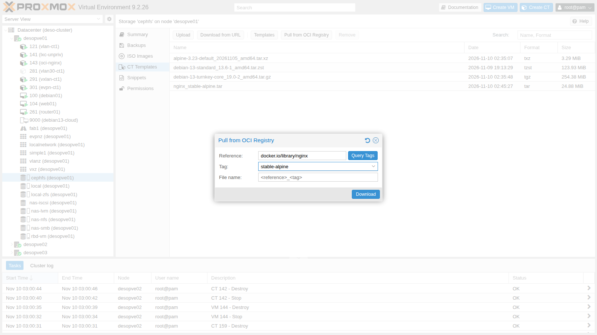
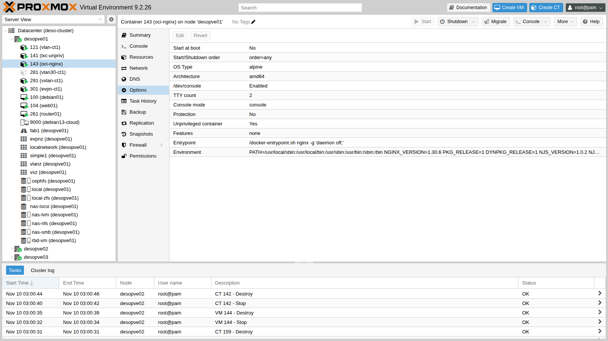
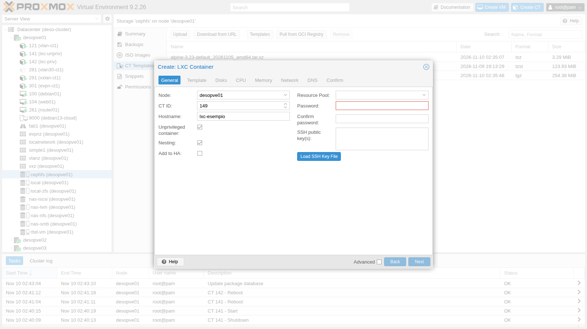
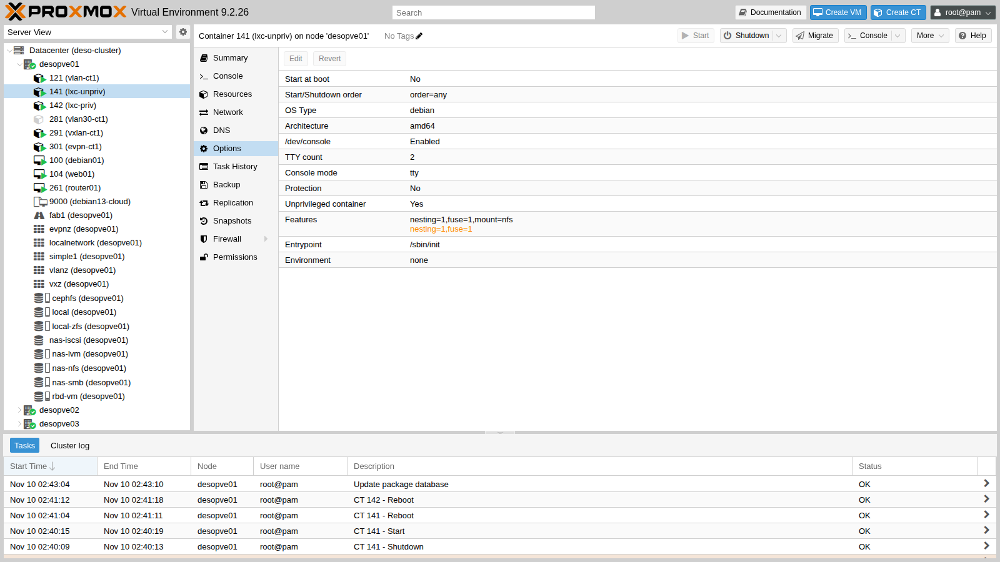
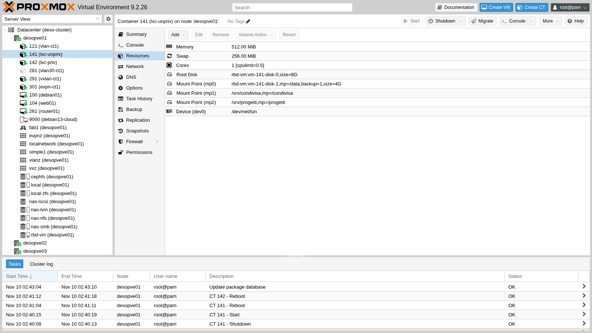

# Lab 41 – Container LXC: privilegiati e non privilegiati, mount point, funzionalità, limiti e confronto con le VM

**Livello:** intermedio · **Durata:** 1 ora e 30 minuti

## Dipendenze

- **Lab precedenti:**
  - [Lab 07](07-first-vm-and-container.md): il primo container (il template `debian-13-standard` qui si scarica anche su `cephfs`, al passo 3);
  - [Lab 13](13-nfs.md): l'export NFS del NAS `172.27.199.10:/mnt/dati/nfs`;
  - [Lab 17](17-ceph-installation.md): gli storage condivisi `rbd-vm` e `cephfs`;
  - [Lab 22](22-dedicated-networks.md): la rete di migrazione sulla VLAN 100;
  - [Lab 40](40-templates-cloud-init-clones.md): il template `9000`, per il confronto con una VM.
- **Nodi e storage:** cluster `desopve01`-`03`; template su `cephfs`, dischi dei container su `rbd-vm` e `local-zfs`.
- **Rete:** il proxy `proxy.proxmox.community:3128` per template, immagini e pacchetti.
- **Indirizzi:** CT 141 su 172.27.199.141, CT 142 su .142, CT 143 su .143, VM 144 su .144, CT 150-159 su .150-.159.
- **Credenziali:** `root` dei container con `<password-lab>` → [Appendice B](b-credentials-and-addresses.md).

## Obiettivi

- Scaricare template di sistema, TurnKey e immagini OCI, e capire cosa fare quando il download passa da un proxy.
- Capire la differenza tra container **privilegiati** e **non privilegiati** guardando gli UID dal nodo.
- Usare **mount point** su storage e **bind mount** dal nodo, risolvendo i permessi con la mappatura degli UID.
- Attivare le funzionalità `nesting`, `fuse`, `mount` e passare un device al container.
- Applicare **limiti di CPU e RAM** e misurarne l'effetto.
- Migrare un container e confrontarlo con una VM: tempi di avvio, RAM e densità.

## Come funziona

**Un container non è una VM.** I processi di un container LXC girano sul kernel del nodo, isolati con i *namespace* (PID, rete, mount, utenti) e limitati con i *cgroup v2*. Non c'è un sistema operativo virtualizzato: per questo un container parte in pochi secondi e occupa pochi MiB.

**Privilegiato o non privilegiato.**

| | Non privilegiato (default) | Privilegiato |
|---|---|---|
| `root` del container sul nodo | UID 100000 (nessun privilegio) | UID 0, cioè `root` del nodo |
| Mappatura | `/etc/subuid` e `/etc/subgid`: 65536 UID a partire da 100000 | nessuna |
| Se un processo evade dal container | è un utente qualsiasi del nodo | è `root` del nodo |
| Limiti | non può montare NFS/CIFS, alcuni device richiedono configurazione | quasi tutto, quindi più rischi |

**Mount point.**

- `mpX: storage:dimensione` crea un volume sullo storage, gestito da Proxmox VE: incluso nei backup (`backup=1`), migrabile se lo storage è condiviso.
- `mpX: /percorso/sul/nodo` è un **bind mount**: una cartella del nodo vista dentro il container. Non va nei backup e blocca la migrazione.

**Template.** Tre fonti, tutte nello storage con contenuto *CT Templates*:

- immagini di sistema di Proxmox (`pveam`, sezione `system`);
- appliance TurnKey Linux (sezione `turnkeylinux`);
- da Proxmox VE 9.1, **immagini OCI** (gli stessi formati di Docker/Podman) da un registry: diventano *application container* con il loro entrypoint.

## Procedura

### 1. Template di sistema e TurnKey

Aggiornamento dell'indice e ricerca:

```bash
pveam update
pveam available --section turnkeylinux | wc -l
pveam available --section system | grep -E "debian-13|alpine-3.23|ubuntu-2[46]"
```

```text
update successful
112
system          alpine-3.23-default_20261105_amd64.tar.xz                    amd64
system          debian-13-standard_13.6-1_amd64.tar.zst                      amd64
system          debian-13-standard_13.6-1_arm64.tar.zst                      arm64
system          ubuntu-24.04-standard_24.04-2_amd64.tar.zst                  amd64
system          ubuntu-26.04-standard_26.04-1_amd64.tar.zst                  amd64
system          ubuntu-26.10-standard_26.10-1_amd64.tar.zst                  amd64
```

La stessa lista si vede dalla GUI: storage `cephfs` → **CT Templates** → **Templates**, con la ricerca `turnkey`:



Download di Alpine e di TurnKey Core:

```bash
pveam download cephfs alpine-3.23-default_20261105_amd64.tar.xz
pveam download cephfs debian-13-turnkey-core_19.0-2_amd64.tar.gz
```

```text
Proxy request sent, awaiting response... 200 OK
calculating checksum...OK, checksum verified
Resolving mirror.turnkeylinux.org (mirror.turnkeylinux.org)... failed: Temporary failure in name resolution.
download failed: wget: unable to resolve host address 'mirror.turnkeylinux.org'
```

Alpine arriva in 2 secondi, TurnKey no. Il motivo è nell'indice: le appliance TurnKey si scaricano in **HTTPS** (`Location: https://mirror.turnkeylinux.org/...`), e `pveam` passa al proxy solo le richieste HTTP. In una rete senza uscita diretta il download HTTPS tenta la risoluzione DNS diretta e fallisce.

**Rimedio:** il pulsante **Download from URL** dello storage, che usa il proxy anche per l'HTTPS. L'URL e lo SHA512 si leggono nell'indice (`/var/lib/pve-manager/apl-info/releases.turnkeylinux.org`):

```bash
pvesh create /nodes/desopve01/storage/cephfs/download-url --content vztmpl \
  --filename debian-13-turnkey-core_19.0-2_amd64.tar.gz \
  --url https://mirror.turnkeylinux.org/turnkeylinux/images/proxmox/debian-13-turnkey-core_19.0-2_amd64.tar.gz \
  --checksum f70345d6b1d5…ba7f11 --checksum-algorithm sha512
```

```text
2026-11-10 02:35:47 (76.0 MB/s) - '/mnt/pve/cephfs/template/cache/debian-13-turnkey-core_19.0-2_amd64.tar.gz.tmp_dwnl.407164' saved [266734332/266734332]
calculating checksum...OK, checksum verified
```

254 MB in 7 secondi, con la verifica dello SHA512.

### 2. Un'immagine OCI come application container

Il pulsante **Pull from OCI Registry** scarica un'immagine da un registry come Docker Hub. Il campo *Reference* si divide da solo in immagine e tag:



Nel laboratorio il download dalla GUI fallisce:

```text
time="2026-11-10T02:44:57+01:00" level=fatal msg="initializing source docker://nginx:stable-alpine: pinging container registry registry-1.docker.io: Get \"https://registry-1.docker.io/v2/\": dial tcp: lookup registry-1.docker.io on 172.27.199.20:53: read udp 172.27.199.21:43629->172.27.199.20:53: i/o timeout"
command 'skopeo copy docker://docker.io/library/nginx:stable-alpine oci-archive:/mnt/pve/cephfs/template/cache/nginx_stable-alpine.tar.tmp.418582' failed: exit code 1
```

Proxmox VE usa `skopeo`, che non legge il proxy del Datacenter. Lo stesso comando con la variabile `HTTPS_PROXY` funziona; sul proxy del laboratorio servono i domini `docker.io`, `production.cloudflare.docker.com` e `production.cloudfront.docker.com`:

```bash
HTTPS_PROXY=http://proxy.proxmox.community:3128 skopeo copy \
  docker://docker.io/library/nginx:stable-alpine \
  oci-archive:/mnt/pve/cephfs/template/cache/nginx_stable-alpine.tar
```

```text
Copying config sha256:1390db6b01a8b0c865b157c7f036b0772534418b1701f598737de546d208b6e4
Writing manifest to image destination
```

Il file compare tra i template (25 MiB) e si usa come un template normale:

```bash
pct create 143 cephfs:vztmpl/nginx_stable-alpine.tar --hostname oci-nginx --unprivileged 1 \
  --memory 256 --rootfs rbd-vm:2 --net0 name=eth0,bridge=vmbr0,ip=172.27.199.143/24,gw=172.27.199.1
pct start 143
curl -s -o /dev/null -w "HTTP %{http_code}\n" http://172.27.199.143/
```

```text
Detected OCI archive
Auto-Enabling host-managed network for network device net0.
Detected container architecture: amd64
HTTP 200
```

Proxmox VE riconosce l'immagine OCI, prende dall'immagine **entrypoint** e **variabili d'ambiente** e gestisce lui la rete del container (`host-managed=1`), perché un'immagine applicativa non ha un sistema di rete proprio:

```text
cmode: console
entrypoint: /docker-entrypoint.sh nginx -g 'daemon off;'
env: PATH=/usr/local/sbin:/usr/local/bin:/usr/sbin:/usr/bin:/sbin:/bin NGINX_VERSION=1.30.6 PKG_RELEASE=1 …
net0: name=eth0,bridge=vmbr0,gw=172.27.199.1,host-managed=1,ip=172.27.199.143/24,type=veth
ostype: alpine
lxc.signal.halt: SIGQUIT
```

Dentro il container non c'è `systemd`: il processo 1 è nginx stesso.

```text
PID   USER     TIME  COMMAND
    1 root      0:00 nginx: master process nginx -g daemon off;
   47 nginx     0:00 nginx: worker process
```



### 3. Container non privilegiato e privilegiato

Nel wizard **Create CT** le caselle *Unprivileged container* e *Nesting* sono già spuntate:



Per confrontarli creo i due container da CLI, uguali tranne `--unprivileged`:

```bash
pveam download cephfs debian-13-standard_13.6-1_amd64.tar.zst   # se non è già su cephfs
T=cephfs:vztmpl/debian-13-standard_13.6-1_amd64.tar.zst
pct create 141 $T --hostname lxc-unpriv --unprivileged 1 --features nesting=1 --cores 2 --memory 1024 --swap 512 \
  --rootfs rbd-vm:8 --net0 name=eth0,bridge=vmbr0,ip=172.27.199.141/24,gw=172.27.199.1 \
  --nameserver 172.27.199.20 --searchdomain proxmox.community --password '<password-lab>'
pct create 142 $T --hostname lxc-priv --unprivileged 0 --cores 2 --memory 1024 --swap 512 \
  --rootfs rbd-vm:8 --net0 name=eth0,bridge=vmbr0,ip=172.27.199.142/24,gw=172.27.199.1 \
  --nameserver 172.27.199.20 --searchdomain proxmox.community --password '<password-lab>'
```

Per il 142, creato senza `nesting`, Proxmox VE avvisa:

```text
WARN: Systemd 257 detected. You may need to enable nesting.
```

Con systemd recente alcune funzioni dei servizi (namespace privati, sandbox) richiedono `nesting=1`, che il wizard attiva già.

Avvia i due container, configura il proxy di `apt` e installa i pacchetti che servono più avanti (il client NFS e `stress-ng`, che il template non contiene):

```bash
pct start 141 && pct start 142
for c in 141 142; do
  pct exec $c -- sh -c 'echo "Acquire::http::Proxy \"http://proxy.proxmox.community:3128\";" > /etc/apt/apt.conf.d/80proxy && apt-get update -qq && apt-get install -y -qq nfs-common stress-ng'
done
```

**La mappatura degli UID.** Il nodo riserva a `root` 65536 UID a partire da 100000:

```text
# /etc/subuid e /etc/subgid
root:100000:65536
root:100000:65536
```

Dentro i due container:

```bash
pct exec 141 -- cat /proc/self/uid_map
pct exec 142 -- cat /proc/self/uid_map
```

```text
CT 141:          0     100000      65536
CT 142:          0          0 4294967295
```

Il 141 vede gli UID 0-65535 come 100000-165535 del nodo; il 142 usa gli UID del nodo senza conversione. Dal nodo, il processo 1 dei due container:

```bash
P=$(lxc-info -n 141 -p -H); ps -o uid=,user=,pid=,cmd= -p $P
P=$(lxc-info -n 142 -p -H); ps -o uid=,user=,pid=,cmd= -p $P
```

```text
100000 100000   408967 /sbin/init
    0 root      409389 /sbin/init
```

Un file creato da `root` dentro ciascun container, visto dal nodo attraverso `/proc/<PID>/root`:

```bash
pct exec 141 -- touch /root/prova-lxc-unpriv
pct exec 142 -- touch /root/prova-lxc-priv
P=$(lxc-info -n 141 -p -H); ls -ln /proc/$P/root/root/prova-lxc-unpriv
P=$(lxc-info -n 142 -p -H); ls -ln /proc/$P/root/root/prova-lxc-priv
```

```text
## CT 141
-rw-r--r-- 1 100000 100000 0 Nov 10 02:39 prova-lxc-unpriv
## CT 142
-rw-r--r-- 1 0 0 0 Nov 10 02:39 prova-lxc-priv
```

È la ragione per cui i container non privilegiati sono più sicuri: se un processo riuscisse a uscire dal 141, sul nodo sarebbe l'utente 100000, che non possiede nulla. Dal 142 sarebbe `root`.

### 4. Mount point e bind mount

Un volume su `rbd-vm`, aggiunto a caldo e incluso nei backup:

```bash
pct set 141 -mp0 rbd-vm:4,mp=/data,backup=1
pct exec 141 -- df -h /data
```

```text
/dev/rbd5       3.9G  1.1M  3.7G   1% /data
```

Un **bind mount** di una cartella del nodo:

```bash
mkdir -p /srv/condivisa && echo 'file creato sul nodo' > /srv/condivisa/leggimi.txt
pct set 141 -mp1 /srv/condivisa,mp=/condivisa
pct exec 141 -- ls -ln /condivisa
pct exec 141 -- touch /condivisa/scrivo-io
```

```text
-rw-r--r-- 1 65534 65534 21 Nov 10 01:39 leggimi.txt
touch: cannot touch '/condivisa/scrivo-io': Permission denied
```

Il file appartiene a `root` del nodo (UID 0), che **non è mappato** nel container: dentro appare come `nobody` (65534) e `root` del container non può scrivere. La soluzione più semplice è dare la cartella all'UID che corrisponde a `root` del container:

```bash
chown -R 100000:100000 /srv/condivisa
pct exec 141 -- touch /condivisa/scrivo-io && ls -ln /srv/condivisa
```

```text
-rw-r--r-- 1 100000 100000 21 Nov 10 02:39 leggimi.txt
-rw-r--r-- 1 100000 100000  0 Nov 10 02:39 scrivo-io
```

**Mappare un UID specifico.** Se la cartella sul nodo appartiene a un utente reale (UID 1000) e dentro il container deve usarla lo stesso UID, si apre un "buco" nella mappatura. Per vedere anche un errore frequente, crea prima l'utente `ana` nel container, come se esistesse già (prende l'UID 1000):

```bash
pct exec 141 -- useradd -m -s /bin/bash ana
```

Sul nodo:

```bash
mkdir -p /srv/progetti && echo 'documento di ana' > /srv/progetti/progetto.txt && chown -R 1000:1000 /srv/progetti
echo 'root:1000:1' >> /etc/subuid
echo 'root:1000:1' >> /etc/subgid
```

Spegni il container (`pct shutdown 141`) e aggiungi al file `/etc/pve/lxc/141.conf` la mappatura in tre pezzi: 0-999 come prima, 1000 su 1000, 1001-65535 come prima:

```text
lxc.idmap: u 0 100000 1000
lxc.idmap: g 0 100000 1000
lxc.idmap: u 1000 1000 1
lxc.idmap: g 1000 1000 1
lxc.idmap: u 1001 101001 64535
lxc.idmap: g 1001 101001 64535
```

```bash
pct set 141 -mp2 /srv/progetti,mp=/progetti
pct start 141
pct exec 141 -- cat /proc/self/uid_map
pct exec 141 -- su - ana -c 'echo modifica di ana >> /progetti/progetto.txt && touch /progetti/nuovo-da-ana'
ls -ln /srv/progetti
```

```text
         0     100000       1000
      1000       1000          1
      1001     101001      64535
-rw-rw-r-- 1 1000 1000  0 Nov 10 02:40 nuovo-da-ana
-rw-r--r-- 1 1000 1000 33 Nov 10 02:40 progetto.txt
```

L'utente `ana` (UID 1000) scrive nella cartella del nodo con il proprio UID.

**Trappola:** l'utente `ana` è stato creato *prima* di cambiare la mappatura, quindi la sua home sul nodo appartiene a 101000, che con la nuova mappatura non corrisponde più a nessun UID del container:

```text
su: warning: cannot change directory to /home/ana: Permission denied
drwx------ 2 65534 65534 4096 Nov 10 01:40 /home/ana
chown: cannot read directory '/home/ana': Permission denied
```

`root` del container non può correggerla, perché il file non appartiene a nessun UID mappato. Si corregge dal nodo:

```bash
P=$(lxc-info -n 141 -p -H); chown -R 1000:1000 /proc/$P/root/home/ana
```

Regola pratica: definire la mappatura **prima** di creare gli utenti nel container.

### 5. Funzionalità e device

**Device: `/dev/net/tun`**, necessario per VPN come WireGuard in userspace o OpenVPN:

```bash
pct exec 141 -- ip tuntap add mode tun dev tun0
pct set 141 -dev0 /dev/net/tun
pct exec 141 -- ip tuntap add mode tun dev tun0 && pct exec 141 -- ip -br link show tun0
```

```text
open: No such file or directory
tun0             DOWN           <POINTOPOINT,MULTICAST,NOARP>
```

Il device si aggiunge a caldo.

**FUSE** (filesystem in userspace, per esempio `sshfs`): si attiva con la funzionalità `fuse=1` e un riavvio del container, dopo il quale compare il device:

```bash
pct set 141 -features nesting=1,fuse=1 && pct reboot 141 && pct exec 141 -- ls -l /dev/fuse
```

```text
crw-rw-rw- 1 nobody nogroup 10, 229 Nov  9 13:31 /dev/fuse
```

**Montare NFS dentro il container.** La funzionalità `mount=nfs` si può impostare su entrambi, ma il risultato è diverso:

```bash
pct set 142 -features nesting=1,mount=nfs     # privilegiato
pct set 141 -features nesting=1,fuse=1,mount=nfs   # non privilegiato
pct reboot 142 && pct reboot 141
pct exec 142 -- mkdir -p /mnt/nas && pct exec 141 -- mkdir -p /mnt/nas
pct exec 142 -- mount -t nfs -o vers=4.2 172.27.199.10:/mnt/dati/nfs /mnt/nas
pct exec 141 -- mount -t nfs -o vers=4.2 172.27.199.10:/mnt/dati/nfs /mnt/nas
```

```text
CT 142: 172.27.199.10:/mnt/dati/nfs   54G     0   54G   0% /mnt/nas
CT 141: mount.nfs: Operation not permitted for 172.27.199.10:/mnt/dati/nfs on /mnt/nas
```

Il kernel non permette di montare NFS da un namespace utente. Per un container non privilegiato la strada giusta è montare la share sul nodo, o usare uno storage di Proxmox VE, e passarla con un mount point. Togli poi `mount=nfs` dal 141, dove non serve: `pct set 141 -features nesting=1,fuse=1` e `pct reboot 141`.

Le funzionalità attive si vedono in **Options**:



Le altre funzionalità utili:

- **`keyctl=1`**: le chiamate di sistema per le chiavi del kernel, necessarie a Docker dentro un container non privilegiato;
- **`nesting=1`**: namespace annidati, per systemd recente e per container dentro il container.

### 6. Limiti di CPU e RAM

Al 141 assegno 1 core, metà di un core come tetto, 512 MiB di RAM e 256 MiB di swap:

```bash
pct set 141 -cores 1 -cpulimit 0.5 -memory 512 -swap 256
```

Proxmox VE li traduce nei file del cgroup `/sys/fs/cgroup/lxc/141/`:

```text
cpu.max: 50000 100000
memory.max: 536870912
memory.swap.max: 268435456
```

`cpu.max` significa "50 ms di CPU ogni 100 ms", cioè mezzo core. Il numero di core, invece, è un `cpuset`: subito dopo il comando era ancora `0,3`, pochi secondi dopo era `0` e dentro il container `nproc` restituiva 1.

Dentro il container `free` mostra la RAM del limite e non quella del nodo:

```text
               total        used        free      shared  buff/cache   available
Mem:             512          16         262           0         232         495
Swap:              0           0           0
```

**CPU misurata.** `stress-ng` con 2 processi per 20 secondi; il consumo si legge dal nodo nel `cpu.stat` del cgroup, prima e dopo. Lo script [`misure.sh`](../files/41/misure.sh), da copiare sul nodo, fa i conti (qui con la riga delle metriche di `stress-ng`):

```bash
./misure.sh cpu 141 pct exec 141 -- stress-ng --cpu 2 --timeout 20s --metrics-brief
```

```text
stress-ng: metrc: [1381] cpu               12146     20.05     10.00      0.02       605.90        1211.82
CPU usata dal cgroup: 10.1 s su 21.3 s di orologio = 47% di un core
```

Il tetto di mezzo core è rispettato.

**RAM misurata.** `stress-ng` prova ad allocare 900 MiB:

```bash
pct exec 141 -- stress-ng --vm 1 --vm-bytes 900M --vm-keep --timeout 20s >/dev/null &
./misure.sh mem 141 12
journalctl -k --since "-2min" | grep -m1 "Memory cgroup out of memory" | sed 's/^.*kernel: //'
```

```text
t+3s memory.current=506 MiB swap.current=0 MiB
t+6s memory.current=290 MiB swap.current=0 MiB
t+9s memory.current=511 MiB swap.current=0 MiB
t+12s memory.current=512 MiB swap.current=0 MiB
oom_kill: 11 -> 16
Memory cgroup out of memory: Killed process 826768 (stress-ng-vm) total-vm:1001468kB, anon-rss:475832kB, file-rss:4kB, shmem-rss:64kB, UID:100000 pgtables:1024kB oom_score_adj:1000
```

Il contatore `oom_kill` del cgroup sale a ogni processo ucciso (qui partiva da 11 per le prove precedenti).

Al limite di 512 MiB il kernel uccide il processo **dentro il cgroup del container** (`UID:100000`): il nodo e gli altri guest non se ne accorgono. La swap del container non viene usata perché `desopve01` **non ha swap**: l'installazione su ZFS non la crea (`swapon --show` è vuoto). Il limite di swap ha effetto solo su un nodo che ne ha.

Le risorse finali del 141:



### 7. Migrazione di un container

Un container acceso non si migra "a caldo":

```bash
pct migrate 141 desopve02
pct migrate 141 desopve02 --restart
pct migrate 142 desopve02 --online
```

```text
can't migrate running container without --online or --restart
ERROR: migration aborted (duration 00:00:00): cannot migrate local bind mount point 'mp1'
ERROR: migration aborted (duration 00:00:00): lxc live migration is currently not implemented
```

- La migrazione dal vivo dei container **non esiste**: Proxmox VE accetta `--online` ma rifiuta l'operazione.
- La migrazione **restart** spegne il container, lo sposta e lo riaccende.
- Un bind mount locale blocca la migrazione: la cartella esiste solo su quel nodo.

Il CT 142, senza bind mount e con il disco su `rbd-vm`. Mentre migra, da un altro terminale sul nodo un ping ogni 0,2 secondi conta le risposte perse:

```bash
./misure.sh pinggap 172.27.199.142 30     # secondo terminale
pct migrate 142 desopve02 --restart
```

```text
shutdown CT 142
starting migration of CT 142 to node 'desopve02' (10.100.10.22)
start container on target node
migration finished successfully (duration 00:00:10)
buco nei ping: 17 risposte perse, circa 3.4 s
```

Il disco è condiviso, quindi non si copia nulla: 10 secondi in tutto, 3,4 secondi senza risposta. La migrazione usa la rete dedicata del [Lab 22](22-dedicated-networks.md) (`10.100.10.22`).

### 8. Container contro VM

**Tempo di avvio.** Il CT 142 (Debian 13) e la VM 144, un linked clone del template 9000, con 1 GiB di RAM ciascuno. La VM si crea su `desopve01`:

```bash
qm clone 9000 144 --name vm144 && qm set 144 --memory 1024 --ipconfig0 ip=172.27.199.144/24,gw=172.27.199.1
```

Il tempo tra il comando di avvio e la prima risposta si misura con un ciclo sul nodo, due volte per guest (per la VM, `qm start 144` e l'IP .144):

```bash
t0=$(date +%s.%N); pct start 142
until ping -c1 -W1 172.27.199.142 >/dev/null; do :; done; echo "$(date +%s.%N) - $t0" | bc
```


| Guest | Primo ping | SSH pronto |
|---|---|---|
| CT 142 | 7,2-7,3 s | 7,2-7,3 s |
| VM 144 | 22,1-22,6 s | 24,5-24,8 s |
| VM 144, primo avvio con cloud-init | – | 63 s |

Il container non ha firmware, bootloader e kernel da avviare: parte systemd direttamente.

**RAM a riposo**, dal cgroup sul nodo dopo 40 secondi (`memory.current` in `/sys/fs/cgroup/lxc/142/` e in `/sys/fs/cgroup/qemu.slice/144.scope/`), in sintesi:

```text
CT 142: 113 MiB
VM 144: 308 MiB (memoria assegnata 1024 MiB)
```

La VM tiene in RAM un kernel completo e la cache del guest; il container condivide il kernel del nodo.

**Densità.** Dieci container Alpine da 64 MiB su `desopve02`, rootfs su `local-zfs`:

```bash
for i in $(seq 150 159); do
  pct create $i cephfs:vztmpl/alpine-3.23-default_20261105_amd64.tar.xz --hostname alp$i --unprivileged 1 \
    --memory 64 --swap 0 --cores 1 --rootfs local-zfs:1 \
    --net0 name=eth0,bridge=vmbr0,ip=172.27.199.$i/24,gw=172.27.199.1 --password '<password-lab>'
done
for i in $(seq 150 159); do pct start $i; done
```

Riepilogo delle misure (`time` sui due cicli, memoria disponibile del nodo prima e dopo con `free -m`, somma dei `memory.current` dei cgroup):

```text
creazione di 10 CT: 23.5 s; avvio di 10 CT: 39.8 s; rispondono al ping: 10/10
memoria disponibile del nodo: -158 MiB; somma memory.current dei 10 CT: 24 MiB
CT 150: 2560 KiB
```

Ogni container Alpine usa **2,5 MiB** di RAM e **7,7 MB** di disco (`zfs list`). La memoria disponibile del nodo cala di più (158 MiB) per le strutture del kernel e la cache dei filesystem. Con le VM la stessa prova richiederebbe almeno dieci kernel e dieci volte la RAM minima di un sistema operativo.

Alla fine elimina i guest di prova:

```bash
# su desopve02
pct stop 142 && pct destroy 142 --purge
for i in $(seq 150 159); do pct stop $i; pct destroy $i --purge; done
# su desopve01
qm stop 144 && qm destroy 144 --purge
```

## Verifica e test

- Un'appliance TurnKey in HTTPS si scarica con **Download from URL** anche dietro proxy; `pveam download` fallisce senza uscita diretta.
- Un'immagine OCI diventa un application container con entrypoint e variabili dell'immagine; con skopeo e `HTTPS_PROXY` il download funziona anche dietro proxy.
- `root` del container non privilegiato è l'UID 100000 sul nodo; quello del privilegiato è l'UID 0.
- Un bind mount appartiene a `nobody` nel container finché non si allinea il proprietario (100000) o si mappa l'UID.
- Il device `/dev/net/tun` si aggiunge a caldo; FUSE richiede un riavvio; NFS si monta solo nel container privilegiato.
- Il tetto di mezzo core porta il consumo al 47% di un core; il limite di 512 MiB fa intervenire l'OOM killer nel solo container.
- La migrazione restart di un container su storage condiviso dura 10 secondi con 3,4 secondi di interruzione; la migrazione dal vivo non è disponibile.
- Un container parte in circa 7 secondi contro i 22-25 di una VM, e a riposo usa 113 MiB contro 308.

## Stato finale del lab

- **CT 141 `lxc-unpriv`** su `desopve01`, acceso, non privilegiato, 172.27.199.141:
  - 1 core con `cpulimit 0.5`, 512 MiB di RAM, 256 MiB di swap;
  - `mp0` su `rbd-vm` (4 GiB, `/data`, `backup=1`);
  - bind mount `mp1` `/srv/condivisa` → `/condivisa` e `mp2` `/srv/progetti` → `/progetti`: per questo il 141 **non si migra** finché non si tolgono;
  - `dev0: /dev/net/tun`, features `nesting=1,fuse=1`;
  - mappatura degli UID con l'UID 1000 passante, utente `ana` (UID 1000) nel container; sul nodo `/etc/subuid` e `/etc/subgid` contengono anche `root:1000:1`.
- **CT 143 `oci-nginx`** su `desopve01`, acceso: application container dall'immagine OCI `nginx:stable-alpine`, 172.27.199.143, risponde in HTTP.
- **Template su `cephfs`:** `debian-13-standard`, `alpine-3.23-default`, `debian-13-turnkey-core` e l'archivio OCI `nginx_stable-alpine.tar`.
- **Eliminati:** CT 142, CT 150-159, VM 144.
- **Proxy del laboratorio:** aggiunti alla whitelist `docker.io`, `production.cloudflare.docker.com` e `production.cloudfront.docker.com`.

## Cosa hai imparato

- I container condividono il kernel del nodo: partono in pochi secondi e occupano pochi MiB, ma non si migrano dal vivo.
- Un container non privilegiato sposta gli UID di 100000: è la scelta di default e quella sicura.
- I mount point su storage seguono la migrazione e, con `backup=1`, il backup; i bind mount no, e richiedono di allineare i proprietari.
- Con `lxc.idmap` e `/etc/subuid` un UID specifico può passare intatto tra nodo e container; va fatto prima di creare gli utenti.
- Device, FUSE e montaggi si abilitano con `devX` e `features`; NFS dentro il container funziona solo se è privilegiato.
- I limiti di CPU e RAM sono cgroup v2: si leggono e si misurano direttamente dal nodo.
- Dietro un proxy, TurnKey (HTTPS) e le immagini OCI (skopeo) richiedono un passaggio in più.

## Riferimenti

- [Proxmox VE – Linux Container](https://pve.proxmox.com/pve-docs/chapter-pct.html)
- [Proxmox VE wiki – Unprivileged LXC containers](https://pve.proxmox.com/wiki/Unprivileged_LXC_containers)
- [LXC – lxc.container.conf (lxc.idmap)](https://linuxcontainers.org/lxc/manpages/man5/lxc.container.conf.5.html)
- [TurnKey Linux – Proxmox VE](https://www.turnkeylinux.org/docs/proxmox)
