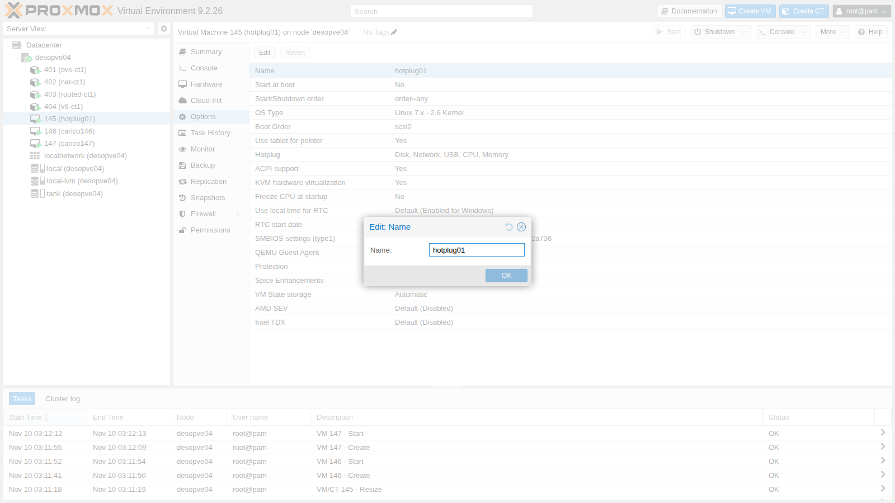
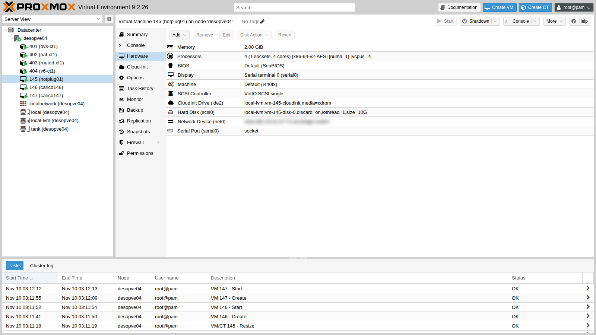
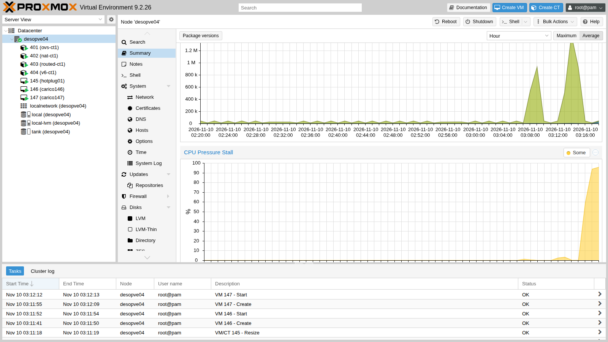
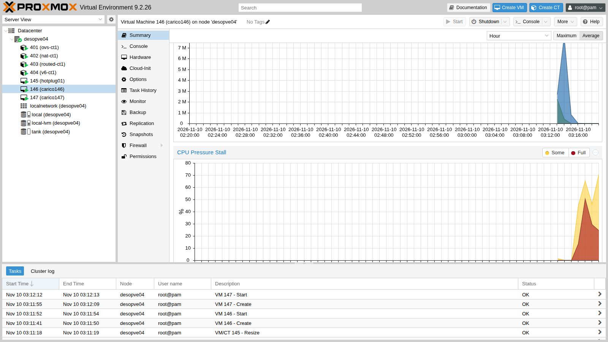

# Lab 42 – Hotplug, resize a caldo, peso e tetto di CPU, pressione (PSI)

**Livello:** intermedio · **Durata:** 1 ora

## Dipendenze

- **Lab precedenti:**
  - [Lab 19](19-fio-benchmark.md): l'immagine cloud Debian 13 in `local:import` di `desopve04`;
  - [Lab 36](36-memory.md): NUMA e memoria delle VM;
  - [Lab 37](37-virtual-disks-controllers.md): controller VirtIO SCSI e limiti di I/O dei dischi;
  - [Lab 40](40-templates-cloud-init-clones.md): cloud-init.
- **Nodo:** `desopve04`, il nodo autonomo con 4 CPU: le prove di contesa saturano il nodo, e non si fanno sui nodi del cluster con Ceph.
- **Storage:** `local-lvm` di `desopve04`.
- **Indirizzi:** VM 145 su 172.27.199.145, VM 146 e 147 su .146 e .147.
- **Credenziali:** utente `labuser` delle VM con la chiave SSH di `root` del nodo → [Appendice B](b-credentials-and-addresses.md).

## Obiettivi

- Aggiungere e togliere **a caldo** CPU, memoria, dischi e schede di rete, e verificare cosa vede il guest.
- Ingrandire un disco **senza spegnere** la VM, fino al filesystem.
- Ripartire la CPU tra VM in contesa con il **peso** (`cpuunits`) e con il **tetto** (`cpulimit`), misurando il risultato.
- Leggere la **pressione** (Pressure Stall Information) di nodo e VM nella GUI di Proxmox VE 9.

## Come funziona

**Hotplug.** L'opzione **Hotplug** di una VM dice a Proxmox VE quali componenti può collegare e scollegare mentre la VM è accesa. Il default è `disk,network,usb`. CPU e memoria vanno aggiunte esplicitamente e hanno dei requisiti:

| Componente | Requisiti | Cosa succede nel guest |
|---|---|---|
| Disco | controller SCSI o VirtIO | il disco compare come nuovo device |
| Scheda di rete | nessuno | compare una nuova interfaccia, da configurare |
| CPU | `vcpus` minore di `sockets × cores` | i nuovi processori arrivano **spenti**: serve una regola udev per accenderli |
| Memoria | `numa: 1` | oltre i primi 1024 MiB la memoria arriva in moduli DIMM da 512 MiB (`dimm0`, `dimm1`…); il kernel la vede in blocchi da 128 MiB e la mette online |

**`cores` e `vcpus`.** `cores` è il massimo di processori che la VM può avere; `vcpus` quanti ne usa all'avvio. La differenza è lo spazio per l'hotplug.

**Peso e tetto della CPU.** Ogni VM è un cgroup v2 in `/sys/fs/cgroup/qemu.slice/<VMID>.scope`:

- **`cpuunits`** diventa `cpu.weight` (default 100): conta solo quando la CPU del nodo è contesa, e la divide in proporzione ai pesi;
- **`cpulimit`** diventa `cpu.max`: un tetto rigido in "core", valido anche con il nodo scarico.

**PSI.** La *Pressure Stall Information* del kernel misura la percentuale di tempo in cui i processi aspettano una risorsa (CPU, I/O, memoria): *some* = almeno un processo in attesa, *full* = tutti in attesa. Proxmox VE 9 la raccoglie per nodo e guest e la mostra nei grafici del **Summary**.

## Procedura

### 1. La VM di prova

Una VM dall'immagine cloud, con 4 core massimi ma 2 attivi, NUMA attivo e hotplug di CPU e memoria:

```bash
qm create 145 --name hotplug01 --ostype l26 --memory 2048 --cores 4 --vcpus 2 --numa 1 --cpu x86-64-v2-AES \
  --scsihw virtio-scsi-single \
  --scsi0 local-lvm:0,import-from=local:import/debian-13-genericcloud-amd64.qcow2,discard=on,iothread=1 \
  --ide2 local-lvm:cloudinit --boot order=scsi0 --serial0 socket --vga serial0 \
  --net0 virtio,bridge=vmbr0 --agent enabled=1 --hotplug disk,network,usb,cpu,memory
qm resize 145 scsi0 6G
qm set 145 --ciuser labuser --sshkeys /root/.ssh/id_rsa.pub \
  --ipconfig0 ip=172.27.199.145/24,gw=172.27.199.1 --nameserver 172.27.199.20 --searchdomain proxmox.community --ciupgrade 0
qm start 145
```

Dopo il primo avvio, dal nodo, configura il proxy di `apt` nel guest e installa l'agent e `stress-ng` (l'immagine cloud non li contiene):

```bash
ssh labuser@172.27.199.145 "echo 'Acquire::http::Proxy \"http://proxy.proxmox.community:3128\";' | sudo tee /etc/apt/apt.conf.d/80proxy \
  && sudo apt-get update && sudo apt-get install -y qemu-guest-agent stress-ng && sudo systemctl start qemu-guest-agent"
qm agent 145 ping && echo agent-ok
```

Da qui in poi le verifiche nel guest si fanno dal nodo con `qm guest exec 145 -- <comando>`.

La stessa opzione dalla GUI: **Options** → **Hotplug**:



Lo stato iniziale nel guest:

```text
nproc: 2
/sys/devices/system/cpu/online: 0-1
Mem:            1926         338        1089           0         708        1588
Memory block size:                     134217728
Total online memory:                  2147483648
sda    6G disk
eth0             UP             <BROADCAST,MULTICAST,UP,LOWER_UP>
```

### 2. Hotplug della CPU

```bash
qm set 145 --vcpus 4
qm guest exec 145 -- bash -c 'nproc; cat /sys/devices/system/cpu/online; dmesg | grep hot-added'
```

``` { .text .no-copy title="Output" }
2
0-1
[  137.463337] ACPI: CPU2 has been hot-added
[  137.465248] ACPI: CPU3 has been hot-added
```

Il kernel ha ricevuto i due processori, ma li lascia **spenti**: `nproc` resta 2. La regola udev che li accende appena arrivano, nel guest:

```bash
echo 'SUBSYSTEM=="cpu", ACTION=="add", TEST=="online", ATTR{online}=="0", ATTR{online}="1"' \
  > /etc/udev/rules.d/80-hotplug-cpu.rules
udevadm control --reload
```

Tolti e riaggiunti i processori:

```bash
qm set 145 --vcpus 2   # torna a 2
qm set 145 --vcpus 4
```

``` { .text .no-copy title="Output" }
nproc: 4
/sys/devices/system/cpu/online: 0-3
```

E la rimozione a caldo:

```text
qm set 145 --vcpus 2
nproc: 2
/sys/devices/system/cpu/online: 0-1
```

### 3. Hotplug della memoria

```bash
qm set 145 --memory 4096
qm guest exec 145 -- bash -c 'free -m | sed -n 2p; lsmem --summary=only'
```

``` { .text .no-copy title="Output" }
Mem:            3974         368        3122           0         708        3606
Memory block size:                128M
Total online memory:                4G
Total offline memory:               0B
```

I 2 GiB in più arrivano come moduli DIMM e il kernel di Debian 13 li mette online da solo: nessuna regola necessaria. Il monitor della VM (`qm monitor 145`, comando `info memory-devices`) mostra sei moduli, da `dimm0` a `dimm5`, ciascuno di 536870912 byte: con l'hotplug Proxmox VE tiene 1024 MiB statici e aggiunge DIMM da **512 MiB** (da 1024 MiB con le hugepages da 1 GiB). I 128 MiB di `lsmem` sono invece i blocchi con cui il kernel gestisce la memoria. Anche la riduzione funziona, perché la memoria aggiunta è libera:

```bash
qm set 145 --memory 2048
```

``` { .text .no-copy title="Output" }
update VM 145: -memory 2048
try to unplug memory dimm dimm5
try to unplug memory dimm dimm4
try to unplug memory dimm dimm3
try to unplug memory dimm dimm2
Mem:            1926         301        1126           0         708        1624
```

I quattro moduli aggiunti si tolgono in ordine inverso.

La rimozione funziona solo se il guest riesce a liberare i moduli da togliere: con la memoria piena di dati non spostabili il kernel rifiuta lo scollegamento.

### 4. Hotplug di disco e scheda di rete

```bash
qm set 145 --scsi1 local-lvm:4,iothread=1,discard=on
qm guest exec 145 -- bash -c 'lsblk -dno NAME,SIZE,TYPE; ls -l /dev/disk/by-id/ | grep drive-scsi1'
```

``` { .text .no-copy title="Output" }
WARNING: Sum of all thin volume sizes (26.00 GiB) exceeds the size of thin pool pve/data and the amount of free space in volume group (<6.13 GiB).
scsi1: successfully created disk 'local-lvm:vm-145-disk-1,discard=on,iothread=1,size=4G'
sda    6G disk
sdb    4G disk
scsi-0QEMU_QEMU_HARDDISK_drive-scsi1 -> ../../sdb
```

Il disco compare come `sdb`; il link in `/dev/disk/by-id` porta il nome del drive Proxmox (`drive-scsi1`), ed è il modo sicuro di riconoscerlo ([Lab 37](37-virtual-disks-controllers.md)). L'avviso LVM ricorda l'overprovisioning del thin pool visto nel [Lab 09](09-lvm-and-lvm-thin.md).

```bash
qm set 145 --net1 virtio,bridge=vmbr0
qm guest exec 145 -- ip -br link
```

``` { .text .no-copy title="Output" }
eth0             UP             <BROADCAST,MULTICAST,UP,LOWER_UP>
ens19            DOWN           <BROADCAST,MULTICAST>
```

La scheda arriva **spenta e senza indirizzo**: va configurata nel guest.

La rimozione a caldo:

```bash
qm set 145 --delete net1
qm set 145 --delete scsi1
qm config 145 | grep unused
```

``` { .text .no-copy title="Output" }
unused0: local-lvm:vm-145-disk-1
```

La scheda sparisce, il disco viene scollegato dal guest ma **non cancellato**: diventa `unused0`, con i dati intatti. Per eliminarlo davvero:

```bash
qm disk unlink 145 --idlist unused0 --force
```

``` { .text .no-copy title="Output" }
Logical volume "vm-145-disk-1" successfully removed.
```

### 5. Ingrandire il disco a caldo

Prima:

```text
sda        6G
├─sda1   5.9G
├─sda14    3M
└─sda15  124M
/dev/sda1       5.8G  1.2G  4.4G  21% /
```

```bash
qm resize 145 scsi0 +4G
```

Il guest vede subito il disco più grande, ma partizione e filesystem restano come prima:

```text
sda       10G
├─sda1   5.9G
```

Nel guest:

```bash
growpart /dev/sda 1
resize2fs /dev/sda1
df -h /
```

``` { .text .no-copy title="Output" }
CHANGED: partition=1 start=262144 old: size=12320735 end=12582878 new: size=20709343 end=20971486
/dev/sda1       9.7G  1.2G  8.2G  13% /
```

Tre livelli: il disco (Proxmox VE), la partizione (`growpart`), il filesystem (`resize2fs` per ext4, `xfs_growfs` per XFS). Ridurre un disco invece **non** è possibile con `qm resize`. Lo stesso comando è nella GUI: **Hardware** → disco → **Disk Action** → **Resize**.



### 6. Peso e tetto della CPU in contesa

Due VM uguali, 146 e 147, con 4 core ciascuna sullo stesso nodo da 4 CPU, create come la 145 ma senza `vcpus` e senza hotplug:

```bash
for v in 146 147; do
  qm create $v --name contesa$v --ostype l26 --memory 2048 --cores 4 --cpu x86-64-v2-AES --scsihw virtio-scsi-single \
    --scsi0 local-lvm:0,import-from=local:import/debian-13-genericcloud-amd64.qcow2,discard=on,iothread=1 \
    --ide2 local-lvm:cloudinit --boot order=scsi0 --serial0 socket --vga serial0 --net0 virtio,bridge=vmbr0 --agent enabled=1
  qm set $v --ciuser labuser --sshkeys /root/.ssh/id_rsa.pub --ipconfig0 ip=172.27.199.$v/24,gw=172.27.199.1 \
    --nameserver 172.27.199.20 --searchdomain proxmox.community --ciupgrade 0
  qm start $v
done
```

In entrambe si installano agent e `stress-ng` come nella 145. Il carico è `stress-ng --cpu 4` in entrambe: la domanda è 8 core su 4 disponibili. Lo script [`contesa.sh`](../files/42/contesa.sh), sul nodo, misura per 30 secondi il tempo di CPU di ciascun cgroup (`usage_usec` in `cpu.stat`), mostra peso e tetto e legge la pressione (PSI). Ogni prova:

```bash
for v in 146 147; do ssh labuser@172.27.199.$v "nohup stress-ng --cpu 4 --timeout 60s >/dev/null 2>&1 &"; done
sleep 15; ./contesa.sh 146 147 30
```

**A. Pesi uguali (default).**

```text
VM 146: 1.97 core   VM 147: 1.95 core   totale 3.93 core   rapporto 147/146 = 0.99
cpu.weight 146=100  cpu.max 146=max 100000
cpu.weight 147=100  cpu.max 147=max 100000
PSI cpu some avg10: VM 146 61.38 %  VM 147 63.20 %  nodo 95.26 %
```

**B. `cpuunits` 100 e 300.**

```bash
qm set 146 --cpuunits 100
qm set 147 --cpuunits 300
```

``` { .text .no-copy title="Output" }
VM 146: 1.01 core   VM 147: 2.93 core   totale 3.94 core   rapporto 147/146 = 2.91
cpu.weight 146=100  cpu.max 146=max 100000
cpu.weight 147=300  cpu.max 147=max 100000
PSI cpu some avg10: VM 146 71.53 %  VM 147 27.25 %  nodo 95.00 %
```

La CPU si divide 1:3, come i pesi. Il peso non toglie nulla quando il nodo ha CPU libera: entra in gioco solo nella contesa.

**C. Pesi di default e `cpulimit 1` sulla 147.**

```bash
qm set 146 --delete cpuunits; qm set 147 --delete cpuunits
qm set 147 --cpulimit 1
```

``` { .text .no-copy title="Output" }
VM 146: 2.92 core   VM 147: 1.00 core   totale 3.92 core   rapporto 147/146 = 0.34
cpu.weight 146=100  cpu.max 146=max 100000
cpu.weight 147=100  cpu.max 147=100000 100000
PSI cpu some avg10: VM 146 26.96 %  VM 147 72.40 %  nodo 96.78 %
```

La 147 è bloccata a 1 core (100 ms ogni 100 ms) anche se ne chiede 4, e il resto va alla 146. Il tetto vale sempre, anche con il nodo scarico.

### 7. La pressione (PSI)

Durante le prove, la pressione di CPU letta dal cgroup di ciascuna VM (`cpu.pressure`, media degli ultimi 10 secondi, ultima riga di `contesa.sh`):

| Prova | PSI VM 146 | PSI VM 147 | PSI del nodo |
|---|---|---|---|
| A, pesi uguali | 61 % | 63 % | 95 % |
| B, 146 peso 100 / 147 peso 300 | 72 % | 27 % | 95 % |
| C, 147 con cpulimit 1 | 27 % | 72 % | 97 % |

La VM penalizzata, dal peso o dal tetto, passa più tempo in attesa della CPU. È l'indicatore giusto per capire se una VM è lenta *perché aspetta* e non perché lavora molto. Proxmox VE 9 mostra gli stessi valori nel **Summary**: per il nodo i grafici *CPU*, *IO* e *Memory Pressure Stall*:



e per ogni guest, con le due curve *some* e *full*:



Alla fine elimina le VM di prova:

```bash
for v in 145 146 147; do qm stop $v; qm destroy $v --purge; done
```

## Verifica e test

- Con `vcpus` minore di `cores` i processori si aggiungono a caldo, ma nel guest restano spenti finché una regola udev non li accende; con la regola compaiono subito, e si tolgono anche a caldo.
- Con NUMA attivo la memoria si aggiunge in moduli DIMM da 512 MiB, il kernel la mette online da solo, e si toglie se è libera.
- Un disco aggiunto a caldo compare come nuovo device, riconoscibile in `/dev/disk/by-id/...drive-scsiN`; tolto, diventa `unused` senza perdere i dati.
- Una scheda aggiunta a caldo compare spenta e senza indirizzo.
- `qm resize` ingrandisce il disco a caldo; `growpart` e `resize2fs` estendono partizione e filesystem senza riavvio.
- In contesa `cpuunits` 100 e 300 dividono la CPU 1:2,9; `cpulimit 1` blocca la VM a 1,00 core.
- La pressione di CPU sale sulla VM penalizzata ed è visibile nei grafici del Summary.

## Stato finale del lab

- VM di prova 145, 146 e 147 eliminate da `desopve04`, con i loro dischi.
- `desopve04` come prima del lab: CT 401-404 accesi, `local-lvm` e `tank` invariati.
- Nessuna modifica al cluster `desopve01`-`03`.

## Cosa hai imparato

- L'hotplug di CPU e memoria va abilitato nell'opzione **Hotplug**; la memoria richiede NUMA.
- Le CPU aggiunte a caldo vanno accese nel guest, con una regola udev o a mano.
- I dischi scollegati restano come `unused` finché non li si elimina esplicitamente.
- L'ingrandimento a caldo è a tre livelli: disco, partizione, filesystem.
- `cpuunits` è un peso relativo che conta solo in contesa; `cpulimit` è un tetto rigido.
- La PSI dice quanto una VM aspetta la CPU, l'I/O o la memoria: da Proxmox VE 9 è nei grafici di nodo e guest.

## Riferimenti

- [Proxmox VE – Hotplug](https://pve.proxmox.com/pve-docs/chapter-qm.html#qm_hotplug)
- [Proxmox VE wiki – Hotplug (qemu disk,nic,cpu,memory)](https://pve.proxmox.com/wiki/Hotplug_(qemu_disk,nic,cpu,memory))
- [Proxmox VE – CPU (cpuunits, cpulimit)](https://pve.proxmox.com/pve-docs/chapter-qm.html#qm_cpu)
- [Linux kernel – PSI, Pressure Stall Information](https://docs.kernel.org/accounting/psi.html)
- [Linux kernel – Control Group v2](https://docs.kernel.org/admin-guide/cgroup-v2.html)
