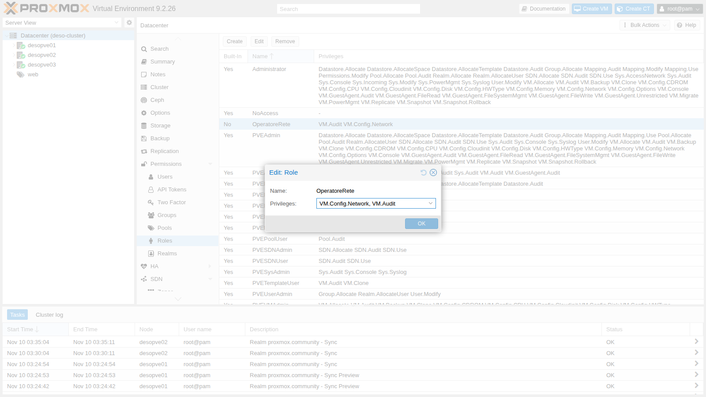
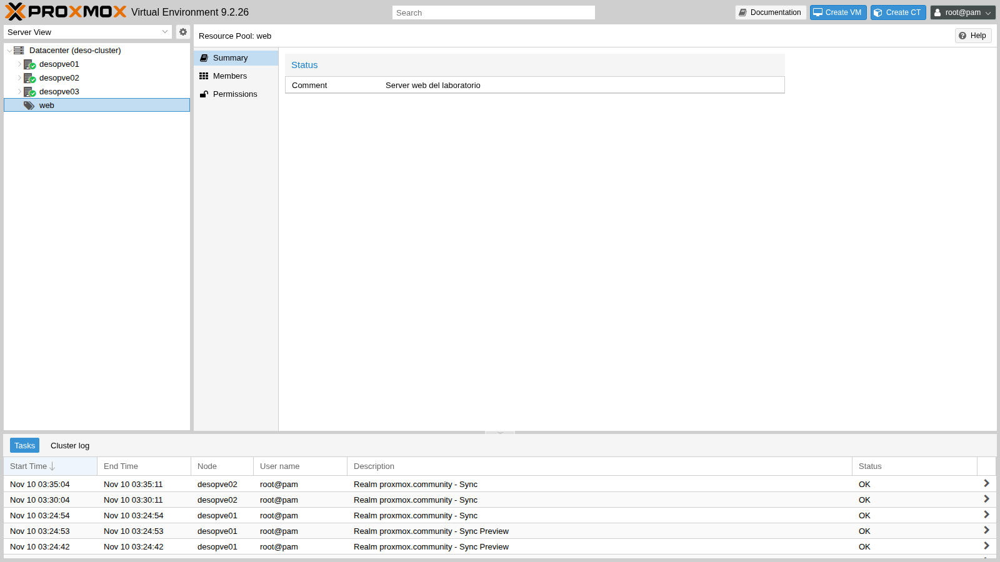
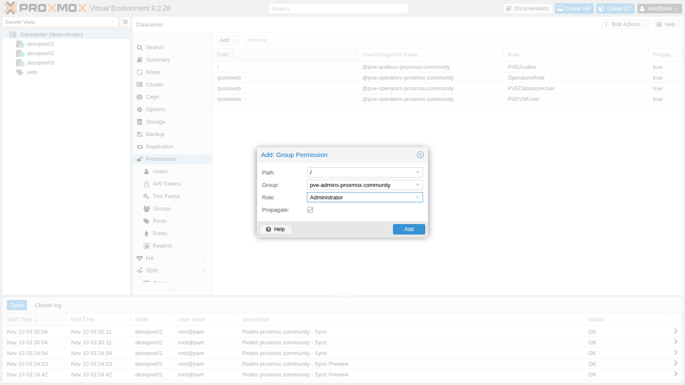
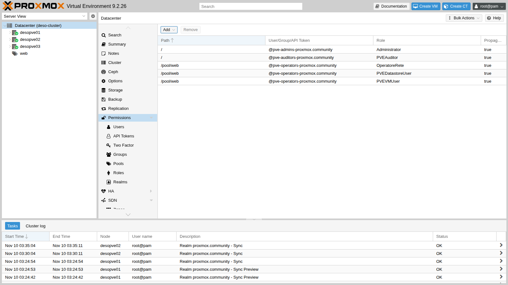
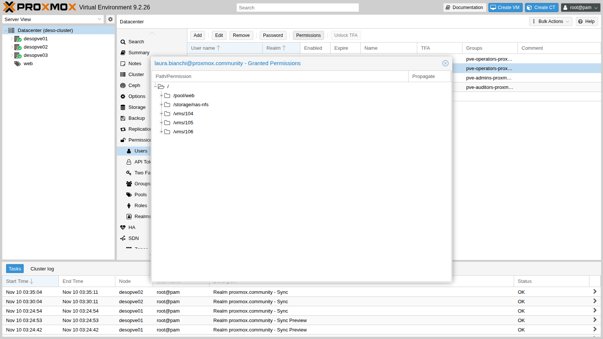
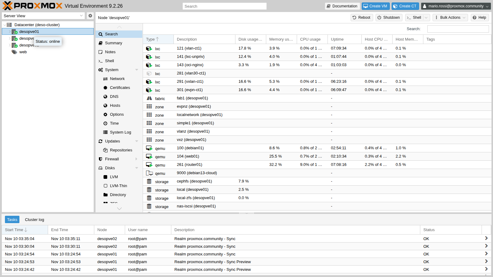
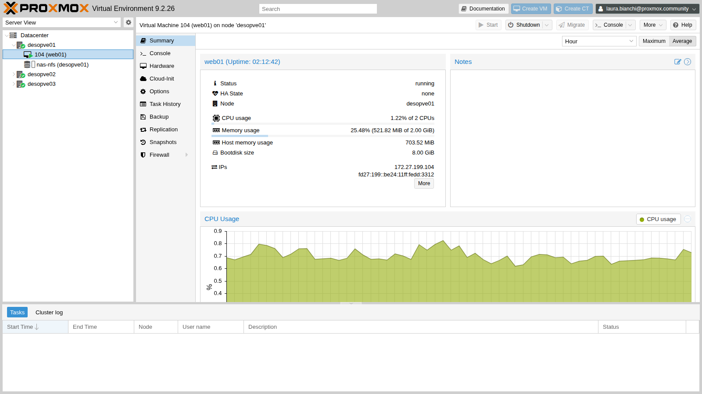
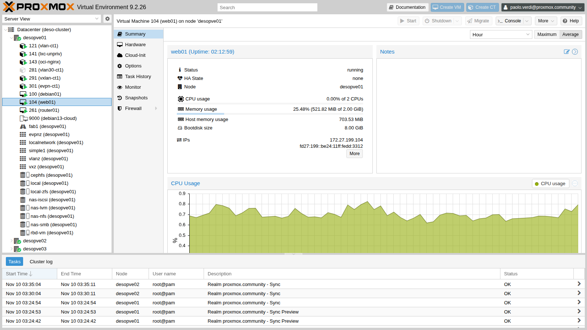
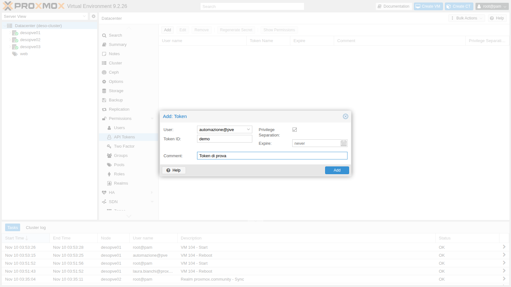
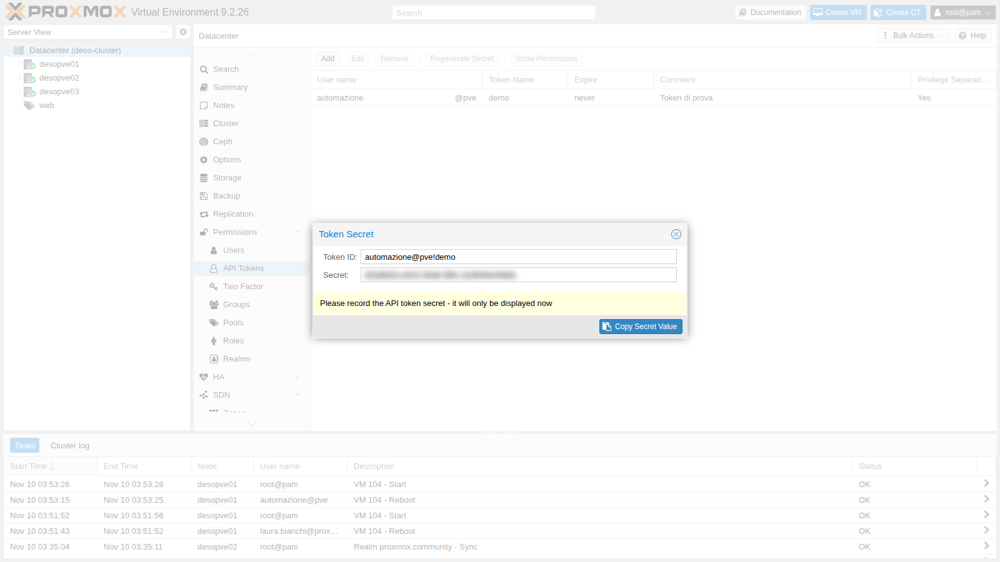

# Lab 44 – Utenti, gruppi, ruoli, pool e API token

**Livello:** intermedio · **Durata:** 1 ora e 15 minuti

## Dipendenze

- **Lab precedenti:**
  - [Lab 43](43-active-directory-realm-ldaps.md): il realm `proxmox.community` con gli utenti e i gruppi del dominio sincronizzati;
  - [Lab 40](40-templates-cloud-init-clones.md): le VM `web01`-`web03` (104-106), usate come risorse del pool;
  - [Lab 20](20-bridges-stable-names-vlans.md) e [Lab 21](21-bonding.md): il bridge `vmbr1` VLAN-aware, usato per la prova dei permessi SDN;
  - [Lab 13](13-nfs.md): lo storage `nas-nfs`.
- **Sistemi:** nodi `desopve01`-`03`, DC `desopve-dc01`. Le prove via API partono da una macchina della rete di gestione con `curl`.
- **Credenziali:** `root@pam`; utenti del dominio `mario.rossi`, `laura.bianchi`, `paolo.verdi`, tutti con `<password-lab>` → [Appendice B](b-credentials-and-addresses.md).

## Obiettivi

- Capire il modello dei permessi di Proxmox VE: **privilegi**, **ruoli**, **percorsi** e **ACL**.
- Creare un **ruolo personalizzato** e un **resource pool**.
- Dare i permessi ai **gruppi sincronizzati da AD** e verificare con un login reale cosa vede ciascun utente.
- Leggere i **permessi effettivi** di un utente, dalla GUI e dalla CLI.
- Capire la **propagazione** e il permesso **SDN.Use** sui bridge.
- Distinguere gli utenti dei realm **pve** e **pam**.
- Creare e usare un **API token** con *privilege separation*, poi revocarlo nel modo giusto.

## Come funziona

**Privilegi e ruoli.** Un *privilegio* è il diritto di fare una singola cosa, per esempio `VM.PowerMgmt` (accendere e spegnere una VM) o `Datastore.AllocateSpace` (scrivere su uno storage). Un *ruolo* è un insieme di privilegi con un nome. Proxmox VE ne fornisce una ventina già pronti; i più usati sono:

| Ruolo | Cosa permette |
|---|---|
| `Administrator` | tutto |
| `PVEAdmin` | quasi tutto, tranne la gestione del sistema e dei permessi |
| `PVEVMAdmin` | gestione completa delle VM: creazione, configurazione, migrazione |
| `PVEVMUser` | uso delle VM: console, accensione e spegnimento, backup, CD-ROM, cloud-init |
| `PVEDatastoreUser` | spazio sugli storage e lettura del contenuto |
| `PVESDNUser` | uso delle reti (bridge e VNet) |
| `PVEAuditor` | sola lettura di tutto |
| `NoAccess` | nessun accesso, utile per togliere un ramo |

**Percorsi e ACL.** Ogni oggetto ha un percorso: `/` (tutto il datacenter), `/nodes/<nodo>`, `/vms/<vmid>`, `/storage/<storage>`, `/pool/<pool>`, `/sdn/zones/<zona>/<vnet>[/<vlan>]`. Un'ACL dice: *su questo percorso*, *questo utente, gruppo o token* ha *questo ruolo*. Con **propagate** attivo, l'ACL vale anche per i percorsi figli (`/` vale per tutto, `/vms` per tutte le VM).

**Resource pool.** Un pool raggruppa VM, container e storage. Un'ACL su `/pool/<pool>` vale per tutti i suoi membri: è il modo più semplice di dare a un gruppo di persone "le sue" macchine.

**SDN.Use.** Per collegare una scheda di rete a un bridge, chi configura la VM deve avere `SDN.Use` sul bridge. Anche i bridge Linux classici hanno un percorso: `/sdn/zones/localnetwork/<bridge>`, con una sottovoce per ogni VLAN.

**Realm pve e pam.** Gli utenti del realm `pve` hanno la password salvata da Proxmox VE nel filesystem del cluster, quindi valgono su tutti i nodi. Gli utenti `pam` sono utenti Linux: Proxmox VE controlla la password con il sistema operativo del nodo su cui si fa il login, quindi l'utente Linux deve esistere su **ogni** nodo.

**API token.** Un token è una credenziale per script e automazioni, con un segreto che per default non scade (si può fissare una scadenza con `--expire`) e che non passa dalla 2FA. Con la *privilege separation* (consigliata) il token ha ACL proprie e i suoi permessi effettivi sono l'**intersezione** tra le ACL del token e quelle dell'utente: il token non può mai fare più del suo utente.

```mermaid
flowchart LR
  G1[Gruppo AD<br/>pve-admins] -->|Administrator su /| R[(Datacenter)]
  G3[Gruppo AD<br/>pve-auditors] -->|PVEAuditor su /| R
  G2[Gruppo AD<br/>pve-operators] -->|PVEVMUser + PVEDatastoreUser<br/>+ OperatoreRete su /pool/web| P[Pool web<br/>VM 104-106, nas-nfs]
  G2 -->|PVESDNUser| B[/sdn/zones/localnetwork/vmbr1/]
  U[automazione@pve] -->|PVEVMUser su /pool/web| P
  T[token automazione@pve!ci] -->|∩ con le ACL dell'utente| P
```

## Procedura

### 1. I ruoli predefiniti

Dalla CLI di un nodo, l'elenco dei ruoli (in GUI: **Datacenter → Permissions → Roles**):

```bash
pveum role list --noborder 1 | awk '{print $1, $NF}'
```

```text
roleid special
Administrator 1
NoAccess 1
PVEAdmin 1
PVEAuditor 1
PVEDatastoreAdmin 1
PVEDatastoreUser 1
PVEMappingAdmin 1
PVEMappingUser 1
PVEPoolAdmin 1
PVEPoolUser 1
PVESDNAdmin 1
PVESDNUser 1
PVESysAdmin 1
PVETemplateUser 1
PVEUserAdmin 1
PVEVMAdmin 1
PVEVMUser 1
```

`special 1` indica i ruoli predefiniti, che non si possono modificare. I privilegi di alcuni di loro:

```text
PVEAuditor        Datastore.Audit,Mapping.Audit,Pool.Audit,SDN.Audit,Sys.Audit,VM.Audit,VM.GuestAgent.Audit
PVEDatastoreUser  Datastore.AllocateSpace,Datastore.Audit
PVESDNUser        SDN.Audit,SDN.Use
PVEVMUser         VM.Audit,VM.Backup,VM.Config.CDROM,VM.Config.Cloudinit,VM.Console,VM.GuestAgent.Audit,VM.GuestAgent.FileRead,VM.GuestAgent.FileSystemMgmt,VM.GuestAgent.FileWrite,VM.PowerMgmt
```

`PVEVMUser` può accendere e spegnere una VM, ma non cambiarne la configurazione hardware: per esempio non ha `VM.Config.Network`.

### 2. Un ruolo personalizzato

Vogliamo che gli operatori possano anche gestire le schede di rete delle loro VM. Creiamo il ruolo `OperatoreRete` con i soli privilegi necessari:

```bash
pveum role add OperatoreRete --privs "VM.Audit,VM.Config.Network"
```

In GUI: **Datacenter → Permissions → Roles → Create**. Il ruolo compare nell'elenco con *Built-In = No*:



### 3. Il resource pool `web`

Mettiamo nel pool le tre VM web e lo storage `nas-nfs`:

```bash
pveum pool add web --comment "Server web del laboratorio"
pveum pool modify web --vms 104,105,106 --storage nas-nfs
pvesh get /pools/web --output-format json | python3 -c 'import sys, json
p = json.load(sys.stdin); print(p["comment"])
for m in p["members"]: print(m["type"], m.get("vmid", ""), m.get("name", m.get("storage")), m["node"])'
```

```text
Server web del laboratorio
qemu 104 web01 desopve01
qemu 105 web02 desopve02
qemu 106 web03 desopve03
storage  nas-nfs desopve01
```

In GUI il pool si crea da **Datacenter → Permissions → Pools → Create** e i membri si aggiungono selezionando il pool nell'albero, scheda **Members**:



### 4. I permessi ai gruppi del dominio

Assegniamo i ruoli ai tre gruppi sincronizzati nel Lab 43. Gli ID dei gruppi hanno il suffisso del realm (`-proxmox.community`).

I primi tre dalla CLI:

```bash
pveum acl modify / --groups pve-auditors-proxmox.community --roles PVEAuditor
pveum acl modify /pool/web --groups pve-operators-proxmox.community --roles PVEVMUser,PVEDatastoreUser
pveum acl modify /pool/web --groups pve-operators-proxmox.community --roles OperatoreRete
pveum acl list
```

```text
┌───────────┬──────────────────┬───────┬─────────────────────────────────┬───────────┐
│ path      │ roleid           │ type  │ ugid                            │ propagate │
╞═══════════╪══════════════════╪═══════╪═════════════════════════════════╪═══════════╡
│ /         │ PVEAuditor       │ group │ pve-auditors-proxmox.community  │ 1         │
├───────────┼──────────────────┼───────┼─────────────────────────────────┼───────────┤
│ /pool/web │ PVEDatastoreUser │ group │ pve-operators-proxmox.community │ 1         │
├───────────┼──────────────────┼───────┼─────────────────────────────────┼───────────┤
│ /pool/web │ PVEVMUser        │ group │ pve-operators-proxmox.community │ 1         │
├───────────┼──────────────────┼───────┼─────────────────────────────────┼───────────┤
│ /pool/web │ OperatoreRete    │ group │ pve-operators-proxmox.community │ 1         │
└───────────┴──────────────────┴───────┴─────────────────────────────────┴───────────┘
```

Il quarto dalla GUI: **Datacenter → Permissions → Add → Group Permission**, percorso `/`, gruppo `pve-admins-proxmox.community`, ruolo `Administrator`, *Propagate* attivo:



Ora `pveum acl list` mostra cinque righe: le quattro sopra più `/ │ Administrator │ group │ pve-admins-proxmox.community`.

L'elenco completo in **Datacenter → Permissions**:



> **Perché ai gruppi e non agli utenti.** Se domani un collega entra in `pve-operators` in AD, la prossima sincronizzazione lo aggiunge al gruppo in Proxmox VE e i permessi seguono da soli. Nessuno deve toccare le ACL.

### 5. I permessi effettivi

Per sapere cosa può fare davvero un utente su un oggetto, si chiede a Proxmox VE di calcolare i **permessi effettivi**, che uniscono tutte le ACL, dirette e di gruppo:

```bash
pveum user permissions laura.bianchi@proxmox.community --path /vms/104
pveum user permissions laura.bianchi@proxmox.community --path /vms/100
```

```text
┌──────────┬──────────────────────────────┐
│ ACL path │ Permissions                  │
╞══════════╪══════════════════════════════╡
│ /vms/104 │ Datastore.AllocateSpace      │
│          │ Datastore.Audit              │
│          │ VM.Audit                     │
│          │ VM.Backup                    │
│          │ VM.Config.CDROM              │
│          │ VM.Config.Cloudinit          │
│          │ VM.Config.Network            │
│          │ VM.Console                   │
│          │ VM.GuestAgent.Audit          │
│          │ VM.GuestAgent.FileRead       │
│          │ VM.GuestAgent.FileSystemMgmt │
│          │ VM.GuestAgent.FileWrite      │
│          │ VM.PowerMgmt                 │
└──────────┴──────────────────────────────┘
┌──────────┬─────────────┐
│ ACL path │ Permissions │
╞══════════╪═════════════╡
│ /vms/100 │             │
└──────────┴─────────────┘
```

Sulla VM 104, che sta nel pool, Laura ha la somma dei tre ruoli; sulla VM 100, fuori dal pool, nulla. In GUI: **Datacenter → Permissions → Users**, selezionare l'utente e premere **Permissions**:



### 6. Cosa vede ciascuno: login reali

Entriamo nella GUI con i tre utenti del dominio, scegliendo il realm *Active Directory* nella finestra di login.

**Mario Rossi** (`pve-admins`) vede e può fare tutto:



**Laura Bianchi** (`pve-operators`) sotto `desopve01` vede solo `web01` e lo storage `nas-nfs`; sotto gli altri nodi trova `web02` e `web03`. I pulsanti *Shutdown* e *Console* sono attivi, *Create VM* e *Migrate* no.



**Paolo Verdi** (`pve-auditors`) vede tutto il datacenter, ma ogni azione è disattivata:



### 7. Prove via API: il perimetro del pool

La GUI usa la stessa API REST che si può chiamare con `curl`. Da una macchina della rete di gestione chiediamo un ticket per Laura e proviamo due riavvii:

```bash
N1=https://172.27.199.21:8006/api2/json
read TK CS < <(curl -sk --data-urlencode "username=laura.bianchi@proxmox.community" \
  --data-urlencode "password=<password-lab>" $N1/access/ticket |
  python3 -c 'import sys,json; d=json.load(sys.stdin)["data"]; print(d["ticket"], d["CSRFPreventionToken"])')
api() { m=$1; p=$2; shift 2; curl -sk -X $m -b "PVEAuthCookie=$TK" -H "CSRFPreventionToken: $CS" "$@" "$N1$p" -w '\nHTTP %{http_code}\n'; }

api POST /nodes/desopve01/qemu/104/status/reboot
api POST /nodes/desopve01/qemu/100/status/reboot
```

```text
{"data":"UPID:desopve01:000727C6:004946EC:6AF286BF:qmreboot:104:laura.bianchi@proxmox.community:"}
HTTP 200
{"data":null,"message":"Permission check failed (/vms/100, VM.PowerMgmt)\n"}
HTTP 403
```

Il messaggio di errore dice esattamente **quale privilegio manca e su quale percorso**: è la prima cosa da leggere quando un utente segnala "non mi fa fare X".

### 8. SDN.Use: il permesso sul bridge

Laura ha `VM.Config.Network` sulle VM del pool (ruolo `OperatoreRete`). Proviamo ad aggiungere a `web01` una seconda scheda su `vmbr1`, VLAN 10:

```bash
api PUT /nodes/desopve01/qemu/104/config --data-urlencode "net1=virtio,bridge=vmbr1,tag=10"
```

```text
{"message":"Permission check failed (/sdn/zones/localnetwork/vmbr1/10, SDN.Use)\n","data":null}
HTTP 403
```

Il privilegio sulla VM non basta: serve anche `SDN.Use` sul bridge (e sulla VLAN). Lo diamo al gruppo sul bridge, con propagazione, quindi vale per tutte le sue VLAN:

```bash
pveum acl modify /sdn/zones/localnetwork/vmbr1 --groups pve-operators-proxmox.community --roles PVESDNUser
```

Laura riprova, e questa volta la scheda viene aggiunta a caldo:

```bash
api PUT /nodes/desopve01/qemu/104/config --data-urlencode "net1=virtio,bridge=vmbr1,tag=10"
qm config 104 | grep ^net
```

```text
{"data":null}
HTTP 200
net0: virtio=BC:24:11:DD:33:12,bridge=vmbr0
net1: virtio=BC:24:11:6E:FA:D0,bridge=vmbr1,tag=10
```

Poi la rimuove:

```bash
api PUT /nodes/desopve01/qemu/104/config --data-urlencode "delete=net1"
```

La prima volta il guest stava ancora completando il riavvio del passo 7 e non ha rilasciato la scheda:

```text
{"errors":{"net1":"hotplug problem - error on hot-unplugging device 'net1' - still busy in guest?\n"},"data":null,"message":"Parameter verification failed.\n"}
HTTP 400
```

```bash
qm pending 104 | grep -i net
```

```text
cur net0: virtio=BC:24:11:DD:33:12,bridge=vmbr0
del net1: virtio=BC:24:11:6E:FA:D0,bridge=vmbr1,tag=10
```

La rimozione è rimasta **in sospeso** (`del`): verrebbe applicata al prossimo spegnimento. Ripetuta a guest avviato, passa subito (`HTTP 200`) e `qm pending` mostra solo `net0`.

### 9. La propagazione

Un'ACL su `/vms` con *propagate* disattivato vale solo per il percorso `/vms` in sé, non per le singole VM. Lo verifichiamo con un utente locale del realm `pve`:

```bash
pveum user add stagista@pve --password '<password-lab>' --comment 'Utente locale del realm pve'
pveum acl modify /vms --users stagista@pve --roles PVEAuditor --propagate 0
pveum user permissions stagista@pve --path /vms/104
pveum acl modify /vms --users stagista@pve --roles PVEAuditor --propagate 1
pveum user permissions stagista@pve --path /vms/104
```

```text
┌──────────┬─────────────┐
│ ACL path │ Permissions │
╞══════════╪═════════════╡
│ /vms/104 │             │
└──────────┴─────────────┘
┌──────────┬─────────────────────────┐
│ ACL path │ Permissions             │
╞══════════╪═════════════════════════╡
│ /vms/104 │ Datastore.Audit (*)     │
│          │ Mapping.Audit (*)       │
│          │ Pool.Audit (*)          │
│          │ SDN.Audit (*)           │
│          │ Sys.Audit (*)           │
│          │ VM.Audit (*)            │
│          │ VM.GuestAgent.Audit (*) │
└──────────┴─────────────────────────┘
```

L'asterisco segna i privilegi arrivati per propagazione. Alla fine lasciamo a `stagista@pve` solo la lettura del pool `web` (servirà nel Lab 45):

```bash
pveum acl delete /vms --users stagista@pve --roles PVEAuditor
pveum acl modify /pool/web --users stagista@pve --roles PVEAuditor
```

### 10. Realm pve contro pam

Chiediamo un ticket a due nodi diversi, con una piccola funzione che stampa solo il codice HTTP:

```bash
t(){ curl -sk -o /dev/null -w "$1 su $3: HTTP %{http_code}\n" --data-urlencode "username=$1" \
  --data-urlencode "password=$2" https://$3:8006/api2/json/access/ticket; }
t stagista@pve '<password-lab>' 172.27.199.21
t stagista@pve '<password-lab>' 172.27.199.22
```

L'utente del realm `pve` funziona ovunque:

```text
stagista@pve su 172.27.199.21: HTTP 200
stagista@pve su 172.27.199.22: HTTP 200
```

Ora creiamo `operatore@pam` in Proxmox VE e proviamo il login prima e dopo aver creato l'utente Linux **solo** su `desopve01`:

```bash
pveum user add operatore@pam --comment "Utente PAM: serve un utente Linux sul nodo"
t operatore@pam '<password-lab>' 172.27.199.21
useradd -m -s /bin/bash operatore && echo 'operatore:<password-lab>' | chpasswd    # solo su desopve01
t operatore@pam '<password-lab>' 172.27.199.21
t operatore@pam '<password-lab>' 172.27.199.22
```

```text
operatore@pam su 172.27.199.21: HTTP 401
operatore@pam su 172.27.199.21: HTTP 200
operatore@pam su 172.27.199.22: HTTP 401
```

L'utente `pam` entra solo dove esiste il suo account Linux. Per questo, a parte `root@pam`, gli utenti delle persone si gestiscono in `pve` o, meglio, in un realm di directory come AD. Puliamo:

```bash
userdel -r operatore
pveum user delete operatore@pam
```

### 11. API token con privilege separation

Creiamo un utente per le automazioni, senza password, con `PVEVMUser` sul pool `web`, e un suo token con privilege separation:

```bash
pveum user add automazione@pve --comment 'Utente per script e CI'
pveum acl modify /pool/web --users automazione@pve --roles PVEVMUser
pveum user token add automazione@pve ci --privsep 1 --comment 'Pipeline CI' --output-format json
```

```json
{"full-tokenid":"automazione@pve!ci","info":{"comment":"Pipeline CI","privsep":"1"},"value":"<segreto>"}
```

Il segreto viene mostrato **una sola volta**. In GUI il token si crea da **Datacenter → Permissions → API Tokens → Add**:





Al token diamo `PVEAuditor` su tutto il datacenter e `PVEVMUser` solo sulla VM 104:

```bash
pveum acl modify / --tokens 'automazione@pve!ci' --roles PVEAuditor
pveum acl modify /vms/104 --tokens 'automazione@pve!ci' --roles PVEVMUser
pveum user token permissions automazione@pve ci --path /vms/104
pveum user token permissions automazione@pve ci --path /vms/100
```

```text
┌──────────┬──────────────────────────────┐
│ ACL path │ Permissions                  │
╞══════════╪══════════════════════════════╡
│ /vms/104 │ VM.Audit                     │
│          │ VM.Backup                    │
│          │ VM.Config.CDROM              │
│          │ VM.Config.Cloudinit          │
│          │ VM.Console                   │
│          │ VM.GuestAgent.Audit          │
│          │ VM.GuestAgent.FileRead       │
│          │ VM.GuestAgent.FileSystemMgmt │
│          │ VM.GuestAgent.FileWrite      │
│          │ VM.PowerMgmt                 │
└──────────┴──────────────────────────────┘
┌──────────┬─────────────┐
│ ACL path │ Permissions │
╞══════════╪═════════════╡
│ /vms/100 │             │
└──────────┴─────────────┘
```

Sulla VM 100 il token ha `PVEAuditor`, ma l'utente non ha nulla: l'intersezione è vuota. Usiamo il token con `curl`, con l'intestazione `Authorization`:

```bash
H='Authorization: PVEAPIToken=automazione@pve!ci=<segreto>'
curl -sk -H "$H" "$N1/cluster/resources?type=vm" | python3 -c 'import sys,json; print(sorted(r["vmid"] for r in json.load(sys.stdin)["data"]))'
curl -sk -H "$H" -X POST $N1/nodes/desopve01/qemu/104/status/reboot -w '\nHTTP %{http_code}\n'
curl -sk -H "$H" -X POST $N1/nodes/desopve02/qemu/105/status/reboot -w '\nHTTP %{http_code}\n'
```

```text
[104, 105, 106]
{"data":"UPID:desopve01:00072DA3:00496ABE:6AF2871B:qmreboot:104:automazione@pve!ci:"}
HTTP 200
{"data":null,"message":"Permission check failed (/vms/105, VM.PowerMgmt)\n"}
HTTP 403
```

- Il token "vede" solo le tre VM del pool, nonostante `PVEAuditor` su `/`: l'utente non vede altro.
- Può riavviare la 104 (token e utente hanno entrambi `VM.PowerMgmt`), non la 105 (il token non ce l'ha). Nel task log l'autore è `automazione@pve!ci`, quindi le azioni di ogni automazione sono tracciabili.
- Le richieste con token non hanno bisogno del `CSRFPreventionToken`.

### 12. Revocare un token senza lasciare residui

Rimuoviamo il token e riproviamo:

```bash
pveum user token remove automazione@pve ci
curl -sk -H "$H" "$N1/version" -w '\nHTTP %{http_code}\n'
```

```text
user config - ignore invalid acl token 'automazione@pve!ci'
user config - ignore invalid acl token 'automazione@pve!ci'

HTTP 401
```

Il token non funziona più, ma le sue **ACL sono rimaste** in `/etc/pve/user.cfg` e generano un avviso a ogni comando. Non si possono nemmeno togliere, perché il token non esiste più:

```text
ACL update failed: no such token 'ci' for user 'automazione@pve'
```

L'ordine corretto è il contrario: **prima** si tolgono le ACL, **poi** il token. Se è già successo, si ricrea un token con lo stesso nome, si cancellano le ACL e si rimuove di nuovo:

```bash
pveum user token add automazione@pve ci --privsep 1 >/dev/null
pveum acl delete / --tokens 'automazione@pve!ci' --roles PVEAuditor
pveum acl delete /vms/104 --tokens 'automazione@pve!ci' --roles PVEVMUser
pveum user token remove automazione@pve ci
grep -c 'automazione@pve!ci' /etc/pve/user.cfg
```

```text
0
```

## Verifica e test

| Prova | Risultato atteso | Esito |
|---|---|---|
| Laura riavvia la VM 104, nel pool | `HTTP 200` | ok |
| Laura riavvia la VM 100, fuori dal pool | `HTTP 403`, manca `VM.PowerMgmt` su `/vms/100` | ok |
| Laura aggiunge una scheda su `vmbr1` senza `SDN.Use` | `HTTP 403` su `/sdn/zones/localnetwork/vmbr1/10` | ok |
| La stessa operazione con `PVESDNUser` sul bridge | `HTTP 200`, scheda aggiunta | ok |
| ACL su `/vms` senza e con propagate | permessi su `/vms/104` vuoti, poi presenti | ok |
| `operatore@pam` con utente Linux solo su `desopve01` | 200 su `desopve01`, 401 su `desopve02` | ok |
| Token con privsep | vede 104-106, riavvia la 104, `403` sulla 105 | ok |
| Token revocato | `HTTP 401`; nessuna ACL residua dopo la pulizia | ok |

## Stato finale del lab

- **Ruolo personalizzato** `OperatoreRete` (`VM.Audit`, `VM.Config.Network`).
- **Pool `web`:** VM 104, 105, 106 e storage `nas-nfs`.
- **ACL:**
  - `/` → `pve-admins-proxmox.community`: `Administrator`; `pve-auditors-proxmox.community`: `PVEAuditor`;
  - `/pool/web` → `pve-operators-proxmox.community`: `PVEVMUser`, `PVEDatastoreUser`, `OperatoreRete`; `automazione@pve`: `PVEVMUser`; `stagista@pve`: `PVEAuditor`;
  - `/sdn/zones/localnetwork/vmbr1` → `pve-operators-proxmox.community`: `PVESDNUser`.
- **Utenti locali:** `stagista@pve` (con password, lettura del pool `web`), `automazione@pve` (senza password e, a fine lab, senza token).
- `operatore@pam` e il relativo utente Linux sono stati rimossi; la VM 104 ha di nuovo solo `net0`.

## Cosa hai imparato

- I permessi sono ACL: **percorso + utente/gruppo/token + ruolo**, con la propagazione verso i percorsi figli.
- I ruoli predefiniti coprono i casi comuni; un ruolo personalizzato aggiunge esattamente i privilegi che mancano.
- Un pool è il modo più semplice per dare a un gruppo "le sue" VM e i suoi storage.
- I permessi si danno ai **gruppi** sincronizzati da AD, non ai singoli utenti.
- I messaggi `Permission check failed (percorso, privilegio)` dicono esattamente cosa manca; `pveum user permissions` lo conferma.
- Per collegare una scheda a un bridge serve `SDN.Use` anche sui bridge Linux classici.
- Gli utenti `pam` esistono solo dove esiste l'utente Linux; per le persone si usano `pve` o un realm di directory.
- Un token con privilege separation può al massimo quanto il suo utente; si revoca togliendo **prima** le ACL e **poi** il token.

## Riferimenti

- [Proxmox VE – User Management](https://pve.proxmox.com/pve-docs/chapter-pveum.html)
- [Proxmox VE – Permission Management](https://pve.proxmox.com/pve-docs/chapter-pveum.html#pveum_permission_management)
- [Proxmox VE – API Tokens](https://pve.proxmox.com/pve-docs/chapter-pveum.html#pveum_tokens)
- [Proxmox VE – Pools](https://pve.proxmox.com/pve-docs/chapter-pveum.html#pveum_pools)
- [Proxmox VE API Viewer](https://pve.proxmox.com/pve-docs/api-viewer/)
