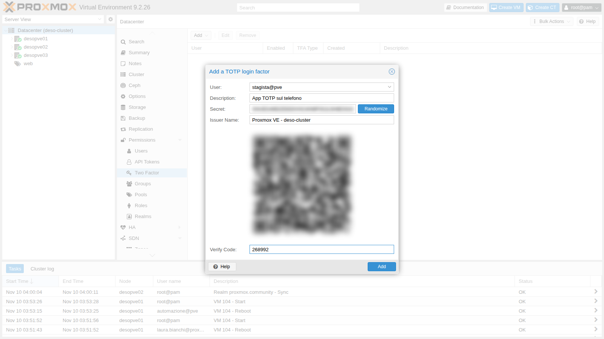
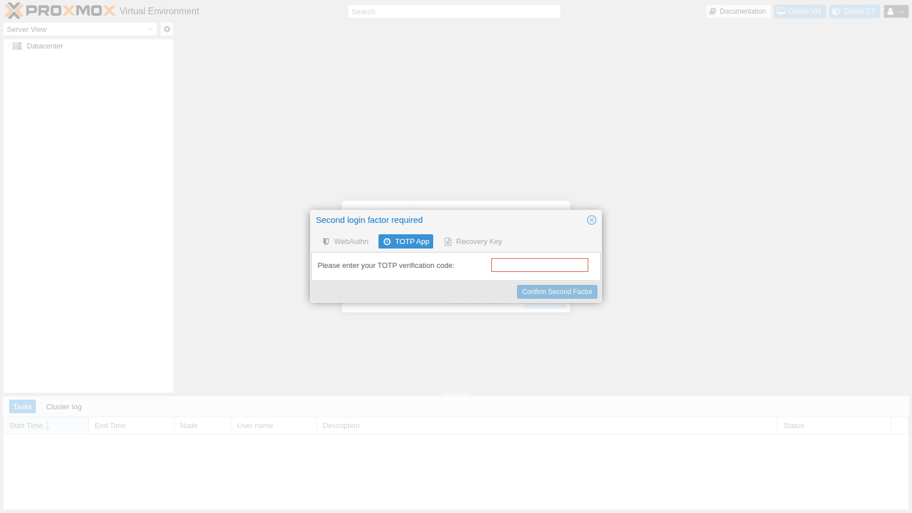
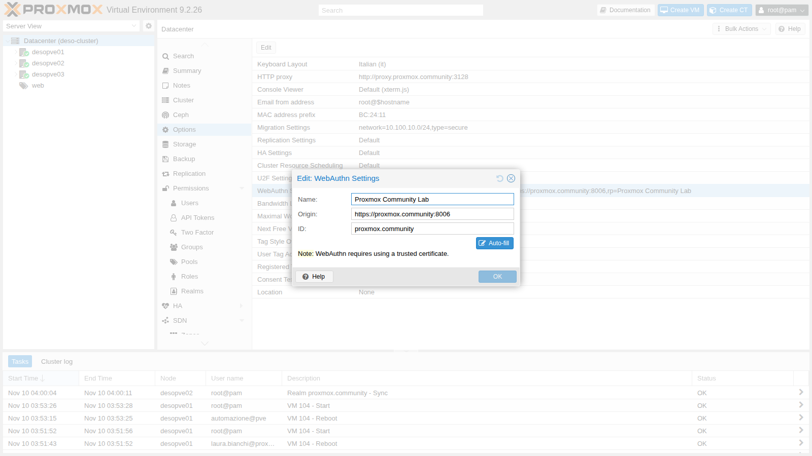
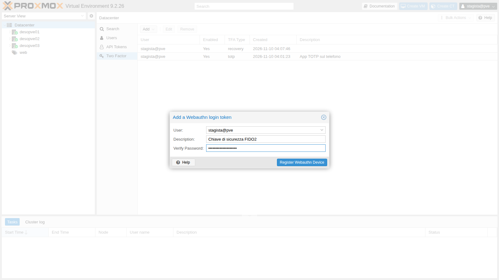
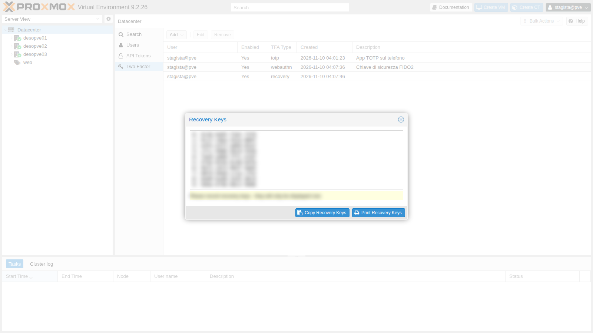
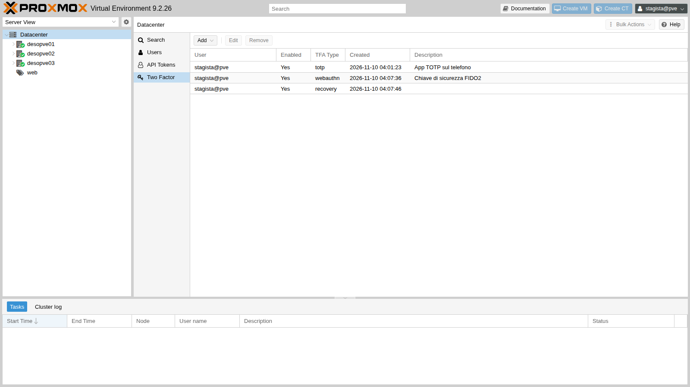
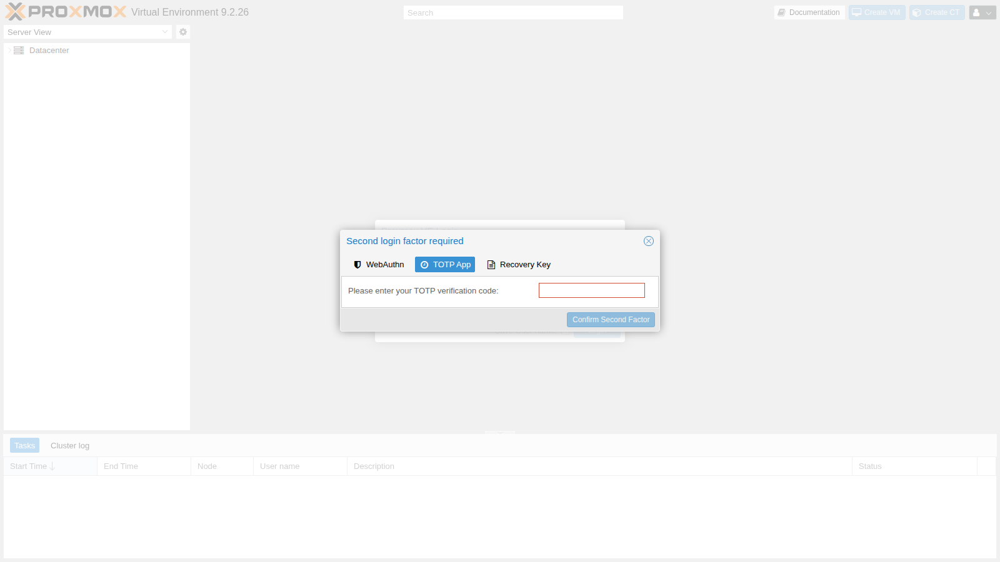
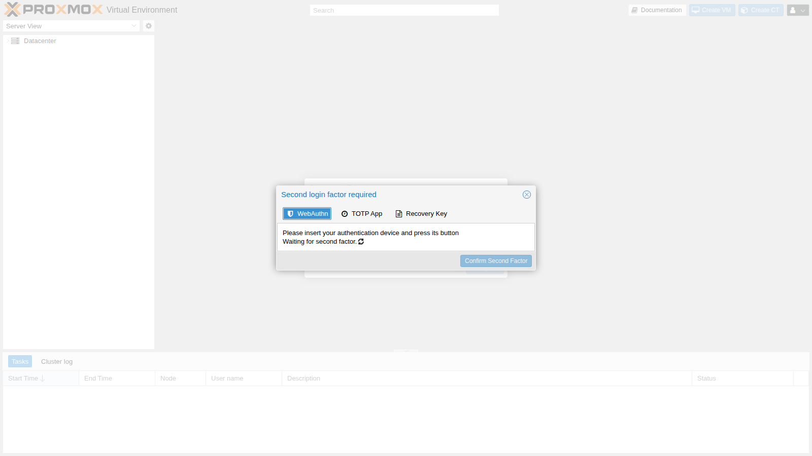
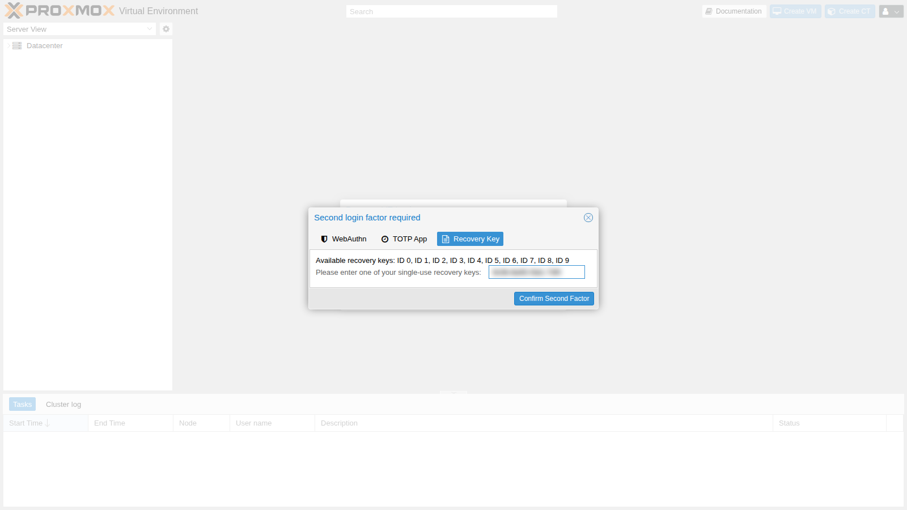
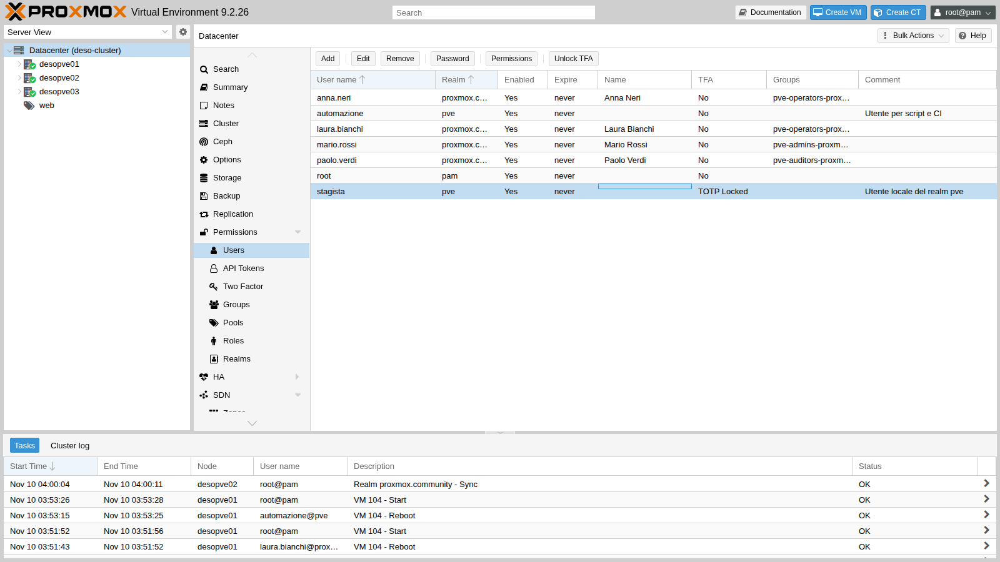

# Lab 45 – Autenticazione a due fattori: TOTP, WebAuthn, codici di recupero

**Livello:** intermedio · **Durata:** 1 ora

## Dipendenze

- **Lab precedenti:**
  - [Lab 44](44-users-groups-roles-pools-tokens.md): l'utente locale `stagista@pve` e gli API token;
  - [Lab 43](43-active-directory-realm-ldaps.md): il realm `proxmox.community` e l'utente `mario.rossi`;
  - [Lab 04](04-first-access-repositories-updates.md): i nomi DNS dei nodi (`desopveNN.proxmox.community`).
- **Sistemi:** nodi `desopve01`-`03`; un PC di amministrazione con browser, un'app TOTP (sul telefono o un programma come `oathtool`) e una chiave di sicurezza FIDO2 (o un autenticatore di piattaforma, per esempio Windows Hello).
- **Credenziali:** `root@pam`, `stagista@pve`, `mario.rossi`, tutti con `<password-lab>` → [Appendice B](b-credentials-and-addresses.md).

## Obiettivi

- Attivare il **TOTP** per un utente ed entrare con il secondo fattore.
- Configurare **WebAuthn** per tutto il cluster e registrare una chiave di sicurezza FIDO2.
- Generare e usare i **codici di recupero**.
- Vedere il **blocco** dopo troppi codici sbagliati e sbloccare l'utente.
- Rendere la 2FA **obbligatoria per un intero realm**.
- Capire cosa cambia per le **API**, per i **token** e per **root@pam**.

## Come funziona

Con la 2FA il login richiede due prove: la password (qualcosa che sai) e un secondo fattore (qualcosa che hai). Proxmox VE ne supporta quattro tipi, configurabili insieme sullo stesso utente:

| Tipo | Cos'è | Note |
|---|---|---|
| **TOTP** | codice di 6 cifre che cambia ogni 30 secondi, generato da un'app | il segreto si condivide una volta, con un QR code |
| **WebAuthn** | chiave di sicurezza FIDO2 (USB/NFC) o autenticatore della piattaforma | resiste al phishing: la firma è legata al dominio |
| **Recovery keys** | 10 codici monouso | per quando si perde il telefono o la chiave |
| **Yubico OTP** | codici delle chiavi YubiKey verificati da un server Yubico | richiede un server di validazione |

I fattori di ogni utente sono in `/etc/pve/priv/tfa.cfg`, condiviso dal cluster. Un utente li gestisce da sé dal menu utente → **TFA**; un amministratore da **Datacenter → Permissions → Two Factor**.

La 2FA protegge il **login con password** (GUI e API `/access/ticket`). Gli **API token** e l'accesso **SSH/console** del nodo non ne sono toccati.

**WebAuthn e il dominio.** Il browser firma la sfida solo se l'indirizzo del sito corrisponde all'*ID* configurato (il dominio, qui `proxmox.community`) e solo su una connessione **con certificato valido**: con l'avviso "certificato non attendibile" WebAuthn non funziona.

## Procedura

### 1. TOTP per un utente

In **Datacenter → Permissions → Two Factor → Add → TOTP** si sceglie l'utente `stagista@pve` e si dà una descrizione. Proxmox VE genera un segreto e il QR code: si inquadra con l'app (o si copia il segreto) e si inserisce il primo codice in *Verify Code*, che dimostra che l'app è configurata bene.



Nel lab il codice viene da `oathtool`, che fa lo stesso calcolo di un'app TOTP:

```bash
oathtool --totp -b <segreto-base32>
```

``` { .text .no-copy title="Output" }
268992
```

Dopo la password, il login chiede il secondo fattore:



### 2. WebAuthn per il cluster

WebAuthn va configurato una volta per tutto il datacenter in **Datacenter → Options → WebAuthn Settings**: *Name* (il nome mostrato dal browser), *Origin* (l'indirizzo da cui si usa la GUI) e *ID* (il dominio). *Auto-fill* li compila con l'indirizzo corrente.



**Prima prova: origin di un solo nodo.** Configuriamo l'origin di `desopve01` e il dominio come ID:

```bash
pvesh set /cluster/options --webauthn "rp=Proxmox Community Lab,origin=https://desopve01.proxmox.community:8006,id=proxmox.community,allow-subdomains=1"
```

Da `https://desopve01.proxmox.community:8006` il login con la chiave funziona; da `https://desopve02.proxmox.community:8006` la stessa chiave viene rifiutata:

```text
Login failed: authentication failure (401)
```

L'origin `desopve02.…` non è un sottodominio dell'origin configurata (`desopve01.…`). **Seconda prova:** origin al livello del dominio, con `allow-subdomains=1` (opzione che nella GUI non c'è: si imposta da CLI o in `/etc/pve/datacenter.cfg`):

```bash
pvesh set /cluster/options --webauthn "rp=Proxmox Community Lab,origin=https://proxmox.community:8006,id=proxmox.community,allow-subdomains=1"
grep webauthn /etc/pve/datacenter.cfg
```

``` { .text .no-copy title="Output" }
webauthn: rp=Proxmox Community Lab,origin=https://proxmox.community:8006,id=proxmox.community,allow-subdomains=1
```

Ora la stessa chiave funziona su tutti i nodi: il login con la chiave riesce sia da `https://desopve01.proxmox.community:8006` sia da `https://desopve02.proxmox.community:8006`.

> **Certificato.** WebAuthn funziona solo se il browser si fida del certificato del nodo. Sul PC di amministrazione (il DC) importa la CA del cluster tra le autorità radice attendibili, che Edge e Chrome su Windows usano:
>
> ```powershell
> scp root@desopve01.proxmox.community:/etc/pve/pve-root-ca.pem C:\
> certutil -addstore Root C:\pve-root-ca.pem
> ```
>
> Poi riapri il browser ed entra sempre con il **nome** del nodo, mai con l'IP. In produzione si usano certificati di una CA aziendale o ACME.

### 3. Registrare la chiave di sicurezza

L'utente stesso, dal menu utente → **TFA → Add → WebAuthn**, dà una descrizione, conferma la propria password (richiesta perché ha già un altro fattore) e preme *Register Webauthn Device*: il browser chiede di toccare la chiave.



> La chiave risponde alla sfida firmando con una chiave privata che non lascia mai il dispositivo. Chi non ha una chiave FIDO2 può provare il lab con l'autenticatore virtuale di Chrome o Edge: **DevTools → More tools → WebAuthn → Enable virtual authenticator environment**.

### 4. I codici di recupero

Sempre da **TFA → Add → Recovery Keys** si generano 10 codici monouso. Vanno stampati o salvati in un luogo sicuro **subito**: non verranno più mostrati.



L'utente ha ora tre fattori:



### 5. Il login con più fattori

Dopo la password, la finestra propone tutti i fattori dell'utente; si sceglie quello che si ha in mano:



Con *WebAuthn* la GUI attende la chiave:



Con *Recovery Key* la GUI mostra quali codici sono ancora disponibili (qui tutti, ID 0-9):



Dopo il login, il codice usato non vale più.

### 6. Blocco dopo troppi codici sbagliati

La 2FA si appoggia anche all'API. Il primo passo del login restituisce un ticket "a metà", che chiede il secondo fattore:

```bash
N=https://172.27.199.21:8006/api2/json
curl -sk --data-urlencode "username=stagista@pve" --data-urlencode "password=<password-lab>" $N/access/ticket
```

``` { .text .no-copy title="Output" }
{"data":{"NeedTFA":1,"username":"stagista@pve","ticket":"PVE:!tfa!{\"totp\"%3Atrue}:6AF2F3BC::…","CSRFPreventionToken":"…"}}
```

Il secondo passo manda il ticket come `tfa-challenge` e il codice come `password=totp:<codice>`. Simuliamo un attacco: 10 codici sbagliati, poi quello giusto.

```bash
T=<ticket del passo 1>
for i in $(seq 10); do printf 'tentativo %s: ' $i
  curl -sk -w ' HTTP %{http_code}\n' --data-urlencode "username=stagista@pve" --data-urlencode "tfa-challenge=$T" \
    --data-urlencode "password=totp:000000" $N/access/ticket; done
curl -sk -o /dev/null -w 'HTTP %{http_code}\n' --data-urlencode "username=stagista@pve" --data-urlencode "tfa-challenge=$T" \
  --data-urlencode "password=totp:$(oathtool --totp -b <segreto-base32>)" $N/access/ticket
```

``` { .text .no-copy title="Output" }
tentativo 1: {"message":"authentication failure\n","data":null} HTTP 401
…
tentativo 10: {"message":"authentication failure\n","data":null} HTTP 401
HTTP 401
```

Anche il codice giusto viene rifiutato: dopo 8 tentativi falliti il TOTP dell'utente è **bloccato**.

```bash
pvesh get /access/users --full 1 --output-format json | python3 -c 'import sys,json; [print(u["userid"], {k:u[k] for k in u if "lock" in k}) for u in json.load(sys.stdin) if u["userid"]=="stagista@pve"]'
```

``` { .text .no-copy title="Output" }
stagista@pve {'totp-locked': 1}
```

Nella GUI la colonna *TFA* mostra *TOTP Locked* e il pulsante **Unlock TFA** sblocca l'utente; da CLI:



```bash
pveum user tfa unlock stagista@pve
```

Dopo lo sblocco (e un nuovo codice) il login riesce: `HTTP 200`. Il TOTP si sblocca anche entrando con un codice di recupero. Il blocco protegge dagli attacchi a forza bruta sulle 6 cifre del codice.

### 7. Token, API e root@pam

**I token non passano dalla 2FA.** Creiamo un token per `stagista@pve` (senza separazione dei privilegi, quindi con i permessi dell'utente) e leggiamo il pool `web`:

```bash
V=$(pveum user token add stagista@pve lettura --privsep 0 --output-format json | python3 -c 'import sys,json;print(json.load(sys.stdin)["value"])')
curl -sk -w ' HTTP %{http_code}\n' -H 'Authorization: PVEAPIToken=stagista@pve!lettura='"$V" $N/pools/web \
  | python3 -c 'import sys,json; t=sys.stdin.read(); j,c=t.rsplit(" HTTP ",1); print(sorted(m["vmid"] for m in json.loads(j)["data"]["members"] if "vmid" in m), "HTTP"+c.strip())'
```

``` { .text .no-copy title="Output" }
[104, 105, 106] HTTP200
```

Il token legge le risorse senza alcun secondo fattore. Alla fine lo rimuoviamo: `pveum user token remove stagista@pve lettura`.

Gli script quindi usano **token** con permessi minimi (Lab 44), non la password di un utente: con la 2FA attiva il login con password via API non basta più (`NeedTFA: 1`).

**TOTP su root@pam.** Lo attiviamo per prova:

```bash
pvesh create /access/tfa/root@pam --type totp --description 'Prova TOTP su root' \
  --totp 'otpauth://totp/root?secret=<segreto>' --value <codice>
```

``` { .text .no-copy title="Output" }
{"id":"a3071529-f096-4fdb-9680-da3a11afa22e"}
```

Il login API con la sola password ora si ferma a metà, con `"NeedTFA":1` come per `stagista@pve`; SSH e la CLI locale del nodo invece funzionano come prima:

```text
ssh root su desopve02: ok
      VMID NAME                 STATUS     MEM(MB)    BOOTDISK(GB) PID
       105 web02                running    2048               8.00 289894
pvesh locale: 9.2.26
```

> **Consiglio di sicurezza.** Attivare la 2FA su `root@pam` è consigliato, ma con criterio: generare i **codici di recupero** e conservarli offline, e tenere un accesso di emergenza alla console del server. Se tutti i fattori vanno persi, si rimedia da SSH o console con `pvesh delete /access/tfa/root@pam/<id>`. Ancora meglio: non usare `root@pam` per il lavoro quotidiano, ma utenti personali con 2FA e i permessi del Lab 44.

Alla fine togliamo il TOTP di prova da root:

```bash
for id in $(pvesh get /access/tfa/root@pam --output-format json | python3 -c 'import sys,json; [print(e["id"]) for e in json.load(sys.stdin)]'); do pvesh delete /access/tfa/root@pam/$id; done
```

### 8. 2FA obbligatoria per un realm

Un realm può **imporre** un secondo fattore a tutti i suoi utenti (**Datacenter → Permissions → Realms → Edit → Require TFA**). Proviamo con OATH/TOTP sul realm AD:

```bash
pveum realm modify proxmox.community --tfa type=oath
pveum realm list --noborder 1 | grep proxmox
```

``` { .text .no-copy title="Output" }
proxmox.community ad   Active Directory del laboratorio (LDAPS) oath
```

Un utente del dominio senza chiave configurata non entra più, nemmeno con la password giusta. Nel log del nodo:

```text
authentication failure; rhost=<IP del client> user=mario.rossi@proxmox.community msg=missing required 2nd keys
```

Con la TFA del realm la chiave dell'utente si imposta nel campo *Key IDs* dell'utente (`pveum user modify … --keys`). Attenzione al formato:

```bash
pveum user modify mario.rossi@proxmox.community --keys v2-<segreto-32-caratteri>
```

``` { .text .no-copy title="Output" }
400 Parameter verification failed.
keys: value does not match the regex pattern
```

Un segreto base32 da 32 caratteri senza prefisso viene accettato da `pveum`, ma al login il nodo lo scarta (`bad otp response` nel log). Funziona un segreto base32 di **16 caratteri** (oppure uno esadecimale da 40):

```bash
MS=$(head -c 10 /dev/urandom | base32 | tr -d '=')   # 16 caratteri
pveum user modify mario.rossi@proxmox.community --keys $MS
```

Ora il login di Mario chiede il codice TOTP, e con il codice giusto entra:


Togliamo i fattori di prova di `stagista@pve` (TOTP, WebAuthn e codici di recupero), dalla GUI (**Datacenter → Permissions → Two Factor → Remove**) o dalla CLI:

```bash
for id in $(pvesh get /access/tfa/stagista@pve --output-format json | python3 -c 'import sys,json; [print(e["id"]) for e in json.load(sys.stdin)]'); do
  pvesh delete /access/tfa/stagista@pve/$id
done
pvesh get /access/tfa/stagista@pve --output-format json
```

``` { .text .no-copy title="Output" }
[]
```

Riportiamo il realm come prima. La chiave di Mario resta però elencata tra i fattori come `<old userconfig key 0>` anche dopo averla svuotata: va tolta anche da lì.

```bash
pveum realm modify proxmox.community --delete tfa
pveum user modify mario.rossi@proxmox.community --keys ''
pvesh get /access/tfa --output-format json
pvesh delete /access/tfa/mario.rossi@proxmox.community/<id>
pvesh get /access/tfa --output-format json
```

``` { .text .no-copy title="Output" }
[{"entries":[{"created":1794281054,"description":"<old userconfig key 0>","id":"dee874ef-ef5f-45fa-9468-165f95517c49","type":"totp"}],"userid":"mario.rossi@proxmox.community"}]
[]
```

> La TFA per realm è il meccanismo più vecchio. Per la maggior parte dei casi è più semplice chiedere a ogni utente di registrare i propri fattori (TOTP o WebAuthn) e verificare dalla lista **Two Factor** chi non l'ha ancora fatto.

## Verifica e test

| Prova | Risultato atteso | Esito |
|---|---|---|
| Login di `stagista@pve` con password + TOTP | accesso | ok |
| Chiave WebAuthn con origin di un solo nodo, login da un altro nodo | `401` | ok |
| Origin di dominio + `allow-subdomains=1` | la stessa chiave funziona su `desopve01` e `desopve02` | ok |
| Login con un codice di recupero | accesso; il codice non vale più | ok |
| 10 codici TOTP sbagliati, poi quello giusto | rifiutato, `totp-locked: 1` | ok |
| `pveum user tfa unlock` | login di nuovo possibile | ok |
| API token di un utente con 2FA | `HTTP 200` senza secondo fattore | ok |
| TOTP su `root@pam` | login API `NeedTFA`, SSH e CLI locale funzionanti | ok |
| Realm con TFA OATH, utente senza chiave | `missing required 2nd keys` | ok |

## Stato finale del lab

- **WebAuthn del datacenter:** `rp=Proxmox Community Lab,origin=https://proxmox.community:8006,id=proxmox.community,allow-subdomains=1`.
- **Fattori registrati:** nessuno. I fattori di prova di `stagista@pve` (TOTP, WebAuthn, codici di recupero), il TOTP di prova di `root@pam` e la chiave di `mario.rossi` sono stati rimossi.
- **Realm `proxmox.community`:** senza TFA imposta, come nel Lab 43.
- Permessi e utenti del Lab 44 invariati.

## Cosa hai imparato

- TOTP, WebAuthn e codici di recupero si possono usare insieme; al login si sceglie il fattore che si ha in mano.
- WebAuthn richiede un certificato attendibile e il nome DNS; con origin di dominio e `allow-subdomains` una sola chiave vale per tutti i nodi.
- I codici di recupero si vedono una sola volta e ciascuno vale una volta.
- Troppi codici TOTP sbagliati bloccano il TOTP dell'utente; si sblocca con **Unlock TFA** o `pveum user tfa unlock`.
- La 2FA protegge il login con password, non gli API token né SSH e console: gli script usano token con permessi minimi.
- La 2FA su `root@pam` è utile, ma va accompagnata da codici di recupero e da un accesso di emergenza.
- La TFA imposta dal realm usa il campo *Key IDs* dell'utente, con un formato di chiave preciso; quando la si toglie, la chiave resta tra i fattori e va rimossa a parte.

## Riferimenti

- [Proxmox VE – Two-Factor Authentication](https://pve.proxmox.com/pve-docs/chapter-pveum.html#pveum_tfa_auth)
- [Proxmox VE – WebAuthn](https://pve.proxmox.com/pve-docs/chapter-pveum.html#pveum_configure_webauthn)
- [Proxmox VE – Recovery Keys](https://pve.proxmox.com/pve-docs/chapter-pveum.html#pveum_recovery_keys)
- [Proxmox VE – Realm enforced TFA](https://pve.proxmox.com/pve-docs/chapter-pveum.html#pveum_tfa_auth)
- [W3C – Web Authentication](https://www.w3.org/TR/webauthn-3/)
