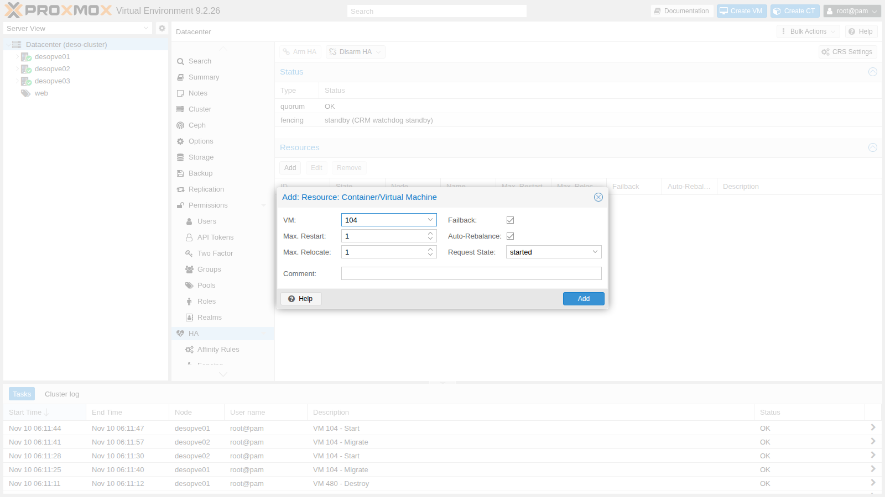
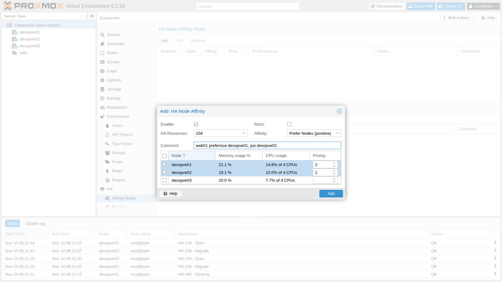
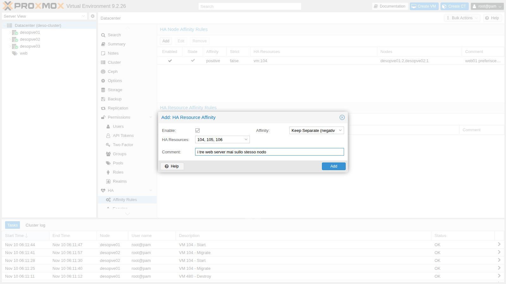
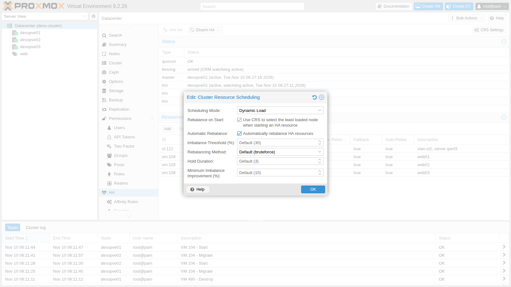
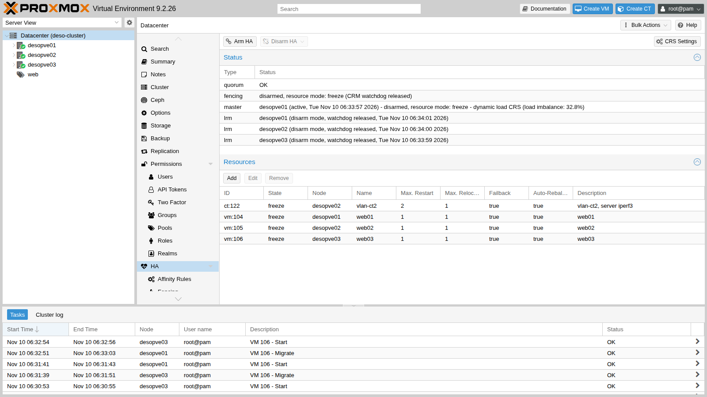
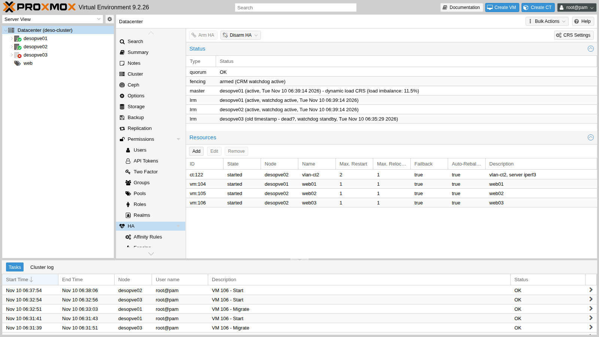

# Lab 49 – Alta disponibilità: risorse HA, affinity rules, CRS dinamico, manutenzione, arm/disarm e failover reale

**Livello:** avanzato · **Durata:** 1 ora e 30 minuti

## Dipendenze

- **Lab precedenti:**
  - [Lab 06](06-cluster-corosync.md): il cluster `deso-cluster` a 3 nodi con Corosync su due link;
  - [Lab 17](17-ceph-installation.md): lo storage condiviso `rbd-vm`, su cui stanno tutti i dischi delle risorse HA;
  - [Lab 20](20-bridges-stable-names-vlans.md): il CT 122 `vlan-ct2` sulla VLAN 10;
  - [Lab 22](22-dedicated-networks.md): la rete di migrazione VLAN 100;
  - [Lab 40](40-templates-cloud-init-clones.md): le VM `web01`-`web03` (104-106) con nginx;
  - [Lab 48](48-migrations.md): la live migration, che l'HA usa per spostare le risorse.
- **Sistemi:**
  - nodi `desopve01`, `desopve02`, `desopve03`;
  - VM 104 `web01`, 105 `web02`, 106 `web03` (172.27.199.104-106, nginx sulla porta 80), tutte su `rbd-vm`;
  - CT 122 `vlan-ct2` (10.10.10.122 sulla VLAN 10), su `rbd-vm`.
- **Misure:** dalla rete di gestione, una richiesta HTTP al secondo verso `web03` e lo stato di `ha-manager` ogni 5 s, con due cicli da lasciare aperti in due terminali:

  ```bash
  while :; do printf '%s ' "$(date +%T)"; curl -s -m 1 -o /dev/null -w '%{http_code}\n' http://172.27.199.106/; sleep 1; done
  watch -n5 ha-manager status
  ```

  Negli output del lab le righe `+N s` indicano i secondi trascorsi dall'inizio dell'operazione.

- **Credenziali:** `root@pam` → [Appendice B](b-credentials-and-addresses.md).

## Obiettivi

- Capire come l'HA di Proxmox VE decide, sorveglia e recinta (*fencing*) i nodi.
- Mettere sotto HA VM e container, dalla GUI e dalla CLI.
- Usare le **affinity rules** di PVE 9 (node affinity e resource affinity) al posto dei gruppi HA.
- Attivare il **CRS dinamico** e vedere il **ribilanciamento automatico** spostare una VM da solo.
- Mettere un nodo in **manutenzione** e scoprire quando l'evacuazione non è possibile.
- Usare **arm/disarm** dell'HA per i lavori sull'intero cluster.
- Spegnere di colpo un nodo e misurare fencing, recovery e ritorno del servizio.

## Come funziona

**Due demoni.** Su ogni nodo gira il *Local Resource Manager* (`pve-ha-lrm`), che avvia, ferma e migra le risorse del proprio nodo. Il *Cluster Resource Manager* (`pve-ha-crm`) gira anch'esso su ogni nodo, ma uno solo è il **master**: decide dove deve stare ogni risorsa. Lo stato condiviso sta in `/etc/pve/ha/` (`resources.cfg`, `rules.cfg`, `manager_status`), quindi vale solo finché il cluster ha il **quorum**.

**Self-fencing con il watchdog.** Un nodo che ospita risorse HA tiene armato un *watchdog*: `watchdog-mux` lo apre e il LRM lo rinnova a ogni ciclo. Se il nodo perde il quorum non può più rinnovarlo, e dopo 60 s il watchdog lo riavvia: si "recinta" da solo. Gli altri nodi aspettano che il suo *lock* nel filesystem del cluster scada; a quel punto sono sicuri che il nodo non sta più scrivendo sui dischi condivisi, e riavviano altrove le sue risorse (*recovery*). Il watchdog di default è `softdog`, un watchdog software del kernel; con un watchdog hardware (per esempio `ipmi_watchdog`) si sceglie il modulo in `/etc/default/pve-ha-manager`.

**Requisiti:** almeno 3 voti nel cluster (con un numero pari di nodi si aggiunge un *QDevice*, `pvecm qdevice setup <ip>`, che dà un voto in più a uno dei due lati), storage condiviso per le risorse, e reti affidabili per Corosync.

**Risorse HA.** Ogni VM o CT sotto HA ha uno *stato richiesto* (`started`, `stopped`, `disabled`, `ignored`), il numero di tentativi di riavvio sul posto (`max_restart`) e di spostamento (`max_relocate`), `failback` e, novità 9.2, `auto-rebalance`.

**Affinity rules (PVE 9).** I vecchi **gruppi HA** sono stati sostituiti da regole, e all'aggiornamento vengono convertiti automaticamente in regole di node affinity:

- **node affinity**: le risorse preferiscono (o evitano) certi nodi, con priorità; `strict` impedisce di usarne altri;
- **resource affinity**: le risorse stanno **insieme** (*positive*) o **separate** (*negative*).

**CRS (Cluster Resource Scheduling).** Sceglie il nodo per l'avvio e il recovery:

- `basic`: conta solo il numero di risorse per nodo;
- `static`: usa CPU e RAM *configurate* delle risorse;
- `dynamic` (novità 9.2): usa anche il consumo *reale* di CPU e RAM dei nodi.

Con **Automatic Rebalance** il CRS sposta da solo le risorse quando lo squilibrio tra i nodi supera una soglia (default 30%) per un certo numero di cicli HA (default 3) e lo spostamento lo riduce almeno di un margine (default 10%).

## Procedura

### 1. Watchdog e stato iniziale

Prima di creare risorse HA, il watchdog è caricato ma non armato:

```bash
lsmod | grep softdog
systemctl status watchdog-mux --no-pager | head -3
grep -i watchdog /etc/default/pve-ha-manager
ha-manager status
```

```text
softdog                12288  2
● watchdog-mux.service - Proxmox VE watchdog multiplexer
     Loaded: loaded (/usr/lib/systemd/system/watchdog-mux.service; static)
     Active: active (running) since Mon 2026-11-09 14:31:33 CET; 16h ago
#WATCHDOG_MODULE=ipmi_watchdog
quorum OK
fencing standby (CRM watchdog standby)
```

### 2. Mettere sotto HA VM e container

1. **Datacenter → HA → Resources → Add**. Si sceglie la VM 104 e si lasciano i default: un tentativo di riavvio sul posto, uno di spostamento, `Failback` e `Auto-Rebalance` attivi, stato richiesto `started`.

   

2. Le altre risorse dalla CLI:

   ```bash
   ha-manager set vm:104 --comment "web01"
   ha-manager add vm:105 --comment "web02"
   ha-manager add vm:106 --comment "web03"
   ha-manager add ct:122 --comment "vlan-ct2, server iperf3" --max_restart 2
   ha-manager status
   ```

   ```text
   quorum OK
   master desopve01 (active, Tue Nov 10 06:18:26 2026)
   fencing armed (CRM watchdog active)
   lrm desopve01 (active, watchdog active, Tue Nov 10 06:18:21 2026)
   lrm desopve02 (active, watchdog active, Tue Nov 10 06:18:29 2026)
   lrm desopve03 (active, watchdog active, Tue Nov 10 06:18:20 2026)
   service ct:122 (desopve02, started)
   service vm:104 (desopve01, started)
   service vm:105 (desopve02, started)
   service vm:106 (desopve03, started)
   ```

   Da questo momento il watchdog è **armato** su tutti e tre i nodi: un nodo che perde il quorum si riavvia da solo.

### 3. Affinity rules

I gruppi non si possono più creare:

```bash
ha-manager groupadd prova --nodes desopve01
```

```text
cannot create group: ha groups have been migrated to rules
```

1. **Datacenter → HA → Affinity Rules → HA Node Affinity Rules → Add**: `web01` preferisce `desopve01` (priorità 2) e poi `desopve02` (priorità 1), regola non *strict*.

   

2. **HA Resource Affinity Rules → Add**: i tre web server devono stare su nodi diversi (*Keep Separate*).

   

   Il salvataggio fallisce. La stessa regola dalla CLI mostra il motivo:

   ```bash
   ha-manager rules add resource-affinity web-separati --resources vm:104,vm:105,vm:106 --affinity negative
   ```

   ```text
   create ha rule failed: 400 Rule 'web-separati' is invalid.
   resources: resources are in node affinity rules with multiple priorities
   ```

   Una risorsa che sta in una regola di node affinity **con più priorità** non può stare anche in una regola di resource affinity. Si semplifica la node affinity a un solo livello di priorità e si aggiungono le due regole di resource affinity:

   ```bash
   # l'ID della regola creata dalla GUI è generato: leggi il tuo con 'ha-manager rules config'
   ha-manager rules set node-affinity ha-rule-076b9e15-d28b --nodes desopve01 --comment "web01 preferisce desopve01"
   ha-manager rules add resource-affinity web-separati --resources vm:104,vm:105,vm:106 --affinity negative --comment "i tre web server mai sullo stesso nodo"
   ha-manager rules add resource-affinity web02-con-ct122 --resources vm:105,ct:122 --affinity positive --comment "web02 e il suo backend sempre insieme"
   ha-manager rules config
   ```

   ```text
   ┌─────────┬────────┬───────────────────────┬───────────────────┬──────────────────────┬────────────────────────────────────────┐
   │ enabled │ state  │ rule                  │ type              │ resources            │ comment                                │
   ╞═════════╪════════╪═══════════════════════╪═══════════════════╪══════════════════════╪════════════════════════════════════════╡
   │ 1       │ in use │ ha-rule-076b9e15-d28b │ node-affinity     │ vm:104               │ web01 preferisce desopve01             │
   ├─────────┼────────┼───────────────────────┼───────────────────┼──────────────────────┼────────────────────────────────────────┤
   │ 1       │ in use │ web02-con-ct122       │ resource-affinity │ ct:122,vm:105        │ web02 e il suo backend sempre insieme  │
   ├─────────┼────────┼───────────────────────┼───────────────────┼──────────────────────┼────────────────────────────────────────┤
   │ 1       │ in use │ web-separati          │ resource-affinity │ vm:104,vm:105,vm:106 │ i tre web server mai sullo stesso nodo │
   └─────────┴────────┴───────────────────────┴───────────────────┴──────────────────────┴────────────────────────────────────────┘
   ```

### 4. CRS dinamico

**Datacenter → HA → CRS Settings**: *Scheduling Mode* `Dynamic Load`, *Rebalance on Start* e *Automatic Rebalance* attivi, soglie di default.



In `/etc/pve/datacenter.cfg` diventa:

```text
crs: ha-auto-rebalance=1,ha-rebalance-on-start=1,ha=dynamic
```

e il master lo annuncia nel log:

```text
pve-ha-crm[1679]: switching scheduler mode from 'basic' to 'dynamic'
```

### 5. Manutenzione di un nodo (e la trappola dell'anti-affinità)

1. Con la regola `web-separati` ancora sui **tre** web server, si mette in manutenzione `desopve03`:

   ```bash
   ha-manager crm-command node-maintenance enable desopve03
   ```

   ```text
   --- +11 s
   lrm desopve03 (maintenance mode, watchdog active, Tue Nov 10 06:27:45 2026)
   service vm:106 (desopve03, started)
   ...
   --- +100 s
   lrm desopve03 (maintenance mode, watchdog active, Tue Nov 10 06:29:10 2026)
   service vm:106 (desopve03, started)
   ```

   `web03` **non si sposta**: `desopve01` ospita `web01`, `desopve02` ospita `web02`, e la regola vieta di metterla accanto a loro. Il nodo è in manutenzione, ma non si può spegnere.

   

   > Una regola *Keep Separate* con tante risorse quanti sono i nodi lascia **zero** margine: niente evacuazione per la manutenzione e niente recovery dopo un guasto. Su 3 nodi, al massimo 2 risorse separate.

2. Si riduce la regola a due VM. `web03` viene evacuata subito:

   ```bash
   ha-manager rules set resource-affinity web-separati --resources vm:104,vm:105
   ```

   ```text
   06:29:46 pve-ha-crm[1679]: migrate service 'vm:106' to node 'desopve02' (running)
   06:30:06 pve-ha-crm[1679]: service 'vm:106': state changed from 'migrate' to 'started'  (node = desopve02)
   ```

3. Fine della manutenzione: le risorse tornano da sole sul nodo da cui erano partite.

   ```bash
   ha-manager crm-command node-maintenance disable desopve03
   ```

   ```text
   06:30:46 pve-ha-crm[1679]: node 'desopve03': state changed from 'maintenance' => 'online'
   06:30:46 pve-ha-crm[1679]: moving service 'vm:106' back to 'desopve03', node came back from maintenance.
   06:31:06 pve-ha-crm[1679]: service 'vm:106': state changed from 'migrate' to 'started'  (node = desopve03)
   ```

### 6. Ribilanciamento automatico

1. Si crea uno squilibrio. La regola `web-separati` ora copre solo `web01` e `web02`, quindi `web03` è libera di muoversi: la si sposta su `desopve01`, dove c'è già `web01`, e si caricano le CPU delle due VM:

   ```bash
   ha-manager crm-command migrate vm:106 desopve01
   for v in 104 106; do
     qm guest exec $v --timeout 1 -- sh -c 'for i in 1 2; do (timeout 900 sh -c "while :; do :; done") & done; wait'
   done
   ```

2. Lo squilibrio misurato dal CRS (`ha-manager status`, riga `master`) e la reazione:

   ```text
   +13 s imbalance: 30.1% | service vm:106 (desopve01, started)
   +25 s imbalance: 54.8% | service vm:106 (desopve01, migrate)
   +50 s imbalance: 36.0% | service vm:106 (desopve03, starting)
   ```

   ```text
   06:32:47 pve-ha-crm[1679]: auto rebalance - migrate vm:106 to desopve03 (expected change for imbalance from 54.8% to 27.3%)
   06:32:47 pve-ha-crm[1679]: migrate service 'vm:106' to node 'desopve03'
   06:33:07 pve-ha-crm[1679]: service 'vm:106': state changed from 'migrate' to 'started'  (node = desopve03)
   ```

   Dopo alcuni cicli HA sopra la soglia (`ha-auto-rebalance-hold-duration`, default 3), il CRS ha scelto da solo la VM da spostare e il nodo di destinazione, con una live migration di 20 s. `web01` è rimasta su `desopve01` per la sua node affinity.

### 7. Arm e disarm dell'HA

La manutenzione riguarda un nodo. Per lavori sull'**intero cluster** (rete di Corosync, aggiornamenti che riavviano i servizi del cluster) si **disarma** l'HA: i watchdog vengono rilasciati ovunque e nessun nodo si recinta, nemmeno senza quorum.

```bash
ha-manager crm-command disarm-ha freeze
ha-manager status
```

```text
quorum OK
master desopve01 (active, Tue Nov 10 06:33:47 2026) - disarmed, resource mode: freeze - dynamic load CRS (load imbalance: 35.9%)
fencing disarmed, resource mode: freeze (CRM watchdog released)
lrm desopve01 (disarm mode, watchdog released, Tue Nov 10 06:33:46 2026)
lrm desopve02 (disarm mode, watchdog released, Tue Nov 10 06:33:50 2026)
lrm desopve03 (disarm mode, watchdog released, Tue Nov 10 06:33:49 2026)
service ct:122 (desopve02, freeze)
service vm:104 (desopve01, freeze)
service vm:105 (desopve02, freeze)
service vm:106 (desopve03, freeze)
```

```text
pve-ha-lrm[3086]: HA disarm requested, releasing agent lock and watchdog
pve-ha-lrm[3086]: watchdog closed (disabled)
```



- `freeze`: le risorse restano sotto HA, ma comandi e cambi di stato non vengono applicati fino al riarmo;
- `ignore`: le risorse escono dal controllo dell'HA e si gestiscono come VM normali.

Si riarma con un comando (o il pulsante **Arm HA**):

```bash
ha-manager crm-command arm-ha
```

```text
fencing armed (CRM watchdog active)
lrm desopve01 (active, watchdog active, Tue Nov 10 06:34:51 2026)
```

### 8. Failover reale: un nodo spento di colpo

1. `web03` gira su `desopve03`. Dalla rete di gestione parte una richiesta HTTP al secondo verso 172.27.199.106, e sul master si registra `ha-manager status` ogni 5 s.
2. Si spegne `desopve03` di colpo, come per un guasto di alimentazione:

   ```bash
   echo 1 > /proc/sys/kernel/sysrq
   echo o > /proc/sysrq-trigger
   ```

3. Il log del master:

   ```text
   06:35:54 pve-ha-crm[1679]: node 'desopve03': state changed from 'online' => 'unknown'
   06:36:44 pve-ha-crm[1679]: service 'vm:106': state changed from 'started' to 'fence'
   06:36:44 pve-ha-crm[1679]: node 'desopve03': state changed from 'unknown' => 'fence'
   06:36:44 perl[1679]: notified via target `mail-to-root`
   06:37:44 pve-ha-crm[1679]: successfully acquired lock 'ha_agent_desopve03_lock'
   06:37:44 pve-ha-crm[1679]: fencing: acknowledged - got agent lock for node 'desopve03'
   06:37:44 pve-ha-crm[1679]: service 'vm:106': state changed from 'fence' to 'recovery'
   06:37:44 pve-ha-crm[1679]: recover service 'vm:106' from fenced node 'desopve03' to node 'desopve02'
   06:37:44 pve-ha-crm[1679]: service 'vm:106': state changed from 'recovery' to 'started'  (node = desopve02)
   ```

4. La sequenza misurata:

   | Ora | Evento | Dallo spegnimento |
   |---|---|---|
   | 06:35:36 | `desopve03` spento | 0 s |
   | 06:35:38 | prima richiesta HTTP fallita | 2 s |
   | 06:35:54 | il master vede il nodo `unknown` | 18 s |
   | 06:36:44 | nodo e risorsa in `fence`, notifica inviata | 68 s |
   | 06:37:44 | lock del nodo acquisito: fencing confermato, recovery su `desopve02` | 128 s |
   | 06:38:46 | nginx di `web03` risponde di nuovo | 190 s |

   Circa due minuti servono per avere la **certezza** che il nodo perso non scriva più sui dischi (scadenza del suo lock), il resto è l'avvio della VM. È il prezzo della sicurezza dei dati: niente *split brain*.

   

5. Il resto del cluster durante il guasto:

   ```text
   Quorate:          Yes
   Total votes:      2
       health: HEALTH_WARN
               Degraded data redundancy: 11601/34803 objects degraded (33.333%), 79 pgs degraded, 97 pgs undersized
       osd: 7 osds: 4 up (since 3m), 7 in (since 12h)
   ```

   Quorum con 2 voti su 3 e Ceph degradato ma funzionante (`min_size 2`): le VM degli altri nodi non si sono mai fermate. I guest **non** in HA di `desopve03` (CT 123, 292, 302) invece sono rimasti spenti: l'HA protegge solo ciò che le si affida.

### 9. Rientro del nodo e ripristino della distribuzione

1. Riaccendi `desopve03` dal pulsante di accensione o dalla console di gestione remota (IPMI/iDRAC/iLO). Nel lab è stato riacceso alle 06:42:34 ed è tornato nel cluster 30 s dopo:

   ```text
   06:43:04 pve-ha-crm[1679]: node 'desopve03': state changed from 'unknown' => 'online'
   06:43:04 pve-ha-crm[1679]: fallback to 'basic' scheduler mode, init for 'dynamic' failed - did not get dynamic node usage information for 'desopve03'
   ```

   Finché il nodo appena tornato non pubblica i suoi dati di carico, il CRS ripiega per un ciclo sul modo `basic`.

2. `web03` **resta** su `desopve02`: non ha node affinity che la richiami, e lo squilibrio (13,5%) è sotto la soglia del ribilanciamento. I CT non in HA vanno riavviati a mano (non hanno `onboot`):

   ```bash
   for c in 123 292 302; do pct start $c; done
   ha-manager crm-command migrate vm:106 desopve03
   ```

   ```text
   +7 s service vm:106 (desopve02, migrate)
   +38 s service vm:106 (desopve03, starting)
   +50 s service vm:106 (desopve03, started)
   ```

   Ceph ricostruisce le copie mancanti e torna `HEALTH_OK`.

## Verifica e test

| Prova | Risultato nel lab |
|---|---|
| Gruppi HA in PVE 9 | rifiutati: `ha groups have been migrated to rules` |
| Resource affinity su una risorsa con node affinity a più priorità | rifiutata: `resources are in node affinity rules with multiple priorities` |
| Ribilanciamento automatico (CRS dinamico) | squilibrio 54,8% → migrazione automatica di `web03`, previsto 27,3% |
| Manutenzione con *Keep Separate* su 3 risorse e 3 nodi | `web03` bloccata sul nodo per oltre 100 s |
| Manutenzione con la regola ridotta | evacuazione in 20 s, rientro automatico in 20 s |
| Disarm `freeze` | watchdog rilasciati su tutti i nodi, risorse in `freeze` |
| Nodo spento di colpo | fencing confermato a 128 s, servizio di nuovo raggiungibile a 190 s |
| Guest non in HA sul nodo guasto | spenti fino al riavvio manuale |

## Stato finale del lab

- **Risorse HA**, tutte `started`, HA armata:
  - `vm:104` su `desopve01`, `vm:105` e `ct:122` su `desopve02`, `vm:106` su `desopve03`.
- **Regole:**
  - `ha-rule-076b9e15-d28b` (node affinity): `vm:104` preferisce `desopve01`;
  - `web-separati` (resource affinity negativa): `vm:104`, `vm:105`;
  - `web02-con-ct122` (resource affinity positiva): `vm:105`, `ct:122`.
- **Datacenter:** `crs: ha-auto-rebalance=1,ha-rebalance-on-start=1,ha=dynamic`.
- Cluster con quorum 3/3, Ceph `HEALTH_OK`, CT 123, 292 e 302 riavviati, guest nelle posizioni iniziali.
- Con l'HA attiva un nodo che perde il quorum si riavvia da solo: prima di lavori sulla rete di Corosync si usa `disarm-ha`.

## Cosa hai imparato

- L'HA di Proxmox VE si basa su quorum, storage condiviso e **self-fencing** con il watchdog: un nodo senza quorum si riavvia da solo, e gli altri riavviano le sue risorse solo dopo la scadenza del suo lock.
- In PVE 9 i gruppi sono diventati **affinity rules**: node affinity per i nodi preferiti, resource affinity per tenere risorse insieme o separate.
- Una regola *Keep Separate* troppo stretta può impedire sia la manutenzione sia il recovery.
- Il **CRS dinamico** con il ribilanciamento automatico sposta le VM in base al carico reale.
- La **manutenzione** svuota un nodo e lo ripopola alla fine; **disarm/arm** sospende l'HA su tutto il cluster.
- Un failover reale dura minuti, non secondi: due servono a garantire che il nodo perso sia davvero fermo.

## Riferimenti

- [Proxmox VE – High Availability](https://pve.proxmox.com/pve-docs/chapter-ha-manager.html)
- [Proxmox VE – ha-manager(1)](https://pve.proxmox.com/pve-docs/ha-manager.1.html)
- [Proxmox VE – datacenter.cfg, opzione crs](https://pve.proxmox.com/pve-docs/datacenter.cfg.5.html)
- [Proxmox VE – Corosync External Vote Support (QDevice)](https://pve.proxmox.com/pve-docs/chapter-pvecm.html#_corosync_external_vote_support)
