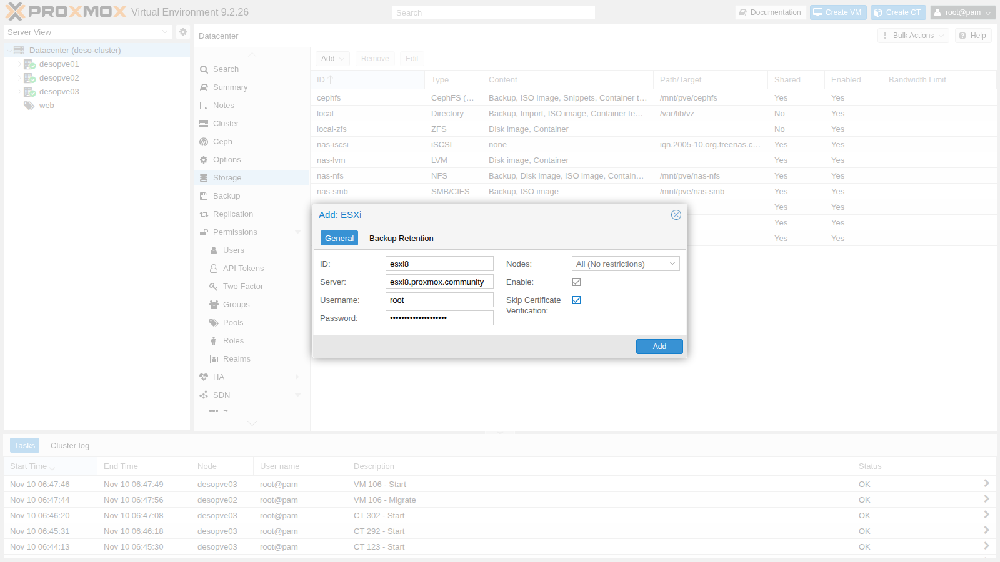
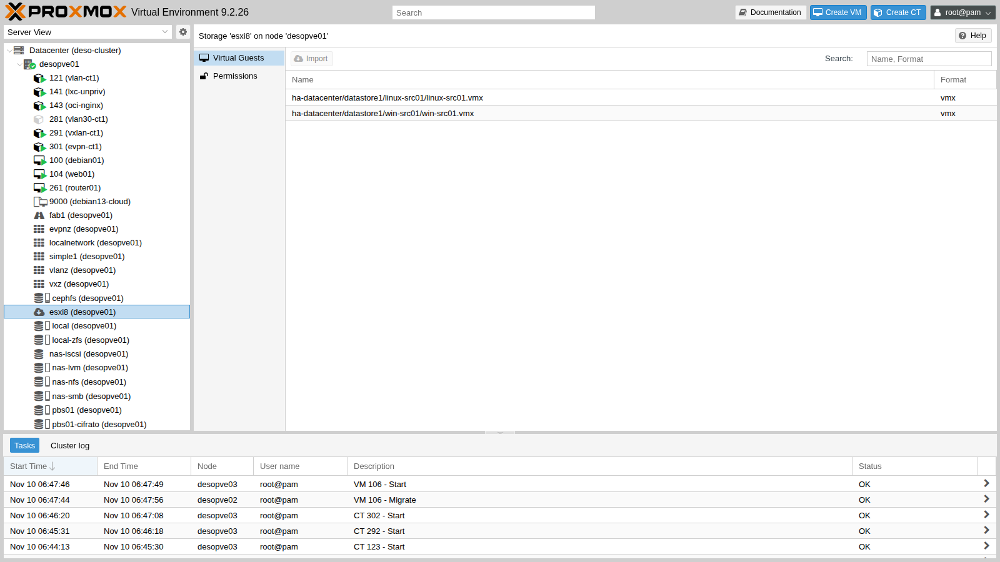
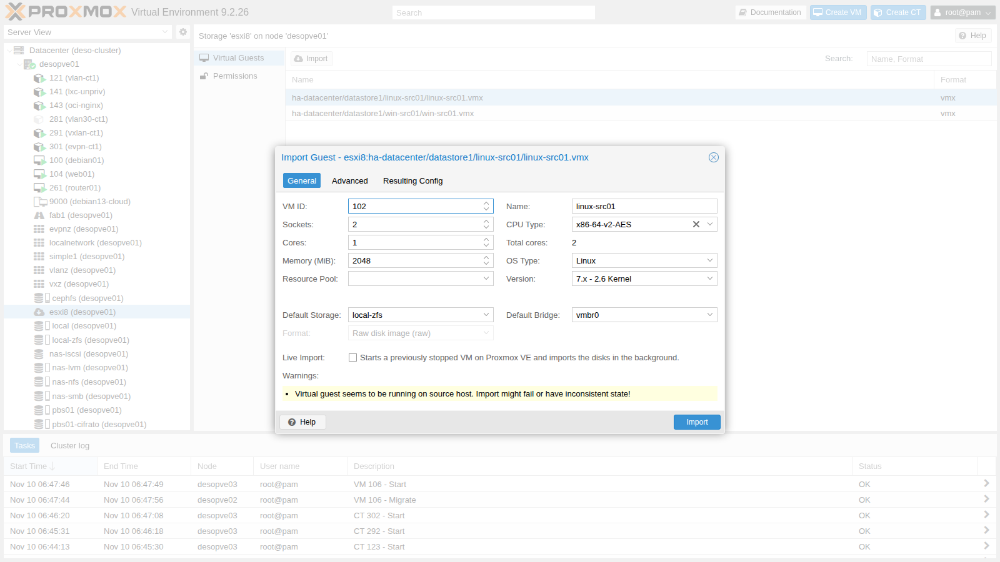
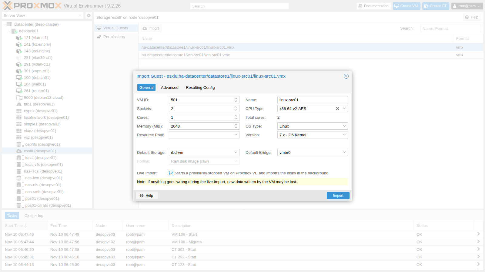
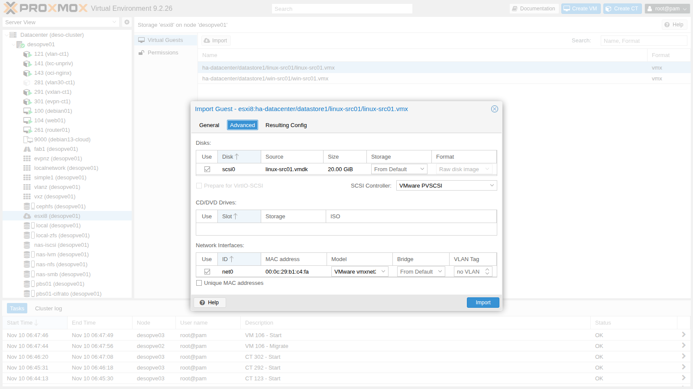
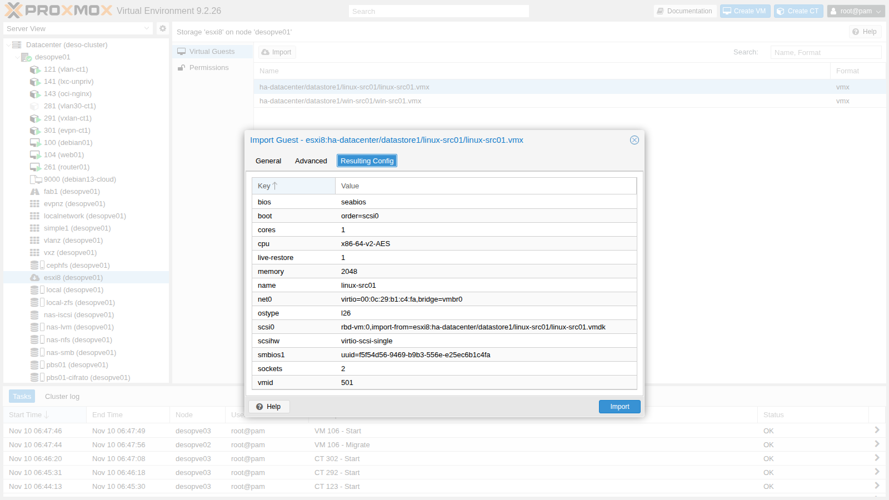
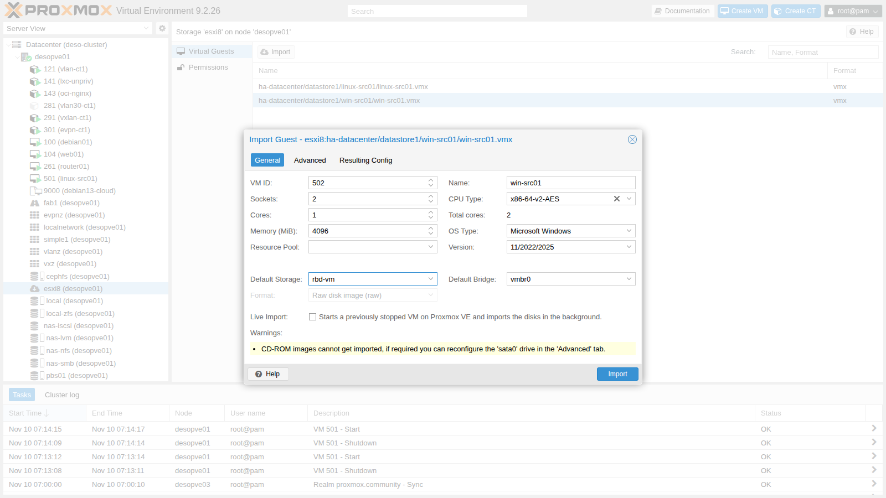
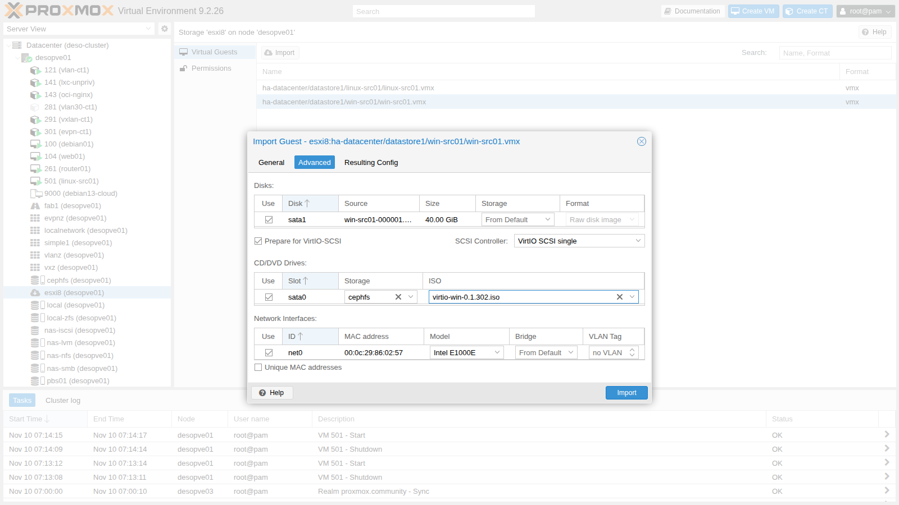
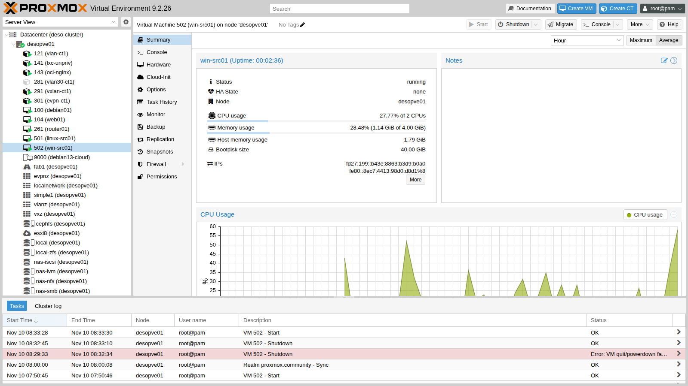
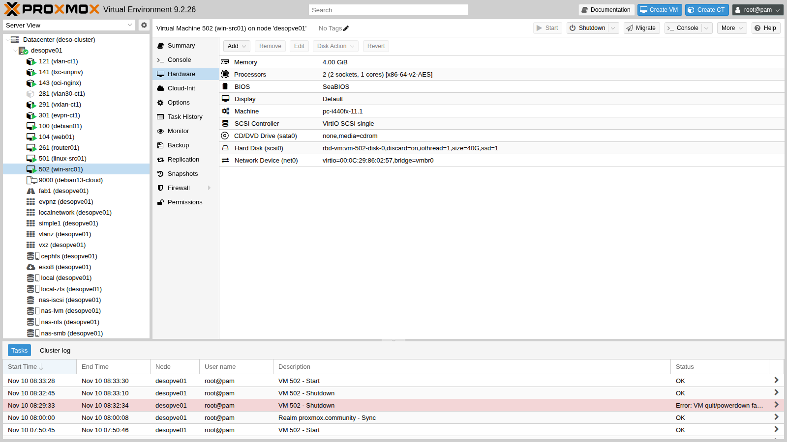

# Lab 50 – Importare VM da VMware ESXi: storage ESXi, import wizard, live-import, Linux e Windows

**Livello:** avanzato · **Durata:** 1 ora e 30 minuti (più i tempi di copia)

## Dipendenze

- **Lab precedenti:**
  - [Lab 07](07-first-vm-and-container.md): la creazione di VM e l'uso della console;
  - [Lab 17](17-ceph-installation.md): lo storage `rbd-vm`, destinazione dei dischi importati;
  - [Lab 38](38-linux-vm-guest-agent.md): il QEMU Guest Agent;
  - [Lab 39](39-windows-vm-virtio.md): i driver VirtIO per Windows e la ISO `virtio-win-0.1.302.iso` su `cephfs`.
- **Sistemi:**
  - un server separato con **VMware ESXi 8.0 U3**, `esxi8.proxmox.community` (172.27.199.30), con il datastore `datastore1`: la sua preparazione è al passo 0;
  - sull'host ESXi, la VM `linux-src01` (Ubuntu 24.04, 172.27.199.31, nginx, `open-vm-tools`);
  - sull'host ESXi, la VM `win-src01` (Windows Server 2025, 172.27.199.32, BIOS, controller LSI SAS, scheda e1000e, VMware Tools);
  - il cluster `deso-cluster`, con `desopve01` come nodo di import.
- **Credenziali:** `root` dell'host ESXi e `root@pam` → [Appendice B](b-credentials-and-addresses.md).

## Obiettivi

- Collegare un host ESXi a Proxmox VE come **storage di tipo ESXi**.
- Usare l'**import wizard**: dischi, storage, controller, schede di rete, opzioni avanzate.
- Importare una VM Linux con il **live-import** e misurarlo.
- Importare una VM Windows preparandola per **VirtIO** e completare il passaggio ai driver paravirtualizzati.
- Riconoscere i problemi tipici: VM accesa sull'origine, snapshot, hardware VMware, MAC e nomi delle schede.

## Come funziona

**Storage ESXi.** Proxmox VE si collega all'API dell'host ESXi (o di un vCenter) con un utente e una password, ed espone il contenuto dei datastore tramite un filesystem FUSE. Lo storage non contiene dischi di Proxmox: serve solo come **sorgente** per importare le VM, e compare nell'albero di ogni nodo con l'elenco dei file `.vmx`.

**Import wizard.** Legge il `.vmx` e propone una configurazione equivalente in Proxmox VE: CPU, RAM, firmware (BIOS o UEFI), tipo di sistema operativo, dischi, controller SCSI, schede di rete con il loro MAC. Si possono cambiare controller e modello delle schede prima dell'import. I dischi vengono convertiti in formato raw (o qcow2) sullo storage scelto.

**Live-import.** La VM viene creata e **avviata subito** su Proxmox VE, mentre i dischi vengono copiati in background: le letture di blocchi non ancora copiati vanno a prenderli sull'host ESXi al volo. Il servizio torna disponibile molto prima della fine della copia, al prezzo di prestazioni ridotte durante l'import e del rischio di perdere le scritture fatte se la copia fallisce a metà.

**Windows e VirtIO.** Un Windows installato su ESXi non ha i driver VirtIO: se il disco di avvio passa subito a VirtIO SCSI, il sistema non parte. L'opzione **Prepare for VirtIO-SCSI** collega i dischi su SATA (che Windows riconosce sempre) e imposta già il controller VirtIO SCSI, così dopo l'installazione dei driver basta spostare il disco.

## Procedura

### 0. Preparare l'ambiente di origine

L'origine è un server separato con **VMware ESXi 8.0 U3**, installato seguendo la documentazione VMware (*vSphere 8.0 – ESXi Installation and Setup*): IP statico 172.27.199.30/24, gateway 172.27.199.1, DNS 172.27.199.20, nome `esxi8.proxmox.community`, un datastore VMFS chiamato `datastore1`. Per il lab basta la licenza di valutazione. Dal client web dell'host (**Host → Actions → Services → Enable Secure Shell (SSH)**) si abilita SSH, che serve ai passi seguenti.

**`linux-src01`: Ubuntu 24.04 da immagine cloud.** Su una postazione Linux con accesso a Internet e i pacchetti `qemu-utils` e `cloud-image-utils`, si converte l'immagine cloud in VMDK e si prepara un piccolo ISO di configurazione per cloud-init con i file [`user-data`](../files/50/user-data), [`network-config`](../files/50/network-config) e [`meta-data`](../files/50/meta-data):

```bash
curl -O https://cloud-images.ubuntu.com/noble/current/noble-server-cloudimg-amd64.img
qemu-img convert -O vmdk -o adapter_type=lsilogic,subformat=monolithicSparse noble-server-cloudimg-amd64.img ubuntu-src.vmdk
cloud-localds -N network-config seed.iso user-data meta-data
ssh root@esxi8.proxmox.community 'mkdir -p /vmfs/volumes/datastore1/linux-src01 /vmfs/volumes/datastore1/iso'
scp ubuntu-src.vmdk root@esxi8.proxmox.community:/vmfs/volumes/datastore1/linux-src01/src.vmdk
scp seed.iso root@esxi8.proxmox.community:/vmfs/volumes/datastore1/iso/linux-src01-seed.iso
```

`network-config` seleziona la scheda con un carattere jolly (`match: name: "e*"`) invece che con il nome esatto: lo si vedrà utile dopo l'import (passo 4).

Sull'host ESXi, via SSH, si converte il disco in formato VMFS thin, lo si porta a 20 GB e si registra la VM descritta da [`linux-src01.vmx`](../files/50/linux-src01.vmx) (controller PVSCSI, scheda vmxnet3, BIOS, ISO di cloud-init nel lettore):

```bash
cd /vmfs/volumes/datastore1/linux-src01
vmkfstools -i src.vmdk -d thin linux-src01.vmdk && rm src.vmdk && vmkfstools -X 20G linux-src01.vmdk
# copia qui linux-src01.vmx, poi:
vim-cmd solo/registervm /vmfs/volumes/datastore1/linux-src01/linux-src01.vmx
vim-cmd vmsvc/power.on <vmid restituito>
```

Le righe `pciBridge` del file `.vmx` servono: senza, l'accensione fallisce con `No PCIe slot available for SCSI0`. Al primo avvio cloud-init crea l'utente `labuser` e configura la rete. Poi, nella VM, si installano nginx e `open-vm-tools` tramite il proxy del laboratorio e si scrive la pagina di prova:

```bash
echo 'Acquire::http::Proxy "http://proxy.proxmox.community:3128";' | sudo tee /etc/apt/apt.conf.d/80proxy
sudo apt-get update && sudo apt-get install -y nginx open-vm-tools
echo '<html><body><h1>linux-src01 - origine ESXi</h1></body></html>' | sudo tee /var/www/html/index.html
```

Infine, a VM spenta, si toglie il lettore con l'ISO di cloud-init (le righe `sata0` del `.vmx`, poi `vim-cmd vmsvc/reload <vmid>`) e si cancella l'ISO dal datastore: contiene la password iniziale.

**`win-src01`: Windows Server 2025.** Una VM creata dal client web di ESXi con **firmware BIOS**, controller **LSI Logic SAS**, scheda **E1000e**, 2 vCPU, 4 GB di RAM e un disco thin da 40 GB, installata dalla ISO di valutazione di Windows Server 2025 (Standard, Desktop Experience). Nel lab l'installazione è stata automatizzata con un file di risposte (`autounattend.xml`); a mano il risultato è lo stesso. Dopo l'installazione, in PowerShell come amministratore:

```powershell
Rename-Computer -NewName WIN-SRC01
New-NetIPAddress -InterfaceAlias Ethernet0 -IPAddress 172.27.199.32 -PrefixLength 24 -DefaultGateway 172.27.199.1
Set-DnsClientServerAddress -InterfaceAlias Ethernet0 -ServerAddresses 172.27.199.20
Set-ItemProperty 'HKLM:\System\CurrentControlSet\Control\Terminal Server' -Name fDenyTSConnections -Value 0
Enable-NetFirewallRule -DisplayGroup 'Remote Desktop'
New-NetFirewallRule -DisplayName 'ICMPv4 in' -Protocol ICMPv4 -IcmpType 8 -Action Allow
Set-Content C:\marker-origine.txt "win-src01 - VM di origine ESXi - configurata il $(Get-Date -Format s)"
```

Il file `C:\marker-origine.txt` servirà a verificare che i dati arrivino in Proxmox VE. Per avere una VM d'origine realistica si installano anche i **VMware Tools**: dal client web, **Actions → Guest OS → Install VMware Tools** monta la ISO dei Tools (`windows.iso` dell'host), poi nella VM `D:\setup64.exe /s /v"/qn REBOOT=R"` e un riavvio.

### 1. Collegare l'host ESXi

**Datacenter → Storage → Add → ESXi**: ID `esxi8`, server `esxi8.proxmox.community`, utente `root` e la sua password. Il certificato dell'host ESXi è autofirmato, quindi in laboratorio si attiva **Skip Certificate Verification**. In produzione si importa la CA dell'host o di vCenter.



```text
esxi: esxi8
	server esxi8.proxmox.community
	username root
	skip-cert-verification 1
```

```bash
pvesm status | grep esxi8
```

```text
esxi8                esxi     active               0               0               0    0.00%
```

Lo storage è attivo ma non ha spazio: non contiene dischi di Proxmox VE, solo l'elenco delle VM dell'host ESXi. Dall'albero, **desopve01 → esxi8** mostra i file `.vmx` delle VM, con il pulsante **Import**.



### 2. Primo problema: la VM è accesa sull'origine

Con `linux-src01` ancora accesa sull'host ESXi, il wizard avvisa:

```text
Virtual guest seems to be running on source host. Import might fail or have inconsistent state!
```



Un disco copiato mentre la VM scrive è incoerente: prima si spegne la VM sull'origine. Via SSH sull'host ESXi (abilitato al passo 0) o dal suo client web, con uno spegnimento pulito del sistema operativo. L'ID della VM si legge con `vim-cmd vmsvc/getallvms`:

```text
Vmid      Name                         File                              Guest OS            Version   Annotation
3      linux-src01   [datastore1] linux-src01/linux-src01.vmx   ubuntu64Guest                vmx-21
4      win-src01     [datastore1] win-src01/win-src01.vmx       windows2022srvNext_64Guest   vmx-21
```

```bash
vim-cmd vmsvc/power.shutdown 3
vim-cmd vmsvc/power.getstate 3
```

```text
Powered off
```

### 3. Import di `linux-src01` con il live-import

1. **General**: VM ID `501`, storage di destinazione `rbd-vm` (condiviso, utile per migrazioni e HA), bridge `vmbr0`, **Live Import** attivo. CPU, RAM, nome e tipo di sistema operativo arrivano dal `.vmx`.

   

2. **Advanced**: il wizard propone l'hardware dell'origine, cioè controller **VMware PVSCSI** e scheda **VMware vmxnet3**. Linux ha i driver VirtIO di serie, quindi si scelgono **VirtIO SCSI single** e **VirtIO (paravirtualized)**. Il MAC dell'origine (`00:0c:29:…`) viene mantenuto; **Unique MAC addresses** ne genererebbe uno nuovo.

   

3. **Resulting Config** mostra la VM che verrà creata: il disco viene importato da `esxi8:…/linux-src01.vmdk` e l'UUID SMBIOS dell'origine viene conservato, così le licenze e gli strumenti legati all'UUID non cambiano.

   

4. **Import**. Il task crea la VM, la avvia subito e copia il disco in background:

   ```text
   scsi0: successfully created disk 'rbd-vm:vm-501-disk-0,size=20G'
   restore-scsi0: transferred 96.0 MiB of 20.0 GiB (0.47%) in 1s
   ...
   restore-scsi0: transferred 20.0 GiB of 20.0 GiB (100.00%) in 6m 48s
   restore-scsi0: stream-job finished
   restore-drive jobs finished successfully, removing all tracking block devices
   ```

5. Le misure, con una richiesta HTTP al secondo verso 172.27.199.31:

   | Ora | Evento | Dall'avvio dell'import |
   |---|---|---|
   | 06:58:12 | avvio dell'import, la VM parte su Proxmox VE | 0 s |
   | 07:01:00 | nginx risponde | 2 min 48 s |
   | 07:05:04 | copia del disco completata | 6 min 52 s |

   Il servizio è tornato quando era copiato solo un quinto del disco. Durante il live-import la VM è lenta: ogni lettura di un blocco non ancora copiato va fino all'host ESXi.

### 4. Linux dopo l'import

```bash
ip -br a
lspci | grep -iE "ethernet|scsi"
```

```text
ens18            UP             172.27.199.31/24 fd27:199::20c:29ff:feb1:c4fa/64 fe80::20c:29ff:feb1:c4fa/64
00:12.0 Ethernet controller: Red Hat, Inc. Virtio network device
01:01.0 SCSI storage controller: Red Hat, Inc. Virtio SCSI
```

- La scheda ora si chiama `ens18`: il nome dipende dallo slot PCI virtuale, e sull'host ESXi era un altro. La rete funziona perché la configurazione di netplan, preparata al passo 0, seleziona le schede per nome con un carattere jolly (`match: name: "e*"`). Con il nome esatto della scheda, come lo scrive di solito l'installer di Ubuntu, o con un `match` sul MAC e un MAC diverso (Unique MAC addresses), la VM sarebbe partita **senza rete**: in quel caso si corregge il file in `/etc/netplan/` dalla console e si esegue `netplan apply`.
- I VMware Tools per Linux (`open-vm-tools`) non servono più e si sostituiscono con il QEMU Guest Agent:

  ```bash
  sudo apt-get purge -y open-vm-tools
  sudo apt-get install -y qemu-guest-agent
  ```

  In Proxmox VE si attiva l'opzione **QEMU Guest Agent** e si **spegne e riaccende** la VM: il canale dell'agent viene aggiunto solo all'avvio, non con un riavvio dall'interno.

  ```bash
  qm set 501 --agent enabled=1,fstrim_cloned_disks=1
  qm shutdown 501 && qm start 501
  qm agent 501 ping && echo agent-ok
  qm guest cmd 501 get-osinfo | grep pretty-name
  ```

  ```text
  agent-ok
     "pretty-name" : "Ubuntu 24.04.5 LTS",
  ```

- Il disco è thin anche su Ceph: dei 20 GiB ne occupa 2,5.

  ```bash
  rbd du rbd-vm/vm-501-disk-0
  ```

  ```text
  vm-501-disk-0       20 GiB  2.5 GiB
  ```

### 5. Snapshot sull'origine

Prima di importare `win-src01` si crea uno snapshot sull'host ESXi, come capita spesso nelle VM di produzione:

```bash
vim-cmd vmsvc/snapshot.create 4 prima-della-migrazione "snapshot di prova" 0 0
ls /vmfs/volumes/datastore1/win-src01/ | grep vmdk
```

```text
win-src01-000001-sesparse.vmdk
win-src01-000001.vmdk
win-src01-flat.vmdk
win-src01.vmdk
```

Il wizard non mostra avvisi e come sorgente usa il disco **delta** `win-src01-000001.vmdk`: l'import legge la catena (base + delta) e porta in Proxmox VE lo **stato corrente** del disco, consolidato. Gli snapshot di VMware **non** vengono importati. Conviene comunque consolidarli prima: la catena va letta tutta e un problema nel delta finirebbe nella VM importata.

### 6. Import di `win-src01` preparato per VirtIO

1. **General**: VM ID `502`, storage `rbd-vm`, **senza** live-import (all'avvio Windows legge molti blocchi, e con il live-import ognuno andrebbe preso dall'host ESXi: meglio una copia completa). Il wizard riconosce il sistema (`win11`) e il firmware BIOS dell'origine. L'unico avviso riguarda il lettore CD dell'origine, che non viene importato.

   

2. **Advanced**:
   - **Prepare for VirtIO-SCSI**: il disco viene collegato su **SATA** (`sata1`), che Windows avvia sempre, e il controller diventa già **VirtIO SCSI single**;
   - nel lettore `sata0` si monta la ISO `virtio-win-0.1.302.iso` da `cephfs`;
   - la scheda resta **Intel E1000E**, perché Windows ha già il driver: la NetKVM arriva dopo.

   

3. L'import dura **31 min 44 s** per 40 GiB (circa 21 MB/s, contro i 50 MB/s del disco di `linux-src01`, che era senza snapshot):

   ```text
   transferred 40.0 GiB of 40.0 GiB (100.00%)
   sata1: successfully created disk 'rbd-vm:vm-502-disk-0,size=40G'
   pinning machine type to 'pc-i440fx-11.1' for Windows guest OS
   TASK OK
   ```

   Il tipo di macchina viene fissato (*pinned*): per Windows un cambio di versione della macchina virtuale può far rilevare nuovo hardware.

### 7. Windows dopo l'import: rete, VirtIO e VMware Tools

1. Prima dell'avvio si aggiunge un piccolo disco **VirtIO SCSI** temporaneo: senza un dispositivo VirtIO SCSI presente, Windows installa il driver ma non lo prepara per l'avvio.

   ```bash
   qm set 502 --boot order=sata1 --scsi0 rbd-vm:1,discard=on
   qm start 502
   ```

2. **Prima trappola: l'IP statico è sparito.** Windows parte, ma non risponde su 172.27.199.32. Dalla console:

   ```text
   Ethernet adapter Ethernet:
      Autoconfiguration IPv4 Address. . : 169.254.121.36
   ```

   La scheda ha lo stesso modello e lo stesso MAC, ma per Windows è un dispositivo **nuovo** (`Intel(R) 82574L Gigabit Network Connection #2`), perché è cambiata la posizione PCI. La configurazione IP è rimasta sulla scheda vecchia, ora nascosta. Si reimposta dalla console:

   ```text
   netsh interface ipv4 set address Ethernet static 172.27.199.32 255.255.255.0 172.27.199.1
   netsh interface ipv4 set dnsservers Ethernet static 172.27.199.20 primary
   ```

3. Dalla ISO `virtio-win` si installano driver e QEMU Guest Agent in modo non interattivo:

   ```powershell
   $p = Start-Process D:\virtio-win-guest-tools.exe -ArgumentList "/install","/quiet","/norestart" -Wait -PassThru
   "virtio-win-guest-tools: exit code " + $p.ExitCode
   ```

   ```text
   virtio-win-guest-tools: exit code 0

   Name           Status  StartType
   BalloonService Running Automatic
   QEMU-GA        Running Automatic

   FriendlyName                                Status
   VirtIO Balloon Driver                       OK
   Red Hat VirtIO SCSI pass-through controller OK
   ```

4. **Seconda trappola: i VMware Tools non si disinstallano** fuori da VMware:

   ```powershell
   $t = Get-ItemProperty HKLM:\Software\Microsoft\Windows\CurrentVersion\Uninstall\* | ? DisplayName -like "VMware Tools*"
   Start-Process msiexec.exe -ArgumentList "/x",$t.PSChildName,"/qn","/norestart","/l*v","C:\vmt.log" -Wait
   ```

   ```text
   VMware Tools 12.4.0.23259341
   msiexec /x: exit code 1603
   CustomAction VM_LogStart returned actual error code 1603
   Windows Installer removed the product. Product Name: VMware Tools. Product Version: 12.4.0.23259341. ... Removal success or error status: 1603.
   ```

   Il pacchetto esegue azioni che funzionano solo su una VM VMware, e la rimozione fallisce. Rimedi:

   - **la regola**: disinstallare i VMware Tools sull'origine **prima** dello spegnimento finale e dell'import;
   - **dopo l'import**: disattivare i servizi, come qui, e pianificare una pulizia manuale o una reinstallazione pulita.

   ```powershell
   Stop-Service VMTools,VGAuthService -Force
   Set-Service VMTools -StartupType Disabled
   Set-Service VGAuthService -StartupType Disabled
   ```

   ```text
   Name          Status  StartType
   VGAuthService Stopped Disabled
   VMTools       Stopped Disabled
   ```

5. **Passaggio a VirtIO.** A VM spenta si toglie il disco temporaneo, si sposta il disco di sistema da SATA a VirtIO SCSI, si passa la scheda a VirtIO (stesso MAC), si attiva l'agent e si svuota il lettore:

   ```bash
   qm set 502 --delete scsi0                     # il disco temporaneo diventa unused0
   qm disk unlink 502 --idlist unused0 --force   # e viene distrutto
   qm set 502 --delete sata1                     # il disco di sistema diventa unused0
   qm set 502 --scsi0 rbd-vm:vm-502-disk-0,discard=on,iothread=1,ssd=1 --boot order=scsi0 \
     --net0 virtio=00:0C:29:86:02:57,bridge=vmbr0 --agent enabled=1 --sata0 none,media=cdrom
   qm start 502
   ```

   Windows parte dal disco VirtIO SCSI e l'agent risponde in meno di un minuto. La scheda NetKVM è di nuovo un dispositivo nuovo, quindi l'IP si reimposta, questa volta dall'host tramite l'agent (`qm guest exec`):

   ```bash
   qm guest exec 502 -- powershell -NoProfile -Command "New-NetIPAddress -InterfaceAlias 'Ethernet 2' -IPAddress 172.27.199.32 -PrefixLength 24 -DefaultGateway 172.27.199.1; Set-DnsClientServerAddress -InterfaceAlias 'Ethernet 2' -ServerAddresses 172.27.199.20; Rename-NetAdapter -Name 'Ethernet 2' -NewName LAN"
   ```

6. Verifica finale, sempre tramite l'agent:

   ```text
   Name InterfaceDescription            Status
   LAN  Red Hat VirtIO Ethernet Adapter Up

   FriendlyName       BusType GB
   QEMU QEMU HARDDISK SAS     40

   FriendlyName                                Class       Status
   VirtIO Serial Driver                        System      OK
   VirtIO Balloon Driver                       System      OK
   Red Hat VirtIO SCSI pass-through controller SCSIAdapter OK
   Red Hat VirtIO Ethernet Adapter             Net         OK

   Name          Status  StartType
   QEMU-GA       Running Automatic
   VGAuthService Stopped Disabled
   VMTools       Stopped Disabled

   Test-Path C:\marker-origine.txt
   True
   ```

   Il file di prova creato sull'origine c'è: i dati sono arrivati, compreso lo stato del delta dello snapshot.

   

   

## Verifica e test

| Prova | Risultato nel lab |
|---|---|
| Storage ESXi | attivo, elenca le VM dell'host |
| Wizard con la VM accesa sull'origine | avviso "seems to be running on source host" |
| Live-import di `linux-src01` (20 GiB) | servizio raggiungibile a 2 min 48 s, copia completa in 6 min 52 s |
| Rete di `linux-src01` dopo l'import | funzionante (`ens18`, netplan con `e*`) |
| Import con uno snapshot sull'origine | riuscito: importato lo stato corrente, nessuno snapshot portato |
| Import offline di `win-src01` (40 GiB) | 31 min 44 s |
| IP statico di Windows | perso due volte (e1000e "#2", poi NetKVM): da reimpostare |
| Disinstallazione dei VMware Tools fuori da VMware | fallita, errore 1603 (`VM_LogStart`) |
| Avvio di Windows da VirtIO SCSI | riuscito dopo i driver e il disco temporaneo |

## Stato finale del lab

- Storage `esxi8` (tipo ESXi) configurato nel datacenter.
- **VM 501 `linux-src01`** su `desopve01`, accesa: `rbd-vm`, VirtIO SCSI single, VirtIO net con il MAC dell'origine, QEMU Guest Agent, 172.27.199.31, nginx attivo.
- **VM 502 `win-src01`** su `desopve01`, spenta: `rbd-vm`, VirtIO SCSI single, NetKVM con il MAC dell'origine, QEMU Guest Agent, 172.27.199.32, VMware Tools disattivati.
- Sull'host ESXi le due VM di origine sono **spente**, e `win-src01` ha ancora lo snapshot `prima-della-migrazione`. Non vanno riaccese insieme alle copie in Proxmox VE: hanno gli stessi IP e gli stessi MAC.
- Cluster con quorum 3/3 e Ceph `HEALTH_OK`; HA invariata rispetto al [Lab 49](49-high-availability.md).

## Cosa hai imparato

- Un host ESXi (o vCenter) diventa uno **storage di import**: Proxmox VE ne legge le VM e le converte.
- Prima dell'import la VM va **spenta** sull'origine, e conviene consolidare gli snapshot e **disinstallare i VMware Tools** sull'origine.
- Il **live-import** riduce il fermo a pochi minuti, con prestazioni ridotte finché la copia non finisce.
- Linux accetta subito VirtIO; per Windows si importa su SATA con **Prepare for VirtIO-SCSI**, si installano i driver (`virtio-win-guest-tools`) e poi si passa a VirtIO SCSI e NetKVM.
- In Windows ogni cambio di scheda è una scheda nuova: l'IP statico va reimpostato, e l'agent permette di farlo dall'host.

## Riferimenti

- [Proxmox VE – Importing Virtual Machines](https://pve.proxmox.com/pve-docs/chapter-qm.html#qm_import_virtual_machines)
- [Proxmox VE wiki – Migrate to Proxmox VE](https://pve.proxmox.com/wiki/Migrate_to_Proxmox_VE)
- [Proxmox VE wiki – Windows VirtIO Drivers](https://pve.proxmox.com/wiki/Windows_VirtIO_Drivers)
- [virtio-win, driver e guest tools](https://github.com/virtio-win/virtio-win-pkg-scripts)
