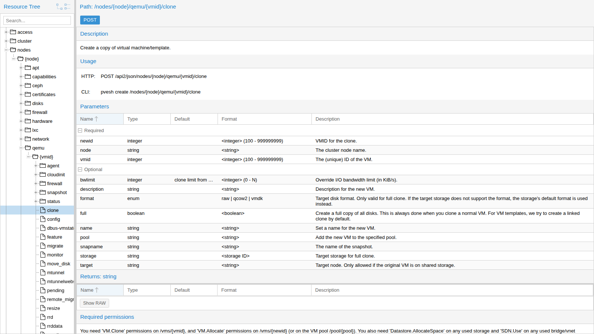
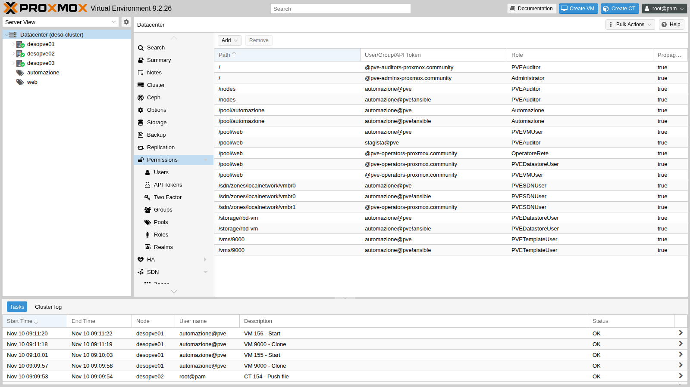
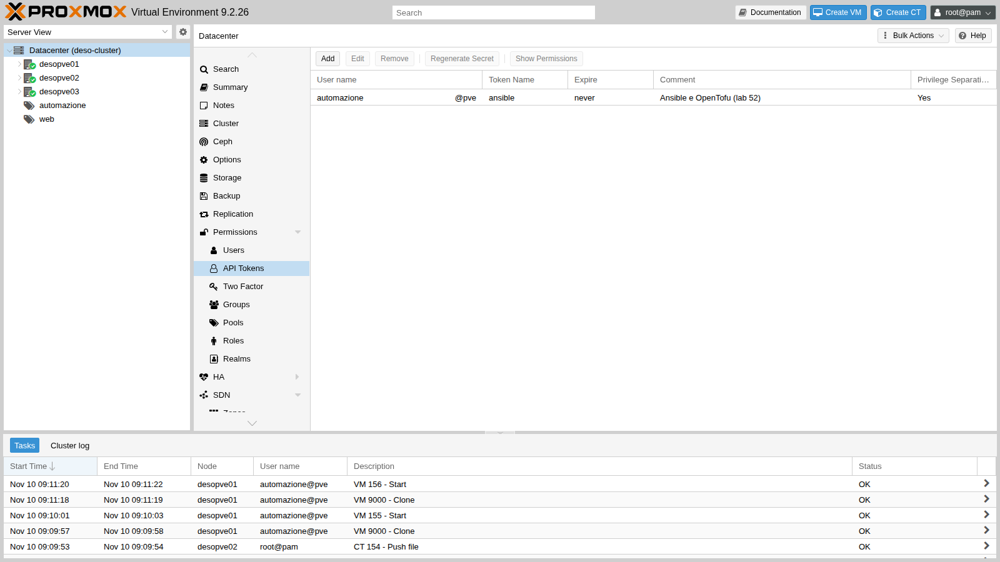
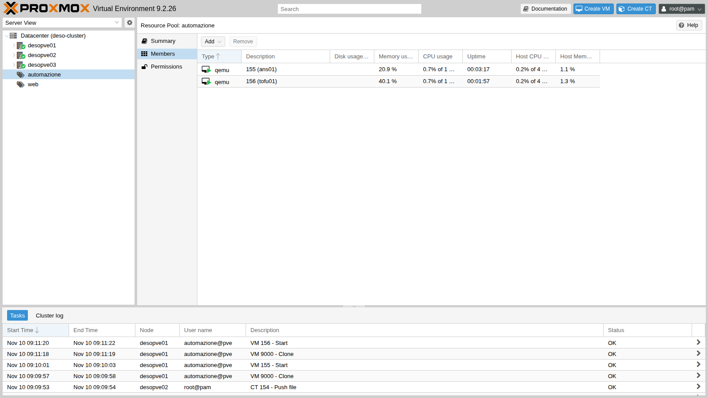
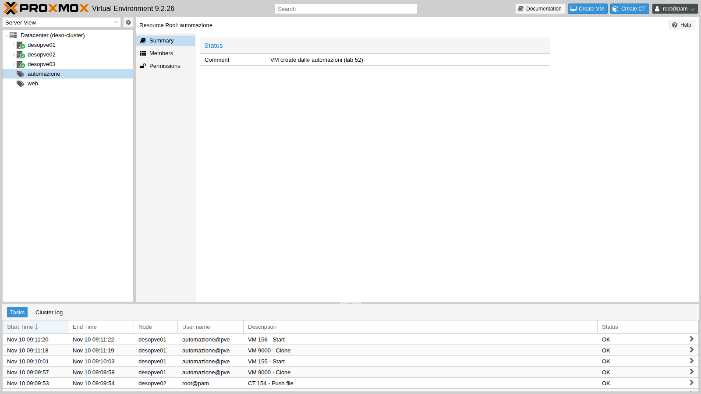

# Lab 52 – API e automazione: `pvesh`, ticket e CSRF, API token, Ansible e OpenTofu

**Livello:** avanzato · **Durata:** 2 ore

## Dipendenze

- **Lab precedenti:**
  - [Lab 05](05-ssh-shell-cli.md): `pvesh` e gli strumenti da riga di comando;
  - [Lab 40](40-templates-cloud-init-clones.md): il template `9000` `debian13-cloud` con cloud-init;
  - [Lab 44](44-users-groups-roles-pools-tokens.md): ruoli, pool, ACL, utente `automazione@pve` e token con privilege separation;
  - [Lab 17](17-ceph-installation.md): lo storage `rbd-vm`.
- **Sistemi:** il cluster `deso-cluster`; il nuovo container `154` `automazione` (172.27.199.154) come postazione di automazione.
- **Indirizzi per le VM di prova:** 172.27.199.155 (`ans01`, Ansible) e 172.27.199.156 (`tofu01`, OpenTofu).
- **Credenziali:** `root@pam` → [Appendice B](b-credentials-and-addresses.md). Il segreto del token viene mostrato una volta sola alla creazione.
- **File del lab:** [`crea-vm.yml`](../files/52/crea-vm.yml) ed [`elimina-vm.yml`](../files/52/elimina-vm.yml) (playbook Ansible), [`main.tf`](../files/52/main.tf) (configurazione OpenTofu) e [`api-demo.sh`](../files/52/api-demo.sh) (script delle prove con `curl`).

## Obiettivi

- Capire com'è fatta l'API REST di Proxmox VE e usarla con `pvesh`, con `curl` e dall'API viewer.
- Autenticarsi con **ticket e CSRF** e con **API token**, e capire quando serve l'uno o l'altro.
- Costruire un ruolo e delle ACL **minime** per un'automazione, partendo dai permessi richiesti da ogni chiamata.
- Creare VM da template con cloud-init con **Ansible** e con **OpenTofu**, verificare l'idempotenza e fare pulizia.

## Come funziona

**Un'unica API.** L'interfaccia web, `pvesh`, `qm`, `pct` e gli strumenti esterni usano tutti la stessa API REST, esposta da `pveproxy` su `https://<nodo>:8006/api2/json/`. Le risorse sono organizzate ad albero (`/nodes/{node}/qemu/{vmid}/...`, `/cluster/...`, `/access/...`, `/pools`, `/storage`), e i metodi HTTP corrispondono ai comandi di `pvesh`: `GET` = `pvesh get`, `POST` = `pvesh create`, `PUT` = `pvesh set`, `DELETE` = `pvesh delete`. Qualunque nodo del cluster risponde per tutto il cluster e inoltra le richieste al nodo giusto.

**Ticket.** Con utente e password (`POST /access/ticket`) si ottiene un **ticket** valido due ore, da mandare come cookie `PVEAuthCookie`, e un **CSRFPreventionToken**, obbligatorio nell'intestazione di ogni richiesta che modifica qualcosa. È il meccanismo dell'interfaccia web. Se l'utente ha la 2FA, il ticket richiede anche il secondo fattore ([lab 45](45-two-factor-authentication.md)).

**API token.** Un token (`utente@realm!nome`) con il suo segreto si manda nell'intestazione `Authorization: PVEAPIToken=…`: niente ticket, niente CSRF, niente 2FA, revocabile da solo. Con la **privilege separation** il token ha solo i permessi che gli si assegnano esplicitamente, e comunque mai più di quelli del suo utente ([lab 44](44-users-groups-roles-pools-tokens.md)). È il metodo giusto per le automazioni.

**Ansible e OpenTofu.** Ansible esegue una sequenza di compiti ("crea il clone, imposta cloud-init, avvia") e i moduli della collezione `community.proxmox` chiamano l'API tramite la libreria `proxmoxer`. OpenTofu (il fork open source di Terraform) descrive lo **stato desiderato** in un file: confronta lo stato reale con quello scritto e applica solo le differenze; il provider `bpg/proxmox` traduce le risorse in chiamate API.

## Procedura

### 1. Esplorare l'API con `pvesh` e l'API viewer

`pvesh` naviga l'albero come un filesystem. Le lettere indicano cosa si può fare su ogni ramo (`r` = GET, `c` = POST, `w` = PUT, `D` = contiene altri rami):

```bash
pvesh ls /nodes/desopve01 | head -8
pvesh get /cluster/resources --type node --output-format json | python3 -c 'import sys, json
for n in json.load(sys.stdin): print(n["node"], n["status"], "%.1f %%" % (n["cpu"] * 100))'
pvesh usage /nodes/{node}/qemu/{vmid}/clone
```

``` { .text .no-copy title="Output" }
-r-c-        aplinfo
Dr---        apt
Dr---        capabilities
Dr---        ceph
Dr---        certificates
-rw--        config
Dr---        disks
-rw--        dns
```

``` { .text .no-copy title="Output" }
desopve01 online 19.0 %
desopve02 online 7.8 %
desopve03 online 9.3 %
```

``` { .text .no-copy title="Output" }
USAGE: pvesh create /nodes/{node}/qemu/{vmid}/clone --newid <integer> [OPTIONS]
```

La documentazione completa di ogni chiamata è nell'**API viewer**, pubblicato da ogni nodo su `https://<nodo>:8006/pve-docs/api-viewer/`. Per ogni percorso mostra parametri, valori restituiti e, in fondo, i **permessi richiesti**. Per il clone di una VM servono `VM.Clone` sul template, `VM.Allocate` sulla nuova VM o sul suo pool, `Datastore.AllocateSpace` sullo storage e `SDN.Use` sul bridge:



### 2. La postazione di automazione

Un container Debian 13 dedicato, il CT 154 `automazione`, con Ansible dalla distribuzione e OpenTofu dal pacchetto ufficiale su GitHub:

```bash
pct create 154 cephfs:vztmpl/debian-13-standard_13.6-1_amd64.tar.zst --hostname automazione \
  --unprivileged 1 --features nesting=1 --cores 2 --memory 1024 --rootfs rbd-vm:8 \
  --net0 name=eth0,bridge=vmbr0,ip=172.27.199.154/24,gw=172.27.199.1 \
  --nameserver 172.27.199.20 --searchdomain proxmox.community --password '<password-lab>'
pct start 154
pct enter 154
```

Sul proxy del laboratorio servono, oltre ai repository Debian, i domini `github.com`, `objects.githubusercontent.com` e `release-assets.githubusercontent.com` (download di OpenTofu e del provider) e `registry.opentofu.org` (per `tofu init`). Dentro il container:

```bash
echo 'Acquire::http::Proxy "http://proxy.proxmox.community:3128";' > /etc/apt/apt.conf.d/80proxy
apt-get update && apt-get install -y ansible python3-proxmoxer python3-requests curl jq
export https_proxy=http://proxy.proxmox.community:3128
V=$(curl -sI https://github.com/opentofu/opentofu/releases/latest | grep -i ^location | sed -E 's#.*/tag/v([0-9.]+).*#\1#' | tr -d '\r')
curl -fsSL -o /tmp/tofu.deb https://github.com/opentofu/opentofu/releases/download/v$V/tofu_${V}_amd64.deb
dpkg -i /tmp/tofu.deb
ssh-keygen -t ed25519 -N "" -C automazione@proxmox.community -f /root/.ssh/id_ed25519
```

``` { .text .no-copy title="Output" }
ansible [core 2.19.11]
ansible 12.0.0+dfsg-0+deb13u1
python3-proxmoxer 2.2.0-1
OpenTofu v1.13.9
```

La collezione `community.proxmox`, che contiene `proxmox_kvm`, è già inclusa nel pacchetto `ansible` di Debian 13.

**Verifica del certificato.** Le automazioni non devono disattivare il controllo TLS. Il certificato dei nodi è firmato dalla CA del cluster (`/etc/pve/pve-root-ca.pem`). Basta copiarla nel container e aggiungerla alle CA di sistema, che usano sia Python sia OpenTofu. Dal nodo che ospita il container:

```bash
pct push 154 /etc/pve/pve-root-ca.pem /usr/local/share/ca-certificates/pve-root-ca.crt
pct exec 154 -- update-ca-certificates
pct exec 154 -- curl -s -o /dev/null -w "%{http_code} verify=%{ssl_verify_result}\n" \
  https://desopve01.proxmox.community:8006/api2/json/version
```

``` { .text .no-copy title="Output" }
401 verify=0
```

`verify=0` vuol dire certificato valido; `401` perché la richiesta non è autenticata.

### 3. Permessi minimi: ruolo, pool e token

Le VM create dalle automazioni finiscono in un **pool dedicato**, e il token può fare solo ciò che serve. Il ruolo `Automazione` raccoglie i privilegi sulle VM; il resto viene da ruoli predefiniti su percorsi precisi:

```bash
pveum pool add automazione --comment "VM create dalle automazioni (lab 52)"
pveum role add Automazione --privs "VM.Allocate VM.Clone VM.Config.CDROM VM.Config.CPU \
  VM.Config.Cloudinit VM.Config.Disk VM.Config.HWType VM.Config.Memory VM.Config.Network \
  VM.Config.Options VM.Audit VM.PowerMgmt VM.GuestAgent.Audit Pool.Audit"
pveum user token add automazione@pve ansible --privsep 1 --comment "Ansible e OpenTofu (lab 52)"

for chi in '--users automazione@pve' '--tokens automazione@pve!ansible'; do
  pveum acl modify /pool/automazione --roles Automazione $chi
  pveum acl modify /vms/9000 --roles PVETemplateUser $chi
  pveum acl modify /storage/rbd-vm --roles PVEDatastoreUser $chi
  pveum acl modify /sdn/zones/localnetwork/vmbr0 --roles PVESDNUser $chi
  pveum acl modify /nodes --roles PVEAuditor $chi
done
```

| Percorso | Ruolo | A cosa serve |
|---|---|---|
| `/pool/automazione` | `Automazione` | creare, configurare e accendere le VM del pool |
| `/vms/9000` | `PVETemplateUser` | clonare il template (`VM.Clone`, `VM.Audit`) |
| `/storage/rbd-vm` | `PVEDatastoreUser` | allocare i dischi (`Datastore.AllocateSpace`) |
| `/sdn/zones/localnetwork/vmbr0` | `PVESDNUser` | collegare la scheda a `vmbr0` (`SDN.Use`) |
| `/nodes` | `PVEAuditor` | leggere nodi e risorse (serve a OpenTofu) |

Con la privilege separation le ACL vanno date **sia all'utente sia al token**: il token ottiene l'intersezione dei due. Il segreto del token viene mostrato una volta sola e va conservato in un posto sicuro. Nel laboratorio sta in `/root/.pve-token` nel CT 154, leggibile solo da root. Per metterlo lì senza passare da file intermedi, al posto del `token add` sopra si può usare direttamente (sul nodo che ospita il CT 154):

```bash
pveum user token add automazione@pve ansible --privsep 1 --comment "Ansible e OpenTofu (lab 52)" --output-format json \
  | python3 -c 'import sys,json; print(json.load(sys.stdin)["value"])' \
  | pct exec 154 -- sh -c 'umask 077; cat > /root/.pve-token'
```





I permessi effettivi del token sul pool:

```bash
pveum user token permissions automazione@pve ansible --path /pool/automazione
```

``` { .text .no-copy title="Output" }
│ /pool/automazione │ Pool.Audit (*)          │
│                   │ VM.Allocate (*)         │
│                   │ VM.Audit (*)            │
│                   │ VM.Clone (*)            │
│                   │ VM.Config.CDROM (*)     │
…
│                   │ VM.PowerMgmt (*)        │
```

### 4. L'API con `curl`: ticket, CSRF e token

Lo script [`api-demo.sh`](../files/52/api-demo.sh), eseguito nel CT 154, mostra i due metodi di autenticazione. Prima di lanciarlo, nella stessa shell, si inserisce la password di `root@pam` senza che resti nella cronologia: `read -rs PW; export PW`.

```bash
API=https://desopve01.proxmox.community:8006/api2/json
R=$(curl -s -d "username=root@pam" --data-urlencode "password=$PW" $API/access/ticket)
TICKET=$(echo "$R" | jq -r .data.ticket); CSRF=$(echo "$R" | jq -r .data.CSRFPreventionToken)
curl -s -b "PVEAuthCookie=$TICKET" $API/nodes
curl -s -b "PVEAuthCookie=$TICKET" -X POST -d "poolid=prova-api" $API/pools
curl -s -b "PVEAuthCookie=$TICKET" -H "CSRFPreventionToken: $CSRF" -X POST -d "poolid=prova-api" $API/pools
```

``` { .text .no-copy title="Output" }
== 1. ticket
ticket: PVE:root@pam:6AF2D114::k… (valido 2 ore)
CSRFPreventionToken: 6AF2D114:AOl…
== 2. GET con il cookie
desopve01 online cpu=14% mem=9/31 GiB
desopve02 online cpu=8% mem=7/31 GiB
desopve03 online cpu=9% mem=6/31 GiB
== 3. scrittura senza e con CSRF
POST /pools senza CSRF: HTTP 401
POST /pools con CSRF: HTTP 200
DELETE /pools/prova-api con CSRF: HTTP 200
```

Con il token non c'è CSRF, ma valgono le ACL:

```bash
H='Authorization: PVEAPIToken=automazione@pve!ansible='"$SECRET"     # apici singoli: "!" in una shell interattiva
curl -s -H "$H" "$API/cluster/resources?type=vm"
curl -s -H "$H" $API/nodes/desopve01/qemu/100/config
curl -s -H "$H" -X POST -d "poolid=prova-token" $API/pools
```

``` { .text .no-copy title="Output" }
== 4. API token
9000 debian13-cloud desopve01 template=1
GET config della VM 100 con il token: HTTP 403
{"data":null,"message":"Permission check failed (/pool/prova-token, Pool.Allocate)\n"}
```

Il token vede **una sola** VM del cluster, il template, perché è l'unica su cui ha permessi. Leggere la VM 100 o creare un pool gli è negato, e il messaggio dice esattamente quale privilegio manca su quale percorso.

### 5. Ansible: una VM dal template

Il playbook [`crea-vm.yml`](../files/52/crea-vm.yml) usa `module_defaults` per non ripetere a ogni task la connessione all'API:

```yaml
- name: VM da template con cloud-init
  hosts: localhost
  gather_facts: false
  module_defaults:
    group/community.proxmox.proxmox:
      api_host: desopve01.proxmox.community
      api_user: automazione@pve
      api_token_id: ansible
      api_token_secret: "{{ lookup('file', '/root/.pve-token') }}"
      validate_certs: true
  vars:
    vm_id: 155
    vm_nome: ans01
    vm_ip: 172.27.199.155
  tasks:
    - name: Linked clone del template debian13-cloud
      community.proxmox.proxmox_kvm:
        node: desopve01
        clone: debian13-cloud
        vmid: 9000
        newid: "{{ vm_id }}"
        name: "{{ vm_nome }}"
        pool: automazione
        full: false
        timeout: 300
    - name: Cloud-init, CPU e RAM
      community.proxmox.proxmox_kvm:
        node: desopve01
        vmid: "{{ vm_id }}"
        update: true
        update_unsafe: false
        cores: 1
        memory: 1024
        ciuser: labuser
        sshkeys: "{{ lookup('file', '/root/.ssh/id_ed25519.pub') }}"
        ipconfig:
          ipconfig0: "ip={{ vm_ip }}/24,gw=172.27.199.1"
        nameservers: [172.27.199.20]
        searchdomains: [proxmox.community]
    - name: Avvio
      community.proxmox.proxmox_kvm:
        node: desopve01
        vmid: "{{ vm_id }}"
        state: started
    - name: Attesa di SSH sulla VM
      ansible.builtin.wait_for:
        host: "{{ vm_ip }}"
        port: 22
        timeout: 300
```

I file del lab (`crea-vm.yml`, `elimina-vm.yml`, `main.tf` e `api-demo.sh`, elencati nelle [Dipendenze](#dipendenze)) vanno copiati nel CT 154, dal nodo che lo ospita:

```bash
pct exec 154 -- mkdir -p /root/ansible /root/tofu
pct push 154 crea-vm.yml /root/ansible/crea-vm.yml
pct push 154 elimina-vm.yml /root/ansible/elimina-vm.yml
pct push 154 main.tf /root/tofu/main.tf
pct push 154 api-demo.sh /root/api-demo.sh
```

Poi, nel CT 154:

```bash
cd /root/ansible && time ansible-playbook crea-vm.yml
```

``` { .text .no-copy title="Output" }
TASK [Linked clone del template debian13-cloud] ********************************
changed: [localhost]
TASK [Cloud-init, CPU e RAM] ***************************************************
changed: [localhost]
TASK [Avvio] *******************************************************************
changed: [localhost]
TASK [Attesa di SSH sulla VM] **************************************************
ok: [localhost]
PLAY RECAP *********************************************************************
localhost                  : ok=4    changed=3    unreachable=0    failed=0    skipped=0    rescued=0    ignored=0
real	0m38.381s
```

In 38 secondi la VM è clonata, configurata e raggiungibile. Cloud-init ha applicato nome, IP e chiave:

```bash
ssh labuser@172.27.199.155 "hostname; ip -4 -br a show scope global; cloud-init status"
```

``` { .text .no-copy title="Output" }
ans01
eth0             UP             172.27.199.155/24
status: done
```

**Idempotenza.** Una seconda esecuzione senza modifiche:

```text
TASK [Linked clone del template debian13-cloud] ********************************
ok: [localhost]
TASK [Cloud-init, CPU e RAM] ***************************************************
changed: [localhost]
TASK [Avvio] *******************************************************************
ok: [localhost]
localhost                  : ok=4    changed=1    unreachable=0    failed=0    skipped=0    rescued=0    ignored=0
```

Il clone e l'avvio riconoscono che la VM c'è già ed è accesa. Il task con `update: true` invece riscrive la configurazione e si dichiara sempre `changed`, anche quando i valori sono uguali: non fa danni, ma in un report di conformità è un falso positivo da conoscere.

### 6. OpenTofu: la stessa cosa come stato desiderato

Il file [`main.tf`](../files/52/main.tf) descrive la VM `tofu01`:

```hcl
terraform {
  required_providers {
    proxmox = {
      source = "bpg/proxmox"
    }
  }
}

variable "token_secret" {
  type      = string
  sensitive = true
}

provider "proxmox" {
  endpoint  = "https://desopve01.proxmox.community:8006/"
  api_token = "automazione@pve!ansible=${var.token_secret}"
  insecure  = false
}

resource "proxmox_virtual_environment_vm" "tofu01" {
  name      = "tofu01"
  node_name = "desopve01"
  vm_id     = 156
  pool_id   = "automazione"
  clone {
    vm_id = 9000
    full  = false
  }
  agent { enabled = false }
  cpu { cores = 1 }
  memory { dedicated = 1024 }
  network_device { bridge = "vmbr0" }
  initialization {
    datastore_id = "rbd-vm"
    ip_config {
      ipv4 {
        address = "172.27.199.156/24"
        gateway = "172.27.199.1"
      }
    }
    dns {
      servers = ["172.27.199.20"]
      domain  = "proxmox.community"
    }
    user_account {
      username = "labuser"
      keys     = [trimspace(file("/root/.ssh/id_ed25519.pub"))]
    }
  }
}
```

Il segreto non sta nel file: arriva da una variabile d'ambiente. Il download del provider passa dal proxy, mentre l'API dei nodi no (`NO_PROXY`):

```bash
cd /root/tofu
export HTTPS_PROXY=http://proxy.proxmox.community:3128 NO_PROXY=proxmox.community,172.27.199.0/24
export TF_VAR_token_secret=$(cat /root/.pve-token)
tofu init
tofu plan
tofu apply -auto-approve
```

``` { .text .no-copy title="Output" }
- Installing bpg/proxmox v0.121.0...
- Installed bpg/proxmox v0.121.0 (signed, key ID 0B3405B36193A495)
OpenTofu has been successfully initialized!
  # proxmox_virtual_environment_vm.tofu01 will be created
Plan: 1 to add, 0 to change, 0 to destroy.
proxmox_virtual_environment_vm.tofu01: Creating...
proxmox_virtual_environment_vm.tofu01: Creation complete after 5s [id=156]
Apply complete! Resources: 1 added, 0 changed, 0 destroyed.
```

`agent { enabled = false }` è voluto: il template non ha il guest agent installato, e con l'agent attivo il provider aspetterebbe un indirizzo IP che non arriva mai. La VM risponde con il nome e l'IP impostati da cloud-init:

```text
tofu01
status: done
```

Un secondo `tofu plan`, senza modifiche:

```text
No changes. Your infrastructure matches the configuration.
```

Le due VM nel pool, e i task registrati a nome dell'utente dell'automazione:





### 7. Pulizia

Con OpenTofu si distrugge ciò che il file descrive; con Ansible serve un playbook di rimozione ([`elimina-vm.yml`](../files/52/elimina-vm.yml)), con `state: stopped` e poi `state: absent`:

```bash
tofu destroy -auto-approve
ansible-playbook /root/ansible/elimina-vm.yml
```

``` { .text .no-copy title="Output" }
proxmox_virtual_environment_vm.tofu01: Destroying... [id=156]
proxmox_virtual_environment_vm.tofu01: Destruction complete after 5s
Destroy complete! Resources: 1 destroyed.
changed: [localhost]
changed: [localhost]
localhost                  : ok=2    changed=2    unreachable=0    failed=0    skipped=0    rescued=0    ignored=0
```

Il pool è di nuovo vuoto:

```bash
pvesh get /pools/automazione --output-format json
```

``` { .text .no-copy title="Output" }
{"comment":"VM create dalle automazioni (lab 52)","members":[],"poolid":"automazione"}
```

## Verifica e test

| Prova | Risultato |
|---|---|
| Certificato dei nodi verificato dal CT 154 con la CA del cluster | `verify=0` |
| `POST` con il ticket senza CSRF | HTTP 401 |
| `POST` con il ticket e il CSRF | HTTP 200 |
| Token: elenco delle VM del cluster | solo il template 9000 |
| Token: configurazione della VM 100 | HTTP 403 |
| Token: creazione di un pool | `Permission check failed (/pool/prova-token, Pool.Allocate)` |
| Ansible, prima esecuzione | VM `ans01` pronta in 38 s, raggiungibile in SSH |
| Ansible, seconda esecuzione | `changed=1` (solo il task `update`) |
| OpenTofu `apply` | VM `tofu01` creata in 5 s |
| OpenTofu, secondo `plan` | `No changes` |
| Pulizia | pool `automazione` vuoto |

## Stato finale del lab

- **CT 154 `automazione`** su `desopve02`, acceso, 172.27.199.154:
  - Ansible 12 (ansible-core 2.19) con `community.proxmox` e `python3-proxmoxer`, OpenTofu 1.13.9;
  - CA del cluster tra le CA di sistema;
  - chiave SSH `/root/.ssh/id_ed25519` e segreto del token in `/root/.pve-token`;
  - playbook in `/root/ansible`, configurazione OpenTofu in `/root/tofu` (stato vuoto dopo il `destroy`).
- **Pool `automazione`**, vuoto.
- **Ruolo `Automazione`** e token `automazione@pve!ansible` con privilege separation, con le ACL della tabella del passo 3 (sia per l'utente sia per il token). Le ACL del [lab 44](44-users-groups-roles-pools-tokens.md) su `/pool/web` restano invariate.
- VM di prova 155 e 156 eliminate.

## Cosa hai imparato

- L'interfaccia web, la CLI e gli strumenti esterni usano la stessa API: `pvesh` e l'**API viewer** sono il modo più rapido per capire una chiamata e i permessi che richiede.
- Il **ticket** serve alle sessioni interattive e richiede il **CSRFPreventionToken** per scrivere; il **token** non ha CSRF né 2FA ed è il metodo giusto per le automazioni.
- I permessi di un'automazione si costruiscono partendo dai "Required permissions" delle chiamate: pool dedicato, ruolo su misura, ruoli predefiniti su storage, bridge e template.
- Con la privilege separation le ACL vanno sia all'utente sia al token; un 403 indica il privilegio e il percorso mancanti.
- Ansible esegue compiti e non tutti i moduli sono idempotenti; OpenTofu confronta lo stato desiderato con quello reale e non cambia nulla se coincidono.
- Le automazioni verificano il certificato del cluster invece di disattivare il controllo TLS.

## Riferimenti

- [Proxmox VE – API](https://pve.proxmox.com/wiki/Proxmox_VE_API)
- [Proxmox VE – API viewer](https://pve.proxmox.com/pve-docs/api-viewer/)
- [Proxmox VE – User Management, API tokens](https://pve.proxmox.com/pve-docs/chapter-pveum.html#pveum_tokens)
- [Ansible – collezione community.proxmox](https://docs.ansible.com/ansible/latest/collections/community/proxmox/)
- [OpenTofu – installazione](https://opentofu.org/docs/intro/install/)
- [Provider bpg/proxmox](https://search.opentofu.org/provider/bpg/proxmox/latest)
