# Lab 53 – Proxmox Datacenter Manager: remote PVE e PBS, dashboard, aggiornamenti, migrazione tra remote

**Livello:** intermedio · **Durata:** 1 ora e 30 minuti

## Dipendenze

- **Lab precedenti:**
  - [Lab 25](25-ipv6.md): la configurazione IPv6 degli host (file `90-ipv6-host.conf`);
  - [Lab 03](03-install-proxmox-ve.md) e [lab 04](04-first-access-repositories-updates.md): installer, repository no-subscription e proxy, con la stessa procedura;
  - [Lab 40](40-templates-cloud-init-clones.md): il template 9000 `debian13-cloud`, da cui si clona la VM di prova della migrazione;
  - [Lab 44](44-users-groups-roles-pools-tokens.md): utenti, ruoli e API token;
  - [Lab 47](47-proxmox-backup-server.md): il Proxmox Backup Server `desopbs01`;
  - [Lab 48](48-migrations.md): `qm remote-migrate` e i suoi limiti, che PDM usa dietro le quinte;
  - [Lab 30](30-sdn-evpn.md): la zona EVPN `evpnz`, che PDM mostra.
- **Sistemi:**
  - il server `desopdm01.proxmox.community` (172.27.199.41) per PDM: 2 core, 4 GB di RAM, disco da 32 GB;
  - il cluster `deso-cluster`, il nodo autonomo `desopve04` e il PBS `desopbs01`.
- **ISO:** `proxmox-datacenter-manager_1.1-1.iso`.
- **Credenziali:** `root@pam` e la password del laboratorio → [Appendice B](b-credentials-and-addresses.md).

## Obiettivi

- Installare Proxmox Datacenter Manager (PDM) e prepararlo come un nodo PVE: repository, aggiornamenti, NTP.
- Collegare come **remote** un cluster PVE, un nodo PVE autonomo e un PBS con token dedicati.
- Usare la dashboard, la ricerca globale, la vista degli aggiornamenti e la vista EVPN.
- Migrare una VM **tra due datacenter diversi** dalla GUI di PDM, e ritrovarne i limiti.

## Come funziona

**Un pannello sopra più datacenter.** Un cluster Proxmox VE si gestisce da qualunque suo nodo, ma ogni cluster (o nodo autonomo) è un mondo a sé, con la sua GUI e i suoi utenti. PDM è un'applicazione separata, con un'installazione propria, che si collega a più cluster PVE e a più PBS tramite le loro API e mostra tutto in un'unica interfaccia: stato, risorse, ricerca, aggiornamenti, task. Non sostituisce la GUI dei cluster: per le operazioni di dettaglio rimanda a quella con il pulsante **Open Web UI**.

**Remote e token.** Ogni sistema collegato è un **remote**. PDM si autentica con un **API token** del remote: può crearlo da solo partendo da utente e password, oppure usare un token esistente. Verifica il certificato con l'impronta (fingerprint) e, per un cluster, salva tutti i nodi come **endpoint**, così continua a funzionare se un nodo è spento.

**Migrazione tra remote.** Tra due remote PVE diversi PDM usa la stessa funzione `remote-migrate` del [lab 48](48-migrations.md): un tunnel websocket sulla porta 8006 tra il nodo di origine e quello di destinazione, con il token del remote di destinazione. PDM aggiunge la GUI, la scelta di storage e bridge di destinazione e la visione dei task da entrambe le parti.

## Procedura

### 1. Installazione

L'installer è lo stesso di Proxmox VE ([lab 03](03-install-proxmox-ve.md)):

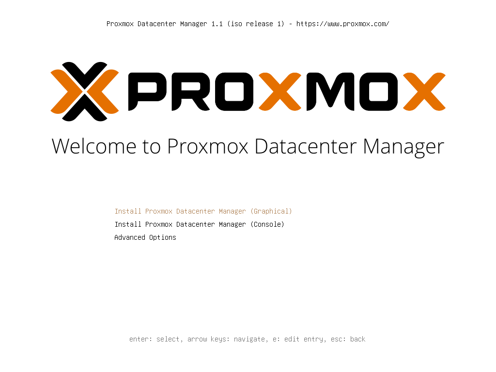

Disco di destinazione da 32 GB con ext4: PDM non ospita VM e gli bastano pochi GB.

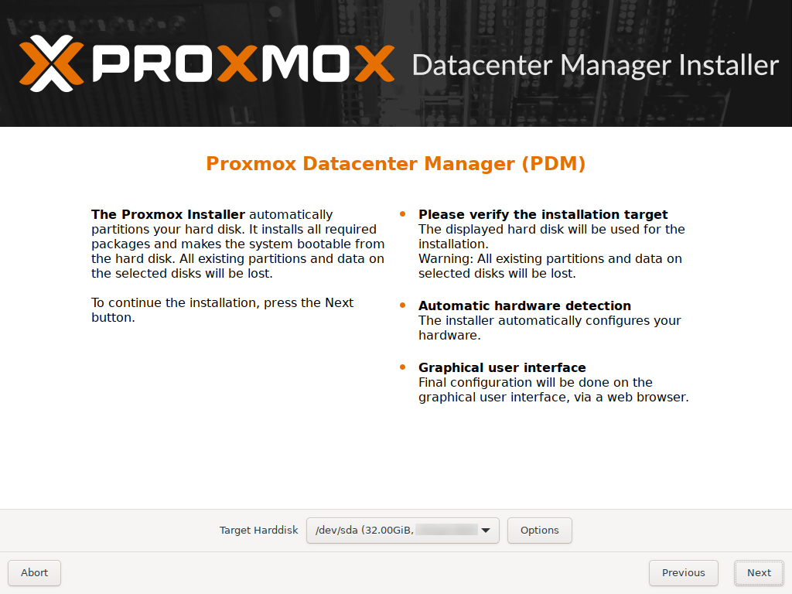

Rete statica con il nome definitivo e i nomi delle schede fissati (`nic0`), come per i nodi:

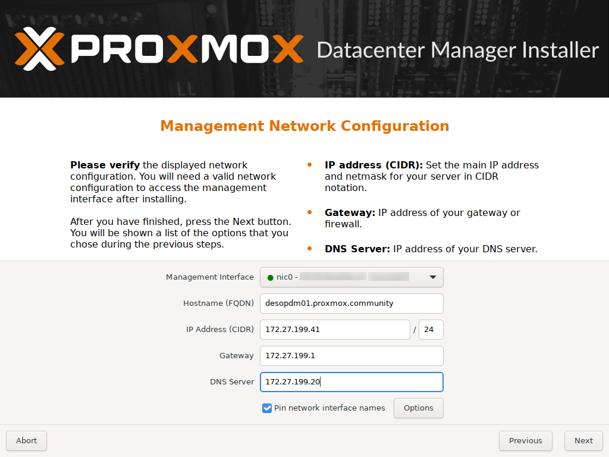

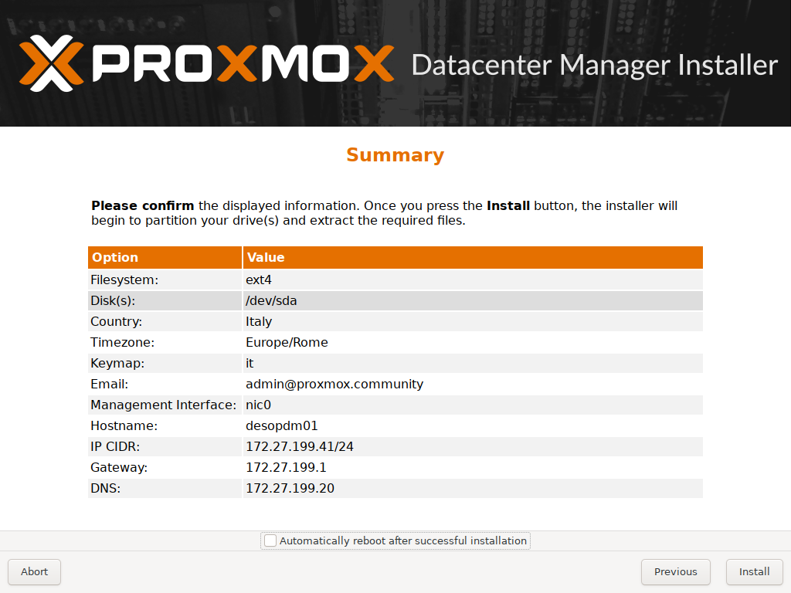

Al riavvio la console indica l'indirizzo della GUI, sulla porta **8443** (non 8006):

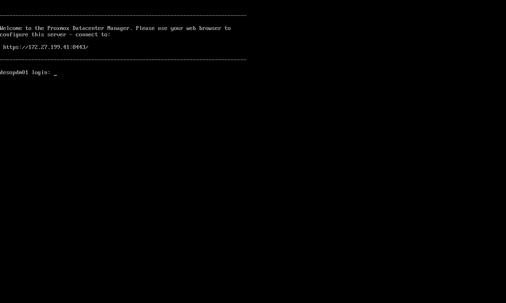

### 2. Repository, proxy, NTP e aggiornamento

Come un nodo PVE senza sottoscrizione, si disattiva il repository enterprise e si aggiunge `pdm-no-subscription`:

```bash
sed -i "s/^Components: pdm-enterprise/Components: pdm-enterprise\nEnabled: false/" /etc/apt/sources.list.d/pdm-enterprise.sources
cat > /etc/apt/sources.list.d/proxmox.sources <<'EOF'
Types: deb
URIs: http://download.proxmox.com/debian/pdm
Suites: trixie
Components: pdm-no-subscription
Signed-By: /usr/share/keyrings/proxmox-archive-keyring.gpg
EOF
echo 'Acquire::http::Proxy "http://proxy.proxmox.community:3128";' > /etc/apt/apt.conf.d/80proxy
sed -i "s/^pool 2.debian.pool.ntp.org iburst/server ntp.proxmox.community iburst/" /etc/chrony/chrony.conf
systemctl restart chrony
apt update && apt full-upgrade
```

L'ISO installava la 1.1.1. Dopo l'aggiornamento, con 111 pacchetti nuovi:

```text
proxmox-datacenter-manager 1.1.9 running version: 1.1.9
proxmox-datacenter-manager-ui 1.1.4
^* netsvc.proxmox.community      3   6    17    48  -9031ns[  -34us] +/-   23ms
System clock synchronized: yes
```

**IPv6 come sui nodi.** Come per i nodi nel [Lab 25](25-ipv6.md), anche qui niente autoconfigurazione dagli RA del router e link-local non derivati dal MAC. Si crea lo stesso file `/etc/sysctl.d/90-ipv6-host.conf`, si applica con `sysctl --system` e vale del tutto dal riavvio successivo. Su `desopdm01`:

```bash
cat /etc/sysctl.d/90-ipv6-host.conf
```

``` { .text .no-copy title="Output" }
# Indirizzi IPv6 del nodo solo statici: nessuna interfaccia accetta gli RA o si autoconfigura (SLAAC).
# Il carattere * vale anche per le schede che compaiono dopo l'avvio (systemd le applica a ogni nuova interfaccia).
net.ipv6.conf.*.accept_ra = 0
net.ipv6.conf.*.autoconf = 0
# Link-local non derivati dal MAC (RFC 7217, "stable privacy" con segreto casuale)
net.ipv6.conf.all.addr_gen_mode = 3
net.ipv6.conf.default.addr_gen_mode = 3
```

Il primo accesso, su `https://desopdm01.proxmox.community:8443` con `root@pam`, mostra un PDM vuoto, che già propone di aggiungere remote **PVE** e **PBS**:

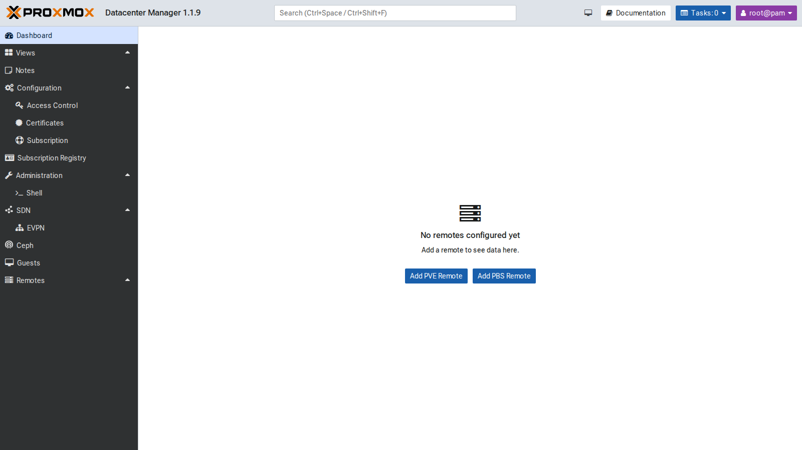

### 3. Token per PDM sui remote

Un utente dedicato per remote rende chiaro, nei log e nei task, cosa ha fatto PDM. Sul cluster e su `desopve04` (che ha un database utenti suo):

```bash
pveum user add pdm@pve --comment "Proxmox Datacenter Manager (lab 53)"
pveum acl modify / --users pdm@pve --roles Administrator
pveum user token add pdm@pve pdm --privsep 0 --comment "PDM desopdm01"
```

Il ruolo `Administrator` serve perché PDM deve poter migrare, accendere e spegnere guest e leggere gli aggiornamenti. Per un PDM di **sola consultazione** basta `PVEAuditor`. Sul PBS PDM ha bisogno di leggere, quindi il ruolo `Audit`; sul PBS i token hanno sempre ACL proprie:

```bash
proxmox-backup-manager user create pdm@pbs --comment "Proxmox Datacenter Manager (lab 53)"
proxmox-backup-manager acl update / Audit --auth-id pdm@pbs
proxmox-backup-manager user generate-token pdm@pbs pdm
proxmox-backup-manager acl update / Audit --auth-id 'pdm@pbs!pdm'
```

### 4. Aggiungere i remote

**Remotes → Add → Proxmox VE**. Nel primo passo si indica un nodo qualunque del cluster. PDM scarica il certificato e chiede se fidarsi: l'impronta va confrontata con quella del nodo (`pvenode cert info`, `14:32:84:88:C7…` per `desopve01`):

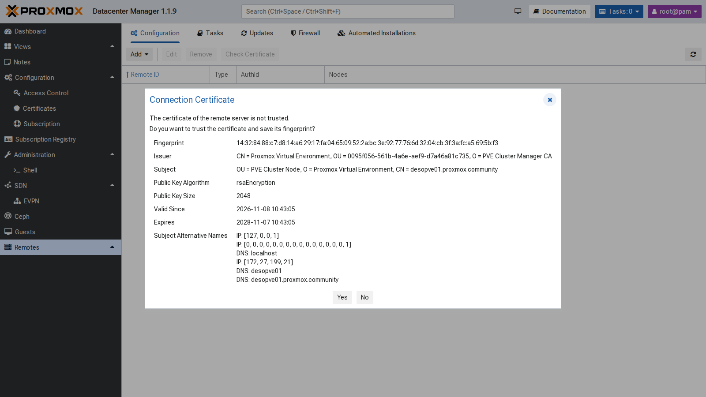

Poi l'ID del remote e l'autenticazione. Con **Use existing Token** si usa il token appena creato; con **Login and create Token** PDM ne creerebbe uno da solo (`pdm-admin-desopdm01`) con le credenziali di `root@pam`:

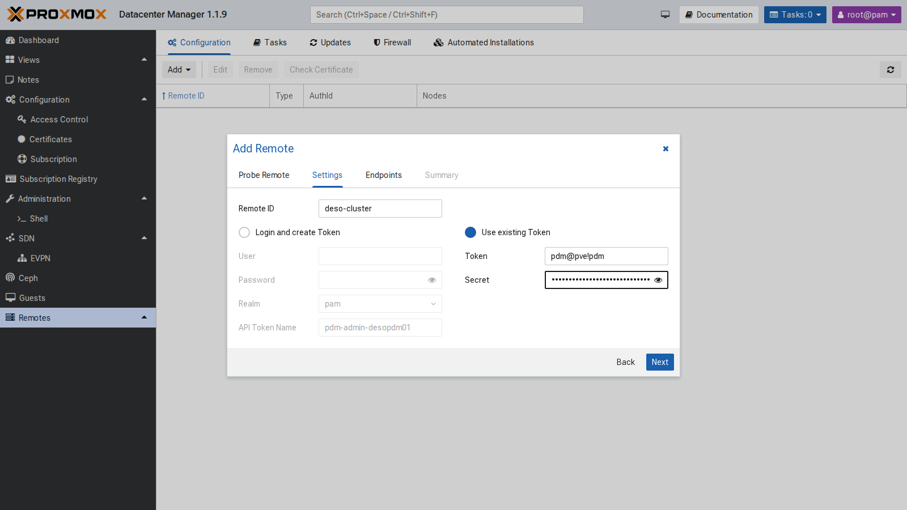

PDM legge l'elenco dei nodi del cluster e salva ognuno come endpoint, con la sua impronta:

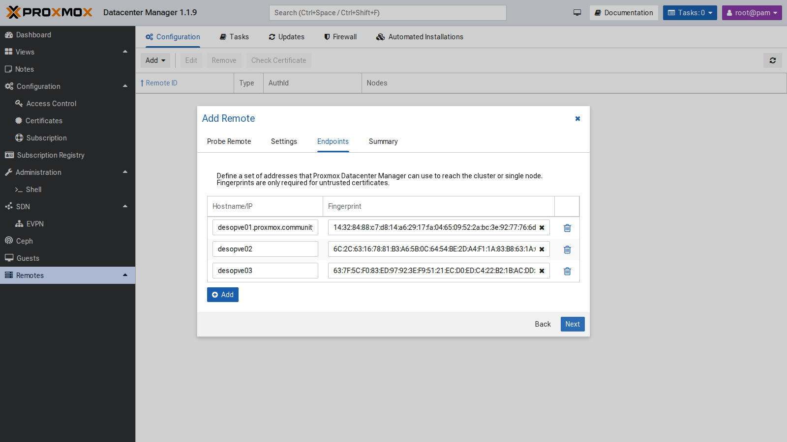

Lo stesso per `desopve04` (remote PVE con un solo nodo) e, con **Add → Proxmox Backup Server**, per `desopbs01`. La versione 1.1 gestisce anche i remote PBS. Il risultato:

```bash
proxmox-datacenter-manager-admin remote list
```

``` { .text .no-copy title="Output" }
Proxmox VE node deso-cluster:
    auth id: pdm@pve!pdm
    nodes:
        desopve01.proxmox.community,fingerprint=14:32:84:88:c7:d8:…
        desopve02,fingerprint=6C:2C:63:16:78:81:…
        desopve03,fingerprint=63:7F:5C:F0:83:ED:…
Proxmox VE node desopve04:
    auth id: pdm@pve!pdm
    node: desopve04.proxmox.community,fingerprint=84:d3:f2:f5:d3:4b:…
Proxmox Backup Server node desopbs01:
    auth id: pdm@pbs!pdm
    node: desopbs01.proxmox.community,fingerprint=31:0b:24:ed:32:07:…
```

Da questo momento compare a ogni accesso un avviso **No valid subscriptions**, perché nessun remote ha una sottoscrizione. Si chiude con **Continue**.

### 5. Dashboard, risorse e ricerca

La dashboard riassume tutti i remote: 4 nodi PVE e 1 PBS online, VM e container per stato, datastore del PBS e risorse aggregate. Le CPU, per esempio, sono 1,33 usate su 16 core fisici, con 44 vCPU assegnate.

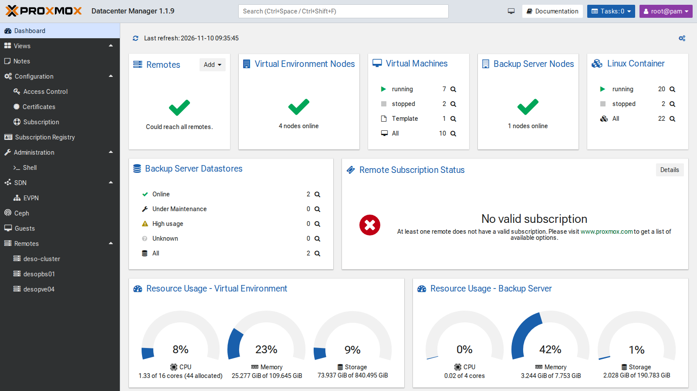

Ogni remote ha la sua vista, con utilizzo, allocazione (CPU e RAM assegnate contro quelle fisiche) e l'elenco delle risorse, con le azioni rapide (spegni, avvia, **migra**, apri la GUI del remote). La **ricerca globale** in alto (`Ctrl+Spazio`) trova una VM in qualunque remote e ne apre la vista, con stato, grafici, configurazione e console:

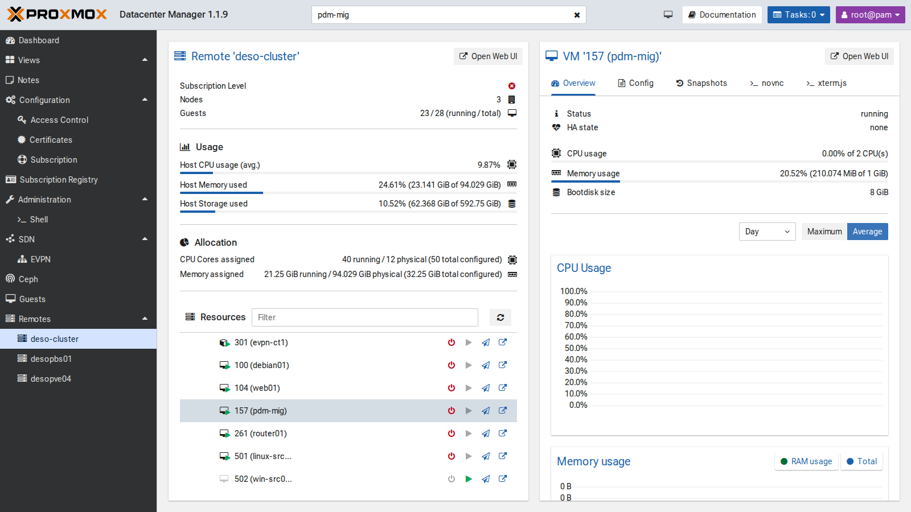

### 6. Aggiornamenti di tutti i remote

**Remotes → Updates → Refresh all** interroga tutti i remote e mostra in un'unica tabella versione, aggiornamenti disponibili e stato dei repository. Selezionando un nodo si vedono i pacchetti e si può avviare l'aggiornamento:

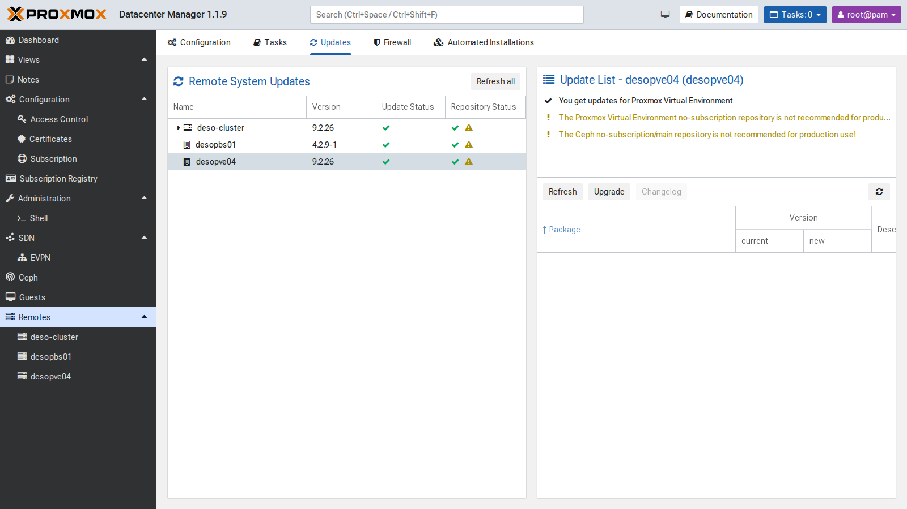

Tutti i remote sono aggiornati (PVE 9.2.26, PBS 4.2.9). Gli avvisi gialli segnalano i repository no-subscription e no-subscription di Ceph: corretti per un laboratorio, sconsigliati in produzione.

### 7. SDN: la vista EVPN

**SDN → EVPN** raccoglie le zone EVPN di tutti i remote, con ASN, VRF (L3VNI) e VNet. Qui c'è la zona `evpnz` del [lab 30](30-sdn-evpn.md), con il VRF VNI 10070:

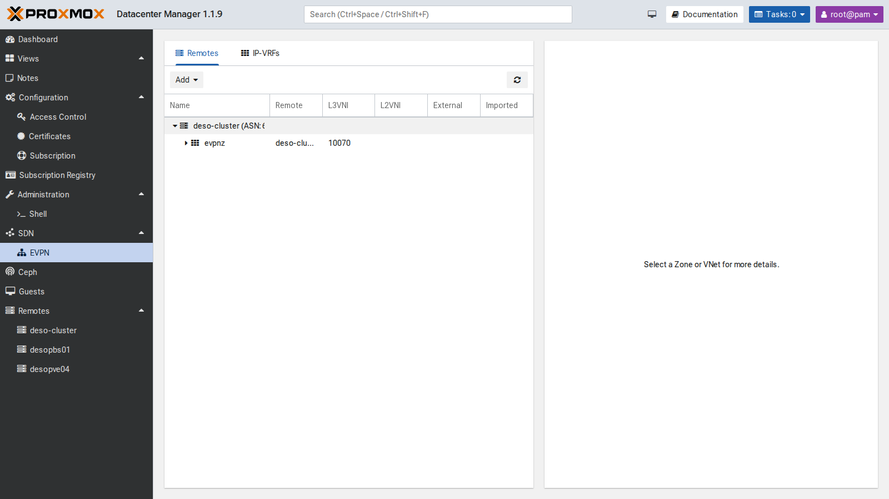

Il pulsante **Add** serve a creare zone e VNet EVPN su più remote insieme. Nel laboratorio c'è un solo cluster con EVPN, quindi non l'abbiamo usato.

### 8. Migrare una VM tra due datacenter

La VM di prova `pdm-mig` (VMID 157) è un full clone del template 9000 su `local-zfs` di `desopve01`, accesa, con indirizzo 172.27.199.157:

```bash
qm clone 9000 157 --name pdm-mig --full 1 --storage local-zfs
qm set 157 --ipconfig0 ip=172.27.199.157/24,gw=172.27.199.1 --nameserver 172.27.199.20 --memory 1024
qm start 157
```

Dalla vista del remote `deso-cluster`, l'icona **Migrate** della VM apre la finestra di migrazione. Scegliendo come **Target Remote** `desopve04` compaiono le opzioni della migrazione remota: endpoint, VMID di destinazione, eliminazione dell'origine, storage e rete di destinazione.

**Primo tentativo**, con lo storage proposto (`local-lvm`). Il task fallisce in 2 secondi, con lo stesso errore del [lab 48](48-migrations.md):

```text
2026-11-10 09:38:43 found generated disk 'local-zfs:vm-157-cloudinit' (in current VM config)
2026-11-10 09:38:43 found local disk 'local-zfs:vm-157-disk-0' (attached)
2026-11-10 09:38:43 ERROR: error - tunnel command '{…"volname":"vm-157-cloudinit","cmd":"disk-import",…"export_formats":"zfs",…"storage":"local-lvm"…}' failed - failed to handle 'disk-import' command - no matching import/export format found for storage 'local-lvm'
TASK ERROR: migration aborted
```

Il disco di cloud-init non si migra a caldo: viene esportato come stream ZFS, e LVM-thin non lo sa importare. PDM non lo prevede in anticipo. La VM resta accesa e intatta sull'origine.

**Secondo tentativo**, verso `tank` (ZFS) di `desopve04`:

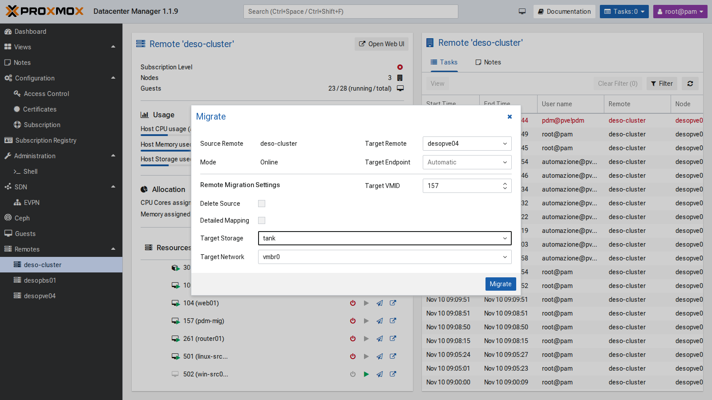

```text
2026-11-10 09:40:17 migration downtime limit: 100 ms
2026-11-10 09:40:19 average migration speed: 512.4 MiB/s - downtime 35 ms
2026-11-10 09:40:19 migration completed, transferred 290.0 MiB VM-state
mirror-scsi0: Completed successfully.
2026-11-10 09:40:23 migration finished successfully (duration 00:00:31)
```

31 secondi in tutto, con 35 ms di fermo della VM. Un ping ogni 0,2 secondi dalla rete di gestione non ha mai avuto una pausa superiore a 0,21 secondi. Il task porta la firma del token di PDM: `UPID:desopve01:…:qmigrate:157:pdm@pve!pdm:`.

L'opzione **Delete Source** era spenta, quindi sul cluster la VM 157 resta **spenta e bloccata** (`lock: migrate`), come con `qm remote-migrate` senza `--delete`. Dopo aver verificato la copia la si elimina:

```bash
qm unlock 157 && qm destroy 157 --purge
```

**Ritorno** da `desopve04` a `deso-cluster`, verso `local-zfs`, sempre dalla GUI di PDM:

```text
2026-11-10 09:42:04 average migration speed: 512.4 MiB/s - downtime 61 ms
2026-11-10 09:42:04 migration completed, transferred 289.9 MiB VM-state
mirror-scsi0: Completed successfully.
2026-11-10 09:42:07 migration finished successfully (duration 00:00:32)
```

32 secondi, 61 ms di fermo; pausa massima del ping 2,70 secondi, probabilmente il tempo che la rete impiega a imparare la nuova posizione della VM. Anche qui l'origine su `desopve04` resta bloccata e si elimina a mano; alla fine si toglie anche la VM tornata sul cluster:

```bash
qm unlock 157 && qm destroy 157 --purge        # su desopve04
qm stop 157 && qm destroy 157 --purge          # su desopve01
```

**Limiti visti nel laboratorio:**

- la migrazione tra remote eredita i limiti di `remote-migrate`, e PDM non li segnala prima di avviare il task;
- senza **Delete Source** l'origine resta bloccata e va ripulita a mano;
- per migrare, accendere e spegnere serve un token con privilegi ampi sul remote;
- le operazioni di dettaglio (storage, rete, HA, permessi) restano nella GUI di ogni remote;
- senza sottoscrizione PDM mostra un avviso a ogni accesso.

## Verifica e test

| Prova | Risultato |
|---|---|
| Aggiornamento di PDM | da 1.1.1 a 1.1.9 (interfaccia 1.1.4) |
| NTP | sincronizzato con `netsvc.proxmox.community` |
| Remote PVE `deso-cluster` | 3 endpoint con impronta, token `pdm@pve!pdm` |
| Remote PVE `desopve04` e PBS `desopbs01` | aggiunti, PBS con token in sola lettura (`Audit`) |
| Dashboard | 4 nodi PVE e 1 PBS online, 2 datastore |
| Aggiornamenti dei remote | versioni e repository di tutti i remote in una tabella |
| Migrazione verso `local-lvm` | rifiutata: il disco cloud-init non è importabile su LVM-thin |
| Migrazione verso `tank` | 31 s, 35 ms di fermo, pausa del ping 0,21 s |
| Ritorno verso `local-zfs` | 32 s, 61 ms di fermo, pausa del ping 2,70 s |
| Origine dopo la migrazione senza "Delete Source" | spenta e bloccata (`lock: migrate`), eliminata a mano |

## Stato finale del lab

- **PDM `desopdm01`** (172.27.199.41, GUI `:8443`), versione 1.1.9:
  - repository `pdm-no-subscription`, proxy per `apt`, NTP verso `ntp.proxmox.community`;
  - remote `deso-cluster` (3 endpoint), `desopve04` e `desopbs01`.
- **Sul cluster e su `desopve04`:** utente `pdm@pve` con `Administrator` su `/` e token `pdm@pve!pdm` senza privilege separation.
- **Sul PBS:** utente `pdm@pbs` e token `pdm@pbs!pdm`, entrambi con `Audit` su `/`.
- **VM 157 `pdm-mig`:** eliminata dopo le prove (né sul cluster né su `desopve04`).
- I segreti dei token stanno solo nella configurazione di PDM. Buona pratica: incolla il segreto direttamente nel wizard di PDM, senza lasciarlo in file o nella cronologia della shell.

## Cosa hai imparato

- PDM si installa e si aggiorna come un nodo PVE, ma risponde sulla porta **8443** e non sostituisce la GUI dei cluster.
- Ogni **remote** è un cluster PVE, un nodo autonomo o un PBS, collegato con un **token** e verificato con l'**impronta** del certificato. Un utente dedicato rende riconoscibili le azioni di PDM nei task.
- Dashboard, ricerca globale e vista degli **aggiornamenti** sono la parte più utile nella gestione quotidiana di più datacenter.
- La **migrazione tra remote** dalla GUI usa `remote-migrate`, quindi ne eredita i limiti: dischi cloud-init e storage incompatibili falliscono, e senza "Delete Source" l'origine resta bloccata.
- Il fermo della VM in una migrazione tra datacenter è dello stesso ordine di quello interno al cluster: decine di millisecondi.

## Riferimenti

- [Proxmox Datacenter Manager – documentazione](https://pdm.proxmox.com/docs/)
- [Proxmox Datacenter Manager – roadmap e note di rilascio](https://pve.proxmox.com/wiki/Proxmox_Datacenter_Manager_Roadmap)
- [Proxmox VE – qm remote-migrate](https://pve.proxmox.com/pve-docs/qm.1.html)
