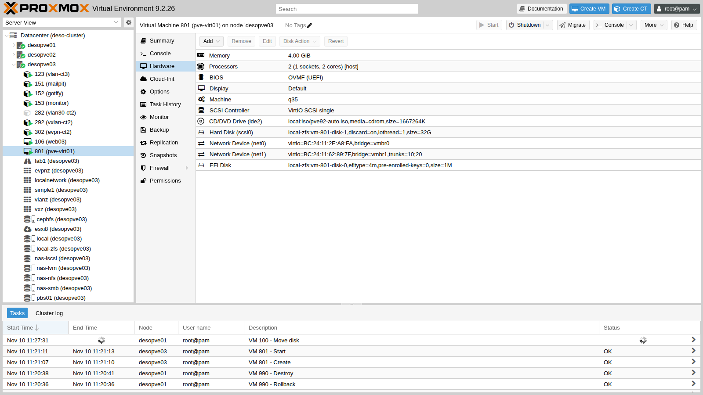
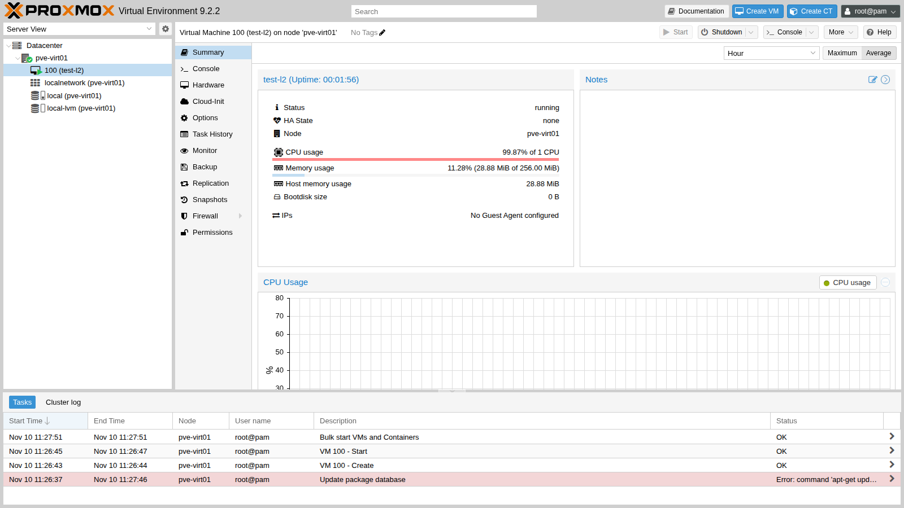

# Appendice D – Ricostruire il laboratorio in virtuale

**Livello:** avanzato · **Durata:** 1 ora per la prova di questa appendice, più il tempo per creare tutte le VM del laboratorio

Il manuale descrive un laboratorio fisico: server, switch, router. Se non hai l'hardware, puoi ricostruire lo stesso laboratorio **dentro un unico server Proxmox VE**, con la *virtualizzazione annidata* (nested): i nodi Proxmox VE del laboratorio diventano VM, e dentro quelle VM girano a loro volta VM e container.

Questa appendice spiega come farlo e cosa cambia rispetto all'hardware fisico. I passi chiave sono stati provati davvero: un nodo Proxmox VE 9.2 in una VM, con una VM annidata che usa KVM e un trunk VLAN che raggiunge il resto del laboratorio.

## Dipendenze

- **Lab precedenti:** [Lab 01](01-lab-architecture.md), per l'inventario dei server, le reti, le VLAN e il piano degli indirizzi.
- **Server ospite:** un server Proxmox VE 9.2 con CPU Intel VT-x o AMD-V, abbastanza RAM e disco per tutte le VM (vedi [Dimensionamento](#dimensionamento)).
- **ISO:** le stesse del [Lab 01](01-lab-architecture.md#immagini-e-software), caricate sullo storage del server ospite.
- **Nella prova di questa appendice:** il server ospite è `desopve03` e la VM di prova è `pve-virt01` (VMID 801, `172.27.199.82`), eliminata alla fine.

## Obiettivi

- Capire come funziona la virtualizzazione annidata e cosa serve al server ospite.
- Dimensionare le VM che sostituiscono i server del laboratorio.
- Usare un bridge VLAN-aware del server ospite come switch del laboratorio, con trunk verso le VM-nodo.
- Sapere quali risultati dei lab cambiano in virtuale.

## Come funziona

Nella virtualizzazione annidata ci sono tre livelli:

1. il **server ospite** (livello 0) esegue Proxmox VE sull'hardware;
2. le **VM-nodo** (livello 1) eseguono Proxmox VE come se fossero server: sono i `desopve01`-`04` del laboratorio;
3. le **VM e i container dei lab** (livello 2) girano dentro le VM-nodo.

Perché il livello 1 possa usare KVM, il processore virtuale della VM-nodo deve esporre le estensioni di virtualizzazione (Intel VT-x o AMD-V). Servono due cose:

- sul server ospite, il modulo KVM con l'annidamento attivo (`nested=Y`), che è il valore predefinito dei kernel recenti;
- sulla VM-nodo, il tipo di CPU **`host`**, che passa alla VM tutte le istruzioni del processore, comprese quelle di virtualizzazione.

La rete del laboratorio diventa un **bridge VLAN-aware** del server ospite: fa da switch. Una scheda di VM collegata a un bridge VLAN-aware **senza tag** è una porta trunk: riceve il traffico non taggato del bridge e tutte le VLAN consentite dal bridge (`bridge-vids`, di solito 2-4094). L'opzione `trunks` della scheda limita le VLAN a quelle elencate.

Le VM annidate escono con i propri indirizzi MAC, diversi da quello della scheda della VM-nodo. Il bridge Linux li impara come farebbe uno switch, ma il **firewall di Proxmox VE** sulla scheda della VM-nodo, se attivo, ha il filtro MAC acceso per impostazione predefinita: lascia passare solo il MAC della scheda e blocca quelli delle VM annidate. Sulle schede delle VM-nodo il firewall va quindi lasciato spento, oppure va disattivato il filtro MAC (*MAC filter* nelle opzioni del firewall della VM).

## Dimensionamento

Le VM ricalcano l'inventario del [Lab 01](01-lab-architecture.md#hardware-del-laboratorio):

| VM | vCPU | RAM | Dischi | Schede di rete | Note |
|---|---|---|---|---|---|
| `desopve01`-`03` | 4, tipo `host` | 32 GB (minimo 16 GB) | 2 × 50 GB + 2 × 60 GB (+ 1 × 60 GB nel lab 18 su `desopve03`) | 3 (+ 2 nel lab 20) | VirtIO SCSI single, VirtIO net |
| `desopve04` | 4, tipo `host` | 16 GB | 1 × 50 GB (+ 4 × 20 GB, 1 × 20 GB e 2 × 40 GB nei lab 09, 10 e 18) | 2 (+ 1 nel lab 18, + 1 nel lab 23) | VirtIO SCSI single, VirtIO net |
| `desopve-dc01` | 4 | 8 GB | 90 GB + 300 GB | 2 | UEFI con Secure Boot e TPM, driver VirtIO o schede emulate |
| `desonas` | 4 | 16 GB | 32 GB + 2 × 100 GB | 1 | |
| `desopbs01`, `desopdm01` | 4 e 2 | 8 GB e 4 GB | 32 GB + 2 × 100 GB, 32 GB | 1 | |
| `netsvc` | 2 | 2 GB | 20 GB | 2 | una scheda sul bridge del laboratorio, una su quello con l'uscita verso Internet |
| `rtr-core` | 1 | 512 MB | 128 MB | 1-2 | MikroTik CHR, importato come nel [Lab 26](26-virtual-router.md) |
| `esxi8` (solo lab 50) | 4, tipo `host` | 16 GB | 200 GB + 150 GB | 1 | |

In totale servono circa **170 GB di RAM** e **2,2 TB di disco**, che con il thin provisioning occupano molto meno. Con 16 GB per nodo si scende a circa 120 GB di RAM: bastano per tutti i lab tranne Ceph e HA, che con meno memoria diventano lenti.

Due accorgimenti sui dischi:

- **Numeri di serie diversi.** ZFS, Ceph e TrueNAS riconoscono i dischi dal numero di serie. I dischi di una VM Proxmox VE ne hanno uno diverso per ogni disco (`drive-scsi0`, `drive-scsi1`…); se vuoi valori più realistici imposta l'opzione `serial=` di ogni disco.
- **Dischi aggiunti nei lab.** Dove il manuale inserisce un disco in un vano hot-swap, in virtuale aggiungi il disco alla VM-nodo con la VM accesa (`qm set <vmid> --scsiN <storage>:<GB>`). Le schede di rete si aggiungono anch'esse a caldo, cosa che su un server fisico non si fa.

## Procedura

### 1. Il server ospite

1. Verifica che l'annidamento sia attivo nel modulo KVM:

   ```bash title="root@desopve03"
   cat /sys/module/kvm_intel/parameters/nested
   ```

   ``` { .text .no-copy title="Output" }
   Y
   ```

   Su processori AMD il file è `/sys/module/kvm_amd/parameters/nested`. Se la risposta è `N`, attivalo e riavvia il server ospite:

   ```bash
   echo "options kvm_intel nested=Y" > /etc/modprobe.d/kvm-intel.conf
   ```

2. Prepara i bridge. Per un laboratorio isolato basta un bridge VLAN-aware **senza porte fisiche**, che fa da switch del laboratorio, più il bridge già esistente con l'uscita verso la tua rete, dove va solo la seconda scheda di `netsvc`. In `/etc/network/interfaces` del server ospite:

   ```text
   auto vmbrlab
   iface vmbrlab inet manual
           bridge-ports none
           bridge-stp off
           bridge-fd 0
           bridge-vlan-aware yes
           bridge-vids 2-4094
   #switch del laboratorio
   ```

   Applica con `ifreload -a`. Nella prova di questa appendice il server ospite è un nodo del laboratorio, e al posto di `vmbrlab` sono serviti i suoi bridge VLAN-aware `vmbr0` (gestione) e `vmbr1` (VLAN delle VM).

### 2. La VM-nodo

La prova usa una VM-nodo piccola (2 vCPU, 4 GB, un disco), installata in automatico come nell'[Appendice A](a-upgrade-8-to-9.md#1-il-nodo-di-prova-installato-in-automatico): file di risposte con `fqdn = "pve-virt01.proxmox.community"`, `cidr = "172.27.199.82/24"`, gateway `172.27.199.1`, DNS `172.27.199.20`, filesystem `ext4` su `sda`, e ISO preparata con `proxmox-auto-install-assistant prepare-iso`. Per i nodi del laboratorio completo usa le risorse della tabella [Dimensionamento](#dimensionamento) e, se preferisci, l'installazione guidata del [Lab 03](03-install-proxmox-ve.md).

1. Crea la VM con il tipo di CPU `host` e avviala:

   ```bash title="root@desopve03"
   qm create 801 --name pve-virt01 --memory 4096 --cores 2 --cpu host --machine q35 \
         --bios ovmf --efidisk0 local-zfs:1,efitype=4m,pre-enrolled-keys=0 --scsihw virtio-scsi-single \
         --scsi0 local-zfs:32,discard=on,iothread=1 --net0 virtio,bridge=vmbr0 \
         --ide2 local:iso/pve92-auto.iso,media=cdrom --boot "order=scsi0;ide2" --ostype l26
   qm start 801
   ```

   Circa cinque minuti dopo l'installazione è finita e il nodo risponde in SSH.

2. Aggiungi la scheda trunk verso le VLAN delle VM. `trunks=10;20` lascia passare solo le VLAN 10 e 20:

   ```bash title="root@desopve03"
   qm set 801 --net1 "virtio,bridge=vmbr1,trunks=10;20"
   ```

   ``` { .text .no-copy title="Output" }
   update VM 801: -net1 virtio,bridge=vmbr1,trunks=10;20
   ```

   La configurazione della VM-nodo:

   ```bash title="root@desopve03"
   qm config 801
   ```

   ``` { .text .no-copy title="Output" }
   bios: ovmf
   boot: order=scsi0;ide2
   cores: 2
   cpu: host
   efidisk0: local-zfs:vm-801-disk-0,efitype=4m,pre-enrolled-keys=0,size=1M
   ide2: local:iso/pve92-auto.iso,media=cdrom,size=1667264K
   machine: q35
   memory: 4096
   name: pve-virt01
   net0: virtio=BC:24:11:2E:A8:FA,bridge=vmbr0
   net1: virtio=BC:24:11:62:89:7F,bridge=vmbr1,trunks=10;20
   ostype: l26
   scsi0: local-zfs:vm-801-disk-1,discard=on,iothread=1,size=32G
   scsihw: virtio-scsi-single
   ```

   

### 3. Verifiche dentro la VM-nodo

1. Il nodo è Proxmox VE 9.2 e vede le estensioni di virtualizzazione:

   ```bash title="root@pve-virt01"
   hostname -f; pveversion
   ```

   ``` { .text .no-copy title="Output" }
   pve-virt01.proxmox.community
   pve-manager/9.2.2/b9984c6d90a4bd80 (running kernel: 7.0.2-6-pve)
   ```

   ```bash title="root@pve-virt01"
   lscpu | grep -E "Virtualization|Hypervisor vendor"
   ```

   ``` { .text .no-copy title="Output" }
   Virtualization:                          VT-x
   Hypervisor vendor:                       KVM
   Virtualization type:                     full
   ```

   ```bash title="root@pve-virt01"
   ls -l /dev/kvm
   ```

   ``` { .text .no-copy title="Output" }
   crw-rw---- 1 root kvm 10, 232 Nov 10 11:26 /dev/kvm
   ```

   `Virtualization: VT-x` e il device `/dev/kvm` dicono che KVM è disponibile anche al livello 1. Il nodo è appena installato, quindi è alla versione della ISO (9.2.2): il [Lab 04](04-first-access-repositories-updates.md) lo porterebbe all'ultima 9.2.x.

2. Una VM annidata parte con l'accelerazione KVM. La VM di prova non ha dischi: basta che si avvii.

   ```bash title="root@pve-virt01"
   qm create 100 --name test-l2 --memory 256 --cores 1 --net0 virtio,bridge=vmbr0
   qm start 100
   qm status 100
   ```

   ``` { .text .no-copy title="Output" }
   status: running
   ```

   ```bash title="root@pve-virt01"
   qm monitor 100
   ```

   ```text title="qm monitor"
   info kvm
   ```

   ``` { .text .no-copy title="Output" }
   kvm support: enabled
   ```

   

   Senza disco, il firmware cerca all'infinito un dispositivo di avvio e la VM usa il 100% della sua CPU: è normale. Nell'elenco dei task compare anche un errore di *Update package database*: il nodo appena installato non ha ancora il proxy per APT, che si configura nel [Lab 04](04-first-access-repositories-updates.md).

3. Il trunk porta le VLAN consentite fino al resto del laboratorio. Dentro la VM-nodo la seconda scheda è `ens19`: un'interfaccia temporanea sulla VLAN 10 raggiunge il gateway della VLAN (`router01`, [Lab 26](26-virtual-router.md)) e un container su un altro nodo:

   ```bash title="root@pve-virt01"
   ip link set ens19 up
   ip link add link ens19 name ens19.10 type vlan id 10
   ip addr add 10.10.10.82/24 dev ens19.10
   ip link set ens19.10 up
   ping -c3 -W1 10.10.10.1
   ```

   ``` { .text .no-copy title="Output" }
   PING 10.10.10.1 (10.10.10.1) 56(84) bytes of data.
   64 bytes from 10.10.10.1: icmp_seq=1 ttl=64 time=3.86 ms
   64 bytes from 10.10.10.1: icmp_seq=2 ttl=64 time=0.930 ms
   64 bytes from 10.10.10.1: icmp_seq=3 ttl=64 time=1.46 ms

   --- 10.10.10.1 ping statistics ---
   3 packets transmitted, 3 received, 0% packet loss, time 2003ms
   rtt min/avg/max/mdev = 0.930/2.083/3.860/1.274 ms
   ```

   ```bash title="root@pve-virt01"
   ping -c3 -W1 10.10.10.122
   ```

   ``` { .text .no-copy title="Output" }
   PING 10.10.10.122 (10.10.10.122) 56(84) bytes of data.
   64 bytes from 10.10.10.122: icmp_seq=1 ttl=64 time=2.66 ms
   64 bytes from 10.10.10.122: icmp_seq=2 ttl=64 time=1.61 ms
   64 bytes from 10.10.10.122: icmp_seq=3 ttl=64 time=0.821 ms

   --- 10.10.10.122 ping statistics ---
   3 packets transmitted, 3 received, 0% packet loss, time 2005ms
   rtt min/avg/max/mdev = 0.821/1.697/2.661/0.753 ms
   ```

4. Una VLAN fuori da `trunks` non passa. La VLAN 100 è la rete di migrazione del [Lab 22](22-dedicated-networks.md):

   ```bash title="root@pve-virt01"
   ip link add link ens19 name ens19.100 type vlan id 100
   ip addr add 10.100.10.82/24 dev ens19.100
   ip link set ens19.100 up
   ping -c3 -W1 10.100.10.21
   ```

   ``` { .text .no-copy title="Output" }
   PING 10.100.10.21 (10.100.10.21) 56(84) bytes of data.

   --- 10.100.10.21 ping statistics ---
   3 packets transmitted, 0 received, 100% packet loss, time 2025ms
   ```

   Per le VM-nodo del laboratorio completo lascia le schede senza `trunks`, così passano tutte le VLAN del bridge, come sulle porte trunk dello switch fisico.

### 4. Pulizia della prova

La VM di prova ha esaurito il suo compito. La ISO preparata contiene la password di `root` in chiaro, quindi va distrutta con `shred`:

```bash title="root@desopve03"
qm stop 801 && qm destroy 801 --purge 1 --destroy-unreferenced-disks 1
```

``` { .text .no-copy title="Output" }
purging VM 801 from related configurations..
```

```bash title="root@desopve03"
shred -u /var/lib/vz/template/iso/pve92-auto.iso /dev/shm/answer.toml
rm -f /var/lib/vz/template/iso/proxmox-ve_9.2-1.iso
apt remove proxmox-auto-install-assistant
```

## Cosa cambia rispetto ai server fisici

Il comportamento di Proxmox VE è lo stesso, ma alcuni risultati dei lab cambiano:

- **Prestazioni.** CPU, dischi e rete passano da due livelli di virtualizzazione: i numeri dei benchmark ([Lab 19](19-fio-benchmark.md), [Lab 34](34-network-performance-troubleshooting.md)) sono più bassi e variano di più tra una prova e l'altra. Il multiqueue delle schede VirtIO, che sull'hardware aiuta, in virtuale può non portare vantaggi.
- **Ceph.** Con dischi lenti Ceph segnala spesso `BLUESTORE_SLOW_OP_ALERT`. L'avviso resta visibile 24 ore: con `ceph config set osd bluestore_slow_ops_warn_lifetime 600` sparisce 10 minuti dopo l'ultimo episodio.
- **Tempi di avvio.** Il primo avvio di una VM con firmware UEFI (OVMF) può richiedere qualche minuto, e il messaggio *Press any key to boot from CD* scade prima che tu lo veda: avvia dalla ISO con il *Boot Manager* del firmware. L'installazione di Windows Server richiede molto più tempo.
- **MTU e VLAN.** Il bridge del server ospite decide quali frame passano: per le prove QinQ del [Lab 28](28-sdn-vlan-qinq.md) e per eventuali jumbo frame alza la MTU del bridge e delle schede delle VM-nodo.
- **Guasti.** Al posto della scheda di gestione dei server fisici, per spegnere di colpo un nodo usa `qm stop <vmid>` sul server ospite, e `qm start` per riaccenderlo. Il fencing dell'HA ([Lab 49](49-high-availability.md)) funziona con il watchdog software come sull'hardware.
- **Hardware nuovo.** Dischi e schede di rete si aggiungono con la VM accesa: sull'hardware, invece, le schede si montano a server spento.

## Verifica e test

- [ ] Sul server ospite `nested` vale `Y`.
- [ ] Dentro la VM-nodo `lscpu` mostra `Virtualization: VT-x` (o `AMD-V`) ed esiste `/dev/kvm`.
- [ ] Una VM annidata parte e `info kvm` risponde `kvm support: enabled`.
- [ ] Dalla VM-nodo le VLAN consentite raggiungono il resto del laboratorio, quelle escluse da `trunks` no.

## Stato finale del lab

- La VM di prova 801 `pve-virt01` è **eliminata**, con i suoi dischi.
- Le ISO e il file di risposte sono distrutti, e su `desopve03` l'assistente dell'installazione automatica è disinstallato.

## Cosa hai imparato

- La virtualizzazione annidata richiede l'annidamento attivo nel modulo KVM del server ospite e il tipo di CPU `host` nelle VM-nodo.
- Un bridge VLAN-aware fa da switch: una scheda senza tag è un trunk, e `trunks` sceglie le VLAN che passano.
- Il filtro MAC del firewall di Proxmox VE va spento sulle schede delle VM-nodo, altrimenti le VM annidate restano isolate.
- In virtuale i lab funzionano allo stesso modo, ma prestazioni, tempi di avvio e simulazione dei guasti cambiano.

## Riferimenti

- [Proxmox VE Wiki – Nested Virtualization](https://pve.proxmox.com/wiki/Nested_Virtualization)
- [Proxmox VE – Qemu/KVM Virtual Machines: Network Device](https://pve.proxmox.com/pve-docs/pve-admin-guide.html#qm_network_device)
- [Proxmox VE – Firewall](https://pve.proxmox.com/pve-docs/pve-admin-guide.html#chapter_pve_firewall)
- [Proxmox VE – Automated Installation](https://pve.proxmox.com/wiki/Automated_Installation)
