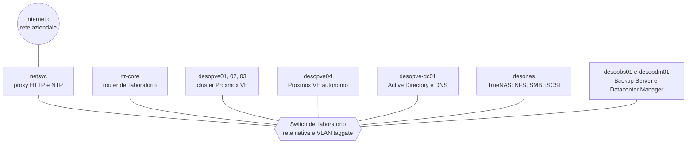

# Proxmox Community

**Proxmox VE 9 da zero a esperto, su un laboratorio vero.**

53 lab pratici e concatenati: si parte da server vuoti e si arriva a un datacenter completo, con cluster, storage condiviso, Ceph, SDN, firewall, backup, alta disponibilità e automazione. Ogni passo è stato eseguito davvero: screenshot e output dei comandi sono quelli reali.

[Inizia dal Lab 01](01-lab-architecture.md){ .md-button .md-button--primary }
[Il percorso completo](the-lab.md){ .md-button }

## Un solo laboratorio, costruito lab dopo lab

Non sono esercizi isolati. Tutti i lab si svolgono sullo **stesso laboratorio**, che cresce man mano: ogni lab parte da quello che i precedenti hanno lasciato configurato e lo descrive nella sezione **Stato finale**. Così, alla fine del percorso, hai costruito e messo alla prova un datacenter Proxmox VE completo.

Il [Lab 01](01-lab-architecture.md) descrive l'hardware, le reti, le VLAN e il piano degli indirizzi, e spiega come preparare tutto prima di cominciare.

## Il percorso

-   :material-hammer-wrench:{ .lg .middle } **Parte 0 – Il laboratorio di base**

    ---

    Domain controller, installazione di Proxmox VE, repository e aggiornamenti, SSH e CLI, cluster a tre nodi, prima VM e primo container.

    Lab 01–07 · [:octicons-arrow-right-24: Lab 01](01-lab-architecture.md)

-   :material-harddisk:{ .lg .middle } **A – Storage**

    ---

    LVM, ZFS e replica, NAS con NFS, SMB e iSCSI multipath, snapshot, Ceph dall'installazione ai guasti, benchmark con fio.

    Lab 08–19 · [:octicons-arrow-right-24: Lab 08](08-storage-model.md)

-   :material-lan:{ .lg .middle } **B – Rete**

    ---

    Bridge e VLAN, bond, reti dedicate, Open vSwitch, routing e NAT, IPv6, router virtuale, SDN fino a EVPN e Fabrics, firewall.

    Lab 20–34 · [:octicons-arrow-right-24: Lab 20](20-bridges-stable-names-vlans.md)

-   :material-memory:{ .lg .middle } **C – Calcolo**

    ---

    KVM e QEMU sotto il cofano, memoria, dischi e controller virtuali, VM Linux e Windows, template e cloud-init, container LXC, hotplug e limiti.

    Lab 35–42 · [:octicons-arrow-right-24: Lab 35](35-kvm-qemu.md)

-   :material-shield-check:{ .lg .middle } **D – Servizi integrati**

    ---

    Active Directory, permessi e token, 2FA, backup con vzdump e Proxmox Backup Server, migrazioni, alta disponibilità, import da ESXi, metriche, API, Datacenter Manager.

    Lab 43–53 · [:octicons-arrow-right-24: Lab 43](43-active-directory-realm-ldaps.md)

-   :material-book-open-variant:{ .lg .middle } **Appendici**

    ---

    Aggiornamento da Proxmox VE 8 a 9, credenziali e indirizzi, risoluzione dei problemi, come ricostruire il laboratorio in virtuale.

    [:octicons-arrow-right-24: Appendice A](a-upgrade-8-to-9.md)

I quattro percorsi si seguono nell'ordine **A → B → C → D**. Prima di ogni lab controlla le sue **Dipendenze**: il [grafo delle dipendenze](the-lab.md#dipendenze-tra-i-lab) le riassume tutte.

## Come è fatto ogni lab

Ogni lab ha la stessa struttura, così sai sempre dove trovare le cose:

- **Dipendenze**: i lab da completare prima, le macchine e i servizi necessari;
- **Obiettivi** e **Come funziona**: la teoria essenziale per capire cosa succede;
- **Procedura**: passi numerati, ogni azione nell'interfaccia web con il suo screenshot e ogni comando con l'output reale;
- **Verifica e test**, spesso con guasti simulati e misurati;
- **Stato finale**: cosa resta configurato per i lab successivi;
- **Cosa hai imparato** e **Riferimenti** alla documentazione ufficiale.

## Come iniziare

1. Leggi il [Lab 01](01-lab-architecture.md): l'hardware, le reti e la preparazione dello switch, del router e del server di servizi.
2. Scegli la **password del laboratorio**: nel manuale compare come `<password-lab>` ([Appendice B](b-credentials-and-addresses.md)).
3. Prosegui in ordine con i lab della Parte 0, poi con i percorsi A, B, C e D.

Non hai i server? L'[Appendice D](d-rebuild-as-virtual.md) spiega come ricostruire lo stesso laboratorio in virtuale su un unico server Proxmox VE.

!!! note "Dati hardware oscurati"
    Negli screenshot sono oscurati i dati che identificano l'hardware del laboratorio: numeri di serie dei dischi, indirizzi MAC delle schede di rete dei server, modelli di CPU e di dischi. Negli output testuali gli stessi dati sono sostituiti da segnaposto come `<seriale-disco-1>`. Sul tuo hardware vedrai valori diversi.

## Una community aperta

Proxmox Community nasce per crescere con chi usa Proxmox ogni giorno. Hai una guida, un'esperienza di produzione, una correzione o una traduzione? [Contribuisci](contributing.md): ogni proposta arriva come pull request su GitHub e viene rivista prima della pubblicazione.
