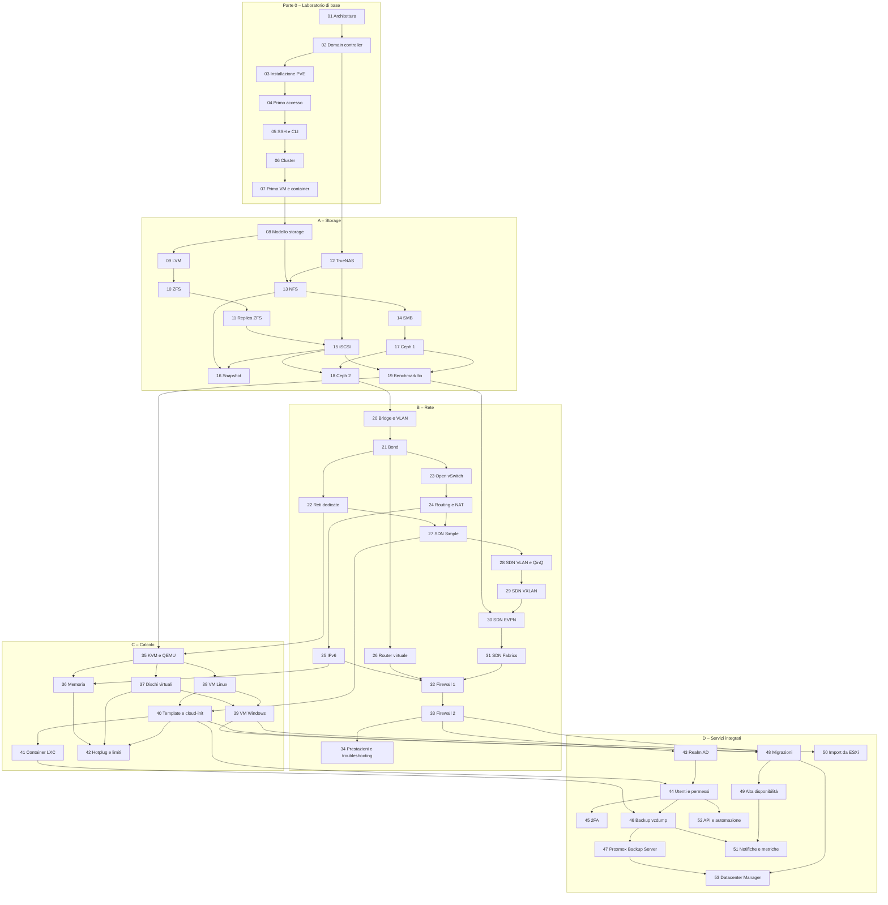

# Il laboratorio e il percorso

Un percorso pratico su **Proxmox VE 9.2**: si parte da un laboratorio vuoto e si arriva a un datacenter completo con cluster, storage condiviso, Ceph, SDN, backup e alta disponibilità.

Ogni lab segue la stessa struttura:

- **Dipendenze**: lab da completare prima, macchine e servizi necessari;
- **Obiettivi** e **Come funziona**: la teoria essenziale per capire cosa succede;
- **Procedura**: passi numerati, ogni azione nell'interfaccia web con il suo screenshot e ogni comando con l'output reale;
- **Verifica e test**, anche con guasti simulati;
- **Stato finale del lab**: cosa resta configurato per i lab successivi.

Le credenziali e gli indirizzi usati in tutto il manuale sono nell'[Appendice B](b-credentials-and-addresses.md).

## Convenzioni

- **Laboratorio.** Tutti i lab si svolgono sullo stesso laboratorio, descritto e preparato nel [Lab 01](01-lab-architecture.md): server fisici, uno switch con VLAN, un router e un server di servizi di rete. Per ricostruirlo in virtuale su un unico server Proxmox VE c'è l'[Appendice D](d-rebuild-as-virtual.md).
- **Password.** `<password-lab>` indica l'unica password del laboratorio, scelta da te: vedi l'[Appendice B](b-credentials-and-addresses.md#la-password-del-laboratorio).
- **Dati hardware oscurati.** Negli screenshot sono oscurati i dati che identificano l'hardware del laboratorio: numeri di serie dei dischi, indirizzi MAC delle schede di rete dei server, modelli di CPU e di dischi. Negli output testuali gli stessi dati sono sostituiti da segnaposto come `<seriale-disco-1>`. Sul tuo hardware vedrai valori diversi.
- **Output.** I blocchi di codice riportano comandi e output reali del laboratorio; i prompt (`root@desopve01:~#`, `PS C:\>`) indicano dove eseguire il comando.

## Come è organizzato

Si parte dalla **Parte 0**, che costruisce il laboratorio di base. Poi i quattro percorsi si svolgono **nell'ordine A → B → C → D**: molti lab riusano quello che i precedenti hanno lasciato configurato, per esempio Ceph (lab 17) e le reti del percorso B. Prima di ogni lab controlla le sue **Dipendenze**; il grafo in fondo a questa pagina le riassume.

### Parte 0 – Il laboratorio di base

| Lab | Titolo |
|---|---|
| 01 | [Architettura e preparazione del laboratorio](01-lab-architecture.md) |
| 02 | [Domain controller Windows Server 2025: AD, DNS e NTP](02-domain-controller.md) |
| 03 | [Installazione di Proxmox VE 9.2 (ZFS RAID1 ed ext4)](03-install-proxmox-ve.md) |
| 04 | [Primo accesso, repository e aggiornamenti](04-first-access-repositories-updates.md) |
| 05 | [SSH, shell e strumenti da riga di comando (`pvesh`, `qm`, `pct`)](05-ssh-shell-cli.md) |
| 06 | [Cluster a tre nodi e Corosync](06-cluster-corosync.md) |
| 07 | [Prima VM e primo container](07-first-vm-and-container.md) |

### Percorso A – Storage

| Lab | Titolo |
|---|---|
| 08 | [Il modello di storage di Proxmox VE: tipi di contenuto, formati, thin provisioning](08-storage-model.md) |
| 09 | [LVM e LVM-thin: creazione, estensione, overprovisioning, pool pieno](09-lvm-and-lvm-thin.md) |
| 10 | [ZFS: pool, mirror e RAIDZ, ARC, compressione, snapshot, send/receive, guasto e resilver](10-zfs.md) |
| 11 | [Replica ZFS tra nodi e failover manuale](11-zfs-replication.md) |
| 12 | [NAS TrueNAS: installazione e preparazione](12-truenas-nas.md) |
| 13 | [NFS: export, opzioni di mount, prestazioni, caduta del NAS](13-nfs.md) |
| 14 | [SMB/CIFS: condivisione autenticata, permessi e confronto con NFS](14-smb-cifs.md) |
| 15 | [iSCSI con LVM condiviso e multipath, caduta di un percorso](15-iscsi-lvm-multipath.md) |
| 16 | [Snapshot: con e senza RAM, rollback, alberi e volume chain](16-snapshots.md) |
| 17 | [Ceph 1: architettura, installazione, pool RBD e CephFS](17-ceph-installation.md) |
| 18 | [Ceph 2: crescita, manutenzione, configurazione dei pool e guasti](18-ceph-growth-maintenance-failures.md) |
| 19 | [Benchmark comparativo dello storage con fio](19-fio-benchmark.md) |

### Percorso B – Rete

| Lab | Titolo |
|---|---|
| 20 | [Linux bridge, nomi stabili delle schede di rete, bridge VLAN-aware](20-bridges-stable-names-vlans.md) |
| 21 | [Bond: active-backup, balance-alb e LACP, caduta di un link](21-bonding.md) |
| 22 | [Reti dedicate: Corosync, migrazione e storage](22-dedicated-networks.md) |
| 23 | [Open vSwitch: bridge, bond e VLAN con OVS](23-open-vswitch.md) |
| 24 | [Routing e NAT sull'host: masquerading, configurazione routed, port forwarding](24-routing-nat.md) |
| 25 | [IPv6: dual stack, RA e SLAAC](25-ipv6.md) |
| 26 | [Router e firewall virtuale tra VLAN: MikroTik CHR (OPNsense come alternativa)](26-virtual-router.md) |
| 27 | [SDN 1: zona Simple, SNAT, DHCP e IPAM](27-sdn-simple.md) |
| 28 | [SDN 2: zone VLAN e QinQ](28-sdn-vlan-qinq.md) |
| 29 | [SDN 3: zona VXLAN](29-sdn-vxlan.md) |
| 30 | [SDN 4: EVPN con BGP, exit node e anycast gateway](30-sdn-evpn.md) |
| 31 | [SDN 5: Fabrics (OpenFabric) e full mesh instradato](31-sdn-fabrics.md) |
| 32 | [Firewall 1: datacenter, nodo e VM, security group, IPSet, alias, macro, log](32-firewall-1.md) |
| 33 | [Firewall 2: nftables, firewall degli host, anti-spoofing, VNet SDN, conntrack](33-firewall-2.md) |
| 34 | [Prestazioni e risoluzione dei problemi di rete](34-network-performance-troubleshooting.md) |

### Percorso C – Calcolo

| Lab | Titolo |
|---|---|
| 35 | [KVM e QEMU sotto il cofano: processo QEMU, tipi di CPU, compatibilità per la migrazione](35-kvm-qemu.md) |
| 36 | [Memoria: ballooning, KSM, hugepages, NUMA, overcommit](36-memory.md) |
| 37 | [Dischi e controller virtuali: VirtIO SCSI e Block, iothread, cache, discard](37-virtual-disks-controllers.md) |
| 38 | [VM Linux e QEMU Guest Agent: console seriale, opzioni, spegnimento, fsfreeze e rimozione con purge](38-linux-vm-guest-agent.md) |
| 39 | [VM Windows e driver VirtIO: Windows Server 2025 con UEFI, TPM, VirtIO SCSI e guest agent](39-windows-vm-virtio.md) |
| 40 | [Template, cloud-init e cloni: linked e full, snippets e deploy da CLI](40-templates-cloud-init-clones.md) |
| 41 | [Container LXC: privilegiati e non privilegiati, mount point, funzionalità, limiti e confronto con le VM](41-lxc-containers.md) |
| 42 | [Hotplug, resize a caldo, peso e tetto di CPU, pressione (PSI)](42-hotplug-resize-limits.md) |

### Percorso D – Servizi integrati

| Lab | Titolo |
|---|---|
| 43 | [Identità: realm Active Directory con LDAPS e sincronizzazione](43-active-directory-realm-ldaps.md) |
| 44 | [Utenti, gruppi, ruoli, pool e API token](44-users-groups-roles-pools-tokens.md) |
| 45 | [Autenticazione a due fattori: TOTP, WebAuthn, codici di recupero](45-two-factor-authentication.md) |
| 46 | [Backup con vzdump: modalità, compressione, fleecing](46-vzdump-backup.md) |
| 47 | [Proxmox Backup Server 4: datastore, deduplica, cifratura, verify, prune, file restore, sync](47-proxmox-backup-server.md) |
| 48 | [Migrazioni live, offline, con dischi locali, bulk e tra cluster](48-migrations.md) |
| 49 | [Alta disponibilità: HA rules, fencing, arm/disarm, bilanciamento dinamico](49-high-availability.md) |
| 50 | [Importare VM da VMware ESXi](50-import-from-esxi.md) |
| 51 | [Notifiche, metriche e log: SMTP, Gotify, matcher, InfluxDB e Grafana, rsyslog](51-notifications-metrics-logs.md) |
| 52 | [API e automazione: `pvesh`, ticket e CSRF, API token, Ansible e OpenTofu](52-api-automation.md) |
| 53 | [Proxmox Datacenter Manager: remote PVE e PBS, dashboard, aggiornamenti, migrazione tra remote](53-datacenter-manager.md) |

### Appendici

| | Titolo |
|---|---|
| A | [Aggiornamento da Proxmox VE 8 a 9: `pve8to9`, repository deb822, cluster e Ceph](a-upgrade-8-to-9.md) |
| B | [Credenziali e indirizzi del laboratorio](b-credentials-and-addresses.md) |
| C | [Risoluzione dei problemi: i problemi reali del laboratorio e dove guardare](c-troubleshooting.md) |
| D | [Ricostruire il laboratorio in virtuale su un server Proxmox VE](d-rebuild-as-virtual.md) |

## Dipendenze tra i lab

