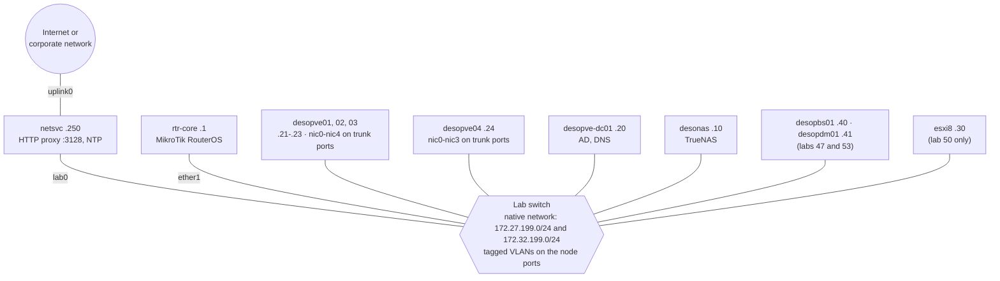

## Dependencies

- **Previous labs:** none. This is the starting point of the manual.
- **Hardware:** the servers, the switch and the router listed in [Lab hardware](#lab-hardware).
- **Software:** the images listed in [Images and software](#images-and-software).
- **Credentials:** a single lab password, chosen by you and shown in the manual as `<lab-password>` → [Appendix B](/b-credentials-and-addresses/).

## Objectives

- Understand how the lab on which all the labs in the manual take place is put together.
- Learn the role of each server, the networks, the VLANs and the addressing plan.
- Prepare the hardware, the switch, the `rtr-core` router and the `netsvc` network services server, before installing Windows Server, Proxmox VE and TrueNAS in the following labs.

## How it works

The lab is a small corporate datacenter:

- **four Proxmox VE (PVE) servers**: three form a cluster (`desopve01`, `desopve02`, `desopve03`); the fourth (`desopve04`) stays standalone and serves as a test bench for storage and as the target for migrations between clusters;
- **a Windows Server 2025 domain controller** (`desopve-dc01`): Active Directory, DNS and, from lab 43, certificate authority; it also serves as the administration workstation;
- **a TrueNAS Community Edition NAS** (`desonas`): NFS, SMB and iSCSI shared storage for the Storage track;
- **a network services server** (`netsvc`): HTTP proxy to the Internet and NTP server;
- **a MikroTik router** (`rtr-core`): the gateway of the lab networks;
- **Proxmox Backup Server** (`desopbs01`, lab 47) and **Proxmox Datacenter Manager** (`desopdm01`, lab 53);
- **a VMware ESXi server** (`esxi8`), with two test VMs: it is needed only in [Lab 50](/50-import-from-esxi/), to import VMs into Proxmox VE;
- **a managed switch** with 802.1Q trunk ports, which connects everything.

### Isolated network and Internet access

The lab is an **isolated network**: `rtr-core` routes traffic between the lab networks, but has no link to the Internet. This is a deliberate choice, common in corporate networks:

- the servers reach the Internet **only through the HTTP proxy** on `netsvc` (`proxy.proxmox.community:3128`), which lets through only the sites that are needed: Debian and Proxmox repositories, Ceph, Windows updates, operating system images;
- the time comes from the **internal NTP server** (`ntp.proxmox.community`), again `netsvc`, which in turn synchronizes with public NTP servers;
- `netsvc` is the only server with two network cards: `lab0` on the lab network and `uplink0` toward the corporate network or the Internet.

Throughout the manual you will therefore see how to configure Proxmox VE behind a proxy: APT repositories, ISO and template downloads, updates. If your lab has direct Internet access, you can skip those steps, but some behaviors change: for example, a download without the proxy succeeds instead of failing.

### Lab networks and VLANs

Two IP networks travel **untagged** over the same physical network: the native network of the switch ports.

| Network | Subnet | Use |
|---|---|---|
| Management | `172.27.199.0/24` | web GUI, SSH, DNS, NTP, proxy, first Corosync link |
| Cluster and storage | `172.32.199.0/24` | second Corosync link (lab 06) and second iSCSI path (lab 15) |

The gateway of both is `rtr-core` (`172.27.199.1` and `172.32.199.1`, on the same router port).

:::caution[Watch the addresses]
`172.32.199.0/24` is **not** a private address: the RFC 1918 private space in the 172 range goes from `172.16.0.0` to `172.31.255.255`, and `172.32.x.x` belongs to public networks on the Internet. It is fine in the lab because the network is isolated and not routed to the outside; in production always use RFC 1918 networks (`10.0.0.0/8`, `172.16.0.0/12`, `192.168.0.0/16`), like the dedicated `10.x` VLANs of the later labs.
:::

Having two subnets on the same physical network is convenient, but it has a side effect that you will meet in [Lab 15](/15-iscsi-lvm-multipath/) (*ARP flux*): this is why, from labs 17 and 22 onward, the dedicated networks run on **tagged VLANs**. The switch must therefore let these VLANs through on the node ports:

| VLAN | Use | Introduced in lab |
|---|---|---|
| 10, 20 | traffic of the test VMs and containers | 20, 21, 23, 26 |
| 30 | SDN VLAN zone | 28 |
| 40 | second Corosync link | 22 |
| 50, 51 | Ceph: public network and cluster network | 17 |
| 61 | VXLAN and EVPN underlay | 29 |
| 81, 82, 83 | point-to-point links of the OpenFabric fabric | 31 |
| 100 | VM migration | 22 |
| 300 (and 301 in 802.1ad) | service VLAN for the QinQ tests | 28 |

### Diagram



### Addressing plan

Lab DNS domain: **`proxmox.community`**. The DNS server is the domain controller (`172.27.199.20`), which takes on that role in [Lab 02](/02-domain-controller/): until then, you reach the servers by IP address.

| Host name (FQDN) | Role | Management | Cluster/storage | Lab |
|---|---|---|---|---|
| `rtr-core.proxmox.community` | Lab router (gateway) | 172.27.199.1 | 172.32.199.1 | 01 |
| `netsvc.proxmox.community` (aliases `proxy`, `ntp`) | HTTP proxy and NTP | 172.27.199.250 | 172.32.199.250 | 01 |
| `desopve-dc01.proxmox.community` | Domain controller, DNS | 172.27.199.20 | 172.32.199.20 | 02 |
| `desopve01.proxmox.community` | PVE cluster node | 172.27.199.21 | 172.32.199.21 | 03 |
| `desopve02.proxmox.community` | PVE cluster node | 172.27.199.22 | 172.32.199.22 | 03 |
| `desopve03.proxmox.community` | PVE cluster node | 172.27.199.23 | 172.32.199.23 | 03 |
| `desopve04.proxmox.community` | Standalone PVE node | 172.27.199.24 | 172.32.199.24 | 03 |
| `desonas.proxmox.community` | TrueNAS Community Edition 25.10 NAS | 172.27.199.10 | 172.32.199.10 (from lab 15) | 12 |
| `desopbs01.proxmox.community` | Proxmox Backup Server 4.2 | 172.27.199.40 | – | 47 |
| `desopdm01.proxmox.community` | Proxmox Datacenter Manager 1.1 | 172.27.199.41 | – | 53 |
| `esxi8.proxmox.community` | Source VMware ESXi server | 172.27.199.30 | – | 50 |
| `linux-src01.proxmox.community` | Linux VM on the ESXi server | 172.27.199.31 | – | 50 |
| `win-src01.proxmox.community` | Windows VM on the ESXi server | 172.27.199.32 | – | 50 |

The addresses from `172.27.199.33` to `172.27.199.39` are reserved for other VMs on the ESXi server, those from `172.27.199.100` to `172.27.199.199` for the VMs and containers created during the labs. [Appendix B](/b-credentials-and-addresses/) collects all the addresses, including the dedicated VLANs and the SDN networks.

:::note[Redacted hardware data]
In the screenshots, the data that identify the lab hardware are redacted: disk serial numbers, MAC addresses of the servers' network cards, CPU and disk models. In the text output, the same data are replaced by placeholders such as `<seriale-disco-1>`. On your hardware you will see different values: you do not need them to follow the labs.
:::

<a id="requisiti-dellhost"></a>

## Lab hardware

| Server | CPU | RAM | Disks | Network ports | Notes |
|---|---|---|---|---|---|
| `desopve01`, `desopve02`, `desopve03` | 4 cores | 32 GB (minimum 16 GB) | 2 × 50 GB (system, ZFS RAID1) + 2 × 60 GB (Ceph, lab 17); on `desopve03`, a free bay for a third 60 GB disk (lab 18) | 3 onboard (`nic0`-`nic2`) + 2-port expansion card (`nic3`, `nic4`), installed in lab 20 | 10 GbE ports |
| `desopve04` | 4 cores | 16 GB | 1 × 50 GB (system, ext4/LVM); hot-swap bays for 4 × 20 GB (lab 09), a 20 GB spare disk (lab 10) and 2 × 40 GB (lab 18) | 2 onboard (`nic0`, `nic1`) + 2 single-port cards (`nic2` in lab 18, `nic3` in lab 23) | 10 GbE ports |
| `desopve-dc01` | 4 cores | 8 GB | 90 GB + 300 GB | 2 (`MGMT`, `CLUSTER`) | UEFI with Secure Boot |
| `desonas` | 4 cores | 16 GB | 32 GB (system) + 2 × 100 GB (mirrored pool) | 1 | |
| `desopbs01` (lab 47) | 4 cores | 8 GB | 32 GB (system) + 2 × 100 GB (ZFS mirror datastore) | 1 | |
| `desopdm01` (lab 53) | 2 cores | 4 GB | 32 GB | 1 | |
| `netsvc` | 2 cores | 2 GB | 20 GB | 2 (`lab0`, `uplink0`) | Ubuntu Server 24.04 LTS |
| `rtr-core` | – | – | – | `ether1` (lab), `ether2` (free) | MikroTik with RouterOS 7 |
| `esxi8` (lab 50 only) | 4 cores | 16 GB | 200 GB (system) + 150 GB NVMe (datastore) | 1 | VMware ESXi 8.0 U3 |

In total you need about **170 GB of RAM** and **2.2 TB of disk**. With 16 GB per node the lab drops to about 120 GB of RAM: enough for all the labs except Ceph and HA, which become slow with less memory.

The disks and cards marked with a lab number are **not needed at the start**: set them aside and install them when the lab asks for them. The disks are hot-plugged into the hot-swap bays; the network cards are installed with the server powered off. This way you will see in each lab how Proxmox VE detects new hardware.

Before installing, check four points:

1. **Firmware.** UEFI boot; processor virtualization extensions (Intel VT-x or AMD-V) and IOMMU (Intel VT-d or AMD-Vi) enabled. Proxmox VE 9 can also be installed in BIOS mode, but UEFI is the recommended configuration.
2. **Disks without hardware RAID.** ZFS, Ceph and TrueNAS need to see the individual disks: use an HBA controller in IT mode, or the motherboard SATA ports, with no RAID volumes. Each disk has a different serial number, and that is how ZFS, Ceph and TrueNAS identify it.
3. **Management controller.** A remote management controller (IPMI, iDRAC, iLO or similar) for the console and for powering the servers on and off: in the failure labs (11, 18, 49) the nodes are powered off abruptly and powered back on from there. Its network is separate from the lab network.
4. **Switch.** Configured as described in [The switch](#the-switch), before powering on the servers.

### The switch

A managed switch with at least 28 ports (or two stacked switches). The rules:

- **native (untagged) network** on all ports: the lab network, which carries both `172.27.199.0/24` and `172.32.199.0/24`;
- **Proxmox VE node ports as 802.1Q trunks**, with the VLANs from the [Networks and VLANs](#lab-networks-and-vlans) table: when in doubt, allow all VLANs;
- **ports of the other servers in access mode**, on the native network;
- **maximum frame size of at least 1526 bytes**, for the double tag of the QinQ tests in [Lab 28](/28-sdn-vlan-qinq/). Jumbo frames are not needed: they are not enabled in the manual's lab, and [Lab 21](/21-bonding/) shows what happens when the network does not support them;
- **no LACP and no port-channel** toward the nodes: the bonds in labs 21 and 23 work without an LACP partner, and the labs show exactly this case;
- **no filtering of the lab network traffic**: no RA Guard (the router advertises the IPv6 prefix in [Lab 25](/25-ipv6/)), no DHCP snooping (the DHCP servers of labs 26 and 27), no MAC limit per port (behind each node port there are dozens of VMs);
- server ports in *edge* mode (portfast) for spanning tree.

Cabling:

| Server | Ports | Switch port |
|---|---|---|
| `desopve01`-`03` | `nic0`-`nic4` | trunk |
| `desopve04` | `nic0`-`nic3` | trunk |
| `desopve-dc01` | `MGMT`, `CLUSTER` | access |
| `desonas`, `desopbs01`, `desopdm01`, `esxi8` | single port | access |
| `netsvc` | `lab0` | access (`uplink0` goes to the corporate network) |
| `rtr-core` | `ether1` | access |
| Administration PC (optional) | – | access |

### Administration workstation

From [Lab 02](/02-domain-controller/) onward, the workstation is the domain controller: from there you open the servers' web GUI and, from [Lab 05](/05-ssh-shell-cli/), SSH sessions to the nodes. To reach the DC over Remote Desktop, connect a PC to an access port of the switch, with a free address on the management network (for example `172.27.199.9/24`, gateway `172.27.199.1`, DNS `172.27.199.20`).

## Images and software

| Image | Use | Lab |
|---|---|---|
| Windows Server 2025 Evaluation (`26100.1742…SERVER_EVAL_x64FRE_en-us.iso`) | domain controller, Windows VM, source VM | 02, 39, 50 |
| `proxmox-ve_9.2-1.iso` | Proxmox VE nodes | 03 |
| `TrueNAS-SCALE-25.10.8.iso` (TrueNAS Community Edition 25.10) | NAS | 12 |
| `proxmox-backup-server_4.2-1.iso` | Proxmox Backup Server | 47 |
| `proxmox-datacenter-manager_1.1-1.iso` | Proxmox Datacenter Manager | 53 |
| VMware ESXi 8.0 U3 | source server | 50 |
| Ubuntu Server 24.04 LTS | `netsvc`; cloud image for the `linux-src01` source VM | 01, 50 |
| RouterOS 7 | `rtr-core` (router firmware) | 01 |
| `proxmox-ve_8.4-1.iso` | upgrade test node | [Appendix A](/a-upgrade-8-to-9/) |

Other images are downloaded within the labs through the proxy: Debian 13 netinst (lab 07), MikroTik CHR (lab 26), `virtio-win` (lab 39), the Debian 13 cloud image (lab 40) and the container templates (labs 07 and 41).

Always download the images from the official sites and verify their SHA-256 checksum against the file published alongside them (`SHA256SUMS` or similar). For Proxmox VE, for example:

```bash
sha256sum proxmox-ve_9.2-1.iso
grep proxmox-ve_9.2-1.iso SHA256SUMS
```

The two checksums must match. For the installation, use a USB stick or the *virtual media* of the management controller.

## Procedure

### 1. Racking and cabling

1. Rack the servers and insert only the disks needed at the start: system and Ceph on nodes 01-03, system on `desopve04`, and the disks of the DC, NAS, PBS, PDM and `esxi8`.
2. Connect the ports as shown in the [Cabling](#the-switch) table. On `desopve01`-`03`, connect only `nic0`, `nic1` and `nic2` for now; on `desopve04`, `nic0` and `nic1`.
3. In the firmware of each server, enable UEFI, VT-x/AMD-V and VT-d/AMD-Vi, and check that the disks are seen individually.

### 2. The switch

Configure the switch as described in [The switch](#the-switch). The instructions vary from vendor to vendor: what matters is the result, that is, native network everywhere, tagged VLANs on the node ports and no filtering of RA, DHCP and MAC addresses.

### 3. The `rtr-core` router

1. Connect to the router through the `ether1` port (with WinBox or over SSH, at the factory address) and reset it **without** the default configuration, which on many models enables NAT, a firewall and a DHCP server:

   ```text title="RouterOS — MikroTik" frame="terminal"
   /system reset-configuration no-defaults=yes skip-backup=yes
   ```

2. After the reboot, upload the [`rtr-core-base.rsc`](/files/01/rtr-core-base.rsc) file from the *Files* section and import it, then set the password:

   ```text title="RouterOS — MikroTik" frame="terminal"
   /import file-name=rtr-core-base.rsc
   ```

   ```text title="RouterOS — rtr-core" frame="terminal"
   /user set admin password=<lab-password>
   ```

   The file sets the name `rtr-core` and the two gateway addresses, both on `ether1`: the two lab networks travel over the same port.

3. Check the addresses and the routes:

   ```text title="RouterOS — rtr-core" frame="terminal"
   /ip address print
   ```

   ```text output
   Columns: ADDRESS, NETWORK, INTERFACE, VRF
   # ADDRESS          NETWORK       INTERFACE  VRF 
   ;;; rete di gestione
   0 172.27.199.1/24  172.27.199.0  ether1     main
   ;;; rete cluster/storage, sulla stessa porta della gestione
   1 172.32.199.1/24  172.32.199.0  ether1     main
   ```

   The router has no default route: the lab does not reach the Internet from here. In labs 24 and 25 you will add a static route and IPv6; the complete configuration at the end of the manual is in [`rtr-core-finale.rsc`](/files/01/rtr-core-finale.rsc).

:::note[Direct Internet access (optional)]
If you want the lab to reach the Internet even without the proxy, [`rtr-core-uplink-esempio.rsc`](/files/01/rtr-core-uplink-esempio.rsc) shows an example on `ether2`, with NAT and a minimal filter. It is not active in the manual's lab: if you use it, some lab results change.
:::

### 4. The `netsvc` network services server

`netsvc` is a small Ubuntu Server 24.04 LTS server with two network cards: `lab0` on the lab network and `uplink0` toward the corporate network or the Internet.

1. Install Ubuntu Server 24.04 LTS and configure the network with netplan, adapting the `uplink0` part to your network: [`netplan-netsvc.yaml`](/files/01/netplan-netsvc.yaml) in `/etc/netplan/60-lab.yaml`, then `sudo netplan apply`. Both lab addresses go on `lab0`, `172.27.199.250/24` and `172.32.199.250/24`, without a gateway: the default gateway is the one of the corporate network.

2. Install the proxy and the NTP server:

   ```bash
   sudo apt install tinyproxy chrony
   ```

3. **Proxy.** Copy [`tinyproxy.conf`](/files/01/tinyproxy.conf) to `/etc/tinyproxy/tinyproxy.conf` and [`tinyproxy-filter`](/files/01/tinyproxy-filter) to `/etc/tinyproxy/filter`. The lines that matter:

   | Line | Meaning |
   |---|---|
   | `Port 3128`, `Listen 172.27.199.250` | the proxy listens only on the lab management network |
   | `Allow 172.27.199.0/24` | accepts requests only from the lab servers |
   | `Filter "/etc/tinyproxy/filter"`, `FilterExtended On`, `FilterDefaultDeny Yes` | allowlist: only the names that match one of the filter lines, written as regular expressions, get through |
   | `ConnectPort 443`, `ConnectPort 80` | for HTTPS the client opens a `CONNECT` tunnel, allowed only to these ports |

   The filter contains the sites used in the labs: Debian, Ubuntu and Proxmox repositories (`proxmox.com`, `deb.debian.org`, `security.debian.org`, `download.ceph.com`), the images (`cdimage.debian.org`, `cloud.debian.org`, `download.mikrotik.com`, `fedorapeople.org`, the Microsoft domains of the Windows Server ISO), Windows and TrueNAS updates, the container registries (`docker.io`), the InfluxDB, Grafana, OpenTofu, Ansible and Python repositories (labs 51 and 52), and `grafana.com` for the dashboard imported in [Lab 51](/51-notifications-metrics-logs/). Two lines allow the internal destinations (`172.27.199.x` and `*.proxmox.community`), which the Lab 51 notifications need when they go through the proxy.

   The published file is the **final** filter, with all the sites needed from Lab 01 to Lab 53. You can install it right away as it is, or start from a shorter list and grow it lab by lab. In that case, when a lab needs a new site, add a line to the filter and restart the service (`sudo systemctl restart tinyproxy`): a download blocked by the proxy gets the response `403 Filtered`.

4. **NTP.** Copy [`chrony-lab.conf`](/files/01/chrony-lab.conf) to `/etc/chrony/conf.d/lab.conf`: the `allow` lines let the servers on the two lab networks synchronize with `netsvc`, which in turn uses the public servers of the Ubuntu default configuration.

5. Restart the two services:

   ```bash
   sudo systemctl restart tinyproxy chrony
   ```

You will create the names `proxy.proxmox.community` and `ntp.proxmox.community` in [Lab 02](/02-domain-controller/), as aliases of `netsvc` in the domain controller's DNS.

### 5. The lab password

Write down the password you will use for the whole lab: in the manual it appears as `<lab-password>`. The rules are in [Appendix B](/b-credentials-and-addresses/#the-lab-password).

## Verification and tests

- [ ] The router responds on both networks. From `netsvc`:

  ```bash title="netsvc"
  ping -c3 172.27.199.1
  ```

  ```text output
  PING 172.27.199.1 (172.27.199.1) 56(84) bytes of data.
  64 bytes from 172.27.199.1: icmp_seq=1 ttl=64 time=0.562 ms
  64 bytes from 172.27.199.1: icmp_seq=2 ttl=64 time=0.694 ms
  64 bytes from 172.27.199.1: icmp_seq=3 ttl=64 time=1.01 ms

  --- 172.27.199.1 ping statistics ---
  3 packets transmitted, 3 received, 0% packet loss, time 2032ms
  rtt min/avg/max/mdev = 0.562/0.754/1.008/0.187 ms
  ```

  ```bash title="netsvc"
  ping -c3 172.32.199.1
  ```

  ```text output
  PING 172.32.199.1 (172.32.199.1) 56(84) bytes of data.
  64 bytes from 172.32.199.1: icmp_seq=1 ttl=64 time=0.569 ms
  64 bytes from 172.32.199.1: icmp_seq=2 ttl=64 time=0.684 ms
  64 bytes from 172.32.199.1: icmp_seq=3 ttl=64 time=0.741 ms

  --- 172.32.199.1 ping statistics ---
  3 packets transmitted, 3 received, 0% packet loss, time 2042ms
  rtt min/avg/max/mdev = 0.569/0.664/0.741/0.071 ms
  ```

- [ ] The proxy lets the allowed sites through, over HTTPS too, and blocks the others:

  ```bash title="netsvc"
  curl -s -x http://172.27.199.250:3128 -I http://deb.debian.org/debian/ | head -1
  ```

  ```text output
  HTTP/1.1 200 OK
  ```

  ```bash title="netsvc"
  curl -s -x http://172.27.199.250:3128 -I https://download.proxmox.com/ | head -1
  ```

  ```text output
  HTTP/1.0 200 Connection established
  ```

  ```bash title="netsvc"
  curl -s -x http://172.27.199.250:3128 -I http://www.example.com/ | head -1
  ```

  ```text output
  HTTP/1.1 403 Filtered
  ```

  The second output is the proxy's response to `CONNECT`: the HTTPS tunnel to `download.proxmox.com` is open.

- [ ] `netsvc` is synchronized with a public NTP server:

  ```bash title="netsvc"
  chronyc tracking | head -3
  ```

  ```text output
  Reference ID    : B913B823 (radha.parvati.it)
  Stratum         : 3
  Ref time (UTC)  : Tue Nov 10 10:11:31 2026
  ```

  After [Lab 04](/04-first-access-repositories-updates/), `sudo chronyc clients` on `netsvc` also lists the Proxmox VE nodes that synchronize with it.

- [ ] The VLAN trunk to the nodes is verified in [Lab 20](/20-bridges-stable-names-vlans/), with the first containers on VLANs.

## Final lab state

- Servers racked and cabled, firmware configured (UEFI, VT-x/AMD-V, VT-d/AMD-Vi, disks without RAID), installation media ready.
- Switch configured: native network everywhere, tagged VLANs on the node ports.
- `rtr-core` with the addresses `172.27.199.1` and `172.32.199.1` on `ether1`, with no Internet access.
- `netsvc` running on `172.27.199.250` and `172.32.199.250`: HTTP proxy on port 3128 with an allowlist, NTP server for the two networks.
- Additional disks and network cards for labs 09, 10, 18, 20 and 23 still set aside.

## What you learned

- The lab is a miniature datacenter: a three-node cluster, a standalone node, Active Directory, a NAS, the network services and a switch with VLANs.
- Which hardware requirements Proxmox VE, Ceph and ZFS have: virtualization extensions, disks without hardware RAID, a switch that carries VLANs.
- How to give an isolated network Internet access with an allowlist proxy and an internal NTP server.
- Which addresses, VLANs and names you will use throughout the manual.

To rebuild the same lab as virtual machines on a single Proxmox VE server, follow [Appendix D](/d-rebuild-as-virtual/).

## References

- [Proxmox VE – System Requirements](https://pve.proxmox.com/pve-docs/pve-admin-guide.html#install_minimal_requirements)
- [Proxmox VE – Network Configuration](https://pve.proxmox.com/pve-docs/pve-admin-guide.html#sysadmin_network_configuration)
- [MikroTik RouterOS – Configuration Management (export and import)](https://help.mikrotik.com/docs/spaces/ROS/pages/328155/Configuration+Management)
- [Tinyproxy – tinyproxy.conf manual](https://tinyproxy.github.io/)
- [chrony – documentation](https://chrony-project.org/documentation.html)
- [Proxmox VE – Downloads](https://www.proxmox.com/en/downloads)
