## Dependencies

- **Previous labs:** [Lab 06](/06-cluster-corosync/): the `deso-cluster` cluster with three nodes.
- **Services:** proxy `proxy.proxmox.community:3128` to download ISOs and templates, DNS `172.27.199.20`.
- **Addresses:** `172.27.199.100` for the VM and `172.27.199.101` for the container, from the range reserved for the lab guests (Appendix B).
- **Credentials:** `root` / `<lab-password>` → [Appendix B](/b-credentials-and-addresses/).

## Objectives

- Download an ISO directly to the node, verifying its SHA-256 checksum.
- Create a virtual machine with the wizard and understand each tab.
- Install Debian 13 in the VM from the console of the web interface.
- Download a template and create an LXC container.
- Verify the network and Internet access of the VM and the container.

## How it works

### VMs and containers

Proxmox VE runs two kinds of guests:

| | **Virtual machine (VM)** | **Container (CT)** |
|---|---|---|
| Technology | KVM and QEMU: complete virtual hardware | LXC: isolated processes on the node's kernel |
| Operating system | any (Linux, Windows, BSD…) with its own kernel | Linux only, shares the node's kernel |
| Boots from | ISO or disk image, with an installer | ready-made template, in a few seconds |
| Isolation | maximum | good, but the kernel is shared |
| Resources | more memory and disk | very lightweight |
| Commands | `qm` | `pct` |

VMs and containers share the **IDs** (VMID) at cluster level: the same number cannot be used twice. In the manual we use a simple convention: the guest with ID `1xx` has the address `172.27.199.1xx`.

### The node storages

A ZFS installation creates two local storages:

- **`local`**, a directory (`/var/lib/vz`) for files: ISOs in `template/iso`, container templates in `template/cache`, backups;
- **`local-zfs`**, a ZFS pool for VM and container disks: each disk is a *zvol* (VM) or a *dataset* (container).

They are **local** storages: an ISO downloaded on `desopve01` is not visible on `desopve02`. Shared storage arrives in track A.

### Downloading from the node

**Download from URL** has the node download the file directly, through the datacenter proxy (lab 04), instead of uploading it from your browser. If you provide the checksum of the file, the node verifies it and discards the download if it does not match.

## Procedure

### 1. Download the Debian ISO

1. Read the checksum of the current *netinst* ISO from the `SHA256SUMS` file published by Debian. The browser on the domain controller cannot reach the Internet, so download the file from the node through the proxy, in the **Shell** of `desopve01` or over SSH:

   ```bash title="root@desopve01"
   curl -s -x http://proxy.proxmox.community:3128 https://cdimage.debian.org/debian-cd/current/amd64/iso-cd/SHA256SUMS | grep netinst
   ```

   ```text output
   a7ef94ac2fb9a7fec454552abd629b7cc9d5155c886165a45649f5ce6167e355  debian-13.7.0-amd64-netinst.iso
   d33ed0c64bde5ff43445c0c530f9da599954d8585771c55345cb840d7997d4a7  debian-edu-13.7.0-amd64-netinst.iso
   d6d4e0d038936230229a66b7c1765452e73c72a962e79dbb99544882295271e8  debian-mac-13.7.0-amd64-netinst.iso
   ```

   You need the first line, the one for `debian-13.7.0-amd64-netinst.iso`. When Debian publishes a newer release, the `current/` folder contains the new ISO: use the name and the checksum you read in the file (older releases remain in `https://cdimage.debian.org/cdimage/archive/`).

2. In the web interface, select the `local (desopve01)` storage → **ISO Images** → **Download from URL**.
3. Paste the URL `https://cdimage.debian.org/debian-cd/current/amd64/iso-cd/debian-13.7.0-amd64-netinst.iso` and click **Query URL**: the file name, size and type appear.
4. Check **Advanced**, choose **Hash algorithm** `SHA-256` and paste the checksum into **Checksum**.

   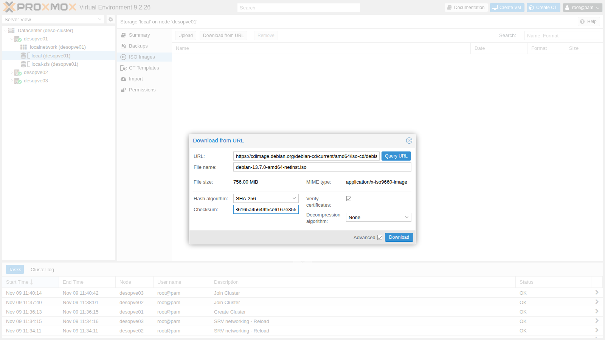

5. Click **Download**. The task log ends with the checksum verification:

   ```text
   2026-11-09 12:48:27 (56.9 MB/s) - '/var/lib/vz/template/iso/debian-13.7.0-amd64-netinst.iso.tmp_dwnl.8549' saved [792723456/792723456]
   calculating checksum...OK, checksum verified
   download of 'https://cdimage.debian.org/debian-cd/current/amd64/iso-cd/debian-13.7.0-amd64-netinst.iso' to '/var/lib/vz/template/iso/debian-13.7.0-amd64-netinst.iso' finished
   TASK OK
   ```

### 2. Create the VM

Click **Create VM** at the top right. The wizard has eight tabs.

1. **General.** The **Node** is the one on which you create the VM (`desopve01`); the suggested **VM ID** is the first free one (`100`). For **Name**, use `debian01`.

   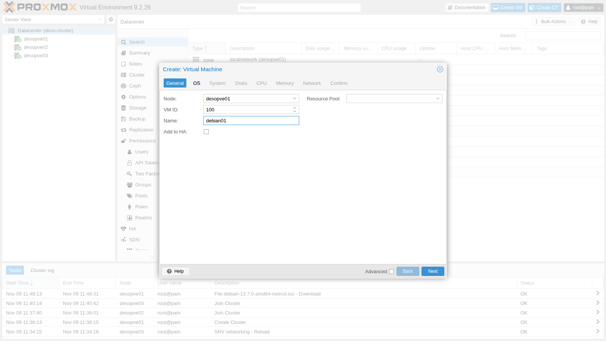

2. **OS.** Choose **Use CD/DVD disc image file (iso)**, storage `local`, ISO `debian-13.7.0-amd64-netinst.iso`. Proxmox VE uses the **Guest OS** (`Linux`, kernel `7.x - 2.6`) to choose the best default values.

   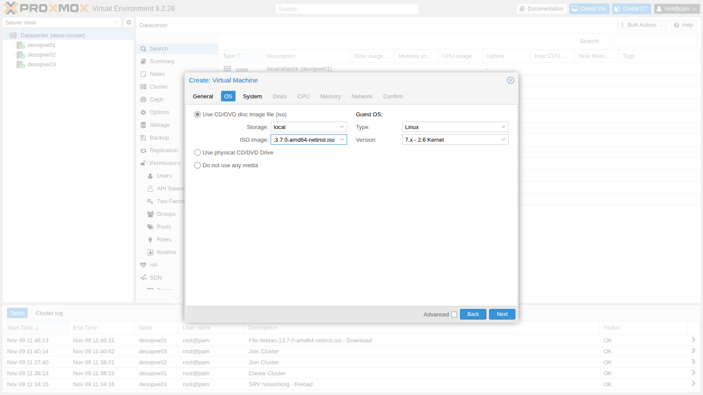

3. **System.** Leave the default values: graphic card `Default`, machine `i440fx`, firmware `SeaBIOS`, disk controller **VirtIO SCSI single**. You will enable the **Qemu Agent** option in lab 38.
4. **Disks.** Disk `scsi0` on the `local-zfs` storage, **Disk size** `16` GiB. **IO thread** is already enabled: the disk has its own I/O thread (lab 37).

   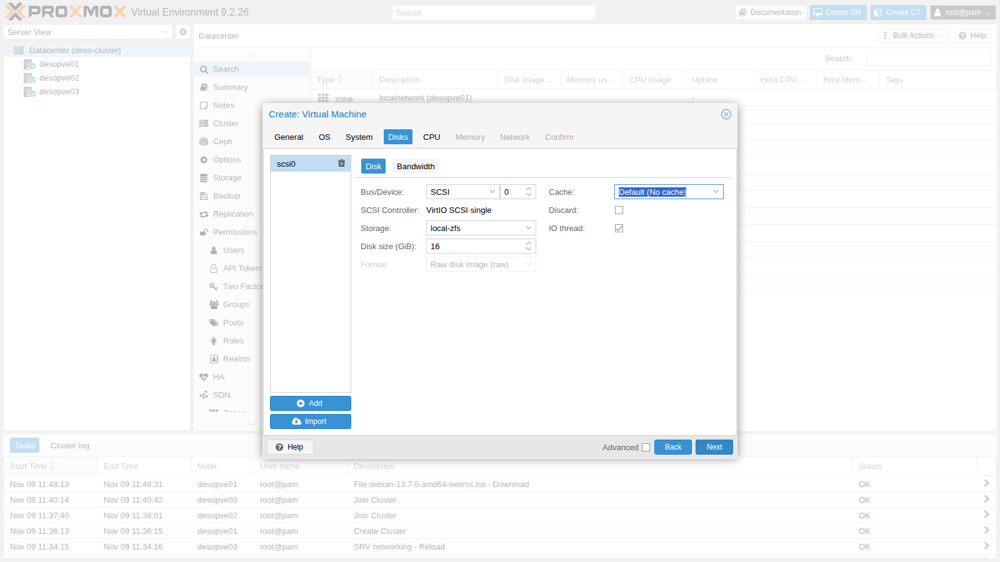

5. **CPU.** **Cores** `2`. The default **Type**, `x86-64-v2-AES`, is a generic CPU model that lets you migrate the VM between nodes with different processors (lab 35).

   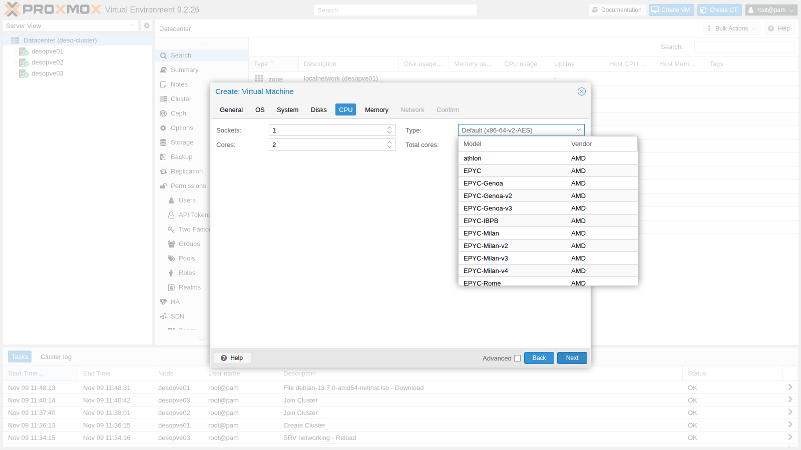

6. **Memory.** Leave `2048` MiB.
7. **Network.** Bridge `vmbr0`, model **VirtIO (paravirtualized)**, firewall enabled: the VM is connected to the management network the way a physical server is connected to the switch.

   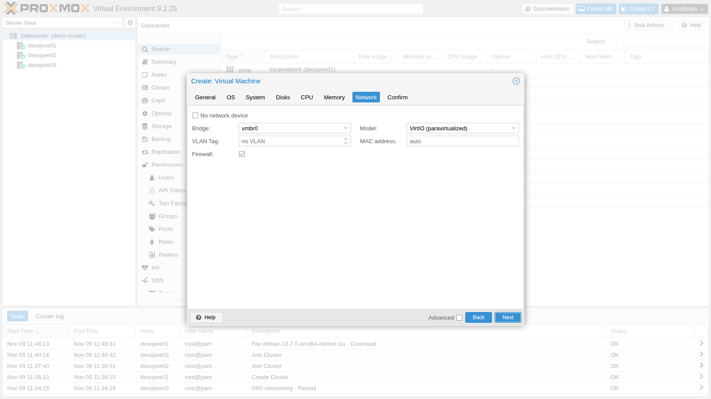

8. **Confirm.** The summary shows the parameters that will be passed to the API. Leave **Start after created** unchecked and click **Finish**.

   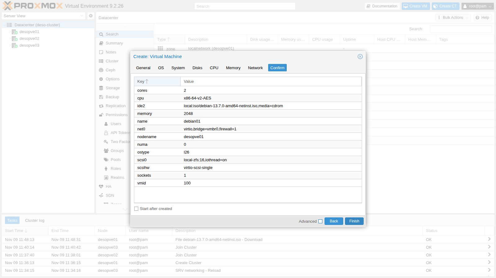

The VM `100 (debian01)` appears in the tree under `desopve01`. Its configuration is a plain text file, `/etc/pve/qemu-server/100.conf`, shared across the cluster:

```bash title="root@desopve01"
qm config 100
```

```text output
boot: order=scsi0;ide2;net0
cores: 2
cpu: x86-64-v2-AES
ide2: local:iso/debian-13.7.0-amd64-netinst.iso,media=cdrom,size=756M
memory: 2048
meta: creation-qemu=11.1.3,ctime=1794225060
name: debian01
net0: virtio=BC:24:11:2B:FF:8A,bridge=vmbr0,firewall=1
numa: 0
ostype: l26
scsi0: local-zfs:vm-100-disk-0,iothread=1,size=16G
scsihw: virtio-scsi-single
smbios1: uuid=ce65e842-1c38-47f2-9112-da688d1a8025
sockets: 1
vmgenid: f52461b5-dbdf-4245-83ba-9897b7d1eacd
```

The boot order (`boot`) tries the disk first and then the CD: as long as the disk is empty, the VM boots from the ISO; after the installation it boots from the disk.

### 3. Install Debian from the console

1. Select the VM, click **Start** and open **Console**: it is the VM screen in the browser (noVNC). In the menu, choose **Install** (the text-mode installer) and press **Enter**.

   :::note
   The menu waits only a few seconds: if you do not press anything, it starts the installation with speech synthesis. If that happens, restart the VM with **Reset** and choose the entry right away.
   :::

   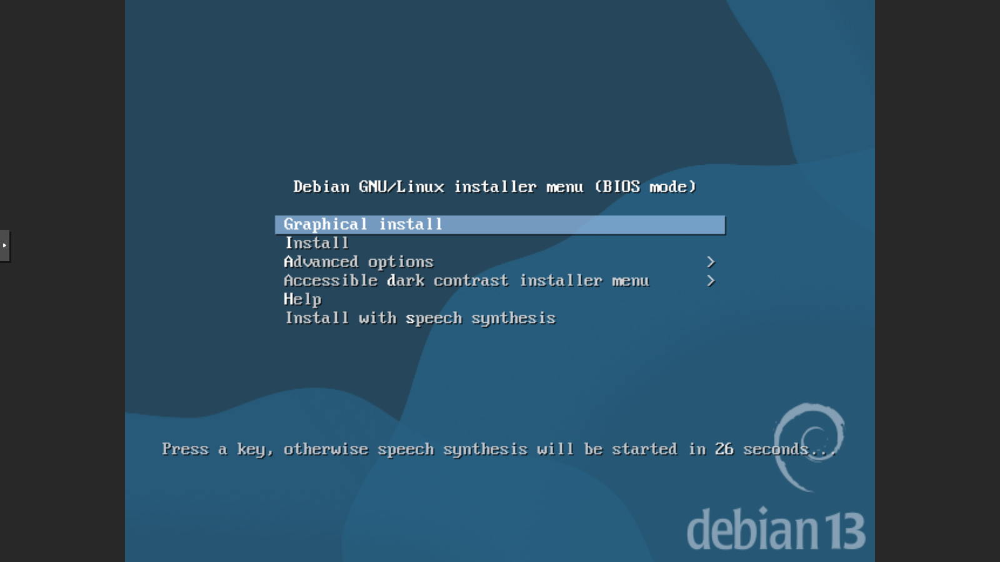

2. Answer the installer's questions:

   | Question | Answer |
   |---|---|
   | Language | `English` |
   | Location | `other` → `Europe` → `Italy` |
   | Locale | `United States – en_US.UTF-8` |
   | Keymap | `Italian` |
   | Network configuration | DHCP does not respond (there is no DHCP server on the lab network): **Cancel**, then **Configure network manually** |
   | IP address | `172.27.199.100/24` |
   | Gateway | `172.27.199.1` (suggested) |
   | Name server | `172.27.199.20` |
   | Hostname / Domain | `debian01` / `proxmox.community` |
   | Root password | `<lab-password>` |
   | User | full name `Lab User`, username `labuser`, password `<lab-password>` |
   | Time from the Internet | the installer tries to contact a public NTP server: **Cancel** |
   | Partitioning | **Guided – use entire disk**, the 17.2 GB `QEMU HARDDISK` disk, **All files in one partition**, confirm with **Yes** |
   | Package manager | mirror in Italy, `deb.debian.org` |
   | HTTP proxy | `http://proxy.proxmox.community:3128` |
   | Popularity contest | **No** |
   | Software | only **SSH server** and **standard system utilities** |
   | GRUB | **Yes**, on the `/dev/sda` disk |

   The disk shows up as `QEMU HARDDISK`: it is the virtual disk that Proxmox VE presents to the VM. These are the most important screens:

   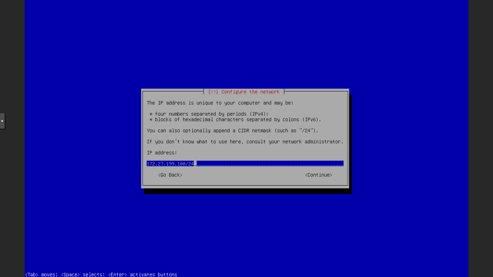

   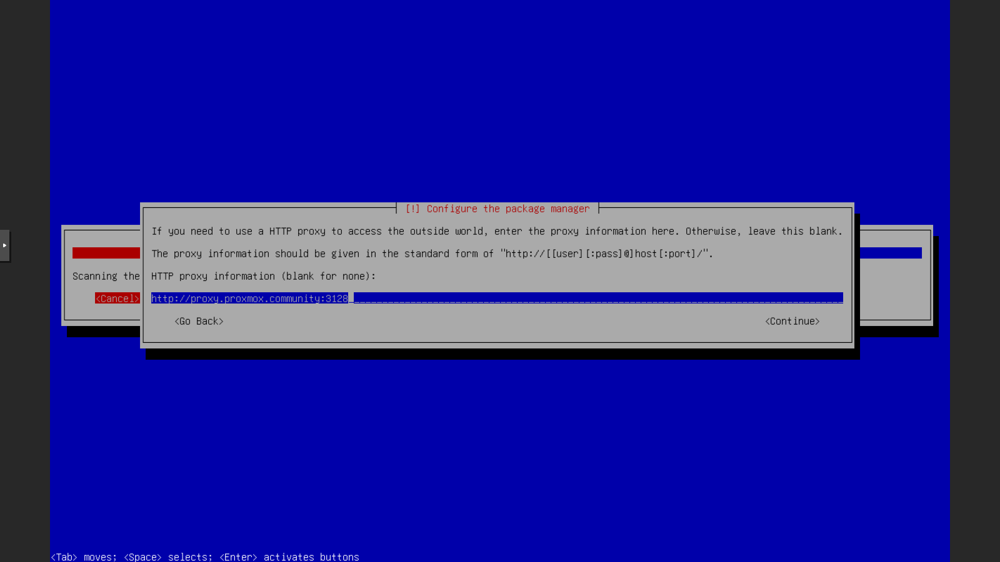

   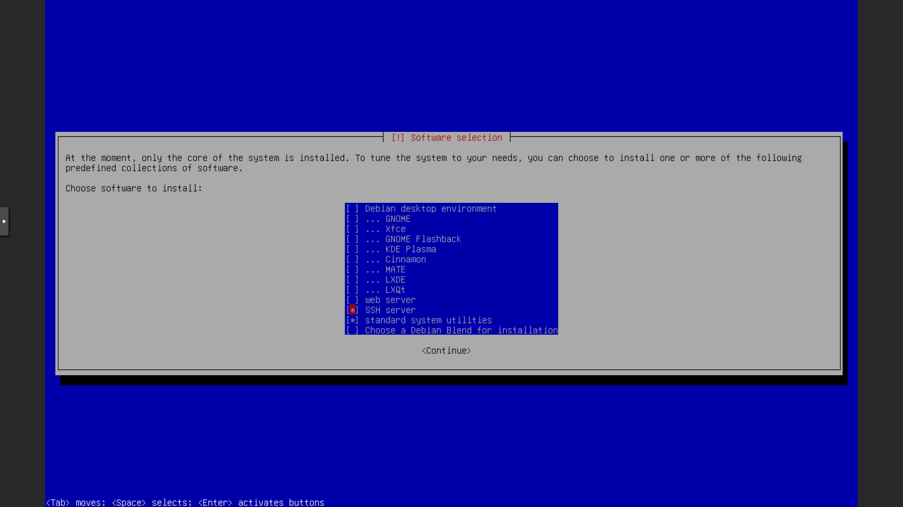

3. When the installer asks you to reboot, select **Continue**. The VM restarts from the disk and shows the login prompt.

   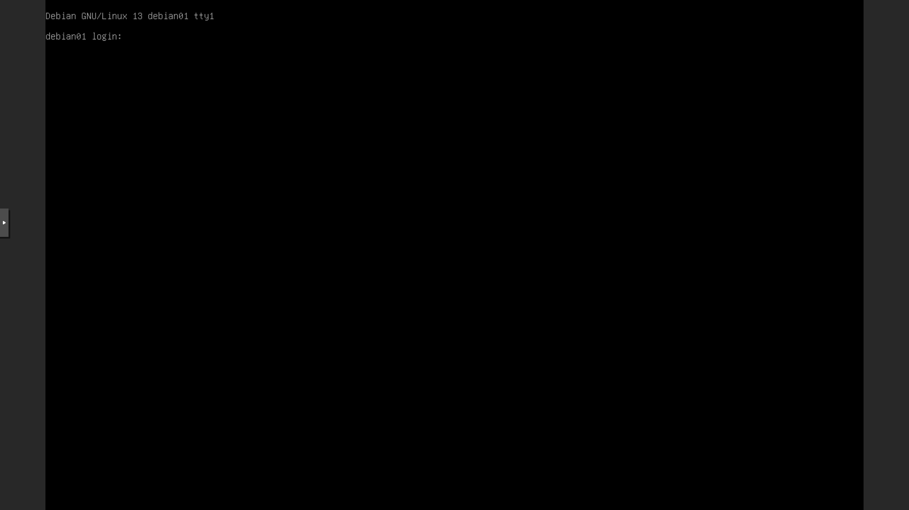

4. Detach the ISO from the VM. In the GUI, the same setting is in **Hardware** → **CD/DVD Drive** → **Do not use any media**:

   ```bash title="root@desopve01"
   qm set 100 --ide2 none,media=cdrom
   ```

   ```text output
   update VM 100: -ide2 none,media=cdrom
   ```

5. The VM **Summary** shows the status, the node, and the CPU, memory and disk usage.

   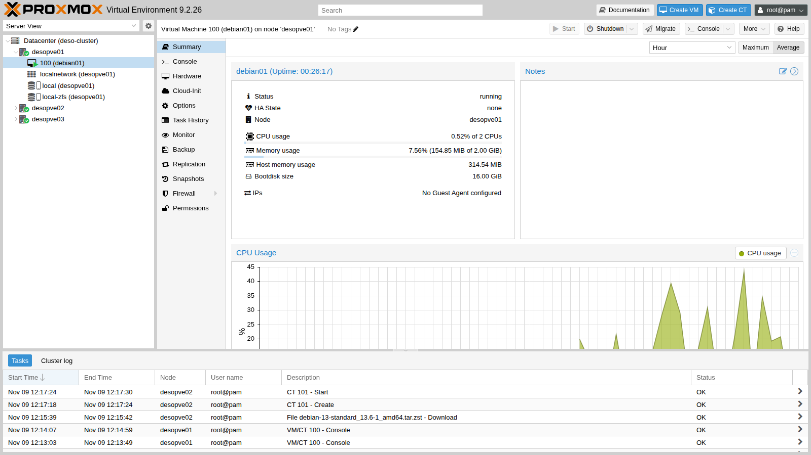

### 4. Download a container template

1. Select the `local (desopve02)` storage → **CT Templates** → **Templates**. The list contains the official Proxmox templates: operating systems (`system`) and ready-made applications (`turnkeylinux`).
2. Search for `debian-13`, select **debian-13-standard** and click **Download**.

   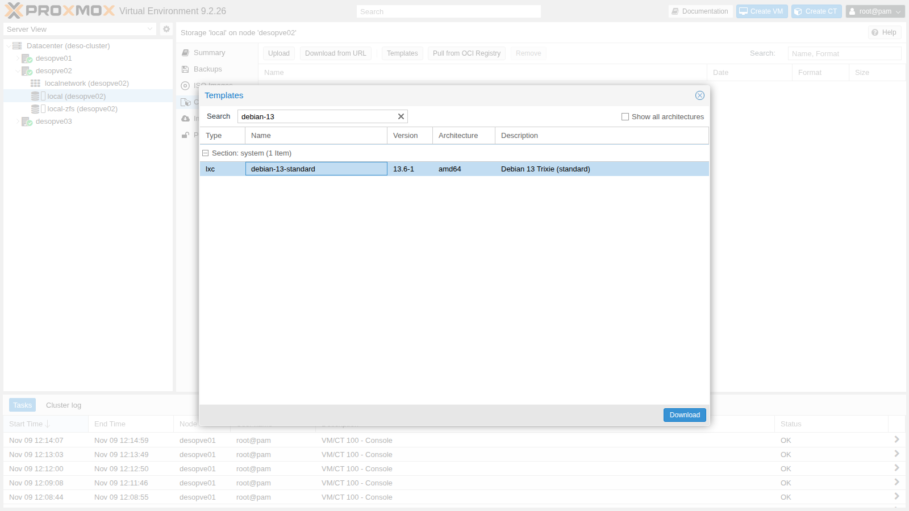

   Here too the node verifies the checksum of the file:

   ```text
   calculating checksum...OK, checksum verified
   download of 'http://download.proxmox.com/images/system/debian-13-standard_13.6-1_amd64.tar.zst' to '/var/lib/vz/template/cache/debian-13-standard_13.6-1_amd64.tar.zst' finished
   TASK OK
   ```

### 5. Create the container

Click **Create CT**.

1. **General.** **Node** `desopve02`: from the interface of one node you can create guests on any node of the cluster. Then **CT ID** `101`, **Hostname** `debian-ct01` and the `root` password of the container. **Unprivileged container** is enabled: the `root` user of the container maps to an unprivileged user on the node, which is the secure setting (lab 41).

   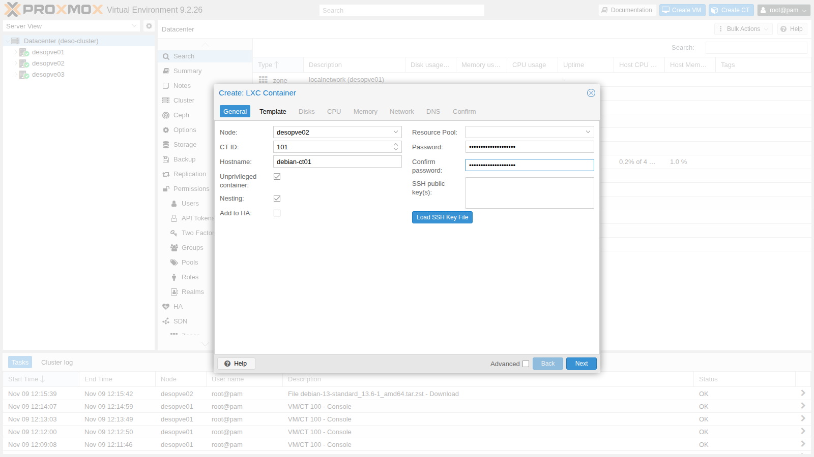

2. **Template.** Storage `local`, template `debian-13-standard_13.6-1_amd64.tar.zst`.
3. **Disks.** Root disk on `local-zfs`, `8` GiB.
4. **CPU** and **Memory.** `1` core, `1024` MiB of memory and `512` MiB of swap.
5. **Network.** `eth0` on the `vmbr0` bridge, static **IPv4** `172.27.199.101/24`, gateway `172.27.199.1`.

   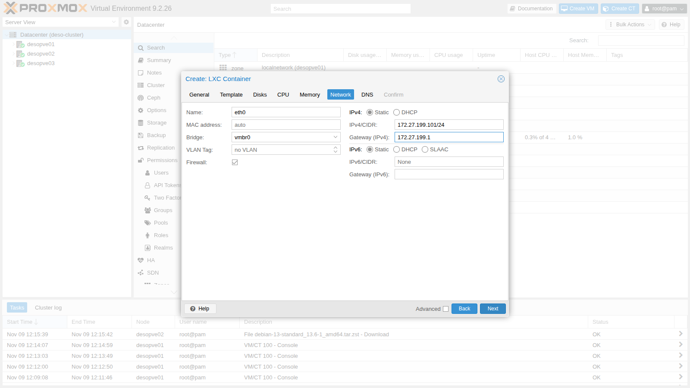

6. **DNS.** Leave the fields empty: the container uses the DNS settings of the node.
7. **Confirm.** Check **Start after created** and click **Finish**.

   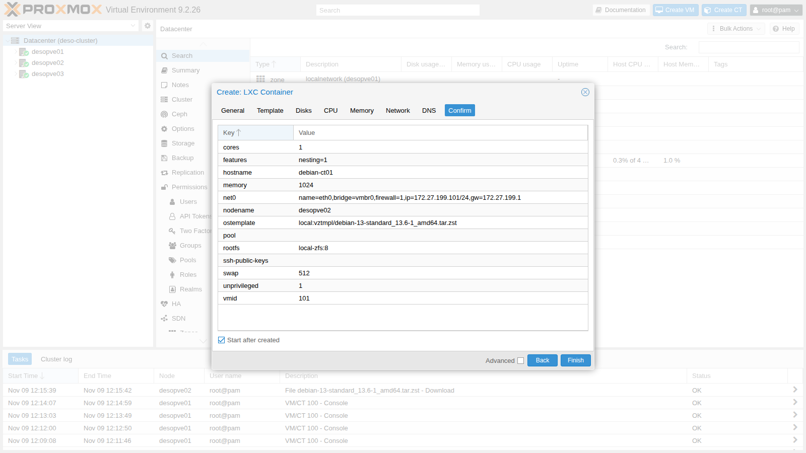

The task extracts the template and generates the SSH keys of the container. In a few seconds the container is running:

```text
extracting archive '/var/lib/vz/template/cache/debian-13-standard_13.6-1_amd64.tar.zst'
Total bytes read: 553512960 (528MiB, 104MiB/s)
Detected container architecture: amd64
Creating SSH host key 'ssh_host_ecdsa_key' - this may take some time ...
done: SHA256:zekotr1oKXgAGnFNcwI/uCX1MRKZbSEfKtC+vRdWoMI root@debian-ct01
Creating SSH host key 'ssh_host_ed25519_key' - this may take some time ...
done: SHA256:PXwzhEQ7pwnOUkqgq+wMtoRDt/a9+nwCVSdX2l3EZMs root@debian-ct01
Creating SSH host key 'ssh_host_rsa_key' - this may take some time ...
done: SHA256:NJOZQVV8VkmI73UewHxOJdUD/uEWL4Pp3rElO8yJA1Y root@debian-ct01
TASK OK
```

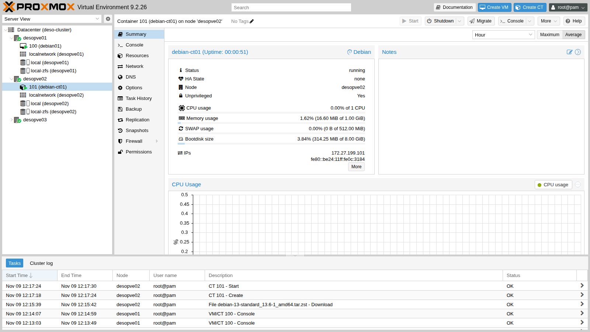

The container disk is a ZFS dataset (`subvol-101-disk-0`), not a virtual disk: the container sees a file system directly.

```bash title="root@desopve02"
pct config 101
```

```text output
arch: amd64
cores: 1
features: nesting=1
hostname: debian-ct01
memory: 1024
net0: name=eth0,bridge=vmbr0,firewall=1,gw=172.27.199.1,hwaddr=BC:24:11:0C:31:84,ip=172.27.199.101/24,type=veth
ostype: debian
rootfs: local-zfs:subvol-101-disk-0,size=8G
swap: 512
unprivileged: 1
```

## Verification and tests

1. **The VM.** From the DC, connect over SSH to `labuser@172.27.199.100` and check the name, the network, DNS, the gateway and the proxy configured by the installer:

   ```bash title="labuser@debian01"
   hostname -f
   ```

   ```text output
   debian01.proxmox.community
   ```

   ```bash title="labuser@debian01"
   ip -br -4 addr
   ```

   ```text output
   lo               UNKNOWN        127.0.0.1/8
   ens18            UP             172.27.199.100/24
   ```

   ```bash title="labuser@debian01"
   ip route
   ```

   ```text output
   default via 172.27.199.1 dev ens18 onlink
   172.27.199.0/24 dev ens18 proto kernel scope link src 172.27.199.100
   ```

   ```bash title="labuser@debian01"
   cat /etc/resolv.conf
   ```

   ```text output
   search proxmox.community
   nameserver 172.27.199.20
   ```

   ```bash title="labuser@debian01"
   ping -c2 172.27.199.1 | grep loss
   ```

   ```text output
   2 packets transmitted, 2 received, 0% packet loss, time 1001ms
   ```

   ```bash title="labuser@debian01"
   cat /etc/apt/apt.conf
   ```

   ```text output
   Acquire::http::Proxy "http://proxy.proxmox.community:3128";
   ```

   ```bash title="labuser@debian01"
   cat /etc/debian_version
   ```

   ```text output
   13.7
   ```

   ```bash title="labuser@debian01"
   timedatectl | grep "Time zone"
   ```

   ```text output
                   Time zone: Europe/Rome (CET, +0100)
   ```

   `ens18` is the name Linux gives to the VirtIO network card of the VM.

2. **The container.** `pct exec` runs a command in the container from the node, without a password or network. The DNS configuration is the node's, written by Proxmox VE between the `PVE` markers:

   ```bash title="root@desopve02"
   pct list
   ```

   ```text output
   VMID       Status     Lock         Name
   101        running                 debian-ct01
   ```

   ```bash title="root@desopve02"
   pct exec 101 -- ip -br -4 addr
   ```

   ```text output
   lo               UNKNOWN        127.0.0.1/8
   eth0@if6         UP             172.27.199.101/24
   ```

   ```bash title="root@desopve02"
   pct exec 101 -- cat /etc/resolv.conf
   ```

   ```text output
   # --- BEGIN PVE ---
   search proxmox.community
   nameserver 172.27.199.20
   # --- END PVE ---
   ```

   ```bash title="root@desopve02"
   pct exec 101 -- ping -c2 172.27.199.1 | grep loss
   ```

   ```text output
   2 packets transmitted, 2 received, 0% packet loss, time 1002ms
   ```

   For an interactive shell in the container, use `pct enter 101`.

3. **The proxy in the container.** The template does not know about the lab proxy: configure it and refresh the package list.

   ```bash title="root@desopve02"
   pct exec 101 -- sh -c "echo 'Acquire::http::Proxy \"http://proxy.proxmox.community:3128\";' > /etc/apt/apt.conf.d/80proxy; apt-get update" | tail -3
   ```

   ```text output
   Get:14 http://deb.debian.org/debian trixie-updates/main amd64 Packages T-2026-11-05-1401.10-F-2026-07-18-0800.33.pdiff [1038 B]
   Fetched 17.0 MB in 2s (7736 kB/s)
   Reading package lists...
   ```

4. **The cluster view.** From any node you see all the guests of the cluster:

   ```bash title="root@desopve01"
   pvesh get /cluster/resources --type vm --output-format yaml | grep -E "^- |id:|name:|node:|status:|type:"
   ```

   ```text output
   - cpu: 0.00447667643448901
     id: qemu/100
     name: debian01
     node: desopve01
     status: running
     type: qemu
     vmid: 100
   - cpu: 0.248149203798156
     id: lxc/101
     name: debian-ct01
     node: desopve02
     status: running
     type: lxc
     vmid: 101
   ```

- [ ] VM `100` is running, reachable over SSH at `172.27.199.100`, and downloads packages through the proxy.
- [ ] Container `101` is running on `desopve02`, responds at `172.27.199.101` and downloads packages through the proxy.

## Final lab state

- Cluster `deso-cluster` unchanged; `desopve04` standalone.
- **VM `100` `debian01`** on `desopve01`, running: Debian 13.7 on `local-zfs` (16 GiB), 2 cores, 2048 MiB, `172.27.199.100`, users `root` and `labuser`, SSH server, proxy for `apt`. ISO detached.
- **CT `101` `debian-ct01`** on `desopve02`, running: unprivileged Debian 13 on `local-zfs` (8 GiB), 1 core, 1024 MiB, `172.27.199.101`, proxy for `apt`.
- ISO `debian-13.7.0-amd64-netinst.iso` in `local` on `desopve01`; template `debian-13-standard_13.6-1_amd64.tar.zst` in `local` on `desopve02`.

## What you learned

- The differences between virtual machines (KVM/QEMU) and containers (LXC), and when to use one or the other.
- How to download ISOs and templates directly to the node, with checksum verification.
- What the tabs of the VM and container creation wizards mean.
- That the configuration of a guest is a text file in `/etc/pve`, readable with `qm config` and `pct config`.
- How to get into a container from the node with `pct exec` and `pct enter`.

## References

- [Proxmox VE – QEMU/KVM Virtual Machines](https://pve.proxmox.com/pve-docs/pve-admin-guide.html#chapter_virtual_machines)
- [Proxmox VE – Proxmox Container Toolkit](https://pve.proxmox.com/pve-docs/pve-admin-guide.html#chapter_pct)
- [Proxmox VE – Storage](https://pve.proxmox.com/pve-docs/pve-admin-guide.html#chapter_storage)
- [Debian – Installation Guide for amd64](https://www.debian.org/releases/trixie/amd64/)
