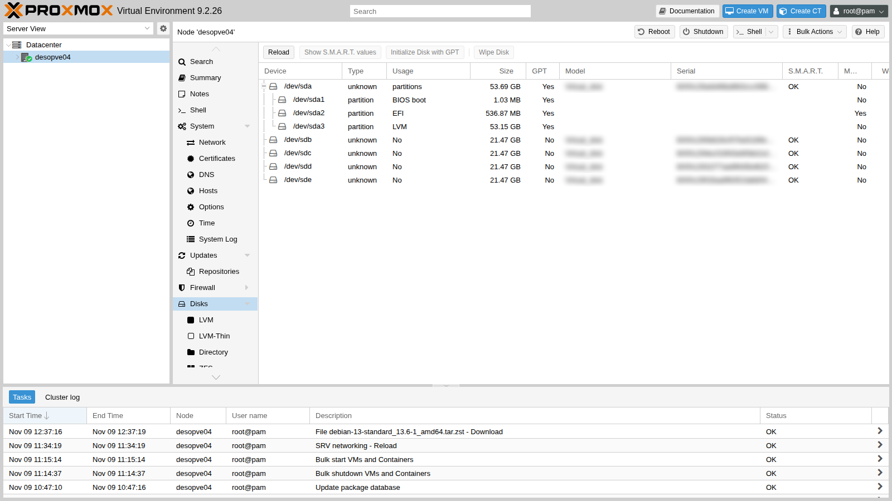
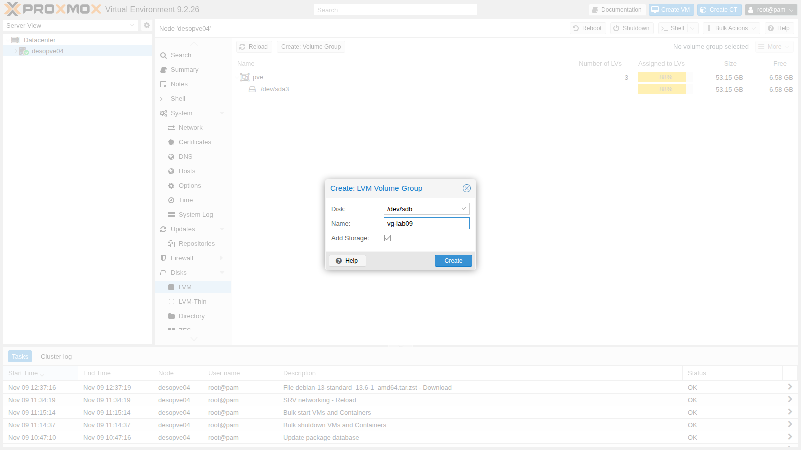
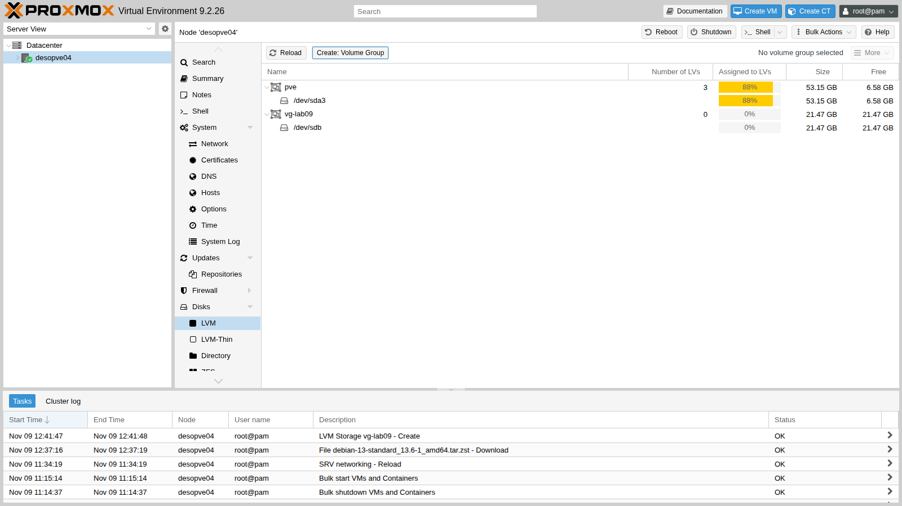
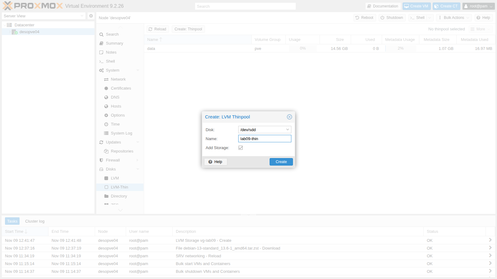
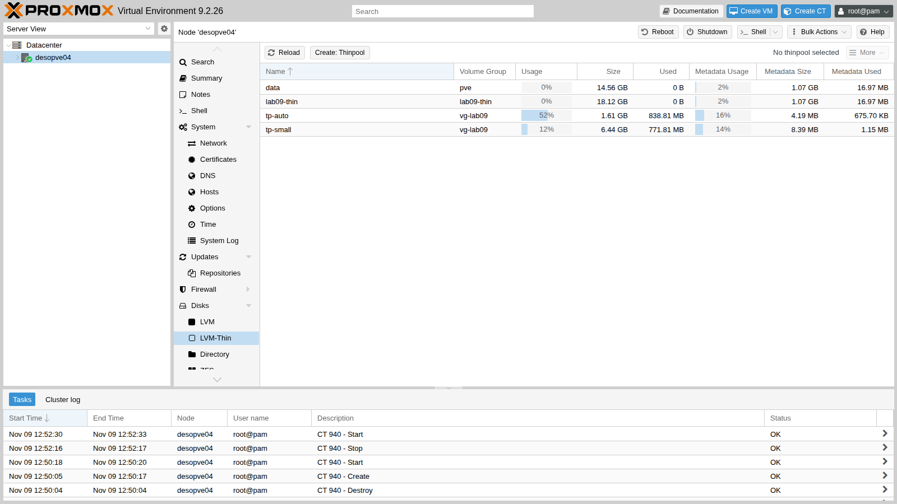
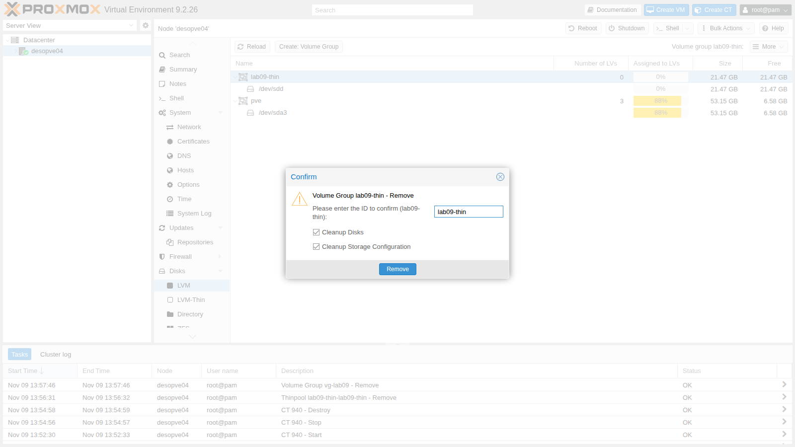

## Dependencies

- **Previous labs:** [Lab 08](/08-storage-model/): storage model, thin provisioning.
- **Nodes:** `desopve04` (standalone node, `172.27.199.24`), used as a storage test bed.
- **Hardware:** **four 20 GB disks**, to be hot-plugged into the free hot-swap bays of `desopve04` in step 2 (see the [lab hardware](/01-lab-architecture/#lab-hardware)). They will become `sdb`, `sdc`, `sdd` and `sde`.
- **Template:** the Debian 13 template in the `local` storage of `desopve04`. You can download it from the GUI as in [Lab 07](/07-first-vm-and-container/), or from the command line: `pveam update` refreshes the list, `pveam available --section system | grep debian-13` shows the current name (in this lab `debian-13-standard_13.6-1_amd64.tar.zst`) and `pveam download local <name>` downloads it.
- **Addresses:** `172.27.199.140` for the test container.
- **Credentials:** `root` / `<lab-password>` → [Appendix B](/b-credentials-and-addresses/).

## Objectives

- Understand the three layers of LVM (PV, VG, LV) and the difference between *thick* and *thin* LVM.
- Create a volume group and a thin pool from the web interface and inspect them from the command line.
- Extend a volume group with a new disk.
- See what happens when an overprovisioned thin pool fills up, and how to recover.
- Prevent the problem with monitoring and automatic extension.

## How it works

### PV, VG and LV

LVM (*Logical Volume Manager*) adds a layer between the disks and the volumes:

```text
 disks         /dev/sdb        /dev/sdc
                  │               │
 PV         physical volume  physical volume     pvcreate, pvs
                  └──────┬────────┘
 VG              volume group  (pooled space)     vgcreate, vgextend, vgs
                 ┌───────┼────────┐
 LV          logical volume  logical volume       lvcreate, lvextend, lvs
```

- A **PV** is a disk (or a partition) prepared for LVM.
- A **VG** combines one or more PVs into a single space, which can be grown by adding disks.
- An **LV** is a "slice" of the VG, seen by the system as a block device: for Proxmox VE, the disk of a VM or a container.

### Thick LVM and LVM-thin

| | **LVM** (`lvm`) | **LVM-thin** (`lvmthin`) |
|---|---|---|
| Allocation | **thick**: the LV takes up its full size right away | **thin**: blocks are allocated when they are written |
| Overprovisioning | no | yes: the total size of the disks can exceed the pool |
| Snapshots and linked clones | no (in Proxmox VE 9, *volume chain* as a technology preview: lab 16) | yes, fast |
| Sharing across nodes | yes, on a shared LUN (lab 15) | no, local only |
| Risk | none: the space is guaranteed | **full pool**: writes fail |

A **thin pool** is a special LV made of two hidden parts: `_tdata`, the data, and `_tmeta`, the map that records which blocks belong to which volume. Both can fill up, and both must be monitored.

A Proxmox VE installation on ext4 (like `desopve04`, lab 03) uses LVM: the `pve` VG contains `root`, `swap` and the `data` thin pool, which is the `local-lvm` storage.

## Procedure

### 1. The LVM layout of the installation

```bash title="root@desopve04"
pvs
```

```text output
  PV         VG  Fmt  Attr PSize   PFree
  /dev/sda3  pve lvm2 a--  <49.50g <6.13g
```

```bash title="root@desopve04"
vgs
```

```text output
  VG  #PV #LV #SN Attr   VSize   VFree
  pve   1   3   0 wz--n- <49.50g <6.13g
```

```bash title="root@desopve04"
lvs
```

```text output
  LV   VG  Attr       LSize   Pool Origin Data%  Meta%  Move Log Cpy%Sync Convert
  data pve twi-a-tz-- <13.56g             0.00   1.58
  root pve -wi-ao----  21.68g
  swap pve -wi-ao----   6.12g
```

In the `Attr` column the first letter gives the type: `t` is a thin pool, `-` a regular volume. `data` is the thin pool of `local-lvm`, still empty.

### 2. The node's disks

Insert the four 20 GB disks into the free hot-swap bays of `desopve04`, with the node running. The controller reports the new disks to the kernel by itself; if they don't show up, force a rescan of the SCSI buses:

```bash title="root@desopve04"
for h in /sys/class/scsi_host/host*/scan; do echo "- - -" > $h; done
```

Open `desopve04` → **Disks**. The four 20 GB disks have **Usage** `No`: they are free.



:::note
The **Model** and **Serial** fields depend on the hardware: they are obscured in the manual, and in the command-line output the serial numbers are replaced by placeholders.
:::

### 3. Create a volume group from the web interface

1. **Disks** → **LVM** → **Create: Volume Group**. **Disk** `/dev/sdb`, **Name** `vg-lab09`, **Add Storage** enabled.

   

2. Click **Create**. The new VG appears next to `pve`, empty.

   

3. Proxmox VE ran `pvcreate` and `vgcreate`, and added an `lvm` storage restricted to the node:

   ```bash title="root@desopve04"
   grep -A4 "lvm: vg-lab09" /etc/pve/storage.cfg
   ```

   ```text output
   lvm: vg-lab09
   	vgname vg-lab09
   	content images,rootdir
   	nodes desopve04
   	shared 0
   ```

### 4. Thick LVM: all the space is taken up front

Allocate a 6 GiB volume (with a test VMID, `990`) and look at the free space of the VG:

```bash title="root@desopve04"
pvesm alloc vg-lab09 990 vm-990-disk-0 6G
```

```text output
  Logical volume "vm-990-disk-0" created.
successfully created 'vg-lab09:vm-990-disk-0'
```

```bash title="root@desopve04"
lvs vg-lab09
```

```text output
  LV            VG       Attr       LSize Pool Origin Data%  Meta%  Move Log Cpy%Sync Convert
  vm-990-disk-0 vg-lab09 -wi-a----- 6.00g
```

```bash title="root@desopve04"
vgs vg-lab09
```

```text output
  VG       #PV #LV #SN Attr   VSize   VFree
  vg-lab09   1   1   0 wz--n- <20.00g <14.00g
```

```bash title="root@desopve04"
pvesm free vg-lab09:vm-990-disk-0
```

```text output
  Logical volume "vm-990-disk-0" successfully removed.
Removed volume 'vg-lab09:vm-990-disk-0'
```

The volume doesn't contain anything yet, but its 6 GiB are already gone from the VG (`VFree` from 20 to 14).

### 5. Extend the volume group with a second disk

The web interface creates a VG on a single disk. To grow it, use the command line: `pvcreate` prepares the disk, `vgextend` adds it.

```bash title="root@desopve04"
pvcreate /dev/sdc
```

```text output
  Physical volume "/dev/sdc" successfully created.
```

```bash title="root@desopve04"
vgextend vg-lab09 /dev/sdc
```

```text output
  Volume group "vg-lab09" successfully extended
```

```bash title="root@desopve04"
vgs vg-lab09
```

```text output
  VG       #PV #LV #SN Attr   VSize  VFree
  vg-lab09   2   0   0 wz--n- 39.99g 39.99g
```

The `vg-lab09` storage shows the new 40 GiB immediately, without any configuration change: Proxmox VE reads the space from the VG.

:::note
A VG spanning several disks **without redundancy** is lost entirely if any one of its disks fails. In production, LVM belongs on top of a RAID (hardware or `mdadm`) or of an already protected LUN.
:::

### 6. Create a thin pool from the web interface

1. **Disks** → **LVM-Thin** → **Create: Thinpool**. **Disk** `/dev/sdd`, **Name** `lab09-thin`.

   

2. The interface creates a `lab09-thin` VG on the whole disk and, inside it, a thin pool with the same name. From the command line you can also see the hidden parts of the pool (in square brackets):

   ```bash title="root@desopve04"
   lvs -a -o lv_name,vg_name,attr,lv_size,data_percent,metadata_percent lab09-thin
   ```

   ```text output
     LV                 VG         Attr       LSize   Data%  Meta%
     lab09-thin         lab09-thin twi-a-tz--  16.87g 0.00   1.58
     [lab09-thin_tdata] lab09-thin Twi-ao----  16.87g
     [lab09-thin_tmeta] lab09-thin ewi-ao----   1.00g
     [lvol0_pmspare]    lab09-thin ewi-------   1.00g
   ```

   ```bash title="root@desopve04"
   grep -A4 "lvmthin: lab09-thin" /etc/pve/storage.cfg
   ```

   ```text output
   lvmthin: lab09-thin
   	thinpool lab09-thin
   	vgname lab09-thin
   	content rootdir,images
   	nodes desopve04
   ```

   Of the disk's 20 GB, 16.87 GiB go to data and 1 GiB to metadata, plus 1 GiB of spare space (`pmspare`) used to repair the metadata if it gets damaged.

### 7. Overprovisioning: a 6 GiB disk in a 2 GiB pool

To see a pool fill up within minutes, create a small 2 GiB thin pool in the `vg-lab09` VG and add it as a storage:

```bash title="root@desopve04"
lvcreate --type thin-pool -L 2G -n tp-small vg-lab09
```

```text output
  Thin pool volume with chunk size 64.00 KiB can address at most <15.88 TiB of data.
  Logical volume "tp-small" created.
```

```bash title="root@desopve04"
pvesm add lvmthin lab09-small --vgname vg-lab09 --thinpool tp-small --content rootdir,images --nodes desopve04
```

Create a container with a **6 GiB** disk on that **2 GiB** pool. The `nesting=1` option is the one the web interface enables automatically on unprivileged containers: systemd needs it.

```bash title="root@desopve04"
pct create 940 local:vztmpl/debian-13-standard_13.6-1_amd64.tar.zst --hostname lab09-ct --rootfs lab09-small:6 --memory 512 --cores 1 --unprivileged 1 --features nesting=1 --ostype debian --net0 name=eth0,bridge=vmbr0,ip=172.27.199.140/24,gw=172.27.199.1
```

```text output
...
```

```bash title="root@desopve04"
pct start 940
lvs -o lv_name,attr,lv_size,pool_lv,data_percent,metadata_percent vg-lab09
```

```text output
  LV            Attr       LSize Pool     Data%  Meta%
  tp-small      twi-aotz-- 2.00g          31.27  16.02
  vm-940-disk-0 Vwi-aotz-- 6.00g tp-small 10.42
```

```bash title="root@desopve04"
pct exec 940 -- df -h /
```

```text output
Filesystem                              Size  Used Avail Use% Mounted on
/dev/mapper/vg--lab09-vm--940--disk--0  5.9G  572M  5.0G  11% /
```

The container sees a 6 GiB disk with 5 GiB free, but the pool has only 2 GiB and has already used 31% of it. This is **overprovisioning**: it works as long as the data actually written stays below the size of the pool.

## Verification and tests

### Test 1 – The thin pool fills up

Inside the container, write 3 GB of random data: the file system has room, the pool does not.

```bash title="root@desopve04"
date +%T; pct exec 940 -- dd if=/dev/urandom of=/root/fill bs=1M count=3000 oflag=direct status=none; echo "dd rc=$?"; date +%T
```

```text output
13:50:28
dd: error writing '/root/fill': No space left on device
dd rc=1
13:51:58
```

The write stalled for about a minute and then failed. The kernel log tells what happened:

```bash title="root@desopve04"
dmesg | grep thin
```

```text output
[ 5759.611992] device-mapper: thin: 252:10: reached low water mark for data device: sending event.
[ 5759.614980] device-mapper: thin: 252:10: switching pool to out-of-data-space (queue IO) mode
[ 5822.127628] device-mapper: thin: 252:10: switching pool to out-of-data-space (error IO) mode
```

```bash title="root@desopve04"
dmesg | grep EXT4 | tail -3
```

```text output
[ 5822.130654] EXT4-fs (dm-12): failed to convert unwritten extents to written extents -- potential data loss!  (inode 1595, error -5)
[ 5822.131286] EXT4-fs (dm-12): failed to convert unwritten extents to written extents -- potential data loss!  (inode 1566, error -5)
[ 5822.131944] EXT4-fs (dm-12): failed to convert unwritten extents to written extents -- potential data loss!  (inode 1567, error -5)
```

```bash title="root@desopve04"
lvs -o lv_name,attr,lv_size,pool_lv,data_percent,metadata_percent vg-lab09
```

```text output
  LV            Attr       LSize Pool     Data%  Meta%
  tp-small      twi-aotzD- 2.00g          100.00 29.00
  vm-940-disk-0 Vwi-aotz-- 6.00g tp-small 33.33
```

1. When the pool fills up, device-mapper **queues** the writes and waits 60 seconds for someone to extend the pool (`queue IO`).
2. After that minute, it starts **rejecting** them (`error IO`): the container's file system receives I/O errors and some data is lost.
3. The `D` at the end of the pool attributes means *out of data space*.

From the container's point of view, however, all is well: the file system believes it still has 3.7 GiB free.

```bash title="root@desopve04"
pct exec 940 -- df -h /
```

```text output
Filesystem                              Size  Used Avail Use% Mounted on
/dev/mapper/vg--lab09-vm--940--disk--0  5.9G  1.9G  3.7G  34% /
```

This is the danger of overprovisioning: a guest has no way of knowing that the space "underneath" has run out. With a VM, depending on the disk settings, QEMU either pauses the VM with the `io-error` status or passes the error on to the guest operating system.

### Test 2 – Recover: extend the pool and free up space

1. The immediate fix is to give the pool more space. The `vg-lab09` VG still has almost 38 GiB free:

   ```bash title="root@desopve04"
   lvextend -L +4G vg-lab09/tp-small
   ```

   ```text output
     Rounding size to boundary between physical extents: 8.00 MiB.
     Size of logical volume vg-lab09/tp-small_tmeta changed from 4.00 MiB (1 extents) to 8.00 MiB (2 extents).
     Size of logical volume vg-lab09/tp-small_tdata changed from 2.00 GiB (512 extents) to 6.00 GiB (1536 extents).
     Logical volume vg-lab09/tp-small successfully resized.
   ```

   ```bash title="root@desopve04"
   dmesg | grep thin | tail -2
   ```

   ```text output
   [ 5832.296162] device-mapper: thin: 252:10: switching pool to write mode
   [ 5832.296168] device-mapper: thin: 252:10: growing the data device from 32768 to 98304 blocks
   ```

   ```bash title="root@desopve04"
   lvs -o lv_name,attr,lv_size,data_percent,metadata_percent vg-lab09/tp-small
   ```

   ```text output
     LV       Attr       LSize Data%  Meta%
     tp-small twi-aotz-- 6.00g 33.33  19.68
   ```

   The pool switches back to write mode. `lvextend` also grew the metadata: with such a small pool it was only 4 MiB.

2. Check the container's file system, which suffered write errors. `pct fsck` checks it with the container stopped:

   ```bash title="root@desopve04"
   pct stop 940
   pct fsck 940
   ```

   ```text output
   fsck from util-linux 2.41.5
   /dev/mapper/vg--lab09-vm--940--disk--0: clean, 22033/393216 files, 530428/1572864 blocks
   ```

   ```bash title="root@desopve04"
   pct start 940
   pct exec 940 -- ls -lh /root/fill
   ```

   ```text output
   -rw-r--r-- 1 root root 1.3G Nov  9 12:51 /root/fill
   ```

   The file system is clean, but the file stopped at 1.3 GB instead of the 3 GB requested: the failed writes are lost.

3. Delete the file. In the thin pool, however, the blocks stay allocated until the file system tells the disk which blocks are free again (**discard**, or *trim*):

   ```bash title="root@desopve04"
   pct exec 940 -- rm /root/fill
   lvs -o lv_name,data_percent vg-lab09
   ```

   ```text output
     LV            Data%
     tp-small      33.34
     vm-940-disk-0 33.34
   ```

   ```bash title="root@desopve04"
   pct fstrim 940
   ```

   ```text output
   /var/lib/lxc/940/rootfs/: 1.4 GiB (1518882816 bytes) trimmed
   ```

   ```bash title="root@desopve04"
   lvs -o lv_name,data_percent vg-lab09
   ```

   ```text output
     LV            Data%
     tp-small      11.98
     vm-940-disk-0 11.98
   ```

   :::note
   An unprivileged container cannot run `fstrim` by itself (`FITRIM ioctl failed: Operation not permitted`): the node does it with `pct fstrim`. If the first trim doesn't free any space, wait a few seconds for ext4 to record the deletion and run it again. VMs need the **Discard** option on the virtual disk (lab 37).
   :::

### Test 3 – Prevent: automatic pool extension

LVM can grow a thin pool by itself when it crosses a threshold, provided the VG has free space. This is done by the `dmeventd` service, which monitors the pools. In the default installation the threshold is 100%, which means the feature is off:

```bash title="root@desopve04"
lvmconfig --typeconfig full activation/thin_pool_autoextend_threshold activation/thin_pool_autoextend_percent
```

```text output
thin_pool_autoextend_threshold=100
thin_pool_autoextend_percent=20
```

Instead of changing the setting for all pools in `/etc/lvm/lvm.conf`, create a **profile** and apply it to a single pool: 70% threshold, 50% growth.

```bash title="root@desopve04"
cat > /etc/lvm/profile/lab09-autoextend.profile <<EOF
activation {
	thin_pool_autoextend_threshold=70
	thin_pool_autoextend_percent=50
}
EOF
lvcreate --type thin-pool -L 1G -n tp-auto --metadataprofile lab09-autoextend vg-lab09
```

```text output
  Thin pool volume with chunk size 64.00 KiB can address at most <15.88 TiB of data.
  Logical volume "tp-auto" created.
```

```bash title="root@desopve04"
lvcreate -V 3G -T vg-lab09/tp-auto -n lv-auto
```

```text output
  WARNING: You have not turned on protection against thin pools running out of space.
  WARNING: Set activation/thin_pool_autoextend_threshold below 100 to trigger automatic extension of thin pools before they get full.
  WARNING: Sum of all thin volume sizes (9.00 GiB) exceeds the size of thin pools (7.00 GiB).
  Logical volume "lv-auto" created.
```

```bash title="root@desopve04"
lvs -o lv_name,lv_size,data_percent,lv_profile,seg_monitor vg-lab09/tp-auto
```

```text output
  LV      LSize Data%  LProfile         Monitor
  tp-auto 1.00g 0.00   lab09-autoextend monitored
```

The `lvcreate` warnings are valuable: LVM itself points out that you are overprovisioning and that the protection is off. The warnings refer to the global setting; the new pool uses the profile instead.

Now write 800 MiB to the 3 GiB volume, that is, 78% of the 1 GiB pool:

```bash title="root@desopve04"
dd if=/dev/urandom of=/dev/vg-lab09/lv-auto bs=1M count=800 oflag=direct status=none
lvs -o lv_name,lv_size,data_percent vg-lab09/tp-auto vg-lab09/lv-auto
```

```text output
  LV      LSize Data%
  lv-auto 3.00g 26.04
  tp-auto 1.50g 52.08
```

```bash title="root@desopve04"
journalctl --since "-2 min" --no-hostname | grep dmeventd | grep -E "changed|resized"
```

```text output
Nov 09 13:53:51 dmeventd[440]: Size of logical volume vg-lab09/tp-auto_tdata changed from 1.00 GiB (256 extents) to 1.50 GiB (384 extents).
Nov 09 13:53:51 dmeventd[440]: Logical volume vg-lab09/tp-auto successfully resized.
```

Once usage went past 70%, `dmeventd` grew the pool by 50% (from 1 to 1.5 GiB) and the write succeeded. Automatic extension only works if the VG has free space: it does not replace monitoring, but it buys time.

In the web interface, **Disks** → **LVM-Thin** shows the data and metadata usage of each pool:



### Cleanup

1. Remove the container, the test storage and pools, and the profile:

   ```bash title="root@desopve04"
   pct stop 940 && pct destroy 940 --purge 1
   pvesm remove lab09-small
   lvremove -y vg-lab09/lv-auto vg-lab09/tp-auto vg-lab09/tp-small
   ```

   ```text output
     Logical volume "lv-auto" successfully removed.
     Logical volume "tp-auto" successfully removed.
     Logical volume "tp-small" successfully removed.
   ```

   ```bash title="root@desopve04"
   rm /etc/lvm/profile/lab09-autoextend.profile
   ```

2. In the web interface, under **Disks** → **LVM-Thin**, select `lab09-thin` and choose **More** → **Destroy**. Type the ID to confirm. **Cleanup Storage Configuration** removes the storage, **Cleanup Disks** wipes the LVM labels from the disk. Then, under **Disks** → **LVM**, destroy the `lab09-thin` and `vg-lab09` VGs in the same way.

   

3. If a disk still carries a PV label, remove it from the command line:

   ```bash title="root@desopve04"
   pvremove /dev/sdb /dev/sdc
   ```

   ```text output
     Labels on physical volume "/dev/sdb" successfully wiped.
     Labels on physical volume "/dev/sdc" successfully wiped.
   ```

   ```bash title="root@desopve04"
   pvs
   ```

   ```text output
     PV         VG  Fmt  Attr PSize   PFree
     /dev/sda3  pve lvm2 a--  <49.50g <6.13g
   ```

- [ ] You created a VG and a thin pool from the web interface, and identified them with `pvs`, `vgs` and `lvs -a`.
- [ ] You extended a VG with a second disk.
- [ ] You saw a full thin pool: writes queued for 60 seconds, then errors and lost data, with the guest completely unaware.
- [ ] You recovered the pool with `lvextend` and freed up space with `pct fstrim`.
- [ ] Automatic extension with an LVM profile grew the pool before it filled up.

## Final lab state

- Nothing changed on the cluster.
- On `desopve04` the storages are `local` and `local-lvm`. The disks `sdb`, `sdc`, `sdd` and `sde` are empty again, ready for lab 10.
- The `debian-13-standard_13.6-1_amd64.tar.zst` template stays in the `local` storage of `desopve04`.

## What you learned

- LVM has three layers: PV (disks), VG (a single, extensible space) and LV (volumes, the guests' disks).
- Thick LVM reserves the space up front and is safe; LVM-thin allocates on demand and supports snapshots and overprovisioning, but the pool must be monitored.
- A full thin pool blocks writes for 60 seconds and then rejects them: the guests lose data without noticing that the space has run out.
- You recover with `lvextend`. The space of deleted files returns to the pool only with discard (`pct fstrim`, the Discard option for VMs).
- Data% and Meta% can be checked with `lvs` or on the **LVM-Thin** page. An LVM profile with a threshold and a percentage enables automatic extension for a single pool.

## References

- [Proxmox VE – LVM Backend](https://pve.proxmox.com/pve-docs/pve-admin-guide.html#storage_lvm)
- [Proxmox VE – LVM thin Backend](https://pve.proxmox.com/pve-docs/pve-admin-guide.html#storage_lvmthin)
- [Proxmox VE – Logical Volume Manager (LVM)](https://pve.proxmox.com/pve-docs/pve-admin-guide.html#chapter_lvm)
- [`lvmthin`(7) – thin provisioning with LVM](https://manpages.debian.org/trixie/lvm2/lvmthin.7.en.html)
