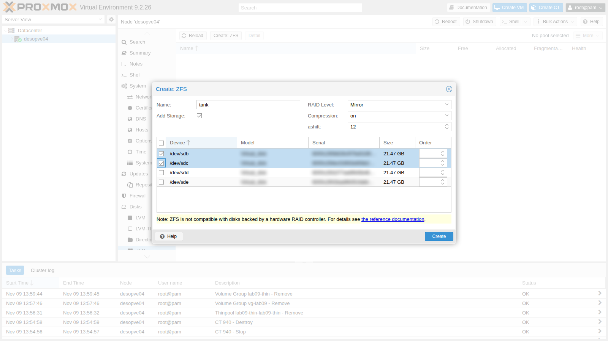
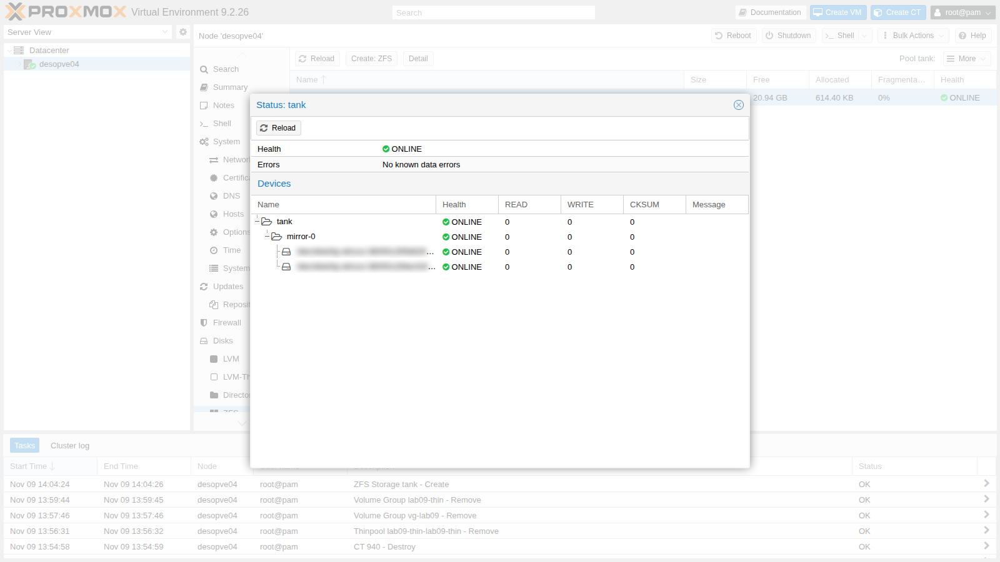
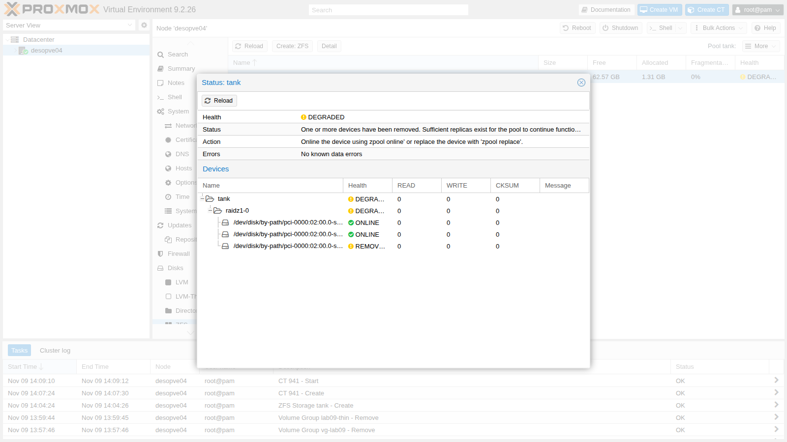
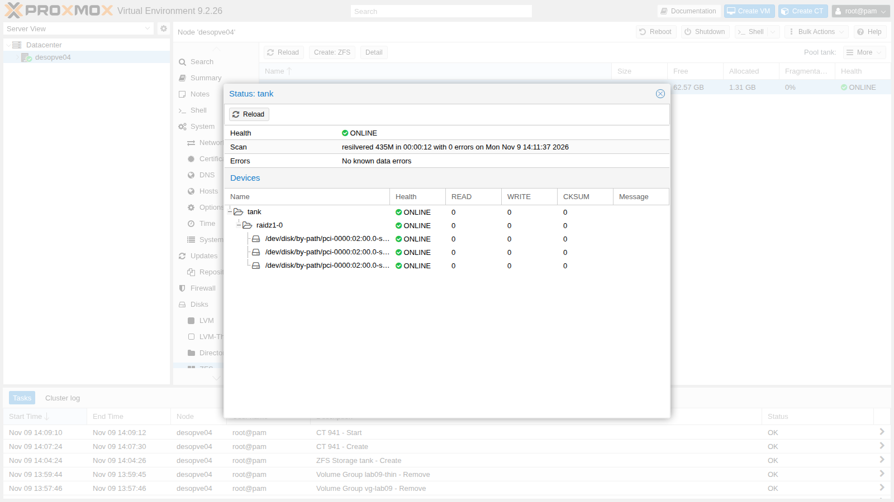

## Dependencies

- **Previous labs:** [Lab 09](/09-lvm-and-lvm-thin/). On `desopve04` the four 20 GB disks (`sdb`, `sdc`, `sdd`, `sde`) are empty.
- **Nodes:** `desopve04` as the test bed and `desopve01` (installed on ZFS, lab 03) for sending snapshots to a remote node.
- **Template:** `debian-13-standard_13.6-1_amd64.tar.zst` in the `local` storage of `desopve04` (lab 09).
- **Addresses:** `172.27.199.141` for the test container.
- **Hardware for the failure tests:** the disks of `desopve04` sit in hot-swap bays and can be pulled while the node is running. Have a fifth, new 20 GB disk ready to insert in Test 2 as a spare disk (see the [lab hardware](/01-lab-architecture/#lab-hardware)).
- **Credentials:** `root` / `<lab-password>` → [Appendix B](/b-credentials-and-addresses/).

## Objectives

- Understand how a ZFS pool is built: vdevs, mirrors, RAIDZ, datasets and zvols.
- Create a pool from the web interface and from the command line, with stable disk names.
- See ZFS self-healing at work: a corrupted mirror disk repaired by a scrub.
- Compare compression algorithms and understand the real usable space of a RAIDZ.
- Use snapshots, rollback and `zfs send`/`receive`, including to another node.
- Size the ARC, the ZFS cache in RAM.
- Handle a real disk failure: degraded pool, replacement and resilver.

## How it works

### Pools, vdevs and datasets

ZFS does the job of a RAID, a volume manager and a file system all at once:

```text
 pool (zpool)           tank
                         │
 vdev               raidz1-0  (or mirror-0, or a single disk)
                    ┌────┼────┐
 disks            sdb   sdc   sdd

 dataset and zvol   tank/dati            file system, mounted at /tank/dati
                    tank/vm-990-disk-0   zvol: a block device, /dev/zvol/tank/vm-990-disk-0
```

- A **pool** is made of one or more **vdevs**. Redundancy lives *inside* each vdev: if you lose an entire vdev, you lose the pool.
- A vdev can be a single disk, a **mirror** (2 or more identical copies), a **RAIDZ1/2/3** (distributed parity, survives the loss of 1, 2 or 3 disks) or a **dRAID**. There are also special vdevs (`log`, `cache`, `special`) and spare disks (`spare`).
- In the pool you create **datasets** (file systems) and **zvols** (block devices). Properties, such as compression, are inherited from the parent and can be changed for each one.

In Proxmox VE a `zfspool` storage puts VM disks in **zvols** and container disks in **datasets** (`subvol`), with a quota equal to the disk size.

### Why ZFS does not lose data silently

- **Copy-on-write:** ZFS never overwrites a block; it writes a new one and then updates the pointers. An interrupted write does not leave the file system half-updated, and snapshots are instant and free.
- **A checksum for every block**, stored in the parent block: ZFS notices when a disk returns wrong data, even without I/O errors.
- **Self-healing:** if the vdev is redundant, ZFS reads the good copy and rewrites the damaged one. A **scrub** rereads the entire pool to find and fix latent errors.

### Mirror or RAIDZ?

| | Mirror (2 disks) | RAIDZ1 (3 disks) | RAIDZ2 (4+ disks) |
|---|---|---|---|
| Usable space | 50% | about 66% | about 50% with 4 disks, more with many disks |
| Disks that can fail without data loss | 1 per mirror | 1 | 2 |
| Random performance (IOPS) | high, grows with the number of mirrors | roughly that of one disk per vdev | roughly that of one disk per vdev |
| Rebuild (resilver) | copy from a single disk | recomputed from parity across all disks | recomputed from parity |

For VM disks the Proxmox VE documentation recommends **mirrors** or striped mirrors (RAID10): more IOPS and faster rebuilds. RAIDZ is a better fit for backups and archives, where capacity matters.

:::note
ZFS must see the disks directly: no hardware RAID controller underneath, at most an HBA in IT/passthrough mode.
:::

### ARC

The **ARC** is the ZFS read cache in RAM. The larger it is, the more reads it spares the disks, but the RAM it uses is not available to the VMs. Since version 8.1 the Proxmox VE installer limits the ARC to **10% of the RAM**, with a maximum of 16 GiB, and writes the limit to `/etc/modprobe.d/zfs.conf`.

## Procedure

### 1. The system pool of `desopve01`

The installation in lab 03 created `rpool`, a mirror on partition 3 of the two 50 GB disks:

```bash title="root@desopve01"
zpool status rpool
```

```text output
  pool: rpool
 state: ONLINE
config:

	NAME                                   STATE     READ WRITE CKSUM
	rpool                                  ONLINE       0     0     0
	  mirror-0                             ONLINE       0     0     0
	    scsi-<seriale-disco-sda>-part3     ONLINE       0     0     0
	    scsi-<seriale-disco-sdb>-part3     ONLINE       0     0     0

errors: No known data errors
```

```bash title="root@desopve01"
zpool list
```

```text output
NAME    SIZE  ALLOC   FREE  CKPOINT  EXPANDSZ   FRAG    CAP  DEDUP    HEALTH  ALTROOT
rpool    49G  5.44G  43.6G        -         -     3%    11%  1.00x    ONLINE  -
```

The installer uses the names in `/dev/disk/by-id`, which contain the model and serial number of the disk and do not change if the `sda`, `sdb`… order changes. In the manual the serial numbers are replaced by placeholders, because they depend on the hardware.

### 2. Create a mirror from the web interface

1. On `desopve04` open **Disks** → **ZFS** → **Create: ZFS**.
2. **Name** `tank`, **RAID Level** `Mirror`, **Compression** `on` (i.e. LZ4), **ashift** `12` (4 KiB sectors), **Add Storage** enabled. Select `/dev/sdb` and `/dev/sdc`.

   

3. Click **Create**. The pool appears in the list; **Detail** shows the state of the disks, like `zpool status`.

   

4. From the command line:

   ```bash title="root@desopve04"
   zpool status tank
   ```

   ```text output
     pool: tank
    state: ONLINE
   config:

   	NAME                           STATE     READ WRITE CKSUM
   	tank                           ONLINE       0     0     0
   	  mirror-0                     ONLINE       0     0     0
   	    scsi-<seriale-disco-sdb>   ONLINE       0     0     0
   	    scsi-<seriale-disco-sdc>   ONLINE       0     0     0

   errors: No known data errors
   ```

   ```bash title="root@desopve04"
   grep -A4 "zfspool: tank" /etc/pve/storage.cfg
   ```

   ```text output
   zfspool: tank
   	pool tank
   	content rootdir,images
   	mountpoint /tank
   	nodes desopve04
   ```

### 3. Self-healing: corrupt a mirror disk

This step **deliberately destroys** part of the data on a disk. Only do it on a test pool.

1. Create a dataset, write 1.5 GB of random data and note the file's checksum:

   ```bash title="root@desopve04"
   zfs create tank/dati
   dd if=/dev/urandom of=/tank/dati/archivio.bin bs=1M count=1500 status=none
   md5sum /tank/dati/archivio.bin
   ```

   ```text output
   15bd171a50378dae9c3153c9c48bdb00  /tank/dati/archivio.bin
   ```

2. Overwrite 3 GB of the data partition of `sdc` with zeros, starting at 64 MiB so as not to touch the ZFS labels at the beginning of the disk:

   ```bash title="root@desopve04"
   dd if=/dev/zero of=/dev/sdc1 bs=1M seek=64 count=3000 oflag=direct status=none
   ```

3. Start a scrub and wait for it to finish (`-w`):

   ```bash title="root@desopve04"
   zpool scrub -w tank
   zpool status tank
   ```

   ```text output
     pool: tank
    state: ONLINE
   status: One or more devices has experienced an unrecoverable error.  An
   	attempt was made to correct the error.  Applications are unaffected.
   action: Determine if the device needs to be replaced, and clear the errors
   	using 'zpool clear' or replace the device with 'zpool replace'.
      see: https://openzfs.github.io/openzfs-docs/msg/ZFS-8000-9P
     scan: scrub repaired 962M in 00:00:05 with 0 errors on Mon Nov  9 14:06:41 2026
   config:

   	NAME                           STATE     READ WRITE CKSUM
   	tank                           ONLINE       0     0     0
   	  mirror-0                     ONLINE       0     0     0
   	    scsi-<seriale-disco-sdb>   ONLINE       0     0     0
   	    scsi-<seriale-disco-sdc>   ONLINE       0     0 7.57K

   errors: No known data errors
   ```

   ZFS found 7,570 blocks with a wrong checksum on the second disk (`CKSUM`) and rewrote 962 MB by copying them from the first one. No I/O errors: without checksums, nobody would have noticed.

4. The file is intact. Reset the counters:

   ```bash title="root@desopve04"
   md5sum /tank/dati/archivio.bin
   ```

   ```text output
   15bd171a50378dae9c3153c9c48bdb00  /tank/dati/archivio.bin
   ```

   ```bash title="root@desopve04"
   zpool clear tank
   zpool status -x tank
   ```

   ```text output
   pool 'tank' is healthy
   ```

   In production, keep an eye on a disk with checksum errors: if the errors recur, replace it. The `zfsutils-linux` package schedules a monthly scrub of all pools (`/etc/cron.d/zfsutils-linux`), and `zfs-zed` sends an email to `root` when it finds problems (lab 51).

### 4. Create a RAIDZ1 from the command line

Now rebuild `tank` as a RAIDZ1 on three disks. First remove the storage and the mirror pool:

```bash title="root@desopve04"
pvesm remove tank
zpool destroy tank
```

To specify the disks, instead of `sdb`… (which can change at every boot) use `/dev/disk/by-path`, which identifies the controller port. It is a stable alternative to `by-id`, handy when you want to know which slot a disk is in:

```bash title="root@desopve04"
ls -l /dev/disk/by-path/ | grep -v part | awk '{print $9, $11}' | grep scsi
```

```text output
pci-0000:02:00.0-scsi-0:0:0:0 ../../sda
pci-0000:02:00.0-scsi-0:0:1:0 ../../sdb
pci-0000:02:00.0-scsi-0:0:2:0 ../../sdc
pci-0000:02:00.0-scsi-0:0:3:0 ../../sdd
pci-0000:02:00.0-scsi-0:0:4:0 ../../sde
```

```bash title="root@desopve04"
cd /dev/disk/by-path
zpool create -o ashift=12 -O compression=lz4 -O atime=off tank raidz1 pci-0000:02:00.0-scsi-0:0:1:0 pci-0000:02:00.0-scsi-0:0:2:0 pci-0000:02:00.0-scsi-0:0:3:0
zpool status tank
```

```text output
  pool: tank
 state: ONLINE
config:

	NAME                               STATE     READ WRITE CKSUM
	tank                               ONLINE       0     0     0
	  raidz1-0                         ONLINE       0     0     0
	    pci-0000:02:00.0-scsi-0:0:1:0  ONLINE       0     0     0
	    pci-0000:02:00.0-scsi-0:0:2:0  ONLINE       0     0     0
	    pci-0000:02:00.0-scsi-0:0:3:0  ONLINE       0     0     0

errors: No known data errors
```

```bash title="root@desopve04:/dev/disk/by-path"
zpool list tank
```

```text output
NAME   SIZE  ALLOC   FREE  CKPOINT  EXPANDSZ   FRAG    CAP  DEDUP    HEALTH  ALTROOT
tank  59.5G   856K  59.5G        -         -     0%     0%  1.00x    ONLINE  -
```

```bash title="root@desopve04:/dev/disk/by-path"
zfs list tank
```

```text output
NAME   USED  AVAIL  REFER  MOUNTPOINT
tank   512K  38.4G   128K  /tank
```

- `-o ashift=12` is a **pool** property, fixed for good at creation time; `-O` sets properties of the root **dataset**, which its children inherit.
- `atime=off` avoids a write on every file read.
- `zpool list` shows the **raw** space, parity included (3 × 20 GB = 59.5 GiB); `zfs list` shows the **usable** space (38.4 GiB): one third goes to parity.

Add the storage, with the `sparse` option like `local-zfs`:

```bash title="root@desopve04"
pvesm add zfspool tank --pool tank --content images,rootdir --sparse 1 --nodes desopve04
pvesm status
```

```text output
Name             Type     Status     Total (KiB)      Used (KiB) Available (KiB)        %
local             dir     active        22203544         5768732        15281584   25.98%
local-lvm     lvmthin     active        14217216               0        14217216    0.00%
tank          zfspool     active        40265280             543        40264736    0.00%
```

### 5. Compression compared

Create three datasets with different compression and copy the same files into each one (documentation and Python libraries, i.e. text and code):

```bash title="root@desopve04"
for c in off lz4 zstd; do zfs create -o compression=$c tank/comp-$c; cp -a /usr/share/doc /usr/lib/python3 /tank/comp-$c/; done
zfs list -o name,compression,used,logicalused,compressratio -r tank | grep -E "NAME|comp-"
```

```text output
NAME            COMPRESS         USED  LUSED  RATIO
tank/comp-lz4   lz4              111M   112M  1.63x
tank/comp-off   off              157M   112M  1.00x
tank/comp-zstd  zstd             103M   112M  1.83x
```

- **RATIO** is the compression gain: zstd compresses more than LZ4 (1.83x versus 1.63x) and uses a little more CPU. LZ4 remains the most balanced default, because it quickly gives up on data that doesn't compress.
- **USED** is the space taken up in the pool. Without compression it is **more** than the logical data (157 MB versus 112): on RAIDZ every block carries its parity and the padding to a multiple of the sector size, and with many small files this overhead shows. Compression partly absorbs it.

### 6. Zvols and subvols: the guests' disks

Allocate a disk for a VM (test VMID `990`) and create a container on the `tank` storage:

```bash title="root@desopve04"
pvesm alloc tank 990 vm-990-disk-0 4G
```

```text output
successfully created 'tank:vm-990-disk-0'
```

```bash title="root@desopve04"
pct create 941 local:vztmpl/debian-13-standard_13.6-1_amd64.tar.zst --hostname lab10-ct --rootfs tank:4 --memory 512 --unprivileged 1 --features nesting=1 --ostype debian --net0 name=eth0,bridge=vmbr0,ip=172.27.199.141/24,gw=172.27.199.1
pvesm list tank
```

```text output
Volid                  Format  Type            Size VMID
tank:subvol-941-disk-0 subvol  rootdir   4294967296 941
tank:vm-990-disk-0     raw     images    4294967296 990
```

```bash title="root@desopve04"
zfs list -t all -o name,type,volsize,refquota,used,mountpoint -r tank | grep -E "NAME|990|941"
```

```text output
NAME                    TYPE        VOLSIZE  REFQUOTA   USED  MOUNTPOINT
tank/subvol-941-disk-0  filesystem        -        4G   346M  /tank/subvol-941-disk-0
tank/vm-990-disk-0      volume           4G         -  74.6K  -
```

```bash title="root@desopve04"
pct start 941
pct exec 941 -- df -h /
```

```text output
Filesystem              Size  Used Avail Use% Mounted on
tank/subvol-941-disk-0  4.0G  351M  3.7G   9% /
```

- The VM disk is a 4 GiB **zvol** (`volume`), thin: it takes up 75 KiB.
- The container disk is a **dataset** (`filesystem`) with a 4 GiB `refquota`: the container sees a 4 GiB file system, and the node sees its files directly in `/tank/subvol-941-disk-0`.

### 7. Snapshots and rollback

1. Create a test dataset, take a snapshot and delete the files:

   ```bash title="root@desopve04"
   zfs create tank/snapdemo; cp -a /usr/share/doc /tank/snapdemo/
   zfs snapshot tank/snapdemo@a
   rm -rf /tank/snapdemo/doc; sync
   zfs list -t snapshot -o name,used,refer tank/snapdemo
   ```

   ```text output
   NAME              USED  REFER
   tank/snapdemo@a  64.6M  64.7M
   ```

   ```bash title="root@desopve04"
   zfs list -o space tank/snapdemo
   ```

   ```text output
   NAME           AVAIL   USED  USEDSNAP  USEDDS  USEDREFRESERV  USEDCHILD
   tank/snapdemo  37.5G  64.7M     64.6M    128K             0B         0B
   ```

   Right after it is created, a snapshot takes up no space. When the files are deleted, their blocks stay with the snapshot: now the dataset uses 128 KiB (`USEDDS`) and the snapshot 64.6 MiB (`USEDSNAP`). The `USED` column of a snapshot counts only the blocks that belong to **that snapshot alone**: if several snapshots share the same blocks, each one shows `0B` and the space appears only in `USEDSNAP`.

2. The files of the snapshot can be read, read-only, in the hidden `.zfs/snapshot` directory. With `zfs rollback` the dataset goes back exactly to how it was. Try it on `tank/comp-zstd`:

   ```bash title="root@desopve04"
   zfs snapshot tank/comp-zstd@prima
   rm -rf /tank/comp-zstd/doc
   ls /tank/comp-zstd
   ```

   ```text output
   python3
   ```

   ```bash title="root@desopve04"
   ls /tank/comp-zstd/.zfs/snapshot/prima/
   ```

   ```text output
   doc
   python3
   ```

   ```bash title="root@desopve04"
   zfs rollback tank/comp-zstd@prima
   ls /tank/comp-zstd
   ```

   ```text output
   doc
   python3
   ```

   ```bash title="root@desopve04"
   zfs destroy -r tank/snapdemo
   ```

   `zfs rollback` only goes back to the **most recent** snapshot: to go back to an earlier one you have to destroy the later ones (`-r`). Snapshots of VM and container disks are managed from the web interface, which relies on ZFS snapshots (lab 16).

### 8. `zfs send` and `zfs receive`

`zfs send` turns a snapshot into a data stream, `zfs receive` recreates it elsewhere. This is the foundation of Proxmox VE replication (lab 11).

1. **Full and incremental copy within the same pool:**

   ```bash title="root@desopve04"
   zfs snapshot tank/comp-zstd@s1
   zfs send tank/comp-zstd@s1 | zfs receive tank/copia
   date > /tank/comp-zstd/nuovo.txt
   zfs snapshot tank/comp-zstd@s2
   zfs send -v -i @s1 tank/comp-zstd@s2 | zfs receive tank/copia
   ```

   ```text output
   send from tank/comp-zstd@s1 to tank/comp-zstd@s2 estimated size is 49.1K
   total estimated size is 49.1K
   TIME        SENT   SNAPSHOT tank/comp-zstd@s2
   ```

   ```bash title="root@desopve04"
   zfs list -t snapshot -o name,used,refer -r tank/comp-zstd tank/copia
   ```

   ```text output
   NAME                   USED  REFER
   tank/comp-zstd@prima     0B   103M
   tank/comp-zstd@s1        0B   103M
   tank/comp-zstd@s2        0B   103M
   tank/copia@s1         95.9K   111M
   tank/copia@s2            0B   111M
   ```

   ```bash title="root@desopve04"
   cat /tank/copia/nuovo.txt
   ```

   ```text output
   Mon Nov  9 02:07:58 PM CET 2026
   ```

   The incremental send (`-i @s1`) transfers only the differences between the two snapshots: 49 KB instead of 100 MB.

2. **To another node, over SSH.** `desopve04` is not part of the cluster, so it first needs an authorized key on `desopve01`. `ssh-copy-id` asks once for the `root` password of `desopve01`:

   ```bash title="root@desopve04"
   ssh-copy-id -o StrictHostKeyChecking=accept-new root@desopve01.proxmox.community
   ```

   ```text output
   /usr/bin/ssh-copy-id: INFO: Source of key(s) to be installed: "/root/.ssh/id_rsa.pub"
   /usr/bin/ssh-copy-id: INFO: attempting to log in with the new key(s), to filter out any that are already installed
   /usr/bin/ssh-copy-id: INFO: 1 key(s) remain to be installed -- if you are prompted now it is to install the new keys

   Number of key(s) added: 1
   ...
   ```

   ```bash title="root@desopve04"
   zfs send tank/comp-zstd@s2 | ssh root@desopve01.proxmox.community zfs receive rpool/lab10-copia
   ssh root@desopve01.proxmox.community zfs list -t all -o name,used,refer -r rpool/lab10-copia
   ```

   ```text output
   NAME                   USED  REFER
   rpool/lab10-copia     93.5M  93.5M
   rpool/lab10-copia@s2     0B  93.5M
   ```

   The dataset arrives on `desopve01` along with its snapshot. It takes up less space than on `tank` because there is no RAIDZ overhead there.

   :::note
   On the cluster nodes, `/root/.ssh/authorized_keys` is a link to the shared `/etc/pve/priv/authorized_keys`: the key of `desopve04` now opens **all** the nodes of the cluster. Remove it at the end of the lab (see *Cleanup*).
   :::

### 9. Size the ARC

1. The current limit is in the file created by the installer and in the module parameter:

   ```bash title="root@desopve04"
   cat /etc/modprobe.d/zfs.conf
   ```

   ```text output
   options zfs zfs_arc_max=1676673024
   ```

   ```bash title="root@desopve04"
   arc_summary -s arc | sed -n 7,12p
   ```

   ```text output
   ARC status:
           Total memory size:                                      15.6 GiB
           Min target size:                                3.1 %  499.7 MiB
           Max target size:                               10.0 %    1.6 GiB
           Target size (adaptive):                        44.1 %    1.6 GiB
           Current size:                                  44.1 %  705.3 MiB
   ```

   1,676,673,024 bytes is 1.6 GiB, 10% of the node's 15.6 GiB. `desopve01`, with 32 GB of RAM, has a limit of 3.1 GiB.

2. Raise the limit to 2 GiB on the fly by writing to the module parameter, and make it permanent in `zfs.conf`:

   ```bash title="root@desopve04"
   echo $((2*1024*1024*1024)) > /sys/module/zfs/parameters/zfs_arc_max
   sed -i "s/^options zfs zfs_arc_max=.*/options zfs zfs_arc_max=2147483648/" /etc/modprobe.d/zfs.conf
   arc_summary -s arc | sed -n 8,12p
   ```

   ```text output
           Total memory size:                                      15.6 GiB
           Min target size:                                3.1 %  499.7 MiB
           Max target size:                               12.8 %    2.0 GiB
           Target size (adaptive):                        33.2 %    1.6 GiB
           Current size:                                  33.2 %  679.9 MiB
   ```

   ```bash title="root@desopve04"
   arcstat 1 3
   ```

   ```text output
       time  read  ddread  ddh%  dmread  dmh%  pread  ph%   size      c  avail
   14:08:38     0       0     0       0     0      0    0   680M   1.6G  12.2G
   14:08:39     0       0     0       0     0      0    0   680M   1.6G  12.2G
   14:08:40     0       0     0       0     0      0    0   680M   1.6G  12.2G
   ```

   On nodes with the **system on ZFS** (like `desopve01-03`) the module is loaded from the initramfs: after changing `zfs.conf` you must run `update-initramfs -u -k all`, otherwise the old limit applies again after a reboot. `desopve04` has its system on ext4, so this is not needed.

## Verification and tests

### Test 1 – A RAIDZ disk fails

The `tank` pool is a RAIDZ1 on three disks and can survive the loss of one of them. Container `941` is running and has its disk on `tank`.

1. **Hot-remove** the disk in bay `scsi-0:0:3:0` (`sdd`). The disk disappears from the system and ZFS notices right away:

   ```bash title="root@desopve04"
   lsblk -d -o NAME,SIZE | grep sd
   ```

   ```text output
   sda    50G
   sdb    20G
   sdc    20G
   sde    20G
   ```

   ```bash title="root@desopve04"
   zpool status tank
   ```

   ```text output
     pool: tank
    state: DEGRADED
   status: One or more devices have been removed.
   	Sufficient replicas exist for the pool to continue functioning in a
   	degraded state.
   action: Online the device using zpool online' or replace the device with
   	'zpool replace'.
   config:

   	NAME                               STATE     READ WRITE CKSUM
   	tank                               DEGRADED     0     0     0
   	  raidz1-0                         DEGRADED     0     0     0
   	    pci-0000:02:00.0-scsi-0:0:1:0  ONLINE       0     0     0
   	    pci-0000:02:00.0-scsi-0:0:2:0  ONLINE       0     0     0
   	    pci-0000:02:00.0-scsi-0:0:3:0  REMOVED      0     0     0

   errors: No known data errors
   ```

   ```bash title="root@desopve04"
   journalctl -u zfs-zed --since "-15 min" --no-hostname | tail -2
   ```

   ```text output
   Nov 09 14:09:18 zed[24608]: eid=246 class=statechange pool='tank' vdev=pci-0000:02:00.0-scsi-0:0:3:0-part1 vdev_state=REMOVED
   Nov 09 14:09:19 zed[24927]: eid=247 class=removed pool='tank' vdev=pci-0000:02:00.0-scsi-0:0:3:0-part1 vdev_state=REMOVED
   ```

   `zfs-zed`, the ZFS event daemon, records the failure and notifies `root` by email (`ZED_EMAIL_ADDR` in `/etc/zfs/zed.d/zed.rc`).

2. The pool is **DEGRADED** but working: the container keeps reading and writing.

   ```bash title="root@desopve04"
   pct exec 941 -- sh -c "date > /root/durante-il-guasto.txt; sync; cat /root/durante-il-guasto.txt"
   ```

   ```text output
   Mon Nov  9 13:10:55 UTC 2026
   ```

   In **Disks** → **ZFS** → **Detail** the pool and the vdev are shown in yellow, with the disk `REMOVED`:

   

3. **Replace** the lost disk with the free disk `sde` (bay `scsi-0:0:4:0`). ZFS rebuilds the missing data from parity (**resilver**), copying only the blocks in use:

   ```bash title="root@desopve04"
   zpool replace tank pci-0000:02:00.0-scsi-0:0:3:0 /dev/disk/by-path/pci-0000:02:00.0-scsi-0:0:4:0
   zpool status tank
   ```

   ```text output
     pool: tank
    state: DEGRADED
   status: One or more devices is currently being resilvered.  The pool will
   	continue to function, possibly in a degraded state.
   action: Wait for the resilver to complete.
     scan: resilver in progress since Mon Nov  9 14:11:25 2026
   	1.22G / 1.22G scanned, 345M / 1.12G issued at 173M/s
   	100M resilvered, 30.18% done, 00:00:04 to go
   config:

   	NAME                                 STATE     READ WRITE CKSUM
   	tank                                 DEGRADED     0     0     0
   	  raidz1-0                           DEGRADED     0     0     0
   	    pci-0000:02:00.0-scsi-0:0:1:0    ONLINE       0     0     0
   	    pci-0000:02:00.0-scsi-0:0:2:0    ONLINE       0     0     0
   	    replacing-2                      DEGRADED     0     0     0
   	      pci-0000:02:00.0-scsi-0:0:3:0  REMOVED      0     0     0
   	      pci-0000:02:00.0-scsi-0:0:4:0  ONLINE       0     0     0  (resilvering)

   errors: No known data errors
   ```

   ```bash title="root@desopve04"
   zpool wait -t resilver tank
   ```

4. A few seconds after the resilver completes, ZFS detaches the old disk by itself and the pool goes back **ONLINE**:

   ```bash title="root@desopve04"
   zpool status tank
   ```

   ```text output
     pool: tank
    state: ONLINE
     scan: resilvered 435M in 00:00:12 with 0 errors on Mon Nov  9 14:11:37 2026
   config:

   	NAME                               STATE     READ WRITE CKSUM
   	tank                               ONLINE       0     0     0
   	  raidz1-0                         ONLINE       0     0     0
   	    pci-0000:02:00.0-scsi-0:0:1:0  ONLINE       0     0     0
   	    pci-0000:02:00.0-scsi-0:0:2:0  ONLINE       0     0     0
   	    pci-0000:02:00.0-scsi-0:0:4:0  ONLINE       0     0     0

   errors: No known data errors
   ```

   ```bash title="root@desopve04"
   md5sum /tank/copia/nuovo.txt /tank/comp-zstd/nuovo.txt
   ```

   ```text output
   2b697b63aba1f00e8edd33f831903cf2  /tank/copia/nuovo.txt
   2b697b63aba1f00e8edd33f831903cf2  /tank/comp-zstd/nuovo.txt
   ```

   ```bash title="root@desopve04"
   pct exec 941 -- cat /root/durante-il-guasto.txt
   ```

   ```text output
   Mon Nov  9 13:10:55 UTC 2026
   ```

   

   No data was lost, not even the data written while the pool was degraded.

### Test 2 – A spare disk

Insert the new 20 GB disk into the free bay `scsi-0:0:5:0` (if the kernel doesn't see it, repeat the bus rescan from [Lab 09](/09-lvm-and-lvm-thin/#2-the-nodes-disks)). The kernel gives it the first free name, `sdd`: the same name as the removed disk, but it is a different disk. That is why pools are built with stable names (`by-path` or `by-id`) and not with `sdX`.

```bash title="root@desopve04"
ls -l /dev/disk/by-path/ | grep -v part | awk '{print $9, $11}' | grep scsi
```

```text output
pci-0000:02:00.0-scsi-0:0:0:0 ../../sda
pci-0000:02:00.0-scsi-0:0:1:0 ../../sdb
pci-0000:02:00.0-scsi-0:0:2:0 ../../sdc
pci-0000:02:00.0-scsi-0:0:4:0 ../../sde
pci-0000:02:00.0-scsi-0:0:5:0 ../../sdd
```

```bash title="root@desopve04"
zpool add tank spare /dev/disk/by-path/pci-0000:02:00.0-scsi-0:0:5:0
zpool set autoreplace=on tank
zpool status tank
```

```text output
  pool: tank
 state: ONLINE
  scan: resilvered 435M in 00:00:12 with 0 errors on Mon Nov  9 14:11:37 2026
config:

	NAME                               STATE     READ WRITE CKSUM
	tank                               ONLINE       0     0     0
	  raidz1-0                         ONLINE       0     0     0
	    pci-0000:02:00.0-scsi-0:0:1:0  ONLINE       0     0     0
	    pci-0000:02:00.0-scsi-0:0:2:0  ONLINE       0     0     0
	    pci-0000:02:00.0-scsi-0:0:4:0  ONLINE       0     0     0
	spares
	  pci-0000:02:00.0-scsi-0:0:5:0    AVAIL

errors: No known data errors
```

- The **spare** (`AVAIL`) stays idle. If a pool disk fails, `zfs-zed` activates it automatically and starts the resilver, without waiting for human intervention. The failed disk must then be replaced, and the spare becomes available again.
- **`autoreplace=on`** does something else: if a new disk is inserted in the **same bay** as a lost disk, ZFS uses it right away as its replacement. It works well precisely with `by-path` names, which identify the slot.

### Cleanup

Remove the container, the test disk and the lab datasets, the dataset received on `desopve01` and the key of `desopve04` from the cluster. The `tank` pool stays: it will be used in lab 19.

```bash title="root@desopve04"
pct stop 941 && pct destroy 941 --purge 1
```

```text output
purging CT 941 from related configurations..
```

```bash title="root@desopve04"
pvesm free tank:vm-990-disk-0
```

```text output
Removed volume 'tank:vm-990-disk-0'
```

```bash title="root@desopve04"
for d in comp-off comp-lz4 comp-zstd copia; do zfs destroy -r tank/$d; done
zfs list -r tank
```

```text output
NAME   USED  AVAIL  REFER  MOUNTPOINT
tank   794K  38.4G   139K  /tank
```

```bash title="root@desopve04"
ssh root@desopve01.proxmox.community 'zfs destroy -r rpool/lab10-copia; sed -i "/ root@desopve04$/d" /etc/pve/priv/authorized_keys'
ssh -o BatchMode=yes root@desopve01.proxmox.community true
```

```text output
root@desopve01.proxmox.community: Permission denied (publickey,password).
```

- [ ] You created a mirror from the web interface and a RAIDZ1 from the command line with `by-path` names.
- [ ] The scrub found and repaired the corrupted blocks of a mirror disk, without losing data.
- [ ] You can tell raw space from usable space, and read the compression ratio.
- [ ] You used snapshots, rollback and `zfs send`/`receive`: full, incremental and to another node.
- [ ] You set the ARC of `desopve04` to 2 GiB, both on the fly and permanently.
- [ ] With a disk removed the pool stayed in service, and `zpool replace` brought it back ONLINE.

## Final lab state

- Nothing changed on the cluster: the received dataset was removed from `desopve01` and the key of `desopve04` was removed from the cluster's `authorized_keys`.
- **`desopve04`:**
  - pool **`tank`**: RAIDZ1 on the disks `pci-0000:02:00.0-scsi-0:0:1:0`, `0:2:0` and `0:4:0`, with the spare `0:5:0`. Properties `compression=lz4`, `atime=off`, `autoreplace=on`; it is empty, with 38.4 GiB usable;
  - storage **`tank`** (`zfspool`, content `images,rootdir`, `sparse`, `desopve04` only);
  - bay `scsi-0:0:3:0` is empty: the disk pulled in Test 1 does not go back into the node;
  - ARC limited to **2 GiB** in `/etc/modprobe.d/zfs.conf`;
  - template `debian-13-standard_13.6-1_amd64.tar.zst` in the `local` storage.

## What you learned

- A ZFS pool is made of vdevs; redundancy (mirror, RAIDZ) lives inside each vdev. Mirrors are preferred for VMs, RAIDZ for archives.
- Checksums and redundancy let ZFS detect corrupted data and repair it; a scrub does this for the whole pool.
- `zpool list` shows the raw space, `zfs list` the usable space; on RAIDZ, parity and padding weigh most on small files.
- Compression (LZ4 or zstd) is chosen per dataset; in Proxmox VE, VMs use zvols and containers use datasets with a quota.
- Snapshots are instant and take up only the differences; `zfs send`/`receive` copies datasets and snapshots, also incrementally and to other nodes.
- The ARC is limited with `zfs_arc_max`, on the fly and in `/etc/modprobe.d/zfs.conf`.
- With a failed disk the pool stays in service (DEGRADED); `zpool replace` restores the redundancy, and a spare lets `zfs-zed` do it automatically.

## References

- [Proxmox VE – ZFS on Linux](https://pve.proxmox.com/pve-docs/pve-admin-guide.html#chapter_zfs)
- [Proxmox VE – Limit ZFS Memory Usage](https://pve.proxmox.com/pve-docs/pve-admin-guide.html#sysadmin_zfs_limit_memory_usage)
- [Proxmox VE – Local ZFS Pool Backend](https://pve.proxmox.com/pve-docs/pve-admin-guide.html#storage_zfspool)
- [OpenZFS – `zpool` and `zfs` documentation](https://openzfs.github.io/openzfs-docs/man/master/index.html)
