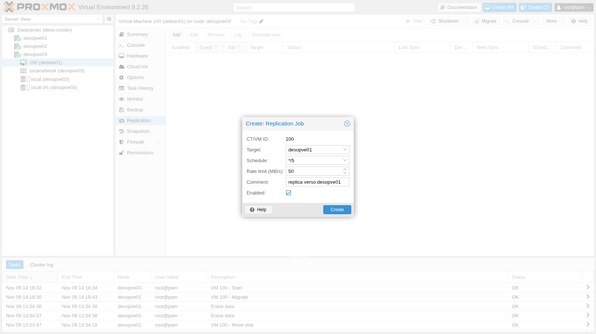
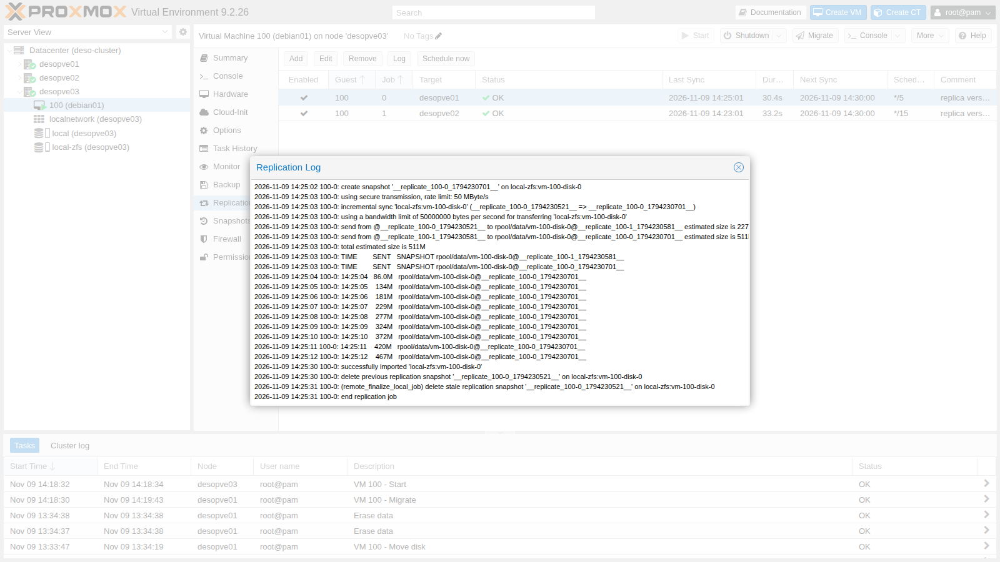
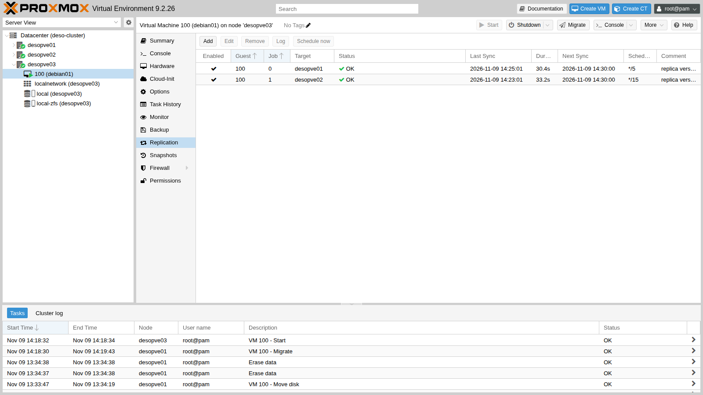
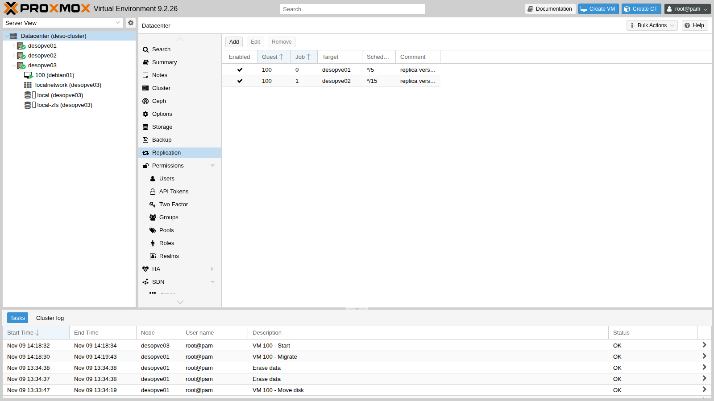
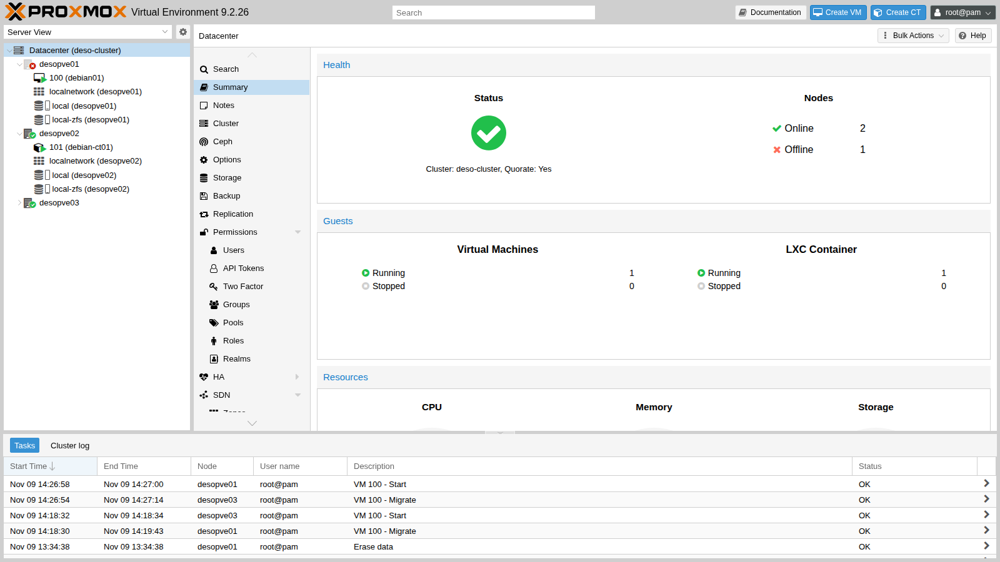
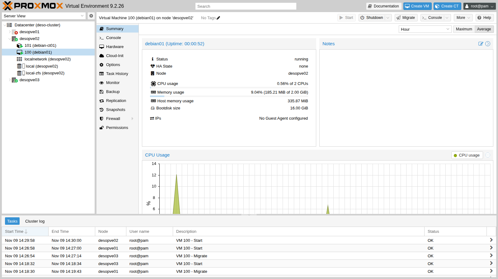

## Dependencies

- **Previous labs:** [Lab 06](/06-cluster-corosync/) for the three-node `deso-cluster` cluster, [Lab 07](/07-first-vm-and-container/) for VM 100 `debian01` and [Lab 10](/10-zfs/) for the concepts of snapshots and `zfs send`.
- **Storage:** `local-zfs` (pool `rpool/data`) on **all** nodes of the cluster, with the same name. It is the storage created by the installation on ZFS (lab 03).
- **VM:** 100 `debian01` running on `desopve01`, with its disk on `local-zfs`, reachable over SSH at `172.27.199.100` as `labuser`.
- **For the failure test:** the ability to cut the power to a node abruptly and to power it back on. Here the node is switched off with a kernel command and powered back on from the remote management card (IPMI, iDRAC, iLO) or with the power button.
- **Credentials:** `root` / `<lab-password>` → [Appendix B](/b-credentials-and-addresses/).

## Objectives

- Two replication jobs for VM 100, to two different nodes, one of them every 5 minutes with a 50 MB/s limit, whose state, logs and snapshots you can read in the GUI and with `pvesr`.
- The same VM live-migrated to a node without a replica and to a node with one, with the task duration, the downtime reported by QEMU and the data copied read separately in the logs.
- VM 100 restarted by hand on another node after its own node was abruptly powered off, with the data lost checked against the time of the last replicated snapshot.
- The cluster and the replication back in order when the failed node returns, knowing which copy is kept and which writes are discarded.

## How it works

### Replication, not shared storage

With a local storage like `local-zfs`, the disk of a VM exists on **one node only**: if the node stops, the VM cannot restart elsewhere. **Replication** (Storage Replication, the `pvesr` command) keeps an up-to-date copy of it on other nodes:

```text
 desopve01 (source)                        desopve02 (target)
 rpool/data/vm-100-disk-0                  rpool/data/vm-100-disk-0
   @__replicate_100-1_<time>__  ── zfs send ──▶  @__replicate_100-1_<time>__
         (every 15 minutes it sends only the blocks changed since the last snapshot)
```

- Replication is **asynchronous** and based on ZFS snapshots: on every run the job creates a snapshot, sends the difference from the previous run over SSH (incremental `zfs send`) and deletes the old snapshot. The first run sends all the data on the disk.
- It works **only with ZFS storage** (`zfspool`) and requires the storage to have the same name on the source and on the target.
- It is configured **per guest and per target node**: a job has an ID in the form `<VMID>-<number>` and one target; to have copies on two nodes you need two jobs.
- The jobs are run by the **`pvescheduler`** service, according to a schedule in *calendar event* format (`*/15`, i.e. every 15 minutes, is the default; forms like `mon..fri 22:30` can be used too).
- The copy is **not real-time**. What reaches the target is the state of the disk at the moment of the snapshot that opens each run: if the source node fails, everything written after the snapshot of the last successful run is lost. As long as the runs succeed, that window lasts at most the schedule interval plus the duration of a run; every failed run widens it. This is the figure to compare with the *Recovery Point Objective* (RPO), the largest data loss a service can accept.

### What you gain

- **Shorter migrations:** if the target already holds a replica, a migration sends only the changes since the last run instead of the whole disk. This also works for live migration: Proxmox VE runs the job one last time, has QEMU track the blocks written from that moment on (a *dirty bitmap*), and then mirrors only those.
- **Restart after a failure:** the VM can be restarted on the node that holds the replica, manually (this lab) or automatically with high availability (lab 49), accepting the loss of the most recent data.

Replication **does not replace backups** (labs 46-47): a deleted file or ransomware gets replicated like any other change.

### Who owns the VM

The configuration of a VM lives in the cluster file system, in `/etc/pve/nodes/<node>/qemu-server/<VMID>.conf`: the **directory** that holds the file decides which node the VM belongs to. To restart a VM on another node after a failure you move that file, but only if the failed node is **certainly powered off**. If it were still running, merely cut off from the others, the VM would end up running twice, on two copies of the disk that drift apart and with the same addresses on the network.

### Test environment and versions

The times and sizes in this lab come from a single run on 9 November 2026, in the configuration below. They describe this configuration: with other versions, disks, networks or VMs they change.

| Component | Configuration used |
|---|---|
| Proxmox VE | 9.2.26, kernel `7.0.14-28-pve` on `desopve01-03` ([Lab 04](/04-first-access-repositories-updates/)); QEMU 11.1.3 (the `creation-qemu` of VM 100, [Lab 07](/07-first-vm-and-container/)) |
| `local-zfs` | `rpool/data` on the ZFS mirror (RAID1) of the two system disks of each node ([Lab 03](/03-install-proxmox-ve/)), `sparse 1`; ZFS in the version shipped with Proxmox VE 9.2.26, which the lab does not record (`zfs version` shows it) |
| VM 100 `debian01` | Debian 13.7, 2 vCPUs, 2 GiB of RAM, no guest agent, 16 GiB `scsi0` disk holding about 1.9 GiB of data; idle apart from the test writes ([Lab 07](/07-first-vm-and-container/)) |
| Network | replication (over SSH) and migrations use the management network `172.27.199.0/24`, because no migration network is set yet ([Lab 22](/22-dedicated-networks/)); migration type `secure`, the default; the link speed is not recorded (`ethtool` shows it) |
| Jobs | `100-0`: `*/5`, limit 50 MB/s (50,000,000 bytes/s); `100-1`: `*/15`, no limit |

**What the logs measure.** The lab compares figures that measure different things:

- **task duration** (`migration finished successfully (duration …)`): the whole migration task, from the start to the final steps;
- **downtime** (`downtime … ms`): the pause that QEMU measures in the last phase of the memory transfer. Proxmox VE resumes the VM on the target only afterwards, in the final steps of the task, so this figure is not the interruption a client sees;
- **average migration speed**: the VM's total RAM divided by the duration of the memory transfer, counted in whole seconds, as [Lab 48](/48-migrations/#how-it-works) explains; it is neither the network throughput nor the speed of the disk copy, and with a resolution of one second it cannot compare memory transfers that last only a few seconds;
- **run duration** (`Duration` in `pvesr status`): a whole run of a replication job, of which the send is only one part;
- **data to send** (`estimated size`): the estimate ZFS makes before sending, in binary units (`154K`, `511M` and `1.91G` are KiB, MiB and GiB); it is not a network counter.

**What the lab does not measure.** It does not measure the pause a client sees during the migrations, nor the time from the power-off of the node until the VM is reachable again. Each migration and each test was run once: the figures are single observations, not statistics.

## Procedure

### 1. Check the storage

The `local-zfs` storage is defined only once for the whole cluster, without a `nodes` line, so it exists on all nodes with the same name:

```bash title="root@desopve01"
grep -A4 "zfspool: local-zfs" /etc/pve/storage.cfg
```

```text output
zfspool: local-zfs
	pool rpool/data
	content rootdir,images
	sparse 1
```

### 2. A baseline migration, without replication

To have a point of comparison, live-migrate VM 100 to `desopve03`, which has no copy of its disk yet. With `--with-local-disks`, Proxmox VE mirrors the 16 GiB disk to the target while the VM keeps running:

```bash title="root@desopve01"
qm migrate 100 desopve03 --online --with-local-disks
```

```text output
…
mirror-scsi0: transferred 16.0 GiB of 16.0 GiB (100.00%) in 57s, ready
2026-11-09 14:19:36 average migration speed: 1.0 GiB/s - downtime 10 ms
2026-11-09 14:19:36 migration completed, transferred 333.6 MiB VM-state
2026-11-09 14:19:43 migration finished successfully (duration 00:01:13)
```

- **Measured:** the disk mirror (`mirror-scsi0`) reports 16.0 GiB of 16.0 GiB in 57 seconds; the whole task takes 1 minute 13 seconds; QEMU reports 10 ms of downtime and 333.6 MiB of VM state (the memory) transferred.
- **Interpretation:** the mirror went through the whole 16 GiB virtual size of the disk, although the volume holds only about 1.9 GiB of data (the estimate of the full send in step 4). The duration is consistent with a copy that depends on the size of the disk more than on its contents, which is what the documentation describes for a target without a replica. The log does not show how many bytes actually crossed the network, nor what limited the speed of the copy: the network, the source pool or the target pool.
- **How to check:** compare the bytes the source node transmits on the management network before and after the migration (`ip -s link show vmbr0`), and watch `zpool iostat 1` on both nodes during the copy.

The VM now runs on `desopve03`.

### 3. Create the replication jobs

1. Select VM **100 (debian01)** → **Replication** → **Add**.
2. Fill in the job to `desopve01`:
   - **Target** `desopve01`;
   - **Schedule** `*/5`, every 5 minutes (in the lab, to see the runs without waiting too long);
   - **Rate limit (MB/s)** `50`, so as not to saturate the network during the first full send;
   - **Comment** `replica verso desopve01`.

   

3. Click **Create**, then add a second job: **Target** `desopve02`, **Schedule** `*/15` (the default), no rate limit.

The configuration is in the cluster file system:

```bash title="root@desopve03"
cat /etc/pve/replication.cfg
```

```text output
local: 100-0
	comment replica verso desopve01
	target desopve01
	rate 50
	schedule */5
	source desopve03

local: 100-1
	comment replica verso desopve02
	target desopve02
	source desopve03
```

The second job has no `schedule` line because it uses the default value.

### 4. The first run: a full copy

The first runs start a few seconds after the jobs are created. **Log** shows the steps of a run: snapshot, full send (`full sync`), import on the target. This is the first run of the job to `desopve01`, with the 50 MB/s limit:

```text
2026-11-09 14:22:02 100-0: create snapshot '__replicate_100-0_1794230521__' on local-zfs:vm-100-disk-0
2026-11-09 14:22:02 100-0: using secure transmission, rate limit: 50 MByte/s
2026-11-09 14:22:02 100-0: full sync 'local-zfs:vm-100-disk-0' (__replicate_100-0_1794230521__)
2026-11-09 14:22:03 100-0: full send of rpool/data/vm-100-disk-0@__replicate_100-0_1794230521__ estimated size is 1.91G
…
2026-11-09 14:22:43 100-0: 14:22:43   1.90G   rpool/data/vm-100-disk-0@__replicate_100-0_1794230521__
2026-11-09 14:23:00 100-0: successfully imported 'local-zfs:vm-100-disk-0'
2026-11-09 14:23:01 100-0: end replication job
```

ZFS estimates `1.91G` to send (in binary units, 1.91 GiB). The 16 GiB volume holds only the blocks written so far, and `zfs send` sends those, not the empty space. The send takes about 40 seconds, in line with the limit (1.91 GiB at 50 MB/s takes about 41 seconds). The job to `desopve02`, without a limit, sends the same data in 7 seconds. Step 5 compares these times with the duration of the whole runs.

### 5. Subsequent runs: only the differences

1. In the VM, write 500 MiB of new data:

   ```bash title="labuser@debian01"
   dd if=/dev/urandom of=$HOME/dati-1.bin bs=1M count=500 status=none; sync
   ```

2. Select the job to `desopve01`, click **Schedule now**, then open **Log**. This time the run is **incremental** (`incremental sync`): ZFS estimates `511M` to send, close to the 500 MiB just written, instead of the whole volume:

   

3. The job list shows, for each job, the last sync, the duration of the last run, the next run and the state:

   

   From the command line:

   ```bash title="root@desopve03"
   pvesr status
   ```

   ```text output
   JobID      Enabled    Target                           LastSync             NextSync   Duration  FailCount State
   100-0      Yes        local/desopve01       2026-11-09_14:25:01  2026-11-09_14:30:00  30.423273          0 OK
   100-1      Yes        local/desopve02       2026-11-09_14:23:01  2026-11-09_14:30:00  33.221129          0 OK
   ```

4. **Datacenter** → **Replication** lists the jobs of all the guests in the cluster: it is the place to check them all at once.

   

5. The replication snapshots can be seen with `zfs list`. Each volume keeps the last snapshot of each job, which serves as the base for the next run:

   ```bash title="root@desopve03"
   zfs list -t snapshot -o name,used,creation -r rpool/data
   ```

   ```text output
   NAME                                                      USED  CREATION
   rpool/data/vm-100-disk-0@__replicate_100-1_1794230581__  1.12M  Mon Nov  9 14:23 2026
   rpool/data/vm-100-disk-0@__replicate_100-0_1794230701__   188K  Mon Nov  9 14:25 2026
   ```

   ```bash title="root@desopve03"
   ssh desopve01 zfs list -t snapshot -o name,used,creation -r rpool/data
   ```

   ```text output
   NAME                                                      USED  CREATION
   rpool/data/vm-100-disk-0@__replicate_100-1_1794230581__  1.12M  Mon Nov  9 14:23 2026
   rpool/data/vm-100-disk-0@__replicate_100-0_1794230701__     0B  Mon Nov  9 14:25 2026
   ```

   Do not delete the `__replicate_…` snapshots by hand: without the common base, the next run would have to start over with a full copy.

**Send and run: two different durations.** The `Duration` column is the length of a whole run. The send is only one part of it, as the logs show:

| Run | Data to send (ZFS estimate) | Send (progress lines in the log) | Whole run |
|---|---|---|---|
| First run to `desopve01`, 50 MB/s limit (step 4) | `1.91G` | about 40 s (14:22:03 → 14:22:43) | about 1 minute (14:22:02 → 14:23:01) |
| First run to `desopve02`, no limit (step 4) | the same | 7 s | 33.2 s (`Duration`) |
| Incremental run to `desopve01`, 50 MB/s limit (this step) | `511M` | about 10 s (14:25:03 → 14:25:12) | 30.4 s (`Duration`) |

- **Measured:** with the limit, the send proceeds at about 50 MB/s, the configured value (the log states it as `50000000 bytes per second`). In both runs to `desopve01`, 17-18 seconds pass between the last progress line and `successfully imported`; the run to `desopve02` lasts 33.2 seconds for a 7-second send.
- **Interpretation:** the length of the send follows from the data to send and the limit. The log does not break down the rest of the run: it may go into completing the receive on the target or into the other steps of the job, and this test does not tell them apart.
- **How to check:** during a run, `zpool iostat 1` on the target shows whether the pool is still writing after the last progress line, and the full log of the job gives the time of every step.

### 6. Migrate a replicated VM

Migrate VM 100 from `desopve03` to `desopve01`, which already has a replica:

```bash title="root@desopve03"
qm migrate 100 desopve01 --online --with-local-disks
```

```text output
…
2026-11-09 14:26:55 incremental sync 'local-zfs:vm-100-disk-0' (__replicate_100-0_1794230701__ => __replicate_100-0_1794230814__)
2026-11-09 14:26:56 send from @__replicate_100-0_1794230701__ to rpool/data/vm-100-disk-0@__replicate_100-0_1794230814__ estimated size is 154K
…
drive mirror re-using dirty bitmap 'repl_scsi0'
…
2026-11-09 14:27:07 average migration speed: 688.3 MiB/s - downtime 20 ms
2026-11-09 14:27:14 migration finished successfully (duration 00:00:20)
```

| Live migration of VM 100 | Disk copy, from the task log | Downtime reported by QEMU | Task duration |
|---|---|---|---|
| To `desopve03`, without a replica (step 2) | mirror of the whole disk: 16.0 GiB of 16.0 GiB in 57 s | 10 ms | 1 minute 13 seconds |
| To `desopve01`, with the replica | one last replication run (estimate `154K`), then a mirror of only the blocks recorded in the `repl_scsi0` bitmap | 20 ms | 20 seconds |

- **Measured:** with the replica, the task lasts 20 seconds instead of 1 minute 13 seconds. The replication run it starts lasts 3.2 seconds: it is the run of job `100-0` with `LastSync` 14:26:54 in the `pvesr status` at the start of the failure test.
- **Interpretation:** the shorter task is consistent with the smaller disk copy. The excerpts do not show how the rest of the time is split, but two figures narrow it down. From the `average migration speed` (see [Test environment and versions](#test-environment-and-versions)), with 2 GiB of RAM, the memory transfer took about 3 seconds here and about 2 in step 2: a few seconds in both cases, but at a resolution of one second the figure does not say which of the two was faster. And in both migrations 7 seconds pass between the end of the memory transfer and the end of the task (14:27:07 → 14:27:14 here, 14:19:36 → 14:19:43 in step 2). The downtimes, 10 and 20 ms, are QEMU's figures from a single run each: they do not say how long a client lost contact with the VM.
- **How to check:** the full task log (double-click the task in **Tasks**) gives the time of every phase. To measure what a client sees, ping the VM from another host during the migration, with an interval shorter than the pause you want to resolve, for example every 10 ms (`ping -D -i 0.01 172.27.199.100`). With a ping every 0.2 seconds, as in [Lab 48](/48-migrations/), a pause shorter than the interval can go unnoticed.

After the migration Proxmox VE **reverses** the jobs on its own: the one that pointed to `desopve01` now replicates to the old node, `desopve03`. The comment, however, stays as it was written by hand:

```bash title="root@desopve01"
cat /etc/pve/replication.cfg
```

```text output
local: 100-0
	comment replica verso desopve01
	target desopve03
	rate 50
	schedule */5
	source desopve01

local: 100-1
	comment replica verso desopve02
	target desopve02
	source desopve01
```

## Verification and tests

The lab has succeeded when every check below gives the expected result. The last column shows what this run observed, on 9 November 2026.

| Check | Expected result | Observed in the lab |
|---|---|---|
| Replication jobs (`pvesr status`, **Datacenter** → **Replication**) | both jobs `OK`, `FailCount` 0 | `100-0` every 5 minutes and `100-1` every 15, both `OK` |
| Run logs | `full sync` on the first run, `incremental sync` afterwards | `1.91G` on the first run; `511M` after writing 500 MiB |
| Migration to a node with the replica (step 6) | `incremental sync` and `drive mirror re-using dirty bitmap` in the log; a shorter task than without a replica | 20 s instead of 1 minute 13 s |
| VM restarted from the replica (first test) | the VM starts on `desopve02`; the files written before the last snapshot are there, the later ones are missing | `A` and `dati-1.bin` present; `B` and `dati-2.bin`, written after 14:28:01, lost |
| Return of the failed node (second test) | the node rejoins with quorum, does not start VM 100, and the next run realigns it with an `incremental sync` | `Quorate`, 3 votes; `12.5M` sent at 14:36:02 |
| Cleanup | no jobs left, no volumes of VM 100 on `desopve02` and `desopve03` | as expected |

### Test – The node suddenly powers off

**Configuration tried.** VM 100 runs on `desopve01` and is replicated to `desopve03` (job `100-0`, every 5 minutes) and to `desopve02` (job `100-1`). You cut the power to `desopve01` and restart the VM from the replica on `desopve02`.

1. In the VM, write a file, start a replication run to `desopve02` and wait for it to finish. Then write more data, **after** the snapshot of that run (`LastSync`):

   ```bash title="labuser@debian01"
   date "+%F %T" > $HOME/A-prima-della-replica.txt; sync
   ```

   ```bash title="root@desopve01"
   pvesr schedule-now 100-1
   pvesr status
   ```

   ```text output
   JobID      Enabled    Target                           LastSync             NextSync   Duration  FailCount State
   100-0      Yes        local/desopve03       2026-11-09_14:26:54  2026-11-09_14:30:00   3.183833          0 OK
   100-1      Yes        local/desopve02       2026-11-09_14:28:01  2026-11-09_14:30:00  13.542599          0 OK
   ```

   ```bash title="labuser@debian01"
   date "+%F %T" > $HOME/B-dopo-la-replica.txt
   dd if=/dev/urandom of=$HOME/dati-2.bin bs=1M count=200 status=none; sync
   ls -l --time-style=+%T $HOME
   ```

   ```text output
   -rw-rw-r-- 1 labuser labuser        20 14:27:34 A-prima-della-replica.txt
   -rw-rw-r-- 1 labuser labuser        20 14:28:11 B-dopo-la-replica.txt
   -rw-rw-r-- 1 labuser labuser 524288000 14:24:00 dati-1.bin
   -rw-rw-r-- 1 labuser labuser 209715200 14:28:12 dati-2.bin
   ```

2. At 14:28:28, before the next run, power `desopve01` off abruptly. The *SysRq* `o` command makes the kernel switch the machine off at once, without a clean shutdown: services are not stopped and file systems are not unmounted:

   ```bash title="root@desopve01"
   echo o > /proc/sysrq-trigger
   ```

3. The other two nodes still have quorum (2 votes out of 3), so the cluster stays operational:

   ```bash title="root@desopve02"
   pvecm status | grep -E "Total votes|Quorum:|Flags"
   ```

   ```text output
   Total votes:      2
   Quorum:           2
   Flags:            Quorate
   ```

   **Behaviour observed.** The web interface marks `desopve01` as offline. VM 100 still appears under `desopve01`, with its last known state, and nothing restarts it: there is no high availability.

   

4. On `desopve02`, check the last replication snapshot received: it is the one taken at 14:28:01 (`__replicate_100-1_1794230881__`; the number in the name is the time of the snapshot in seconds since 1970).

   ```bash title="root@desopve02"
   zfs list -t snapshot -o name,creation -r rpool/data/vm-100-disk-0
   ```

   ```text output
   NAME                                                     CREATION
   rpool/data/vm-100-disk-0@__replicate_100-0_1794230814__  Mon Nov  9 14:26 2026
   rpool/data/vm-100-disk-0@__replicate_100-1_1794230881__  Mon Nov  9 14:28 2026
   ```

5. **Decision.** Restart the VM from the replica on `desopve02`. This is safe only because you know for certain that `desopve01` is off: you switched it off yourself. Move the VM configuration into the directory of `desopve02` and start the VM, as the documentation describes for a failed node:

   ```bash title="root@desopve02"
   mv /etc/pve/nodes/desopve01/qemu-server/100.conf /etc/pve/nodes/desopve02/qemu-server/100.conf
   qm start 100
   ```

   

6. In the VM, check the files:

   ```bash title="labuser@debian01"
   ls -l --time-style=+%T $HOME
   ```

   ```text output
   -rw-rw-r-- 1 labuser labuser        20 14:27:34 A-prima-della-replica.txt
   -rw-rw-r-- 1 labuser labuser 524288000 14:24:00 dati-1.bin
   ```

   ```bash title="labuser@debian01"
   cat $HOME/B-dopo-la-replica.txt
   ```

   ```text output
   cat: /home/labuser/B-dopo-la-replica.txt: No such file or directory
   ```

   **Result.** The VM restarted with its disk as it was at **14:28:01**, the moment of the last replicated snapshot.

   - **Measured:** the file written before the snapshot (`A`, 14:27:34) and `dati-1.bin` are there; file `B` (14:28:11) and the 200 MiB of `dati-2.bin` (14:28:12), written after it, are **lost**. Between the snapshot and the power-off (14:28:28) 27 seconds passed: that is the data-loss window of this test. The VM boots and its files can be read.
   - **Interpretation:** what is lost is whatever was written inside the window, and the window depends on where the failure falls between two runs. With job `100-1` on its default `*/15` schedule and no forced run, it could have reached 15 minutes plus the duration of a run, and more after failed runs. VM 100 has no guest agent, so the snapshot is taken without freezing the guest file systems: the copy is like a disk after a power cut (*crash-consistent*), and ext4 makes it consistent again by replaying its journal when it mounts.
   - **How to check:** in the VM, as root, the kernel log of the boot shows whether ext4 recovered its journal (`journalctl -k -b | grep EXT4-fs`); in the job log, the line `freeze guest filesystem` appears only when the guest file systems are frozen before the snapshot. Applications need their own checks: a database, for example, has to recover its own log.

   The test did not measure how long the service was down, from the power-off until the VM answered again: here that time includes making sure that the node is off and the manual steps. To measure it, keep a ping running from another host for the whole test (`ping -D 172.27.199.100`): the timestamps of the last reply before the power-off and of the first one after the restart give the interruption.

7. Meanwhile the jobs have followed the VM. Job `100-1`, whose target was `desopve02`, now replicates from `desopve02` to the failed node, `desopve01`: it fails (`FailCount` 1, `ssh` exit code 255) and has no `NextSync` while that node is off. Job `100-0` carries on from the new node to `desopve03`:

   ```bash title="root@desopve02"
   pvesr status
   ```

   ```text output
   JobID      Enabled    Target                           LastSync             NextSync   Duration  FailCount State
   100-0      Yes        local/desopve03       2026-11-09_14:30:01  2026-11-09_14:35:00   6.464296          0 OK
   100-1      Yes        local/desopve01                         -                    -   3.111215          1 command '/usr/bin/ssh -e none … root@172.27.199.21 -- pvesr prepare-local-job 100-1 --last_sync 0 -- local-zfs:vm-100-disk-0' failed: exit code 255
   ```

### Test – The failed node returns to service

1. Power `desopve01` back on from the remote management card. At boot it rejoins the cluster and receives the updated configuration: VM 100 no longer belongs to it, so it does not start.

   ```bash title="root@desopve01"
   pvecm status | grep -E "Total votes|Quorate"
   ```

   ```text output
   Quorate:          Yes
   Total votes:      3
   ```

   ```bash title="root@desopve01"
   qm list
   zfs list -t all -o name,creation -r rpool/data | grep vm-100
   ```

   ```text output
   rpool/data/vm-100-disk-0                                 Mon Nov  9 14:22 2026
   rpool/data/vm-100-disk-0@__replicate_100-0_1794230814__  Mon Nov  9 14:26 2026
   rpool/data/vm-100-disk-0@__replicate_100-1_1794230881__  Mon Nov  9 14:28 2026
   ```

   The disk left on `desopve01` is **stale**: the VM now lives on `desopve02`, and this copy stopped at the power-off. It may also hold the writes made after 14:28:01 that never reached the replica; the lab does not check this. To see it, before the job runs again, run `zfs get written rpool/data/vm-100-disk-0` on `desopve01`: it shows how much was written after the last snapshot, and a value close to the 200 MiB of `dati-2.bin` would confirm it.

2. The job resumes by itself, at 14:36:02 in this run. It starts from the snapshot the two nodes have in common, the one taken at 14:28:01 (`__replicate_100-1_1794230881__`), and sends only what the VM wrote on `desopve02` after it: an estimated `12.5M`. On import, Proxmox VE uses `zfs receive -F`, which first rolls the volume on `desopve01` back to that snapshot:

   ```text
   2026-11-09 14:36:02 100-1: incremental sync 'local-zfs:vm-100-disk-0' (__replicate_100-1_1794230881__ => __replicate_100-1_1794231361__)
   2026-11-09 14:36:03 100-1: total estimated size is 12.5M
   2026-11-09 14:36:10 100-1: successfully imported 'local-zfs:vm-100-disk-0'
   2026-11-09 14:36:11 100-1: end replication job
   ```

   The writes left only on `desopve01` are discarded: the good copy is the one the VM kept working on. The time of the retry is not fixed: the documentation speaks of retries every 30 minutes, while here the job ran again within a few minutes. **Decision:** if you need the writes left on the failed node, disable the job (`pvesr disable 100-1`) **before** powering the node back on, and recover them first.

3. Move the VM back to its node. The log shows the same steps as in step 6 of the procedure, an incremental run and the reuse of the `repl_scsi0` bitmap, and the task again lasts 20 seconds:

   ```bash title="root@desopve02"
   qm migrate 100 desopve01 --online --with-local-disks
   ```

   ```text output
   …
   2026-11-09 14:36:43 incremental sync 'local-zfs:vm-100-disk-0' (__replicate_100-1_1794231361__ => __replicate_100-1_1794231402__)
   drive mirror re-using dirty bitmap 'repl_scsi0'
   2026-11-09 14:37:01 migration finished successfully (duration 00:00:20)
   ```

### Cleanup

Delete the replication jobs and the test files in the VM. Removing a job is a background operation: the job is marked with `remove_job full`, and on the next run `pvescheduler` deletes the replicated volumes on the target and the snapshots on the source.

```bash title="labuser@debian01"
rm -f $HOME/dati-*.bin $HOME/A-*.txt $HOME/B-*.txt
```

```bash title="root@desopve01"
pvesr delete 100-0
```

```text output
Replication job removal is a background task and will take some time.
```

```bash title="root@desopve01"
pvesr delete 100-1
```

```text output
Replication job removal is a background task and will take some time.
```

```bash title="root@desopve01"
grep -E "^local|remove_job" /etc/pve/replication.cfg
```

```text output
local: 100-0
	remove_job full
local: 100-1
	remove_job full
```

A minute later the jobs are gone, together with the copies on the other nodes:

```bash title="root@desopve01"
cat /etc/pve/replication.cfg
zfs list -t all -o name -r rpool/data | grep vm-100
```

```text output
rpool/data/vm-100-disk-0
```

```bash title="root@desopve01"
ssh desopve02 'zfs list -t all -o name -r rpool/data | grep vm-100 || echo "nessun volume della VM 100"'
```

```text output
nessun volume della VM 100
```

```bash title="root@desopve01"
ssh desopve03 'zfs list -t all -o name -r rpool/data | grep vm-100 || echo "nessun volume della VM 100"'
```

```text output
nessun volume della VM 100
```

## Final lab state

- Cluster `deso-cluster` with the three nodes online; `desopve04` unchanged.
- VM 100 `debian01` running on `desopve01`, disk `local-zfs:vm-100-disk-0`, with no test files.
- No replication jobs: `/etc/pve/replication.cfg` is empty and there are no copies of VM 100 on `desopve02` and `desopve03`.
- CT 101 `debian-ct01` running on `desopve02`, unchanged.

## What you learned

- **Choosing the schedule from the data you can afford to lose.** After a failure you lose everything written after the snapshot of the last successful run: up to the schedule interval plus the duration of a run, and more if runs fail. You compare that window with the RPO of the service, and you watch `LastSync` and `FailCount` in `pvesr status` or in **Datacenter** → **Replication**.
- **Planning copies and bandwidth.** A job covers one guest and one target, so two copies need two jobs; a rate limit keeps the first full send from saturating the network, at the cost of a longer run.
- **Using a replica to shorten migrations.** With a replica on the target, the migration of a VM with local disks sends only the changes since the last run. Here it took 20 seconds instead of 1 minute 13 seconds, measured once on one VM: on your own VMs, measure before relying on a figure.
- **Reading a migration log.** The task duration, the downtime reported by QEMU and the pause a client sees are different measurements, and `average migration speed`, the RAM divided by whole seconds, is neither the network throughput nor a figure for comparing two runs. To know what clients see, you measure it from outside, with a ping at an interval suited to the pause you expect.
- **Restarting a VM by hand after a failure.** Only when the failed node is certainly off: you move the configuration file into the directory of a node that holds the replica, then start the VM.
- **Handling the return of the failed node.** Replication resumes by itself and rolls the stale copy back to the common snapshot, discarding the writes left there: if you need them, you disable the job before powering the node back on.
- **Knowing what replication does not do.** It is not a backup and it does not restart VMs: automatic restart needs high availability (lab 49), with the same data-loss window.

## References

- [Proxmox VE – Storage Replication](https://pve.proxmox.com/pve-docs/pve-admin-guide.html#chapter_pvesr)
- [Proxmox VE – Storage Replication: error handling and retries](https://pve.proxmox.com/pve-docs/pve-admin-guide.html#_error_handling)
- [Proxmox VE – Migrating a guest in case of error (moving the configuration file)](https://pve.proxmox.com/pve-docs/pve-admin-guide.html#_migrating_a_guest_in_case_of_error)
- [Proxmox VE – Schedule Format (calendar events)](https://pve.proxmox.com/pve-docs/pve-admin-guide.html#chapter_calendar_events)
- [Proxmox VE – `pvesr` man page](https://pve.proxmox.com/pve-docs/pvesr.1.html)
- [Proxmox VE – Migration](https://pve.proxmox.com/pve-docs/pve-admin-guide.html#qm_migration)
- [Proxmox VE – qemu-server source, `QemuMigrate.pm` (`average migration speed`, resuming the VM on the target)](https://git.proxmox.com/?p=qemu-server.git;a=blob;f=src/PVE/QemuMigrate.pm;hb=HEAD)
- [OpenZFS 2.4 – `zfs receive -F` (rollback before receiving)](https://openzfs.github.io/openzfs-docs/man/v2.4/8/zfs-receive.8.html#F)
- [OpenZFS 2.4 – the `written` property](https://openzfs.github.io/openzfs-docs/man/v2.4/7/zfsprops.7.html#written)
- [Linux kernel – Magic SysRq key (`o`: power off)](https://docs.kernel.org/admin-guide/sysrq.html)
