## Dependencies

- **Previous labs:** [Lab 01](/01-lab-architecture/) for the addressing plan and [Lab 02](/02-domain-controller/) for DNS, with the records for `desonas.proxmox.community`. The NAS does not depend on the cluster: you can prepare it in parallel with Part 0.
- **Server:** `desonas`, with 4 cores, 16 GB of RAM, a 32 GB system disk, two 100 GB data disks and a network card on the lab LAN.
- **ISO:** `TrueNAS-SCALE-25.10.8.iso` (TrueNAS Community Edition 25.10 "Goldeye"), from [truenas.com](https://www.truenas.com/download-truenas-community-edition/), on a USB stick or on the *virtual media* of the management card.
- **Services:** DNS `172.27.199.20`, NTP and proxy on `netsvc.proxmox.community` (aliases `ntp` and `proxy`).
- **Addresses:** `172.27.199.10` for the NAS.
- **Credentials:** `truenas_admin` / `<lab-password>` → [Appendix B](/b-credentials-and-addresses/).

## Objectives

- Install TrueNAS Community Edition and configure its static network from the console.
- Complete the basic configuration from the web interface: time zone, NTP, DNS and proxy.
- Create a mirrored ZFS pool for the data.
- Prepare the datasets that NFS, SMB and iSCSI will use in the following labs.
- Create a service user for Proxmox VE.

## How it works

### The role of the NAS in the lab

So far the VM disks have stayed on the nodes (`local-zfs`). A **shared storage**, visible in the same way from all nodes, makes it possible to migrate VMs without copying their disks and to restart them elsewhere if a node fails (labs 48-49). In the lab it is provided by a NAS outside the cluster, over three protocols:

| Protocol | Level | What Proxmox VE sees | Lab |
|---|---|---|---|
| **NFS** | file | a shared directory: disks as `raw` or `qcow2` files, ISOs, backups, templates | 13 |
| **SMB/CIFS** | file | like NFS, authenticated with a user name and password | 14 |
| **iSCSI** | block | a disk (LUN) on which to create shared LVM | 15 |

### TrueNAS Community Edition

TrueNAS Community Edition (called **SCALE** up to version 24.10) is a NAS operating system based on Debian and **OpenZFS**: the same concepts as in lab 10, managed from a web interface.

- The **boot pool** (`boot-pool`) contains only the operating system, on a dedicated disk. The data goes into a separate **data pool**, on the other disks.
- In the pool you create **datasets**, i.e. file systems with their own properties (compression, quotas, permissions), and **zvols**, the block devices that iSCSI needs.
- The ZFS rules apply to a real NAS too: disks seen directly, with no RAID controller (at most an HBA in IT/passthrough mode), ECC RAM recommended and, for VMs, mirrored pools.

## Procedure

### 1. Installation from the console

1. Boot the NAS from the USB stick with the ISO (or from the *virtual media* of the management card) and choose **Install/Upgrade**.

   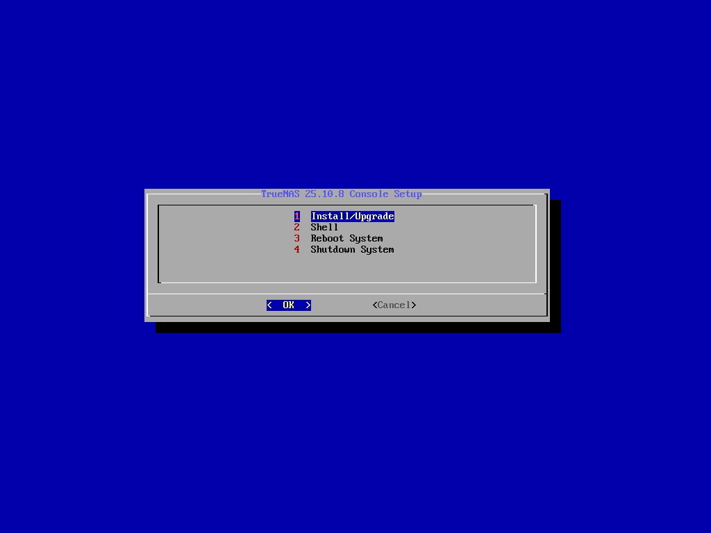

2. With the space bar, select **only the 32 GiB disk** (`sdb`) and confirm with **OK**. The two 100 GiB disks remain free for the data pool: the disk you install on can no longer hold data. At the next prompt, confirm that the disk will be erased.

   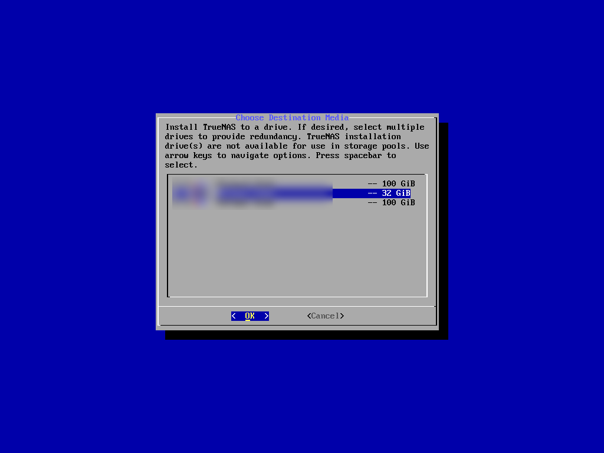

   As throughout the manual, the data that identify the hardware (model and serial number of the disks, name and physical address of the network card) are obscured in the screenshots.

3. As the authentication method, choose **Administrative user (truenas_admin)** and set the password. Direct password login for `root` remains disabled.

   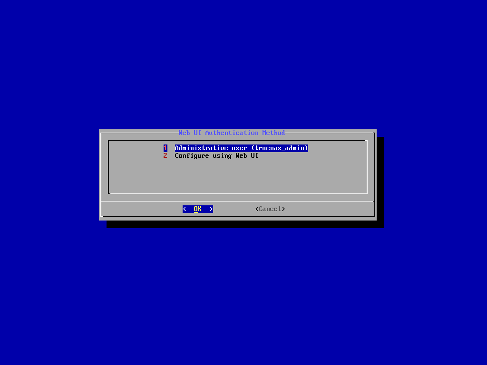

4. When the installation is done, remove the USB stick (or unmount the *virtual media*) and reboot from the disk.

   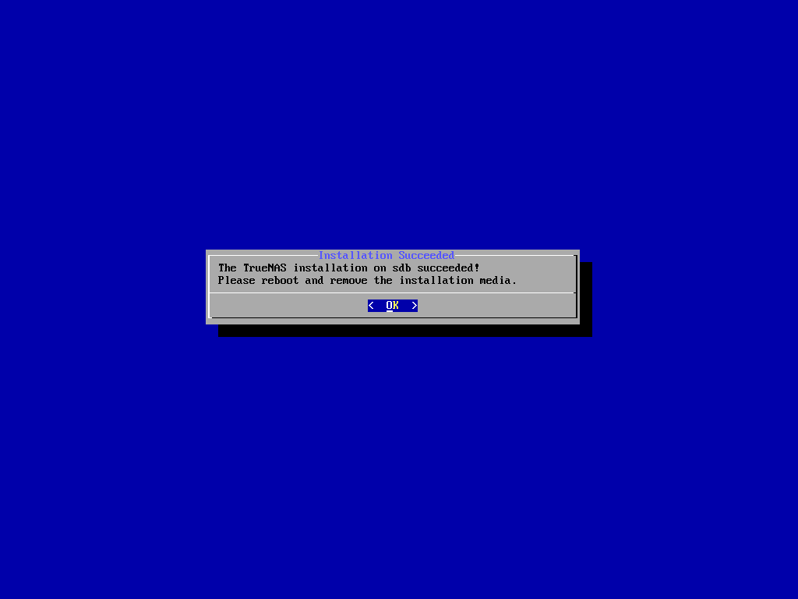

### 2. Static network from the console

There is no DHCP server on the lab network, so at first boot the NAS has no address and the console warns that the web interface is not reachable:

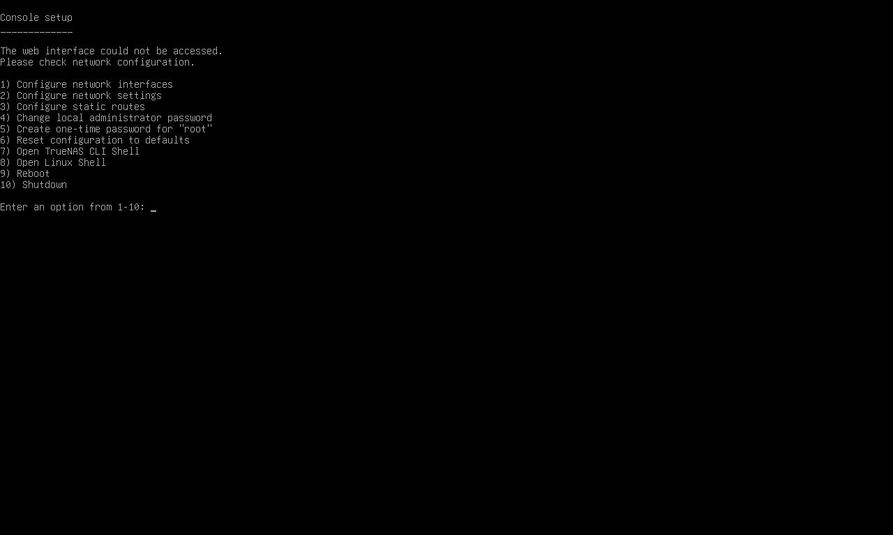

1. Choose **1) Configure network interfaces** and open the only interface. Set `ipv4_dhcp` to **No** and in `aliases` enter `172.27.199.10/24`, then **Save**.

   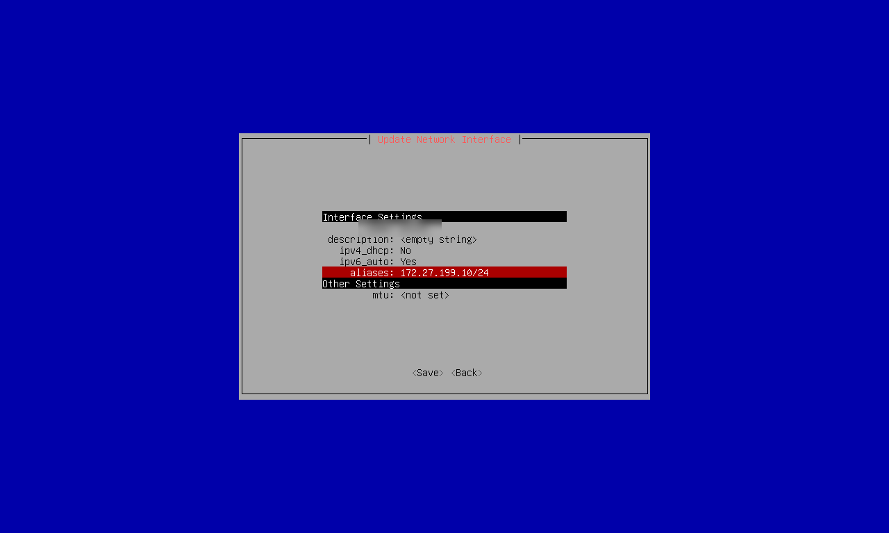

2. Press **a** to apply. TrueNAS applies the change with an **automatic rollback** after 60 seconds: if the new network settings made you lose access, the configuration would revert by itself. If everything works, press **p** to make it permanent (*persist*).
3. Choose **2) Configure network settings**: `hostname` `desonas`, `domain` `proxmox.community`, `ipv4gateway` `172.27.199.1`, `nameserver1` `172.27.199.20`, then **Save**. In version 25.10 the gateway is set here: the menu no longer has a separate entry for the default route.

   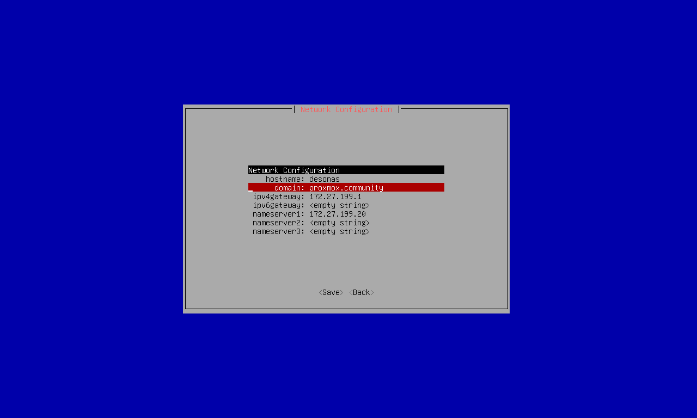

4. The console now shows the address of the web interface:

   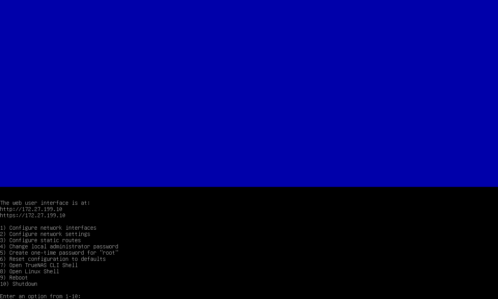

### 3. First access to the web interface

From the DC, open `https://desonas.proxmox.community` and log in as `truenas_admin`. The certificate is self-signed, like the Proxmox VE one.

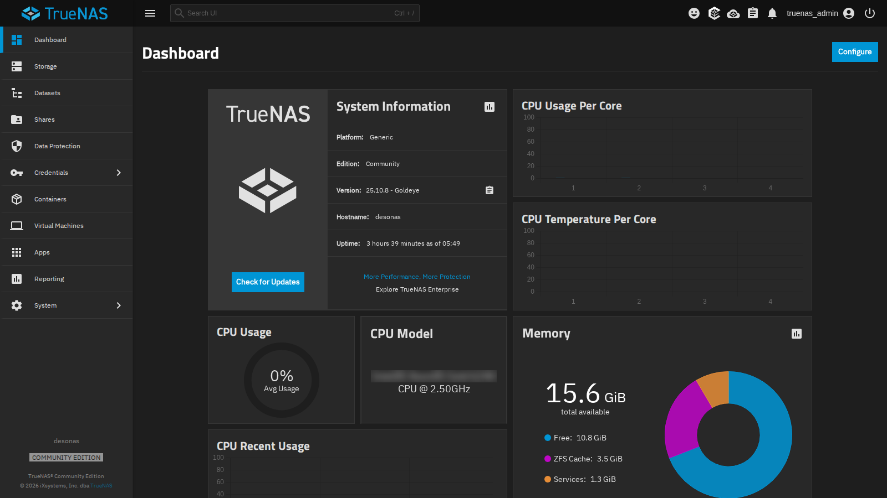

### 4. Time zone and keyboard

**System** → **General Settings** → **Localization** → **Settings**: **Timezone** `Europe/Rome`, **Console Keyboard Map** `Italian (it)`, then **Save**. Without this step the NAS clock stays on `America/Los_Angeles`, and logs and scheduled snapshots are nine hours off from the rest of the lab.

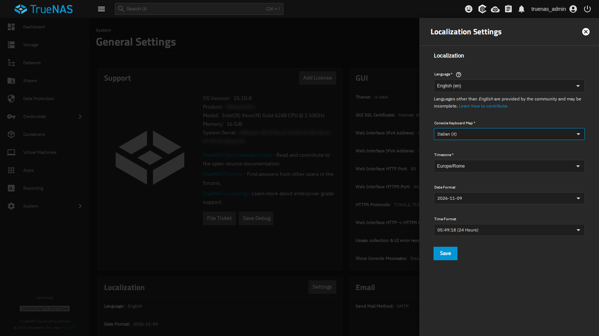

### 5. Time synchronization

Accurate time matters: notifications, logs and, in lab 14, SMB authentication depend on it. The default servers (`*.debian.pool.ntp.org`) are on the Internet and cannot be reached from the lab.

1. **System** → **Advanced Settings** (confirm the warning) → **NTP Servers** → **Add**.
2. **Address** `ntp.proxmox.community`, check **IBurst** (fast initial synchronization) and **Prefer**, then **Save**. TrueNAS queries the server right away and rejects an address that does not respond, unless you check **Force**.

   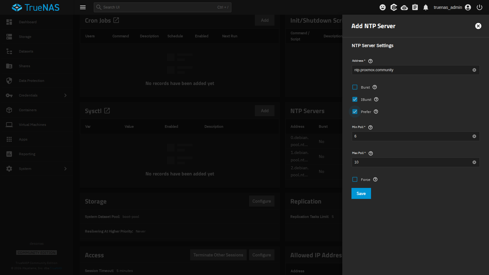

3. Delete the three servers `0`, `1` and `2.debian.pool.ntp.org` with the trash icon, confirming each time.

### 6. DNS, gateway and proxy

**System** → **Network** → **Network Configuration** → **Settings** summarizes what was set from the console: hostname, domain, DNS and gateway. In **HTTP Proxy** enter `http://proxy.proxmox.community:3128`: TrueNAS will use it to check for updates, just as Proxmox VE uses the datacenter proxy (lab 04). **Save**.

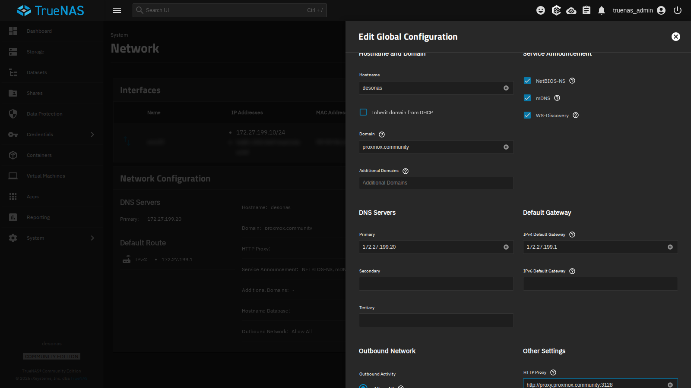

### 7. The mirrored data pool

1. **Storage** → **Create Pool**. In the **General Info** step the name is `dati`, with no encryption.
2. In the **Data** step choose **Layout** `Mirror`; in the automatic disk selection, **Disk Size** `100 GiB (HDD)`, **Width** `2` (disks per vdev) and **Number of VDEVs** `1`.

   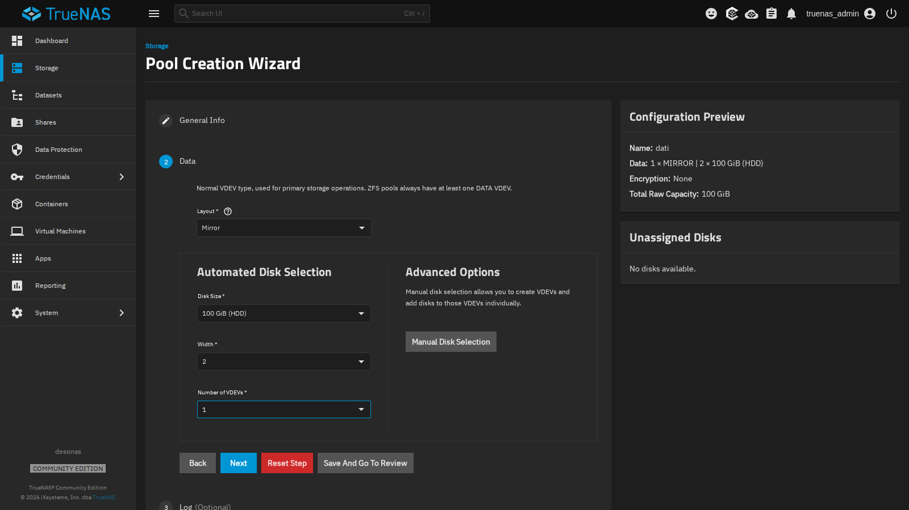

3. Skip the optional steps (Log, Spare, Cache, Metadata, Dedup) with **Save And Go To Review** and check the summary: a mirror of two 100 GiB disks.

   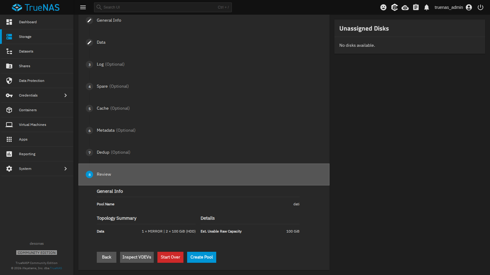

4. **Create Pool**, check **Confirm** in the warning that the disks will be erased and click **Continue**. After a few seconds the pool is online: 95.44 GiB usable, with a scrub already scheduled every Sunday at midnight.

   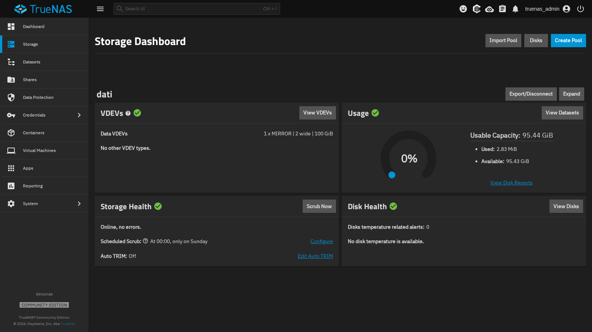

### 8. The datasets for the three protocols

Each protocol gets its own dataset, with independent properties and permissions.

1. **Datasets** → select `dati` → **Add Dataset**: **Name** `nfs`, **Dataset Preset** `Generic`, then **Save**.

   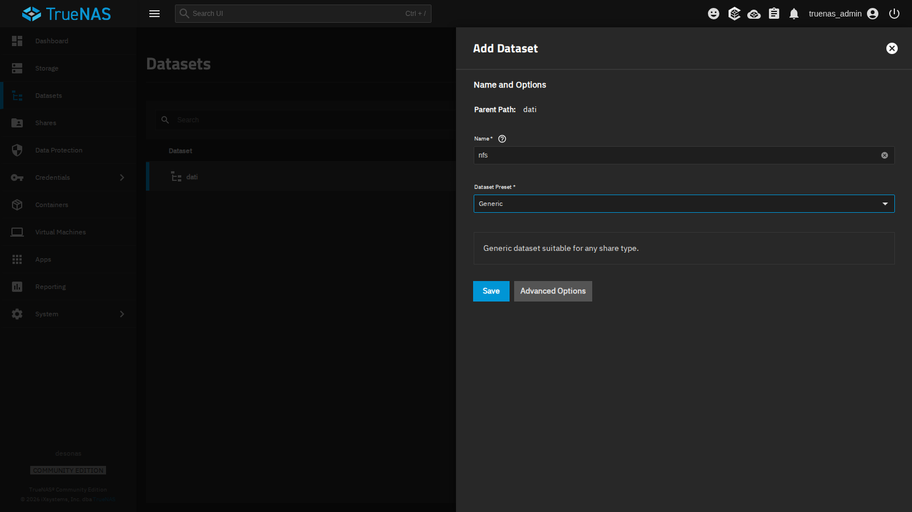

2. Repeat for `smb` with **Dataset Preset** `SMB` and **clear** the **Create SMB Share** checkbox: you will create the share in lab 14. The SMB preset sets permissions and options suited to Windows (NFSv4 ACLs, case-insensitive names).
3. Repeat for `iscsi` with the `Generic` preset: it will hold the zvols of lab 15.

The three datasets inherit LZ4 compression and `atime` disabled from the pool:

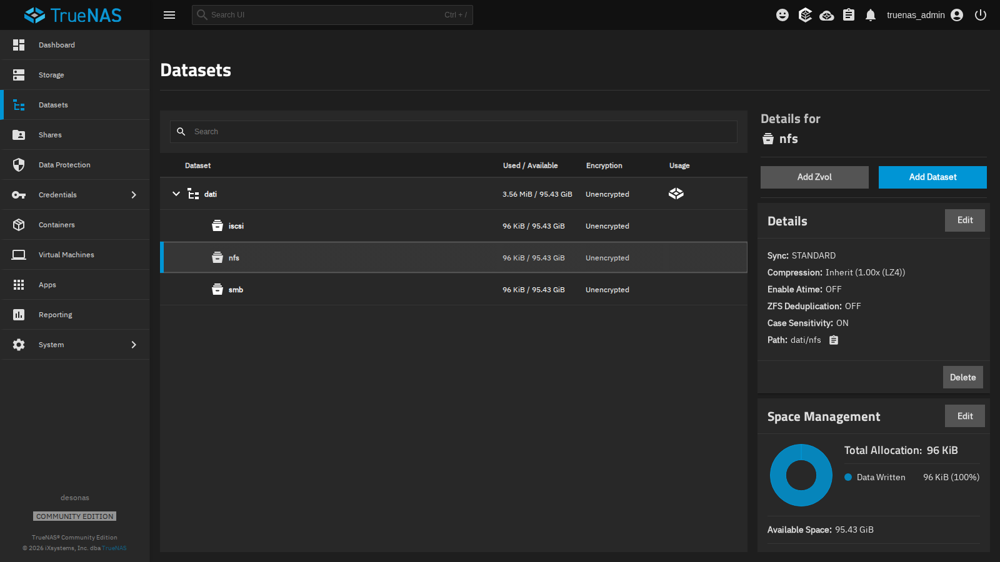

### 9. The service user

Proxmox VE will access the SMB share with a dedicated user, not with the NAS administrator.

1. **Credentials** → **Users** → **Add**.
2. **Username** `svc-pve`, leave only **SMB Access** enabled, set the password `<lab-password>`. No access to the shell, SSH or the web interface.

   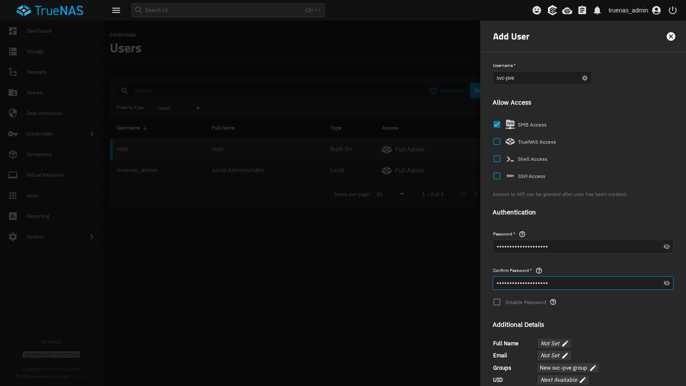

3. **Save**.

## Verification and tests

From a cluster node, check that the NAS answers to its name, that reverse DNS is correct and that its clock matches the nodes':

```bash title="root@desopve01"
host desonas.proxmox.community
```

```text output
desonas.proxmox.community has address 172.27.199.10
```

```bash title="root@desopve01"
host 172.27.199.10
```

```text output
10.199.27.172.in-addr.arpa domain name pointer desonas.proxmox.community.
```

```bash title="root@desopve01"
ping -c2 -W1 desonas.proxmox.community | tail -2
```

```text output
2 packets transmitted, 2 received, 0% packet loss, time 1002ms
rtt min/avg/max/mdev = 0.503/1.300/2.097/0.797 ms
```

```bash title="root@desopve01"
curl -skI https://desonas.proxmox.community/ui/ | grep -i "^date"; date -u
```

```text output
date: Mon, 09 Nov 2026 14:04:49 GMT
Mon Nov  9 02:04:49 PM UTC 2026
```

- [ ] The NAS has the static address `172.27.199.10` and the name `desonas.proxmox.community`.
- [ ] The NAS time matches the nodes'; the only NTP server is `ntp.proxmox.community`.
- [ ] The `dati` pool is a two-disk mirror, online and error-free.
- [ ] The datasets `dati/nfs`, `dati/smb` and `dati/iscsi` exist, and so does the user `svc-pve`, with SMB access only.

## Final lab state

- **NAS `desonas.proxmox.community`** (`172.27.199.10`), TrueNAS Community Edition 25.10.8:
  - system on the 32 GB disk (`boot-pool`); administrator `truenas_admin`;
  - time zone `Europe/Rome`, Italian keyboard, NTP `ntp.proxmox.community`, DNS `172.27.199.20`, gateway `172.27.199.1`, proxy `http://proxy.proxmox.community:3128`;
  - pool **`dati`**: mirror of the two 100 GiB disks, 95.44 GiB usable, LZ4 compression;
  - datasets `dati/nfs` (Generic), `dati/smb` (SMB) and `dati/iscsi` (Generic), still without shares;
  - user `svc-pve` with SMB access.
- Cluster and VMs unchanged.

## What you learned

- TrueNAS Community Edition is a NAS system based on Debian and ZFS: the system lives in a dedicated boot pool, the data in a separate pool.
- Without DHCP, the network is configured from the console, with an automatic rollback that protects against mistakes.
- Time zone and NTP must be fixed right away; the default NTP servers are on the Internet.
- A pool is created with a wizard: layout, disk size, width and number of vdevs.
- NFS, SMB and iSCSI are best given a separate dataset each; the SMB preset prepares permissions suited to Windows.
- Proxmox VE accesses the NAS with a dedicated service user that has only the permissions it needs.

## References

- [TrueNAS – Installing TrueNAS Community Edition](https://www.truenas.com/docs/scale/gettingstarted/install/installingscale/)
- [TrueNAS – Console Setup Menu Configuration](https://www.truenas.com/docs/scale/gettingstarted/install/consolesetupmenuscale/)
- [TrueNAS – Creating Storage Pools](https://www.truenas.com/docs/scale/scaletutorials/storage/createpoolwizard/)
- [TrueNAS – Adding and Managing Datasets](https://www.truenas.com/docs/scale/scaletutorials/datasets/datasetsscale/)
- [TrueNAS – Managing Users](https://www.truenas.com/docs/scale/scaletutorials/credentials/managelocalusersscale/)
- [Proxmox VE – Storage](https://pve.proxmox.com/pve-docs/pve-admin-guide.html#chapter_storage)
