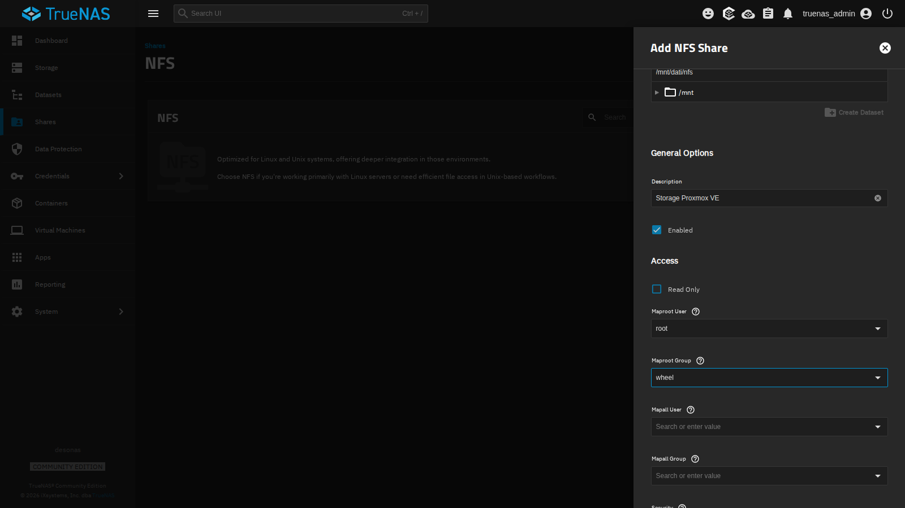
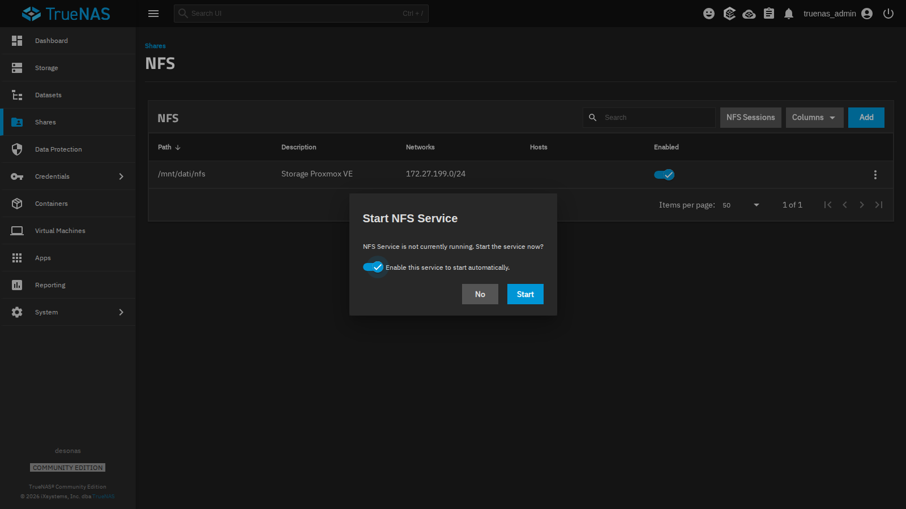
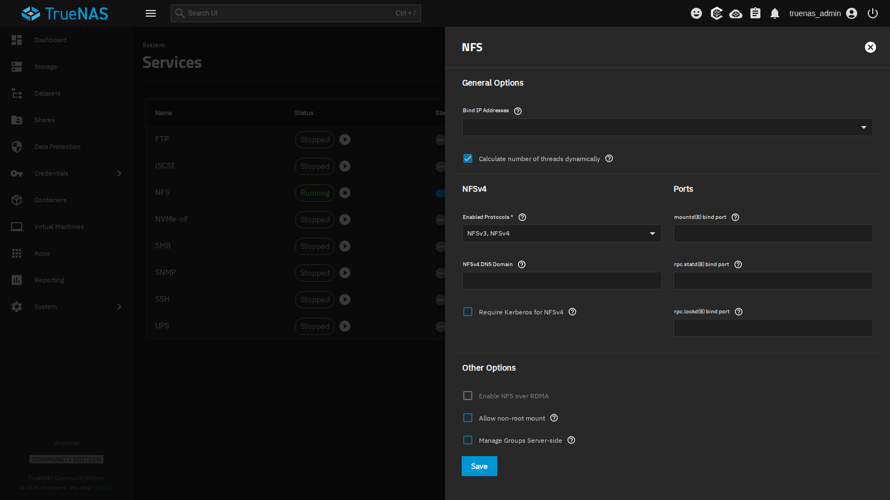
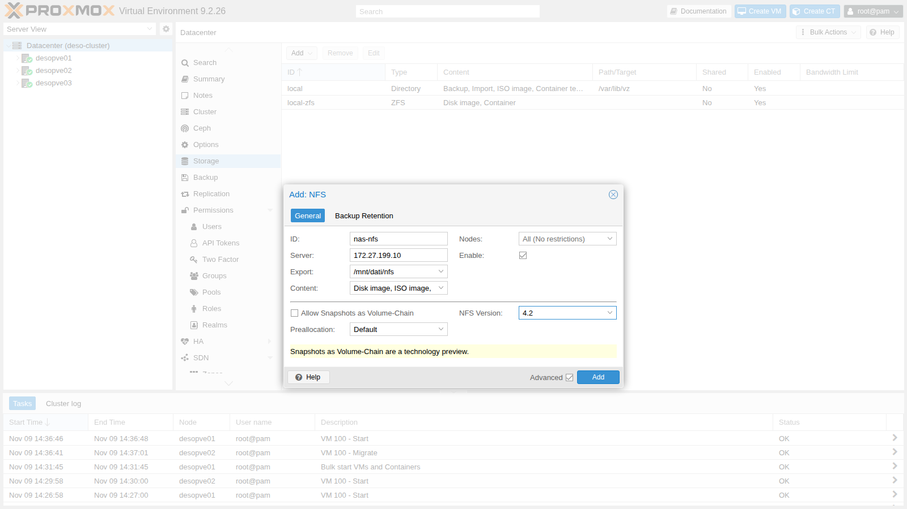
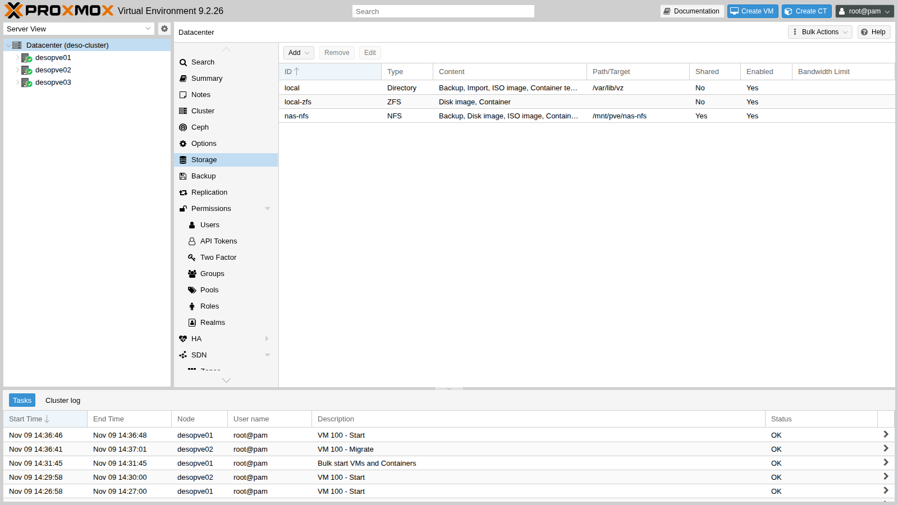
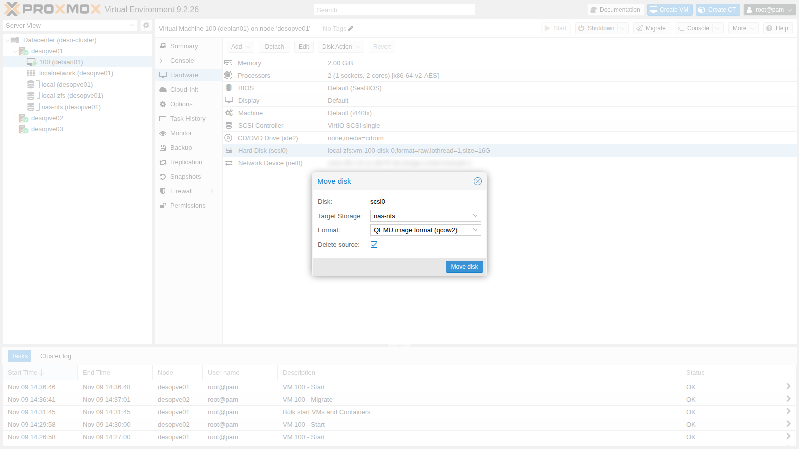
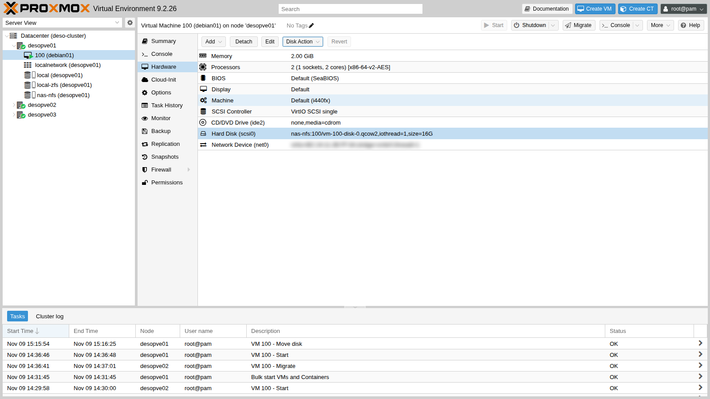
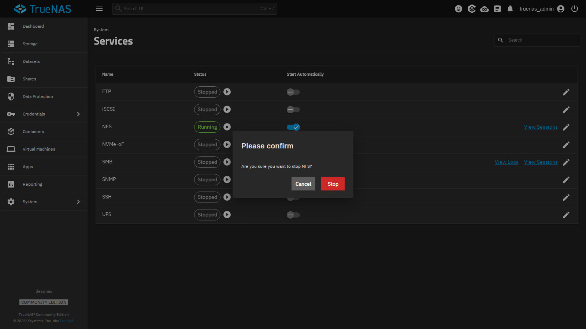
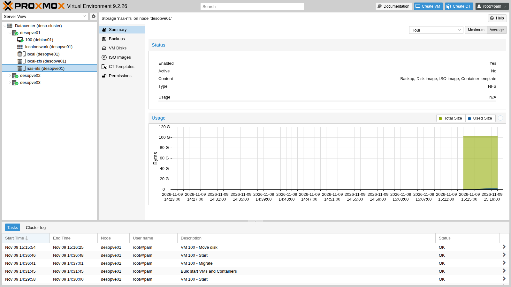
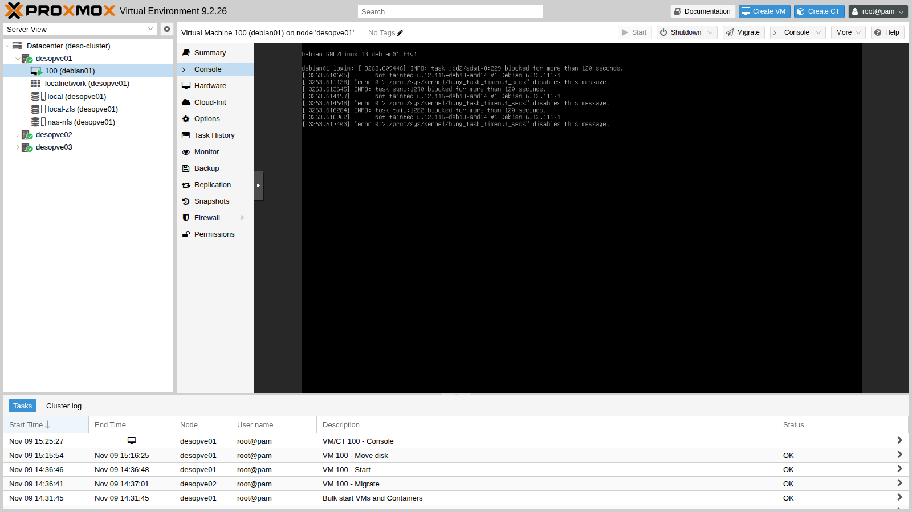

## Dependencies

- **Previous labs:** [Lab 12](/12-truenas-nas/) for the NAS `desonas` with the `dati/nfs` dataset, and [Lab 08](/08-storage-model/) for the storage and content types.
- **Cluster:** `deso-cluster` with the three nodes (lab 06). VM 100 `debian01` is running on `desopve01` with its disk on `local-zfs` (lab 07, state at the end of lab 11).
- **Network:** the nodes reach `172.27.199.10` on the lab LAN.
- **Credentials:** `root` / `<lab-password>` on the nodes, `truenas_admin` / `<lab-password>` on the NAS → [Appendix B](/b-credentials-and-addresses/).

## Objectives

- An NFS share of the `dati/nfs` dataset on TrueNAS, restricted to the lab network and without root squashing, which the nodes can see with `pvesm scan nfs` and `rpcinfo`.
- The `nas-nfs` storage mounted with NFS 4.2 on every node, with the mount options actually in effect (`hard`, `timeo`, `retrans`) read from `mount`.
- The disk of a running VM moved to NFS and back to local storage without stopping the VM.
- A comparison between local storage and NFS made with random data and repeated runs, knowing which tool and which layer produced each number.
- The behavior of nodes and VMs with the NAS stopped observed and described: storage inactive, processes in state `D`, VM waiting, recovery when the service returns.

## How it works

### NFS in Proxmox VE

NFS (*Network File System*) shares a directory of the server over the network. Proxmox VE **mounts it on every node** under `/mnt/pve/<ID>` and treats it as a directory-type storage, but a **shared** one: all nodes see the same files.

```text
 desonas (TrueNAS)                         desopve01 / 02 / 03
 /mnt/dati/nfs ── NFS 4.2 over TCP ──▶ /mnt/pve/nas-nfs
                                         ├── images/100/vm-100-disk-0.qcow2   VM disks
                                         ├── template/iso/                     ISO images
                                         ├── template/cache/                   container templates
                                         └── dump/                             backups
```

- On a file-based storage, VM disks are **`raw`** or **`qcow2`** files. With `qcow2`, snapshots work on NFS too.
- The storage is **shared** (`shared`): a VM with its disk on NFS is migrated by copying only its memory, and with high availability (lab 49) it can restart on another node.
- Proxmox VE accesses the files as **root**. On the server, the export must therefore not "squash" root to the `nobody` user (*root squash*), otherwise disk creation fails with permission errors. In TrueNAS this is set with **Maproot User** `root`.
- The mount is **`hard`** (the default): if the server stops responding, operations wait and resume when it comes back, without returning errors to the applications. With `soft` the client would return an error after its retries, and `nfs(5)` warns that this can corrupt data silently, so it is not used for VM disks. The Proxmox VE documentation suggests it only for read-only content such as ISO images.

### Versions

| Version | Features |
|---|---|
| NFSv3 | stateless on the server, additional ports (`mountd`, `lockd`, `statd`) |
| NFSv4.x | a single TCP port (2049), built-in locking, sessions |
| NFSv4.2 | in addition: server-side copy, sparse files (*hole punching*), space allocation |

In the lab we use **NFS 4.2**, set in the mount options of the storage.

### Test environment and versions

The measurements and the outage test in this lab come from a run carried out in November 2026 (the outage test on 9 November, as the logs show), with the configuration described below. With other versions, options or hardware, the same commands give different numbers.

| Component | Configuration used |
|---|---|
| Proxmox VE | 9.2.26, kernel `7.0.14-28-pve` ([Lab 04](/04-first-access-repositories-updates/)); node `desopve01` with 4 cores and 32 GB of RAM ([Lab 01](/01-lab-architecture/)) |
| NAS | TrueNAS Community Edition 25.10.8 ([Lab 12](/12-truenas-nas/)), 4 cores and 16 GB of RAM, pool `dati` mirrored on two 100 GB disks, dataset `dati/nfs`; one network card on the lab LAN |
| NFS mount | NFS 4.2 over TCP, 1 MiB `rsize` and `wsize`, `hard`, `timeo=600`, `retrans=2` (the `mount` output in step 3) |
| Network | management LAN `172.27.199.0/24`, MTU 1500 ([Lab 21](/21-bonding/)) |
| Test VM | VM 100 `debian01`, Debian 13.7, 2 cores, 2 GiB of RAM, 16 GiB `scsi0` disk with `iothread=1` and the default cache (`none`) ([Lab 07](/07-first-vm-and-container/)): first on `local-zfs` (raw zvol), then on `nas-nfs` (`qcow2` file) |
| Local storage | `local-zfs` for the VM disk and `local` (`/var/lib/vz`) for `fio` on the node, both on the ZFS mirror of the two system disks ([Lab 03](/03-install-proxmox-ve/)) |
| Tools | `dd` in the VM; `fio` on the node, from the Debian repository (version not recorded in this lab) |

Disk models are redacted, as explained in the [manual's conventions](/the-lab/#conventions).

**What the test measures, and what it does not.** The `dd` runs in the VM measure the path the guest sees: the VM's kernel, the virtual disk, QEMU, and then either local ZFS or the NFS client, the network and the NAS. `fio` on the node measures the node's file system instead: a file in the system ZFS dataset for local storage, and the kernel's NFS client, the network and the NAS for NFS, with no VM and none of the virtual disks' cache options involved. Neither test isolates the individual layers. The test files (512 MiB and 1 GiB) are small compared with the RAM of the node and of the NAS, so reads may come from the caches (ARC). There are only two or three runs per test, and the activity of the rest of the lab during the runs was not recorded: the values give an order of magnitude, not a statistic.

## Procedure

### 1. The share on TrueNAS

1. On the NAS: **Shares** → **NFS** → **Add**.
2. **Path** `/mnt/dati/nfs`, **Description** `Storage Proxmox VE`. Under **Networks** click **Add** and enter `172.27.199.0` / `24`: only the lab network will be able to mount the share.
3. Open **Advanced Options** and set **Maproot User** `root` and **Maproot Group** `wheel`.

   

4. **Save**. TrueNAS offers to start the NFS service: leave **Enable this service to start automatically** checked and click **Start**.

   

5. In **System** → **Services** → **NFS** (pencil icon) the service settings confirm that **NFSv3** and **NFSv4** are enabled. Nothing else needs to be changed.

   

### 2. Check the export from the nodes

Before adding the storage, check from the node that the server exports the directory and responds over NFSv4:

```bash title="root@desopve01"
pvesm scan nfs 172.27.199.10
```

```text output
/mnt/dati/nfs 172.27.199.0/24
```

```bash title="root@desopve01"
rpcinfo -T tcp 172.27.199.10 nfs 4
```

```text output
program 100003 version 4 ready and waiting
```

### 3. Add the storage to the cluster

1. **Datacenter** → **Storage** → **Add** → **NFS**.
2. Fill in:
   - **ID** `nas-nfs`;
   - **Server** `172.27.199.10`. Using the IP address keeps the storage independent of DNS: if DNS goes down, the storage keeps working;
   - **Export** `/mnt/dati/nfs`, which the drop-down offers after querying the server;
   - **Content**: `Disk image`, `ISO image`, `Container template`, `Backup`;
   - **Nodes**: all.
3. Check **Advanced** at the bottom and choose **NFS Version** `4.2`. Leave **Allow Snapshots as Volume-Chain** disabled: it is a technology preview that you will see in lab 16.

   

4. **Add**. The storage appears in the list, shared (**Shared** `Yes`) and active:

   

From the command line:

```bash title="root@desopve01"
grep -A6 "nfs: nas-nfs" /etc/pve/storage.cfg
```

```text output
nfs: nas-nfs
	export /mnt/dati/nfs
	path /mnt/pve/nas-nfs
	server 172.27.199.10
	content images,iso,backup,vztmpl
	options vers=4.2
	prune-backups keep-all=1
```

```bash title="root@desopve01"
pvesm status | grep nas-nfs
```

```text output
nas-nfs           nfs     active       100070400               0       100070400    0.00%
```

```bash title="root@desopve01"
mount | grep nas-nfs
```

```text output
172.27.199.10:/mnt/dati/nfs on /mnt/pve/nas-nfs type nfs4 (rw,relatime,vers=4.2,rsize=1048576,wsize=1048576,namlen=255,hard,fatal_neterrors=none,proto=tcp,timeo=600,retrans=2,sec=sys,clientaddr=172.27.199.21,local_lock=none,addr=172.27.199.10)
```

```bash title="root@desopve01"
ssh desopve03 ls /mnt/pve/nas-nfs
```

```text output
dump
images
template
```

- `pvestatd` mounts the storage by itself on every node, in the `/mnt/pve/nas-nfs` directory, and creates the subdirectories for the selected content types.
- The mount options show `hard`, `timeo=600` (60 seconds before a request is retried) and `retrans=2`.
- The capacity is that of the `dati` pool on the NAS: about 95 GiB.

### 4. Measure the performance with the local disk

Before moving the disk, measure how it performs on local storage: these are the reference values for NFS. The disk of VM 100 is on `local-zfs`.

**A misleading test.** In the VM, write 1 GiB of zeros with `dd`:

```bash title="labuser@debian01"
dd if=/dev/zero of=$HOME/test.bin bs=1M count=1024 oflag=direct
```

```text output
1073741824 bytes (1.1 GB, 1.0 GiB) copied, 1.40965 s, 762 MB/s
```

You will repeat it on NFS in step 6, and there you will see why zeros are no good for measuring.

**Sequential writes and reads with random data.** Generate 512 MiB of random data in RAM (`/dev/shm`), write it to the disk with direct I/O, waiting until it has actually reached the storage (`oflag=direct conv=fsync`), then read it back. Repeat the write three times and the read twice, because a single value is not enough:

```bash title="labuser@debian01"
head -c 512M /dev/urandom > /dev/shm/rnd.bin
for i in 1 2 3; do dd if=/dev/shm/rnd.bin of=$HOME/test.bin bs=1M oflag=direct conv=fsync 2>&1 | tail -1; done
```

```text output
536870912 bytes (537 MB, 512 MiB) copied, 15.0205 s, 35.7 MB/s
536870912 bytes (537 MB, 512 MiB) copied, 5.48904 s, 97.8 MB/s
536870912 bytes (537 MB, 512 MiB) copied, 16.7323 s, 32.1 MB/s
```

```bash title="labuser@debian01"
for i in 1 2; do dd if=$HOME/test.bin of=/dev/null bs=1M iflag=direct 2>&1 | tail -1; done
```

```text output
536870912 bytes (537 MB, 512 MiB) copied, 0.737017 s, 728 MB/s
536870912 bytes (537 MB, 512 MiB) copied, 0.620782 s, 865 MB/s
```

```bash title="labuser@debian01"
rm -f $HOME/test.bin /dev/shm/rnd.bin
```

**Random writes in 4 KiB blocks**, the typical workload of databases and operating systems, measured with `fio` directly from the node on the `local` storage (`/var/lib/vz`, in the system ZFS dataset). There is no VM in the way here: this measures the node's file system. The `--unlink=1` option deletes the test file at the end:

```bash title="root@desopve01"
apt install fio
fio --name=rw4k --directory=/var/lib/vz --rw=randwrite --bs=4k --size=1G \
      --iodepth=16 --ioengine=libaio --direct=1 --runtime=30 --time_based --group_reporting --unlink=1
```

```text output
  write: IOPS=2118, BW=8476KiB/s (8679kB/s)(275MiB/33273msec); 0 zone resets
```

```bash title="root@desopve01"
fio --name=rw4k --directory=/var/lib/vz --rw=randwrite --bs=4k --size=1G \
      --iodepth=16 --ioengine=libaio --direct=1 --runtime=30 --time_based --group_reporting --unlink=1
```

```text output
  write: IOPS=11.2k, BW=43.7MiB/s (45.8MB/s)(1310MiB/30001msec); 0 zone resets
```

### 5. Move the VM disk to NFS

1. VM **100** → **Hardware** → select **Hard Disk (scsi0)** → **Disk Action** → **Move Storage**.
2. **Target Storage** `nas-nfs`, **Format** `QEMU image format (qcow2)`, **Delete source** checked, then **Move disk**.

   

   The VM stays running: QEMU copies the disk in the background (*drive mirror*) and at the end switches over to the new file. The task copied the 16 GiB disk in 3 minutes and 35 seconds:

   ```text
   mirror-scsi0: transferred 16.0 GiB of 16.0 GiB (100.00%) in 3m 35s, ready
   mirror-scsi0: Completed successfully.
   removing source volume 'local-zfs:vm-100-disk-0' after successful copy
   TASK OK
   ```

3. The disk is now a `qcow2` file on the NAS:

   

   ```bash title="root@desopve01"
   qm config 100 | grep scsi0
   ```

   ```text output
   scsi0: nas-nfs:100/vm-100-disk-0.qcow2,iothread=1,size=16G
   ```

   ```bash title="root@desopve01"
   qemu-img info /mnt/pve/nas-nfs/images/100/vm-100-disk-0.qcow2 | head -4
   ```

   ```text output
   image: /mnt/pve/nas-nfs/images/100/vm-100-disk-0.qcow2
   file format: qcow2
   virtual size: 16 GiB (17179869184 bytes)
   disk size: 6.5 GiB
   ```

   The 16 GiB file takes up 6.5 GiB: `qcow2` allocates space only for the blocks that contain data.

### 6. Repeat the measurements on NFS and compare

In the VM, repeat the same commands as in step 4, now with the disk on NFS:

```bash title="labuser@debian01"
dd if=/dev/zero of=$HOME/test.bin bs=1M count=1024 oflag=direct
```

```text output
1073741824 bytes (1.1 GB, 1.0 GiB) copied, 0.403307 s, 2.7 GB/s
```

```bash title="labuser@debian01"
head -c 512M /dev/urandom > /dev/shm/rnd.bin
for i in 1 2 3; do dd if=/dev/shm/rnd.bin of=$HOME/test.bin bs=1M oflag=direct conv=fsync 2>&1 | tail -1; done
```

```text output
536870912 bytes (537 MB, 512 MiB) copied, 6.69699 s, 80.2 MB/s
536870912 bytes (537 MB, 512 MiB) copied, 20.2377 s, 26.5 MB/s
536870912 bytes (537 MB, 512 MiB) copied, 26.9102 s, 20.0 MB/s
```

```bash title="labuser@debian01"
for i in 1 2; do dd if=$HOME/test.bin of=/dev/null bs=1M iflag=direct 2>&1 | tail -1; done
```

```text output
536870912 bytes (537 MB, 512 MiB) copied, 1.44691 s, 371 MB/s
536870912 bytes (537 MB, 512 MiB) copied, 1.7027 s, 315 MB/s
```

```bash title="labuser@debian01"
rm -f $HOME/test.bin /dev/shm/rnd.bin
```

And from the node, 4 KiB random writes on the NFS share:

```bash title="root@desopve01"
fio --name=rw4k --directory=/mnt/pve/nas-nfs --rw=randwrite --bs=4k --size=1G \
      --iodepth=16 --ioengine=libaio --direct=1 --runtime=30 --time_based --group_reporting --unlink=1
```

```text output
  write: IOPS=865, BW=3463KiB/s (3546kB/s)(101MiB/30007msec); 0 zone resets
```

```bash title="root@desopve01"
fio --name=rw4k --directory=/mnt/pve/nas-nfs --rw=randwrite --bs=4k --size=1G \
      --iodepth=16 --ioengine=libaio --direct=1 --runtime=30 --time_based --group_reporting --unlink=1
```

```text output
  write: IOPS=966, BW=3867KiB/s (3959kB/s)(114MiB/30151msec); 0 zone resets
```

| Test | Local storage | NFS |
|---|---|---|
| Zeros, 1 GiB (`dd` in the VM, once) | 762 MB/s (`local-zfs`) | 2.7 GB/s |
| Sequential write, random data (`dd` in the VM, 3 runs) | 32-98 MB/s (`local-zfs`) | 20-80 MB/s |
| Sequential read (`dd` in the VM, 2 runs) | 728-865 MB/s (`local-zfs`) | 315-371 MB/s |
| 4 KiB random write, queue depth 16 (`fio` on the node, 2 runs of 30 s) | 2,118-11,200 IOPS (`/var/lib/vz`) | 865-966 IOPS |

The MB/s figures are the ones `dd` prints, in decimal units. Each point below separates what the test measured from how we interpret it, and names the check that would confirm the interpretation.

1. **Zeros.**
   - **Measured:** writing 1 GiB of zeros with `dd` in the VM runs at 762 MB/s with the disk on `local-zfs` and at 2.7 GB/s on `nas-nfs`.
   - **Interpretation:** an NFS write faster than the local one is consistent with the zeros never reaching the NAS as data. With the Proxmox VE defaults, QEMU detects writes of zeros (`detect_zeroes`) and turns them into an operation that, on a `qcow2` file, can be recorded in the image metadata without writing the blocks. ZFS compression, on the node and on the NAS, also treats blocks of zeros specially. The test does not tell which mechanism was at work, but it is enough to rule zeros out as test data: measurements need random data.
   - **How to check:** on the node, compare the bytes transmitted by `vmbr0` (`ip -s link show vmbr0`) before and after the `dd`. If the zeros do not travel to the NAS, the difference is far below 1 GiB. Alternatively, repeat the test with the disk option `detect_zeroes=0`.
2. **Sequential writes with random data (in the VM).**
   - **Measured:** 35.7, 97.8 and 32.1 MB/s locally; 80.2, 26.5 and 20.0 MB/s on NFS. Each `dd` writes 512 MiB, one 1 MiB block at a time, and ends with an `fsync`.
   - **Interpretation:** on both storages the same test varies by a factor of 3-4 from one run to the next, and the ranges overlap, so this test does not establish which of the two writes sequentially faster. Possible causes of the variability include the activity of the rest of the lab and the periodic flushes with which ZFS commits data to disk, on the node and on the NAS; the test cannot tell them apart.
   - **How to check:** more and longer runs with the rest of the lab idle, while watching `zpool iostat 1` on the node and on the NAS during the write.
3. **Sequential reads (in the VM).**
   - **Measured:** 728 and 865 MB/s locally; 371 and 315 MB/s on NFS.
   - **Interpretation:** reads over NFS reach between a third and a half of the local rate. That is consistent with the cost of the network and the NAS on every request. The file, however, had just been written and is small compared with the RAM: local reads may come from the node's ARC and NFS reads from the NAS's ARC, and the test does not separate these contributions.
   - **How to check:** `arcstat 1` on the node and on the NAS during the read, and a read of a file larger than the RAM available to the ARC.
4. **4 KiB random writes (`fio` on the node, queue depth 16).**
   - **Measured:** 2,118 and 11,200 IOPS on `/var/lib/vz`; 865 and 966 IOPS on NFS.
   - **Interpretation:** locally, two identical runs differ by a factor of five, so the local value is unstable, and the test does not say why. On NFS the values are stable and lower than both. The NFS result is consistent with direct writes (`--direct=1`) that the NAS acknowledges only once they are stable, which with ZFS means after going through the ZIL, so each write also pays a network round trip. The test does not separate the network from the NAS. Note that `fio` runs on the node here, so the VM disk's cache option plays no part; a VM disk with `cache=none`, the default, opens its file in the same direct mode.
   - **How to check:** on the NAS, run `zfs get sync dati/nfs` and read the ZIL counters (`cat /proc/spl/kstat/zfs/zil`) before and after the test: if the writes go through the ZIL, `zil_commit_count` grows during the run. On the node, `nfsstat -m` shows the effective mount options, and a `ping` to the NAS gives the round-trip time of the network alone.

**What to take away.** Small random writes are what you should measure before putting VM disks with many small synchronous writes, such as databases, on NFS. If the check confirms that synchronous writes on the NAS are the limit, the usual options are a fast dedicated log device on the NAS (SLOG) and a faster network, to be evaluated by repeating the same measurement. In lab 19 you will repeat the tests on all storages with a more rigorous method.

## Verification and tests

### Test – The NAS stops responding

You leave the VM disk on NFS and stop the NFS service on the NAS, as would happen with a NAS or network failure.

1. In the VM, start a "heartbeat" that writes the time every second and forces it to disk:

   ```bash title="labuser@debian01"
   nohup sh -c 'while true; do date +%T >> $HOME/battito.log; sync; sleep 1; done' >/dev/null 2>&1 &
   ```

2. On the NAS: **System** → **Services** → **NFS** → **Stop Service** and confirm with **Stop**.

   

3. A minute later, on the node, the server no longer responds over NFS and `pvestatd` marks the storage as not active. The VM, however, still shows as running:

   ```bash title="root@desopve01"
   rpcinfo -T tcp 172.27.199.10 nfs 4
   ```

   ```text output
   rpcinfo: RPC: Program not registered
   ```

   ```bash title="root@desopve01"
   pvesm status
   ```

   ```text output
   storage 'nas-nfs' is not online
   Name             Type     Status     Total (KiB)      Used (KiB) Available (KiB)        %
   local             dir     active        46255488          768000        45487488    1.66%
   local-zfs     zfspool     active        45487664              96        45487568    0.00%
   nas-nfs           nfs   inactive               0               0               0    0.00%
   ```

   ```bash title="root@desopve01"
   journalctl -u pvestatd --since "-3 min" | tail -2
   ```

   ```text output
   Nov 09 15:21:57 desopve01 pvestatd[1611]: storage 'nas-nfs' is not online
   Nov 09 15:22:07 desopve01 pvestatd[1611]: storage 'nas-nfs' is not online
   ```

   ```bash title="root@desopve01"
   qm status 100
   ```

   ```text output
   status: running
   ```

   In the web interface the storage shows **Active: No**, with no usage data:

   

   For an NFSv4 storage, `pvestatd` checks the server with the same `rpcinfo` query as in step 2 before touching the mount, which is why it can mark the storage as inactive without getting stuck. Anything that accesses the files on the mount, on the other hand, is left waiting.

4. Try to access the mount: the process gets stuck in state **`D`** (uninterruptible I/O wait), waiting for the server. The kernel reports it in the log:

   ```bash title="root@desopve01"
   timeout 20 ls -la /mnt/pve/nas-nfs/images/100/ &
   ps -eo stat,pid,etime,comm,wchan:28 | awk 'NR==1 || $1 ~ /^D/'
   ```

   ```text output
   STAT     PID     ELAPSED COMMAND         WCHAN
   D      12326       00:20 172.27.199.10-m rpc_wait_bit_killable
   D      12419       00:03 ls              rpc_wait_bit_killable
   ```

   ```bash title="root@desopve01"
   dmesg -T | grep "nfs: server"
   ```

   ```text output
   [Mon Nov  9 15:24:04 2026] nfs: server 172.27.199.10 not responding, still trying
   ```

   The first process is the kernel thread that manages the NFSv4 state with the server. Linux counts processes in state `D` in the *load average*, so with the NAS stopped the nodes' load average can rise even while the CPUs are idle. This test did not record it; `uptime` during the outage shows it.

   The `not responding` message arrives at 15:24:04, about three minutes after the last heartbeat line (15:20:58). That is consistent with the mount options: according to `nfs(5)`, the client reports the server after `retrans` retries, with a timeout that starts at `timeo` (60 seconds) and grows by 60 seconds with each retry, so 60 + 120 = 180 seconds. The test does not prove it, because the moment of the first unanswered request is not known.

5. In the VM, I/O to the disk is frozen. The heartbeat stopped at 15:20:58, and two minutes later the VM's kernel reports on the console the processes blocked on the disk, starting with the file system journal (`jbd2`); two minutes is the kernel's default threshold for reporting a blocked task:

   

   The VM does not fail and does not shut down: it waits, just like the processes on the node.

6. Restart the service on the NAS (**Start Service**). The node's kernel logs the recovery, the storage becomes active again and no process is left in state `D`:

   ```bash title="root@desopve01"
   dmesg -T | grep "nfs: server" | tail -1
   ```

   ```text output
   [Mon Nov  9 15:37:36 2026] nfs: server 172.27.199.10 OK
   ```

   ```bash title="root@desopve01"
   pvesm status | grep nas-nfs
   ```

   ```text output
   nas-nfs           nfs     active       100069376         2021376        98048000    2.02%
   ```

   ```bash title="root@desopve01"
   ps -eo stat,comm | awk '$1 ~ /^D/' | wc -l
   ```

   ```text output
   0
   ```

   **What was observed.** About 16 and a half minutes passed between the last heartbeat line written before the stop (15:20:58) and the `nfs: server 172.27.199.10 OK` message (15:37:36). These are two different observations, one in the VM and one in the node's kernel; the exact times at which the service was stopped and restarted on the NAS were not recorded. After the recovery the VM was still running, without a reboot, and the node had no processes left in state `D`.

   **Interpretation.** This is the behavior `nfs(5)` describes for a `hard` mount: requests are retried until the server answers. The test does not show, however, that the VM completed all of its pending writes without errors.

   **How to check.** In the VM, `tail $HOME/battito.log` should show the gap followed by one line per second again, and `sudo journalctl -k | grep -iE 'I/O error|EXT4-fs error'` should find no disk errors.

### Cleanup

Stop the heartbeat and move the VM disk back to local storage. The `nas-nfs` storage stays configured for the following labs.

```bash title="labuser@debian01"
pkill -f battito.log; rm -f $HOME/battito.log
```

```bash title="root@desopve01"
qm disk move 100 scsi0 local-zfs --delete 1
```

```text output
…
mirror-scsi0: transferred 16.0 GiB of 16.0 GiB (100.00%) in 38s, ready
removing source volume 'nas-nfs:100/vm-100-disk-0.qcow2' after successful copy
```

```bash title="root@desopve01"
qm config 100 | grep scsi0
```

```text output
scsi0: local-zfs:vm-100-disk-0,iothread=1,size=16G
```

The copy back took 38 seconds, against 3 minutes and 35 seconds for the copy to NFS. The two task times are not a storage measurement: direction, file format and the amount of data actually read all differ, and this lab did not investigate the gap.

### Summary of the checks

| Check | Expected result | Observed in this run |
|---|---|---|
| Export | `/mnt/dati/nfs` exported only to `172.27.199.0/24`, with root mapped to `root` | `pvesm scan nfs`: `/mnt/dati/nfs 172.27.199.0/24` |
| Mount | NFS 4.2 on all three nodes, `hard` | `vers=4.2`, `hard`, `timeo=600`, `retrans=2`; subdirectories visible from `desopve03` |
| Live move | disk to NFS and back to local storage with the VM running | `TASK OK` in 3 min 35 s to NFS, 38 s back; `qm config` shows `local-zfs` again |
| Measurements | random data and repeated runs; for each number, the tool and the layer it measures | table in step 6 |
| NAS stopped | storage inactive, processes in state `D`, VM waiting; recovery on its own when the service returns | `inactive`, two processes in `D`, VM `running`; `server ... OK` at 15:37:36 and no processes left in `D` |

## Final lab state

- **NAS:** NFS share `/mnt/dati/nfs` for `172.27.199.0/24`, **Maproot** `root:wheel`; NFS service running and set to start automatically.
- **Cluster:** storage **`nas-nfs`** (NFS 4.2, `172.27.199.10:/mnt/dati/nfs`, content `images,iso,backup,vztmpl`, shared, on all nodes), mounted at `/mnt/pve/nas-nfs` and empty.
- VM 100 `debian01` running on `desopve01`, with its disk on `local-zfs`.
- `fio` installed on `desopve01`.

## What you learned

- **How to expose an NFS dataset to Proxmox VE:** an export restricted to the nodes' network, root mapped to `root` (Maproot), the server given by IP address; before adding the storage, `pvesm scan nfs` and `rpcinfo` from the node.
- **When to put VM disks on NFS:** it is shared storage (memory-only migration, high availability) and disks can be moved live; for workloads with many small synchronous writes, first measure 4 KiB random writes on your own NAS, as in step 6.
- **How to measure without being fooled:** random data rather than zeros, repeated runs, ranges rather than single values, and for every number the tool and the layer it measures (the VM or the node).
- **What to expect when the NAS stops, and how to prepare for it:** with `hard`, I/O stops without errors and resumes when the server returns; meanwhile the VMs are blocked and the node's processes sit in state `D`. Plan the availability of the NAS, and of the network to it, as you plan the nodes', and do not use `soft` for VM disks.

## References

- [Proxmox VE – NFS Backend](https://pve.proxmox.com/pve-docs/pve-admin-guide.html#storage_nfs)
- [Proxmox VE – Storage](https://pve.proxmox.com/pve-docs/pve-admin-guide.html#chapter_storage)
- [Proxmox VE – `qm`: moving disks (`qm disk move`) and the `detect_zeroes` option](https://pve.proxmox.com/pve-docs/qm.1.html)
- [TrueNAS 25.10 – Adding NFS Shares](https://www.truenas.com/docs/scale/25.10/scaletutorials/shares/addingnfsshares/)
- [`nfs(5)` – the `hard`, `soft`, `timeo` and `retrans` mount options](https://man7.org/linux/man-pages/man5/nfs.5.html)
- [QEMU 11.1 – the `detect-zeroes` block device option](https://qemu.readthedocs.io/en/stable-11.1/system/invocation.html#hxtool-1)
