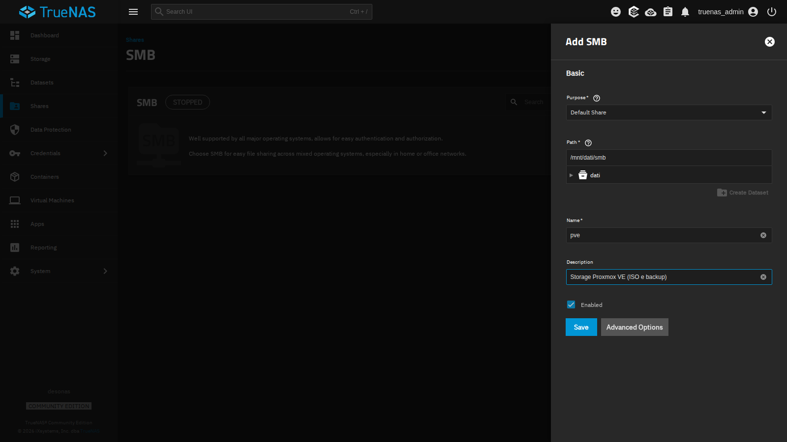
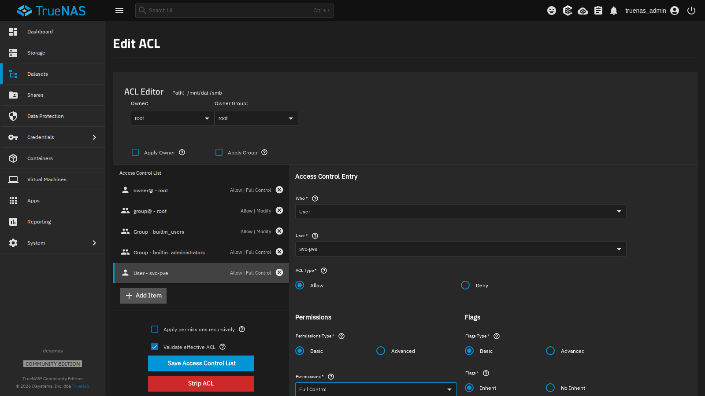
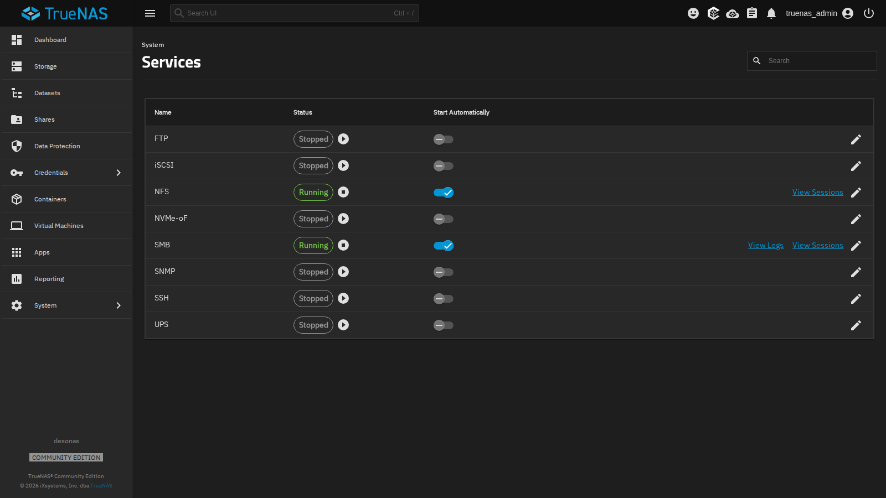
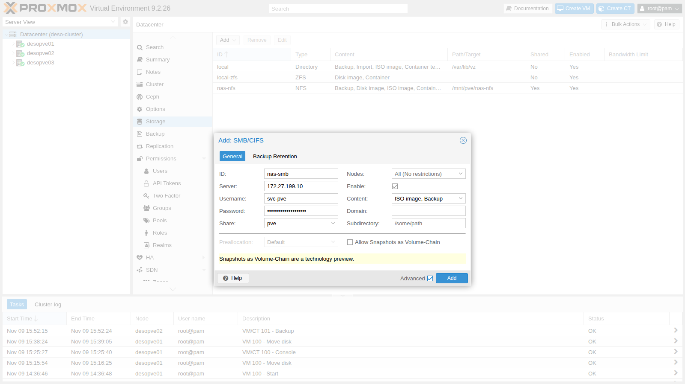
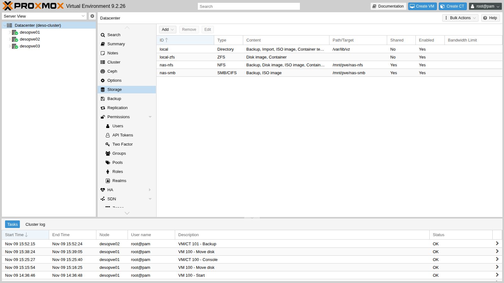
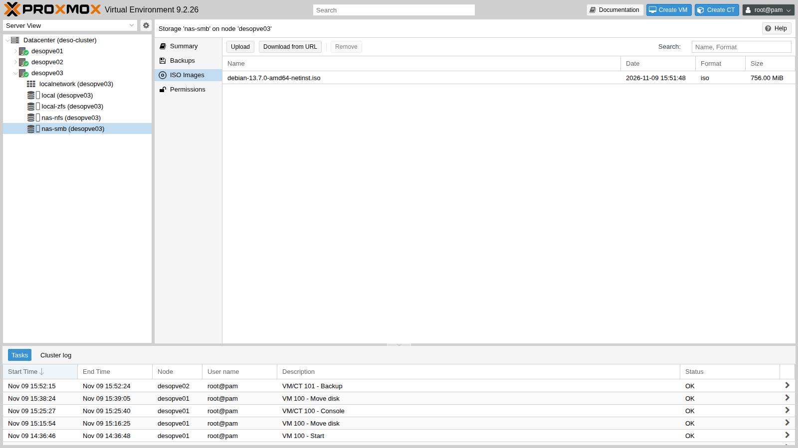
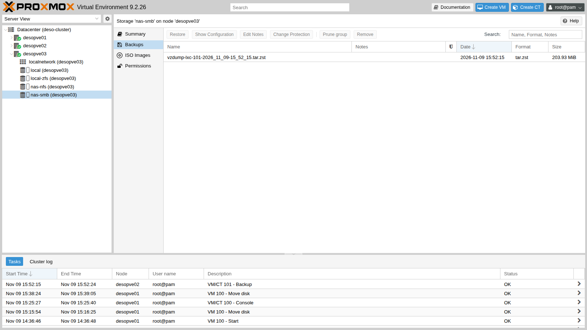

## Dependencies

- **Previous labs:** [Lab 12](/12-truenas-nas/) for the NAS `desonas` with the `dati/smb` dataset (SMB preset) and the user `svc-pve`, and [Lab 13](/13-nfs/) for the `nas-nfs` storage, which you will use in the comparison.
- **Cluster:** `deso-cluster` with the three nodes (lab 06). Node `desopve01` has the Debian 13 ISO downloaded in lab 07; container 101 runs on node `desopve02`.
- **Network:** the nodes reach `172.27.199.10` on the lab LAN (TCP port 445).
- **Credentials:** `root` / `<lab-password>` on the nodes, `truenas_admin` / `<lab-password>` on the NAS, `svc-pve` / `<lab-password>` for SMB access → [Appendix B](/b-credentials-and-addresses/).

## Objectives

- An SMB share `pve` on the `dati/smb` dataset, with the service user `svc-pve` in full control, which the node can see with `pvesm scan cifs`.
- The `nas-smb` storage mounted on every node, with the protocol version pinned to 3.11, the password in `/etc/pve/priv/storage/` and the mount options actually in effect read from `mount`.
- The Debian ISO and a backup of container 101 on the share, visible from every node.
- The three typical problems reproduced and recognized by their messages: a wrong password, Unix permissions being ignored, and a stopped NAS with a `soft` mount.
- A comparison with NFS in which every number states whether the writes were made stable with an `fsync` or not.

## How it works

### SMB in Proxmox VE

SMB (*Server Message Block*), also known as CIFS, is the Windows file-sharing protocol. As with NFS, Proxmox VE **mounts the share on every node** under `/mnt/pve/<ID>` and uses it as a shared file-based storage. Unlike NFS, access is **authenticated**: each node presents itself to the server with a user name and a password.

```text
 desonas (TrueNAS)                              desopve01 / 02 / 03
 /mnt/dati/smb  ── share "pve" ── SMB 3.1.1 ──▶  /mnt/pve/nas-smb
                   user svc-pve                   ├── template/iso/   ISO images
                                                  └── dump/           backups
```

- The user's password is stored in `/etc/pve/priv/storage/<ID>.pw`. It lives in the cluster file system, so every node knows it, but the `priv` directory is readable only by root.
- The server decides the permissions through its ACLs: on TrueNAS, the `svc-pve` user needs full control of the dataset.
- The Linux client mounts the share with options that differ from NFS: Unix permissions do not exist (`nounix`), and the mount is **`soft`**, an option Proxmox VE always sets for CIFS storages. If the server stops responding, operations fail with an error instead of waiting.

### When to use SMB

| | NFS | SMB/CIFS |
|---|---|---|
| Authentication | by client IP address | user name and password (or AD domain) |
| Unix permissions (owner, `chmod`) | yes | no, with the options used here (`nounix`): the server decides them |
| Mount in Proxmox VE | `hard` by default | always `soft` |
| With the NAS stopped, in labs 13 and 14 | processes wait, no errors | error after about 10 seconds |
| Typical use in Proxmox VE | VM disks, ISOs, backups | ISOs, templates and backups; a NAS already in use with Windows |

In this manual VM disks live on NFS, iSCSI (lab 15) or Ceph, and SMB is used for **ISOs and backups**. This lab does not put VM disks on SMB: what would happen can be inferred from Test 3, where writes fail after about ten seconds with the NAS stopped. For a virtual disk, that would mean I/O errors in the guest.

### Alternative: authentication with Active Directory

In the lab the NAS uses a local user. In a company with Active Directory, TrueNAS can be joined to the domain (**Credentials** → **Directory Services** → **Configure Active Directory**: domain `proxmox.community`, an account with the right to join computers to the domain). This way:

- the service user becomes a domain account (for example `PROXMOX\svc-pve`), managed and expired according to the domain rules;
- in Proxmox VE the storage is configured with **Username** `svc-pve` and **Domain** `PROXMOX`;
- the ACLs of the share use domain users and groups.

Before joining the domain, the NAS needs correct DNS and time settings (lab 12): Kerberos rejects clock differences greater than 5 minutes.

### Test environment and versions

The tests in this lab were run in November 2026 (on 9 November, as the file names and logs show), with the configuration described below. With other versions, options or hardware, the same commands give different numbers and timings.

| Component | Configuration used |
|---|---|
| Proxmox VE | 9.2.26, kernel `7.0.14-28-pve` ([Lab 04](/04-first-access-repositories-updates/)); the tests run from node `desopve01` |
| NAS | TrueNAS Community Edition 25.10.8 ([Lab 12](/12-truenas-nas/)), datasets `dati/smb` (SMB preset) and `dati/nfs` on the same mirrored pool `dati`; a single network card ([Lab 01](/01-lab-architecture/)) |
| SMB mount | SMB 3.1.1 (`vers=3.1.1`), `cache=strict`, `soft`, `nounix`, 4 MiB `rsize` and `wsize` (the `mount` output in step 3) |
| NFS mount | NFS 4.2, `hard`, 1 MiB `rsize` and `wsize` ([Lab 13](/13-nfs/)) |
| Network | management LAN `172.27.199.0/24`, MTU 1500 ([Lab 21](/21-bonding/)) |
| Not recorded | the Samba version on the NAS and the `sync` property of the two datasets: read them on the NAS with `smbd --version` and `zfs get sync dati/smb dati/nfs` |
| Runs | `fio` from the node, a single 20-second run per case; heartbeat every 2 seconds |

**What the test measures, and what it does not.** `fio` on the node measures the kernel client (CIFS or NFS), the network and the NAS, with no VM involved. Each case was measured only once, for 20 seconds, so the result gives an order of magnitude, not a statistic. The three runs of Test 4 change several parameters at once (queue depth, I/O engine, `fsync`, block size), so compare NFS and SMB within a row, not across rows.

## Procedure

### 1. The share on TrueNAS

1. On the NAS: **Shares** → **SMB** → **Add**.
2. **Purpose** `Default Share`, **Path** `/mnt/dati/smb`, **Name** `pve`, **Description** `Storage Proxmox VE (ISO e backup)`.

   

3. **Save**. TrueNAS asks **Configure ACL**: answer **Configure** to open the dataset permissions editor.
4. In the ACL editor click **Add Item** and create the entry:
   - **Who** `User`, **User** `svc-pve`;
   - **ACL Type** `Allow`, **Permissions** `Full Control`, **Flags** `Inherit`, so that it also applies to the directories and files that Proxmox VE will create.

   

5. **Save Access Control List**.
6. **System** → **Services**: enable **Start Automatically** for **SMB** and start the service.

   

From a node, check that the user can see the share:

```bash title="root@desopve01"
pvesm scan cifs 172.27.199.10 --username svc-pve --password '<lab-password>'
```

```text output
pve Storage
```

### 2. Add the storage to the cluster

1. **Datacenter** → **Storage** → **Add** → **SMB/CIFS**.
2. Fill in:
   - **ID** `nas-smb`, **Server** `172.27.199.10`;
   - **Username** `svc-pve` and **Password**: the **Share** drop-down fills with the shares the user can access; choose `pve`;
   - **Content**: `ISO image` and `Backup` (remove `Disk image`);
   - **Nodes**: all.
3. Check **Advanced**: leave **Preallocation** `Default` and **Allow Snapshots as Volume-Chain** disabled.

   

4. **Add**. The storage appears as shared and active:

   

### 3. Pin the SMB version

The dialog has no field for the protocol version. When none is set, the client negotiates the highest version from SMB2 upwards that both sides support (SMB1 is not supported). Pinning it makes the mount fail, instead of silently accepting an older version, when the server does not offer the one requested. It is set from the command line and takes effect at the next mount:

```bash title="root@desopve01"
pvesm set nas-smb --smbversion 3.11
umount /mnt/pve/nas-smb        # on every node: pvestatd remounts it by itself
grep -A8 "cifs: nas-smb" /etc/pve/storage.cfg
```

```text output
cifs: nas-smb
	path /mnt/pve/nas-smb
	server 172.27.199.10
	share pve
	content iso,backup
	prune-backups keep-all=1
	smbversion 3.11
	username svc-pve
```

```bash title="root@desopve01"
ls -l /etc/pve/priv/storage/
```

```text output
-rw------- 1 root www-data 30 Nov  9 15:49 nas-smb.pw
```

```bash title="root@desopve01"
mount | grep nas-smb
```

```text output
//172.27.199.10/pve on /mnt/pve/nas-smb type cifs (rw,relatime,vers=3.1.1,cache=strict,upcall_target=app,username=svc-pve,uid=0,noforceuid,gid=0,noforcegid,addr=172.27.199.10,file_mode=0755,dir_mode=0755,soft,nounix,serverino,mapposix,reparse=nfs,nativesocket,symlink=native,rsize=4194304,wsize=4194304,bsize=1048576,echo_interval=60,actimeo=1,closetimeo=1)
```

- `vers=3.1.1`: this is SMB version 3.11, the most recent one.
- `uid=0`, `gid=0`, `file_mode=0755`: every file appears to belong to root, with fixed permissions, whoever owns it on the server.
- `soft`: operations fail if the server does not respond (you will see this in the tests).

### 4. Shared ISOs and backups

Copy the Debian ISO downloaded in lab 07 to the share and look at it from another node:

```bash title="root@desopve01"
cp /var/lib/vz/template/iso/debian-13.7.0-amd64-netinst.iso /mnt/pve/nas-smb/template/iso/
```

```bash title="root@desopve03"
pvesm list nas-smb
```

```text output
Volid                                       Format  Type           Size VMID
nas-smb:iso/debian-13.7.0-amd64-netinst.iso iso     iso       792723456
```



Back up container 101 to the share (backups are the topic of lab 46):

```bash title="root@desopve02"
vzdump 101 --storage nas-smb --mode snapshot --compress zstd
```

```text output
INFO: Starting Backup of VM 101 (lxc)
INFO: creating vzdump archive '/mnt/pve/nas-smb/dump/vzdump-lxc-101-2026_11_09-15_52_15.tar.zst'
INFO: Total bytes written: 706631680 (674MiB, 87MiB/s)
INFO: archive file size: 203MB
INFO: Finished Backup of VM 101 (00:00:09)
```



## Verification and tests

### Test 1 – Wrong credentials

With a wrong password the server denies access. It is the same error you would see if the password of `svc-pve` changed on the NAS without the storage being updated:

```bash title="root@desopve01"
pvesm scan cifs 172.27.199.10 --username svc-pve --password sbagliata
```

```text output
unexpected status: NT_STATUS_ACCESS_DENIED
```

To update the password: **Datacenter** → **Storage** → `nas-smb` → **Edit**, or `pvesm set nas-smb --password`.

### Test 2 – Unix permissions do not exist

```bash title="root@desopve01:/mnt/pve/nas-smb"
touch prova.txt; chmod 600 prova.txt; chown 1000:1000 prova.txt; echo $?
```

```text output
0
```

```bash title="root@desopve01:/mnt/pve/nas-smb"
ls -l prova.txt
```

```text output
-rwxr-xr-x 1 root root 0 Nov  9 15:51 prova.txt
```

`chmod` and `chown` return no error but change nothing: with `nounix` the server decides the permissions through its ACLs, and the client shows the values fixed by the mount for every file (`uid=0`, `gid=0`, `file_mode=0755`). This is why the share should not hold files whose Unix owners and permissions matter, for example a directory mounted straight into a container.

### Test 3 – The NAS stops responding

On node `desopve01`, start a "heartbeat" that writes the time to the share every 2 seconds and logs the outcome:

```bash title="root@desopve01"
nohup sh -c 'while true; do if date +%T > /mnt/pve/nas-smb/battito.txt; then echo "$(date +%T) ok"; else echo "$(date +%T) ERRORE"; fi >> /root/smb-battito.log; sleep 2; done' >/dev/null 2>&1 &
```

On the NAS, stop the SMB service (**System** → **Services** → **SMB** → **Stop Service**). The heartbeat logs the time at the end of each attempt:

```bash title="root@desopve01"
tail -4 /root/smb-battito.log
```

```text output
15:55:33 ok
15:55:35 ok
15:55:47 ERRORE
15:55:59 ERRORE
```

Between the last `ok` (15:55:35) and the first `ERRORE` (15:55:47) 12 seconds pass, 2 of which are the loop's pause: the write hung for about 10 seconds before failing, and the next attempt did the same (15:55:59). A write by hand gets the error, and `pvestatd` marks the storage as inactive:

```bash title="root@desopve01"
bash -c 'echo x > /mnt/pve/nas-smb/prova.txt'
```

```text output
bash: line 1: /mnt/pve/nas-smb/prova.txt: Host is down
```

```bash title="root@desopve01"
pvesm status | grep nas-smb
```

```text output
nas-smb          cifs   inactive               0               0               0    0.00%
```

**Compared with lab 13.** With NFS mounted `hard`, processes kept waiting, without errors, until the server came back. Here, with the `soft` mount that Proxmox VE always uses for CIFS, the application gets an error (`Host is down`). The wait of about 10 seconds is what this combination showed (kernel `7.0.14-28-pve`, TrueNAS 25.10.8); this test did not investigate which CIFS client timeouts produce it. For an ISO copy or a backup in progress it means a failed operation that has to be repeated; for a VM disk it would mean I/O errors in the guest operating system.

Restart the SMB service: the client reconnects by itself, with no action on the node, and the writes resume (the exact time of the restart was not recorded):

```bash title="root@desopve01"
tail -3 /root/smb-battito.log
```

```text output
15:57:38 ok
15:57:40 ok
15:57:42 ok
```

```bash title="root@desopve01"
pvesm status | grep nas-smb
```

```text output
nas-smb          cifs     active       100069248          977024        99092224    0.98%
```

Stop the heartbeat and delete the test files:

```bash title="root@desopve01"
pkill -f "^sh -c while true"; rm -f /mnt/pve/nas-smb/battito.txt /mnt/pve/nas-smb/prova.txt /root/smb-battito.log
```

### Test 4 – SMB versus NFS

From node `desopve01`, use `fio` to measure the same writes on the two NAS storages (same pool, same network). Each run lasts 20 seconds and is done once:

```bash title="root@desopve01"
fio --name=t --directory=/mnt/pve/nas-smb --rw=randwrite --bs=4k --size=1G \
      --iodepth=16 --ioengine=libaio --direct=1 --runtime=20 --time_based --group_reporting
```

```text output
  write: IOPS=5430, BW=21.2MiB/s (22.2MB/s)(425MiB/20017msec); 0 zone resets
```

```bash title="root@desopve01"
fio --name=t --directory=/mnt/pve/nas-nfs --rw=randwrite --bs=4k --size=1G \
      --iodepth=16 --ioengine=libaio --direct=1 --runtime=20 --time_based --group_reporting
```

```text output
  write: IOPS=962, BW=3851KiB/s (3943kB/s)(75.9MiB/20179msec); 0 zone resets
```

With these options SMB delivers 5.6 times the IOPS of NFS. Repeat the test, this time asking for every write to be made stable before the next one (`--fsync=1`, as a database does):

```bash title="root@desopve01"
fio --name=t --directory=/mnt/pve/nas-smb --rw=randwrite --bs=4k --size=1G \
      --iodepth=1 --ioengine=psync --direct=1 --fsync=1 --runtime=20 --time_based
```

```text output
  write: IOPS=185, BW=741KiB/s (759kB/s)(14.9MiB/20557msec); 0 zone resets
```

```bash title="root@desopve01"
fio --name=t --directory=/mnt/pve/nas-nfs --rw=randwrite --bs=4k --size=1G \
      --iodepth=1 --ioengine=psync --direct=1 --fsync=1 --runtime=20 --time_based
```

```text output
  write: IOPS=339, BW=1358KiB/s (1391kB/s)(26.5MiB/20001msec); 0 zone resets
```

Finally, sequential writes in 1 MiB blocks, typical of ISOs and backups:

```bash title="root@desopve01"
fio --name=t --directory=/mnt/pve/nas-smb --rw=write --bs=1M --size=1G \
      --iodepth=4 --ioengine=libaio --direct=1 --runtime=20 --time_based --group_reporting
```

```text output
  write: IOPS=688, BW=688MiB/s (722MB/s)(13.6GiB/20292msec); 0 zone resets
```

```bash title="root@desopve01"
fio --name=t --directory=/mnt/pve/nas-nfs --rw=write --bs=1M --size=1G \
      --iodepth=4 --ioengine=libaio --direct=1 --runtime=20 --time_based --group_reporting
```

```text output
  write: IOPS=33, BW=33.3MiB/s (34.9MB/s)(673MiB/20201msec); 0 zone resets
```

Delete the test files created by `fio`:

```bash title="root@desopve01"
rm -f /mnt/pve/nas-smb/t.0.0 /mnt/pve/nas-nfs/t.0.0
```

| Test (from the node, `fio`, 20 s, one run) | NFS | SMB |
|---|---|---|
| 4 KiB random write, queue depth 16, `libaio`, no `fsync` | 962 IOPS | 5,430 IOPS |
| 1 MiB sequential write, queue depth 4, `libaio`, no `fsync` | 33 MiB/s | 688 MiB/s |
| 4 KiB random write, queue depth 1, `psync`, `fsync` after every write | 339 IOPS | 185 IOPS |

Each point below separates what the test measured from how we interpret it, and names the check that would confirm the interpretation.

1. **Writes without `fsync`.**
   - **Measured:** for 4 KiB random writes SMB reaches 5,430 IOPS against 962 for NFS (5.6 times); for 1 MiB sequential writes, 688 MiB/s against 33.3 (about 20 times).
   - **Interpretation:** the gap is consistent with the two protocols acknowledging writes at different moments. Over NFS, the NAS would acknowledge direct writes only once they are stable, through the ZFS ZIL. Over SMB, the NAS could acknowledge them as soon as they are in RAM and write them to disk later, unless the client explicitly asks for a flush (`fsync`). The test does not prove it, because it does not observe the NAS.
   - **How to check:** on the NAS, read the ZIL counters (`cat /proc/spl/kstat/zfs/zil`) before and after each run. If the interpretation is right, `zil_commit_count` grows a lot during the NFS run and little during the SMB run without `fsync`. `zfs get sync dati/smb dati/nfs` shows how the two datasets handle synchronous writes.
2. **Writes with an `fsync` after each one.**
   - **Measured:** SMB 185 IOPS, NFS 339.
   - **Interpretation:** when every write has to become stable before the next one, SMB is no faster than NFS, and in this run it is slower. That fits point 1: without `fsync`, SMB's advantage would come from not waiting for the stable write.
   - **How to check:** the same ZIL counters, which in this run should grow in a similar way for both protocols.
3. **The consequence, if the interpretation is confirmed.** If the NAS lost power suddenly, the last SMB writes already acknowledged but not yet stable would be lost; with NFS they would not.

For ISOs and backups the speed of SMB is an advantage, as long as you can repeat a failed operation (Test 3) and you check your backups with a test restore (lab 46). For VM disks, which rely on acknowledged writes, the `soft` mount and the acknowledgment before the write is stable, if the check confirms it, are two additional risks.

### Summary of the checks

| Check | Expected result | Observed in this run |
|---|---|---|
| Share and ACL | `svc-pve` sees the `pve` share | `pvesm scan cifs`: `pve Storage` |
| Mount | SMB 3.1.1 on all nodes, password in `/etc/pve/priv/storage/` | `vers=3.1.1`, `soft`, `nounix`; `nas-smb.pw` readable only by root |
| Shared content | ISO and backup visible from every node | ISO listed from `desopve03`; backup of CT 101 written from `desopve02` |
| Wrong password | access denied | `NT_STATUS_ACCESS_DENIED` |
| Unix permissions | `chmod` and `chown` have no effect and return no error | `-rwxr-xr-x 1 root root` after `chmod 600` and `chown 1000:1000` |
| NAS stopped | errors instead of waiting; recovery on its own when the service returns | `ERRORE` after about 10 s, `Host is down`, storage `inactive`; `ok` and `active` again after the restart |
| Comparison with NFS | NFS and SMB compared with the same `fsync` behavior | without `fsync` SMB at 5.6 and 20 times NFS; with `fsync` SMB 185 IOPS, NFS 339 |

## Final lab state

- **NAS:** SMB share **`pve`** on `/mnt/dati/smb`; ACL with `svc-pve` set to `Full Control` (inherited); SMB service running and set to start automatically. NFS unchanged.
- **Cluster:** storage **`nas-smb`** (CIFS, `//172.27.199.10/pve`, user `svc-pve`, `smbversion 3.11`, content `iso,backup`, shared, on all nodes), mounted at `/mnt/pve/nas-smb`. It contains:
  - the ISO `debian-13.7.0-amd64-netinst.iso`;
  - the backup `vzdump-lxc-101-2026_11_09-15_52_15.tar.zst` of container 101.
- Storage `nas-nfs` unchanged and empty. VM 100 running on `desopve01` (disk on `local-zfs`), CT 101 running on `desopve02`.

## What you learned

- **Where to use SMB storage:** for ISOs, templates and backups, especially when the NAS already serves Windows clients. Not for VM disks: Proxmox VE always mounts it `soft` (Test 3), and without `fsync` writes may be acknowledged before they are stable (Test 4, still to be verified).
- **How to set it up in a controlled way:** a dedicated service user with ACLs on the dataset, the protocol version pinned with `pvesm set <ID> --smbversion`, and the password in `/etc/pve/priv/storage/`, to be updated there if it changes on the NAS.
- **How to recognize the typical failures by their message:** `NT_STATUS_ACCESS_DENIED` for credentials, `chmod` and `chown` with no effect for permissions decided by the server, `Host is down` for an unreachable server with a `soft` mount.
- **How to compare two storages:** with the same write guarantees (with and without `fsync`), stating the queue depth, I/O engine and duration of each run, and repeating the runs before drawing conclusions.

## References

- [Proxmox VE – CIFS Backend (the `soft` option is always set)](https://pve.proxmox.com/pve-docs/pve-admin-guide.html#storage_cifs)
- [Proxmox VE – `pvesm` (the `smbversion` option)](https://pve.proxmox.com/pve-docs/pvesm.1.html)
- [TrueNAS 25.10 – Windows Shares (SMB)](https://www.truenas.com/docs/scale/25.10/scaletutorials/shares/smb/)
- [TrueNAS 25.10 – Configuring Active Directory](https://www.truenas.com/docs/scale/25.10/scaletutorials/credentials/directoryservices/configadscale/)
- [`mount.cifs(8)` – the `soft`, `hard`, `vers` and `nounix` options](https://man7.org/linux/man-pages/man8/mount.cifs.8.html)
