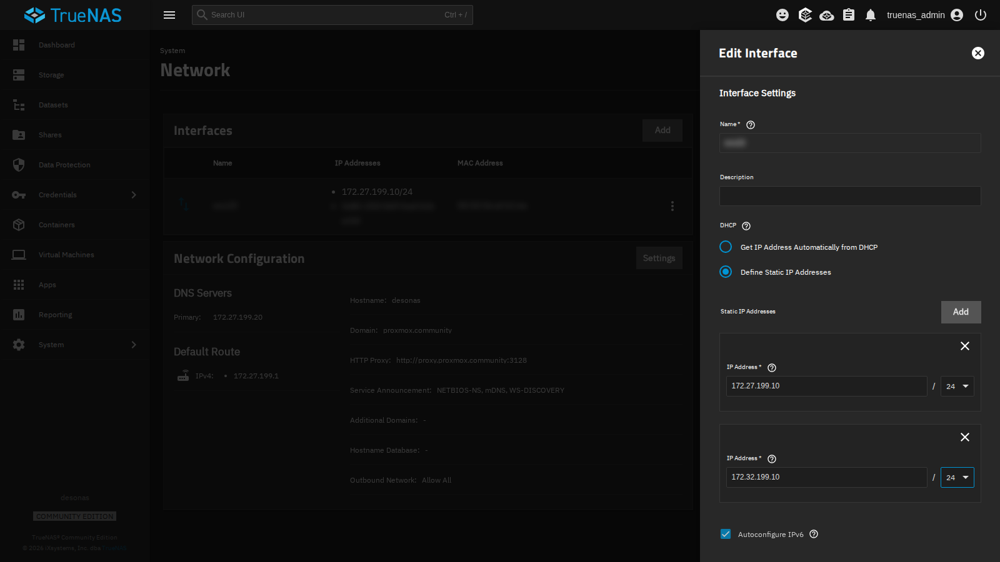
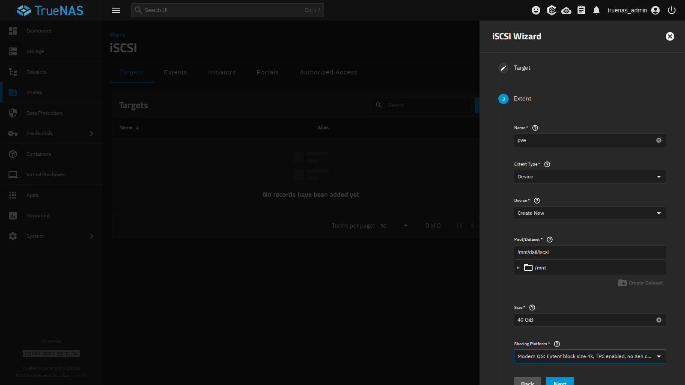
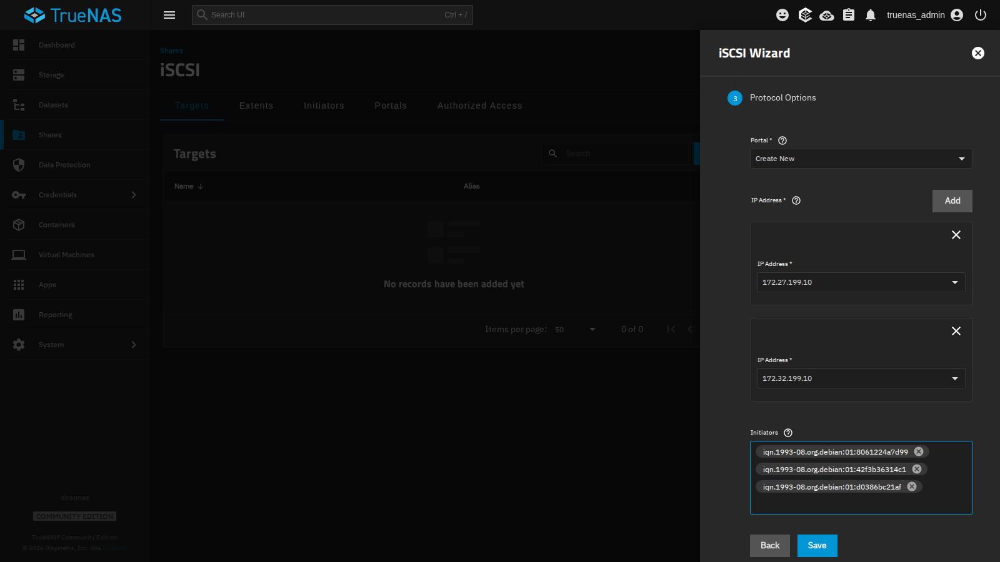
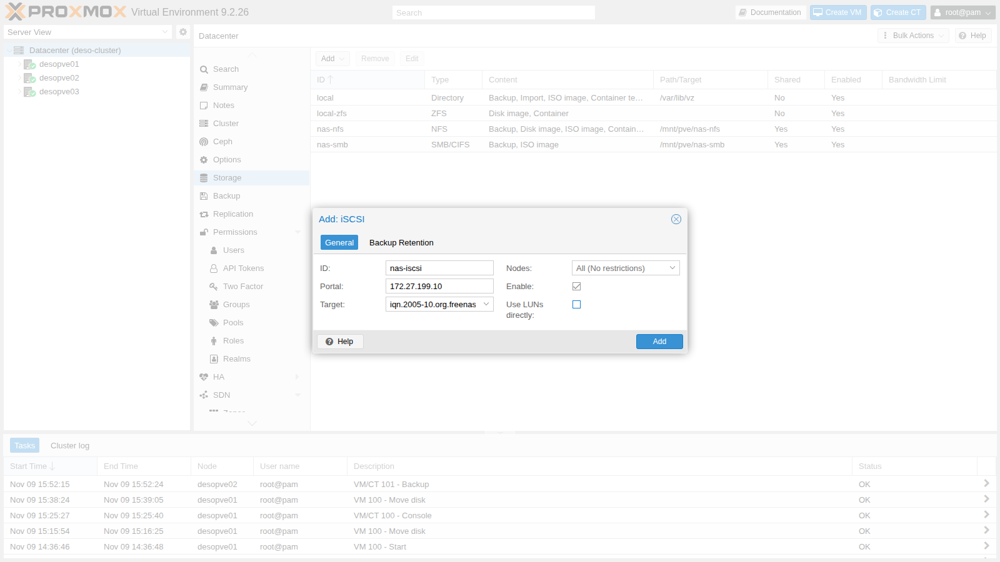
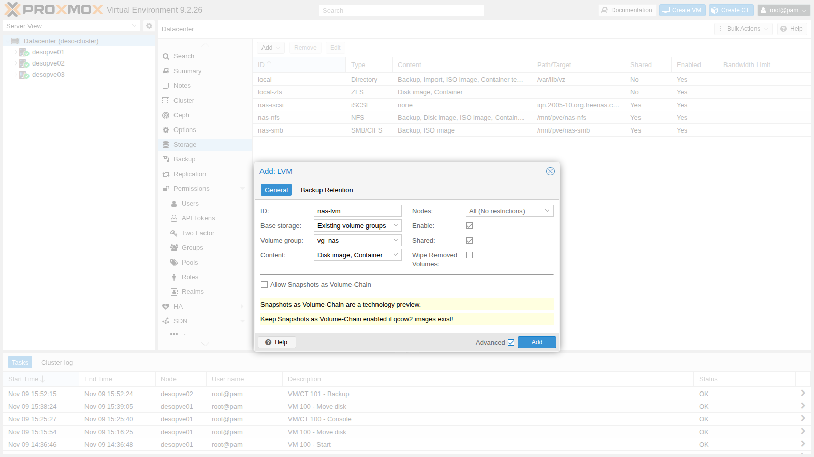
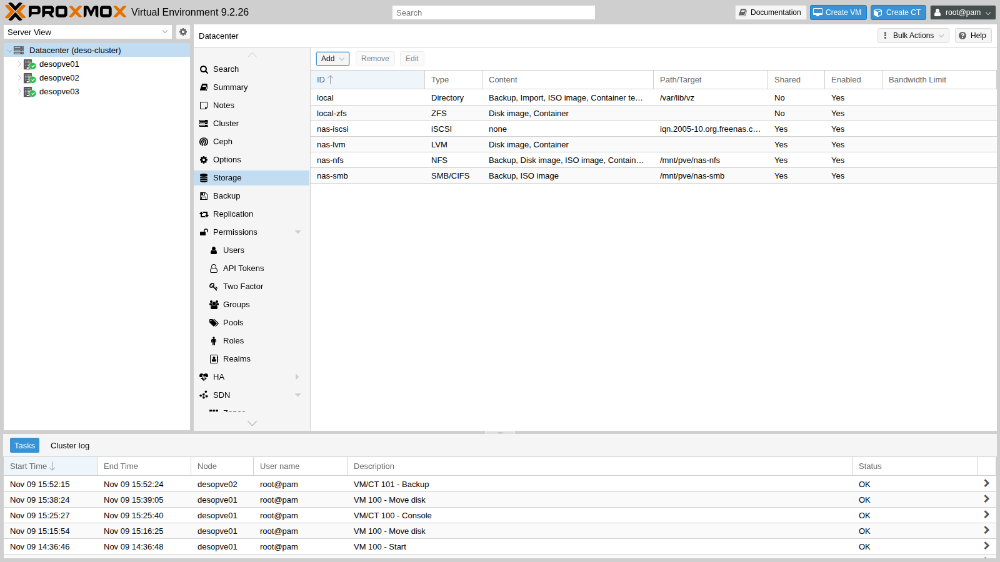

## Dependencies

- **Previous labs:** [Lab 12](/12-truenas-nas/) for the NAS `desonas` with the `dati/iscsi` dataset, [Lab 09](/09-lvm-and-lvm-thin/) for the LVM concepts, [Lab 06](/06-cluster-corosync/) for the nodes with the second NIC `nic1` (`172.32.199.21-23`), [Lab 11](/11-zfs-replication/) for the migration times to compare against.
- **Cluster:** `deso-cluster` with the three nodes; VM 100 `debian01` running on `desopve01`, with its disk on `local-zfs`.
- **Network:** the nodes reach the NAS at `172.27.199.10` (interface `vmbr0`) and, after the first step, at `172.32.199.10` (interface `nic1`).
- **Software:** `open-iscsi` is already installed in Proxmox VE; you will install `multipath-tools` through the lab proxy (lab 04).
- **Credentials:** `root` / `<lab-password>` on the nodes, `truenas_admin` / `<lab-password>` on the NAS, `labuser` / `<lab-password>` in VM 100 → [Appendix B](/b-credentials-and-addresses/).

## Objectives

- A 40 GiB zvol exported by the NAS over iSCSI on two portals, `172.27.199.10` and `172.32.199.10`, and reachable only by the IQNs of the three nodes.
- On every node, two iSCSI sessions combined by **multipath** into a single device, `nas-lun0`, with both paths `active ready running`, and the **shared LVM** storage `nas-lvm` on top of it.
- VM 100 live-migrated between two nodes with its disk on `nas-lvm`, without copying the disk.
- A path cut while the VM is writing, with three observations kept apart: the state of the paths on the node, the kernel timestamps of the failure and of the recovery, and the pause seen from inside the VM.
- Nodes with two NICs on the same Ethernet segment answering ARP only from the right interface, and the symptoms of the opposite case recognized in the logs.

## How it works

### iSCSI

iSCSI carries SCSI commands over TCP: the node sees a **disk** on the NAS as if it were attached locally (`/dev/sdX`). Unlike NFS and SMB, it does not share files, but blocks.

| Term | In the lab |
|---|---|
| **Target**: the "server" that exposes the disks, identified by an IQN | `iqn.2005-10.org.freenas.ctl:pve` on `desonas` |
| **LUN** / **extent**: the exported disk | the 40 GiB zvol `dati/iscsi/pve`, LUN 0 |
| **Portal**: IP address and TCP port (3260) on which the target responds | `172.27.199.10:3260` and `172.32.199.10:3260` |
| **Initiator**: the client, with its own IQN | the three nodes, `iqn.1993-08.org.debian:01:…` |
| **Initiator group**: who is allowed to connect to the target | only the IQNs of the three nodes |

### Shared LVM

The same iSCSI disk is seen by all nodes. On top of it you create **a single** LVM volume group (`vg_nas`), and each VM disk is a logical volume (LV):

```text
                 desonas: zvol dati/iscsi/pve (40 GiB)
                   │ 172.27.199.10            │ 172.32.199.10
               path 1 (vmbr0)              path 2 (nic1)
                   │                          │
  each node:    /dev/sde                   /dev/sdf      ← the same LUN, twice
                   └──────── multipath ───────┘
                      /dev/mapper/nas-lun0
                               │
                       VG vg_nas (shared)
                       └── vm-100-disk-0 (LV)
```

- LVM is not a cluster file system: Proxmox VE coordinates the changes (creating, growing, deleting LVs) with a cluster lock, and an LV is active on only one node at a time, the one where the VM runs.
- The storage is **thick**: every LV takes up all its space right away. Thin provisioning (LVM-thin) cannot be shared across nodes.
- Snapshots on shared LVM exist only with the *volume chain* feature of Proxmox VE 9, which you will see in lab 16.

### Multipath

With two portals, each node opens **two iSCSI sessions** and sees the LUN twice (`sde`, `sdf`). Using them directly would be dangerous: LVM would find two copies of the same disk. The **multipathd** daemon recognizes that they have the same identifier (WWID) and combines them into a single device, `/dev/mapper/nas-lun0`:

- with `path_grouping_policy multibus` and `round-robin`, both paths belong to the same group and I/O is spread over **both**;
- if a path goes down, multipath marks it `failed` and sends the I/O over the other one; when the path comes back, multipathd reinstates it by itself. Its path checker runs every `polling_interval` seconds, and the interval grows up to `max_polling_interval` (four times as long, by default) while the paths are healthy;
- with `no_path_retry queue`, if **all** paths go down, I/O is queued (as with the NFS `hard` mount of lab 13) instead of returning errors to the VM disk. The VM then waits for as long as the outage lasts, and the `multipath.conf(5)` man page warns that processes waiting on that I/O can hang and cannot be killed. This lab cuts only one path: the case with all paths down is not tested.

### Detecting a lost path

How long the I/O waits when a path fails depends on two layers:

1. **Detection, in open-iscsi.** Each session is checked with an iSCSI ping (*NOP-Out*). With the values of the `iscsid.conf` shipped with open-iscsi, a ping is sent every 5 seconds and its answer is awaited for 5 seconds; this lab does not change them. A ping without an answer marks the connection as failed.
2. **Recovery timeout.** From that moment open-iscsi tries to restore the session, and the I/O waits. When the session recovery timeout expires, the pending I/O is handed back to multipath, which retries it on another path. In `iscsid.conf` this timeout is `node.session.timeo.replacement_timeout`: 120 seconds by default, lowered to 15 in step 3. For the sessions that belong to its paths, however, multipathd writes its own value into the session's `recovery_tmo`: its `fast_io_fail_tmo`, 5 seconds by default. The failure test shows which value was in effect in the lab.

### Test environment and versions

The times reported in this lab come from a run on 9 November 2026, with the configuration below. With other versions, timers or hardware, the same steps can give different times.

| Component | Configuration used |
|---|---|
| Proxmox VE | 9.2.26, kernel `7.0.14-28-pve` ([Lab 04](/04-first-access-repositories-updates/)); `open-iscsi` and `multipath-tools` as installed on the nodes, versions not recorded in this lab (`dpkg -l open-iscsi multipath-tools` shows them) |
| iSCSI initiator | `node.session.timeo.replacement_timeout = 15` (step 3); every other parameter as in the package's `iscsid.conf`; no CHAP |
| Multipath | the `/etc/multipath.conf` of step 5: `multibus`, `round-robin 0`, `polling_interval 2`, `failback immediate`, `no_path_retry queue`; `fast_io_fail_tmo` not set, so the multipath-tools default applies |
| NAS | TrueNAS SCALE 25.10 ([Lab 12](/12-truenas-nas/)), one network card with two addresses (`172.27.199.10` and the alias `172.32.199.10`); thick 40 GiB zvol `dati/iscsi/pve`, *Modern OS* platform (4 KiB blocks), on the `dati` pool, a two-disk mirror |
| Network | `vmbr0` (on `nic0`) and `nic1` of each node on the same switch and in the same VLAN, MTU 1500 |
| Test VM | VM 100 `debian01` ([Lab 07](/07-first-vm-and-container/)): Debian 13, 2 cores, 2 GiB of RAM, 16 GiB `scsi0` disk with `iothread=1`, moved to `nas-lvm` as a raw LV |

**What the tests measure, and what they do not.** The failure test cuts one path, on one node (`desopve02`), by taking its interface down with `ip link set nic1 down`: it simulates the failure on the node side. An unplugged cable, a failed switch port or a fault on the NAS side were not tested, and they may be detected after different times. The test runs once, with a light load: one short write followed by `sync` every second. The kernel log (`dmesg -T`) has a resolution of one second, and so, roughly, does the heartbeat in the VM, whose clock was not synchronized with the node's. The migration times are task durations from individual runs, not repeated measurements.

## Procedure

### 1. A second address on the NAS

The NAS has a single network card: add the second address as an alias, on the `172.32.199.0/24` network that the nodes reach through `nic1`.

1. **System** → **Network** → interface row → **⋮** → **Edit**.
2. Under **Static IP Addresses** click **Add** and enter `172.32.199.10` / `24`.

   

3. **Save**, then **Test Changes** and, within the time shown, **Save Changes**: if the network stopped working, TrueNAS would revert to the previous configuration by itself.

### 2. The iSCSI target

1. **Shares** → **iSCSI** → **Wizard**.
2. **Target**: `Create New`, **Next**.
3. **Extent**:
   - **Name** `pve` (it becomes the name of the target and of the extent);
   - **Extent Type** `Device`, **Device** `Create New`: TrueNAS creates a **zvol**, a ZFS block volume. A *dataset* will not do: it is a file system, not a disk;
   - **Pool/Dataset** `/mnt/dati/iscsi`, **Size** `40 GiB`;
   - **Sharing Platform** `Modern OS` (4 KiB blocks).

   

4. **Protocol Options**:
   - **Portal** `Create New`, with two **IP Address** entries: `172.27.199.10` and `172.32.199.10`;
   - **Initiators**: the IQNs of the three nodes, read on each node with `cat /etc/iscsi/initiatorname.iscsi`. Only these will be able to connect.

   

5. **Save**, and accept starting the iSCSI service with automatic start enabled.

:::note[CHAP authentication]
The initiator group restricts access to the IQNs of the nodes, but an IQN can be spoofed. On networks that are not dedicated, add CHAP (**Authorized Access** on the NAS, and user name and password in the `/etc/iscsi/iscsid.conf` file of the nodes). In the lab the network is isolated and we do not use it.
:::

The zvol is **thick**: it reserves its 40 GiB right away, and in the lab the free space seen by the NFS and SMB storages dropped from about 95 to 56 GiB. On the NAS, `zfs get volsize,refreservation dati/iscsi/pve` shows the reservation.

### 3. Connect the nodes to the target

On **all three nodes**, before the first connection, lower the session recovery timeout from the default 120 seconds to the 15 seconds recommended by the Proxmox VE multipath guide. Once multipath manages the paths, multipathd may apply a value of its own: see [Detecting a lost path](#detecting-a-lost-path).

```bash title="root@desopve01"
sed -i 's/^node.session.timeo.replacement_timeout = 120/node.session.timeo.replacement_timeout = 15/' /etc/iscsi/iscsid.conf
pvesm scan iscsi 172.27.199.10
```

```text output
iqn.2005-10.org.freenas.ctl:pve 172.27.199.10:3260,172.32.199.10:3260
```

The target advertises both portals. Add the iSCSI storage:

1. **Datacenter** → **Storage** → **Add** → **iSCSI**.
2. **ID** `nas-iscsi`, **Portal** `172.27.199.10`, **Target** from the drop-down.
3. **Uncheck** **Use LUNs directly**: the LUN will not hold the VM disks directly, but the LVM volume group.

   

4. **Add**. Proxmox VE connects to the target from every node, on **all** the advertised portals:

```bash title="root@desopve01"
iscsiadm -m session
```

```text output
tcp: [1] 172.27.199.10:3260,1 iqn.2005-10.org.freenas.ctl:pve (non-flash)
tcp: [2] 172.32.199.10:3260,1 iqn.2005-10.org.freenas.ctl:pve (non-flash)
```

```bash title="root@desopve01"
lsblk -o NAME,SIZE,TRAN,VENDOR,MODEL | grep iscsi
```

```text output
sde      40G iscsi  TrueNAS  iSCSI Disk
sdf      40G iscsi  TrueNAS  iSCSI Disk
```

```bash title="root@desopve01"
iscsiadm -m session -P3 | grep -E 'Current Portal|Attached scsi disk'
```

```text output
	Current Portal: 172.27.199.10:3260,1
			Attached scsi disk sde		State: running
	Current Portal: 172.32.199.10:3260,1
			Attached scsi disk sdf		State: running
```

`sde` and `sdf` are the **same** disk, seen through the two paths.

### 4. Two NICs on the same network: ARP

In this lab `vmbr0` and `nic1` are connected to the same switch, in the same VLAN: the `172.27.199.0/24` and `172.32.199.0/24` subnets share one Ethernet segment. By default Linux answers an ARP request for **any** of its addresses on **any** interface (`arp_ignore=0`, a behaviour known as *ARP flux*). The NAS can therefore associate `172.32.199.22` with the MAC address of `vmbr0` and send the traffic of the second path there. This is most likely after one of the two NICs has been down: while `nic1` is down only `vmbr0` answers, and the NAS can keep that association after `nic1` comes back.

**Configuration tried.** `vmbr0` and `nic1` of every node on the same switch and VLAN, with the default ARP settings.

**Behaviour observed.** On `desopve02` the session of the second path kept dropping, every 10 seconds, and the VM's I/O stalled, with pauses of up to 85 seconds (the lab does not reproduce the output of that measurement). The kernel log shows the repeated connection errors (code 1022, an unanswered NOP-Out), and a capture on `vmbr0` shows traffic from the `172.32.199.10` portal, which should arrive only on `nic1`:

```bash title="root@desopve02"
dmesg -T | grep "conn error" | tail -2
```

```text output
[Mon Nov  9 16:28:15 2026]  connection2:0: detected conn error (1022)
[Mon Nov  9 16:28:25 2026]  connection2:0: detected conn error (1022)
```

```bash title="root@desopve02"
tcpdump -ni vmbr0 -c 2 host 172.32.199.10
```

```text output
16:28:46.780034 IP 172.32.199.10.3260 > 172.32.199.22.36180: Flags [S.], seq 2256764707, ack 4002835344, win 65160, options [mss 1460,sackOK,TS val 675916009 ecr 343433178,nop,wscale 7], length 0
16:28:46.781033 IP 172.32.199.10.3260 > 172.32.199.22.36180: Flags [.], ack 49, win 509, options [nop,nop,TS val 675916010 ecr 343433179], length 0
```

**Interpretation.** The symptoms are consistent with ARP flux, that is, with the NAS sending the second path's traffic to the MAC address of `vmbr0`. The capture, however, shows only that those packets reach `vmbr0`, not which MAC address the NAS used: on its own it does not prove the cause.

**How to check.** On the NAS (TrueNAS shell), `ip neigh show 172.32.199.22` shows the MAC address associated with the node's second address: compare it with the output of `ip link show nic1` and `ip link show vmbr0` on the node. `tcpdump -eni vmbr0 host 172.32.199.10` adds the MAC addresses to the capture.

**Decision.** On **all** the nodes with more than one NIC on the same segment, restrict ARP to the right interface, before configuring multipath: each interface answers only for its own addresses (`arp_ignore=1`), and ARP requests use a source address from the target's subnet on the outgoing interface (`arp_announce=2`):

```bash title="root@desopve01"
printf 'net.ipv4.conf.all.arp_ignore = 1\nnet.ipv4.conf.all.arp_announce = 2\n' > /etc/sysctl.d/90-arp-multihomed.conf
sysctl -p /etc/sysctl.d/90-arp-multihomed.conf
```

```text output
net.ipv4.conf.all.arp_ignore = 1
net.ipv4.conf.all.arp_announce = 2
```

If the NAS has already learned the wrong association, update it with an unsolicited ARP announcement from the right interface:

```bash title="root@desopve02"
apt install iputils-arping
arping -c 3 -U -I nic1 -s 172.32.199.22 172.32.199.22
```

**Result.** The path-failure test at the end of this lab, run later on the same node, shows a single connection error and the path coming back by itself (see [Verification and tests](#verification-and-tests)). This is consistent with the fix, but the lab did not record the NAS's ARP table before and after the change: the check above would confirm it.

A storage network on its own segment (a dedicated switch or VLAN) avoids the situation altogether, because each node then has a single interface on that network.

### 5. Multipath

On **all three nodes**:

1. Install the package and read the WWID of the LUN:

   ```bash title="root@desopve01"
   apt install multipath-tools
   /lib/udev/scsi_id -g -u -d /dev/sde
   ```

   ```text output
   36589cfc000000580bcccfa017f51b957
   ```

2. Create `/etc/multipath.conf`: all disks are excluded (`blacklist`) except the NAS LUN, which is given a readable name.

   ```text
   defaults {
       polling_interval        2
       path_selector           "round-robin 0"
       path_grouping_policy    multibus
       uid_attribute           ID_SERIAL
       failback                immediate
       no_path_retry           queue
       user_friendly_names     yes
   }
   blacklist {
       wwid .*
   }
   blacklist_exceptions {
       wwid "36589cfc000000580bcccfa017f51b957"
   }
   multipaths {
       multipath {
           wwid  "36589cfc000000580bcccfa017f51b957"
           alias nas-lun0
       }
   }
   ```

3. Register the WWID: with the default `find_multipaths strict`, multipath-tools builds a device only for WWIDs it already knows. Then reload:

   ```bash title="root@desopve01"
   multipath -a 36589cfc000000580bcccfa017f51b957
   systemctl restart multipathd; multipath -r
   multipath -ll
   ```

   ```text output
   nas-lun0 (36589cfc000000580bcccfa017f51b957) dm-0 TrueNAS,iSCSI Disk
   size=40G features='1 queue_if_no_path' hwhandler='0' wp=rw
   `-+- policy='round-robin 0' prio=1 status=active
     |- 33:0:0:0 sde 8:64 active ready running
     `- 34:0:0:0 sdf 8:80 active ready running
   ```

   One device, two active paths; `queue_if_no_path` is the effect of `no_path_retry queue`.

### 6. The shared LVM volume group

Create the volume group **only once**, from a single node, on the multipath device (never on `sde` or `sdf`):

```bash title="root@desopve01"
pvcreate /dev/mapper/nas-lun0
```

```text output
  Physical volume "/dev/mapper/nas-lun0" successfully created.
```

```bash title="root@desopve01"
vgcreate vg_nas /dev/mapper/nas-lun0
```

```text output
  Volume group "vg_nas" successfully created
```

```bash title="root@desopve02"
pvs
```

```text output
  PV                   VG     Fmt  Attr PSize  PFree
  /dev/mapper/nas-lun0 vg_nas lvm2 a--  39.99g 39.99g
```

The other nodes see the volume group right away, again through the multipath device: LVM ignores the individual paths by itself (`multipath_component_detection=1`).

1. **Datacenter** → **Storage** → **Add** → **LVM**.
2. **ID** `nas-lvm`, **Base storage** `Existing volume groups`, **Volume group** `vg_nas`, **Content** `Disk image, Container`.
3. Check **Shared**: without it, Proxmox VE would treat the volume group as local to each node.

   

4. **Add**.



```bash title="root@desopve01"
grep -A5 "lvm: nas-lvm" /etc/pve/storage.cfg
```

```text output
lvm: nas-lvm
	vgname vg_nas
	content images,rootdir
	saferemove 0
	shared 1
```

### 7. A VM on shared storage

Move the disk of VM 100 to `nas-lvm` while the VM is running (it becomes a `raw` LV) and migrate the VM:

```bash title="root@desopve01"
qm disk move 100 scsi0 nas-lvm --delete 1
```

```text output
mirror-scsi0: transferred 16.0 GiB of 16.0 GiB (100.00%) in 1m 20s, ready
mirror-scsi0: Completed successfully.
removing source volume 'local-zfs:vm-100-disk-0' after successful copy
```

```bash title="root@desopve01"
lvs vg_nas
```

```text output
  LV            VG     Attr       LSize  Pool Origin Data%  Meta%  Move Log Cpy%Sync Convert
  vm-100-disk-0 vg_nas -wi-ao---- 16.00g
```

```bash title="root@desopve01"
qm migrate 100 desopve02 --online
```

```text output
2026-11-09 16:22:48 starting migration of VM 100 to node 'desopve02' (172.27.199.22)
2026-11-09 16:22:54 migration completed, transferred 274.2 MiB VM-state
2026-11-09 16:22:58 migration finished successfully (duration 00:00:10)
```

The disk is not copied: the target node activates the same LV. The task transferred 274.2 MiB of VM state (the memory pages and the state of the virtual devices) and took 10 seconds in all; the return trip in the cleanup also took 10 seconds.

| Live migration of VM 100 | Task duration (`duration` in the log) |
|---|---|
| Local disk, no replication (lab 11) | 1 min 13 s |
| Local disk with ZFS replication (lab 11) | 20 s |
| Disk on shared storage (LVM on iSCSI) | 10 s |

The values are those of the individual migrations reported in lab 11 and in this lab, run on the same day with the same VM. The differences are consistent with how much disk data each migration has to copy: the whole disk without replication, only the changes since the last replication with it, nothing with shared storage. The table compares the total duration of the task, not the VM's downtime, which is a different measurement: lab 11's logs report 10 and 20 ms, while for the migration to shared storage this lab did not record it (the full task log reports it on the `average migration speed … downtime … ms` line).

## Verification and tests

The lab has succeeded when the checks at the end of this section pass. The core is the path-failure test, which looks at the loss of a path from two sides: the node, with the state of the paths and the kernel log, and the VM, with the pause its writes see. The two sides measure different things and are kept apart.

### Test – A path goes down while I/O is in progress

1. In VM 100, now on `desopve02`, start a "heartbeat": a loop that appends the time, to the millisecond, to a file, flushes it to disk with `sync` and waits one second. A write that stalls shows up as a gap between two consecutive entries.

   ```bash title="labuser@debian01"
   nohup sh -c 'while true; do date +%T.%N | cut -c1-12 >> $HOME/battito.log; sync; sleep 1; done' >/dev/null 2>&1 &
   ```

2. On `desopve02`, take down the NIC of the second path, noting the time (node clock). This simulates the failure on the node side:

   ```bash title="root@desopve02"
   date +%T.%N | cut -c1-12; ip link set nic1 down
   ```

   ```text output
   16:32:14.282
   ```

3. About 15 seconds later, look at the paths and at the kernel log on the node:

   ```bash title="root@desopve02"
   multipath -ll nas-lun0 | tail -2
   ```

   ```text output
     |- 33:0:0:0 sde 8:64 active ready  running
     `- 35:0:0:0 sdg 8:96 failed faulty offline
   ```

   ```bash title="root@desopve02"
   dmesg -T | grep -E 'conn error|recovery timed|Failing path'
   ```

   ```text output
   [Mon Nov  9 16:32:24 2026]  connection3:0: detected conn error (1022)
   [Mon Nov  9 16:32:29 2026]  session3: session recovery timed out after 5 secs
   [Mon Nov  9 16:32:29 2026] device-mapper: multipath: 252:0: Failing path 8:96.
   ```

   - **Measured** (node clock, kernel log with a resolution of one second): `nic1` goes down at 16:32:14.282. The first connection error on the second path's session (`connection3`) comes at 16:32:24, about 10 seconds later, with code 1022, which the kernel uses for an unanswered NOP-Out (`ISCSI_ERR_NOP_TIMEDOUT`); `session recovery timed out after 5 secs` and `Failing path 8:96` come at 16:32:29, about 15 seconds after the disconnection. `multipath -ll` then shows `sdg` as `failed faulty offline` and `sde` still `active ready running`.
   - **Interpretation:** the two intervals fit the two layers described in [Detecting a lost path](#detecting-a-lost-path): about 10 seconds of detection, compatible with the NOP-Out values of the shipped `iscsid.conf` (a ping every 5 seconds, 5 seconds to answer), then 5 seconds of recovery timeout. That timeout is not the 15 seconds set in step 3: the value is consistent with multipathd having applied its `fast_io_fail_tmo` to the session. The lab did not print the values in effect.
   - **How to check:** `iscsiadm -m node -T iqn.2005-10.org.freenas.ctl:pve -p 172.32.199.10 | grep -E 'noop_out|replacement_timeout'` shows the values of the node record; `cat /sys/class/iscsi_session/session*/recovery_tmo` shows the timeout actually in effect for each session; `multipathd show config | grep fast_io_fail_tmo` shows the multipath value.

4. Bring the NIC back up: the path comes back by itself.

   ```bash title="root@desopve02"
   date +%T.%N | cut -c1-12; ip link set nic1 up
   ```

   ```text output
   16:32:49.332
   ```

   ```bash title="root@desopve02"
   dmesg -T | grep Reinstating
   ```

   ```text output
   [Mon Nov  9 16:32:58 2026] device-mapper: multipath: 252:0: Reinstating path 8:96.
   ```

   ```bash title="root@desopve02"
   multipath -ll nas-lun0 | tail -2
   ```

   ```text output
     |- 33:0:0:0 sde 8:64 active ready running
     `- 35:0:0:0 sdg 8:96 active ready running
   ```

   - **Measured:** `nic1` comes back at 16:32:49.332 and the path is reinstated at 16:32:58, about 9 seconds later, as the same device (`sdg`, 8:96). Both paths are `active ready running` again.
   - **Interpretation:** the session was restored and multipathd put the path back into the existing map: nothing changes for LVM or for the VM, which only see `nas-lun0`. The 9 seconds include the new iSCSI login and the time the path checker takes to notice it; the test does not separate the two.
   - **How to check:** `journalctl -u iscsid` shows when the session became operational again; compare it with the time of `Reinstating path`.

   In this output the second path is called `sdg` instead of `sdf` because on `desopve02` its session had already been recreated once, during the ARP problem described in step 4, and the kernel had given the disk a new name. The kernel log agrees: at 16:28 the second path was `connection2`, in this test it is `connection3`. On your nodes it will probably be `sdf`.

5. In the VM, look for heartbeat pauses longer than 1.5 seconds:

   ```bash title="labuser@debian01"
   awk -F: '{s=$1*3600+$2*60+$3; if (NR>1 && s-p>1.5) printf "pausa di %.1f s, da %s a %s\n", s-p, q, $0; p=s; q=$0}' $HOME/battito.log
   ```

   ```text output
   pausa di 15.3 s, da 16:32:09.700 a 16:32:25.034
   pausa di 1.8 s, da 16:32:40.597 a 16:32:42.416
   pausa di 1.6 s, da 16:32:44.484 a 16:32:46.123
   pausa di 1.6 s, da 16:32:46.123 a 16:32:47.678
   ```

   - **Measured** (VM clock; one entry about every second; the `awk` command prints only the gaps longer than 1.5 seconds): one gap of 15.3 seconds, from 16:32:09.700 to 16:32:25.034, and three gaps of 1.6-1.8 seconds between 16:32:40 and 16:32:48. No gap longer than 1.5 seconds around the return of the path.
   - **Interpretation:**
     - The 15.3-second gap is the pause seen by the guest, and it is a different observation from the node's timers (10 + 5 seconds in the kernel log). The two agree in duration, and with an offset of a few seconds between the clocks they would also coincide in time. The VM clock was indeed a few seconds behind the node's, but by an amount that was not measured, so the alignment of the two logs cannot be verified.
     - The writes waited instead of failing: the heartbeat resumed by itself, over the remaining path.
     - The three gaps of 1.6-1.8 seconds fall while only one path was active, but they are not explained by this test: they concern only three of the twenty or more iterations in that interval, and the others stayed under the 1.5-second threshold.
     - The return of the path caused no gap above 1.5 seconds; a shorter pause would not show up with this method.
   - **How to check:** synchronize the VM with `ntp.proxmox.community` before the test, so that its times can be compared with the node's `dmesg`; print every interval, without the 1.5-second threshold, to compare before, during and after the failure; `journalctl -k -p err` in the VM shows whether the guest kernel logged any I/O errors.

Taking `nic1` down also cut Corosync link 1 (lab 06) on `desopve02`, since it uses the same NIC: the cluster stayed quorate over link 0. `corosync-cfgtool -s` shows the state of each link.

Stop the heartbeat:

```bash title="labuser@debian01"
pkill -f "^sh -c while true"; rm -f $HOME/battito.log
```

### Cleanup

Move the VM back to `desopve01` and its disk back to local storage. The `nas-iscsi` and `nas-lvm` storages stay configured for the following labs.

```bash title="root@desopve02"
qm migrate 100 desopve01 --online
```

```text output
2026-11-09 16:34:07 migration finished successfully (duration 00:00:10)
```

```bash title="root@desopve01"
qm disk move 100 scsi0 local-zfs --delete 1
```

```text output
mirror-scsi0: transferred 16.0 GiB of 16.0 GiB (100.00%) in 2m 30s, ready
removing source volume 'nas-lvm:vm-100-disk-0' after successful copy
```

- [ ] The NAS answers on `172.27.199.10` and `172.32.199.10` (`pvesm scan iscsi` lists both portals) and exports the `dati/iscsi/pve` zvol only to the IQNs of the nodes.
- [ ] Each node has two iSCSI sessions (`iscsiadm -m session`) and a single multipath device, `nas-lun0`, with both paths `active ready running` (`multipath -ll`).
- [ ] The `nas-lvm` storage is shared (`shared 1` in `storage.cfg`), on the `vg_nas` volume group created on `/dev/mapper/nas-lun0`, and every node sees it (`pvs`).
- [ ] A live migration with the disk on `nas-lvm` copies only the VM state: the log reports `transferred … VM-state` and no disk mirror.
- [ ] With one path down, the VM's writes pause for about as long as the detection plus the recovery timeout in effect (15.3 seconds in the lab) and then resume on their own; the path goes `failed` and, once the NIC is back, `active ready running` again.
- [ ] `arp_ignore=1` and `arp_announce=2` are active on the nodes (`sysctl net.ipv4.conf.all.arp_ignore net.ipv4.conf.all.arp_announce`).

## Final lab state

- **NAS:** alias `172.32.199.10/24` on the network card; zvol **`dati/iscsi/pve`** (40 GiB, thick); target **`iqn.2005-10.org.freenas.ctl:pve`** with LUN 0, portals `172.27.199.10:3260` and `172.32.199.10:3260`, initiator group with the three nodes, no CHAP; iSCSI service running and set to start automatically.
- **Nodes `desopve01-03`:**
  - `node.session.timeo.replacement_timeout = 15` in `/etc/iscsi/iscsid.conf`;
  - `multipath-tools` with `/etc/multipath.conf` (alias `nas-lun0`) and the WWID registered;
  - `/etc/sysctl.d/90-arp-multihomed.conf` with `arp_ignore=1` and `arp_announce=2`;
  - on `desopve02`, `iputils-arping` as well.
- **Cluster:** storages **`nas-iscsi`** (iSCSI, no direct content) and **`nas-lvm`** (shared LVM on the `vg_nas` VG, content `images,rootdir`, empty).
- Storages `nas-nfs` and `nas-smb` unchanged. VM 100 running on `desopve01`, disk on `local-zfs`; CT 101 running on `desopve02`.

## What you learned

- **How to export block storage from TrueNAS:** as a zvol, not a dataset. A thick zvol reserves its whole size at once, so take it out of the pool's free space when you size the other shares.
- **Where to build LVM:** on the multipath device, never on the single paths, as a single volume group marked **Shared**. Each VM disk is then an LV active on one node at a time, and a live migration copies only the VM state.
- **How long a VM waits when a path fails:** about the detection time (NOP-Out interval plus timeout) plus the session recovery timeout in effect, which with multipath can be multipathd's `fast_io_fail_tmo` rather than the `replacement_timeout` of `iscsid.conf`. Read the values in effect (`/sys/class/iscsi_session/*/recovery_tmo`) before relying on them, and measure the pause from inside the guest, separately from the node's logs.
- **What to choose for the case with all paths down:** `no_path_retry queue` keeps the I/O waiting for as long as the outage lasts, so the VM's I/O hangs without errors, possibly with processes that cannot be killed; a finite number of retries returns errors after a bounded time. This lab tested only the loss of one path.
- **How to lay out the network for two paths:** two interfaces on the same Ethernet segment need `arp_ignore=1` and `arp_announce=2`; a separate segment for each path avoids the problem. If one path keeps dropping every few seconds, check which MAC address the NAS associates with the node's address before blaming the storage.

## References

- [Proxmox VE – Open-iSCSI initiator](https://pve.proxmox.com/pve-docs/pve-admin-guide.html#storage_open_iscsi)
- [Proxmox VE – LVM Backend](https://pve.proxmox.com/pve-docs/pve-admin-guide.html#storage_lvm)
- [Proxmox VE wiki – Multipath: iSCSI paths, `multipath -a`, LVM on top, `replacement_timeout`](https://pve.proxmox.com/wiki/Multipath)
- [TrueNAS 25.10 – Adding iSCSI Block Shares (the iSCSI wizard)](https://www.truenas.com/docs/scale/25.10/scaletutorials/shares/iscsi/addingiscsishares/)
- [`multipath.conf(5)` for Debian 13 (multipath-tools 0.11): `no_path_retry`, `fast_io_fail_tmo`, `polling_interval`, `find_multipaths`](https://manpages.debian.org/trixie/multipath-tools/multipath.conf.5.en.html)
- [multipath-tools 0.11.1 – `sysfs_set_session_tmo()`: `fast_io_fail_tmo` applied as the `recovery_tmo` of iSCSI sessions](https://github.com/opensvc/multipath-tools/blob/0.11.1/libmultipath/discovery.c#L778)
- [open-iscsi – `iscsid.conf`: NOP-Out and `replacement_timeout` values](https://github.com/open-iscsi/open-iscsi/blob/master/etc/iscsid.conf)
- [Linux kernel 7.0 – iSCSI error codes in `include/scsi/iscsi_if.h` (1022 is `ISCSI_ERR_NOP_TIMEDOUT`)](https://github.com/torvalds/linux/blob/v7.0/include/scsi/iscsi_if.h)
- [Linux kernel – `arp_ignore` and `arp_announce`](https://docs.kernel.org/networking/ip-sysctl.html)
