## Dependencies

- **Previous labs:** [Lab 06](/06-cluster-corosync/) (three-node cluster `deso-cluster`), [Lab 08](/08-storage-model/) (moving disks between storages), [Lab 14](/14-smb-cifs/) (the Debian ISO on the `nas-smb` storage).
- **Nodes:** `desopve01`, `desopve02` and `desopve03` in a cluster, each with:
  - two free 60 GB disks (`/dev/sdc` and `/dev/sdd`), never used before;
  - a free third network card (`nic2`) connected to a switch that carries VLANs 50 and 51.
- **VM:** VM 100 `debian01` running on `desopve01`, with its disk on `local-zfs`.
- **Internet:** the lab proxy (`proxy.proxmox.community:3128`) must allow `download.proxmox.com`, where the Ceph packages come from.
- **Credentials:** `root` / `<lab-password>` on the nodes → [Appendix B](/b-credentials-and-addresses/).

## Objectives

- Understand the Ceph components (MON, MGR, OSD, MDS) and how Ceph decides where to place data (pools, placement groups, CRUSH).
- Prepare a dedicated Ceph network with two VLANs, separate from the management network.
- Install Ceph Tentacle with the Proxmox VE wizard and complete the Ceph cluster on the three nodes.
- Create the OSDs, a 3/2 replicated RBD pool and the cluster's RBD storage.
- Move a VM to Ceph and live-migrate it without copying its disk.
- Create a CephFS file system for ISOs, templates and backups.

## How it works

### The components

Ceph is distributed storage: it combines the disks of several servers into a single system, replicates data across the servers and heals itself when a disk or a node fails. In Proxmox VE it is integrated into the interface: you install, configure and monitor it from the GUI, with no external tools.

| Component | What it does | How many in the lab |
|---|---|---|
| **MON** (monitor) | Maintains the cluster *map*: which OSDs exist, where the data is, who is alive. Decides by majority (quorum). | 3, one per node |
| **MGR** (manager) | Collects statistics and hosts the modules (PG autoscaler, dashboard, metrics). One is active, the others are on standby. | 3 (1 active, 2 standby) |
| **OSD** (object storage daemon) | One process per disk: writes data to the disk, replicates it to the other OSDs and takes part in recovery. | 6, two per node |
| **MDS** (metadata server) | Manages the metadata (directories, names, permissions) of the CephFS file system. Needed only for CephFS. | 2 (1 active, 1 standby) |

There are **three** monitors for the same reason as the Corosync votes (lab 06): with three monitors the cluster keeps working if one stops, because the other two are still a majority. With two monitors, losing one blocks everything.

### From data to disks: pools, PGs and CRUSH

```text
 VM 100  ──▶  RBD image vm-100-disk-0 (16 GiB)
                 │  split into 4 MiB objects
                 ▼
            pool rbd-vm  (size 3, min_size 2)
                 │  each object lands in a placement group (PG)
                 ▼
            PG 2.1a ──CRUSH──▶ osd.1 (desopve01) + osd.2 (desopve02) + osd.4 (desopve03)
```

- **Pool:** a logical container with its own protection rules. `size 3` = every object exists in three copies; `min_size 2` = the pool accepts writes as long as at least two copies are available.
- **Placement group (PG):** groups of objects. Ceph does not move individual objects but whole PGs, which is much lighter to manage. The **autoscaler** chooses the number of PGs for each pool based on the space used.
- **CRUSH:** the algorithm that, given a PG, computes which OSDs hold its copies, without looking anything up in a table. The default rule, `replicated_rule`, places each copy on a **different host**: losing an entire node does not lose any data.

### Two networks for Ceph

| Network | VLAN | Subnet | Traffic |
|---|---|---|---|
| *Public network* | 50 | 10.50.10.0/24 | clients (the nodes that read and write the VM disks) and monitors |
| *Cluster network* | 51 | 10.51.10.0/24 | replication and recovery between the OSDs |

Separating Ceph traffic from the management network (172.27.199.0/24) prevents heavy replication from slowing down the GUI, Corosync or migrations. In the lab both networks run on the same `nic2` card as **tagged VLANs**: this is the most common way to separate traffic when you have few network cards. VLANs and dedicated networks are the subject of track B (labs 20-22).

:::note
**In production** Ceph wants at least 10 Gbit/s of dedicated bandwidth (25 is better), SSD or NVMe disks, at least three nodes and, for 3-way replication with full self-healing, four or more nodes. In the lab everything is scaled down: the performance figures are not representative of a production cluster (see lab 19).
:::

## Procedure

### 1. Dedicated network: two VLANs on `nic2`

1. Node **desopve01** → **System** → **Network** → **Create** → **Linux VLAN**. Name `nic2.50`, address `10.50.10.21/24`, no gateway, **Autostart** checked. Proxmox derives the base interface (`nic2`) and the tag (50) from the name on its own.

   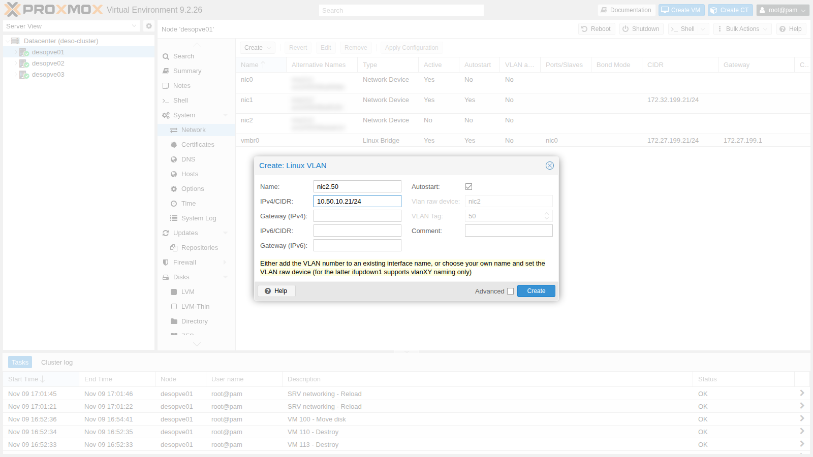

2. Repeat for `nic2.51` with `10.51.10.21/24`, then **Apply Configuration**.

   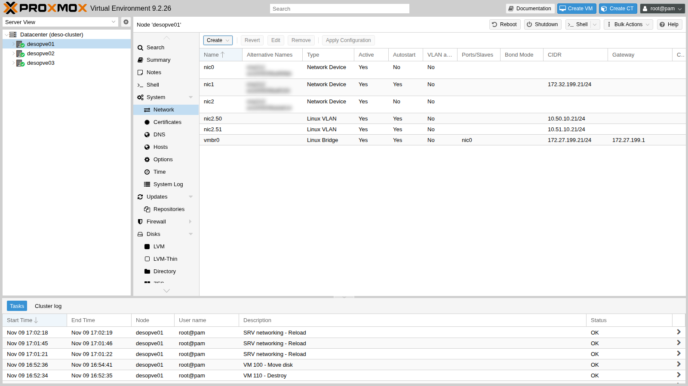

3. On the other two nodes do the same from the command line, through the Proxmox API: the result is identical to the one you get from the GUI.

   ```bash title="root@desopve02"
   pvesh create /nodes/desopve02/network --iface nic2.50 --type vlan --cidr 10.50.10.22/24 --autostart 1
   pvesh create /nodes/desopve02/network --iface nic2.51 --type vlan --cidr 10.51.10.22/24 --autostart 1
   pvesh set /nodes/desopve02/network
   ip -br a | grep nic2
   ```

   ```text output
   nic2             UP
   nic2.50@nic2     UP             10.50.10.22/24
   nic2.51@nic2     UP             10.51.10.22/24
   ```

   On `desopve03` the addresses are `10.50.10.23/24` and `10.51.10.23/24`.

4. Check that tagged packets pass between the nodes and that the VLANs are isolated from the rest of the network:

   ```bash title="root@desopve01"
   ping -c2 -W1 10.50.10.22 | tail -2
   ```

   ```text output
   2 packets transmitted, 2 received, 0% packet loss, time 1002ms
   rtt min/avg/max/mdev = 0.658/0.992/1.326/0.334 ms
   ```

   ```bash title="root@desopve01"
   ping -c2 -W1 10.51.10.23 | tail -2
   ```

   ```text output
   2 packets transmitted, 2 received, 0% packet loss, time 1001ms
   rtt min/avg/max/mdev = 0.269/0.560/0.852/0.291 ms
   ```

   The two VLANs have no gateway: Ceph traffic never leaves the dedicated network. A test from the DC confirms it: the DC sits on the management network and cannot reach VLAN 50, because no router routes it:

   ```powershell title="PowerShell — desopve-dc01"
   (Test-NetConnection 10.50.10.21 -WarningAction SilentlyContinue).PingSucceeded
   ```

   ```text output
   False
   ```

### 2. Installing Ceph with the wizard

1. Node **desopve01** → **Ceph**. Ceph is not installed, so Proxmox offers **Install Ceph**.
2. The wizard proposes **tentacle (20.2)**, the default version in Proxmox VE 9.2. As **Repository** choose **No-Subscription**: the *Enterprise* repository requires a subscription.

   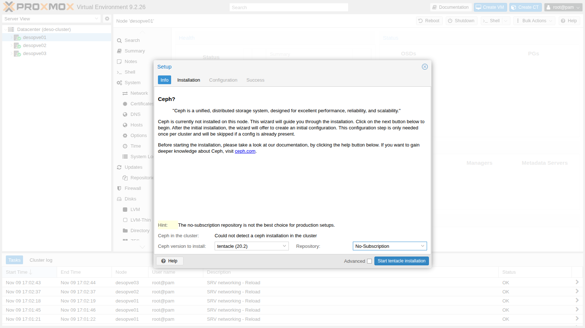

3. **Start tentacle installation**: a terminal opens running `apt`. Check the list of packages and confirm with **Y**.

   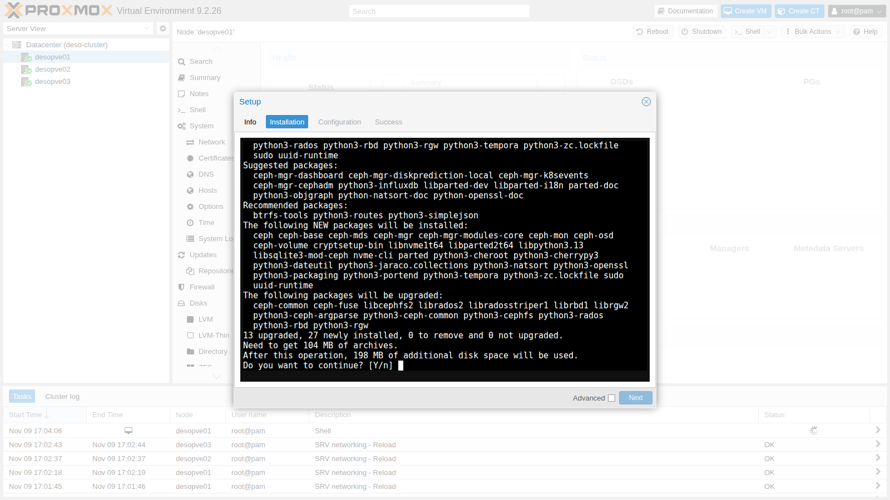

   The installation takes about a minute: the packages come from `download.proxmox.com` through the lab proxy.

4. **Next** → **Configuration**: this is where you create the Ceph cluster configuration, only once for the whole cluster.
   - **Public Network IP/CIDR:** `10.50.10.21/24` (VLAN 50);
   - **Cluster Network IP/CIDR:** `10.51.10.21/24` (VLAN 51).
   - The number of replicas and the minimum number of replicas stay at their defaults, 3 and 2 (they are in the **Advanced** options).

   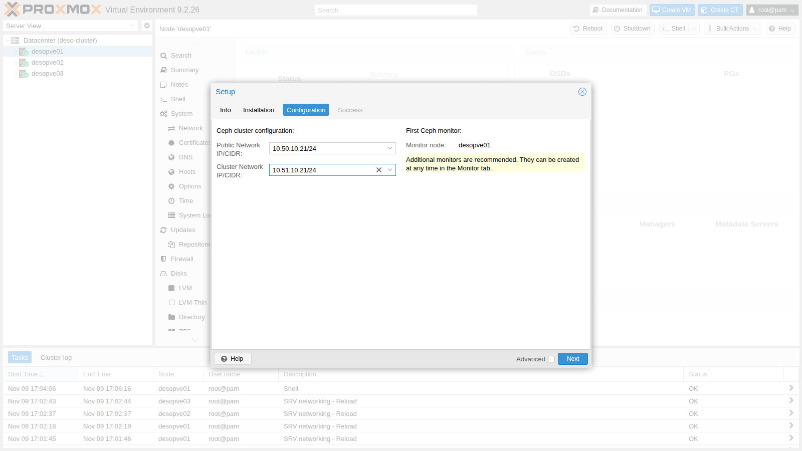

5. **Next**: Proxmox writes `/etc/pve/ceph.conf` and creates the first monitor and the first manager on `desopve01`.

   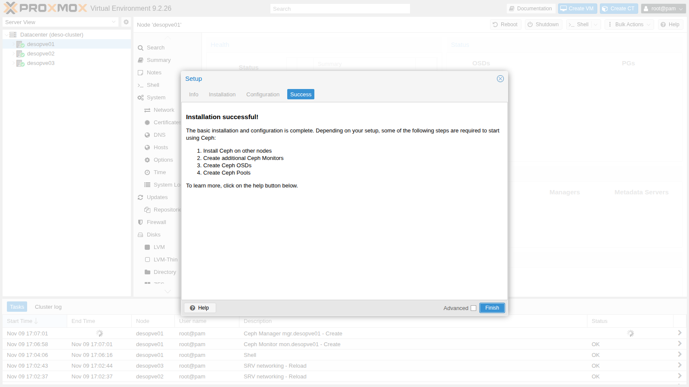

   ```bash title="root@desopve01"
   cat /etc/pve/ceph.conf
   ```

   ```text output
   [global]
   	auth_client_required = cephx
   	auth_cluster_required = cephx
   	auth_service_required = cephx
   	cluster_network = 10.51.10.21/24
   	fsid = cfd9bc4d-a092-487e-9c25-2a042c84bbbf
   	mon_allow_pool_delete = true
   	mon_host =  10.50.10.21
   	ms_bind_ipv4 = true
   	ms_bind_ipv6 = false
   	osd_pool_default_min_size = 2
   	osd_pool_default_size = 3
   	public_network = 10.50.10.21/24
   ...
   ```

   - The file lives in `/etc/pve`, so it is already identical on all the nodes of the Proxmox cluster.
   - The networks are written with the node's address (`10.50.10.21/24`): Ceph uses only the network part, that is 10.50.10.0/24, so the setting works for every node.

6. On the other two nodes install the packages from the command line, confirming with **Y**:

   ```bash title="root@desopve02"
   pveceph install --repository no-subscription --version tentacle
   ```

   ```text output
   ...
   reloading API to load new Ceph RADOS library...
   ```

   ```bash title="root@desopve02"
   ceph --version
   ```

   ```text output
   ceph version 20.2.5 (18a25ea6153a998538b0b02f656cd62b4cadaca4) tentacle (stable)
   ```

   There is no need to repeat the configuration: the nodes read `ceph.conf` from `/etc/pve`.

### 3. Monitors and managers on all nodes

1. **Ceph** → **Monitor** → **Create** (*Monitor* panel), **Host** `desopve02`. Then **Create** in the *Manager* panel, again for `desopve02`.

   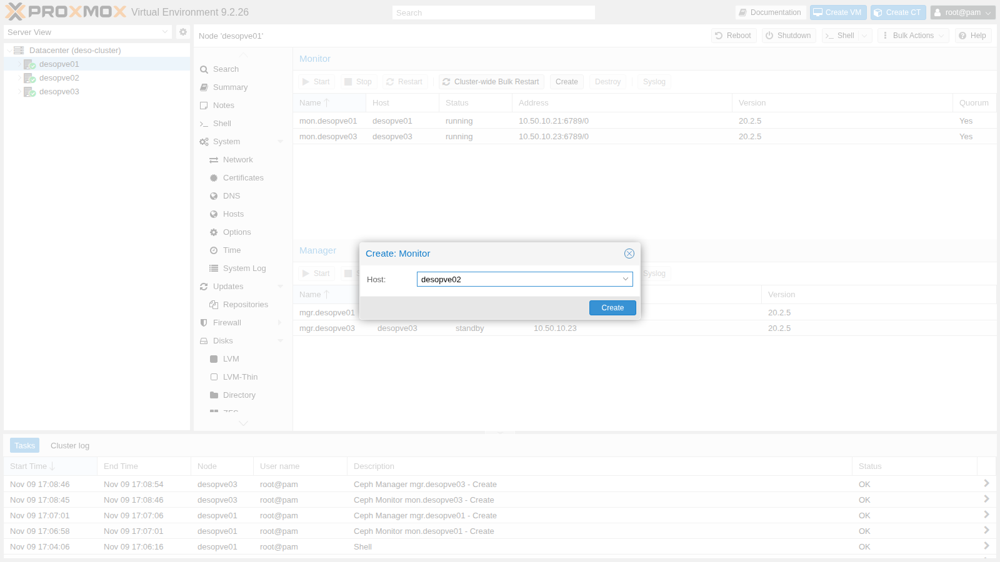

2. For `desopve03` use the command line:

   ```bash title="root@desopve03"
   pveceph mon create
   ```

   ```text output
   monmaptool: writing epoch 1 to /tmp/monmap (2 monitors)
   ...
   ```

   ```bash title="root@desopve03"
   pveceph mgr create
   ```

   ```text output
   starting service 'ceph-mgr@desopve03.service'
   ```

3. The result: three monitors in quorum and three managers, one active and two on standby.

   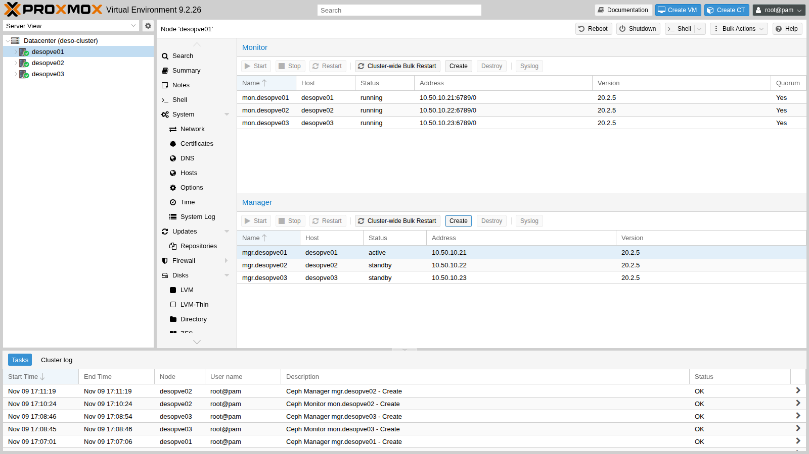

   ```bash title="root@desopve01"
   ceph mon stat
   ```

   ```text output
   e3: 3 mons at {desopve01=[v2:10.50.10.21:3300/0,v1:10.50.10.21:6789/0],desopve02=[v2:10.50.10.22:3300/0,v1:10.50.10.22:6789/0],desopve03=[v2:10.50.10.23:3300/0,v1:10.50.10.23:6789/0]} removed_ranks: {} disallowed_leaders: {}, election epoch 12, leader 0 desopve01, quorum 0,1,2 desopve01,desopve03,desopve02
   ```

   The monitors listen on the Ceph public network (10.50.10.x), not on the management network.

### 4. The OSDs

1. Node **desopve01** → **Ceph** → **OSD** → **Create: OSD**. **Disk** `/dev/sdc`, **DB Disk** *use OSD disk*: the BlueStore DB and WAL stay on the same disk.

   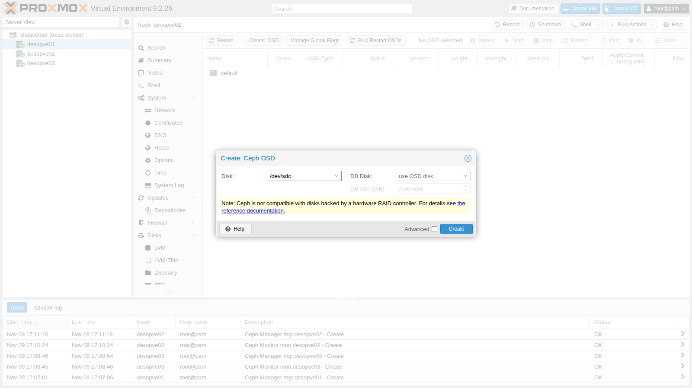

   In production, with spinning disks, you put the DB on a fast SSD (**DB Disk**); with all-SSD or NVMe disks you do not need to. The note in the dialog reminds you that Ceph wants direct access to the disks: no hardware RAID controllers.

2. Create the other five OSDs from the command line, two per node:

   ```bash title="root@desopve01"
   pveceph osd create /dev/sdd
   ```

   ```text output
   ...
   --> ceph-volume lvm create successful for: /dev/sdd
   ```

   ```bash title="root@desopve02"
   pveceph osd create /dev/sdc
   pveceph osd create /dev/sdd
   ```

   ```bash title="root@desopve03"
   pveceph osd create /dev/sdc
   pveceph osd create /dev/sdd
   ```

   Every command ends with the same `ceph-volume lvm create successful` line.

   Each OSD is an LVM volume that `ceph-volume` creates on the whole disk, with BlueStore as its format:

   ```bash title="root@desopve01"
   ceph-volume lvm list /dev/sdc | grep -E "osd id|objectstore|block device"
   ```

   ```text output
         block device              /dev/ceph-92836807-f4fd-4193-a256-dc9f557c2df7/osd-block-eff89a0e-fa94-462d-ad23-49e431295708
         objectstore               bluestore
         osd id                    0
   ```

3. The OSD tree shows the hierarchy that CRUSH uses: `root default` → three hosts → two OSDs each.

   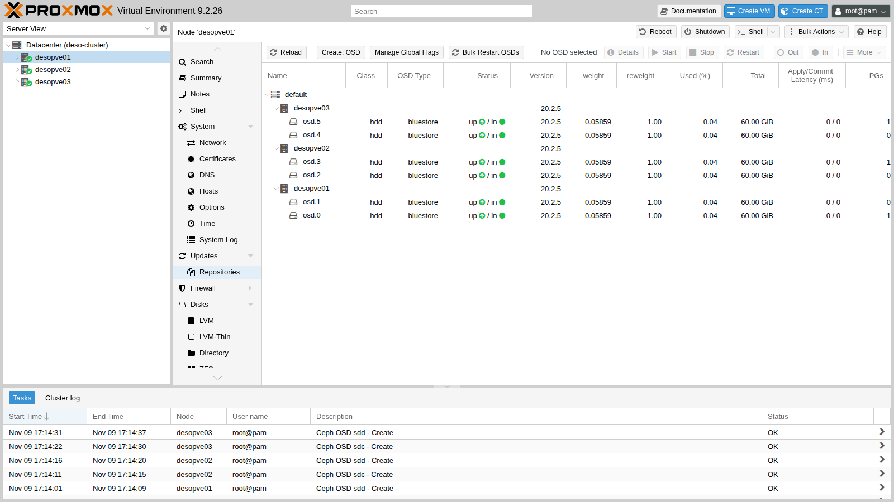

   ```bash title="root@desopve01"
   ceph osd tree
   ```

   ```text output
   ID  CLASS  WEIGHT   TYPE NAME           STATUS  REWEIGHT  PRI-AFF
   -1         0.35156  root default
   -3         0.11719      host desopve01
    0    hdd  0.05859          osd.0           up   1.00000  1.00000
    1    hdd  0.05859          osd.1           up   1.00000  1.00000
   -5         0.11719      host desopve02
    2    hdd  0.05859          osd.2           up   1.00000  1.00000
    3    hdd  0.05859          osd.3           up   1.00000  1.00000
   -7         0.11719      host desopve03
    4    hdd  0.05859          osd.4           up   1.00000  1.00000
    5    hdd  0.05859          osd.5           up   1.00000  1.00000
   ```

   - **WEIGHT** is the capacity in TiB (60 GiB = 0.0586 TiB): CRUSH distributes data in proportion to it.
   - **CLASS** `hdd` is the automatically detected *device class*. In lab 18 we use it to build different CRUSH rules.

### 5. RBD pool and cluster storage

1. **Ceph** → **Pools** → **Create**: **Name** `rbd-vm`, **Size** 3, **Min. Size** 2, **PG Autoscale Mode** `on`, **Add as Storage** checked.

   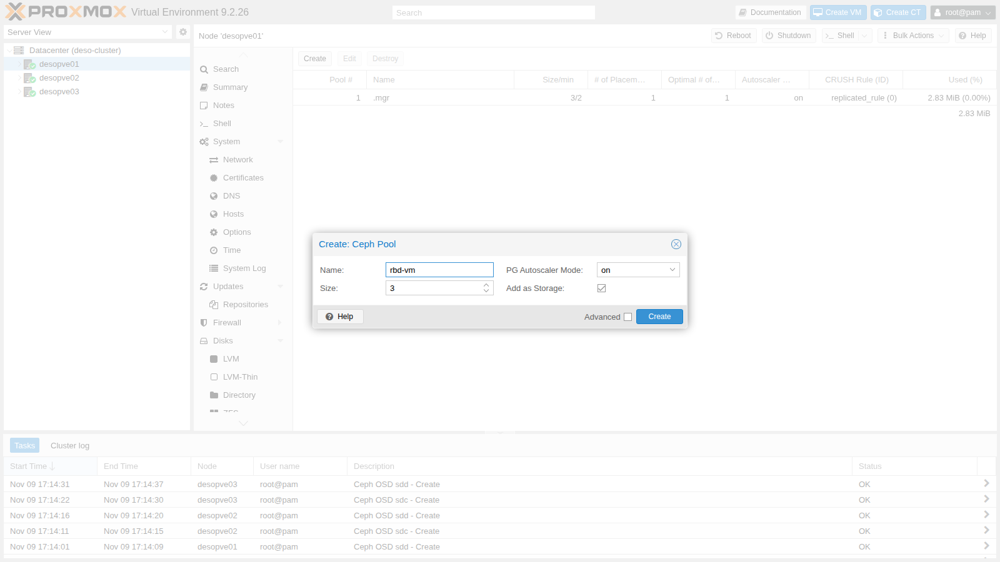

   **Add as Storage** also creates the Proxmox storage `rbd-vm`, available on all nodes for VM and container disks:

   ```bash title="root@desopve01"
   grep -A3 "rbd: rbd-vm" /etc/pve/storage.cfg
   ```

   ```text output
   rbd: rbd-vm
   	content rootdir,images
   	krbd 0
   	pool rbd-vm
   ```

   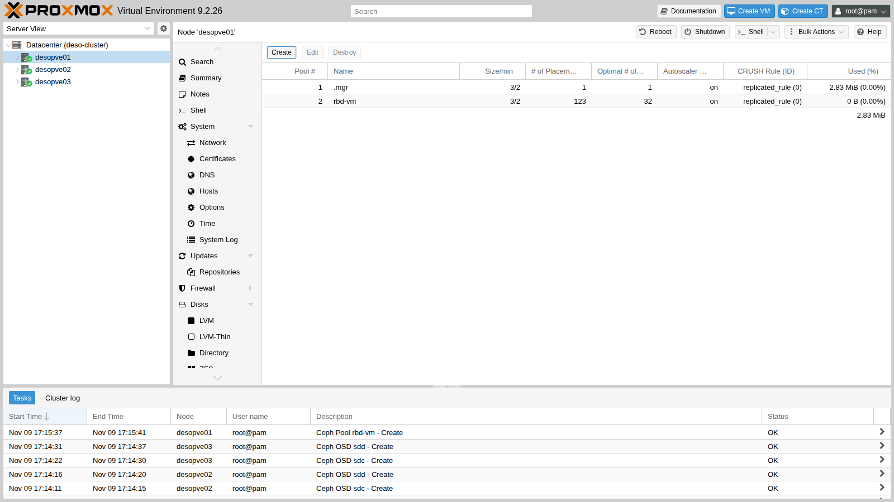

2. The pool starts with 128 PGs; the autoscaler sees an empty pool and immediately reduces them to 32. The autoscaler status below was captured after step 6, when the pool already contains the disk of VM 100:

   ```bash title="root@desopve01"
   ceph osd pool autoscale-status
   ```

   ```text output
   POOL               SIZE  TARGET SIZE  RATE  RAW CAPACITY   RATIO  FINAL RATIO  TARGET RATIO  EFFECTIVE RATIO  BIAS  PG_NUM  NEW PG_NUM  AUTOSCALE  BULK
   .mgr             966.6k                3.0        359.9G  0.0000       0.0050                                  1.0       1              on         False
   rbd-vm            6561M                3.0        359.9G  0.0534       0.1600                                  1.0      32              on         False
   ...
   ```

   Ceph creates the `.mgr` pool for the manager modules: leave it alone.

3. **Ceph** → **Configuration** shows `ceph.conf` and the **CRUSH map**: the `replicated_rule` rule picks one OSD from each different host (`chooseleaf_firstn` of type `host`).

   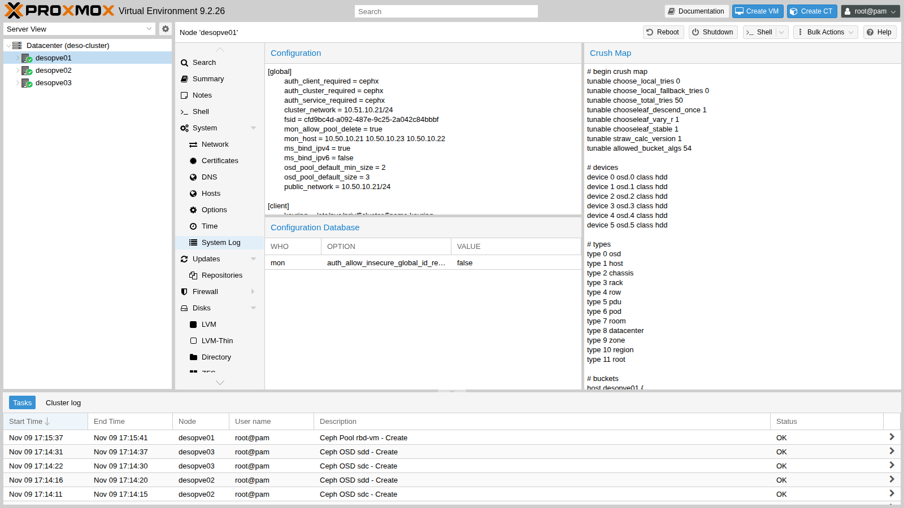

   ```bash title="root@desopve01"
   ceph osd crush rule dump replicated_rule | grep -A2 chooseleaf
   ```

   ```text output
               "op": "chooseleaf_firstn",
               "num": 0,
               "type": "host"
   ```

4. The node's **Ceph** page summarizes the status: `HEALTH_OK`, 6 OSDs *up* and *in*, all PGs `active+clean`, three monitors and three managers.

   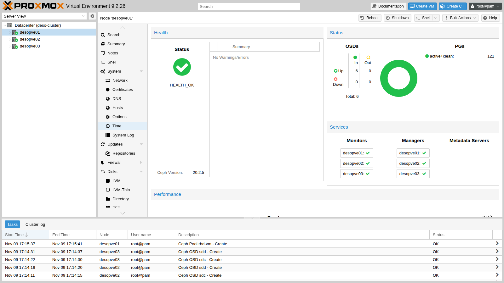

### 6. A VM on Ceph and migration without copying the disk

1. Live-move the disk of VM 100 from `local-zfs` to the RBD pool (as in lab 08):

   ```bash title="root@desopve01"
   time qm disk move 100 scsi0 rbd-vm --delete 1
   ```

   ```text output
   mirror-scsi0: Completed successfully.
   mirror-scsi0: mirror-job finished
   removing source volume 'local-zfs:vm-100-disk-0' after successful copy

   real	3m55.737s
   ```

   ```bash title="root@desopve01"
   rbd -p rbd-vm ls -l
   ```

   ```text output
   NAME           SIZE    PARENT  FMT  PROT  LOCK
   vm-100-disk-0  16 GiB            2        excl
   ```

   ```bash title="root@desopve01"
   rbd info rbd-vm/vm-100-disk-0 | grep -E "size|order|features"
   ```

   ```text output
   	size 16 GiB in 4096 objects
   	order 22 (4 MiB objects)
   	features: layering, exclusive-lock, object-map, fast-diff, deep-flatten
   ```

   - The disk is now an RBD image made of 4096 objects of 4 MiB each, every one of them replicated three times.
   - `excl` indicates the *exclusive lock*: only the node running the VM can write to it.

2. Live-migrate the VM to `desopve02`: **Migrate** → **Target node** `desopve02`. The dialog does not ask for a target storage: the disk is already shared.

   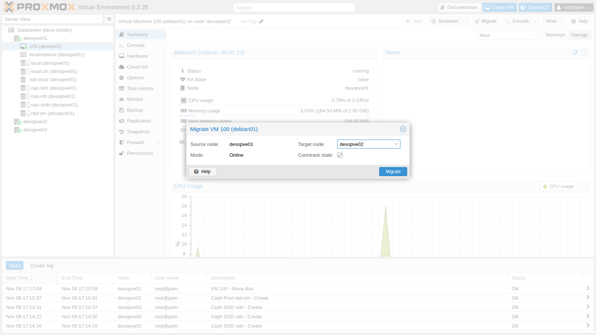

   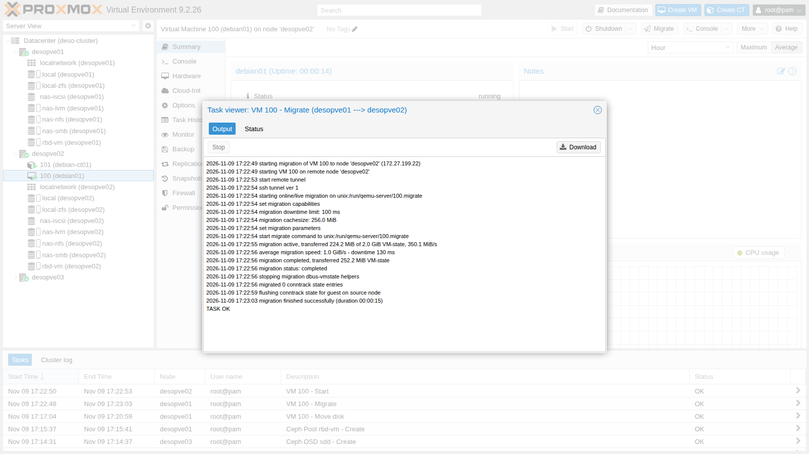

   ```text
   2026-11-09 17:22:54 migration downtime limit: 100 ms
   2026-11-09 17:22:56 average migration speed: 1.0 GiB/s - downtime 130 ms
   2026-11-09 17:23:03 migration finished successfully (duration 00:00:15)
   ```

   Only the VM's RAM is transferred: the disk stays on Ceph. The three figures in the log measure different things, as [Lab 48](/48-migrations/#how-it-works) explains: the task took 15 seconds; the 130 ms are the downtime QEMU reports for the final switchover, not the pause a client sees; and the `average migration speed` is not a measured throughput but the guest's total RAM divided by the duration of the memory phase in whole seconds, so with 2 GiB of RAM 1.0 GiB/s only says that this phase lasted about 2 seconds. For comparison, in [Lab 11](/11-zfs-replication/) the same VM, with its 16 GiB disk on local storage, took 1 minute 13 seconds, 57 of them for the disk mirror.

3. Move the VM back to `desopve01`:

   ```bash title="root@desopve02"
   qm migrate 100 desopve01 --online
   ```

   ```text output
   ...
   2026-11-09 17:25:55 migration finished successfully (duration 00:00:14)
   ```

### 7. CephFS for ISOs, templates and backups

RBD provides block devices for VMs and containers. For **files** (ISOs, templates, backups) Ceph provides **CephFS**, a shared file system mounted on all nodes. CephFS needs at least one MDS.

1. Create two metadata servers, one active and one standby:

   ```bash title="root@desopve01"
   pveceph mds create
   ```

   ```text output
   starting service 'ceph-mds@desopve01.service'
   ```

   ```bash title="root@desopve02"
   pveceph mds create
   ```

   ```text output
   starting service 'ceph-mds@desopve02.service'
   ```

2. **Ceph** → **CephFS** → **Create CephFS**: **Name** `cephfs`, **Placement Groups** 128, **Add as Storage** checked.

   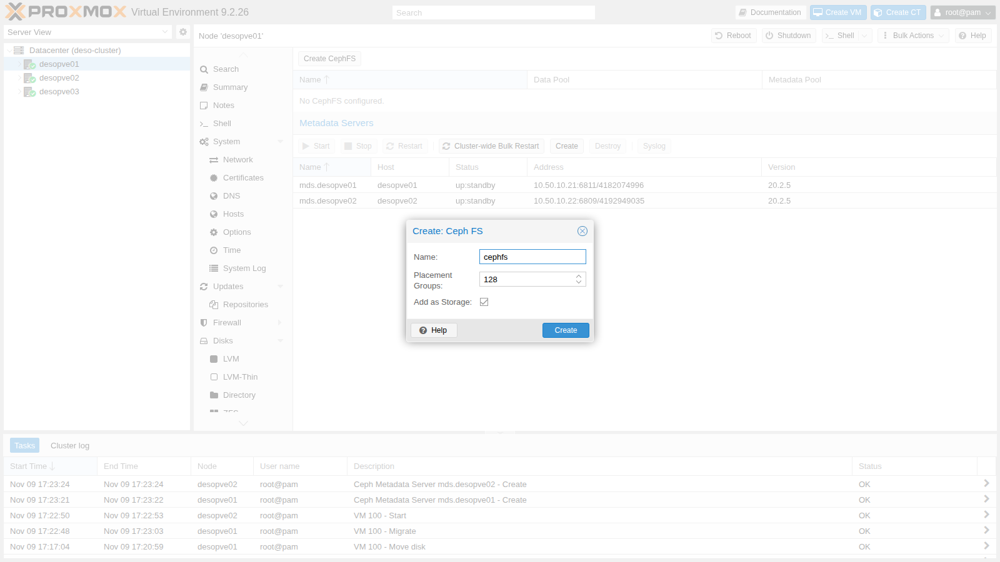

   Proxmox creates two pools, `cephfs_data` for the contents and `cephfs_metadata` for the metadata, plus the `cephfs` storage, mounted at `/mnt/pve/cephfs` on every node.

   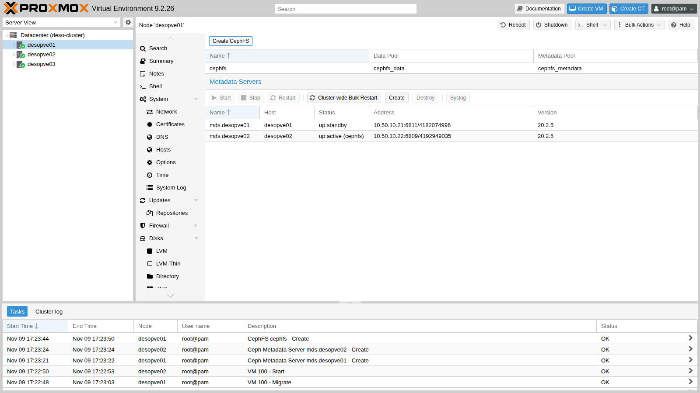

3. Check it and try copying the Debian ISO to it:

   ```bash title="root@desopve01"
   ceph fs status
   ```

   ```text output
   cephfs - 3 clients
   ======
   RANK  STATE      MDS        ACTIVITY     DNS    INOS   DIRS   CAPS
    0    active  desopve02  Reqs:    0 /s    14     17     16     15
         POOL         TYPE     USED  AVAIL
   cephfs_metadata  metadata   174k   105G
     cephfs_data      data       0    105G
   STANDBY MDS
    desopve01
   ```

   ```bash title="root@desopve01"
   grep -A4 "cephfs: cephfs" /etc/pve/storage.cfg
   ```

   ```text output
   cephfs: cephfs
   	path /mnt/pve/cephfs
   	content iso,vztmpl,backup
   	fs-name cephfs
   ```

   ```bash title="root@desopve01"
   cp /mnt/pve/nas-smb/template/iso/debian-13.7.0-amd64-netinst.iso /mnt/pve/cephfs/template/iso/
   pvesm list cephfs
   ```

   ```text output
   Volid                                      Format  Type           Size VMID
   cephfs:iso/debian-13.7.0-amd64-netinst.iso iso     iso       792723456
   ```

   The ISO is now visible from all three nodes without depending on the NAS.

## Verification and tests

1. **Overall status:**

   ```bash title="root@desopve01"
   ceph -s
   ```

   ```text output
     cluster:
       id:     cfd9bc4d-a092-487e-9c25-2a042c84bbbf
       health: HEALTH_OK

     services:
       mon: 3 daemons, quorum desopve01,desopve03,desopve02 (age 15m) [leader: desopve01]
       mgr: desopve01(active, since 18m), standbys: desopve03, desopve02
       mds: 1/1 daemons up, 1 standby
       osd: 6 osds: 6 up (since 11m), 6 in (since 11m); 1 remapped pgs

     data:
       volumes: 1/1 healthy
       pools:   4 pools, 183 pgs
       objects: 1.71k objects, 6.5 GiB
       usage:   20 GiB used, 340 GiB / 360 GiB avail
       pgs:     183 active+clean
   ```

   The `1 remapped pgs` line, like the `active+remapped+backfilling` state that can appear for a few minutes while the pools are being created, means that the autoscaler is changing the number of PGs and moving data around. This is normal and resolves itself.

2. **How much space there really is:**

   ```bash title="root@desopve01"
   ceph df
   ```

   ```text output
   --- RAW STORAGE ---
   CLASS     SIZE    AVAIL    USED  RAW USED  %RAW USED
   hdd    360 GiB  340 GiB  20 GiB    20 GiB       5.48
   TOTAL  360 GiB  340 GiB  20 GiB    20 GiB       5.48

   --- POOLS ---
   POOL             ID  PGS   STORED  OBJECTS     USED  %USED  MAX AVAIL
   .mgr              1    1  961 KiB        2  2.8 MiB      0    106 GiB
   rbd-vm            2   41  6.4 GiB    1.69k   19 GiB   5.71    106 GiB
   cephfs_data       3  108      0 B        1      0 B      0    106 GiB
   cephfs_metadata   4   32   52 KiB       22  243 KiB      0    106 GiB
   ```

   - **Raw:** 6 disks × 60 GiB = 360 GiB.
   - **STORED** versus **USED:** the VM disk holds 6.4 GiB of data, which take up 19 GiB with three copies.
   - **MAX AVAIL** 106 GiB: about a third of the free space (340 / 3 = 113 GiB), minus the margin Ceph keeps so that the OSDs never fill up (*full ratio*). With 3-way replication you can use a third of the raw capacity.

3. **Distribution across the OSDs:**

   ```bash title="root@desopve01"
   ceph osd df
   ```

   ```text output
   ID  CLASS  WEIGHT   REWEIGHT  SIZE     RAW USE  DATA     OMAP     META     AVAIL    %USE  VAR   PGS  STATUS
    0    hdd  0.05859   1.00000   60 GiB  2.5 GiB  2.5 GiB  289 KiB   61 MiB   57 GiB  4.19  0.77   94      up
    1    hdd  0.05859   1.00000   60 GiB  4.1 GiB  4.0 GiB  287 KiB   96 MiB   56 GiB  6.76  1.23   88      up
    2    hdd  0.05859   1.00000   60 GiB  2.6 GiB  2.5 GiB  184 KiB   61 MiB   57 GiB  4.30  0.79  100      up
    3    hdd  0.05859   1.00000   60 GiB  4.0 GiB  3.9 GiB  281 KiB   96 MiB   56 GiB  6.65  1.21   82      up
    4    hdd  0.05859   1.00000   60 GiB  3.4 GiB  3.3 GiB  280 KiB   96 MiB   57 GiB  5.61  1.02   86      up
    5    hdd  0.05859   1.00000   60 GiB  3.2 GiB  3.1 GiB  280 KiB   61 MiB   57 GiB  5.35  0.98   96      up
                          TOTAL  360 GiB   20 GiB   19 GiB  1.6 MiB  473 MiB  340 GiB  5.48
   ```

   Each host holds about a third of the data: this is the effect of the per-host CRUSH rule.

4. **Migration:** VM 100 moves between nodes without copying its disk: a 15-second task, with 130 ms of downtime reported by QEMU.

## Final lab state

- **Network:** on `desopve01-03` the `nic2` card carries two VLANs without a gateway: `nic2.50` (10.50.10.21-23/24, Ceph public network) and `nic2.51` (10.51.10.21-23/24, cluster network).
- **Ceph Tentacle 20.2.5** on `desopve01-03`, `HEALTH_OK`:
  - 3 MONs and 3 MGRs (active on `desopve01`), 2 MDSs (active on `desopve02`, standby on `desopve01`);
  - 6 BlueStore OSDs on `/dev/sdc` and `/dev/sdd` of each node (`osd.0`-`osd.5`), class `hdd`;
  - pool `rbd-vm` (3/2 replication, autoscaler on) and pools `cephfs_data`/`cephfs_metadata`.
- **Cluster storage:** `rbd-vm` (RBD, VM and container disks) and `cephfs` (ISOs, templates, backups) are added; `cephfs` holds the Debian 13.7 ISO.
- **VM 100 `debian01`:** running on `desopve01`, with its disk on `rbd-vm:vm-100-disk-0`. It is no longer on `local-zfs`.
- **CT 101:** unchanged, running on `desopve02`.
- **`desopve04`:** unchanged, outside the cluster.

## What you learned

- Ceph combines the disks of several nodes: the MONs keep the map and the quorum, the OSDs write and replicate the data, the MGRs collect statistics, and the MDSs are needed only for CephFS.
- A pool's data is split into PGs, and CRUSH distributes them across the hosts according to a rule. With 3/2 replication you can use a third of the raw capacity.
- The Proxmox wizard installs Ceph and writes `ceph.conf` to `/etc/pve`, so the whole cluster shares it. The other nodes only need the packages.
- Ceph networks should be kept separate from management: with VLANs, a single network card is enough.
- With its disk on RBD, a VM migrates in a few seconds, because only its RAM moves.
- CephFS gives all nodes shared space for ISOs, templates and backups, without an external NAS.

## References

- [Proxmox VE – Deploy Hyper-Converged Ceph Cluster](https://pve.proxmox.com/pve-docs/pve-admin-guide.html#chapter_pveceph)
- [Proxmox VE – `pveceph`](https://pve.proxmox.com/pve-docs/pveceph.1.html)
- [Proxmox VE – RBD storage](https://pve.proxmox.com/pve-docs/pve-admin-guide.html#ceph_rados_block_devices) and [CephFS](https://pve.proxmox.com/pve-docs/pve-admin-guide.html#storage_cephfs)
- [Ceph – Architecture](https://docs.ceph.com/en/latest/architecture/)
- [Ceph – Placement groups and the autoscaler](https://docs.ceph.com/en/latest/rados/operations/placement-groups/)
- [Ceph – CRUSH maps](https://docs.ceph.com/en/latest/rados/operations/crush-map/)
