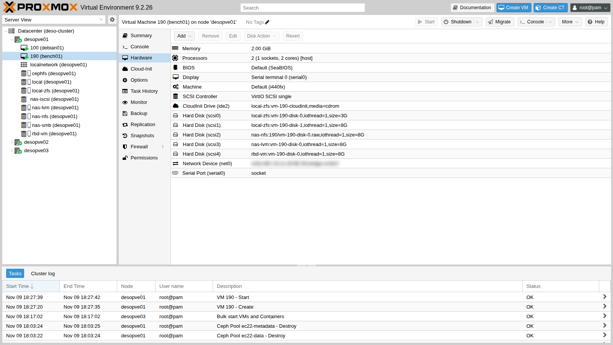
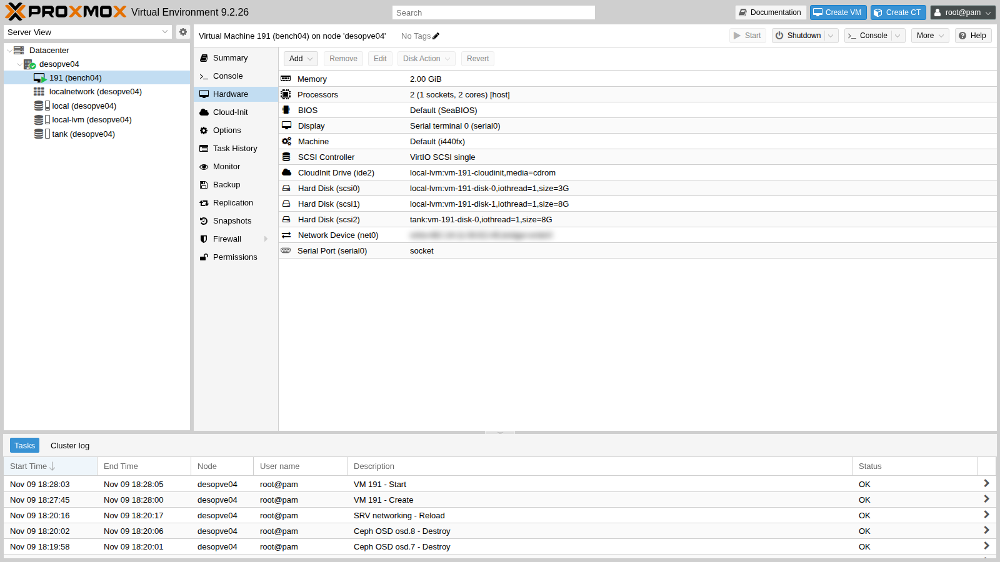

## Dependencies

- **Previous labs:** the storages to compare must exist:
  - `local-zfs` on the cluster ([Lab 03](/03-install-proxmox-ve/));
  - `local-lvm` and `tank` on `desopve04` ([Lab 09](/09-lvm-and-lvm-thin/), [Lab 10](/10-zfs/));
  - `nas-nfs` ([Lab 13](/13-nfs/));
  - `nas-lvm` on iSCSI ([Lab 15](/15-iscsi-lvm-multipath/));
  - `rbd-vm` on Ceph ([Lab 17](/17-ceph-installation/)).
- **Free space:** 8 GiB on each of these storages; 3 GiB on `local-zfs` and `local-lvm` for the system disks of the two test VMs.
- **Internet:** the lab proxy must allow `cloud.debian.org` (with its mirror `*.acc.umu.se`) and `deb.debian.org`.
- **Credentials:** `root` / `<lab-password>` on the nodes → [Appendix B](/b-credentials-and-addresses/). To log in to the test VMs you use an SSH key created for the occasion (step 1).

## Objectives

- Produce a comparable table of IOPS, bandwidth and latency for six different storages, measured with the same workload, the same VM and the same method.
- For every number, be able to say which part of the I/O path may have shaped it (caches, never-written blocks, how writes are acknowledged) and which check would confirm it.
- Have two repeatable scripts, [`bench.sh`](/files/19/bench.sh) and [`riassunto.py`](/files/19/riassunto.py), to run the same measurement on another system.

## How it works

### The three measurements

| Measurement | What it tells you | Typical test |
|---|---|---|
| **IOPS** | operations per second | small blocks (4 KiB) at random offsets: databases, operating systems |
| **Bandwidth** (MB/s) | data per second | large blocks (1 MiB) in sequence: backups, copies, video |
| **Latency** (ms) | how long a single operation waits | one operation at a time (*QD1*) |

The **queue depth** (QD) is the number of operations in flight at the same time. At QD32 the storage can work on many of them in parallel, so IOPS go up. At QD1 each operation waits for the previous one, so you measure the response time of a single operation: what an application feels when it writes and waits for the acknowledgment.

fio reports three different latencies. **slat** is the submission latency. **clat** (*completion latency*) is the time from submitting an operation to its completion. **lat** is the total latency and includes both. Every table in this lab states which one it shows.

### Three benchmark pitfalls

1. **Caches.** Several cache layers sit between the VM and the disk:
   - the page cache of the guest operating system, which `fio --direct=1` bypasses;
   - the QEMU cache, which is not used when the disk is set to `cache=none`, the Proxmox default;
   - the **ZFS ARC** on the node or on the NAS. Depending on the ZFS version and on the properties of the dataset or zvol (`primarycache`, `direct`), it may serve reads from RAM even when the VM uses `--direct=1`.

   A read served from RAM can reach tens of thousands of IOPS even when the disk underneath is slow.

2. **Never-written blocks.** On *thin* storage (ZFS, LVM-thin, Ceph), reading a block that was never written usually never reaches the disk: the storage answers with zeros. Before measuring reads, **fill** the test area first (*preconditioning*).
3. **Writes acknowledged from RAM.** Many storages acknowledge a write as soon as it is in memory and flush it to disk later, unless the system explicitly asks for an `fsync`. Plain writes and writes followed by `fsync` cost very different amounts of time, so measure both.

### Method

- **Same VM, same jobs:** a Debian 13 VM with one 8 GiB disk per storage, all on `VirtIO SCSI single` with `iothread=1` and `cache=none`. The cluster needs one VM (`bench01`); `local-lvm` and `tank` live on `desopve04`, so they need a second, identical VM (`bench04`).
- **Raw device:** fio writes straight to `/dev/disk/by-id/...`, with no file system, using `--direct=1` and `libaio`.
- **Preconditioning:** before the tests, the whole test area of each disk (2 GiB) is written once.
- **Five 20-second jobs** (plus a 3-second ramp-up), each run **twice**. The table shows the average and, in parentheses, how far apart the two runs are.
- **One extra job with an `fsync` after every write**, to measure the cost of a write that has to reach stable storage.
- Only **one storage is tested at a time**, never several in parallel.

### Test environment and versions

The results further down come from a run carried out in November 2026 with the configuration below. You need it to read them correctly: with different versions, options or hardware, the same jobs give different numbers.

| Component | Configuration used |
|---|---|
| Proxmox VE | 9.2.26, kernel `7.0.14-28-pve` ([Lab 04](/04-first-access-repositories-updates/)) |
| Test VM | Debian 13 from the cloud image, 2 vCPUs of type `host`, 2 GiB of RAM, fio 3.39 |
| VM disks | VirtIO SCSI single, `iothread=1`, `cache=none`, `aio` left at its default, which depends on the storage (see below), no `discard`; raw 8 GiB devices with a 2 GiB test area |
| `local-zfs` | ZFS mirror on the two system disks of `desopve01` ([Lab 03](/03-install-proxmox-ve/)), ARC with the limit set by the installer |
| `local-lvm` | LVM-thin on the system disk of `desopve04` ([Lab 03](/03-install-proxmox-ve/), [Lab 09](/09-lvm-and-lvm-thin/)) |
| `tank` | ZFS RAIDZ1 on the four 20 GB disks of `desopve04`, plus a hot spare; ARC capped at 2 GiB ([Lab 10](/10-zfs/)) |
| `nas-nfs` | NFS 4.2 to the `dati/nfs` dataset of the TrueNAS SCALE 25.10 NAS, on a mirrored ZFS pool ([Lab 12](/12-truenas-nas/), [Lab 13](/13-nfs/)); VM disk in raw format |
| `nas-lvm` | Shared LVM on a 40 GiB iSCSI zvol of the same NAS, over two multipath paths ([Lab 15](/15-iscsi-lvm-multipath/)) |
| `rbd-vm` | Ceph 20.2 (tentacle), replicated pool `size 3` / `min_size 2` on seven OSDs across nodes 01-03, public and cluster networks on dedicated VLANs ([Lab 17](/17-ceph-installation/), [Lab 18](/18-ceph-growth-maintenance-failures/)) |
| Network | MTU 1500 on every link ([Lab 21](/21-bonding/)) |

Disk and controller models are redacted, as explained in the [manual's conventions](/the-lab/#conventions): read the numbers as properties of this configuration, not of a particular disk model.

**The `aio` mode is not the same on every disk.** The disks were created without the `aio` option, so the qemu-server default applies, and qemu-server picks it per storage type (functions `storage_allows_io_uring_default` and `aio_cmdline_option` in the source, see the references):

- `io_uring` on `local-zfs`, `local-lvm`, `tank` and `nas-nfs`;
- `native` on `nas-lvm`: on plain LVM storages (type `lvm`) Proxmox VE does not use `io_uring` by default, and with `cache=none` it falls back to `native`;
- no `aio` mode on `rbd-vm`: with `krbd 0` ([Lab 17](/17-ceph-installation/)) QEMU reaches the image through librbd, and qemu-server sets `aio` only for files and block devices.

This list comes from the source code, not from the run, which did not record the command line of the VMs. `qm showcmd 190 --pretty` shows the mode each disk actually uses, as `"aio":…` in its `-blockdev` line.

**What the test measures, and what it does not.** It measures the full path as a VM sees it: the guest kernel, the virtual controller, QEMU, the Proxmox storage layer and, for network storages, the network plus the NAS or the OSDs. It does not isolate the individual layers, so a high or low value does not tell you on its own which layer produced it. It does not measure many VMs working in parallel. With a 2 GiB test area, smaller than the RAM of the nodes and of the NAS, caches can affect the reads. Two 20-second runs give an idea of the variability, not a statistic.

## Procedure

### 1. The test VMs from a cloud image

Instead of installing Debian from the ISO, use the official *cloud* image: a ready-made disk that configures itself at first boot with cloud-init (cloud-init and templates are the subject of lab 40).

1. On `desopve01` and on `desopve04` create an SSH key without a passphrase, used only to log in to the two test VMs (you will delete it at the end):

   ```bash title="root@desopve01"
   ssh-keygen -q -t ed25519 -N '' -f /root/bench
   ```

   ```bash title="root@desopve04"
   ssh-keygen -q -t ed25519 -N '' -f /root/bench
   ```

   Then download the image into the `local` storage (content **import**) of `desopve01` and of `desopve04`. The Debian site redirects to a mirror, so you need `-L`:

   ```bash title="root@desopve01"
   curl -sL -x http://proxy.proxmox.community:3128 \
       -o /var/lib/vz/import/debian-13-genericcloud-amd64.qcow2 \
       https://cloud.debian.org/images/cloud/trixie/latest/debian-13-genericcloud-amd64.qcow2
   qemu-img info /var/lib/vz/import/debian-13-genericcloud-amd64.qcow2 | grep -E "format|virtual"
   ```

   ```text output
   file format: qcow2
   virtual size: 3 GiB (3221225472 bytes)
   ```

   ```bash title="root@desopve04"
   curl -sL -x http://proxy.proxmox.community:3128 \
       -o /var/lib/vz/import/debian-13-genericcloud-amd64.qcow2 \
       https://cloud.debian.org/images/cloud/trixie/latest/debian-13-genericcloud-amd64.qcow2
   ```

2. Create `bench01` on `desopve01`. The system disk is imported from the image (`import-from`); cloud-init sets up the user, the SSH key and the network. Then add an 8 GiB disk for each storage to measure:

   ```bash title="root@desopve01"
   qm create 190 --name bench01 --memory 2048 --cores 2 --cpu host \
       --scsihw virtio-scsi-single --net0 virtio,bridge=vmbr0 --boot order=scsi0 \
       --serial0 socket --vga serial0 \
       --scsi0 local-zfs:0,import-from=local:import/debian-13-genericcloud-amd64.qcow2,iothread=1 \
       --ide2 local-zfs:cloudinit --ciuser labuser --sshkeys /root/bench.pub \
       --ipconfig0 ip=172.27.199.190/24,gw=172.27.199.1 \
       --nameserver 172.27.199.20 --searchdomain proxmox.community
   qm set 190 --scsi1 local-zfs:8,iothread=1 --scsi2 nas-nfs:8,format=raw,iothread=1 \
       --scsi3 nas-lvm:8,iothread=1 --scsi4 rbd-vm:8,iothread=1
   qm start 190
   ```

   

   `bench04` (VMID 191, 172.27.199.191) is identical, on `desopve04`, with the system disk on `local-lvm` and the test disks on `local-lvm` and `tank`:

   ```bash title="root@desopve04"
   qm create 191 --name bench04 --memory 2048 --cores 2 --cpu host \
       --scsihw virtio-scsi-single --net0 virtio,bridge=vmbr0 --boot order=scsi0 \
       --serial0 socket --vga serial0 \
       --scsi0 local-lvm:0,import-from=local:import/debian-13-genericcloud-amd64.qcow2,iothread=1 \
       --ide2 local-lvm:cloudinit --ciuser labuser --sshkeys /root/bench.pub \
       --ipconfig0 ip=172.27.199.191/24,gw=172.27.199.1 \
       --nameserver 172.27.199.20 --searchdomain proxmox.community
   qm set 191 --scsi1 local-lvm:8,iothread=1 --scsi2 tank:8,iothread=1
   qm start 191
   ```

   

   The SMB storage (`nas-smb`) is not part of the comparison: Proxmox can use it for VM disks, but in lab 14 we configured it only for ISOs and backups, which is the recommended use.

3. Log in to the VMs with the key created in step 1 (`bench04` the same way, from `desopve04` to `.191`):

   ```bash title="root@desopve01"
   ssh -i /root/bench labuser@172.27.199.190
   ```

   Install fio. The cloud image uses the Debian repositories over **HTTPS**, so the proxy must be declared for `https` as well:

   ```bash title="labuser@bench01"
   printf 'Acquire::http::Proxy "http://proxy.proxmox.community:3128";\nAcquire::https::Proxy "http://proxy.proxmox.community:3128";\n' | sudo tee /etc/apt/apt.conf.d/80proxy
   sudo apt-get update && sudo apt-get install -y fio
   fio --version
   ```

   ```text output
   fio-3.39
   ```

   ```bash title="labuser@bench01"
   ls -l /dev/disk/by-id/ | grep drive-scsi | awk '{print $9, $11}'
   ```

   ```text output
   scsi-0QEMU_QEMU_HARDDISK_drive-scsi0 ../../sdb
   ...
   scsi-0QEMU_QEMU_HARDDISK_drive-scsi1 ../../sda
   scsi-0QEMU_QEMU_HARDDISK_drive-scsi2 ../../sdc
   scsi-0QEMU_QEMU_HARDDISK_drive-scsi3 ../../sdd
   scsi-0QEMU_QEMU_HARDDISK_drive-scsi4 ../../sde
   ```

   The `sdX` names do **not** follow the order of the disks: here `scsi1` is `sda` and the system disk is `sdb`. To avoid writing to the wrong disk, the script uses the stable `drive-scsiN` names in `/dev/disk/by-id`.

### 2. The test script

The script is published in [`files/19/bench.sh`](/files/19/bench.sh). Create it in both VMs, for example by pasting it with a *here document*, and make it executable:

```bash title="labuser@bench01"
cat > ~/bench.sh <<'FINE'
(paste the contents of bench.sh here)
FINE
chmod +x ~/bench.sh
```

Its contents:

```bash
#!/bin/bash
# bench.sh label:scsiN ... : same fio jobs on every disk, 2 runs, JSON results in ~/res
set -u
mkdir -p ~/res
for pair in "$@"; do
  lab=${pair%%:*}; dev=/dev/disk/by-id/scsi-0QEMU_QEMU_HARDDISK_drive-${pair##*:}
  # preconditioning: write the whole test area, so that reads never hit unallocated blocks
  sudo fio --name=fill --filename=$dev --rw=write --bs=1M --size=2G --direct=1 --ioengine=libaio --iodepth=16 --output-format=json --output=$HOME/res/$lab-fill.json >/dev/null
  for run in 1 2; do
    for job in "rr4k randread 4k 32" "rw4k randwrite 4k 32" "rw4kqd1 randwrite 4k 1" "sr1m read 1M 16" "sw1m write 1M 16"; do
      set -- $job
      sudo fio --name=$1 --filename=$dev --rw=$2 --bs=$3 --iodepth=$4 --size=2G --direct=1 --ioengine=libaio \
        --time_based --runtime=20 --ramp_time=3 --output-format=json --output=$HOME/res/$lab-$1-$run.json >/dev/null
    done
  done
  echo "$(date +%T) $lab finito"
done
touch ~/res/DONE
```

Start it in the background on `bench01` and, only when it has finished, on `bench04`:

```bash title="labuser@bench01"
nohup ./bench.sh local-zfs:scsi1 nas-nfs:scsi2 nas-lvm:scsi3 rbd-vm:scsi4 > bench.log 2>&1 &
cat bench.log
```

```text output
17:36:30 local-zfs finito
17:41:39 nas-nfs finito
17:46:13 nas-lvm finito
17:51:30 rbd-vm finito
```

```bash title="labuser@bench04"
nohup ./bench.sh local-lvm:scsi1 tank:scsi2 > bench.log 2>&1 &
```

Then one last job for each disk, with an `fsync` after **every** write:

```bash title="labuser@bench01"
sudo fio --name=sync --filename=/dev/disk/by-id/scsi-0QEMU_QEMU_HARDDISK_drive-scsi1 \
    --rw=randwrite --bs=4k --iodepth=1 --fsync=1 --size=2G --direct=1 --ioengine=libaio \
    --time_based --runtime=15 --ramp_time=2 --output-format=json
```

The fio JSON files hold everything: IOPS, bandwidth, mean latencies and percentiles. The [`files/19/riassunto.py`](/files/19/riassunto.py) script builds the table for the plain workload: it reads `jobs[0].read` and `jobs[0].write` from each file and computes the average and the spread of the two runs. For latency it uses `clat_ns.mean`, the mean completion latency:

```bash title="labuser@bench01"
python3 riassunto.py ~/res
```

For the `fsync` table, read `jobs[0].write.iops`, `jobs[0].write.lat_ns.mean` (total latency) and `jobs[0].sync.lat_ns.mean` (fsync latency) in the JSON of the last job. The 99th percentile of the QD1 write without `fsync` is in `jobs[0].write.clat_ns.percentile` of the `rw4kqd1` files: unless told otherwise, fio computes percentiles on the completion latency.

## Verification and tests: the results

The test has succeeded when:

- every storage has the JSON files of all the jobs, for both runs, and `~/res/DONE` exists;
- `riassunto.py` prints a table with no empty cells;
- you can explain, or at least check, the spread between the two runs.

The absolute values depend on the infrastructure. The ones below are the results of the run described in [Test environment and versions](#test-environment-and-versions).

### Plain workload (no fsync)

| Storage | 4k random read QD32 (IOPS) | 4k random write QD32 (IOPS) | 4k write QD1, mean completion latency (clat, ms) | 1M sequential read (MB/s) | 1M sequential write (MB/s) |
|---|---|---|---|---|---|
| `local-zfs` (ZFS mirror, local) | 44,289 (±3%) | 2,336 (±50%) | 0.21 (±6%) | 3,289 (±0%) | 42 (±19%) |
| `local-lvm` (LVM-thin, local) | 29,414 (±2%) | 9,347 (±20%) | 1.70 (±4%) | 291 (±3%) | 540 (±9%) |
| `tank` (ZFS RAIDZ1, local) | 27,866 (±3%) | 3,398 (±15%) | 0.79 (±30%) | 1,036 (±3%) | 44 (±35%) |
| `nas-nfs` (NFS 4.2) | 25,069 (±9%) | 181 (±6%) | 4.47 (±3%) | 1,208 (±1%) | 21 (±23%) |
| `nas-lvm` (iSCSI + LVM, multipath) | 20,424 (±5%) | 4,182 (±15%) | 0.74 (±17%) | 1,082 (±2%) | 15 (±36%) |
| `rbd-vm` (Ceph, 3-way replication) | 10,357 (±17%) | 306 (±11%) | 8.31 (±25%) | 983 (±1%) | 20 (±27%) |

### Writes with fsync (fsync after every write, QD1)

| Storage | IOPS | Mean total write latency (lat, ms) | Mean fsync latency (ms) | QD1 write without fsync: 99th percentile completion latency (clat, ms) |
|---|---|---|---|---|
| `local-zfs` | 288 | 0.52 | 3.39 | 1.06 |
| `local-lvm` | 534 | 1.46 | 1.80 | 3.95 |
| `tank` | 145 | 0.48 | 6.79 | 3.06 |
| `nas-nfs` | 194 | 4.82 | 4.63 | 55.31 |
| `nas-lvm` | 138 | 0.83 | 7.12 | 2.54 |
| `rbd-vm` | 26 | 38.21 | 38.53 | 42.21 |

### Reading the results

Each point separates what the test measured from how we interpret it, and names the check that would confirm the interpretation.

1. **Sequential reads.**
   - **Measured:** `local-zfs` reads sequentially at 3,289 MB/s, `tank` at 1,036 MB/s and `local-lvm` at 291 MB/s.
   - **Interpretation:** the `local-zfs` figure is consistent with a large contribution from the cache, since the preconditioning had just written the test area. This measurement, however, does not separate the effect of the ARC from the rest of the I/O path. The same applies to `tank`, which has a smaller ARC (2 GiB). The 291 MB/s of `local-lvm` likewise describe the configuration under test: attributing them to the disk alone needs an additional check. The reads from `nas-nfs` (1,208 MB/s) and `nas-lvm` (1,082 MB/s) may partly come from the cache of the NAS, which also runs ZFS, but this test does not show it.
   - **How to check:**
     - during the test, watch the ARC statistics on the node (and on the NAS) with `arcstat 1`: a hit rate close to 100% means reads are served from RAM;
     - repeat the reads on a test area larger than the RAM available to the ARC, or with `primarycache=metadata` temporarily set on the test zvol;
     - for `local-lvm`, benchmark the physical disk directly from the node with fio in read-only mode (`--readonly --direct=1`); comparing it with the VM result shows how much the rest of the path costs.
2. **Ceph and the single operation.**
   - **Measured:** QD1 writes on `rbd-vm` have a mean completion latency of 8.31 ms (±25%), against 0.21-1.70 ms on the local storages. With an `fsync` after every write the rate drops to 26 IOPS, at 38.53 ms per `fsync`.
   - **Interpretation:** this is consistent with how Ceph acknowledges a write: the primary OSD forwards it to the other two replicas and replies only after they confirm, so every operation crosses the network several times. The test does not, however, separate the network's share from that of the OSD disks, nor from the access path, which differs too: QEMU reaches `rbd-vm` through librbd, while the other disks are files or block devices on the node.
   - **How to check:** during the test, `ceph osd perf` shows the commit latency of each OSD; `rados bench -p rbd-vm 30 write -b 4096 -t 1` measures single-queue 4k writes without the VM in the way; a `ping` between nodes on the Ceph VLAN gives the latency of the network alone. With deeper queues and more clients, Ceph spreads the work across many OSDs, which is why it should also be measured in parallel (see below).
3. **NFS and iSCSI on the same NAS.**
   - **Measured:** QD32 random writes reach 181 IOPS on `nas-nfs` and 4,182 on `nas-lvm`. With an `fsync` after every write the two get close: 194 and 138 IOPS.
   - **Interpretation:** the gap is consistent with how the two protocols acknowledge writes. The NFS server would acknowledge the client's `O_DIRECT` writes only once they are on stable storage, whereas over iSCSI the NAS can acknowledge from RAM and write later, unless the client asks for a flush. The values converging with `fsync` points the same way, but this test does not prove it. The two disks also differ in their `aio` mode, `io_uring` on `nas-nfs` and `native` on `nas-lvm` (see [Test environment and versions](#test-environment-and-versions)), and the test does not separate that effect from the protocol's.
   - **How to check:** on the NAS, `zfs get sync dati/nfs dati/iscsi/pve` shows how ZFS handles synchronous writes on the two volumes; on the node, `nfsstat -m` shows the effective NFS mount options. If the interpretation is right, repeating the test with `sync=always` on the iSCSI zvol should bring `nas-lvm` close to NFS. Setting `aio=native` on the `nas-nfs` disk as well removes the difference in `aio` mode from the comparison.
4. **Variability.**
   - **Measured:** QD32 random writes and sequential writes vary by up to ±50% between the two runs (`local-zfs`), and by ±35-36% on `tank` and `nas-lvm`.
   - **Interpretation:** there is more than one possible cause: activity elsewhere in the lab (Ceph, the NAS, the shared network), and the periodic flushes with which ZFS commits data to disk every few seconds, which land differently in two 20-second windows. The test cannot tell them apart.
   - **How to check:** more and longer runs, with the rest of the lab idle, while recording disk activity on the node with `iostat -x 1` or `zpool iostat 1`.
5. **Sequential writes on `local-lvm`.**
   - **Measured:** `local-lvm` writes sequentially at 540 MB/s and reads at 291 MB/s. With `fsync` it completes 534 writes per second, at 1.80 ms per `fsync`.
   - **Interpretation:** writes faster than reads, and flushes acknowledged in under 2 ms, suggest a write cache below LVM, in the controller or in the disk. The test does not tell which layer provides it, nor whether it is protected against power loss.
   - **How to check:** the write-cache state of the disk (`hdparm -W` or `sdparm --get=WCE`) and of the controller, and a longer sequential write that exceeds the cache size.

**In short:** the ratios between the storages hold for this infrastructure. With different hardware, networks and versions they change, sometimes a lot. The method, on the other hand, carries over as it is.

### What to measure in production

- A **preconditioned** test area larger than the RAM of the nodes (and of the NAS), so that caches do not distort the reads.
- More runs, longer ones (at least 60 seconds), at different times of day. Report the median and percentiles (p99), not only the mean, and always state which latency you report (clat or lat).
- Both the plain workload and the one with `fsync`: a database lives on `fsync`.
- For Ceph: several VMs or several parallel jobs (`--numjobs`), because Ceph spreads the load across many OSDs. `rados bench` and `rbd bench` measure the cluster without a VM in between.
- Write everything down, as in [Test environment and versions](#test-environment-and-versions): versions, disk options (`cache`, `iothread`, `discard`, and the `aio` mode actually in use, read with `qm showcmd`, since its default depends on the storage), block size and queue depth, size of the test area, date.

### Cleanup

Destroy the test VMs along with their disks and delete the test SSH key:

```bash title="root@desopve01"
qm stop 190 && qm destroy 190 --purge && rm -f /root/bench /root/bench.pub
```

```bash title="root@desopve04"
qm stop 191 && qm destroy 191 --purge && rm -f /root/bench /root/bench.pub
```

## Final lab state

- The state of the cluster, of Ceph and of `desopve04` is the one left by [Lab 18](/18-ceph-growth-maintenance-failures/): no test VMs, and the storages as empty as before.
- The `debian-13-genericcloud-amd64.qcow2` image stays in the `local` storage (content **import**) of `desopve01` and `desopve04`: it will be used for the templates in lab 40.

## What you learned

- **Telling whether a benchmark measures the workload you care about.** Before trusting a number you check five things: whether reads can come from a cache (a freshly written area, smaller than RAM, with the ARC active); whether fio uses `--direct=1`; how large the test area is compared with the RAM of the nodes and of the NAS; how long each test runs; how many runs you have and how far apart they are.
- **Picking the metric that answers the question.** IOPS at deep queues describe the parallel load of many VMs. QD1 latency describes an application that waits for every write, and you should say which latency you mean (clat or lat). Bandwidth matters for backups and copies.
- **Deciding when you need the `fsync` test.** If the real workload calls `fsync` (databases, logs), a result without `fsync` does not represent it.
- **Keeping measurements and explanations apart.** Next to every interpretation you can name the check that would confirm it: `arcstat`, `ceph osd perf`, `rados bench`, a test on the node's own disk.
- **Using a comparison for what it is.** A storage comparison holds for the infrastructure it was run on: before a production decision, repeat the same method on the production hardware.

## References

- [fio – documentation](https://fio.readthedocs.io/en/latest/fio_doc.html)
- [fio – interpreting the output: slat, clat and lat](https://fio.readthedocs.io/en/latest/fio_doc.html#interpreting-the-output)
- [Proxmox VE – Virtual disk options (cache, iothread, aio)](https://pve.proxmox.com/pve-docs/pve-admin-guide.html#qm_hard_disk)
- [Proxmox VE – qemu-server source, `Drive.pm`: the default `aio` mode for each storage type (`storage_allows_io_uring_default`, `aio_cmdline_option`)](https://git.proxmox.com/?p=qemu-server.git;a=blob;f=src/PVE/QemuServer/Drive.pm;hb=HEAD)
- [Proxmox VE – Cloud-init support](https://pve.proxmox.com/pve-docs/pve-admin-guide.html#qm_cloud_init)
- [Proxmox VE – `qm` and importing disk images (`import-from`)](https://pve.proxmox.com/pve-docs/qm.1.html)
- [OpenZFS – the `primarycache` property](https://openzfs.github.io/openzfs-docs/man/master/7/zfsprops.7.html#primarycache)
- [Ceph – `rados bench` (the `rados` man page)](https://docs.ceph.com/en/latest/man/8/rados/)
- [Proxmox – Proxmox VE Ceph Benchmark 2023/12](https://www.proxmox.com/en/downloads/proxmox-virtual-environment/documentation/proxmox-ve-ceph-benchmark-2023-12)
- [Ceph – Hardware recommendations](https://docs.ceph.com/en/latest/start/hardware-recommendations/)
