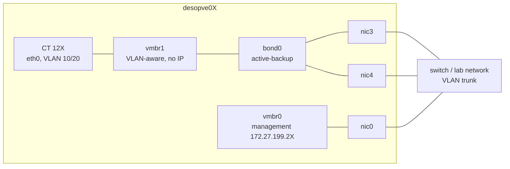
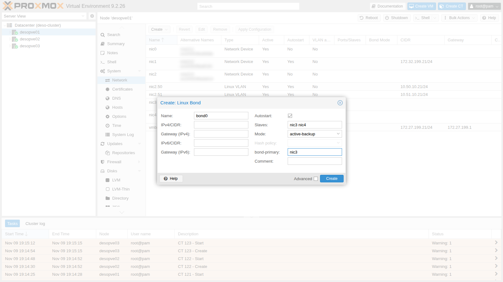
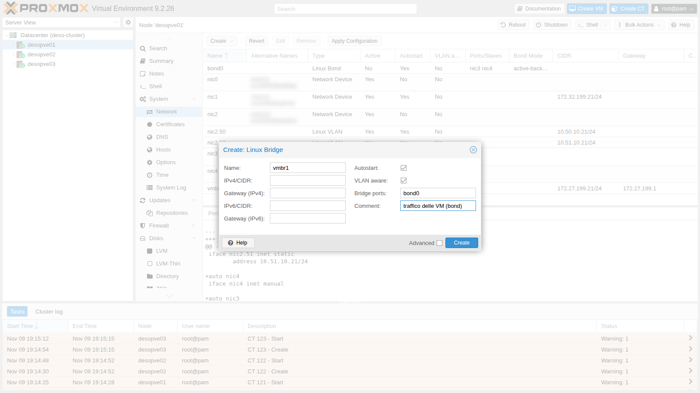
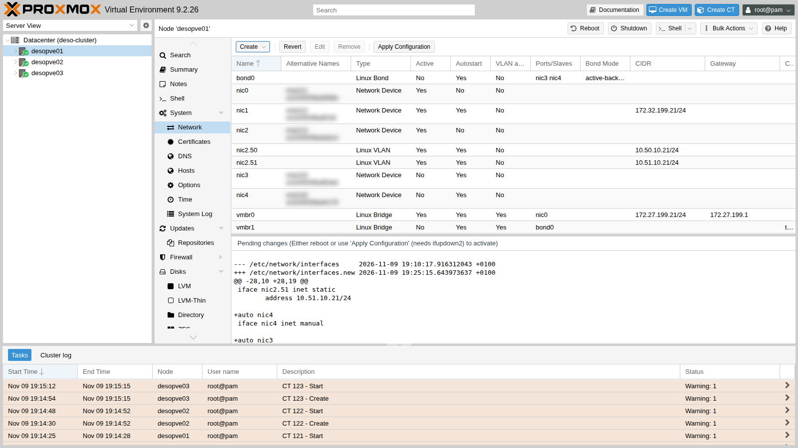
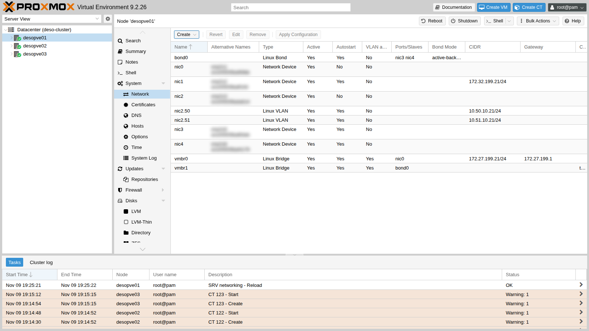

## Dependencies

- **Previous labs:** [Lab 20](/20-bridges-stable-names-vlans/): cards `nic3` and `nic4` with stable names on `desopve01-03`, VLAN-aware bridge, test containers 121-123 with `ping`, `tcpdump` and `iperf3`.
- **Network:** the two cards of each node are connected to the same network (to the same switch). LACP mode (802.3ad) would require a switch with an LACP *port-channel* configured on the two ports: the lab does not have one, and this lab shows what happens in that case.
- **Credentials:** `root` / `<lab-password>` on the nodes → [Appendix B](/b-credentials-and-addresses/).

## Objectives

- `bond0` (`nic3` + `nic4`, *active-backup*, preferred link `nic3`) under a VLAN-aware `vmbr1` bridge with no IP address on `desopve01-03`, built from the GUI on one node and from the command line on the others, with the test containers moved onto it and reachable.
- A failure and recovery of the active link while a ping is running, with the switch-over visible in the kernel log and the lost pings counted at a known probe interval.
- *active-backup*, *balance-alb* and *802.3ad* compared with `iperf3` and the interface counters, knowing which modes need configuration on the switch and which one suits a bond that carries a bridge with guests.
- The largest packet the VM network carries end to end, measured with `ping -M do` before any decision on jumbo frames.

## How it works

### What a bond is

A **bond** (Linux bonding) combines several physical NICs into a single logical interface, `bond0`. It serves two purposes:

- **redundancy:** if a cable, a port or a switch fails, traffic continues on the remaining cards;
- **more total bandwidth**, only in some modes and only with many flows: in the modes that balance per flow or per destination, **a single flow uses one link**. The exception is *balance-rr*, which spreads the packets of a single flow over all the links, at the cost of delivering them out of order.

The driver checks the state of the links every `bond-miimon` milliseconds (100 here) and stops using the ones that are down.

### The modes

| Mode | Name | Switch | Use of multiple links | Notes |
|---|---|---|---|---|
| 0 | `balance-rr` | static port-channel | yes, round-robin, packet by packet | reorders packets: not recommended for TCP |
| 1 | `active-backup` | **no configuration** | no: one active link, the others on standby | the simplest and most robust; with `bond-primary` you choose the preferred link |
| 2 | `balance-xor` | static port-channel | yes, per flow (hash) | |
| 3 | `broadcast` | – | every packet on all links | very special cases |
| 4 | **`802.3ad`** (LACP) | **LACP port-channel** | yes, per flow (hash) | the datacenter standard; with two switches it needs MLAG/vPC |
| 5 | `balance-tlb` | none | transmit only | not suitable for a bond under a bridge with guests (see below) |
| 6 | `balance-alb` | none | transmit and receive, **per destination** | balances incoming traffic by rewriting the node's own ARP replies; not suitable for a bond under a bridge with guests |

In the modes that balance "per flow", the link is chosen with a *hash* function (`bond-xmit-hash-policy`): `layer2` (MAC), `layer2+3` (MAC + IP) or `layer3+4` (IP + ports). With `layer3+4` two TCP connections between the same two hosts can use different links; a single transfer still stays on one link.

**Which modes fit Proxmox VE.** The Proxmox VE documentation recommends *802.3ad* when the switch supports LACP and *active-backup* otherwise. It advises against *balance-alb* and *balance-tlb* when the bond carries a Linux bridge with guests: these modes rely on the host knowing the local addresses, and the guests' addresses belong to the VMs and containers behind the bridge. This lab uses *balance-alb* in step 6 only to observe its behaviour, and then goes back to *active-backup*.

### The design of this lab



- `bond0` (`nic3` + `nic4`) is the port of **`vmbr1`**, a second VLAN-aware bridge dedicated to **VM traffic**. Management, Corosync, storage and Ceph stay on their own cards.
- `vmbr1` **has no IP address**: the node does not communicate on that network, it only offers it to the guests. This way the bond does not interfere with the node's own traffic.

### Test environment and versions

The results in the procedure come from tests run in November 2026 (the kernel log in step 4 is from 9 November) with the configuration below. With other cards, switches or versions, the same commands can give different numbers.

| Component | Configuration used |
|---|---|
| Proxmox VE | 9.2.26, kernel `7.0.14-28-pve`, which also provides the bonding driver ([Lab 04](/04-first-access-repositories-updates/)) |
| Bond | `nic3` + `nic4` on each node, `miimon 100`, no up or down delay; on `desopve01` both links at 10000 Mbps full duplex, as reported by `/proc/net/bonding/bond0` |
| Switch | the two ports of each node on the same switch, as VLAN trunks, with no port-channel and no LACP on those ports ([Lab 01](/01-lab-architecture/)) |
| Bridge | `vmbr1`, VLAN-aware, no IP address, MTU 1500 |
| Test containers | CT 121 on `desopve01` and CT 122 on `desopve02`, in VLAN 10: unprivileged Debian 13 (`debian-13-standard_13.6-1`), 1 core and 512 MiB of RAM each, `iperf3` and `iputils-ping` from the Debian packages ([Lab 20](/20-bridges-stable-names-vlans/)) |
| Failure | simulated on `desopve01` with `ip link set nic3 down` and `up`, not by unplugging the cable |
| Tools | `ping` with one probe every 0.2 s (`-i 0.2`), a 1-second timeout (`-W 1`) and timestamps (`-D`); `iperf3` for 10 s with 1 or 4 TCP streams, server on CT 122; transmit counters in `/sys/class/net/<card>/statistics/tx_bytes` |

**What the tests measure, and what they do not.** They measure what a container on `desopve01` sees when it talks to a container on `desopve02` through `vmbr1`, the two bonds and the switch. A ping with one probe every 0.2 seconds cannot see an interruption shorter than that interval: "0% packet loss" means that no probe went unanswered, not that the interruption lasted zero seconds. Each `iperf3` figure comes from a single 10-second run in one direction (CT 121 → CT 122), with no CPU measurement: it says nothing about variability or about what limited the throughput. The counters were read only on the transmit side of `desopve01`. The failure was simulated on the node: a cable pull, a failed switch port or the loss of the switch (the lab has only one) were not tested, and LACP was tested only without a partner on the switch.

## Procedure

### 1. bond0 and vmbr1 from the GUI (desopve01)

1. Node **desopve01** → **System** → **Network** → **Create** → **Linux Bond**.
   - **Name** `bond0`;
   - **Slaves** `nic3 nic4`;
   - **Mode** `active-backup` (the GUI proposes `balance-rr`);
   - **bond-primary** `nic3`: whenever it is available, this is the active link;
   - no IP address.

   **Hash policy** stays disabled: it is used only by `balance-xor` and `802.3ad`.

   

2. **Create** → **Linux Bridge**. **Name** `vmbr1`, **Bridge ports** `bond0`, **VLAN aware** checked, no IP address, and a comment that reminds you what it is for.

   

3. The pending changes show the two new blocks:

   

4. **Apply Configuration** → **Yes**.

   

   The resulting file:

   ```text
   auto bond0
   iface bond0 inet manual
   	bond-slaves nic3 nic4
   	bond-miimon 100
   	bond-mode active-backup
   	bond-primary nic3

   auto vmbr1
   iface vmbr1 inet manual
   	bridge-ports bond0
   	bridge-stp off
   	bridge-fd 0
   	bridge-vlan-aware yes
   	bridge-vids 2-4094
   #traffico delle VM (bond)
   ```

   You can read the state of the bond in `/proc/net/bonding/bond0`:

   ```bash title="root@desopve01"
   cat /proc/net/bonding/bond0
   ```

   ```text output
   Ethernet Channel Bonding Driver: v7.0.14-28-pve

   Bonding Mode: fault-tolerance (active-backup)
   Primary Slave: nic3 (primary_reselect always)
   Currently Active Slave: nic3
   MII Status: up
   MII Polling Interval (ms): 100
   Up Delay (ms): 0
   Down Delay (ms): 0
   Peer Notification Delay (ms): 0

   Slave Interface: nic3
   MII Status: up
   Speed: 10000 Mbps
   Duplex: full
   Link Failure Count: 0
   Permanent HW addr: <MAC>
   Slave queue ID: 0

   Slave Interface: nic4
   MII Status: up
   Speed: 10000 Mbps
   Duplex: full
   Link Failure Count: 0
   Permanent HW addr: <MAC>
   Slave queue ID: 0
   ```

### 2. The same configuration on the other nodes (CLI)

On `desopve02` and `desopve03` add the same two blocks to `/etc/network/interfaces`, before the `source /etc/network/interfaces.d/*` line, after making a copy of the file (`cp /etc/network/interfaces /root/interfaces.bak-lab21`). Then apply and check:

```bash title="root@desopve02"
ifreload -a
grep -E "Currently Active|MII Status" /proc/net/bonding/bond0 | head -2
```

```text output
Currently Active Slave: nic3
MII Status: up
```

```bash title="root@desopve02"
cat /sys/class/net/vmbr1/bridge/vlan_filtering
```

```text output
1
```

Repeat on `desopve03` and check that the cluster and Ceph suffered no interruptions (`pvecm status`, `ceph -s`).

### 3. The containers on the VM network

Move the three containers to `vmbr1`, with the same VLANs and the same addresses. You can do it while they are running:

```bash title="root@desopve01"
pct set 121 -net0 name=eth0,bridge=vmbr1,tag=10,ip=10.10.10.121/24
```

```bash title="root@desopve02"
pct set 122 -net0 name=eth0,bridge=vmbr1,tag=10,ip=10.10.10.122/24
```

```bash title="root@desopve03"
pct set 123 -net0 name=eth0,bridge=vmbr1,tag=20,ip=10.20.20.123/24
```

```bash title="root@desopve01"
pct exec 121 -- ping -c2 -W1 10.10.10.122 | tail -2
```

```text output
2 packets transmitted, 2 received, 0% packet loss, time 1001ms
rtt min/avg/max/mdev = 0.927/1.380/1.834/0.453 ms
```

```bash title="root@desopve01"
bridge vlan show dev veth121i0
```

```text output
port              vlan-id
veth121i0         10 PVID Egress Untagged
```

In the GUI it is the **Bridge** field of the container's (or VM's) network device, the same dialog you used in lab 20 to set the tag.

### 4. Failure of the active link (active-backup)

CT 121 sends five pings per second to CT 122 (`-i 0.2`). Meanwhile, on `desopve01`, the active link `nic3` goes down and comes back 13 seconds later. In the test shown here the failure was simulated with `ip link set nic3 down`. Unplugging the cable of `nic3` is a more realistic test, because the switch then sees its port go down as well; with `ip link`, whether that happens depends on the card and its driver.

```bash title="root@desopve01"
pct exec 121 -- bash -c "ping -D -i 0.2 -c 150 -W 1 10.10.10.122 > /root/ab.log" &
ip link set nic3 down
grep -E "Currently Active|Link Failure" /proc/net/bonding/bond0
```

```text output
Currently Active Slave: nic4
Link Failure Count: 1
Link Failure Count: 0
```

```bash title="root@desopve01"
ip link set nic3 up
grep "Currently Active" /proc/net/bonding/bond0
```

```text output
Currently Active Slave: nic3
```

```bash title="root@desopve01"
pct exec 121 -- tail -2 /root/ab.log
```

```text output
150 packets transmitted, 150 received, 0% packet loss, time 31030ms
rtt min/avg/max/mdev = 0.395/0.868/10.409/0.806 ms
```

The kernel logs every transition:

```bash title="root@desopve01"
journalctl -k | grep bond0 | tail -4
```

```text output
Nov 09 19:26:44 desopve01 kernel: bond0: (slave nic3): link status definitely down, disabling slave
Nov 09 19:26:44 desopve01 kernel: bond0: (slave nic4): making interface the new active one
Nov 09 19:26:57 desopve01 kernel: bond0: (slave nic3): link status definitely up, 10000 Mbps full duplex
Nov 09 19:26:57 desopve01 kernel: bond0: (slave nic3): making interface the new active one
```

- **Measured:** 150 probes sent and 150 answered (`0% packet loss`), with a slowest round trip of 10.4 ms (`rtt max`). The kernel log shows `nic4` taking over at 19:26:44 and `nic3` (the *primary*) becoming the active link again at 19:26:57.
- **Interpretation:** neither switch-over cost a probe. Any interruption was short enough to fall between two probes, or to delay one by no more than 10.4 ms. The test does not say how long it lasted, nor whether the 10.4 ms round trip, the slowest of the run, coincides with one of the two transitions.
- **How to check:** in `/root/ab.log` inside CT 121, find the line with the highest `time=` and compare its timestamp (`-D`) with the kernel log; for a finer resolution, repeat the test with a denser ping, for example `-i 0.01`.

**What the switch has to relearn.** After a switch-over, the switch has to learn which port the guests' MAC addresses are now behind. According to the kernel documentation, in *active-backup* the bond sends gratuitous ARPs on the new link only for the bond itself and for the VLAN interfaces above it, and only if they have an IP address. Here `bond0` has none and the guests sit behind the bridge, so nothing is announced on their behalf. In this test the continuous ping made CT 121 transmit over the new link straight away, and that is enough for the switch to learn its address. A guest that is not transmitting was not tested, and the outcome depends on the switch. If the switch sees the old port go down, it normally forgets the addresses learned on it and floods the frames for them to every port in the VLAN. If the old port stays up (a failure further along the path, or an `ip link` that leaves the physical link up), the switch keeps sending to the old port until the guest transmits or the entry ages out of its MAC table. To check it: stop the traffic from CT 121, take `nic3` down, then ping CT 121 from CT 122 and see when the replies start; on the switch, compare the port associated with the container's MAC address before and after the switch-over.

### 5. Bandwidth: one flow, one link

With `iperf3` you measure the bandwidth between CT 121 and CT 122 (server on 122 with `iperf3 -s -D`):

```bash title="root@desopve01"
pct exec 121 -- iperf3 -c 10.10.10.122 -t 10 -f g | tail -4
```

```text output
[  5]   0.00-10.00  sec  6.54 GBytes  5.62 Gbits/sec  191            sender
[  5]   0.00-10.00  sec  6.54 GBytes  5.61 Gbits/sec                  receiver
```

- **Measured:** one TCP stream for 10 seconds from CT 121 to CT 122: 5.62 Gbit/s at the sender and 5.61 Gbit/s at the receiver, with 191 retransmissions (`Retr` column). The links of `desopve01` run at 10 Gbit/s.
- **Interpretation:** in *active-backup* only one link carries traffic, so one flow cannot go beyond 10 Gbit/s. It stopped at 5.62, so the link speed alone does not explain the result. The limit may come from the single core of each container, from the path through `veth`, bridge and bond, from the switch, or from losses along the way, which the retransmissions hint at: the test does not tell these causes apart. In step 6, four streams, all on `nic3`, total 5.72 Gbit/s, about the same as one. That is consistent with a limit shared by all the streams rather than one per stream, but the bond mode is different and each figure comes from a single run.
- **How to check:** during the test, watch the CPU usage in the containers and on the nodes (`top`): a core pinned at 100% points to a CPU limit; read the `tx_bytes` counters of `nic3` and `nic4` to confirm that only one link carries the flow; repeat the test with containers that have more cores and compare.

### 6. balance-alb: load balancing without configuring the switch

:::caution[A test, not a configuration to keep]
The Proxmox VE documentation advises against *balance-alb* and *balance-tlb* when the bond carries a bridge with guests, as `bond0` does here. This step uses *balance-alb* only to see how it spreads the traffic; at the end of step 7 the bond goes back to *active-backup*.
:::

1. On `desopve01` and `desopve02` change the mode: in `bond0` replace `bond-mode active-backup` with `bond-mode balance-alb` and remove the `bond-primary` line, so that no card is preferred. `ifreload -a` applies the change on the fly.

   ```bash title="root@desopve01"
   ifreload -a; grep "Bonding Mode" /proc/net/bonding/bond0
   ```

   ```text output
   Bonding Mode: adaptive load balancing
   ```

2. Run four parallel flows to the same container, measuring the bytes transmitted by each card. Read the counters before and after the test, and compute the difference:

   ```bash title="root@desopve01"
   cat /sys/class/net/nic3/statistics/tx_bytes /sys/class/net/nic4/statistics/tx_bytes
   pct exec 121 -- iperf3 -c 10.10.10.122 -t 10 -P 4 -f g | grep "SUM.*receiver"
   ```

   ```text output
   [SUM]   0.00-10.00  sec  6.66 GBytes  5.72 Gbits/sec                  receiver
   ```

   ```bash title="root@desopve01"
   cat /sys/class/net/nic3/statistics/tx_bytes /sys/class/net/nic4/statistics/tx_bytes
   ```

   | Interface | Bytes transmitted during the test |
   |---|---|
   | `nic3` | 7.17 GB |
   | `nic4` | 0.00 GB |

   - **Measured:** four parallel TCP streams from CT 121 to CT 122 for 10 seconds, 5.72 Gbit/s in total at the receiver (`SUM` line). During the test `nic3` transmitted 7.17 GB and `nic4` nothing.
   - **Interpretation:** consistent with *balance-alb* choosing the transmit link **per destination**: the four streams go to the same IP address, so they share one card. With many guests talking to different hosts, the transmit load would be spread over both links. On the receive side, the kernel documentation describes the balancing (*rlb*) as a rewrite of the ARP replies sent by the local system, and the driver code skips the ARP traffic that does not come from the bond itself or from a VLAN directly above it: the guests behind the bridge are left out, and their traffic would come in through a single card. The test read only the transmit counters, so it does not show the receive side.
   - **How to check:** repeat with streams to several different hosts and compare the counters of the two cards; for the receive side, read the `rx_bytes` counters of `nic3` and `nic4` during a test in the opposite direction (`iperf3 -R`).

3. Failure of `nic3` while the ping is running:

   ```bash title="root@desopve01"
   pct exec 121 -- bash -c "ping -D -i 0.2 -c 100 -W 1 10.10.10.122 > /root/alb.log" &
   ip link set nic3 down
   grep -E "Slave Interface|MII Status" /proc/net/bonding/bond0 | tail -4
   ```

   ```text output
   Slave Interface: nic3
   MII Status: down
   Slave Interface: nic4
   MII Status: up
   ```

   ```bash title="root@desopve01"
   ip link set nic3 up
   pct exec 121 -- tail -2 /root/alb.log
   ```

   ```text output
   100 packets transmitted, 99 received, 1% packet loss, time 20559ms
   ```

   - **Measured:** 100 probes, one every 0.2 seconds, and 99 answers: one probe lost (`1% packet loss`).
   - **Interpretation:** consistent with a short interruption while the bond moves the traffic from `nic3` to `nic4` and the switch learns the new port, but the test does not prove it. It does not say when the probe was lost (when the link went down, when it came back, or at some other moment), nor how long the interruption lasted: if the loss does come from a switch-over, one lost probe with the ones before and after answered means it lasted less than about 0.4 seconds.
   - **How to check:** in `/root/alb.log` find the missing `icmp_seq` and compare the timestamps (`-D`) of the probes around it with the kernel log (`journalctl -k | grep bond0`); repeat with a denser ping.

### 7. LACP (802.3ad) without a switch that negotiates it

LACP is the standard mode in datacenters: the node's cards and the switch ports form a single channel, and the LACP protocol continuously checks that both sides agree. **It requires switch configuration.** This step shows what happens when the switch does not have it.

1. **Configuration tried.** On `desopve01` only (`desopve02` stays in *balance-alb* from step 6), set:

   ```text
   auto bond0
   iface bond0 inet manual
   	bond-slaves nic3 nic4
   	bond-miimon 100
   	bond-mode 802.3ad
   	bond-xmit-hash-policy layer3+4
   	bond-lacp-rate fast
   ```

2. Apply (`ifreload -a`) and look at the state:

   ```bash title="root@desopve01"
   grep -E "Mode|Hash|LACP|Aggregator ID|Number of ports|Partner Mac|Slave Interface" /proc/net/bonding/bond0
   ```

   ```text output
   Bonding Mode: IEEE 802.3ad Dynamic link aggregation
   Transmit Hash Policy: layer3+4 (1)
   LACP active: on
   LACP rate: fast
   	Aggregator ID: 1
   	Number of ports: 1
   	Partner Mac Address: 00:00:00:00:00:00
   Slave Interface: nic3
   Aggregator ID: 1
   Slave Interface: nic4
   Aggregator ID: 2
   ```

   **Behaviour observed:**

   - **`Partner Mac Address: 00:00:00:00:00:00`**: nobody on the other side answers LACP;
   - each card ends up in a **different aggregator** (1 and 2), and the active aggregator has **only one port**.

   **Interpretation.** Without a partner, each card forms an aggregator of its own and the bond uses only one of them: it works, but on one link at a time, like an *active-backup* in disguise that adds no bandwidth. This reading comes from the state of the aggregators; the bandwidth in this mode was not measured.

3. Traffic flows, including while `nic3` is down for 3 seconds:

   ```bash title="root@desopve01"
   pct exec 121 -- ping -c4 -W1 10.10.10.122 | tail -2
   ```

   ```text output
   4 packets transmitted, 4 received, 0% packet loss, time 3064ms
   rtt min/avg/max/mdev = 0.475/0.594/0.718/0.091 ms
   ```

   ```bash title="root@desopve01"
   pct exec 121 -- bash -c "ping -D -i 0.2 -c 75 -W 1 10.10.10.122 > /root/lacp.log" &
   ip link set nic3 down; sleep 3; ip link set nic3 up
   pct exec 121 -- tail -2 /root/lacp.log
   ```

   ```text output
   75 packets transmitted, 75 received, 0% packet loss, time 15335ms
   ```

   - **Measured:** 4 pings out of 4 answered before the failure; then 75 probes at 0.2-second intervals, over about 15 seconds that include the 3 seconds with `nic3` down, all answered.
   - **Interpretation:** consistent with the bond moving to the other aggregator when the only port of the active one goes down, which is what the default selection policy (`ad_select stable`) does according to the kernel documentation. The output does not show the change of aggregator.
   - **How to check:** read the `Active Aggregator Info` section of `/proc/net/bonding/bond0` while `nic3` is down; compare the `tx_bytes` counters of the two cards during an `iperf3 -P 4`: in this state only one of them should grow.

   **With LACP configured on the switch** (not testable in this lab), `Partner Mac Address` shows the switch's MAC address and the two cards sit in the **same** aggregator (`Number of ports: 2`). With two switches for redundancy, they must support MLAG/vPC (or stacking), because LACP sees the two switches as a single one.

4. **Decision.** Go back to *active-backup* on `desopve01` and `desopve02` (same block as in step 1, with `bond-primary nic3`) and apply with `ifreload -a`. If you do not control the switch configuration, it is the mode that needs nothing from the switch, and the one the Proxmox VE documentation recommends when LACP is not available. **Result:** `bond0` is back in *active-backup*, with `nic3` preferred, on both nodes: the configuration that stays for the following labs.

### 8. MTU and jumbo frames: verify before using them

*Jumbo frames* (MTU 9000) carry the same data in fewer packets, which reduces the per-packet work for storage and migration traffic. They work only if **the whole path** accepts them: NICs, bond, switch, guest ports and guests. A single element left at 1500 drops the larger frames, and the symptom looks like a generic network fault.

**Configuration tried.** A temporary test (with `ip link`, so it does not persist) between CT 121 on `desopve01` and CT 122 on `desopve02`. On each node raise the MTU of the bond (which also applies it to `nic3` and `nic4`), of the node side of the container's interface (`veth121i0`, `veth122i0`) and of the interface inside the container. Leave the `vmbr1` bridge alone: for the frames that cross it, what counts is the MTU of its ports.

```bash title="root@desopve01"
ip link set bond0 mtu 9000; ip link set veth121i0 mtu 9000
pct exec 121 -- ip link set eth0 mtu 9000
```

```bash title="root@desopve02"
ip link set bond0 mtu 9000; ip link set veth122i0 mtu 9000
pct exec 122 -- ip link set eth0 mtu 9000
```

```bash title="root@desopve01"
pct exec 121 -- ping -M do -s 1472 -c 3 -W 1 10.10.10.122 | tail -2
```

```text output
3 packets transmitted, 3 received, 0% packet loss, time 2036ms
rtt min/avg/max/mdev = 0.480/0.799/1.392/0.419 ms
```

```bash title="root@desopve01"
pct exec 121 -- ping -M do -s 8972 -c 3 -W 1 10.10.10.122 | tail -2
```

```text output
3 packets transmitted, 0 received, 100% packet loss, time 2081ms
```

`-M do` prohibits fragmentation, and `-s 8972` plus 28 bytes of headers makes a 9000-byte packet: it does not get through, while the 1500-byte one does. To find out where the limit is, try increasing sizes:

```bash title="root@desopve01"
for s in 4000 8000 8910 8912; do r=$(pct exec 121 -- ping -M do -s $s -c 2 -W 1 10.10.10.122 | grep -o "[0-9]* received"); echo "$s: $r"; done
```

```text output
4000: 2 received
8000: 2 received
8910: 2 received
8912: 0 received
```

**Behaviour observed.** With fragmentation forbidden, 1500-byte packets (`-s 1472`) get through and 9000-byte packets (`-s 8972`) do not: 3 sent, none answered, and the summary line reports no errors. With increasing sizes, 8910 bytes of ICMP data (an 8938-byte packet) still get through and 8912 bytes (8940) do not; 8911 was not tried.

**Interpretation.** Something on the path between the two nodes lets 8938-byte IP packets through and drops 8940-byte ones. Since 8938-byte packets got through, the interfaces of the two nodes had indeed been raised well above 1500: the limit is consistent with an element outside the nodes, such as the maximum frame size of the switch, but the test does not show where the larger frames are dropped. It does show why the problem is hard to spot: nothing reports an error, the larger packets simply vanish.

**How to check.** Capture on both nodes (`tcpdump -eni bond0 'icmp and greater 8000'`) while CT 121 sends an 8940-byte packet (`ping -M do -s 8912`): if the frame leaves `desopve01` and never shows up on `desopve02`, it is dropped in the network. Also check the MTU actually applied to each interface (`ip link show`), the receive errors of the cards on `desopve02` (`ip -s link show nic3`) and the maximum frame size configured on the switch ports.

**Decision.** Stay at 1500 in this lab. Jumbo frames would need a common MTU that the whole path carries, here at most 8938, and a switch configured for it. Put everything back as it was:

```bash title="root@desopve01"
pct exec 121 -- ip link set eth0 mtu 1500; ip link set veth121i0 mtu 1500; ip link set bond0 mtu 1500
```

```bash title="root@desopve02"
pct exec 122 -- ip link set eth0 mtu 1500; ip link set veth122i0 mtu 1500; ip link set bond0 mtu 1500
```

**Result.** MTU 1500 again on every interface, as in the rest of the manual. In production you set the MTU in the network file (`mtu 9000` on the NICs, on the bond and on the bridge) only after checking the switch, and you always confirm it with `ping -M do` at full size, in both directions.

## Verification and tests

The lab has succeeded when `bond0` is active in *active-backup* on the three nodes with the containers reachable on `vmbr1`, when a failure of the active link shows up in the kernel log with the lost pings counted, and when you can say, for each result below, what was measured and with which tool.

| Check | Success criterion | Observed in the lab |
|---|---|---|
| `bond0` + VLAN-aware `vmbr1` on `desopve01-03` | `Currently Active Slave: nic3` and `MII Status: up`; `vlan_filtering` set to 1; quorum and Ceph health unchanged (`pvecm status`, `ceph -s`) | active on the three nodes, with no interruption seen by `pvecm status` and `ceph -s` |
| Containers on `vmbr1` | CT 121 answers CT 122; `veth121i0` has PVID 10 | 2 pings out of 2 answered; VLAN 10 untagged on the port |
| *active-backup*, failure and return of the active link | switch to `nic4` and back to `nic3` in the kernel log; lost pings counted at a known interval | 0 probes lost out of 150 (one every 0.2 s); slowest round trip 10.4 ms |
| One TCP stream (*active-backup*) | a reference value, with tool and parameters noted | 5.62 Gbit/s at the sender, 191 retransmissions, on 10 Gbit/s links |
| *balance-alb*, 4 streams to a single host | counters showing which card transmitted | 5.72 Gbit/s in total; 7.17 GB on `nic3`, nothing on `nic4` |
| *balance-alb*, failure of one link | lost pings counted at a known interval | 1 probe lost out of 100 (one every 0.2 s) |
| *802.3ad* without an LACP switch | the signs of a missing partner recognised | partner `00:00:00:00:00:00`, separate aggregators, one port in the active one; 0 probes lost out of 75 across a 3-second failure |
| MTU along the path | `ping -M do -s 8972` answered before adopting MTU 9000 | 100% loss at 9000 bytes; largest packet through: 8938 bytes. MTU stays at 1500 |

## Final lab state

- **`desopve01-03`:** `bond0` (`nic3` + `nic4`, *active-backup*, `bond-primary nic3`, `miimon 100`) and VLAN-aware **`vmbr1`** (`2-4094`) without an IP address, for VM traffic. MTU 1500 everywhere.
- **Management network, Corosync, iSCSI and Ceph:** unchanged (`vmbr0` on `nic0`, `nic1`, `nic2.50`/`nic2.51`).
- **Test containers, now on `vmbr1`:** CT 121 (`desopve01`, VLAN 10, `10.10.10.121`), CT 122 (`desopve02`, VLAN 10, `10.10.10.122`, `iperf3` server running), CT 123 (`desopve03`, VLAN 20, `10.20.20.123`).
- Copies of the previous configuration in `/root/interfaces.bak-lab21` on `desopve02` and `desopve03`.

## What you learned

- **Choosing the bond mode from what the switch offers.** If you cannot configure the switch, use *active-backup*, with `bond-primary` when one link is preferred. If the switch has an LACP port-channel on those ports, use *802.3ad*; with two switches, check that they support MLAG/vPC or stacking. Keep *balance-alb* and *balance-tlb* off bonds that carry a bridge with guests, as the Proxmox VE documentation advises.
- **Setting the right expectations for bandwidth.** Apart from *balance-rr*, one flow never uses more than one link, and *balance-alb* picks the card per destination, so all the traffic to one host goes through one card. Before blaming the links for a low figure, compare it with their speed: here one stream reached 5.62 Gbit/s on 10 Gbit/s links, so the link speed alone does not explain it.
- **Recognising an LACP bond without a partner:** `Partner Mac Address: 00:00:00:00:00:00`, one aggregator per card and `Number of ports: 1`. The bond keeps working, but on one link.
- **Reading a failover test for what it measures.** The ping interval sets the resolution: 0% loss with one probe every 0.2 seconds means that no probe was lost, not that the interruption lasted zero seconds. Match the ping timestamps with the kernel log, and remember that what happens to a silent guest depends on how the switch relearns its MAC address.
- **Deciding on jumbo frames.** Only after `ping -M do` at full size gets through end to end, in both directions: otherwise the larger packets vanish without an error, as at 9000 bytes in this lab.
- **Keeping the node off a guest network.** A bridge without an IP address offers the network to the guests without exposing the node on it.

## References

- [Proxmox VE – Linux Bond: the modes, the recommended ones and *balance-alb*/*balance-tlb* with a bridge](https://pve.proxmox.com/pve-docs/pve-admin-guide.html#sysadmin_network_bond)
- [Linux kernel 7.0 – Bonding driver options (`mode`, `miimon`, `primary`, `ad_select`, `num_grat_arp`)](https://www.kernel.org/doc/html/v7.0/networking/bonding.html#bonding-driver-options)
- [Linux kernel 7.0 – Bonding: switch configuration required by each mode](https://www.kernel.org/doc/html/v7.0/networking/bonding.html#switch-configuration)
- [Linux 7.0 – `bond_alb.c`: per-destination transmit balancing and the ARP replies left out of *rlb* (`rlb_arp_xmit`)](https://github.com/torvalds/linux/blob/v7.0/drivers/net/bonding/bond_alb.c)
- [Debian 13 – `iperf3(1)`: parallel streams (`-P`), duration (`-t`), reverse direction (`-R`)](https://manpages.debian.org/trixie/iperf3/iperf3.1.en.html)
- [Debian 13 – `ping(8)`: interval (`-i`), timeout (`-W`), timestamps (`-D`), no fragmentation (`-M do`)](https://manpages.debian.org/trixie/iputils-ping/ping.8.en.html)
