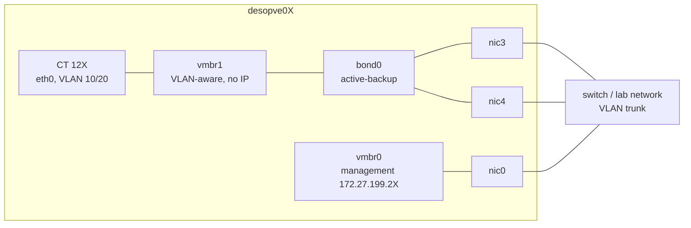

## Dependencies

- **Previous labs:** [Lab 20](/20-bridges-stable-names-vlans/): cards `nic3` and `nic4` with stable names on `desopve01-03`, VLAN-aware bridge, test containers 121-123 with `ping`, `tcpdump` and `iperf3`.
- **Network:** the two cards of each node are connected to the same network (to the same switch). LACP mode (802.3ad) would require a switch with an LACP *port-channel* configured on the two ports: the lab does not have one, and this lab shows what happens in that case.
- **Credentials:** `root` / `<lab-password>` on the nodes → [Appendix B](/b-credentials-and-addresses/).

## Objectives

- Understand the Linux bonding modes and which of them require switch configuration.
- Create a bond of two cards and a VLAN-aware bridge dedicated to VM traffic, from the GUI and from the command line.
- Disconnect a link while traffic is flowing and measure what the guest sees.
- Compare *active-backup*, *balance-alb* and *802.3ad* on the real lab, using the interface counters.
- Verify the MTU of a network before using *jumbo frames*.

## How it works

### What a bond is

A **bond** (Linux bonding) combines several physical NICs into a single logical interface, `bond0`. It serves two purposes:

- **redundancy:** if a cable, a port or a switch fails, traffic continues on the remaining cards;
- **aggregated bandwidth**, only in some modes and only with many flows: **a single flow always uses just one link**.

The driver checks the state of the links every `bond-miimon` milliseconds (100 here) and stops using the ones that are down.

### The modes

| Mode | Name | Switch | Use of multiple links | Notes |
|---|---|---|---|---|
| 0 | `balance-rr` | static port-channel | yes, round-robin, packet by packet | reorders packets: not recommended for TCP |
| 1 | `active-backup` | **no configuration** | no: one active link, the others on standby | the simplest and most robust; with `bond-primary` you choose the preferred link |
| 2 | `balance-xor` | static port-channel | yes, per flow (hash) | |
| 3 | `broadcast` | – | every packet on all links | very special cases |
| 4 | **`802.3ad`** (LACP) | **LACP port-channel** | yes, per flow (hash) | the datacenter standard; with two switches it needs MLAG/vPC |
| 5 | `balance-tlb` | none | transmit only | |
| 6 | `balance-alb` | none | transmit and receive, **per destination** | balances incoming traffic by manipulating ARP replies |

In the modes that balance "per flow", the link is chosen with a *hash* function (`bond-xmit-hash-policy`): `layer2` (MAC), `layer2+3` (MAC + IP) or `layer3+4` (IP + ports). With `layer3+4` two TCP connections between the same two hosts can use different links; a single transfer still stays on one link.

### The design of this lab



- `bond0` (`nic3` + `nic4`) is the port of **`vmbr1`**, a second VLAN-aware bridge dedicated to **VM traffic**. Management, Corosync, storage and Ceph stay on their own cards.
- `vmbr1` **has no IP address**: the node does not communicate on that network, it only offers it to the guests. This way the bond does not interfere with the node's own traffic.

## Procedure

### 1. bond0 and vmbr1 from the GUI (desopve01)

1. Node **desopve01** → **System** → **Network** → **Create** → **Linux Bond**.
   - **Name** `bond0`;
   - **Slaves** `nic3 nic4`;
   - **Mode** `active-backup` (the GUI proposes `balance-rr`);
   - **bond-primary** `nic3`: whenever it is available, this is the active link;
   - no IP address.

   **Hash policy** stays disabled: it is used only by `balance-xor` and `802.3ad`.

   

2. **Create** → **Linux Bridge**. **Name** `vmbr1`, **Bridge ports** `bond0`, **VLAN aware** checked, no IP address, and a comment that reminds you what it is for.

   

3. The pending changes show the two new blocks:

   

4. **Apply Configuration** → **Yes**.

   

   The resulting file:

   ```text
   auto bond0
   iface bond0 inet manual
   	bond-slaves nic3 nic4
   	bond-miimon 100
   	bond-mode active-backup
   	bond-primary nic3

   auto vmbr1
   iface vmbr1 inet manual
   	bridge-ports bond0
   	bridge-stp off
   	bridge-fd 0
   	bridge-vlan-aware yes
   	bridge-vids 2-4094
   #traffico delle VM (bond)
   ```

   You can read the state of the bond in `/proc/net/bonding/bond0`:

   ```bash title="root@desopve01"
   cat /proc/net/bonding/bond0
   ```

   ```text output
   Ethernet Channel Bonding Driver: v7.0.14-28-pve

   Bonding Mode: fault-tolerance (active-backup)
   Primary Slave: nic3 (primary_reselect always)
   Currently Active Slave: nic3
   MII Status: up
   MII Polling Interval (ms): 100
   Up Delay (ms): 0
   Down Delay (ms): 0
   Peer Notification Delay (ms): 0

   Slave Interface: nic3
   MII Status: up
   Speed: 10000 Mbps
   Duplex: full
   Link Failure Count: 0
   Permanent HW addr: <MAC>
   Slave queue ID: 0

   Slave Interface: nic4
   MII Status: up
   Speed: 10000 Mbps
   Duplex: full
   Link Failure Count: 0
   Permanent HW addr: <MAC>
   Slave queue ID: 0
   ```

### 2. The same configuration on the other nodes (CLI)

On `desopve02` and `desopve03` add the same two blocks to `/etc/network/interfaces`, before the `source /etc/network/interfaces.d/*` line, after making a copy of the file (`cp /etc/network/interfaces /root/interfaces.bak-lab21`). Then apply and check:

```bash title="root@desopve02"
ifreload -a
grep -E "Currently Active|MII Status" /proc/net/bonding/bond0 | head -2
```

```text output
Currently Active Slave: nic3
MII Status: up
```

```bash title="root@desopve02"
cat /sys/class/net/vmbr1/bridge/vlan_filtering
```

```text output
1
```

Repeat on `desopve03` and check that the cluster and Ceph suffered no interruptions (`pvecm status`, `ceph -s`).

### 3. The containers on the VM network

Move the three containers to `vmbr1`, with the same VLANs and the same addresses. You can do it while they are running:

```bash title="root@desopve01"
pct set 121 -net0 name=eth0,bridge=vmbr1,tag=10,ip=10.10.10.121/24
```

```bash title="root@desopve02"
pct set 122 -net0 name=eth0,bridge=vmbr1,tag=10,ip=10.10.10.122/24
```

```bash title="root@desopve03"
pct set 123 -net0 name=eth0,bridge=vmbr1,tag=20,ip=10.20.20.123/24
```

```bash title="root@desopve01"
pct exec 121 -- ping -c2 -W1 10.10.10.122 | tail -2
```

```text output
2 packets transmitted, 2 received, 0% packet loss, time 1001ms
rtt min/avg/max/mdev = 0.927/1.380/1.834/0.453 ms
```

```bash title="root@desopve01"
bridge vlan show dev veth121i0
```

```text output
port              vlan-id
veth121i0         10 PVID Egress Untagged
```

In the GUI it is the **Bridge** field of the container's (or VM's) network device, the same dialog you used in lab 20 to set the tag.

### 4. Failure of the active link (active-backup)

CT 121 sends five pings per second to CT 122. Meanwhile, on `desopve01`, the active link `nic3` is disconnected and then reconnected 13 seconds later. Unplug the cable of `nic3`, or simulate the failure with `ip link set nic3 down`.

```bash title="root@desopve01"
pct exec 121 -- bash -c "ping -D -i 0.2 -c 150 -W 1 10.10.10.122 > /root/ab.log" &
ip link set nic3 down
grep -E "Currently Active|Link Failure" /proc/net/bonding/bond0
```

```text output
Currently Active Slave: nic4
Link Failure Count: 1
Link Failure Count: 0
```

```bash title="root@desopve01"
ip link set nic3 up
grep "Currently Active" /proc/net/bonding/bond0
```

```text output
Currently Active Slave: nic3
```

```bash title="root@desopve01"
pct exec 121 -- tail -2 /root/ab.log
```

```text output
150 packets transmitted, 150 received, 0% packet loss, time 31030ms
rtt min/avg/max/mdev = 0.395/0.868/10.409/0.806 ms
```

No packets were lost, either at the failure or when traffic returned to `nic3` (the *primary*): the maximum delay was about 10 ms. The kernel logs every transition:

```bash title="root@desopve01"
journalctl -k | grep bond0 | tail -4
```

```text output
Nov 09 19:26:44 desopve01 kernel: bond0: (slave nic3): link status definitely down, disabling slave
Nov 09 19:26:44 desopve01 kernel: bond0: (slave nic4): making interface the new active one
Nov 09 19:26:57 desopve01 kernel: bond0: (slave nic3): link status definitely up, 10000 Mbps full duplex
Nov 09 19:26:57 desopve01 kernel: bond0: (slave nic3): making interface the new active one
```

When the active link changes, the switch has to relearn which port the guests' MAC addresses are behind. `bond0` and `vmbr1` have no IP addresses, so the bond does not send gratuitous ARPs on behalf of the guests: the switch learns each MAC address from the first frame the guest transmits over the new link. Here the continuous ping does that immediately; a silent guest stays unreachable until it transmits, or until its entry ages out of the switch's MAC table.

### 5. Bandwidth: one flow, one link

With `iperf3` you measure the bandwidth between CT 121 and CT 122 (server on 122 with `iperf3 -s -D`):

```bash title="root@desopve01"
pct exec 121 -- iperf3 -c 10.10.10.122 -t 10 -f g | tail -4
```

```text output
[  5]   0.00-10.00  sec  6.54 GBytes  5.62 Gbits/sec  191            sender
[  5]   0.00-10.00  sec  6.54 GBytes  5.61 Gbits/sec                  receiver
```

In *active-backup* only one link works at a time: the bandwidth is that of a single card.

### 6. balance-alb: load balancing without configuring the switch

1. On `desopve01` and `desopve02` change the mode: in `bond0` replace `bond-mode active-backup` with `bond-mode balance-alb` and remove the `bond-primary` line, so that no card is preferred. `ifreload -a` applies the change on the fly.

   ```bash title="root@desopve01"
   ifreload -a; grep "Bonding Mode" /proc/net/bonding/bond0
   ```

   ```text output
   Bonding Mode: adaptive load balancing
   ```

2. Run four parallel flows to the same container, measuring the bytes transmitted by each card. Read the counters before and after the test, and compute the difference:

   ```bash title="root@desopve01"
   cat /sys/class/net/nic3/statistics/tx_bytes /sys/class/net/nic4/statistics/tx_bytes
   pct exec 121 -- iperf3 -c 10.10.10.122 -t 10 -P 4 -f g | grep "SUM.*receiver"
   ```

   ```text output
   [SUM]   0.00-10.00  sec  6.66 GBytes  5.72 Gbits/sec                  receiver
   ```

   ```bash title="root@desopve01"
   cat /sys/class/net/nic3/statistics/tx_bytes /sys/class/net/nic4/statistics/tx_bytes
   ```

   | Interface | Bytes transmitted during the test |
   |---|---|
   | `nic3` | 7.17 GB |
   | `nic4` | 0.00 GB |

   All the traffic went through `nic3`. *balance-alb* balances **per destination**: all the flows to the same host use the same card. With many guests talking to many different hosts, the **transmit** load is spread over the two links. Receive load balancing (*rlb*, which manipulates the ARP replies), on the other hand, applies only to the node's own IP addresses, not to the guests behind the bridge: the traffic destined for the guests comes in through a single card.

3. Failure of `nic3` while the ping is running:

   ```bash title="root@desopve01"
   pct exec 121 -- bash -c "ping -D -i 0.2 -c 100 -W 1 10.10.10.122 > /root/alb.log" &
   ip link set nic3 down
   grep -E "Slave Interface|MII Status" /proc/net/bonding/bond0 | tail -4
   ```

   ```text output
   Slave Interface: nic3
   MII Status: down
   Slave Interface: nic4
   MII Status: up
   ```

   ```bash title="root@desopve01"
   ip link set nic3 up
   pct exec 121 -- tail -2 /root/alb.log
   ```

   ```text output
   100 packets transmitted, 99 received, 1% packet loss, time 20559ms
   ```

   One packet lost out of a hundred (about 200 ms): the time it takes to move the traffic and re-announce the MAC addresses.

### 7. LACP (802.3ad) without a switch that negotiates it

LACP is the standard mode in datacenters: the node's cards and the switch ports form a single channel, and the LACP protocol continuously checks that both sides agree. **It requires switch configuration.** Here is what happens when the switch does not have it.

1. On `desopve01` set:

   ```text
   auto bond0
   iface bond0 inet manual
   	bond-slaves nic3 nic4
   	bond-miimon 100
   	bond-mode 802.3ad
   	bond-xmit-hash-policy layer3+4
   	bond-lacp-rate fast
   ```

2. Apply (`ifreload -a`) and look at the state:

   ```bash title="root@desopve01"
   grep -E "Mode|Hash|LACP|Aggregator ID|Number of ports|Partner Mac|Slave Interface" /proc/net/bonding/bond0
   ```

   ```text output
   Bonding Mode: IEEE 802.3ad Dynamic link aggregation
   Transmit Hash Policy: layer3+4 (1)
   LACP active: on
   LACP rate: fast
   	Aggregator ID: 1
   	Number of ports: 1
   	Partner Mac Address: 00:00:00:00:00:00
   Slave Interface: nic3
   Aggregator ID: 1
   Slave Interface: nic4
   Aggregator ID: 2
   ```

   - **`Partner Mac Address: 00:00:00:00:00:00`**: nobody on the other side is answering LACP.
   - Each card ends up in a **different aggregator** (1 and 2) and the active aggregator has **only one port**: the bond works, but as an *active-backup* in disguise, without aggregating bandwidth.

3. Traffic flows, and when `nic3` goes down the bond activates the other aggregator:

   ```bash title="root@desopve01"
   pct exec 121 -- ping -c4 -W1 10.10.10.122 | tail -2
   ```

   ```text output
   4 packets transmitted, 4 received, 0% packet loss, time 3064ms
   rtt min/avg/max/mdev = 0.475/0.594/0.718/0.091 ms
   ```

   ```bash title="root@desopve01"
   pct exec 121 -- bash -c "ping -D -i 0.2 -c 75 -W 1 10.10.10.122 > /root/lacp.log" &
   ip link set nic3 down; sleep 3; ip link set nic3 up
   pct exec 121 -- tail -2 /root/lacp.log
   ```

   ```text output
   75 packets transmitted, 75 received, 0% packet loss, time 15335ms
   ```

   In production, with LACP configured on the switch, `Partner Mac Address` shows the switch's MAC address and the two cards are in the **same** aggregator (`Number of ports: 2`). With two switches for redundancy, they must support MLAG/vPC (or stacking), because LACP sees the two switches as a single one.

4. Go back to *active-backup* on `desopve01` and `desopve02` (same block as in step 1, with `bond-primary nic3`) and apply with `ifreload -a`. It is the right choice when you do not control the switch configuration.

### 8. MTU and jumbo frames: verify before using them

*Jumbo frames* (MTU 9000) reduce the CPU load for storage and migration traffic, but they work only if **the whole path** accepts them: NICs, bond, switch, guest ports and guests. A port in the chain left at 1500 drops the larger frames, and the test appears to fail because of a network problem.

Run a temporary test (with `ip link`, so it does not persist) between CT 121 on `desopve01` and CT 122 on `desopve02`. On each node raise the MTU of the bond (which also applies it to `nic3` and `nic4`), of the node side of the container's interface (`veth121i0`, `veth122i0`) and of the interface inside the container. Leave the `vmbr1` bridge alone: for the frames that cross it, what counts is the MTU of its ports.

```bash title="root@desopve01"
ip link set bond0 mtu 9000; ip link set veth121i0 mtu 9000
pct exec 121 -- ip link set eth0 mtu 9000
```

```bash title="root@desopve02"
ip link set bond0 mtu 9000; ip link set veth122i0 mtu 9000
pct exec 122 -- ip link set eth0 mtu 9000
```

```bash title="root@desopve01"
pct exec 121 -- ping -M do -s 1472 -c 3 -W 1 10.10.10.122 | tail -2
```

```text output
3 packets transmitted, 3 received, 0% packet loss, time 2036ms
rtt min/avg/max/mdev = 0.480/0.799/1.392/0.419 ms
```

```bash title="root@desopve01"
pct exec 121 -- ping -M do -s 8972 -c 3 -W 1 10.10.10.122 | tail -2
```

```text output
3 packets transmitted, 0 received, 100% packet loss, time 2081ms
```

`-M do` prohibits fragmentation, and `-s 8972` plus 28 bytes of headers makes a 9000-byte packet: it does not get through, while the 1500-byte one does. To find out where the limit is, try increasing sizes:

```bash title="root@desopve01"
for s in 4000 8000 8910 8912; do r=$(pct exec 121 -- ping -M do -s $s -c 2 -W 1 10.10.10.122 | grep -o "[0-9]* received"); echo "$s: $r"; done
```

```text output
4000: 2 received
8000: 2 received
8910: 2 received
8912: 0 received
```

The lab switch accepts packets up to 8938 bytes (8910 bytes of ICMP data plus 28 bytes of headers), but does not reach 9000: with MTU 9000 on the nodes, the larger packets would be silently dropped. To use jumbo frames you would have to choose a common MTU that works along the whole path, here at most 8938. In this lab we stay at 1500. Put everything back as it was:

```bash title="root@desopve01"
pct exec 121 -- ip link set eth0 mtu 1500; ip link set veth121i0 mtu 1500; ip link set bond0 mtu 1500
```

```bash title="root@desopve02"
pct exec 122 -- ip link set eth0 mtu 1500; ip link set veth122i0 mtu 1500; ip link set bond0 mtu 1500
```

In production you set the MTU in the network file (`mtu 9000` on the NICs, on the bond and on the bridge) only after verifying the switch, and you always check it with `ping -M do`.

## Verification and tests

| Test | Result |
|---|---|
| `bond0` + VLAN-aware `vmbr1` on `desopve01-03` | active, with no interruption for the cluster and Ceph |
| *active-backup*, failure and return of the active link | 0 packets lost out of 150, maximum delay ~10 ms |
| Bandwidth, one flow (*active-backup*) | 5.62 Gbit/s |
| *balance-alb*, 4 flows to a single host | 5.72 Gbit/s, all on `nic3` |
| *balance-alb*, failure of one link | 1 packet lost out of 100 |
| *802.3ad* without an LACP switch | partner `00:00:00:00:00:00`, separate aggregators, one active port; no loss on failure |
| Jumbo frames along the path | 9000 bytes do not get through (100% loss); the maximum is 8938 bytes. We stay at 1500 |

## Final lab state

- **`desopve01-03`:** `bond0` (`nic3` + `nic4`, *active-backup*, `bond-primary nic3`, `miimon 100`) and VLAN-aware **`vmbr1`** (`2-4094`) without an IP address, for VM traffic. MTU 1500 everywhere.
- **Management network, Corosync, iSCSI and Ceph:** unchanged (`vmbr0` on `nic0`, `nic1`, `nic2.50`/`nic2.51`).
- **Test containers, now on `vmbr1`:** CT 121 (`desopve01`, VLAN 10, `10.10.10.121`), CT 122 (`desopve02`, VLAN 10, `10.10.10.122`, `iperf3` server running), CT 123 (`desopve03`, VLAN 20, `10.20.20.123`).
- Copies of the previous configuration in `/root/interfaces.bak-lab21` on `desopve02` and `desopve03`.

## What you learned

- A bond always provides redundancy, but extra bandwidth only with many flows: a single transfer uses one link.
- *active-backup* requires nothing from the switch and, in the lab, survived the failure and the return of the link without losing a single packet.
- *balance-alb* distributes traffic per destination, without configuring the switch.
- *802.3ad* is the standard, but only with LACP configured on the switch: without a partner the bond works with a single link. `Partner Mac Address: 00:00:00:00:00:00` is the sign to recognize.
- A bridge with no IP on the node offers a network to the guests without exposing the node on that network.
- Verify the MTU end-to-end with `ping -M do` before enabling jumbo frames.

## References

- [Proxmox VE – Linux Bond](https://pve.proxmox.com/pve-docs/pve-admin-guide.html#sysadmin_network_bond)
- [Linux kernel – Bonding driver](https://docs.kernel.org/networking/bonding.html)
- [iperf3](https://software.es.net/iperf/)
