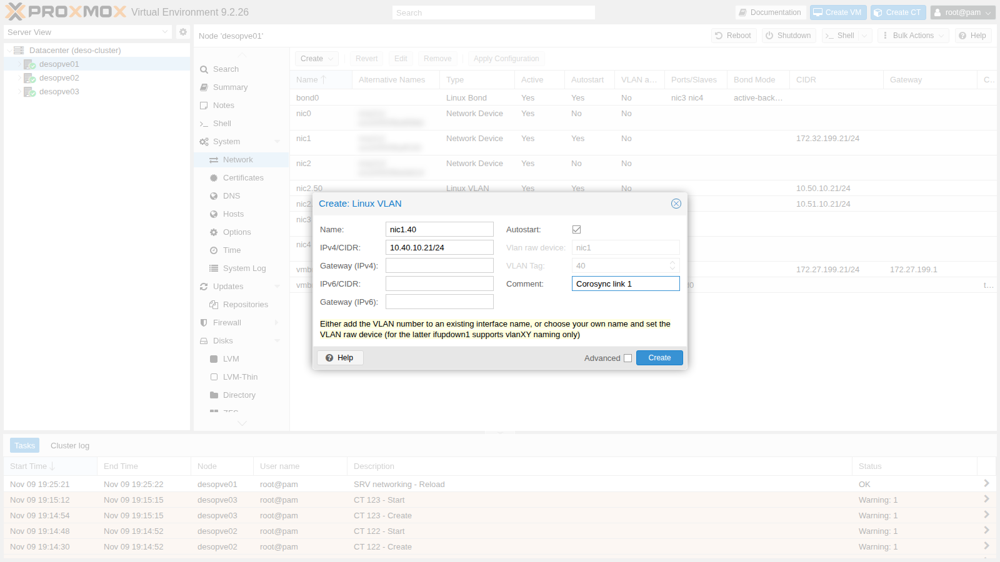
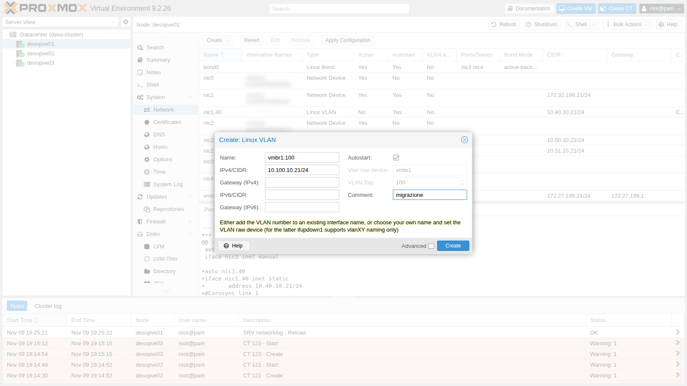
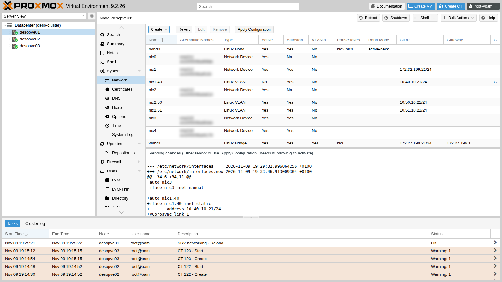
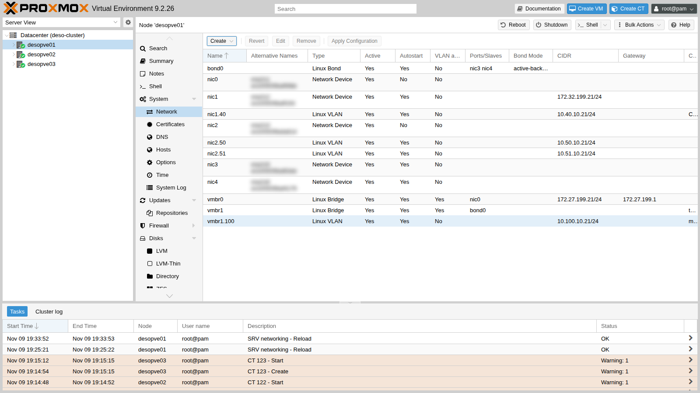
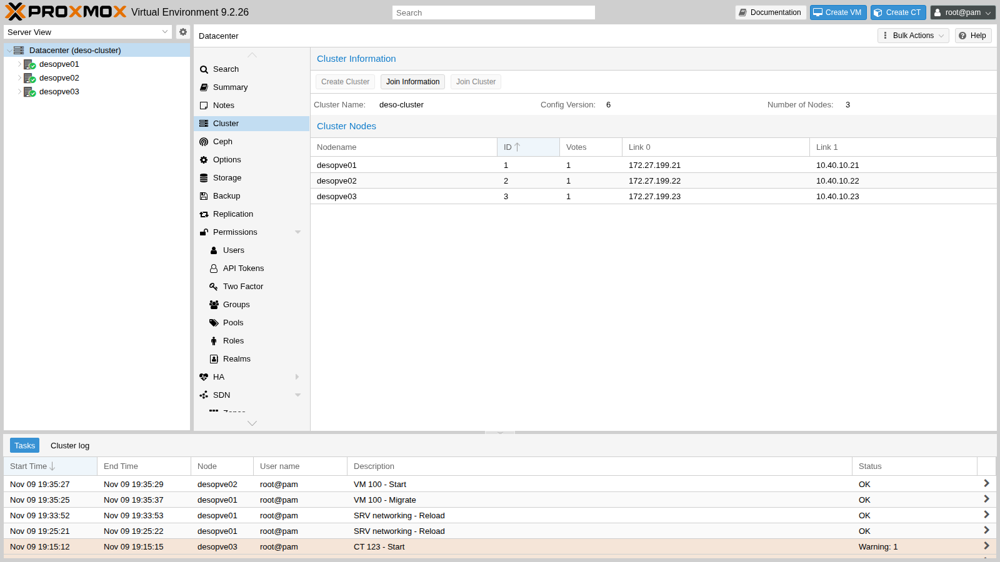
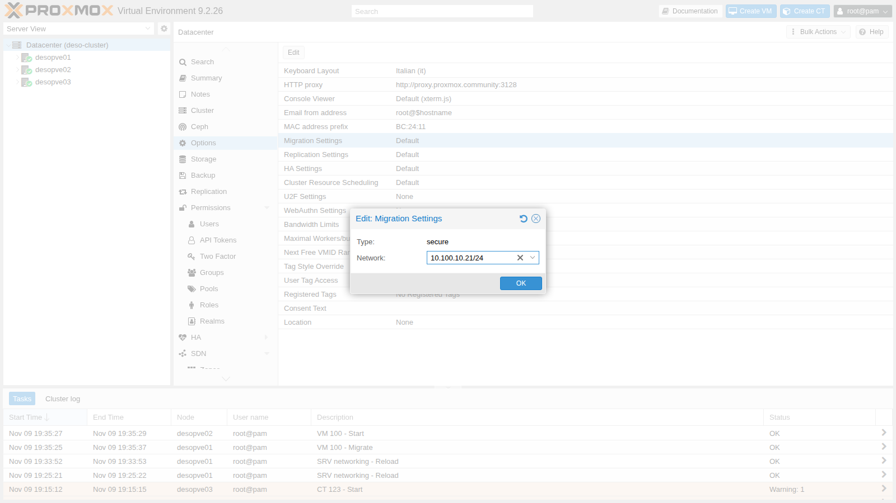
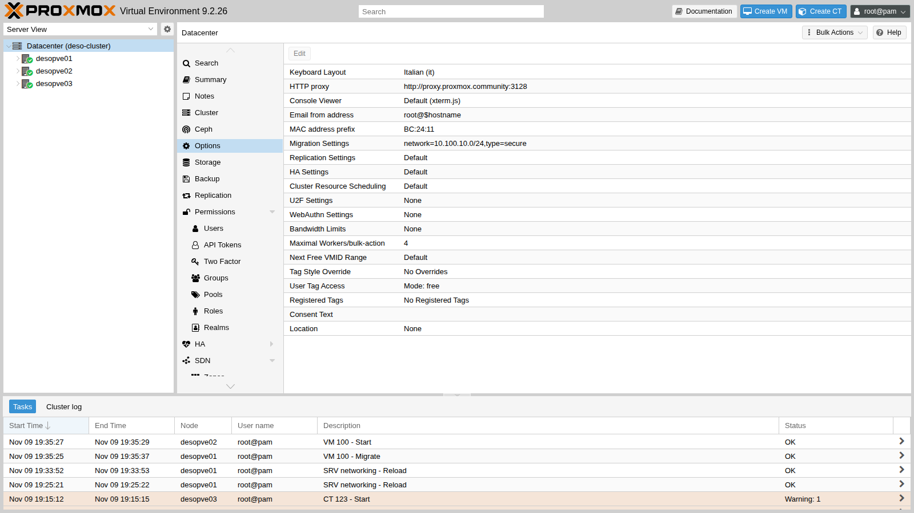
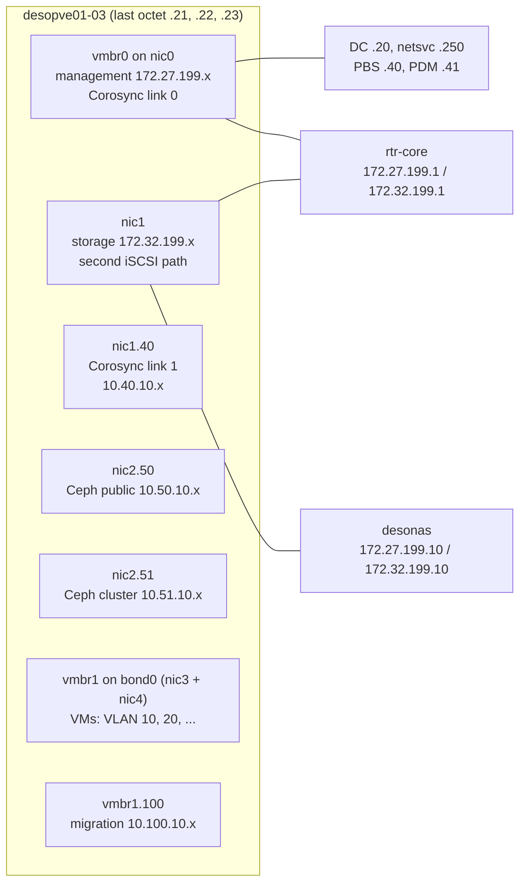

## Dependencies

- **Previous labs:**
  - [Lab 06](/06-cluster-corosync/): cluster with two Corosync links;
  - [Lab 15](/15-iscsi-lvm-multipath/): second iSCSI path on `nic1`;
  - [Lab 17](/17-ceph-installation/): Ceph networks on VLANs 50 and 51;
  - [Lab 20](/20-bridges-stable-names-vlans/) and [Lab 21](/21-bonding/): VLAN-aware bridges, `bond0` and `vmbr1`.
- **VM:** VM 100 `debian01` with its disk on `rbd-vm`, running on `desopve01`: you need it to measure the migration.
- **Network:** the lab switch carries the VLANs on the node ports (trunk). The new VLANs 40 and 100 have **no** router.
- **Credentials:** `root` / `<lab-password>` on the nodes → [Appendix B](/b-credentials-and-addresses/).

## Objectives

- Corosync link 1 moved to VLAN 40 (10.40.10.0/24, no router) on all three nodes, with the cluster quorate after every step: `corosync-cfgtool -n` shows link 1 on the new addresses.
- Live migrations carried over VLAN 100 (10.100.10.0/24), proved by the byte counters of the interfaces.
- Knowing which Corosync link carries the cluster traffic, and what still works when the link on VLAN 40 fails.
- A table of the lab networks (VLAN, subnet, interface, gateway, use) to plan the following labs.

## How it works

### Different types of traffic, different needs

| Traffic | What matters | What happens when it suffers |
|---|---|---|
| **Corosync** (cluster) | low, steady latency, little bandwidth | if packets arrive late the node loses quorum; with high availability enabled it is isolated and rebooted (*fencing*) |
| **Storage** (NFS, iSCSI) | bandwidth and latency | slow VMs, I/O waiting |
| **Ceph** public and cluster | bandwidth and latency; the *cluster network* carries replication between the OSDs | slow writes, *slow ops* |
| **Migration** | lots of bandwidth, in bursts | slow migrations; if it shares the link with Corosync, it can disrupt it |
| **VMs** | depends on the services | |
| **Management** | little bandwidth | GUI and SSH unreachable |

The typical risk is a migration or a backup that saturates the link shared with Corosync: the cluster packets arrive late and a healthy node gets excluded. The Proxmox VE documentation therefore asks for a cluster network with latencies under 5 ms that other traffic does not use heavily, ideally **physically separate**, and advises in particular against sharing it with storage, except as a low-priority fallback link.

### Corosync with two links

Corosync (*knet* transport) monitors all the links, but in `passive` mode it sends the cluster traffic over only one of them: the working link with the highest priority. No priority is set in this cluster (in [Lab 06](/06-cluster-corosync/) the log shows `pri: 1` for both links), so the link with the lowest number wins, link 0. In the lab:

- **link 0**: management network (`vmbr0`), the link that carries the Corosync traffic;
- **link 1**: so far on `172.32.199.0/24` on `nic1`, the same network as the second iSCSI path, routed by `rtr-core`. In this lab it moves to a **dedicated VLAN, VLAN 40**, without a gateway. It stays the fallback link, used only if link 0 fails.

To make VLAN 40 the preferred link you would give it a higher `knet_link_priority` than link 0; this lab keeps the default priorities. VLAN 40 is also dedicated only at the addressing level: it shares the physical port `nic1` with the second iSCSI path.

### VLAN interfaces on a NIC and on a bridge

| Interface | What it is | Use in the lab |
|---|---|---|
| `nic1.40` | VLAN 40 on top of the `nic1` card: frames tagged 40 on the same cable as the untagged traffic | Corosync link 1 |
| `vmbr1.100` | the **node's** address in VLAN 100 of the VLAN-aware bridge `vmbr1` (on top of the bond) | migration network |

The two networks have no router: traffic cannot go through `rtr-core` and keep "working" over some indirect route when the dedicated link fails. And the ARP problem from lab 15 cannot happen again, because each VLAN is a separate broadcast domain.

### The migration network

Unless told otherwise, Proxmox VE sends migrations over the network used for cluster communication: here, the management network, which also carries Corosync link 0. In **Datacenter** → **Options** → **Migration Settings** you choose:

- **Network**: the network (CIDR) over which the nodes exchange memory and disks during migrations;
- **Type**: `secure` (the default: traffic goes through an encrypted SSH tunnel) or `insecure` (plain TCP, faster, acceptable only on a dedicated, isolated network).

### Test environment and versions

The outputs and measurements in this lab come from tests run in November 2026 with this configuration:

| Component | Configuration used |
|---|---|
| Proxmox VE | 9.2.26, kernel `7.0.14-28-pve` ([Lab 04](/04-first-access-repositories-updates/)); Corosync and knet as shipped with that release (versions not recorded: `pveversion -v` lists them) |
| Corosync | knet transport, `passive` link mode, no link priorities ([Lab 06](/06-cluster-corosync/)) |
| Network | 10 GbE ports ([Lab 01](/01-lab-architecture/)); `vmbr0` on `nic0`; `nic1` shared by the storage network and VLAN 40; `vmbr1` and VLAN 100 on `bond0` (`nic3` + `nic4`, active-backup, [Lab 21](/21-bonding/)); MTU 1500 everywhere |
| Migration | `type=secure` (SSH tunnel); VM 100 with 2 GiB of RAM and its disk on `rbd-vm` (Ceph 20.2, [Lab 17](/17-ceph-installation/)), so only the memory is copied |

**What the tests measure, and what they do not.** There is one migration in each direction, with no other load on the networks: the runs show which way the traffic goes, not which network is faster. The failure of link 1 is simulated with `ip link set nic1.40 down` on one node: the `nic1` port stays up, so this is neither a pulled cable nor a switch failure, and it takes away the standby link, not the one in use.

## Procedure

### 1. The VLAN interfaces from the GUI (desopve01)

1. Node **desopve01** → **System** → **Network** → **Create** → **Linux VLAN**. **Name** `nic1.40` (the GUI derives the card and the VLAN from the name on its own), **IPv4/CIDR** `10.40.10.21/24`, no gateway, **Autostart** checked, comment `Corosync link 1`.

   

2. **Create** → **Linux VLAN**. **Name** `vmbr1.100`, **IPv4/CIDR** `10.100.10.21/24`, comment `migrazione`.

   

3. Check the pending changes and apply them with **Apply Configuration**.

   

   

   ```text
   auto nic1.40
   iface nic1.40 inet static
   	address 10.40.10.21/24
   #Corosync link 1

   auto vmbr1.100
   iface vmbr1.100 inet static
   	address 10.100.10.21/24
   #migrazione
   ```

### 2. The same interfaces on the other nodes (CLI)

On `desopve02` and `desopve03` add the same two blocks (with `.22` and `.23`) before the `source` line, after making a copy of the file (`/root/interfaces.bak-lab22`), then run `ifreload -a`. Check from `desopve01`:

```bash title="root@desopve01"
for ip in 10.40.10.22 10.40.10.23 10.100.10.22 10.100.10.23; do printf "%s " $ip; ping -c2 -W1 $ip >/dev/null && echo ok || echo NO; done
```

```text output
10.40.10.22 ok
10.40.10.23 ok
10.100.10.22 ok
10.100.10.23 ok
```

```bash title="root@desopve01"
ip route get 10.40.10.22
```

```text output
10.40.10.22 dev nic1.40 src 10.40.10.21 uid 0
    cache
```

```bash title="root@desopve01"
ping -c1 -W1 10.40.10.1 >/dev/null 2>&1 || echo "nessun router su 10.40.10.0/24"
```

```text output
nessun router su 10.40.10.0/24
```

### 3. Moving Corosync link 1 to VLAN 40

1. The starting point:

   ```bash title="root@desopve01"
   corosync-cfgtool -n
   ```

   ```text output
   Local node ID 1, transport knet
   nodeid: 2 reachable
      LINK: 0 udp (172.27.199.21->172.27.199.22) enabled connected mtu: 1397
      LINK: 1 udp (172.32.199.21->172.32.199.22) enabled connected mtu: 1397

   nodeid: 3 reachable
      LINK: 0 udp (172.27.199.21->172.27.199.23) enabled connected mtu: 1397
      LINK: 1 udp (172.32.199.21->172.32.199.23) enabled connected mtu: 1397
   ```

2. **Always** edit a copy of `/etc/pve/corosync.conf`, check it, and then move it into place with a single `mv`. A half-written or wrong file would be distributed to all nodes immediately. Besides the addresses you must increment **`config_version`**, otherwise the nodes ignore the change. The value depends on the cluster's history (here it is 5, after `desopve04` joined and left in lab 18): the `perl` command reads it and increases it by one, whatever it is.

   ```bash title="root@desopve01"
   cp /etc/pve/corosync.conf /root/corosync.conf.bak-lab22
   cp /etc/pve/corosync.conf /etc/pve/corosync.conf.new
   grep config_version /etc/pve/corosync.conf.new
   ```

   ```text output
     config_version: 5
   ```

   ```bash title="root@desopve01"
   sed -i "s/ring1_addr: 172.32.199.2/ring1_addr: 10.40.10.2/" /etc/pve/corosync.conf.new
   perl -pi -e 's/(config_version: )(\d+)/$1.($2+1)/e' /etc/pve/corosync.conf.new
   diff -u /etc/pve/corosync.conf /etc/pve/corosync.conf.new
   ```

   ```text output
   @@ -9,21 +9,21 @@
        nodeid: 1
        quorum_votes: 1
        ring0_addr: 172.27.199.21
   -    ring1_addr: 172.32.199.21
   +    ring1_addr: 10.40.10.21
      }
   ...
   -    ring1_addr: 172.32.199.23
   +    ring1_addr: 10.40.10.23
      }
    }
   @@ -33,7 +33,7 @@
    totem {
      cluster_name: deso-cluster
   -  config_version: 5
   +  config_version: 6
      interface {
        linknumber: 0
      }
   ```

   ```bash title="root@desopve01"
   mv /etc/pve/corosync.conf.new /etc/pve/corosync.conf
   ```

3. Corosync rereads the file but, in this version, **does not change the address of a link that is already active**, and the log says so:

   ```bash title="root@desopve01"
   journalctl -u corosync --since "-1min" --no-pager
   ```

   ```text output
   ... [CFG   ] Config reload requested by node 1
   ... [TOTEM ] new config has different address for link 1 (addr changed from 172.32.199.21 to 10.40.10.21). Internal value was NOT changed.
   ...
   ... [CFG   ] Cannot configure new interface definitions: To reconfigure an interface it must be deleted and recreated. A working interface needs to be available to corosync at all times
   ```

   **Decision.** The Proxmox VE documentation covers this case: a change that cannot be applied while Corosync is running needs a restart of the service. Restart Corosync **one node at a time**: while one node restarts, the other two stay connected over link 0 and keep 2 votes out of 3. Each command reads the quorum 6 seconds after the restart:

   ```bash title="root@desopve03"
   systemctl restart corosync; sleep 6; pvecm status | grep ^Quorate
   ```

   ```text output
   Quorate:          Yes
   ```

   ```bash title="root@desopve02"
   systemctl restart corosync; sleep 6; pvecm status | grep ^Quorate
   ```

   ```text output
   Quorate:          Yes
   ```

   ```bash title="root@desopve01"
   systemctl restart corosync; sleep 6; pvecm status | grep ^Quorate
   ```

   ```text output
   Quorate:          Yes
   ```

   :::note
   Restarting Corosync is safe only if the cluster has quorum even without that node and if no high-availability resources are in a critical state. With HA active (lab 49) you put the cluster into maintenance first.
   :::

4. **Result:** link 1 now uses VLAN 40:

   ```bash title="root@desopve01"
   corosync-cfgtool -n
   ```

   ```text output
   Local node ID 1, transport knet
   nodeid: 2 reachable
      LINK: 0 udp (172.27.199.21->172.27.199.22) enabled connected mtu: 1397
      LINK: 1 udp (10.40.10.21->10.40.10.22) enabled connected mtu: 1397

   nodeid: 3 reachable
      LINK: 0 udp (172.27.199.21->172.27.199.23) enabled connected mtu: 1397
      LINK: 1 udp (10.40.10.21->10.40.10.23) enabled connected mtu: 1397
   ```

   The GUI shows it too, in **Datacenter** → **Cluster**, with **Config Version** `6`:

   

### 4. The migration network

1. **Before:** VM 100 (disk on Ceph, 2 GiB of RAM) migrates from `desopve01` to `desopve02` with the default settings, that is, over the management network:

   ```bash title="root@desopve01"
   qm migrate 100 desopve02 --online
   ```

   ```text output
   ...
   2026-11-09 19:35:29 start remote tunnel
   2026-11-09 19:35:30 ssh tunnel ver 1
   2026-11-09 19:35:30 migration downtime limit: 100 ms
   2026-11-09 19:35:30 start migrate command to unix:/run/qemu-server/100.migrate
   2026-11-09 19:35:31 migration active, transferred 221.0 MiB of 2.0 GiB VM-state, 9.8 GiB/s
   2026-11-09 19:35:32 average migration speed: 1.0 GiB/s - downtime 53 ms
   2026-11-09 19:35:32 migration completed, transferred 289.1 MiB VM-state
   2026-11-09 19:35:37 migration finished successfully (duration 00:00:12)
   ```

2. **Datacenter** → **Options** → **Migration Settings** → **Edit**. The **Network** field offers the node's addresses: choose the one on `vmbr1.100`. **Type** stays `secure`.

   

   The GUI saves the node's address (`10.100.10.21/24`): this works, because it applies to the whole network that contains it. For clarity it is better to write the network address:

   ```bash title="root@desopve01"
   pvesh set /cluster/options --migration network=10.100.10.0/24,type=secure
   grep migration /etc/pve/datacenter.cfg
   ```

   ```text output
   migration: network=10.100.10.0/24,type=secure
   ```

   

3. **After:** the VM goes back to `desopve01`. By counting the bytes received by the interfaces of `desopve01` before and after the migration, you can see which way it went:

   ```bash title="root@desopve01"
   cat /sys/class/net/vmbr1.100/statistics/rx_bytes /sys/class/net/vmbr0/statistics/rx_bytes
   ```

   ```bash title="root@desopve02"
   qm migrate 100 desopve01 --online
   ```

   ```text output
   ...
   2026-11-09 19:38:19 average migration speed: 1.0 GiB/s - downtime 9 ms
   2026-11-09 19:38:19 migration completed, transferred 290.4 MiB VM-state
   2026-11-09 19:38:24 migration finished successfully (duration 00:00:11)
   ```

   ```bash title="root@desopve01"
   cat /sys/class/net/vmbr1.100/statistics/rx_bytes /sys/class/net/vmbr0/statistics/rx_bytes
   ```

   The difference between the two readings:

   | Interface of `desopve01` | Bytes received during the migration |
   |---|---|
   | `vmbr1.100` (migration) | 291 MiB |
   | `vmbr0` (management) | 0 MiB |

   The migration went through VLAN 100: 291 MiB received on `vmbr1.100`, in line with the 290.4 MiB of VM state in the task log, against 0 MiB (rounded to the MiB) on `vmbr0`.

   How to read the two migrations:

   - **Measured:** over the management network the task took 12 s and reported 53 ms of downtime; over VLAN 100, 11 s and 9 ms. Both times about 290 MiB of state were transferred out of 2 GiB of RAM.
   - **Interpretation:** the two runs do not compare the networks. There is one run per direction, in opposite directions, both paths have 10 GbE ports, and a transfer of a few hundred MiB is too short to show a difference; the gap in downtime cannot be put down to the network either. The rates in the log do not measure the network either. The 9.8 GiB/s printed during the copy is more than a 10 Gbit/s port can carry. The `average migration speed`, 1.0 GiB/s in both runs, is not a throughput: as [Lab 48](/48-migrations/#how-it-works) explains, Proxmox VE computes it as the guest's total RAM divided by the duration of the memory phase, counted in whole seconds. With 2 GiB of RAM, 1.0 GiB/s only says that the memory phase lasted about 2 seconds, at a resolution of one second; the figure counts the whole RAM, not the 290 MiB actually sent, and at that resolution it cannot tell the two runs apart. What crossed the network is measured by the counters.
   - **What the dedicated network gives here:** migrations no longer cross the management network, the one that carries Corosync link 0. Whether it also makes them faster is a separate question: repeat several runs per direction with a VM that uses much more memory, with and without load on `vmbr0`. A gain is to be expected only if the dedicated network is faster than the shared one, or the shared one is busy.

### 5. Failure of the dedicated Corosync link

With the default priorities link 1 is the standby link: bringing it down removes the redundancy without moving the Corosync traffic (the loss of link 0 is tested in [Lab 06](/06-cluster-corosync/)). On `desopve03` bring down only VLAN 40 (the `nic1` card stays up, with the iSCSI path):

```bash title="root@desopve03"
ip link set nic1.40 down
```

```bash title="root@desopve01"
corosync-cfgtool -n | sed -n "/nodeid: 3/,\$p"
```

```text output
nodeid: 3 reachable
   LINK: 0 udp (172.27.199.21->172.27.199.23) enabled connected mtu: 1397
   LINK: 1 udp (10.40.10.21->10.40.10.23) enabled mtu: 1397
```

```bash title="root@desopve01"
pvecm status | grep -E "^Quorate|Total votes"
```

```text output
Quorate:          Yes
Total votes:      3
```

```bash title="root@desopve03"
multipath -ll | grep -c "active ready"
```

```text output
2
```

Link 1 toward `desopve03` is no longer `connected`; the node is still reachable over link 0 and the cluster keeps all three votes. `multipath -ll` still shows both iSCSI paths active: bringing down the VLAN interface did not touch `nic1`. Until link 1 comes back, however, the cluster has a single link toward `desopve03`. Bring the VLAN back up and Corosync picks it up again on its own:

```bash title="root@desopve03"
ip link set nic1.40 up
```

```bash title="root@desopve01"
journalctl -u corosync --since "-2min" --no-pager | grep "host: 3 link: 1"
```

```text output
Nov 09 19:38:34 desopve01 corosync[120106]:   [KNET  ] link: host: 3 link: 1 is down
Nov 09 19:38:44 desopve01 corosync[120106]:   [KNET  ] rx: host: 3 link: 1 is up
```

The two messages are 10 seconds apart, but that interval includes the time the interface stayed down, which was not recorded: it is neither a detection time nor a recovery time. To measure those, note the time of each command (`date +%T.%N; ip link set nic1.40 down`) and compare it with the timestamps of the `link: 1 is down` and `is up` messages. To confirm which link carries the traffic, read the knet counters on `desopve01` twice, a few seconds apart: `corosync-cmapctl -m stats | grep -E 'node3\.link[01]\.tx_data_bytes'`. The counter that grows belongs to the link in use.

### 6. The overall picture of the lab networks



| Network | VLAN | Subnet | Interface on the nodes | Gateway | Use |
|---|---|---|---|---|---|
| Management | untagged | 172.27.199.0/24 | `vmbr0` (`nic0`) | `rtr-core` .1 | GUI, SSH, DNS, NTP, proxy, Corosync link 0 |
| Storage | untagged | 172.32.199.0/24 | `nic1` | `rtr-core` .1 | second iSCSI path to the NAS |
| Corosync link 1 | 40 | 10.40.10.0/24 | `nic1.40` | none | cluster |
| Ceph public | 50 | 10.50.10.0/24 | `nic2.50` | none | clients, MONs |
| Ceph cluster | 51 | 10.51.10.0/24 | `nic2.51` | none | replication between the OSDs |
| Migration | 100 | 10.100.10.0/24 | `vmbr1.100` (`bond0`) | none | migrations |
| VMs (test) | 10, 20 | 10.10.10.0/24, 10.20.20.0/24 | `vmbr1` (`bond0`) | none (until lab 26) | containers 121-123 |

In production the most critical networks would have their own physical cards: Corosync at least on a dedicated port, Ceph and storage on fast cards separate from VM traffic. In the lab they are separated with VLANs. A VLAN separates addresses and broadcast domains, and without a gateway its traffic cannot leave it; it does not separate the bandwidth of the port. VLAN 40 shares `nic1` with the second iSCSI path, VLAN 100 shares `bond0` with the VMs. Whether this matters for Corosync was not measured here: you would watch the latency of the link (`corosync-cmapctl -m stats | grep -E 'link1\.latency_(ave|max)'`) while saturating `nic1`.

## Verification and tests

The lab has succeeded when link 1 runs on 10.40.10.0/24 on every node with the cluster quorate, the migration traffic shows up on the counters of `vmbr1.100`, and the loss of `nic1.40` on one node leaves the cluster quorate over link 0.

| Check | Expected result | Observed in the test |
|---|---|---|
| VLAN 40 and 100 interfaces on `desopve01-03` | reachable between the nodes, no router | all reachable; nothing answers on 10.40.10.1 |
| Reload of `corosync.conf` with new addresses | the address of the active link does not change: restart needed | log: `Internal value was NOT changed` |
| Corosync restart, one node at a time | cluster quorate | `Quorate: Yes` 6 s after each restart; link 1 on 10.40.10.0/24 |
| Migration over management, then over VLAN 100 | completed | 12 s and 11 s (task duration); downtime reported by the task 53 ms and 9 ms; one run per direction |
| Path taken by the migration | bytes on `vmbr1.100`, not on `vmbr0` | 291 MiB on `vmbr1.100`, 0 MiB on `vmbr0` |
| `nic1.40` down on `desopve03` | link 1 not connected, cluster quorate over link 0, storage unaffected | 3 votes, quorate; 2 active iSCSI paths; link 1 back on its own once the VLAN is up |

## Final lab state

- **Corosync:** link 0 on 172.27.199.21-23, **link 1 on 10.40.10.21-23 (VLAN 40, `nic1.40`)**, `config_version` 6. A copy of the previous file is in `/root/corosync.conf.bak-lab22` on `desopve01`.
- **Migration:** `migration: network=10.100.10.0/24,type=secure` in `datacenter.cfg`, with the `vmbr1.100` interfaces 10.100.10.21-23.
- **`nic1`:** with 172.32.199.0/24 it remains the storage network (second iSCSI path).
- **Ceph:** unchanged on `nic2.50`/`nic2.51`, `HEALTH_OK`.
- **VM 100** running on `desopve01`. **CT 121-123** unchanged on `vmbr1` (VLANs 10 and 20).
- Copies of the previous network configuration in `/root/interfaces.bak-lab22` on `desopve02` and `desopve03`.

## What you learned

- **Which link should carry Corosync:** with no priorities, knet uses link 0. Decide which network has the lowest, steadiest latency and make it the preferred link, by its number or with `knet_link_priority`; check it with the knet counters, not by assuming it.
- **How to change a Corosync address safely:** edit a copy, increment `config_version`, move it into place, then read the log. If it says the address of an active link was not changed, restart Corosync one node at a time, checking the quorum before moving on.
- **What a VLAN separates and what it does not:** addresses and broadcast domains, and, without a gateway, routes to other networks; not the bandwidth of the port. For Corosync in production that calls for a dedicated port, not only a dedicated VLAN.
- **How to prove where the traffic goes:** compare the byte counters of the interfaces before and after; the rates printed by the migration task are not network throughput.
- **When a dedicated migration network pays off:** always, to keep migration bursts away from the network that carries Corosync; for speed, only if it is faster than the shared one, which you measure with repeated runs.

## References

- [Proxmox VE – Cluster network: requirements and separation](https://pve.proxmox.com/pve-docs/pve-admin-guide.html#pvecm_cluster_network)
- [Proxmox VE – Corosync redundancy and link priorities](https://pve.proxmox.com/pve-docs/pve-admin-guide.html#pvecm_redundancy)
- [Proxmox VE – Edit corosync.conf](https://pve.proxmox.com/pve-docs/pve-admin-guide.html#pvecm_edit_corosync_conf)
- [Proxmox VE – Migration type: secure and insecure](https://pve.proxmox.com/pve-docs/pve-admin-guide.html#_migration_type)
- [Proxmox VE – Migration network](https://pve.proxmox.com/pve-docs/pve-admin-guide.html#pvecm_migration_network)
- [corosync.conf(5) – `link_mode` and `knet_link_priority`](https://manpages.debian.org/trixie/corosync/corosync.conf.5.en.html)
- [cmap_keys(7) – the `stats.knet` counters](https://manpages.debian.org/trixie/corosync/cmap_keys.7.en.html)
