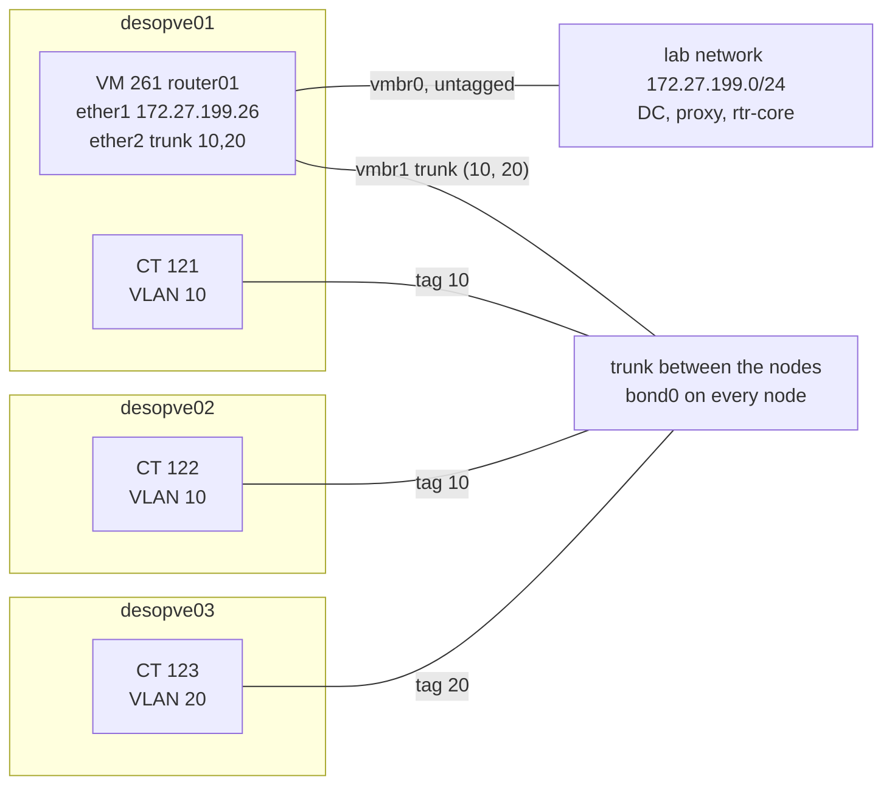
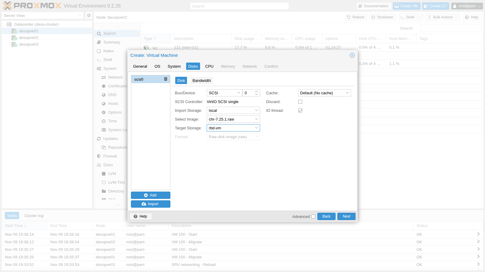
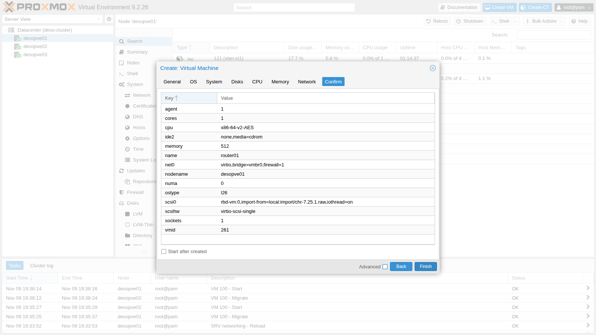
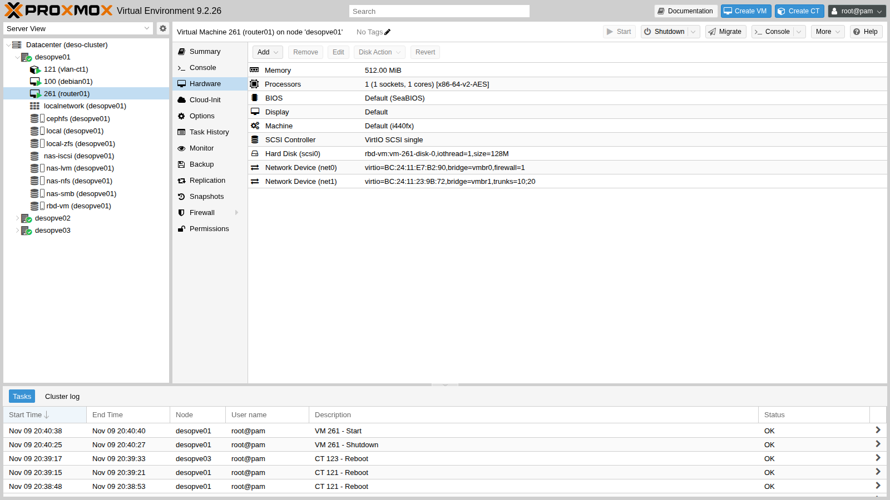
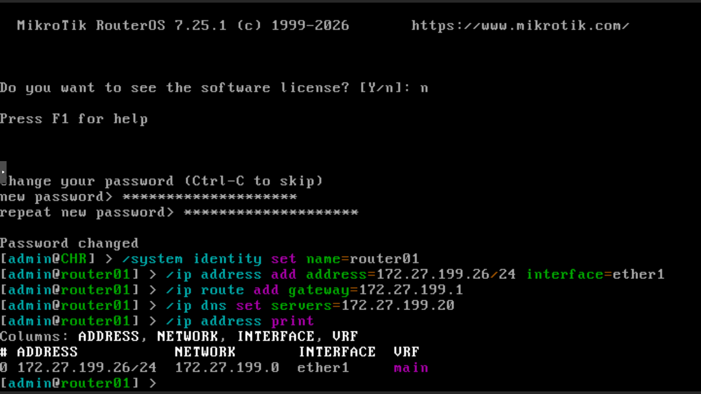
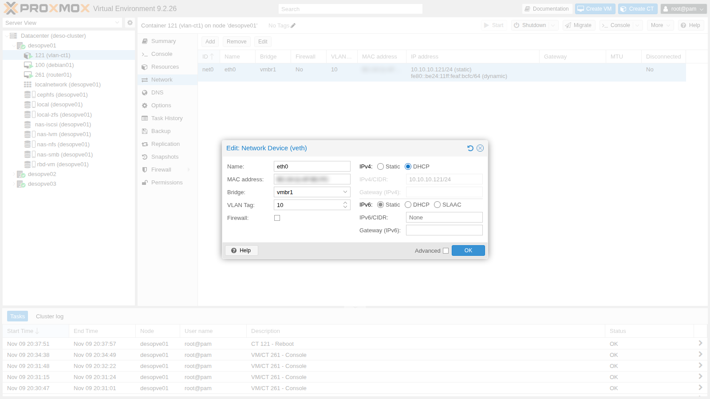
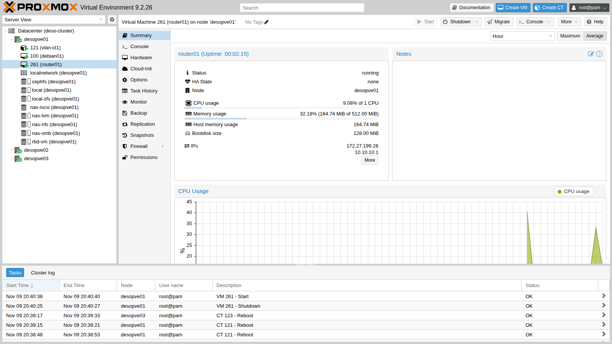

## Dependencies

- **Previous labs:**
  - [Lab 20](/20-bridges-stable-names-vlans/) and [Lab 21](/21-bonding/): VLAN-aware `vmbr1` on `bond0` and the test containers in VLANs 10 and 20;
  - [Lab 17](/17-ceph-installation/): `rbd-vm` storage for the router's disk.
- **Nodes:** `desopve01` (where the router runs), `desopve02` and `desopve03` (where the test containers run).
- **Test containers:**
  - CT 121 `vlan-ct1` on `desopve01` and CT 122 `vlan-ct2` on `desopve02`, VLAN 10;
  - CT 123 `vlan-ct3` on `desopve03`, VLAN 20;
  - all on `vmbr1`, with `iperf3` and `tcpdump`.
- **Software:** raw image of MikroTik **Cloud Hosted Router (CHR) 7.25.1**, downloaded from the MikroTik website through the proxy: the lab proxy must allow `download.mikrotik.com`.
- **Services:** DNS on the DC (172.27.199.20), proxy `proxy.proxmox.community:3128`.
- **Router address on the management network:** 172.27.199.26 (`router01.proxmox.community`).
- **Credentials:** `root` / `<lab-password>` on the nodes, `admin` / `<lab-password>` on the router → [Appendix B](/b-credentials-and-addresses/).

## Objectives

- A router VM, `router01` (MikroTik CHR), created from a ready-made disk image, with a single trunk device that receives only VLANs 10 and 20: `bridge vlan show` confirms it.
- Routing between VLAN 10 and VLAN 20 through the router, with DHCP, NAT toward the lab network and a firewall that blocks VLAN 20 → VLAN 10, checked with `ping`, `tcpdump` and the rule counters.
- Knowing what stops working when the router is down, and how long it took in this lab to route again after a start.
- Knowing how much routed traffic the free CHR license lets through, how to measure it, and when OPNsense is the better choice.

## How it works

### Router-on-a-stick

In lab 20 the guests in VLAN 10 and VLAN 20 were isolated: the bridge does not route, it separates. To let them talk you need a **router** with a leg in each VLAN. Instead of giving it one network device per VLAN, you give it **a single trunk device**: frames arrive with their 802.1Q tag and the router creates a logical interface for each VLAN. This is the classic *router-on-a-stick* configuration.



### `trunks` and the bridge VLAN filter

A VM network device on a VLAN-aware bridge **without** `tag` and without `trunks` sits untagged in VLAN 1 (PVID), but Proxmox VE also adds it, tagged, to all the VLANs in `bridge-vids` (2-4094, see [Lab 20](/20-bridges-stable-names-vlans/)). With the option `trunks=10;20` the port stays untagged in VLAN 1 and receives, tagged, **only** VLANs 10 and 20: the router receives both of them, and no others. The option is set from the command line (`qm set`): the GUI dialog only has the *VLAN Tag* field.

### NAT and firewall on the router

- **NAT:** the router goes out to the lab network with its own address (masquerading). The DC, the proxy and `rtr-core` do not need to know about the 10.10.10.0/24 and 10.20.20.0/24 networks.
- **Stateful firewall:** RouterOS has two main chains. `input` protects the router itself, `forward` decides what passes *through* the router. The `established,related` rule lets through the replies to connections that were already allowed: you only need to authorize whoever *opens* the connection.

In this lab the policy is:

| From → to | Allowed |
|---|---|
| VLAN 10 → anywhere | yes |
| VLAN 20 → lab network (DC, proxy) | yes |
| VLAN 20 → VLAN 10 | **no**, except replies to connections opened from VLAN 10 |
| Lab network → router (SSH) | yes, only from 172.27.199.0/24 |

### CHR licensing

CHR can be downloaded and used for free. According to MikroTik's documentation, the **free** license limits every interface to **1 Mbit/s** of outbound (upload) traffic and leaves the other features unrestricted. With an account on mikrotik.com you can request a 60-day trial of the paid levels (P1 at 1 Gbit/s, P10 at 10 Gbit/s, P-Unlimited with no limit); in production you buy a perpetual license. The free license is enough to learn the configuration; the bandwidth test in the verification shows what it means for routed traffic.

### OPNsense as an alternative

The same design (router-on-a-stick, DHCP, NAT, firewall) can be built with **OPNsense**, an open source firewall based on FreeBSD. It was not installed in this lab; the comparison sums up the differences that matter on Proxmox VE.

| Aspect | MikroTik CHR | OPNsense |
|---|---|---|
| Installation | ready-made disk image to import (128 MiB) | ISO with installer |
| Resources | in the lab: 1 vCPU, 512 MiB of RAM | at least 3 GB of RAM and a dual-core CPU, according to the OPNsense documentation |
| Management | CLI, WinBox, web interface | full web interface |
| License | free, limited to 1 Mbit/s per interface; 60-day trial; paid licenses | open source, no limits |
| Security features | firewall, VPN, dynamic routing | firewall, VPN, IDS/IPS (Suricata), proxy, plugins |
| VirtIO NICs | supported | supported (`vtnet`); on virtual machines the documentation recommends disabling all hardware offloading in **Interfaces → Settings** |
| Guest agent | built in | `os-qemu-guest-agent` plugin |

For learning routing and VLANs, CHR is lighter and quicker to set up; for a perimeter firewall with a graphical interface and advanced security features, OPNsense is the more common choice.

### Test environment and versions

The outputs and measurements in this lab come from tests run in November 2026 with this configuration:

| Component | Configuration used |
|---|---|
| Proxmox VE | 9.2.26, kernel `7.0.14-28-pve` ([Lab 04](/04-first-access-repositories-updates/)) |
| Router | RouterOS CHR 7.25.1, license level `free`; VM 261 on `desopve01` with 1 vCPU, 512 MiB of RAM, two VirtIO network devices and its disk on `rbd-vm` (Ceph 20.2, [Lab 17](/17-ceph-installation/)) |
| Network | VLAN-aware `vmbr1` on `bond0`, active-backup on 10 GbE ports, MTU 1500 ([Lab 21](/21-bonding/)); trunk device with `trunks=10;20` |
| Test guests | CT 121 (`desopve01`) and CT 122 (`desopve02`) in VLAN 10, CT 123 (`desopve03`) in VLAN 20, from the Debian 13 template, with `iperf3` ([Lab 20](/20-bridges-stable-names-vlans/)) |
| Bandwidth tests | `iperf3` with one TCP flow and default options: 8 s through the router (CT 121 → CT 123), 5 s within VLAN 10 (CT 121 → CT 122) |

**What the tests measure, and what they do not.** The outputs show one run of each test. The router was stopped with a clean shutdown (`qm shutdown`), not by a crash or a node failure. During the bandwidth test, neither the CPU load of the router nor its interface counters were recorded.

## Procedure

### 1. Download the image into the import storage

1. On node `desopve01`, download the CHR raw image into the `import` folder of the `local` storage and unzip it:

   ```bash title="root@desopve01"
   cd /var/lib/vz/import
   export https_proxy=http://proxy.proxmox.community:3128
   curl -s https://download.mikrotik.com/routeros/NEWESTa7.stable
   ```

   ```text output
   7.25.1 1793623193
   ```

   ```bash title="root@desopve01:/var/lib/vz/import"
   curl -s -O https://download.mikrotik.com/routeros/7.25.1/chr-7.25.1.img.zip
   unzip chr-7.25.1.img.zip
   ```

   ```text output
   Archive:  chr-7.25.1.img.zip
     inflating: chr-7.25.1.img
   ```

2. In the import storage, Proxmox VE lists only the files with an extension it recognizes, such as `.raw`, `.qcow2`, `.vmdk` or `.ova`. An `.img` file does not show up: rename it to `.raw`, which is the same format:

   ```bash title="root@desopve01:/var/lib/vz/import"
   pvesm list local --content import
   ```

   ```text output
   Volid                                           Format  Type           Size VMID
   local:import/debian-13-genericcloud-amd64.qcow2 qcow2   import    341180416
   ```

   ```bash title="root@desopve01:/var/lib/vz/import"
   mv chr-7.25.1.img chr-7.25.1.raw && rm chr-7.25.1.img.zip
   pvesm list local --content import
   ```

   ```text output
   Volid                                           Format  Type           Size VMID
   local:import/debian-13-genericcloud-amd64.qcow2 qcow2   import    341180416
   local:import/chr-7.25.1.raw                     raw     import    134217728
   ```

### 2. Create the VM with the imported disk

1. **Create VM** on `desopve01`:
   - **General:** VM ID `261`, name `router01`;
   - **OS:** *Do not use any media*;
   - **System:** default values, with **Qemu Agent** enabled: RouterOS CHR includes the guest agent.
2. **Disks:** delete the proposed disk (`scsi0`, trash can icon) and click **Import**. In the new disk set **Bus/Device** `SCSI 0`, **Import Storage** `local`, **Select Image** `chr-7.25.1.raw`, **Target Storage** `rbd-vm`. With its disk on Ceph, the router can be migrated between nodes.

   

3. **CPU** 1 core, **Memory** 512 MiB, **Network** `vmbr0` with the VirtIO model: it will be `ether1`, the uplink to the lab network. In the summary the disk appears as `rbd-vm:0,import-from=local:import/chr-7.25.1.raw`:

   

   Click **Finish** without starting the VM.

### 3. The trunk device

1. Add the second network device on `vmbr1` with only VLANs 10 and 20, remove the unneeded CD drive and make the router start with the node:

   ```bash title="root@desopve01"
   qm set 261 --net1 virtio,bridge=vmbr1,trunks='10;20' --boot order=scsi0 --delete ide2 --onboot 1
   ```

   ```text output
   update VM 261: -boot order=scsi0 -delete ide2 -net1 virtio,bridge=vmbr1,trunks=10;20 -onboot 1
   ```

   ```bash title="root@desopve01"
   qm start 261
   ```

   

2. With the VM running, the bridge VLAN filter shows what enters the port of the second network device (`tap261i1`): VLANs 10 and 20 tagged, plus the untagged PVID 1 that the bridge assigns by default:

   ```bash title="root@desopve01"
   bridge vlan show dev tap261i1
   ```

   ```text output
   port              vlan-id  
   tap261i1          1 PVID Egress Untagged
                     10
                     20
   ```

### 4. First login from the console

1. Open **Console** on the VM. At the `CHR Login:` prompt log in as `admin` with an empty password, answer `n` to the license question and set the new password (`<lab-password>`). Then give the router its name, the management address on `ether1`, the gateway and the DNS server:

   ```text
   /system identity set name=router01
   /ip address add address=172.27.199.26/24 interface=ether1
   /ip route add gateway=172.27.199.1
   /ip dns set servers=172.27.199.20
   ```

   

   :::caution[Mind the keyboard]
   The VM console uses the guest's keyboard layout, which in RouterOS is the US layout: if the password contains symbols, check what you are typing. If the first SSH login with the right password is rejected, log back in from the console and reset the password with `/user set admin password=...`.
   :::

2. From the DC, register the router's name in DNS (A and PTR records):

   ```powershell title="PowerShell — desopve-dc01"
   Add-DnsServerResourceRecordA -ZoneName proxmox.community -Name router01 -IPv4Address 172.27.199.26 -CreatePtr
   ```

3. From here on you work over SSH (`ssh admin@router01.proxmox.community`). The interfaces appear in the order of the VM's network devices: `ether1` is `net0` (`vmbr0`), `ether2` is `net1` (the trunk). The MACs match those in Proxmox:

   ```text title="RouterOS — router01" frame="terminal"
   /interface ethernet print
   ```

   ```text output
   Flags: R - RUNNING
   Columns: NAME, MTU, MAC-ADDRESS, ARP
   #   NAME     MTU  MAC-ADDRESS        ARP    
   0 R ether1  1500  BC:24:11:E7:B2:90  enabled
   1 R ether2  1500  BC:24:11:23:9B:72  enabled
   ```

   :::note
   In scripts, use a single SSH session with several commands separated by `;`: many logins in a row within a few seconds can cause even the right password to be rejected for a few tens of seconds.
   :::

### 5. VLANs and addresses

1. Create a VLAN interface for each network on the trunk and group the interfaces into two lists, `LAN` and `WAN`, which the firewall will use:

   ```text
   /interface vlan add name=vlan10 vlan-id=10 interface=ether2 comment="VLAN 10 sul trunk"
   /interface vlan add name=vlan20 vlan-id=20 interface=ether2 comment="VLAN 20 sul trunk"
   /interface list add name=LAN
   /interface list add name=WAN
   /interface list member add list=WAN interface=ether1
   /interface list member add list=LAN interface=vlan10
   /interface list member add list=LAN interface=vlan20
   /ip address add address=10.10.10.1/24 interface=vlan10
   /ip address add address=10.20.20.1/24 interface=vlan20
   ```

2. Check:

   ```text title="RouterOS — router01" frame="terminal"
   /interface print where type~"ether|vlan"
   ```

   ```text output
   Flags: R - RUNNING
   Columns: NAME, TYPE, ACTUAL-MTU, MAC-ADDRESS
   #   NAME    TYPE   ACTUAL-MTU  MAC-ADDRESS      
   0 R ether1  ether        1500  BC:24:11:E7:B2:90
   1 R ether2  ether        1500  BC:24:11:23:9B:72
   ;;; VLAN 10 sul trunk
   2 R vlan10  vlan         1500  BC:24:11:23:9B:72
   ;;; VLAN 20 sul trunk
   3 R vlan20  vlan         1500  BC:24:11:23:9B:72
   ```

   ```text title="RouterOS — router01" frame="terminal"
   /ip address print
   ```

   ```text output
   Columns: ADDRESS, NETWORK, INTERFACE, VRF
   # ADDRESS           NETWORK       INTERFACE  VRF 
   0 172.27.199.26/24  172.27.199.0  ether1     main
   1 10.10.10.1/24     10.10.10.0    vlan10     main
   2 10.20.20.1/24     10.20.20.0    vlan20     main
   ```

### 6. DHCP for each VLAN

1. One address pool and one DHCP server per VLAN; in the DHCP network the gateway is the router and the DNS server is the DC:

   ```text
   /ip pool add name=pool-vlan10 ranges=10.10.10.150-10.10.10.199
   /ip pool add name=pool-vlan20 ranges=10.20.20.150-10.20.20.199
   /ip dhcp-server add name=dhcp-vlan10 interface=vlan10 address-pool=pool-vlan10 lease-time=1h
   /ip dhcp-server add name=dhcp-vlan20 interface=vlan20 address-pool=pool-vlan20 lease-time=1h
   /ip dhcp-server network add address=10.10.10.0/24 gateway=10.10.10.1 dns-server=172.27.199.20 domain=proxmox.community
   /ip dhcp-server network add address=10.20.20.0/24 gateway=10.20.20.1 dns-server=172.27.199.20 domain=proxmox.community
   ```

2. Check:

   ```text title="RouterOS — router01" frame="terminal"
   /ip dhcp-server print
   ```

   ```text output
   Columns: NAME, INTERFACE, ADDRESS-POOL, LEASE-TIME
   # NAME         INTERFACE  ADDRESS-POOL  LEASE-TIME
   0 dhcp-vlan10  vlan10     pool-vlan10   1h        
   1 dhcp-vlan20  vlan20     pool-vlan20   1h        
   ```

   ```text title="RouterOS — router01" frame="terminal"
   /ip dhcp-server network print
   ```

   ```text output
   Columns: ADDRESS, GATEWAY, DNS-SERVER, DOMAIN
   # ADDRESS        GATEWAY     DNS-SERVER     DOMAIN           
   0 10.10.10.0/24  10.10.10.1  172.27.199.20  proxmox.community
   1 10.20.20.0/24  10.20.20.1  172.27.199.20  proxmox.community
   ```

### 7. NAT and firewall

1. NAT toward the lab network:

   ```text
   /ip firewall nat add chain=srcnat out-interface-list=WAN action=masquerade comment="NAT verso la rete del lab"
   ```

2. The firewall rules, in the order in which they are evaluated. The rule that allows SSH from the lab network comes before the final `drop` of the `input` chain: the current SSH session stays open thanks to the first rule (`established,related`).

   ```text
   /ip firewall filter add chain=input action=accept connection-state=established,related comment="input: risposte"
   /ip firewall filter add chain=input action=drop connection-state=invalid comment="input: pacchetti non validi"
   /ip firewall filter add chain=input action=accept protocol=icmp comment="input: ping"
   /ip firewall filter add chain=input action=accept in-interface-list=LAN protocol=udp dst-port=67 comment="input: DHCP dalle VLAN"
   /ip firewall filter add chain=input action=accept in-interface=ether1 src-address=172.27.199.0/24 protocol=tcp dst-port=22 comment="input: SSH solo dalla rete del lab"
   /ip firewall filter add chain=input action=drop comment="input: tutto il resto"
   /ip firewall filter add chain=forward action=accept connection-state=established,related comment="forward: risposte"
   /ip firewall filter add chain=forward action=drop connection-state=invalid comment="forward: pacchetti non validi"
   /ip firewall filter add chain=forward action=accept in-interface=vlan10 comment="forward: VLAN 10 verso tutti"
   /ip firewall filter add chain=forward action=accept in-interface=vlan20 out-interface-list=WAN comment="forward: VLAN 20 solo verso la rete del lab"
   /ip firewall filter add chain=forward action=drop comment="forward: tutto il resto"
   ```

### 8. The containers use the router

1. **CT 121, from the GUI:** container **121** → **Network** → `net0` → **Edit** → **IPv4: DHCP**. The VLAN 10 tag stays as it is.

   

2. After the container restarts, the router assigns it the first free address in the pool, starting from the top, together with the gateway and the DNS server:

   ```bash title="root@desopve01"
   pct reboot 121
   pct exec 121 -- ip route
   ```

   ```text output
   default via 10.10.10.1 dev eth0 
   10.10.10.0/24 dev eth0 proto kernel scope link src 10.10.10.199 
   ```

   ```bash title="root@desopve01"
   pct exec 121 -- cat /etc/resolv.conf
   ```

   ```text output
   domain proxmox.community
   search proxmox.community
   nameserver 172.27.199.20
   ```

   ```text title="RouterOS — router01" frame="terminal"
   /ip dhcp-server lease print
   ```

   ```text output
   Flags: D - DYNAMIC
   Columns: ADDRESS, MAC-ADDRESS, HOST-NAME, SERVER, STATUS, LAST-SEEN
   #   ADDRESS       MAC-ADDRESS        HOST-NAME  SERVER       STATUS  LAST-SEEN
   0 D 10.10.10.199  BC:24:11:AF:BC:FC  vlan-ct1   dhcp-vlan10  bound   5s
   ```

3. Servers are better off with a fixed address even with DHCP: make the lease static and assign it the desired address. For CT 123 the static lease is created in advance, from the container's MAC. The MACs of your containers differ from those in the examples: read them with `pct config 121 | grep hwaddr` (and the same for 122 and 123) and put them in place of the placeholders:

   ```text
   /ip dhcp-server lease make-static [find mac-address=<MAC del CT 121>]
   /ip dhcp-server lease set [find mac-address=<MAC del CT 121>] address=10.10.10.121 comment="vlan-ct1 (CT 121)"
   /ip dhcp-server lease add server=dhcp-vlan20 mac-address=<MAC del CT 123> address=10.20.20.123 comment="vlan-ct3 (CT 123)"
   ```

4. **CT 123** switches to DHCP from the command line; **CT 122** keeps its static address, but with the router as its gateway. In `pct set` repeat the current MAC (`hwaddr`), otherwise Proxmox generates a new one:

   ```bash title="root@desopve03"
   pct set 123 -net0 name=eth0,bridge=vmbr1,hwaddr=<MAC del CT 123>,ip=dhcp,tag=20,type=veth
   pct reboot 123
   ```

   ```bash title="root@desopve02"
   pct set 122 -net0 name=eth0,bridge=vmbr1,hwaddr=<MAC del CT 122>,ip=10.10.10.122/24,gw=10.10.10.1,tag=10,type=veth
   ```

   After restarting CT 121 and CT 123:

   ```text title="RouterOS — router01" frame="terminal"
   /ip dhcp-server lease print
   ```

   ```text output
   Columns: ADDRESS, MAC-ADDRESS, HOST-NAME, SERVER, STATUS, LAST-SEEN
   # ADDRESS       MAC-ADDRESS        HOST-NAME  SERVER       STATUS  LAST-SEEN
   ;;; vlan-ct1 (CT 121)
   0 10.10.10.121  BC:24:11:AF:BC:FC  vlan-ct1   dhcp-vlan10  bound   17s      
   ;;; vlan-ct3 (CT 123)
   1 10.20.20.123  BC:24:11:F4:8A:80  vlan-ct3   dhcp-vlan20  bound   5s
   ```

### 9. The RouterOS guest agent

The CHR guest agent reports the router's addresses to Proxmox VE: they appear in the VM's **Summary** and can be read from the command line:



```bash title="root@desopve01"
qm guest cmd 261 network-get-interfaces | python3 -c "import sys,json; [print(i['name'], [a['ip-address'] for a in i.get('ip-addresses',[]) if a['ip-address-type']=='ipv4']) for i in json.load(sys.stdin)]"
```

```text output
ether1 ['172.27.199.26']
ether2 []
vlan10 ['10.10.10.1']
vlan20 ['10.20.20.1']
```

## Verification and tests

The lab has succeeded when routing between the VLANs works, the firewall blocks VLAN 20 → VLAN 10 while VLAN 20 still reaches the lab network, and the lab network sees the router's address (NAT). The bandwidth and the restart time describe this lab: they are recorded, not used as pass/fail criteria.

1. **Inter-VLAN routing:** CT 121 (VLAN 10) reaches CT 123 (VLAN 20). With TTL 1 the first hop answers: it is the router.

   ```bash title="root@desopve01"
   pct exec 121 -- ping -c3 -W1 10.20.20.123
   ```

   ```text output
   3 packets transmitted, 3 received, 0% packet loss, time 2002ms
   rtt min/avg/max/mdev = 0.897/1.231/1.568/0.273 ms
   ```

   ```bash title="root@desopve01"
   pct exec 121 -- ping -c1 -t1 -W1 10.20.20.123
   ```

   ```text output
   From 10.10.10.1 icmp_seq=1 Time to live exceeded
   ```

2. **Firewall:** VLAN 10 cannot be reached from VLAN 20, while the lab network can:

   ```bash title="root@desopve03"
   pct exec 123 -- ping -c3 -W1 10.10.10.121
   ```

   ```text output
   3 packets transmitted, 0 received, 100% packet loss, time 2030ms
   ```

   ```bash title="root@desopve03"
   pct exec 123 -- ping -c3 -W1 172.27.199.20
   ```

   ```text output
   3 packets transmitted, 3 received, 0% packet loss, time 2003ms
   ```

   The rule counters show where the traffic ended up: the 3 pings toward VLAN 10 were dropped by the last rule.

   ```text title="RouterOS — router01" frame="terminal"
   /ip firewall filter print stats where chain=forward
   ```

   ```text output
   Columns: CHAIN, ACTION, BYTES, PACKETS
    # CHAIN    ACTION   BYTES  PACKETS
   ;;; forward: risposte
    6 forward  accept  50 319       79
   ;;; forward: pacchetti non validi
    7 forward  drop         0        0
   ;;; forward: VLAN 10 verso tutti
    8 forward  accept      84        1
   ;;; forward: VLAN 20 solo verso la rete del lab
    9 forward  accept     784       11
   ;;; forward: tutto il resto
   10 forward  drop       252        3
   ```

3. **NAT:** on the lab network, the container's traffic arrives with the router's address:

   ```bash title="root@desopve01"
   tcpdump -lni vmbr0 -c4 icmp and host 172.27.199.20
   ```

   ```text output
   20:40:10.925277 IP 172.27.199.26 > 172.27.199.20: ICMP echo request, id 301, seq 1, length 64
   20:40:10.925907 IP 172.27.199.20 > 172.27.199.26: ICMP echo reply, id 301, seq 1, length 64
   ```

4. **Proxy:** from CT 123, `apt` reaches the proxy through the router:

   ```bash title="root@desopve03"
   pct exec 123 -- apt-get update
   ```

   ```text output
   ...
   Fetched 43.4 kB in 0s (158 kB/s)
   Reading package lists...
   ```

   The rate printed by `apt` refers to a 43.4 kB transfer and says nothing about bandwidth.

5. **Bandwidth through the router.** `iperf3` from VLAN 10 to VLAN 20, through the router, against the same test within VLAN 10, without the router. First, the license level:

   ```text title="RouterOS — router01" frame="terminal"
   /system license print
   ```

   ```text output
     system-id: <id-del-router>
         level: free
   ```

   ```bash title="root@desopve03"
   pct exec 123 -- iperf3 -s -D
   ```

   ```bash title="root@desopve01"
   pct exec 121 -- iperf3 -c 10.20.20.123 -t 8 -f m
   ```

   ```text output
   [  5]   0.00-8.00   sec  4.50 MBytes  4.72 Mbits/sec    3            sender
   [  5]   0.00-15.61  sec  2.00 MBytes  1.07 Mbits/sec                  receiver
   ```

   ```bash title="root@desopve01"
   pct exec 121 -- iperf3 -c 10.10.10.122 -t 5 -f m
   ```

   ```text output
   [  5]   0.00-5.00   sec  3.13 GBytes  5371 Mbits/sec  221            sender
   [  5]   0.00-5.00   sec  3.13 GBytes  5367 Mbits/sec                  receiver
   ```

   - **Measured:** through the router, one TCP flow from CT 121 to CT 123: the receiver got 2.00 MBytes in 15.61 s, that is **1.07 Mbit/s**. The sender line (4.50 MBytes in 8 s, 4.72 Mbit/s) counts the data the client handed to TCP, not what was delivered: the receiver got less than half of it, over almost twice the time. Within VLAN 10, without the router, from CT 121 to CT 122: 5,367 Mbit/s at the receiver, over 5 s.
   - **Interpretation:** the routed throughput is consistent with the 1 Mbit/s per interface that MikroTik documents for the free license, and the license level reads `free`. The test does not, however, separate the license from the other limits of this router (1 vCPU, 512 MiB of RAM), nor does it show on which interface the limit is applied.
   - **How to check:** during the test, `/interface monitor-traffic ether2` on the router shows the transmit rate of the trunk interface, and `/system resource print` the CPU load; repeating the test with a trial license (P1 or higher) shows how much of the limit comes from the license.

6. **Router down:** with the router stopped, the same VLAN still works (it is a bridge), routing does not:

   ```bash title="root@desopve01"
   qm shutdown 261 --timeout 60 && qm status 261
   ```

   ```text output
   status: stopped
   ```

   ```bash title="root@desopve01"
   pct exec 121 -- ping -c3 -W1 10.10.10.122
   ```

   ```text output
   64 bytes from 10.10.10.122: icmp_seq=3 ttl=64 time=0.714 ms
   ```

   ```bash title="root@desopve01"
   pct exec 121 -- ping -c3 -W1 10.20.20.123
   ```

   ```text output
   3 packets transmitted, 0 received, 100% packet loss, time 2039ms
   ```

   ```bash title="root@desopve01"
   qm start 261
   ```

   - **Measured:** about 28 seconds between the start command and the first successful ping between the VLANs. The test records only this total: it does not say how often the ping was repeated, nor how the time divides between starting the VM, booting RouterOS and bringing up its interfaces.
   - **Interpretation:** the value is consistent with the boot time of the router; with other hardware, another RouterOS version or a different configuration it may differ.
   - **How to check:** a timestamped ping from CT 121 toward CT 123 (`ping -D -O`), started together with `qm start`, and the router's log (`/log print`), which shows when the system came up.

   For that whole time there is no routing between the VLANs: a virtual router is a *single point of failure*. The two usual remedies were not tested in this lab. With two routers and VRRP, the second one is already running and takes over the gateway address. With Proxmox VE high availability ([Lab 49](/49-high-availability/)) the same VM is restarted on another node: after a node failure, the boot measured here comes on top of the fencing time, about two minutes in lab 49.

| Check | Expected result | Observed in the test |
|---|---|---|
| VLAN 10 → VLAN 20 through the router | replies, first hop the router | 0% loss, first hop 10.10.10.1 |
| VLAN 20 → VLAN 10 | no replies: blocked by the firewall | 100% loss, 3 packets counted by the last `forward` rule |
| VLAN 20 → DC and proxy | replies, with the router's address (NAT) | 0% loss, source 172.27.199.26 |
| Dynamic, then static DHCP lease | an address from the pool, then the fixed one | .199 dynamic, then .121 fixed |
| `iperf3` through the router (free license), one TCP flow, receiver side | about 1 Mbit/s | 1.07 Mbit/s |
| `iperf3` within VLAN 10, without the router, one TCP flow, receiver side | not limited by the router | 5,367 Mbit/s (5.4 Gbit/s) |
| Router stopped with a clean shutdown | same VLAN works, no routing between VLANs | as expected |
| From `qm start` to the first ping between the VLANs | measured, no threshold | about 28 s |

## Final lab state

- **VM 261 `router01`** on `desopve01`, running, with start at boot enabled (`onboot=1`):
  - RouterOS CHR 7.25.1, free license, disk `rbd-vm:vm-261-disk-0` (128 MiB), 512 MiB of RAM, guest agent enabled;
  - `net0` on `vmbr0`: `ether1` 172.27.199.26/24, gateway `rtr-core`, DNS 172.27.199.20;
  - `net1` on `vmbr1` with `trunks=10;20`: `vlan10` 10.10.10.1/24 and `vlan20` 10.20.20.1/24;
  - DHCP on both VLANs (pool .150-.199), static leases for CT 121 and CT 123;
  - NAT toward the lab network, firewall as in the table;
  - DNS records for `router01.proxmox.community` (A and PTR) on the DC.
- **Containers:**
  - CT 121 `vlan-ct1`: DHCP, 10.10.10.121 (static lease), gateway 10.10.10.1;
  - CT 122 `vlan-ct2`: static 10.10.10.122, gateway 10.10.10.1;
  - CT 123 `vlan-ct3`: DHCP, 10.20.20.123 (static lease), gateway 10.20.20.1.
- **Storage:** the image `local:import/chr-7.25.1.raw` stays on `desopve01`.
- `rtr-core` and the node networks have not changed.

## What you learned

- **How to bring a vendor appliance into Proxmox VE:** copy the image into the `import` folder of a storage with the *Import* content, under an extension Proxmox VE recognizes (an `.img` becomes `.raw`), and import it onto shared storage if the VM must be able to move between nodes.
- **How many VLANs to give an appliance:** a single trunk device with `trunks=` carries exactly the VLANs it needs, instead of every VLAN in `bridge-vids`; `bridge vlan show` confirms it.
- **Where the policy between VLANs lives:** with a stateful firewall you decide only who may open a connection, the replies pass through `established,related`, and the rule counters show which rule handled the traffic. For servers, a static DHCP lease keeps the addresses in one place.
- **Whether one virtual router is enough:** when it stops, routing between the VLANs stops with it, while traffic within a VLAN goes on; here it took about 28 s from the start command to route again. If that is too long, choose between two routers with VRRP and an HA restart, which after a node failure adds the fencing time.
- **How to read a throughput test through a router:** check the license level first, use the receiver line of `iperf3`, and confirm the rate on the router's interfaces. With the free CHR license, routed traffic stays around 1 Mbit/s. For a perimeter firewall with a web interface and IDS/IPS, OPNsense is the more common choice, with at least 3 GB of RAM.

## References

- [Proxmox VE – Storage content types, including `import`](https://pve.proxmox.com/pve-docs/pve-admin-guide.html#_common_storage_properties)
- [Proxmox VE – Directory storage and its `import/` folder](https://pve.proxmox.com/pve-docs/pve-admin-guide.html#storage_directory)
- [Proxmox VE – qm, network options (`trunks`)](https://pve.proxmox.com/pve-docs/qm.1.html)
- [MikroTik – Cloud Hosted Router (CHR) and its license levels](https://help.mikrotik.com/docs/spaces/ROS/pages/18350234/Cloud+Hosted+Router+CHR)
- [MikroTik – DHCP server](https://help.mikrotik.com/docs/spaces/ROS/pages/24805500/DHCP)
- [MikroTik – Filter rules](https://help.mikrotik.com/docs/spaces/ROS/pages/48660574/Filter)
- [iperf3(1) – sender and receiver lines in the summary](https://manpages.debian.org/trixie/iperf3/iperf3.1.en.html)
- [OPNsense – Virtual & Cloud-Based Installation: RAM, offloading, guest agent](https://docs.opnsense.org/manual/virtuals.html)
- [OPNsense – Hardware sizing & setup](https://docs.opnsense.org/manual/hardware.html)
