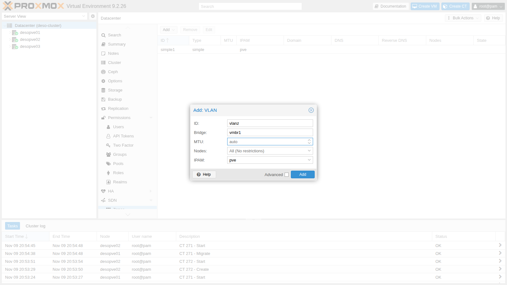
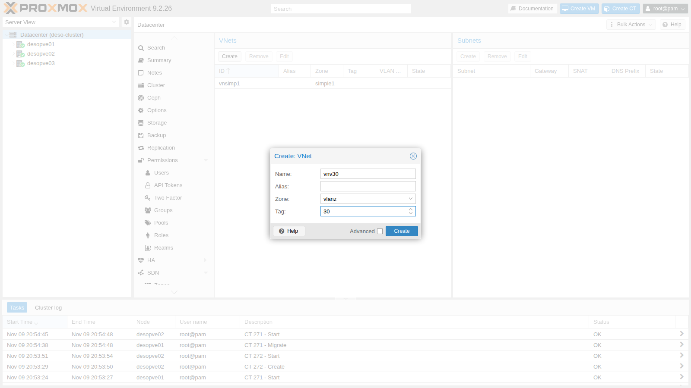
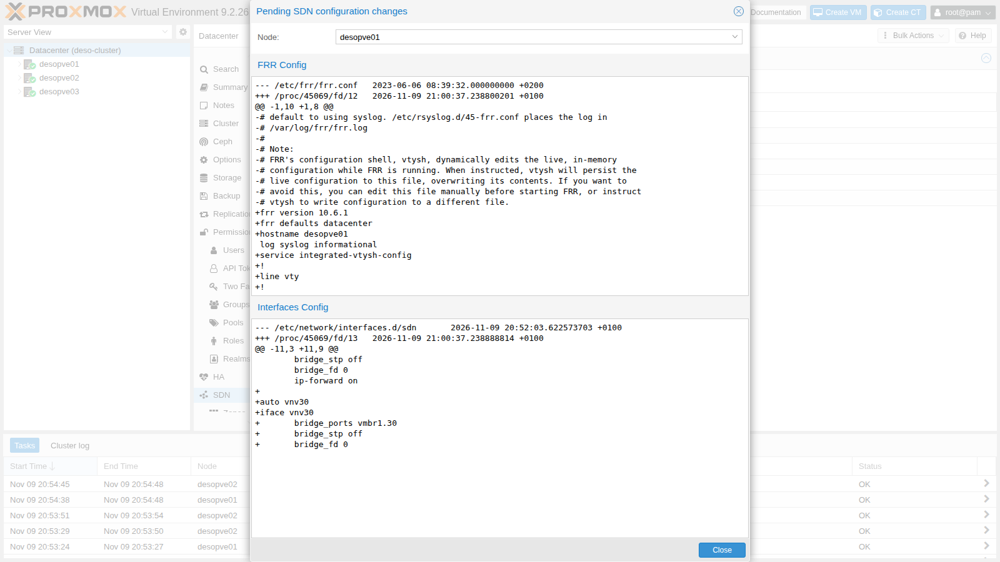
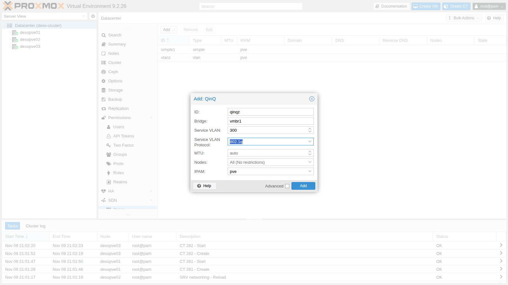
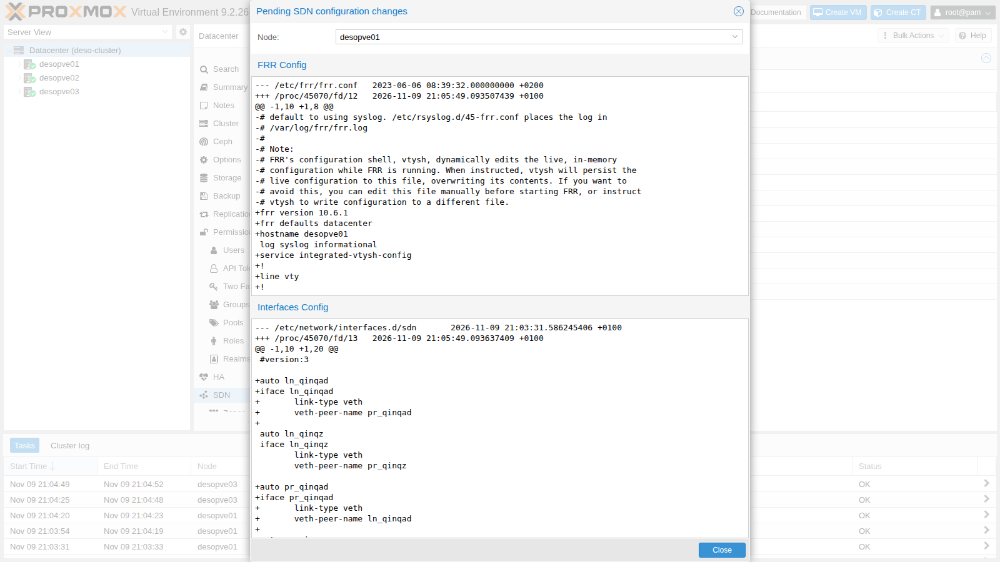
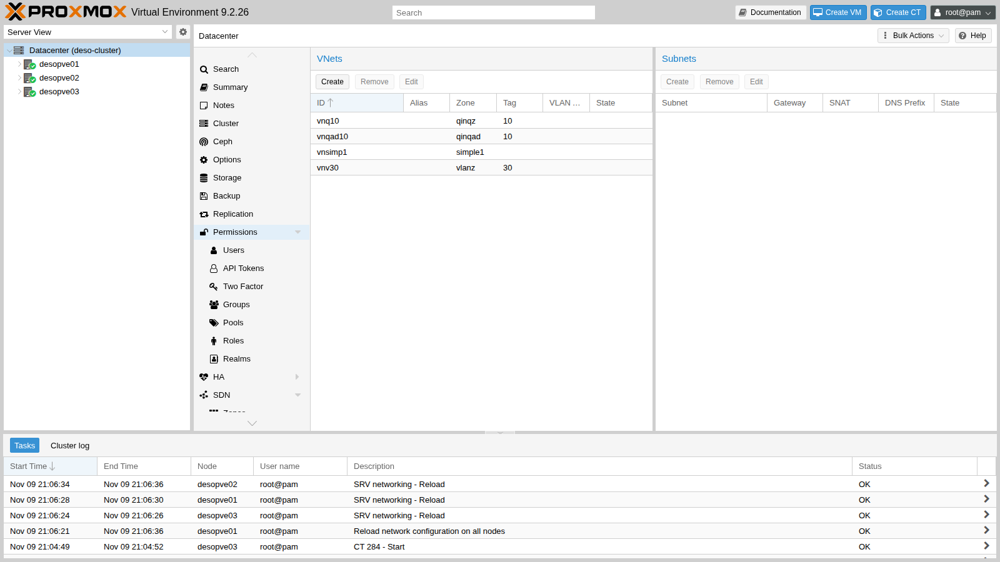

## Dependencies

- **Previous labs:**
  - [Lab 27](/27-sdn-simple/): zones, VNets, Apply and SDN status;
  - [Lab 20](/20-bridges-stable-names-vlans/) and [Lab 21](/21-bonding/): VLAN-aware `vmbr1` on `bond0`, the bridge that carries the VM traffic;
  - [Lab 22](/22-dedicated-networks/): the migration network, checked in the final verification.
- **Physical network:** the node ports facing the network are a trunk that lets any tag through. In production they are configured on the switches as trunks with the allowed VLANs.
- **Nodes:** `desopve01`, `desopve02`, `desopve03`.
- **Template:** `cephfs:vztmpl/debian-13-standard_13.6-1_amd64.tar.zst`.
- **Credentials:** `root` / `<lab-password>` → [Appendix B](/b-credentials-and-addresses/).

## Objectives

- Create VLAN networks as SDN VNets instead of setting the tag on the guest's network interface.
- Use **Dry-Run** to see which files the SDN will change before applying.
- Understand QinQ: a service VLAN that contains the customer VLANs, with ethertype 802.1Q or 802.1ad.
- Check with `tcpdump` which tags actually travel between the nodes, and look at the MTU issue.

## How it works

### VLAN zone

In lab 20 the tag was set on the guest's network interface (`tag=10`). With a **VLAN zone** the VNet decides the tag: you create a VNet `vnv30` with tag 30, and whoever creates the VM picks *vnv30* as the bridge, without knowing anything about VLANs. On the nodes the VNet becomes a Linux bridge whose port is `vmbr1.30`, the VLAN subinterface of the existing bridge. With VNets you can also grant permissions per network (lab 44).

### QinQ zone

**QinQ** stacks two tags:

- the outer tag, the **service VLAN**, is one per zone: it separates, for example, two customers or two environments;
- the inner tag, the **customer VLAN**, is the VNet's tag.

Two QinQ zones can both use VLAN 10 without seeing each other, because they travel in different service VLANs.

| Zone | Frame on the trunk between the nodes |
|---|---|
| VLAN, VNet tag 30 | `MAC` · 802.1Q **30** · IPv4 |
| QinQ, service VLAN 300 (802.1q) | `MAC` · 802.1Q **300** · 802.1Q **10** · IPv4 |
| QinQ, service VLAN 301 (802.1ad) | `MAC` · 802.1ad **301** (ethertype `0x88a8`) · 802.1Q **10** · IPv4 |

The service VLAN protocol is `802.1q` by default; `802.1ad` is the one the standard specifies for the outer tag and should be chosen if the switches require it.

**MTU:** each tag adds 4 bytes to the frame. With two tags a 1500-byte IP packet produces a 1526-byte frame (1522 without the FCS, as `tcpdump` counts them), versus 1518 bytes for an untagged frame and 1522 for a frame with a single 802.1Q tag. The Proxmox VE documentation says to reduce the MTU of QinQ VNets to 1496 if the physical network has an MTU of 1500, or else to raise the MTU of the physical network.

## Procedure

### 1. VLAN zone and VNet

1. **Datacenter** → **SDN** → **Zones** → **Add** → **VLAN**. **ID** `vlanz`, **Bridge** `vmbr1`:

   

2. **VNets** → **Create**: **Name** `vnv30`, **Zone** `vlanz`, **Tag** `30`:

   

### 2. Dry-Run before applying

1. On the **SDN** page click **Dry-Run**: for each node it shows the differences between the current files and those that Apply will write.

   

   Two things to note:

   - in **Interfaces Config** the new bridge `vnv30` appears, with port `vmbr1.30`;
   - in **FRR Config** the Dry-Run shows the `frr.conf` that the SDN generates in place of the default one. The file on the node is actually written when a controller or a fabric is needed (labs 30-31): from then on FRR is managed by the SDN, and anyone using FRR by hand for something else must do so through the SDN.

2. Apply (this also works from the command line) and check the status:

   ```bash title="root@desopve01"
   pvesh set /cluster/sdn
   ```

   ```text output
   UPID:desopve01:00027B63:0023AE2B:6AF22680:reloadnetworkall::root@pam:
   ```

   ```bash title="root@desopve01"
   ip -d link show vmbr1.30 | grep -v link/ether
   ```

   ```text output
   73: vmbr1.30@vmbr1: <BROADCAST,MULTICAST,UP,LOWER_UP> mtu 1500 qdisc noqueue master vnv30 state UP mode DEFAULT group default qlen 1000
       vlan protocol 802.1Q id 30 <REORDER_HDR> 
   ```

### 3. Guests on different nodes in VLAN 30

1. One container on `desopve01` and one on `desopve03`, with a static address. The VNet has no subnet: it is a layer 2 network, and any gateway is a router on the VLAN, like `router01` from lab 26.

   ```bash title="root@desopve01"
   pct create 281 cephfs:vztmpl/debian-13-standard_13.6-1_amd64.tar.zst --hostname vlan30-ct1 \
     --unprivileged 1 --features nesting=1 --cores 1 --memory 512 --rootfs rbd-vm:4 \
     --net0 name=eth0,bridge=vnv30,ip=10.30.30.11/24 --password
   pct start 281
   ```

   ```bash title="root@desopve03"
   pct create 282 cephfs:vztmpl/debian-13-standard_13.6-1_amd64.tar.zst --hostname vlan30-ct2 \
     --unprivileged 1 --features nesting=1 --cores 1 --memory 512 --rootfs rbd-vm:4 \
     --net0 name=eth0,bridge=vnv30,ip=10.30.30.12/24 --password
   pct start 282
   ```

2. The two containers see each other, and on the bond the traffic carries tag 30. Start the capture before the ping, in a second terminal; in this and the following labs `tcpdump` is shown after the command that generates the traffic only so that the output reads in the right order:

   ```bash title="root@desopve01"
   tcpdump -lnei bond0 -c2 "vlan 30 and icmp"      # second terminal, before the ping
   pct exec 281 -- ping -c3 -W1 10.30.30.12
   ```

   ```text output
   3 packets transmitted, 3 received, 0% packet loss, time 2016ms
   ```

   ```text output
   16:26:01.301288 bc:24:11:53:8e:d8 > bc:24:11:ed:d7:ff, ethertype 802.1Q (0x8100), length 102: vlan 30, p 0, ethertype IPv4 (0x0800), 10.30.30.11 > 10.30.30.12: ICMP echo request, id 326, seq 1, length 64
   16:26:01.301592 bc:24:11:ed:d7:ff > bc:24:11:53:8e:d8, ethertype 802.1Q (0x8100), length 102: vlan 30, p 0, ethertype IPv4 (0x0800), 10.30.30.12 > 10.30.30.11: ICMP echo reply, id 326, seq 1, length 64
   ```

   After the test the two containers are shut down: they remain ready for the migration in [Lab 48](/48-migrations/).

   ```bash title="root@desopve01"
   pct shutdown 281
   ```

   ```bash title="root@desopve03"
   pct shutdown 282
   ```

### 4. QinQ zone with an 802.1q service VLAN

1. **Zones** → **Add** → **QinQ**. **ID** `qinqz`, **Bridge** `vmbr1`, **Service VLAN** `300`, **Service VLAN Protocol** `802.1q`:

   

2. The VNet (customer VLAN 10) and Apply, from the command line:

   ```bash title="root@desopve01"
   pvesh create /cluster/sdn/vnets --vnet vnq10 --zone qinqz --tag 10
   pvesh set /cluster/sdn
   ```

3. What the SDN generates on every node: a VLAN-aware bridge for the zone (`z_qinqz`), connected to `vmbr1.300` (the service VLAN), and inside it the customer VLAN `z_qinqz.10`, which is the VNet's port:

   ```text
   # excerpt of /etc/network/interfaces.d/sdn on desopve01
   auto vmbr1.300
   iface vmbr1.300
   	vlan-protocol 802.1q

   auto z_qinqz
   iface z_qinqz
   	bridge-stp off
   	bridge-ports vmbr1.300 ln_qinqz
   	bridge-fd 0
   	bridge-vlan-aware yes
   	bridge-vids 2-4094

   auto vnq10
   iface vnq10
   	bridge_ports z_qinqz.10
   	bridge_stp off
   	bridge_fd 0
   ```

   ```bash title="root@desopve01"
   ip -d link show | grep -A2 -E "vmbr1.300|z_qinqz|qinqz" | grep -E "^[0-9]+:|vlan protocol" | head -10
   ```

   ```text output
   76: vmbr1.300@vmbr1: <BROADCAST,MULTICAST,UP,LOWER_UP> mtu 1500 qdisc noqueue master z_qinqz state UP mode DEFAULT group default qlen 1000
       vlan protocol 802.1Q id 300 <REORDER_HDR> 
   77: ln_qinqz@pr_qinqz: <BROADCAST,MULTICAST,UP,LOWER_UP> mtu 1500 qdisc noqueue master z_qinqz state UP mode DEFAULT group default qlen 1000
   78: pr_qinqz@ln_qinqz: <BROADCAST,MULTICAST,UP,LOWER_UP> mtu 1500 qdisc noqueue state UP mode DEFAULT group default qlen 1000
   79: z_qinqz: <BROADCAST,MULTICAST,UP,LOWER_UP> mtu 1500 qdisc noqueue state UP mode DEFAULT group default qlen 1000
   80: z_qinqz.10@z_qinqz: <BROADCAST,MULTICAST,UP,LOWER_UP> mtu 1500 qdisc noqueue master vnq10 state UP mode DEFAULT group default qlen 1000
       vlan protocol 802.1Q id 10 <REORDER_HDR> 
   ```

   The `veth` pair `ln_qinqz`/`pr_qinqz` connects the zone bridge: it is an internal implementation detail.

4. Two containers (CT 283 on `desopve01`, CT 284 on `desopve03`, addresses 10.31.10.11 and .12) on `vnq10`, created like the VLAN 30 ones:

   ```bash title="root@desopve01"
   pct create 283 cephfs:vztmpl/debian-13-standard_13.6-1_amd64.tar.zst --hostname qinq-ct1 \
     --unprivileged 1 --features nesting=1 --cores 1 --memory 512 --rootfs rbd-vm:4 \
     --net0 name=eth0,bridge=vnq10,ip=10.31.10.11/24 --password
   pct start 283
   ```

   ```bash title="root@desopve03"
   pct create 284 cephfs:vztmpl/debian-13-standard_13.6-1_amd64.tar.zst --hostname qinq-ct2 \
     --unprivileged 1 --features nesting=1 --cores 1 --memory 512 --rootfs rbd-vm:4 \
     --net0 name=eth0,bridge=vnq10,ip=10.31.10.12/24 --password
   pct start 284
   ```

   The ping goes through, and on the bond the frames carry **two** tags, 300 outside and 10 inside:

   ```bash title="root@desopve01"
   pct exec 283 -- ping -c3 -W1 10.31.10.12
   ```

   ```text output
   3 packets transmitted, 3 received, 0% packet loss, time 2002ms
   ```

   ```bash title="root@desopve01"
   tcpdump -lnei bond0 -c2 "vlan 300 and vlan 10 and icmp"
   ```

   ```text output
   21:04:57.411769 bc:24:11:af:71:cf > bc:24:11:7c:50:ed, ethertype 802.1Q (0x8100), length 106: vlan 300, p 0, ethertype 802.1Q (0x8100), vlan 10, p 0, ethertype IPv4 (0x0800), 10.31.10.11 > 10.31.10.12: ICMP echo request, id 342, seq 2, length 64
   21:04:57.413112 bc:24:11:7c:50:ed > bc:24:11:af:71:cf, ethertype 802.1Q (0x8100), length 106: vlan 300, p 0, ethertype 802.1Q (0x8100), vlan 10, p 0, ethertype IPv4 (0x0800), 10.31.10.12 > 10.31.10.11: ICMP echo reply, id 342, seq 2, length 64
   ```

5. **MTU.** The container's network interface has an MTU of 1500: the SDN did not reduce it on its own. With the *don't fragment* bit, test a 1500-byte and a 1496-byte IP packet:

   ```bash title="root@desopve01"
   pct exec 283 -- ip link show eth0 | grep -o "mtu [0-9]*"
   ```

   ```text output
   mtu 1500
   ```

   ```bash title="root@desopve01"
   pct exec 283 -- ping -c3 -W1 -M do -s 1472 10.31.10.12
   ```

   ```text output
   3 packets transmitted, 3 received, 0% packet loss, time 2081ms
   ```

   ```bash title="root@desopve01"
   pct exec 283 -- ping -c3 -W1 -M do -s 1468 10.31.10.12
   ```

   ```text output
   3 packets transmitted, 3 received, 0% packet loss, time 2060ms
   ```

   In the lab both go through: the network between the nodes accepts much larger frames (in [Lab 21](/21-bonding/), packets up to 8938 bytes). On a switch that drops frames over 1518 bytes the first one would be lost without any visible error, the worst case to diagnose. Before using QinQ in production, check the MTU of the whole path (lab 34), or set the zone MTU to 1496.

### 5. 802.1ad service VLAN

1. A second QinQ zone with service VLAN 301 and protocol `802.1ad`, with its VNet. Before applying, **Dry-Run** shows that only the service VLAN subinterface is added on `vmbr1` (`vmbr1.301` with `vlan-protocol 802.1ad`): the `vmbr1` bridge and its 802.1Q VLANs are not touched.

   ```bash title="root@desopve01"
   pvesh create /cluster/sdn/zones --type qinq --zone qinqad --bridge vmbr1 --tag 301 --vlan-protocol 802.1ad
   pvesh create /cluster/sdn/vnets --vnet vnqad10 --zone qinqad --tag 10
   ```

   

2. After Apply the bridge stays 802.1Q (`0x8100`) and the service VLAN is 802.1ad:

   ```bash title="root@desopve01"
   pvesh set /cluster/sdn
   cat /sys/class/net/vmbr1/bridge/vlan_protocol
   ```

   ```text output
   0x8100
   ```

   ```bash title="root@desopve01"
   ip -d link show vmbr1.301 | grep -o "vlan protocol [^ ]* id [0-9]*"
   ```

   ```text output
   vlan protocol 802.1ad id 301
   ```

3. The two containers move to the `vnqad10` VNet (same MAC and address) and the outer tag now has ethertype `0x88a8`:

   ```bash title="root@desopve01"
   pct set 283 --net0 name=eth0,bridge=vnqad10,hwaddr=BC:24:11:AF:71:CF,ip=10.31.10.11/24
   ```

   ```bash title="root@desopve03"
   pct set 284 --net0 name=eth0,bridge=vnqad10,hwaddr=BC:24:11:7C:50:ED,ip=10.31.10.12/24
   ```

   ```bash title="root@desopve01"
   pct exec 283 -- ping -c3 -W1 10.31.10.12
   ```

   ```text output
   3 packets transmitted, 3 received, 0% packet loss, time 2061ms
   ```

   ```bash title="root@desopve01"
   tcpdump -lnei bond0 -c2 "ether proto 0x88a8"
   ```

   ```text output
   21:06:55.911301 bc:24:11:af:71:cf > bc:24:11:7c:50:ed, ethertype 802.1Q-QinQ (0x88a8), length 106: vlan 301, p 0, ethertype 802.1Q (0x8100), vlan 10, p 0, ethertype IPv4 (0x0800), 10.31.10.11 > 10.31.10.12: ICMP echo request, id 346, seq 1, length 64
   21:06:56.948753 bc:24:11:af:71:cf > bc:24:11:7c:50:ed, ethertype 802.1Q-QinQ (0x88a8), length 106: vlan 301, p 0, ethertype 802.1Q (0x8100), vlan 10, p 0, ethertype IPv4 (0x0800), 10.31.10.11 > 10.31.10.12: ICMP echo request, id 346, seq 2, length 64
   ```

4. The rest of the network was not affected by the new zone: the containers' VLAN 10, the migration network and Ceph all work.

   ```bash title="root@desopve01"
   pct exec 121 -- ping -c2 -W1 10.10.10.122
   ```

   ```text output
   2 packets transmitted, 2 received, 0% packet loss, time 1002ms
   ```

   ```bash title="root@desopve01"
   ping -c2 -W1 10.100.10.22
   ```

   ```text output
   2 packets transmitted, 2 received, 0% packet loss, time 1058ms
   ```

   ```bash title="root@desopve01"
   ceph health
   ```

   ```text output
   HEALTH_OK
   ```

### 6. The VNet overview and cleanup

1. The VNets created in this lab and the previous one:

   

2. The QinQ zones were only a test: delete the containers, the VNets and the zones, then apply. Zones can only be deleted after their VNets.

   ```bash title="root@desopve01"
   pct stop 283 && pct destroy 283 --purge
   ```

   ```bash title="root@desopve03"
   pct stop 284 && pct destroy 284 --purge
   ```

   ```bash title="root@desopve01"
   for v in vnqad10 vnq10; do pvesh delete /cluster/sdn/vnets/$v; done
   for z in qinqad qinqz; do pvesh delete /cluster/sdn/zones/$z; done
   pvesh set /cluster/sdn
   ip link show vmbr1.300
   ```

   ```text output
   Device "vmbr1.300" does not exist.
   ```

## Verification and tests

| Test | Result |
|---|---|
| VLAN 30 VNet between `desopve01` and `desopve03` | 0% loss, one 802.1Q tag 30 on the bond |
| Dry-Run | shows the new bridge and the replacement of `frr.conf` |
| QinQ 802.1q, service VLAN 300 | 0% loss, two 802.1Q tags (300 and 10) |
| QinQ, 1500-byte IP packet (1522-byte frame) | goes through in the lab; on a switch that does not accept the double tag it would be lost |
| QinQ 802.1ad, service VLAN 301 | 0% loss, outer tag `0x88a8` |
| Guest VLANs, migration and Ceph after the QinQ zones | unchanged |

## Final lab state

- **SDN:**
  - zone `simple1` with VNet `vnsimp1` (lab 27), unchanged;
  - zone `vlanz` (VLAN on `vmbr1`) with VNet `vnv30`, tag 30, no subnet;
  - QinQ zones `qinqz` and `qinqad` deleted.
- **Containers in VLAN 30**, stopped, not set to start at boot, disk on `rbd-vm`:
  - CT 281 `vlan30-ct1` on `desopve01`, 10.30.30.11/24;
  - CT 282 `vlan30-ct2` on `desopve03`, 10.30.30.12/24.
- CT 283 and 284 deleted.
- `vmbr1` stays VLAN-aware 802.1Q; `/etc/frr/frr.conf` is still the one shipped with the package: the SDN writes it with the EVPN controller and the fabric of labs 30-31.

## What you learned

- With a VLAN zone the VNet decides the tag: guests pick a network by name, and the existing bridge carries the traffic.
- Dry-Run shows, for each node, the changes to the network files and to FRR before applying them.
- QinQ encapsulates the customer VLANs in one service VLAN per zone; the service VLAN can be 802.1Q or 802.1ad.
- The double tag makes the frame 8 bytes longer: with an MTU of 1500 on the physical network, QinQ VNets go to 1496, or you raise the MTU of the path.
- Zones are deleted after their VNets, and the removal, too, takes effect only with Apply.

## References

- [Proxmox VE – SDN: VLAN Zones](https://pve.proxmox.com/pve-docs/chapter-pvesdn.html#pvesdn_zone_plugin_vlan)
- [Proxmox VE – SDN: QinQ Zones](https://pve.proxmox.com/pve-docs/chapter-pvesdn.html#pvesdn_zone_plugin_qinq)
- [IEEE 802.1ad – Provider Bridges (QinQ)](https://en.wikipedia.org/wiki/IEEE_802.1ad)
