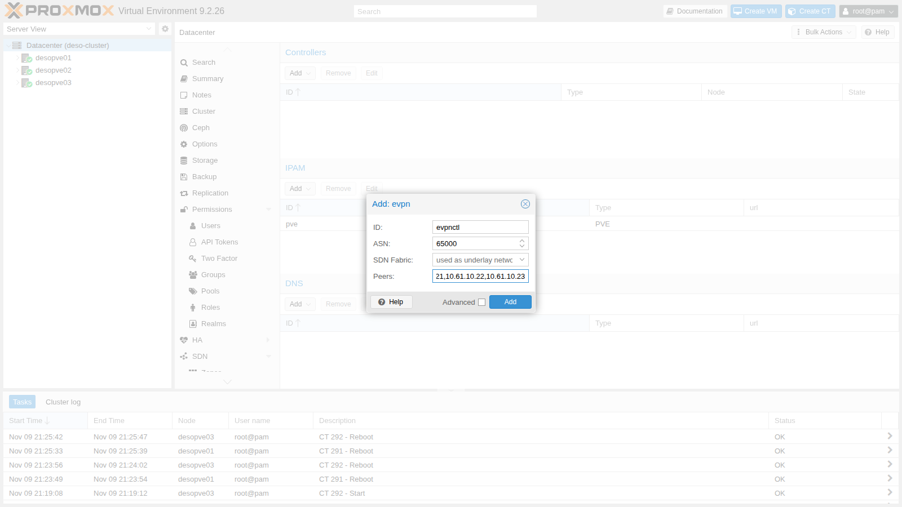
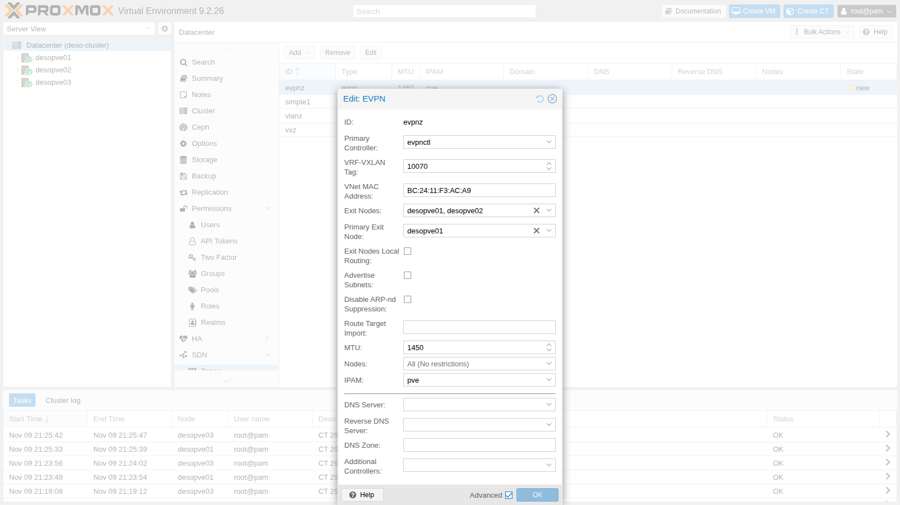
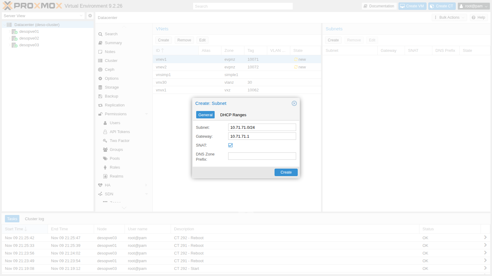

## Dependencies

- **Previous labs:**
  - [Lab 29](/29-sdn-vxlan/): VXLAN, underlay network `vmbr1.61` (10.61.10.0/24) and guest MTU;
  - [Lab 27](/27-sdn-simple/): SDN subnets, gateway, SNAT and IPAM;
  - [Lab 22](/22-dedicated-networks/): dedicated migration network;
  - [Lab 17](/17-ceph-installation/): `rbd-vm` storage for the guest disks.
- **Packages:** `frr` and `frr-pythontools` are installed by the Proxmox VE ISO; the SDN enables the service and writes `/etc/frr/frr.conf` on Apply. Check with `dpkg -l frr frr-pythontools` and `systemctl is-enabled frr`:

  ```text
  ii  frr             10.6.1-1+pve3 amd64        FRRouting suite of internet protocols (BGP, OSPF, IS-IS, ...)
  ii  frr-pythontools 10.6.1-1+pve3 all          FRRouting suite - Python tools
  enabled
  ```

- **Nodes:** `desopve01`, `desopve02`, `desopve03`.
- **Images:** template `cephfs:vztmpl/debian-13-standard_13.6-1_amd64.tar.zst` ([Lab 20](/20-bridges-stable-names-vlans/)) and cloud image `local:import/debian-13-genericcloud-amd64.qcow2` on `desopve01`, downloaded in [Lab 19](/19-fio-benchmark/).
- **Credentials:** `root` / `<lab-password>` → [Appendix B](/b-credentials-and-addresses/).

## Objectives

- An EVPN zone, `evpnz`, with its VRF and two VNets, and iBGP sessions with BFD established between the three nodes: `vtysh` shows the sessions, the VNIs and the MAC/IP routes of the guests.
- The same gateway, with the same IP and MAC, on every node (*anycast gateway*): a container in `vnev2` reaches one in `vnev1` on another node, and leaves the zone with the address of the primary *exit node* (SNAT).
- A VM live-migrated to another node with no change to its network configuration, its MAC now advertised behind the new node.
- A simulated failure of the primary exit node, after which you can tell whether the exit has moved to the backup node, and why a flow that was already open may stay blocked.

## How it works

### The control plane

In the VXLAN zone of lab 29 each node learned MACs from the traffic and copied broadcasts to every peer. With **EVPN** (RFC 7432 and 8365) the nodes exchange this information over **BGP** (address family `l2vpn evpn`): when a guest starts, its node advertises the guest's MAC and IP to the others.

| Route type | What it advertises | Example in the lab |
|---|---|---|
| Type 2 (MAC/IP) | a guest's MAC and IP and the VTEP it sits behind | `bc:24:11:ca:34:84` / 10.71.71.11 behind 10.61.10.21 |
| Type 3 (multicast) | which VTEPs participate in a VNI | the three nodes for each VNet |
| Type 5 (IP prefix) | a routable network, for example an exit node's default route | 0.0.0.0/0 from `desopve01` |

The nodes form **iBGP** sessions with each other using a private ASN (65000) on the underlay network addresses. The SDN also enables **BFD** on these sessions (`neighbor VTEP bfd` in the configuration of step 4). With FRR's default timers, 300 ms between control packets and a multiplier of 3, a neighbor that falls silent is declared down after about 900 ms, without waiting for the BGP timers; `vtysh -c "show bfd peers"` shows the timers actually in use.

### VRF, anycast gateway and distributed routing

- **EVPN zone = VRF.** Each zone is a separate routing table (`vrf_evpnz`), that is, a tenant: its networks do not mix with those of the host or of other zones.
- **Anycast gateway.** The gateway of each VNet exists on **all** nodes, with the same IP and the same MAC. A guest always talks to the gateway of the node it runs on, and if it migrates it finds the same gateway.
- **Symmetric routing.** Traffic between two VNets is routed by the source node and crosses the network between the nodes inside the zone's layer 3 VNI (**VRF-VXLAN tag**). The destination node delivers it into the target VNet.

### Exit nodes

To leave the zone you need one or more **exit nodes**: nodes that advertise a default route into the zone and connect the VRF to the host network. With **SNAT** on the subnet, the guests go out with the exit node's address. When there are several exit nodes, a **Primary Exit Node** sends all outgoing traffic through that node while the others stand by; the Proxmox VE documentation requires one if you use SNAT.

SNAT is *stateful*: the exit node records each flow in its connection tracking table (*conntrack*) and uses that entry to translate the replies. As in [Lab 24](/24-routing-nat/), an entry has two halves, the request as the guest sent it and the reply as it is expected to come back. With SNAT, the reply half is addressed to the exit node, not to the guest: step 8 uses this to read what happened during the failure.

### Test environment and versions

The outputs and measurements below come from tests run in November 2026 with this configuration:

| Component | Configuration used |
|---|---|
| Proxmox VE | 9.2.26, kernel `7.0.14-28-pve` ([Lab 04](/04-first-access-repositories-updates/)) |
| FRR | 10.6.1-1+pve3, with the configuration generated by the SDN |
| Underlay | VLAN 61 (`vmbr1.61`, 10.61.10.0/24) on `vmbr1` and `bond0`, active-backup on 10 GbE ports, MTU 1500 ([Lab 21](/21-bonding/), [Lab 29](/29-sdn-vxlan/)) |
| Zone | exit nodes `desopve01` (primary) and `desopve02`, SNAT on both subnets, guest MTU 1450 |
| Guests | CT 301 and CT 302 from the `debian-13-standard_13.6-1` template, VM 303 from the Debian 13 cloud image, all on `rbd-vm` (Ceph 20.2, [Lab 17](/17-ceph-installation/)) |
| Tools | `ping` from CT 302 every 100 or 200 ms, the migration task log, `vtysh`, `tcpdump`, `conntrack` |

**What the tests measure, and what they do not.** The failure of the exit node is simulated by bringing down its underlay interface: `desopve01` stays up and reachable on the management network, so this is not the crash or the power loss of a node. The traffic is ICMP only; no TCP connection was tested. A `ping` shows what a client experiences, at the resolution of its interval: it does not time BFD or the BGP convergence, and the moment the interface went down, relative to the ping, was not recorded. The Proxmox VE documentation recommends disabling strict reverse path filtering (`rp_filter`) when a zone has several exit nodes; its value on the nodes was not recorded.

## Procedure

### 1. The EVPN controller

**Datacenter** → **SDN** → **Options** → **Controllers** → **Add** → **EVPN**:

- **ID** `evpnctl`;
- **ASN** `65000`, private;
- **Peers** `10.61.10.21,10.61.10.22,10.61.10.23`: the underlay addresses of the nodes.

Here too, **SDN Fabric** is the alternative to the peer list (lab 31).



### 2. The EVPN zone

1. **Zones** → **Add** → **EVPN**, with **Advanced** checked:
   - **ID** `evpnz`, **Controller** `evpnctl`;
   - **VRF-VXLAN Tag** `10070`: the zone's layer 3 VNI;
   - **Exit Nodes** `desopve01`, `desopve02`; **Primary Exit Node** `desopve01`;
   - **MTU** `1450`, as in lab 29.

   The **VNet MAC Address** is generated by Proxmox VE: it is the MAC of the anycast gateway, the same on all nodes.

   

   The primary node can also be set from the command line:

   ```bash title="root@desopve01"
   pvesh set /cluster/sdn/zones/evpnz --exitnodes-primary desopve01
   ```

### 3. Two VNets with subnet and SNAT

1. **VNets** → **Create**: `vnev1`, zone `evpnz`, **Tag** (VNI) `10071`. In the **Subnets** panel → **Create**: **Subnet** `10.71.71.0/24`, **Gateway** `10.71.71.1`, **SNAT** enabled:

   

2. The second VNet from the command line, then Apply:

   ```bash title="root@desopve01"
   pvesh create /cluster/sdn/vnets --vnet vnev2 --zone evpnz --tag 10072
   pvesh create /cluster/sdn/vnets/vnev2/subnets --subnet 10.72.72.0/24 --type subnet --gateway 10.72.72.1 --snat 1
   pvesh set /cluster/sdn
   ```

### 4. What the SDN generates: FRR, VRF and gateway

1. In `/etc/frr/frr.conf` the SDN writes the VRF with its VNI, the iBGP sessions between the nodes with BFD, and the advertisement of all VNIs. On the exit nodes it adds the default route advertised into the zone:

   ```text
   # excerpt of /etc/frr/frr.conf on desopve01 (exit node)
   vrf vrf_evpnz
    vni 10070
   exit-vrf
   !
   router bgp 65000
    bgp router-id 10.61.10.21
    neighbor VTEP peer-group
    neighbor VTEP remote-as 65000
    neighbor VTEP bfd
    neighbor 10.61.10.22 peer-group VTEP
    neighbor 10.61.10.23 peer-group VTEP
    !
    address-family l2vpn evpn
     neighbor VTEP activate
     neighbor VTEP route-map MAP_VTEP_IN in
     neighbor VTEP route-map MAP_VTEP_OUT out
     advertise-all-vni
    exit-address-family
   exit
   !
   router bgp 65000 vrf vrf_evpnz
    !
    address-family l2vpn evpn
     default-originate ipv4
     default-originate ipv6
    exit-address-family
   exit
   ```

2. The BGP sessions with the other two nodes and the known VNIs:

   ```bash title="root@desopve01"
   vtysh -c "show bgp l2vpn evpn summary"
   ```

   ```text output
   BGP router identifier 10.61.10.21, local AS number 65000 VRF default vrf-id 0
   ...
   Neighbor               V         AS   MsgRcvd   MsgSent   TblVer  InQ OutQ  Up/Down State/PfxRcd   PfxSnt Desc
   desopve02(10.61.10.22) 4      65000        25        31        3    0    0 00:00:37            3        7 FRRouting/10.6.1
   desopve03(10.61.10.23) 4      65000        25        24        3    0    0 00:00:30            5        7 FRRouting/10.6.1
   ```

   ```bash title="root@desopve01"
   vtysh -c "show evpn vni"
   ```

   ```text output
   VNI        Type VxLAN IF              # MACs   # ARPs   # Remote VTEPs  Tenant VRF      VLAN       BRIDGE
   10072      L2   vxlan_vnev2           0        0        2               vrf_evpnz       1          vnev2
   10071      L2   vxlan_vnev1           0        0        2               vrf_evpnz       1          vnev1
   10062      L2   vxlan_vnvx1           2        2        2               default         1          vnvx1
   10070      L3   vrfvx_evpnz           0        0        n/a             vrf_evpnz       1          vrfbr_evpnz
   ```

   The two L2 VNIs are the VNets, the L3 VNI belongs to the VRF. VNI 10062 of the lab 29 VXLAN zone also shows up: with `advertise-all-vni`, FRR advertises every VXLAN interface on the node.

3. The anycast gateway: same IP and same MAC on `desopve01` and `desopve03`:

   ```bash title="root@desopve01"
   ip -br link show vnev1
   ```

   ```text output
   vnev1            UP             bc:24:11:f3:ac:a9 <BROADCAST,MULTICAST,UP,LOWER_UP>
   ```

   ```bash title="root@desopve03"
   ip -br link show vnev1
   ```

   ```text output
   vnev1            UP             bc:24:11:f3:ac:a9 <BROADCAST,MULTICAST,UP,LOWER_UP>
   ```

   ```bash title="root@desopve03"
   ip -br -4 addr show vnev1
   ```

   ```text output
   vnev1            UP             10.71.71.1/24
   ```

### 5. Guests in different VNets on different nodes

1. CT 301 on `desopve01` in the `vnev1` VNet and CT 302 on `desopve03` in the `vnev2` VNet, with the subnet gateway and an MTU of 1450. As in lab 29, the MTU must also be written into the container's network file, then the container is restarted:

   ```bash title="root@desopve01"
   pct create 301 cephfs:vztmpl/debian-13-standard_13.6-1_amd64.tar.zst --hostname evpn-ct1 \
     --unprivileged 1 --features nesting=1 --cores 1 --memory 512 --rootfs rbd-vm:4 \
     --net0 name=eth0,bridge=vnev1,ip=10.71.71.11/24,gw=10.71.71.1,mtu=1450 --password
   pct start 301
   pct exec 301 -- sed -i '/address 10.71.71.11/a\	mtu 1450' /etc/network/interfaces
   pct reboot 301
   ```

   ```bash title="root@desopve03"
   pct create 302 cephfs:vztmpl/debian-13-standard_13.6-1_amd64.tar.zst --hostname evpn-ct2 \
     --unprivileged 1 --features nesting=1 --cores 1 --memory 512 --rootfs rbd-vm:4 \
     --net0 name=eth0,bridge=vnev2,ip=10.72.72.12/24,gw=10.72.72.1,mtu=1450 --password
   pct start 302
   pct exec 302 -- sed -i '/address 10.72.72.12/a\	mtu 1450' /etc/network/interfaces
   pct reboot 302
   ```

2. CT 302 reaches CT 301 in another VNet and on another node. The first hop is the anycast gateway on the local node; the second, the remote node, does not answer traceroute:

   ```bash title="root@desopve03"
   pct exec 302 -- ping -c3 -W1 10.71.71.11
   ```

   ```text output
   3 packets transmitted, 3 received, 0% packet loss, time 2031ms
   ```

   ```bash title="root@desopve03"
   pct exec 302 -- apt-get install -y traceroute    # the CT goes out through the exit node; apt proxy set as in the other guests
   pct exec 302 -- traceroute -n -w1 -q1 10.71.71.11
   ```

   ```text output
   traceroute to 10.71.71.11 (10.71.71.11), 30 hops max, 60 byte packets
    1  10.72.72.1  0.130 ms
    2  *
    3  10.71.71.11  1.096 ms
   ```

   ```bash title="root@desopve03"
   pct exec 302 -- ip neigh show 10.72.72.1
   ```

   ```text output
   10.72.72.1 dev eth0 lladdr bc:24:11:f3:ac:a9 REACHABLE
   ```

3. On node `desopve03`, which is not an exit node, the VRF table contains the default route toward the primary exit node and a /32 route for each remote guest, learned from BGP:

   ```bash title="root@desopve03"
   vtysh -c "show ip route vrf vrf_evpnz"
   ```

   ```text output
   ...
   B>* 0.0.0.0/0 [200/0] via 10.61.10.21, vrfbr_evpnz onlink, weight 1, 00:02:34
   K * 0.0.0.0/0 [255/8192] unreachable (ICMP unreachable), weight 1, 00:02:39
   C>* 10.71.71.0/24 is directly connected, vnev1, weight 1, 00:02:39
   L>* 10.71.71.1/32 is directly connected, vnev1, weight 1, 00:02:39
   B>* 10.71.71.11/32 [200/0] via 10.61.10.21, vrfbr_evpnz onlink, weight 1, 00:00:19
   C>* 10.72.72.0/24 is directly connected, vnev2, weight 1, 00:00:30
   L>* 10.72.72.1/32 is directly connected, vnev2, weight 1, 00:00:30
   ```

4. The type 2 routes with the guests' MACs and IPs:

   ```bash title="root@desopve01"
   vtysh -c "show bgp l2vpn evpn route type macip"
   ```

   ```text output
   ...
   Route Distinguisher: 10.61.10.21:4
    *>  [2]:[0]:[48]:[bc:24:11:ca:34:84]:[32]:[10.71.71.11] RD 10.61.10.21:4
   Route Distinguisher: 10.61.10.23:5
    *>i [2]:[0]:[48]:[bc:24:11:46:74:e2]:[32]:[10.72.72.12] RD 10.61.10.23:5
   ```

### 6. Leaving through the exit node with SNAT

1. CT 302 reaches the domain controller, outside the zone. On the management network of `desopve01`, the primary exit node, the traffic goes out with the node's address:

   ```bash title="root@desopve03"
   pct exec 302 -- ping -c3 -W1 172.27.199.20
   ```

   ```text output
   3 packets transmitted, 3 received, 0% packet loss, time 2003ms
   ```

   ```bash title="root@desopve01"
   tcpdump -lnni vmbr0 -c2 "icmp[icmptype]=icmp-echo and dst host 172.27.199.20"
   ```

   ```text output
   21:40:37.078886 IP 172.27.199.21 > 172.27.199.20: ICMP echo request, id 282, seq 1, length 64
   21:40:38.080689 IP 172.27.199.21 > 172.27.199.20: ICMP echo request, id 282, seq 2, length 64
   ```

2. The SNAT rules were written by the SDN, on each exit node with its own address:

   ```bash title="root@desopve01"
   iptables -t nat -S POSTROUTING | grep -E "10.7[12]"
   ```

   ```text output
   -A POSTROUTING -s 10.71.71.0/24 -o vmbr0 -j SNAT --to-source 172.27.199.21
   -A POSTROUTING -s 10.72.72.0/24 -o vmbr0 -j SNAT --to-source 172.27.199.21
   ```

   ```bash title="root@desopve02"
   iptables -t nat -S POSTROUTING | grep -E "10.7[12]"
   ```

   ```text output
   -A POSTROUTING -s 10.71.71.0/24 -o vmbr0 -j SNAT --to-source 172.27.199.22
   -A POSTROUTING -s 10.72.72.0/24 -o vmbr0 -j SNAT --to-source 172.27.199.22
   ```

### 7. Live migration with the anycast gateway

1. A VM from the Debian cloud image, with cloud-init (covered in depth in lab 40) and a network device that inherits the VNet MTU (`mtu=1`):

   ```bash title="root@desopve01"
   qm create 303 --name evpn-vm1 --ostype l26 --memory 1024 --cores 1 \
     --net0 virtio,bridge=vnev1,mtu=1 --scsihw virtio-scsi-single \
     --scsi0 rbd-vm:0,import-from=local:import/debian-13-genericcloud-amd64.qcow2 \
     --ide2 rbd-vm:cloudinit --ipconfig0 ip=10.71.71.30/24,gw=10.71.71.1 \
     --ciuser labuser --cipassword '<lab-password>' --boot order=scsi0 --serial0 socket --vga serial0
   qm start 303
   qm showcmd 303 | grep -o 'host_mtu=[0-9]*'
   ```

   ```text output
   host_mtu=1450
   ```

   `host_mtu=1450` confirms that with `mtu=1` Proxmox VE passes the bridge MTU to the VirtIO device.

2. Before the migration, `desopve03` sees the VM's MAC (`bc:24:11:45:63:6d`) behind the VTEP of `desopve01`:

   ```bash title="root@desopve03"
   vtysh -c "show evpn mac vni 10071"
   ```

   ```text output
   MAC               Type   Flags Intf/Remote ES/VTEP                     VLAN  Seq #'s
   bc:24:11:ca:34:84 remote       10.61.10.21                                   0/0
   bc:24:11:45:63:6d remote       10.61.10.21                                   1/0
   ```

3. From CT 302, a ping every 100 ms toward the VM, while the VM live-migrates from `desopve01` to `desopve02`:

   ```bash title="root@desopve03"
   pct exec 302 -- ping -i 0.1 -c 450 -q 10.71.71.30
   ```

   ```bash title="root@desopve01"
   qm migrate 303 desopve02 --online
   ```

   ```text output
   ...
   2026-11-09 21:42:03 average migration speed: 512.4 MiB/s - downtime 45 ms
   2026-11-09 21:42:03 migration status: completed
   2026-11-09 21:42:07 migration finished successfully (duration 00:00:10)
   ```

   ```text output
   450 packets transmitted, 440 received, 2.22222% packet loss, time 45465ms
   ```

   Three observations, to be kept apart:

   - **Task:** the migration took 10 seconds in all, and the task reports 45 ms of downtime, the pause of the VM measured by QEMU in the final phase.
   - **Ping:** from CT 302, with one request every 100 ms, 10 replies are missing out of 450. The summary does not say whether they were consecutive; if they were, the gap lasted about one second.
   - **EVPN:** after the migration, `desopve03` sees the VM's MAC behind the VTEP of `desopve02` (next step).

   **Interpretation:** a gap of about one second, against a 45 ms pause, is consistent with the time the other nodes need to learn where the VM now is: `desopve02` has to see a frame from the VM and advertise its MAC with a type 2 route, and the other nodes have to install it. The test does not time these steps one by one. **How to check:** `ping -D -O -i 0.1` timestamps every reply and reports the missing ones, so you can see whether they are consecutive and when they start compared with the task log; on `desopve02`, `tcpdump -eni vnev1 ether src bc:24:11:45:63:6d` shows when the first frames of the VM reach the target node.

   The VM's network configuration did not change: the gateway 10.71.71.1, with the same MAC, also exists on `desopve02`.

4. After the migration the MAC is behind the VTEP of `desopve02` and the sequence number has increased: this is the EVPN *MAC mobility* mechanism.

   ```bash title="root@desopve03"
   vtysh -c "show evpn mac vni 10071"
   ```

   ```text output
   MAC               Type   Flags Intf/Remote ES/VTEP                     VLAN  Seq #'s
   bc:24:11:ca:34:84 remote       10.61.10.21                                   0/0
   bc:24:11:45:63:6d remote       10.61.10.22                                   2/1
   ```

5. The VM was only needed for this test: `qm stop 303 && qm destroy 303 --purge`.

### 8. Failure of the primary exit node

1. From CT 302, a continuous ping toward the domain controller. On `desopve01`, bring down the underlay interface, as if the node disappeared from the network between the nodes (it stays up on the management network):

   ```bash title="root@desopve03"
   pct exec 302 -- ping -i 0.1 -c 300 -q 172.27.199.20
   ```

   ```bash title="root@desopve01"
   ip link set vmbr1.61 down
   ```

2. After the failure, on `desopve03` the default route of the VRF points to the backup exit node, and on `desopve02` the traffic leaves with that node's address:

   ```bash title="root@desopve03"
   vtysh -c "show ip route vrf vrf_evpnz 0.0.0.0/0"
   ```

   ```text output
   Routing entry for 0.0.0.0/0
     Known via "bgp", distance 200, metric 200, vrf vrf_evpnz, best
     * 10.61.10.22, via vrfbr_evpnz onlink, weight 1
   ```

   ```bash title="root@desopve02"
   tcpdump -lnni vmbr0 -c2 "icmp and host 172.27.199.20"
   ```

   ```text output
   21:44:53.644292 IP 172.27.199.22 > 172.27.199.20: ICMP echo request, id 294, seq 37, length 64
   21:44:53.644875 IP 172.27.199.20 > 172.27.199.22: ICMP echo reply, id 294, seq 37, length 64
   ```

   These outputs are snapshots taken after the switch and do not say how long it took. The FRR log on `desopve03` (`journalctl -u frr`) records when the session with 10.61.10.21 went down, and why.

3. The ping that was already running did **not** behave the same way in every test. Over four attempts:

   | Test | Replies lost | The running ping |
   |---|---|---|
   | 1 | 152 of 400, every 100 ms (about 15 s) | no replies until the link was restored |
   | 2 | 4 of 150, every 200 ms (about 0.8 s) | resumed through `desopve02` |
   | 3 | 132 of 300, every 100 ms (about 13 s) | no replies until the link was restored |
   | 4 | 9 of 200, every 100 ms (about 0.9 s) | resumed through `desopve02` |

   The time in parentheses is computed, replies lost × interval: it assumes the losses were consecutive, which the ping summary does not show. In tests 2 and 4 the gap is consistent with the BFD detection time (about 900 ms) plus the route change, but the two were not timed separately.

   **Observed in tests 1 and 3.** On `desopve02`, the conntrack entry of the running ping had **no address translation**: in its reply half the destination is 10.72.72.12, the guest, instead of 172.27.199.22, the node, and the entry is `[UNREPLIED]`. For example:

   ```bash title="root@desopve02"
   conntrack -L -p icmp | grep 10.72.72.12
   ```

   ```text output
   icmp     1 29 src=10.72.72.12 dst=172.27.199.20 type=8 code=0 id=295 [UNREPLIED] src=172.27.199.20 dst=10.72.72.12 type=0 code=0 id=295 mark=0 use=1
   ```

   A **new** ping, started during the failure, has a different ICMP identifier and therefore gets a new entry. It worked with no loss:

   ```bash title="root@desopve03"
   pct exec 302 -- ping -c5 -W1 172.27.199.20
   ```

   ```text output
   5 packets transmitted, 5 received, 0% packet loss, time 4006ms
   ```

   **Interpretation.** Without translation, the requests leave `desopve02` with the guest's private address, and the DC replies to 10.72.72.12, an address that no router outside the zone knows how to reach: this is consistent with `[UNREPLIED]`. Why the entry was created without NAT is a hypothesis. The first packets of the flow may have reached `desopve02` while its own default route in the VRF still pointed to `desopve01`: they would then not have left through `vmbr0`, and would not have matched the SNAT rule (`-o vmbr0`). NAT is decided on the first packet of a flow, and an ICMP entry expires only after 30 seconds without traffic (`nf_conntrack_icmp_timeout`): a ping every 100 ms keeps it alive for as long as it runs. In tests 2 and 4 the events would have happened in the opposite order. The test did not record their timing.

   **How to check:**

   - during a blocked test, run `tcpdump -lnni vmbr0 icmp and host 172.27.199.20` on `desopve02`: requests leaving from 10.72.72.12, with no replies, confirm the missing translation;
   - `conntrack -E -p icmp -o timestamp` on `desopve02`, together with `ip -ts monitor route`, shows whether the entry was created before or after the node changed its default route;
   - delete the entry while the ping is blocked (`conntrack -D -p icmp -s 10.72.72.12`): if the ping resumes right away, through SNAT, the stale entry was the cause.

4. Restore the link, and the BGP sessions come back up:

   ```bash title="root@desopve01"
   ip link set vmbr1.61 up
   vtysh -c "show bgp l2vpn evpn summary" | grep ^desopve
   ```

   ```text output
   desopve02(10.61.10.22) 4      65000       231       253       40    0    0 00:00:46            3        8 FRRouting/10.6.1
   desopve03(10.61.10.23) 4      65000       231       247       40    0    0 00:00:46            8        8 FRRouting/10.6.1
   ```

**Decision and limits.** The zone keeps SNAT with a primary exit node, the configuration the Proxmox VE documentation requires for SNAT with several exit nodes, and the upstream router `rtr-core` stays out of BGP, so as not to touch the lab infrastructure. A flow that is already open may therefore stay blocked when the exit moves, and the test shows that it does not happen every time. Two cases were not tested:

- **TCP connections.** ICMP tolerates the change of source address: the DC simply replies to `desopve02`. A TCP connection opened through `desopve01` would instead reach the server, after the switch, from an address that belongs to no open connection, and would be expected to break.
- **An exit without SNAT.** The exit nodes advertise the zone's subnets via BGP to the upstream routers, which can then send the replies to any exit node, with no NAT state on the nodes. How long the switch takes in that configuration has to be measured on your own network.

## Verification and tests

The lab has succeeded when every check in the table gives the expected result. The behavior of a flow that is already open during the failure is recorded rather than judged: in this test it was not repeatable.

| Check | Expected result | Observed in the test |
|---|---|---|
| EVPN iBGP sessions between the 3 nodes | established, with BFD | established |
| Anycast gateway | same IP and MAC on every node | 10.71.71.1 and `bc:24:11:f3:ac:a9` on `desopve01` and `desopve03` |
| CT 302 (`vnev2`, `desopve03`) → CT 301 (`vnev1`, `desopve01`) | replies, routed in the VRF | 0% loss |
| Exit toward the DC | source address of the primary exit node | 172.27.199.21 |
| Live migration of VM 303 | migration completed, MAC behind the VTEP of the target node | task: 10 s, 45 ms of downtime; ping every 100 ms: 10 replies lost out of 450; MAC behind 10.61.10.22, sequence 2/1 |
| Underlay of the primary exit node down | default route via `desopve02`, new flows leaving with its address | route via 10.61.10.22; new ping: 0% loss; running ping: 4 and 9 replies lost in two tests, no replies until the restore in the other two |
| Link restored | BGP sessions established again | both sessions up |

## Final lab state

- **SDN:**
  - controller `evpnctl` (EVPN, ASN 65000, peers 10.61.10.21-23 on VLAN 61);
  - zone `evpnz` (VRF `vrf_evpnz`, VRF-VXLAN 10070, MTU 1450, exit nodes `desopve01` as primary and `desopve02`);
  - VNet `vnev1` (VNI 10071, 10.71.71.0/24, gateway .1, SNAT) and `vnev2` (VNI 10072, 10.72.72.0/24, gateway .1, SNAT);
  - zones `simple1`, `vlanz` and `vxz` unchanged.
- **Containers**, running, not set to start at boot, MTU 1450:
  - CT 301 `evpn-ct1` on `desopve01`, 10.71.71.11/24;
  - CT 302 `evpn-ct2` on `desopve03`, 10.72.72.12/24.
- VM 303 deleted. `vmbr1.61` is up again on `desopve01`.

## What you learned

- **When EVPN is worth it over plain VXLAN:** when the VNets have to route between each other on every node, with a VRF per tenant and the same gateway everywhere, and you want MACs and IPs distributed by BGP instead of learned by flooding the underlay ([Lab 29](/29-sdn-vxlan/)).
- **How to let the zone out:** exit nodes with SNAT need nothing on the upstream routers, but with several exit nodes they require a primary one, and a failover can block flows that are already open. If open flows must survive the loss of an exit node, plan the routed alternative, with the subnets advertised via BGP, and test it on your network.
- **How to run a failover test:** keep the route switch, the gap seen by the client and the conntrack state apart; repeat the test several times, since the outcome here changed from one attempt to the next, and record timestamps (`ping -D -O`, the FRR log, `conntrack -E`).
- **What to check after an exit node fails:** the default route of the VRF on a node that is not an exit node, the source address on the backup node's `vmbr0`, and any conntrack entry without translation. A new flow tells you whether the exit works; the old one tells you whether stale state is in the way.
- **What a live migration costs in an EVPN zone:** the guest keeps its gateway, but the gap a client sees, about one second here, is much longer than the pause reported by the task, and is measured with a timestamped ping.

## References

- [Proxmox VE – SDN: EVPN zones, exit nodes and primary exit node](https://pve.proxmox.com/pve-docs/chapter-pvesdn.html#pvesdn_zone_plugin_evpn)
- [Proxmox VE – SDN: EVPN controller](https://pve.proxmox.com/pve-docs/chapter-pvesdn.html#pvesdn_controller_plugin_evpn)
- [Proxmox VE – SDN: subnets and the SNAT option](https://pve.proxmox.com/pve-docs/chapter-pvesdn.html#pvesdn_config_subnet)
- [Proxmox VE – SDN: multiple EVPN exit nodes and `rp_filter`](https://pve.proxmox.com/pve-docs/chapter-pvesdn.html#_multiple_evpn_exit_nodes)
- [RFC 7432 – BGP MPLS-Based Ethernet VPN](https://www.rfc-editor.org/rfc/rfc7432)
- [RFC 7432, section 15 – MAC mobility and sequence numbers](https://www.rfc-editor.org/rfc/rfc7432#section-15)
- [RFC 8365 – A Network Virtualization Overlay Solution Using EVPN](https://www.rfc-editor.org/rfc/rfc8365)
- [FRRouting 10.6 – EVPN](https://docs.frrouting.org/en/stable-10.6/evpn.html)
- [FRRouting 10.6 – BFD, default timers](https://docs.frrouting.org/en/stable-10.6/bfd.html)
- [Linux 7.0 – conntrack parameters (`nf_conntrack_icmp_timeout`)](https://www.kernel.org/doc/html/v7.0/networking/nf_conntrack-sysctl.html)
- [conntrack(8) – listing, watching and deleting entries](https://manpages.debian.org/trixie/conntrack/conntrack.8.en.html)
