## Dependencies

- **Previous labs:**
  - [Lab 05](/05-ssh-shell-cli/): the DC's SSH key loaded in the agent, which the test script uses to log in to the nodes;
  - [Lab 15](/15-iscsi-lvm-multipath/), [Lab 17](/17-ceph-installation/), [Lab 22](/22-dedicated-networks/), [Lab 27](/27-sdn-simple/) and [Lab 29](/29-sdn-vxlan/)-[31](/31-sdn-fabrics/): multipath, Ceph, Corosync on two links, migration, `dnsmasq` and SDN. Step 2 lists them and step 8 checks them: if you have not done one of these labs, skip the corresponding check;
  - [Lab 20](/20-bridges-stable-names-vlans/): bridges and VLANs;
  - [Lab 24](/24-routing-nat/): the routed subnet 10.99.99.0/28 of `desopve04`, with CT 403;
  - [Lab 25](/25-ipv6/): IPv6 addresses `fd27:199::/64` of the nodes and the DC;
  - [Lab 26](/26-virtual-router/): `router01`, which NATs the traffic of VLANs 10 and 20 toward the management network.
- **Guests used:**
  - CT 101 `debian-ct01` (172.27.199.101 on `desopve02`): becomes the protected server, with nginx;
  - CT 121 `vlan-ct1` (VLAN 10): a client that comes in through `router01`;
  - CT 403 `routed-ct1` (10.99.99.2 on `desopve04`): a client from a routed network;
  - the DC `desopve-dc01` (172.27.199.20): the administration workstation.
- **Nodes:** cluster `desopve01`-`desopve03` and the standalone node `desopve04`.
- **Credentials:** `root` / `<lab-password>` → [Appendix B](/b-credentials-and-addresses/).

## Objectives

- Understand the levels of the Proxmox VE firewall (Datacenter, Node, VM/CT) and what enables what.
- Enable the datacenter firewall **without** blocking the services between the nodes.
- Use aliases, IPSets and security groups to write readable, reusable rules.
- Protect a container with inbound and outbound rules, and verify them with positive and negative tests.
- Read the firewall log.
- Protect the host and understand the role of the `management` IPSet, including for IPv6.

## How it works

### Levels and files

The Proxmox VE firewall is distributed: each node applies the rules that concern it, but the configuration lives in the cluster file system (`/etc/pve`), so there is a single configuration for the whole cluster.

| Level | Where it is configured | File | What it protects |
|---|---|---|---|
| **Datacenter** | Datacenter → Firewall | `/etc/pve/firewall/cluster.fw` | Master switch, default policies, shared aliases, IPSets and security groups |
| **Node** | Node → Firewall | `/etc/pve/nodes/<nodo>/host.fw` | Traffic addressed to the node itself (GUI, SSH, cluster services) |
| **VM/CT** | VM/CT → Firewall | `/etc/pve/firewall/<vmid>.fw` | Traffic to and from a single network interface of the guest |
| **VNet** | SDN → VNet Firewall | `/etc/pve/sdn/firewall/<vnet>.fw` | Traffic passing through a VNet (→ [Lab 33](/33-firewall-2/)) |

Three rules to remember:

1. **The Datacenter switch turns everything on.** As long as the Datacenter `Firewall` option is `No`, no rule is applied, at any level. When it becomes `Yes`, the firewall of **every node** is enabled too, except on the nodes where it has been explicitly disabled.
2. **A guest's firewall only applies if it is enabled in two places:** the guest's `Firewall` option and the `firewall=1` flag on the individual network interface (`net0`). Without the flag, that interface's traffic does not go through the firewall.
3. **Rules are evaluated from top to bottom and the first match wins.** If none matches, the default policy for that direction decides (`Input Policy`, `Output Policy`).

### The default policies

| Level | Inbound | Outbound |
|---|---|---|
| Datacenter/nodes | `DROP` | `ACCEPT` |
| VM/CT | `DROP` | `ACCEPT` |

For the nodes, Proxmox VE adds the essential rules on its own: GUI (8006), SSH (22), console (5900-5999, 3128) and migration (60000-60050) from the management network, plus Corosync traffic between the cluster nodes. The management network is the `management` set; if you do not define it, the **local network** detected from the node's address (`local_network`) applies.

### Tools for writing readable rules

- **Alias:** a name for an address or a network (`dc01` = 172.27.199.20). If the address changes, you update the alias and all the rules follow it.
- **IPSet:** a named list of addresses and networks (`admin`). In rules it is referenced with a leading `+`: `+dc/admin`.
- **Security group:** a named bundle of rules (`web-server`), to insert into several guests with a single `GROUP` line.
- **Macro:** a predefined service (`HTTP`, `SSH`, `Ping`, `Ceph`...) that maps to protocols and ports, so you do not have to remember the numbers.

In Proxmox VE 9 references have a **scope**: `dc/` for those of the Datacenter and `guest/` for those defined in the individual guest. In the GUI and in the files they appear as `dc/dc01` and `+dc/admin`.

### How it is applied to the guest

When a network interface has `firewall=1`, Proxmox VE does not connect it directly to the bridge: it places a small dedicated bridge (`fwbr<vmid>i<n>`) and a pair of interfaces (`fwln`/`fwpr`) in between. The guest's rules hook in there. In the log these names appear as `IN=fwbr101i0` and `PHYSOUT=veth101i0`.

The `pve-firewall` daemon recompiles the rules about every **10 seconds**: a rule you have just saved is not active at that very instant.

## Procedure

### 1. The initial state

**Datacenter → Firewall → Options**: the firewall is off, with the default policies.

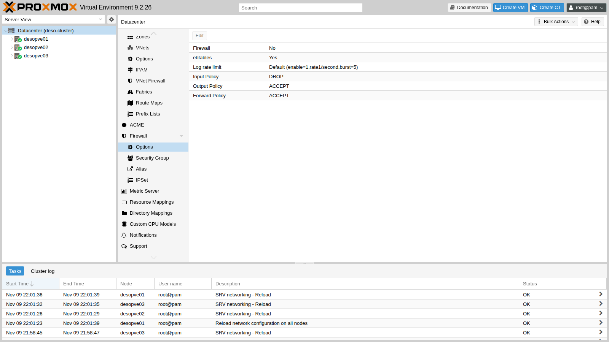

### 2. Before turning it on: securing the nodes

Turning on the Datacenter firewall also turns on the nodes' firewall, with the inbound policy `DROP`. The automatic rules cover the management network and Corosync, but in this cluster there are services on other networks that would be blocked:

- Ceph on VLANs 50 and 51 (10.50.10.0/24 and 10.51.10.0/24);
- the second Corosync link on VLAN 40;
- the SDN's BGP, BFD and VXLAN on VLAN 61 and on the fabric;
- migration on VLAN 100;
- `dnsmasq` DHCP and DNS for the SDN zone `simple1`.

In this lab the firewall is for the **guests**, so first of all you disable the nodes' firewall: **Node → Firewall → Options → Firewall: No**. The firewall of the cluster hosts, with all the rules for the services, is built in [Lab 33](/33-firewall-2/).

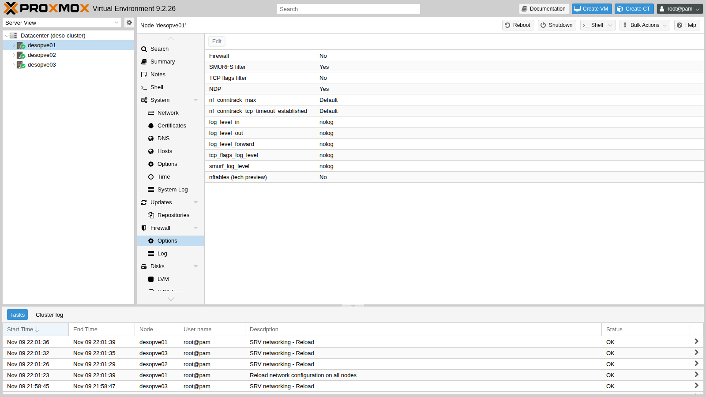

The same, for all three nodes, from the command line:

```bash
for n in desopve01 desopve02 desopve03; do
  pvesh set /nodes/$n/firewall/options --enable 0
done
cat /etc/pve/nodes/desopve02/host.fw
```

```text output
[OPTIONS]

enable: 0
```

### 3. The aliases

**Datacenter → Firewall → Alias → Add**: a name for each address or network that appears in the rules.

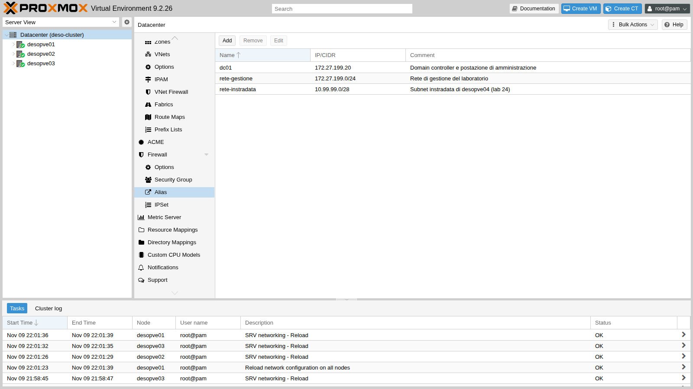

From the command line:

```bash
pvesh create /cluster/firewall/aliases --name dc01 --cidr 172.27.199.20 \
  --comment "Domain controller e postazione di amministrazione"
pvesh create /cluster/firewall/aliases --name rete-gestione --cidr 172.27.199.0/24 \
  --comment "Rete di gestione del laboratorio"
pvesh create /cluster/firewall/aliases --name rete-instradata --cidr 10.99.99.0/28 \
  --comment "Subnet instradata di desopve04 (lab 24)"
```

### 4. The administrators' IPSet

**Datacenter → Firewall → IPSet → Create** `admin`, then on the right **Add** with the alias `dc/dc01`. Later on, adding another workstation only takes one more line in the set.

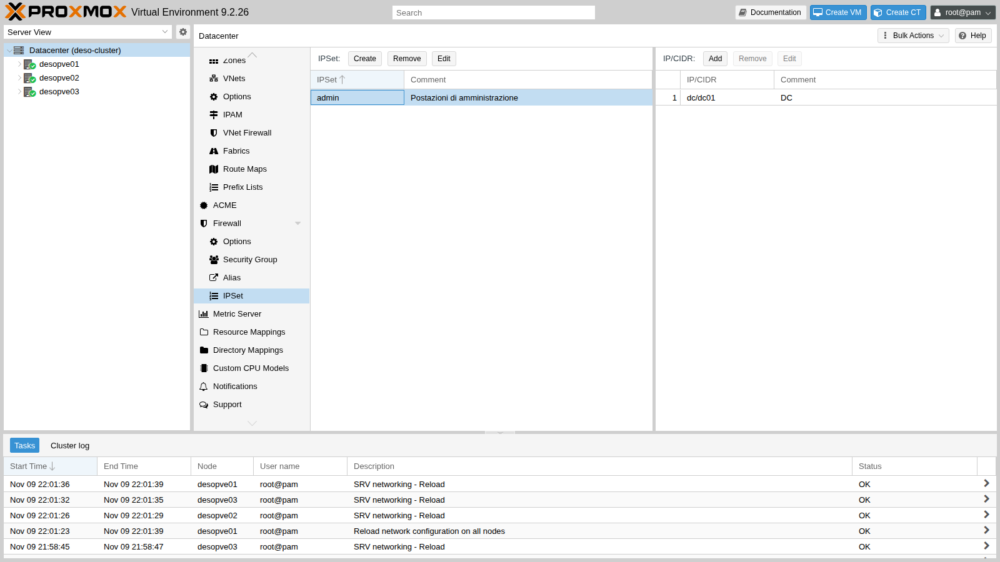

```bash
pvesh create /cluster/firewall/ipset --name admin --comment "Postazioni di amministrazione"
pvesh create /cluster/firewall/ipset/admin --cidr dc/dc01 --comment "DC"
```

### 5. The security groups

**Datacenter → Firewall → Security Group → Create**. Create two groups:

- `web-server`: HTTP from the management network;
- `accesso-admin`: SSH and ping only from the `admin` set.

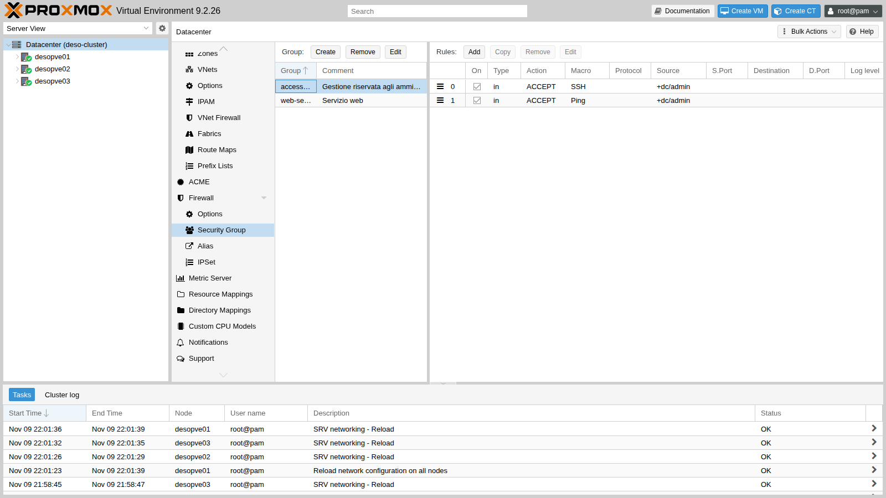

Each rule is created with **Add** in the right-hand panel. The details of the SSH rule:

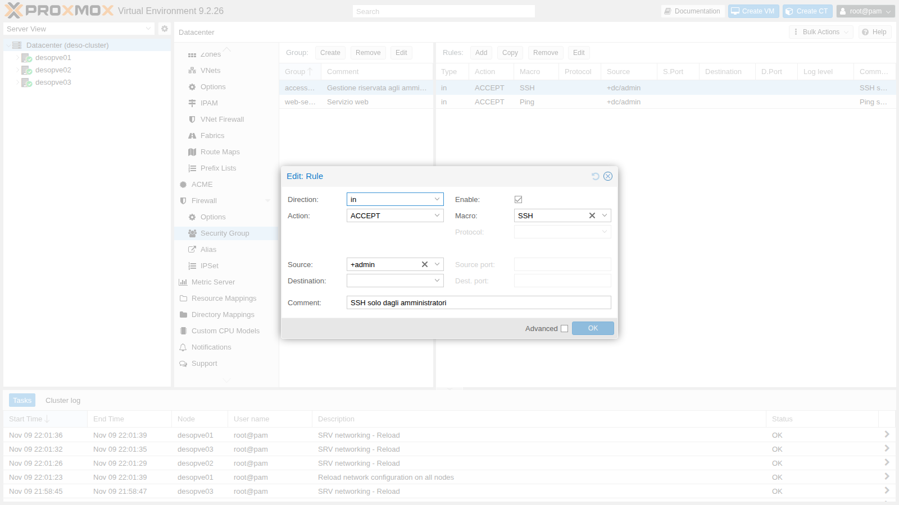

From the command line:

```bash
pvesh create /cluster/firewall/groups --group web-server --comment "Servizio web"
pvesh create /cluster/firewall/groups/web-server --type in --action ACCEPT \
  --macro HTTP --source dc/rete-gestione --enable 1 --comment "HTTP solo dalla rete di gestione"
pvesh create /cluster/firewall/groups --group accesso-admin --comment "Gestione riservata agli amministratori"
pvesh create /cluster/firewall/groups/accesso-admin --type in --action ACCEPT \
  --macro Ping --source +dc/admin --enable 1 --comment "Ping solo dagli amministratori"
pvesh create /cluster/firewall/groups/accesso-admin --type in --action ACCEPT \
  --macro SSH --source +dc/admin --enable 1 --comment "SSH solo dagli amministratori"
```

The result in `cluster.fw`:

```text
[ALIASES]

dc01 172.27.199.20 # Domain controller e postazione di amministrazione
rete-gestione 172.27.199.0/24 # Rete di gestione del laboratorio
rete-instradata 10.99.99.0/28 # Subnet instradata di desopve04 (lab 24)

[IPSET admin] # Postazioni di amministrazione

dc/dc01 # DC

[group accesso-admin] # Gestione riservata agli amministratori

IN SSH(ACCEPT) -source +dc/admin # SSH solo dagli amministratori
IN Ping(ACCEPT) -source +dc/admin # Ping solo dagli amministratori

[group web-server] # Servizio web

IN HTTP(ACCEPT) -source dc/rete-gestione # HTTP solo dalla rete di gestione
```

:::note
A `pvesh create` on rules inserts the rule **at the top** (position 0). That is why SSH comes before Ping in the file, even though it was created later. To choose the position, use the `--pos` option.
:::

### 6. The server to protect

Install a test web server on CT 101:

```bash
pct exec 101 -- bash -c 'apt-get -qq update; apt-get -y -qq install nginx curl
  echo "debian-ct01 - web di prova (lab 32)" > /var/www/html/index.html'
pct exec 101 -- ss -ltn
```

```text output
LISTEN 0      511          0.0.0.0:80        0.0.0.0:*
LISTEN 0      511             [::]:80           [::]:*
LISTEN 0      4096               *:22              *:*
```

The CT's network interface already has the firewall flag, set at creation time:

```text
net0: name=eth0,bridge=vmbr0,firewall=1,gw=172.27.199.1,hwaddr=BC:24:11:0C:31:84,ip=172.27.199.101/24,type=veth
```

Before enabling any rule, measure the starting situation with the test script [`fwtest.ps1`](/files/32/fwtest.ps1). Copy it to the DC, for example to `C:\lab`, and run it in PowerShell with `.\fwtest.ps1`. For the tests from the containers, the script logs in to the nodes with the DC's SSH key ([Lab 05](/05-ssh-shell-cli/)) and runs `nc` and `ping` inside the CT. It tests HTTP, SSH and ping from three sources:

- the DC;
- CT 121, which comes from VLAN 10 through the NAT of `router01` (source 172.27.199.26);
- CT 403, which comes from the routed network without NAT (source 10.99.99.2).

```text
DC 172.27.199.20 (admin)           HTTP ok        SSH ok        ping ok
CT 121 VLAN 10 (via router01, NAT) HTTP ok        SSH ok        ping ok
CT 403 10.99.99.2 (rete instradata) HTTP ok        SSH ok        ping ok
```

### 7. The rules of CT 101

**CT 101 → Firewall → Insert: Security Group**, once for `web-server` and once for `accesso-admin`. Then **Firewall → Options**:

- `Firewall`: `Yes`;
- `log_level_in`: `info`, to log the packets dropped by the inbound policy.

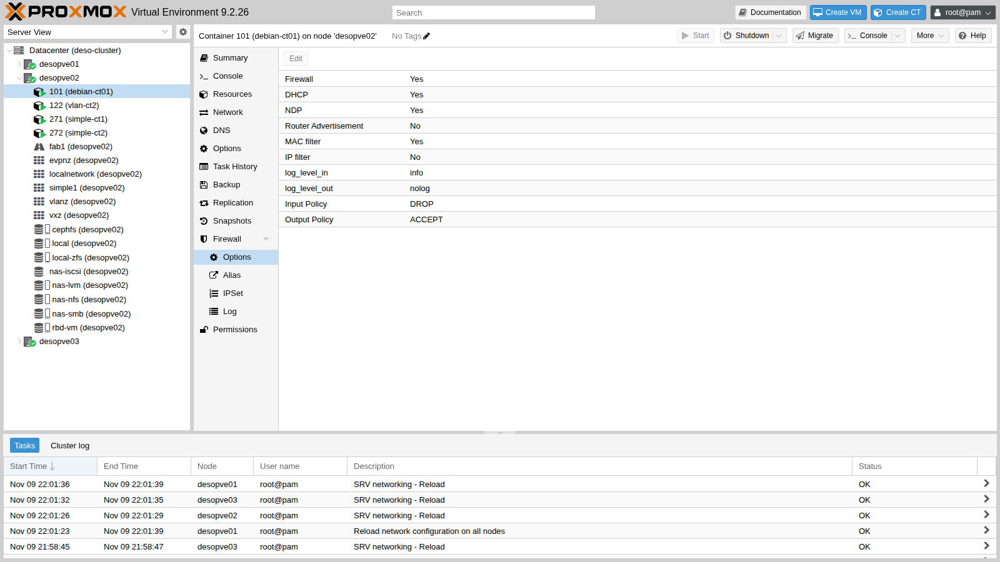

From the command line:

```bash
pvesh create /nodes/desopve02/lxc/101/firewall/rules --type group --action accesso-admin --enable 1
pvesh create /nodes/desopve02/lxc/101/firewall/rules --type group --action web-server --enable 1
pvesh set /nodes/desopve02/lxc/101/firewall/options --enable 1 --log_level_in info
cat /etc/pve/firewall/101.fw
```

```text output
[OPTIONS]

enable: 1
log_level_in: info

[RULES]

GROUP web-server
GROUP accesso-admin
```

### 8. Turning on the datacenter firewall

**Datacenter → Firewall → Options**, double-click `Firewall`, check the box and click **OK**.

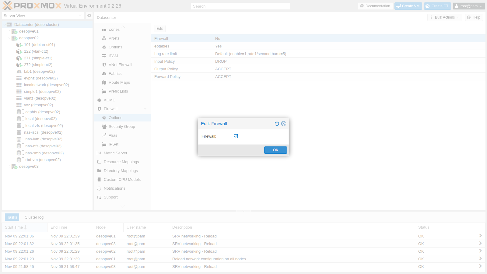

Right afterwards, check that the nodes have **no** rules of their own and that the cluster services have not been interrupted:

```bash
for n in desopve01 desopve02 desopve03; do
  ssh $n 'echo "== $(hostname)"; pve-firewall status; echo "regole host: $(iptables -S PVEFW-HOST-IN 2>/dev/null | wc -l)"'
done
pvecm status | grep Quorate; corosync-cfgtool -s | grep -c connected
ceph health; multipath -ll | grep -c "active ready"
vtysh -c "show bgp summary" | grep ^desopve
```

```text output
== desopve01
Status: enabled/running
regole host: 0
== desopve02
Status: enabled/running
regole host: 0
== desopve03
Status: enabled/running
regole host: 0
Quorate:          Yes
4
HEALTH_OK
2
desopve02(10.61.10.22) 4      65000       519       529       16    0    0 00:25:09            3        5 FRRouting/10.6.1
desopve03(10.61.10.23) 4      65000       528       529       16    0    0 00:25:09            6        5 FRRouting/10.6.1
```

The service is `enabled/running`, but the host rule chain is empty: the nodes filter nothing. Corosync has both links up (4 `connected` lines), Ceph is healthy, both iSCSI paths are active and the BGP sessions are up.

### 9. The tests

```text
DC 172.27.199.20 (admin)           HTTP ok        SSH ok        ping ok
CT 121 VLAN 10 (via router01, NAT) HTTP ok        SSH BLOCCATO  ping BLOCCATO
CT 403 10.99.99.2 (rete instradata) HTTP BLOCCATO  SSH BLOCCATO  ping BLOCCATO
```

Each result is explained by a rule:

- **DC:** it is in the `admin` set, so SSH and ping get through (`accesso-admin`); it is in the management network, so HTTP gets through (`web-server`).
- **CT 121:** the NAT of `router01` makes it arrive with the address 172.27.199.26. That address is in the management network, so HTTP gets through; it is not in the `admin` set, so SSH and ping end up on the `DROP` policy.
- **CT 403:** it arrives with its real address 10.99.99.2, which matches no rule. Everything is blocked.

:::note[NAT hides the origin]
To the CT 101 firewall, the guests in VLANs 10 and 20 are all "172.27.199.26". If you need different rules for each VLAN, the traffic must arrive without NAT, like the traffic from the routed network.
:::

### 10. The log

**CT 101 → Firewall → Log** shows the dropped packets, thanks to `log_level_in: info`.

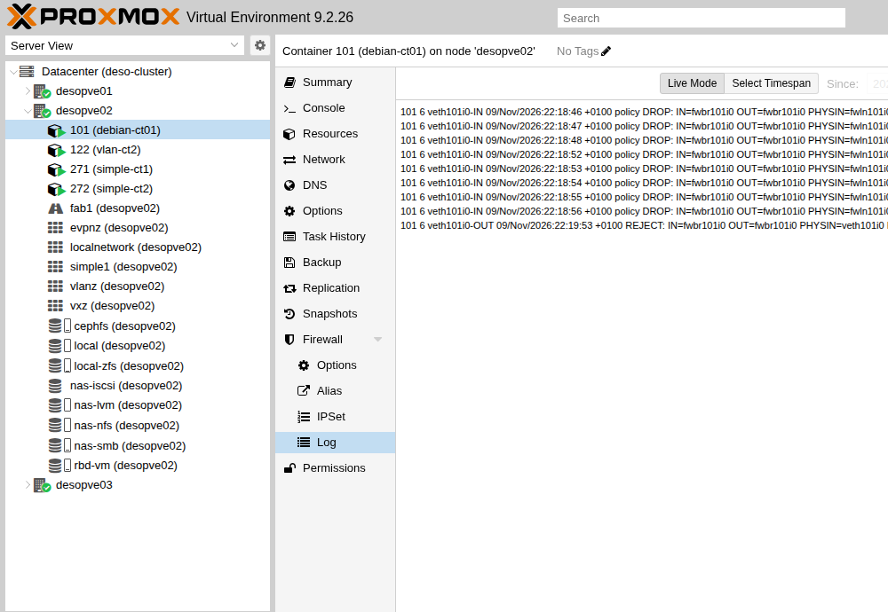

The same log can be read on the node that hosts the guest, in `/var/log/pve-firewall.log`. In the lines below, the `MAC` field (destination, source and frame type) is abbreviated:

```text
101 6 veth101i0-IN 09/Nov/2026:22:18:48 +0100 policy DROP: IN=fwbr101i0 OUT=fwbr101i0 PHYSIN=fwln101i0 PHYSOUT=veth101i0 MAC=… SRC=172.27.199.26 DST=172.27.199.101 LEN=84 TOS=0x00 PREC=0x00 TTL=63 ID=61663 DF PROTO=ICMP TYPE=8 CODE=0 ID=404 SEQ=1
101 6 veth101i0-IN 09/Nov/2026:22:18:52 +0100 policy DROP: IN=fwbr101i0 OUT=fwbr101i0 PHYSIN=fwln101i0 PHYSOUT=veth101i0 MAC=… SRC=10.99.99.2 DST=172.27.199.101 LEN=60 TOS=0x00 PREC=0x00 TTL=63 ID=64893 DF PROTO=TCP SPT=55866 DPT=80 SEQ=2496087703 ACK=0 WINDOW=64240 SYN
```

How to read a line:

- `101` is the guest and `6` the log level (`info`);
- `veth101i0-IN` is the chain: inbound on the `net0` interface;
- `policy DROP` means that no rule accepted the packet and the default policy kicked in;
- `SRC`, `DST`, `PROTO`, `DPT` tell who, to whom and what.

The log is limited to 1 line per second with bursts of 5 (`Log rate limit` in the Datacenter options), so as not to fill the disk during an attack.

### 11. An outbound rule

The guests' outbound policy is `ACCEPT`, but specific destinations can be forbidden. For example: the web server must not open SMB connections to the DC.

```bash
pvesh create /nodes/desopve02/lxc/101/firewall/rules --type out --action REJECT \
  --dest dc/dc01 --proto tcp --dport 445 --enable 1 --log info \
  --comment "Nessuna connessione SMB verso il DC"
```

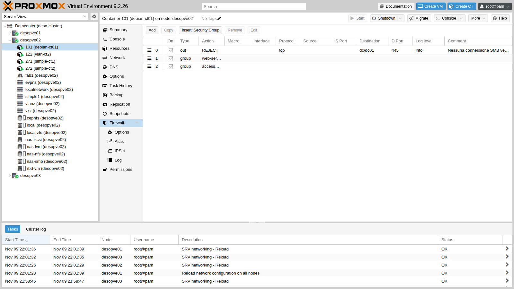

Before and after, from inside CT 101, with `pct exec 101 -- nc -zv -w2 desopve-dc01.proxmox.community 445 53`. The second check was done about ten seconds after saving, the time of one `pve-firewall` cycle:

```text
# before
desopve-dc01.proxmox.community [172.27.199.20] 445 (microsoft-ds) open
desopve-dc01.proxmox.community [172.27.199.20] 53 (domain) open
# after
desopve-dc01.proxmox.community [172.27.199.20] 445 (microsoft-ds) : Connection refused
desopve-dc01.proxmox.community [172.27.199.20] 53 (domain) open
```

`REJECT` answers immediately with a refusal (`Connection refused`), while `DROP` leaves the client waiting until the timeout. For internal traffic `REJECT` makes troubleshooting faster; toward the outside `DROP` is preferred, because it does not confirm that the service exists.

The compiled rules can be seen on the node:

```bash
iptables -S veth101i0-OUT
```

```text output
-N veth101i0-OUT
-A veth101i0-OUT -j CONNMARK --set-xmark 0x65/0xffffffff
-A veth101i0-OUT -p udp -m udp --sport 68 --dport 67 -g PVEFW-SET-ACCEPT-MARK
-A veth101i0-OUT -m mac ! --mac-source BC:24:11:0C:31:84 -j DROP
-A veth101i0-OUT -j MARK --set-xmark 0x0/0x80000000
-A veth101i0-OUT -d 172.27.199.20/32 -p tcp -m tcp --dport 445 -m limit --limit 1/sec -j NFLOG --nflog-prefix ":101:6:veth101i0-OUT: REJECT: "
-A veth101i0-OUT -d 172.27.199.20/32 -p tcp -m tcp --dport 445 -j PVEFW-reject
-A veth101i0-OUT -j GROUP-web-server-OUT
-A veth101i0-OUT -m mark --mark 0x80000000/0x80000000 -j RETURN
-A veth101i0-OUT -j GROUP-accesso-admin-OUT
-A veth101i0-OUT -m mark --mark 0x80000000/0x80000000 -j RETURN
-A veth101i0-OUT -g PVEFW-SET-ACCEPT-MARK
```

The line with `--mac-source` is the **MAC filter**, enabled by default: the guest cannot send traffic with a MAC other than its own. It is covered in depth in [Lab 33](/33-firewall-2/).

### 12. The host firewall on desopve04

`desopve04` is a standalone node, that is, a datacenter of its own, with its own `cluster.fw`. It is the right place to see the host firewall in action without any risk to the cluster.

Which network it considers the "management" network:

```bash
pve-firewall localnet
```

```text output
local hostname: desopve04
local IP address: 172.27.199.24
network auto detect: 172.27.199.0/24
using detected local_network: 172.27.199.0/24
```

Turn on the datacenter firewall of `desopve04`. The node has no options of its own, so its firewall follows the master switch:

```bash
pvesh set /cluster/firewall/options --enable 1
iptables -S PVEFW-HOST-IN
```

```text output
-A PVEFW-HOST-IN -i lo -j ACCEPT
-A PVEFW-HOST-IN -m conntrack --ctstate INVALID -j DROP
-A PVEFW-HOST-IN -m conntrack --ctstate RELATED,ESTABLISHED -j ACCEPT
-A PVEFW-HOST-IN -m conntrack --ctstate INVALID,NEW -j PVEFW-smurfs
-A PVEFW-HOST-IN -p 2 -j RETURN
-A PVEFW-HOST-IN -p tcp -m set --match-set PVEFW-0-management-v4 src -m tcp --dport 8006 -j RETURN
-A PVEFW-HOST-IN -p tcp -m set --match-set PVEFW-0-management-v4 src -m tcp --dport 5900:5999 -j RETURN
-A PVEFW-HOST-IN -p tcp -m set --match-set PVEFW-0-management-v4 src -m tcp --dport 3128 -j RETURN
-A PVEFW-HOST-IN -p tcp -m set --match-set PVEFW-0-management-v4 src -m tcp --dport 22 -j RETURN
-A PVEFW-HOST-IN -p tcp -m set --match-set PVEFW-0-management-v4 src -m tcp --dport 60000:60050 -j RETURN
-A PVEFW-HOST-IN -j PVEFW-Drop
-A PVEFW-HOST-IN -j DROP
```

These are the automatic rules: GUI, console, SSH and migration only from the `management` set, and everything else dropped. The tests run from the DC, in PowerShell, and from CT 403:

```powershell
'== dal DC (172.27.199.20)'
foreach ($p in 22, 8006) {
  $ok = Test-NetConnection 172.27.199.24 -Port $p -InformationLevel Quiet -WarningAction SilentlyContinue
  'tcp/{0} {1}' -f $p, $(if ($ok) {'ok'} else {'BLOCCATO'})
}
'ping ' + $(if (Test-Connection 172.27.199.24 -Count 1 -Quiet) {'ok'} else {'BLOCCATO'})
```

```bash
# on desopve04
pct exec 403 -- bash -c 'echo "== dal CT 403 (10.99.99.2) verso il nodo 10.99.99.1"
  nc -zw2 10.99.99.1 22 && echo "tcp/22 ok" || echo "tcp/22 BLOCCATO"
  ping -c1 -W2 10.99.99.1 >/dev/null && echo "ping ok" || echo "ping BLOCCATO"
  echo "-- inoltro verso il DC:"
  nc -zw2 172.27.199.20 53 && echo "dc tcp/53 ok" || echo "dc tcp/53 BLOCCATO"'
```

```text output
== dal DC (172.27.199.20)
tcp/22 ok
tcp/8006 ok
ping BLOCCATO
== dal CT 403 (10.99.99.2) verso il nodo 10.99.99.1
tcp/22 BLOCCATO
ping BLOCCATO
-- inoltro verso il DC:
dc tcp/53 ok
== dal DC: port forwarding 8080 e GUI in IPv4
172.27.199.24:8080 (DNAT verso CT 402) ok
172.27.199.24:8006 (GUI, IPv4)       ok
```

Three observations:

- **Ping to the node is blocked even from the management network:** the automatic rules do not open it.
- **Traffic that the node forwards does not go through the host rules:** the routing of CT 403 toward the DC and the port forwarding of [Lab 24](/24-routing-nat/) still work. The host rules only concern packets addressed to the node (input chain).
- **IPv6 is left out:** the detected local network is IPv4 only, so the GUI reached via `fd27:199::24` is blocked.

For IPv6 the local network is not enough: you need an explicit `management` set. **Datacenter → Firewall → IPSet → Create** `management`, with both the IPv4 and the IPv6 management networks.

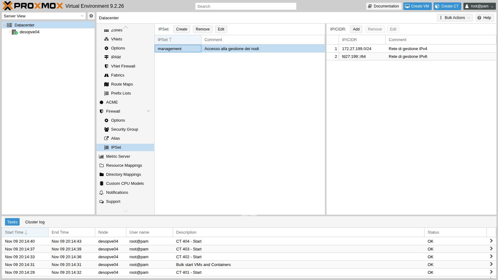

```bash
pvesh create /cluster/firewall/ipset --name management --comment "Accesso alla gestione dei nodi"
pvesh create /cluster/firewall/ipset/management --cidr 172.27.199.0/24 --comment "Rete di gestione IPv4"
pvesh create /cluster/firewall/ipset/management --cidr fd27:199::/64 --comment "Rete di gestione IPv6"
```

The effect was verified from the DC by removing and re-adding the IPv6 line:

```text
== senza la rete IPv6 nel set management
GUI via IPv6 [fd27:199::24]:8006 -> False
== con la rete IPv6 nel set management
GUI via IPv6 [fd27:199::24]:8006 -> True
```

Finally, two **node** rules, in **Node → Firewall → Add**:

- ping from the management network;
- SSH from the routed subnet, to administer the node from CT 403.

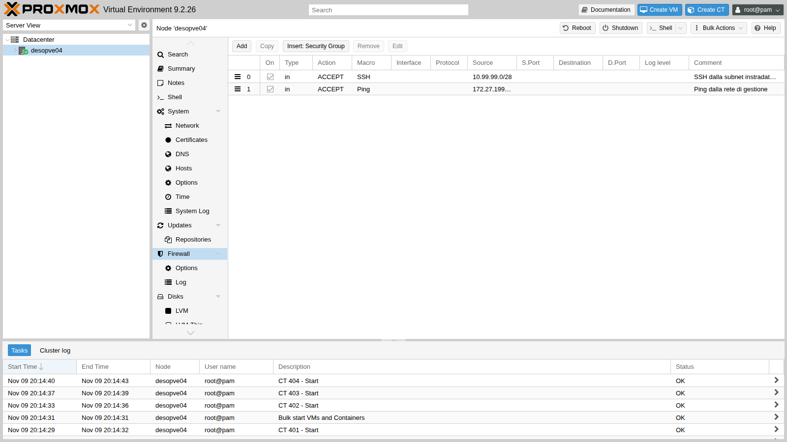

```bash
pvesh create /nodes/desopve04/firewall/rules --type in --action ACCEPT --macro Ping \
  --source 172.27.199.0/24 --enable 1 --comment "Ping dalla rete di gestione"
pvesh create /nodes/desopve04/firewall/rules --type in --action ACCEPT --macro SSH \
  --source 10.99.99.0/28 --enable 1 --comment "SSH dalla subnet instradata (amministrazione del CT 403)"
```

```text output
ping dal DC ok
CT403 tcp/22 ok
```

## Verification and tests

| Test | Expected | Result |
|---|---|---|
| Datacenter firewall enabled, cluster hosts without rules | `regole host: 0` on all three nodes | ok |
| Quorum, Corosync (2 links), Ceph, iSCSI, BGP after enabling | unchanged | ok |
| HTTP, SSH, ping from the DC to CT 101 | all allowed | ok |
| HTTP from CT 121 (NAT 172.27.199.26) | allowed; SSH and ping blocked | ok |
| HTTP, SSH, ping from CT 403 (10.99.99.2) | all blocked and logged | ok |
| SMB from CT 101 to the DC | `Connection refused`; DNS still allowed | ok |
| GUI and SSH of `desopve04` from the management network | allowed; ping blocked until the node rule is added | ok |
| GUI of `desopve04` via IPv6 | blocked without `fd27:199::/64` in `management`, allowed with it | ok |
| Routing and port forwarding through `desopve04` | not affected by the host firewall | ok |

## Final lab state

- **Cluster `deso-cluster`:**
  - Datacenter firewall **enabled**;
  - host firewall **disabled** on `desopve01`, `desopve02` and `desopve03` (`host.fw`: `enable: 0`), until [Lab 33](/33-firewall-2/) builds the rules for the cluster services;
  - aliases `dc01`, `rete-gestione`, `rete-instradata`; IPSet `admin`; security groups `web-server` and `accesso-admin`.
- **CT 101 `debian-ct01`:**
  - nginx installed, with the test page;
  - firewall enabled with `log_level_in: info`;
  - rules: `OUT REJECT` toward `dc/dc01` port 445, `GROUP web-server`, `GROUP accesso-admin`.
- **Other guests:** no rules; their firewall stays off.
- **`desopve04`:** firewall of its datacenter enabled, IPSet `management` with 172.27.199.0/24 and `fd27:199::/64`, node rules for Ping (management network) and SSH (10.99.99.0/28).
- **DC:** test script [`fwtest.ps1`](/files/32/fwtest.ps1) in `C:\lab`.

## What you learned

- The Datacenter switch turns on the firewall of all nodes: prepare the node rules beforehand, or disable the firewall explicitly on the nodes.
- A guest's firewall requires two switches: the guest option and `firewall=1` on the network interface.
- Aliases, IPSets and security groups make rules readable and reusable; in Proxmox VE 9 they are referenced with their scope (`dc/`, `+dc/`).
- Tests must be run from several sources, and upstream NAT changes what the firewall sees.
- `log_level_in` and the guest log show exactly which packet was dropped and why.
- The host's automatic rules cover GUI, SSH and console from the IPv4 local network only: for IPv6, and for services on other networks, you need explicit rules.

## References

- [Proxmox VE – Proxmox VE Firewall](https://pve.proxmox.com/pve-docs/chapter-pve-firewall.html)
- [Proxmox VE – Firewall: IP Sets and Standard IP Set management](https://pve.proxmox.com/pve-docs/chapter-pve-firewall.html#pve_firewall_ip_sets)
- [Proxmox VE – Firewall: Security Groups](https://pve.proxmox.com/pve-docs/chapter-pve-firewall.html#pve_firewall_security_groups)
- [Proxmox VE – Firewall: Ports used by Proxmox VE](https://pve.proxmox.com/pve-docs/chapter-pve-firewall.html#_ports_used_by_proxmox_ve)
