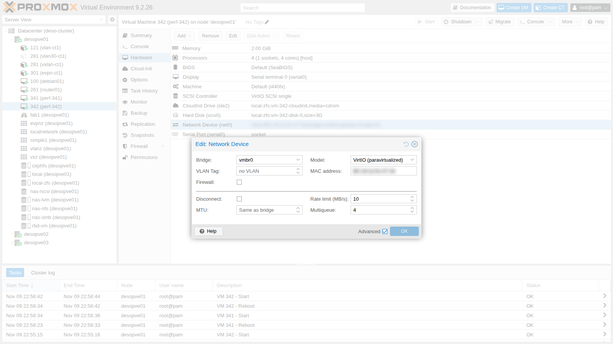

## Dependencies

- **Previous labs:**
  - [Lab 20](/20-bridges-stable-names-vlans/) and [Lab 21](/21-bonding/): VLAN-aware `vmbr1` on `bond0`, CTs 121 and 122 in VLAN 10;
  - [Lab 22](/22-dedicated-networks/): dedicated networks and the lab MTU;
  - [Lab 29](/29-sdn-vxlan/): CTs 291 and 292 on the VXLAN VNet `vnvx1` (MTU 1450);
  - [Lab 32](/32-firewall-1/) and [Lab 33](/33-firewall-2/): firewall of CT 101 and the test script [`fwtest.ps1`](/files/32/fwtest.ps1) on the DC;
  - [Lab 26](/26-virtual-router/): `router01`, gateway 10.10.10.1 of the CTs in VLAN 10;
  - [Lab 05](/05-ssh-shell-cli/): the DC's SSH key, authorized on the nodes and copied into the test VMs;
  - [Lab 24](/24-routing-nat/) and [Lab 25](/25-ipv6/): CT 404 on `desopve04`.
- **Resources:** the cloud image `debian-13-genericcloud-amd64.qcow2` in `local:import` on `desopve01`, downloaded in [Lab 19](/19-fio-benchmark/). It is used to create two test VMs with cloud-init, covered in depth in Lab 40.
- **Credentials:** `root` / `<lab-password>` → [Appendix B](/b-credentials-and-addresses/).

## Objectives

- Measure the effect of **multiqueue** and of the **bandwidth limit** on a VM's network device.
- Know which offloads are active and how to read the MTU of a path.
- Have a toolkit of commands for diagnosing the network of a Proxmox VE node.
- Reproduce six typical failures and fix them following the pattern **symptom → check → cause → fix**.

## How it works

### Where a packet goes

Before hunting for a failure, it helps to have the path in mind. For a VM or a CT on `vmbr1`:

```text
guest eth0 ──► tap<vmid>i0 (VM) / veth<vmid>i0 (CT) ──► vmbr1 (VLAN-aware) ──► bond0 ──► nic3/nic4 ──► network
                    │                                     │
              guest firewall                        VLAN and MAC table
              (nftables: bridge table)              (bridge vlan / bridge fdb)
```

Each arrow is a point where you can look with `tcpdump`, and each object has its own command to read its state.

### Multiqueue

By default, a VirtIO network device has **one** transmit queue and one receive queue, served by a single `vhost` thread on the host and by a single CPU in the guest. With `queues=N` the device exposes N of them: the traffic of multiple connections is spread across multiple CPUs, both in the guest and on the host. It helps when a single queue is the bottleneck and there are idle CPUs; it does not multiply the bandwidth of a single connection. The Proxmox VE documentation recommends a number of queues equal to the number of vCPUs of the guest.

### Bandwidth limit

`rate=` on the network device (in MB/s) is enforced with Linux traffic control on the host's `tap` interface, in two different ways:

- **towards the guest:** with an `htb` queue, which delays packets (*shaping*);
- **from the guest:** with a `police` action on ingress, which drops whatever exceeds the limit (*policing*).

For TCP the difference is noticeable, as the measurements will show.

## Procedure

### 1. The test VMs

Two identical Debian 13 VMs on the same node (`desopve01`), on the management network, created from the cloud image with the user `labuser` and the SSH keys authorized on the node, including the DC's key ([Lab 05](/05-ssh-shell-cli/)):

```bash
for id in 341 342; do
  ip=172.27.199.$((id-200))
  qm create $id --name perf-$id --memory 2048 --cores 4 --cpu host \
    --net0 virtio,bridge=vmbr0 --scsihw virtio-scsi-single \
    --scsi0 local-zfs:0,import-from=local:import/debian-13-genericcloud-amd64.qcow2 \
    --ide2 local-zfs:cloudinit --boot order=scsi0 \
    --ipconfig0 ip=$ip/24,gw=172.27.199.1 --nameserver 172.27.199.20 \
    --ciuser labuser --sshkeys /root/.ssh/authorized_keys --serial0 socket --vga serial0
  qm start $id
done
```

The two VMs temporarily take the addresses .141 and .142 and are deleted at the end of the lab. If you have already done [Lab 41](/41-lxc-containers/), where .141 and .142 belong to CTs 141 and 142, pick two free addresses (for example .181 and .182) by changing `$((id-200))`.

From the DC, log in to each VM with `ssh labuser@172.27.199.141` (and `.142`) and install `iperf3` through the lab proxy:

```bash
echo 'Acquire::http::Proxy "http://proxy.proxmox.community:3128";' | sudo tee /etc/apt/apt.conf.d/90proxy
sudo apt-get update && sudo apt-get install -y iperf3
echo "$(hostname): $(iperf3 --version | head -1); code: $(ls /sys/class/net/eth0/queues | tr '\n' ' ')"
```

```text output
perf-341: iperf 3.18 (cJSON 1.7.15); code: rx-0 tx-0
perf-342: iperf 3.18 (cJSON 1.7.15); code: rx-0 tx-0
```

`rx-0 tx-0`: a single queue per direction.

### 2. Multiqueue: before and after

`iperf3` server on 342, client on 341. Two rounds, 8 seconds each, with 1 and with 4 parallel streams:

```bash
# on 342
iperf3 -s -D
# on 341
for giro in 1 2; do
  echo "== 1 flusso";  iperf3 -c 172.27.199.142 -t 8      | grep receiver
  echo "== 4 flussi";  iperf3 -c 172.27.199.142 -t 8 -P 4 | grep "SUM.*receiver"
done
```

**One queue (default):**

```text
== 1 flusso
[  5]   0.00-8.00   sec  10.5 GBytes  11.3 Gbits/sec                  receiver
== 4 flussi
[SUM]   0.00-8.01   sec  11.0 GBytes  11.8 Gbits/sec                  receiver
== 1 flusso
[  5]   0.00-8.00   sec  11.4 GBytes  12.3 Gbits/sec                  receiver
== 4 flussi
[SUM]   0.00-8.02   sec  11.8 GBytes  12.7 Gbits/sec                  receiver
```

Enable 4 queues on both: **Hardware → Network Device → Advanced → Multiqueue: 4**, then reboot the VMs. From the command line you must repeat the MAC address of the device (read it with `qm config <id> | grep net0`), otherwise Proxmox VE generates a new one:

```bash
for id in 341 342; do
  qm set $id --net0 virtio=<VM-MAC>,bridge=vmbr0,queues=4
  qm reboot $id
done
```

The guest now has 4 queues per direction:

```bash
ls /sys/class/net/eth0/queues | tr '\n' ' '; echo
ethtool -l eth0 | grep -E "parameters|maximums|hardware|Combined"
```

```text output
rx-0 rx-1 rx-2 rx-3 tx-0 tx-1 tx-2 tx-3
Channel parameters for eth0:
Pre-set maximums:
Combined:	4
Current hardware settings:
Combined:	4
```

**Four queues:**

```text
== 1 flusso
[  5]   0.00-8.01   sec  11.4 GBytes  12.2 Gbits/sec                  receiver
== 4 flussi
[SUM]   0.00-8.02   sec  9.11 GBytes  9.76 Gbits/sec                  receiver
== 1 flusso
[  5]   0.00-8.00   sec  12.1 GBytes  13.0 Gbits/sec                  receiver
== 4 flussi
[SUM]   0.00-8.02   sec  9.04 GBytes  9.68 Gbits/sec                  receiver
```

| | 1 stream | 4 streams |
|---|---|---|
| 1 queue | 11.3-12.3 Gbit/s | 11.8-12.7 Gbit/s |
| 4 queues | 12.2-13.0 Gbit/s | 9.7-9.8 Gbit/s |

In this lab, multiqueue did **not** improve performance: with 4 streams, throughput actually dropped by about 20%. The most likely reason is CPU contention: the two VMs, with 4 vCPUs each, send traffic to each other on the same node, and with 4 queues per device the `vhost` threads compete with the vCPUs for the same cores.

Multiqueue pays off when:

- the VM has many concurrent connections (web servers, proxies, virtual routers);
- the host has idle cores;
- a single queue is the measured limit.

Always verify it with a before-and-after test, as done here.

### 3. Bandwidth limit

On VM 342, set a limit of 10 MB/s (`rate=10`), keeping the 4 queues.

 On the node, the limit becomes:

```bash
tc -s qdisc show dev tap342i0
tc filter show dev tap342i0 parent ffff: | grep police
```

```text output
qdisc htb 1: root refcnt 257 r2q 10 default 0x1 direct_packets_stat 1 direct_qlen 1000
 Sent 13626 bytes 9 pkt (dropped 0, overlimits 0 requeues 0)
 backlog 0b 0p requeues 0
qdisc ingress ffff: parent ffff:fff1 ----------------
 Sent 0 bytes 0 pkt (dropped 0, overlimits 0 requeues 0)
 backlog 0b 0p requeues 0
 police 0x1 rate 83886Kbit burst 1Mb mtu 64Kb action drop overhead 0b
```

The measurements in both directions:

```text
== verso la VM 342 (ingresso della VM limitata)
[  5]   0.00-8.00   sec  79.9 MBytes  83.7 Mbits/sec    4            sender
[  5]   0.00-8.16   sec  77.8 MBytes  80.0 Mbits/sec                  receiver
== dalla VM 342 (uscita della VM limitata, -R)
[  5]   0.00-8.00   sec  48.6 MBytes  51.0 Mbits/sec  4639            sender
[  5]   0.00-8.00   sec  47.8 MBytes  50.1 Mbits/sec                  receiver
```

- **Towards the VM:** 80 Mbit/s, practically the nominal 10 MB/s (83.9 Mbit/s), with only 4 retransmissions. The `htb` queue delays packets and TCP adapts.
- **From the VM:** 50 Mbit/s and **4639 retransmissions**. The `police` action drops packets beyond the limit, TCP interprets the losses as congestion and slows down more than necessary.

The limit is therefore more accurate on traffic **towards** the guest. On outgoing traffic, the effective bandwidth is lower than the configured value.

### 4. Offloads and path MTU

Offloads move work away from the CPU to the NIC or the kernel: checksum calculation, segmentation of large packets (TSO/GSO), receive aggregation (GRO). On a physical port of the node and on the `tap` interface of a VM:

```bash
for i in nic0 tap341i0; do
  echo "-- $i"
  ethtool -k $i | grep -E "^(rx-checksumming|tx-checksumming|tcp-segmentation-offload|generic-segmentation-offload|generic-receive-offload):"
done
```

```text output
-- nic0
rx-checksumming: on
tx-checksumming: on
tcp-segmentation-offload: on
generic-segmentation-offload: on
generic-receive-offload: on
-- tap341i0
rx-checksumming: off [fixed]
tx-checksumming: on
tcp-segmentation-offload: on
generic-segmentation-offload: on
generic-receive-offload: on
```

Offloads explain why `iperf3` between two VMs on the same node goes well beyond 10 Gbit/s: packets travel in 64 KB chunks and are never split into 1500-byte frames. Turning them off is only useful for diagnosis; this is also why a `tcpdump` on the `tap` interface shows packets larger than the MTU.

The MTU of a path is measured with packets of increasing size and the *Don't Fragment* bit set (`-M do`). 1472 bytes of data + 28 bytes of ICMP and IP headers make 1500. From VM 341:

```bash
ping -M do -s 1472 -c1 172.27.199.22 | grep transmitted
ping -M do -s 1473 -c1 172.27.199.22
```

```text output
1 packets transmitted, 1 received, 0% packet loss, time 0ms
PING 172.27.199.22 (172.27.199.22) 1473(1501) bytes of data.
ping: sendmsg: Message too long
```

The management network has an MTU of 1500 end to end: it is the MTU configured on the interfaces, not a limit of the switches. In [Lab 21](/21-bonding/) the path between the nodes carries packets of up to 8938 bytes (8910 of ICMP data), while 9000-byte jumbo frames do not get through.

### 5. The troubleshooting toolkit

| Question | Command |
|---|---|
| Which VLAN is a guest's port in? | `bridge vlan show dev veth121i0` |
| Where did the bridge learn a MAC address? | `bridge fdb show br vmbr1` |
| Is the bond healthy, and which link is it using? | `cat /proc/net/bonding/bond0` |
| What type of interface is it, and with which parameters? | `ip -d link show <if>` |
| Is the traffic arriving? With which tag? | `tcpdump -eni <if> <filter>` |
| Is the firewall on? With which rules? | `pve-firewall status`, `nft list ruleset` |
| What happened to a connection? | `conntrack -L`, `conntrack -S`, `conntrack -C` |
| Are the dynamic routing protocols up? | `vtysh -c "show bgp summary"` |
| Which sockets are open? | `ss -tulpn` |

Real examples, on `desopve01`:

```text
== bridge vlan show dev veth121i0
port              vlan-id
veth121i0         10 PVID Egress Untagged
== bridge fdb show br vmbr1 | grep " vlan 10 " | grep -v permanent
bc:24:11:10:9a:74 dev bond0 vlan 10 master vmbr1
bc:24:11:af:bc:fc dev veth121i0 vlan 10 master vmbr1
bc:24:11:23:9b:72 dev tap261i1 vlan 10 master vmbr1
== bond0
Bonding Mode: fault-tolerance (active-backup)
Currently Active Slave: nic3
MII Status: up
Slave Interface: nic3
MII Status: up
Slave Interface: nic4
== conntrack
467
```

- `bridge vlan`: the port of CT 121 has `PVID` 10 and `Egress Untagged`. The bridge adds and removes tag 10, and the guest sees untagged traffic.
- `bridge fdb`: in VLAN 10 the bridge knows three MAC addresses. Two are on local ports: CT 121 (`veth121i0`) and the second network device of `router01` (`tap261i1`). The third, `bc:24:11:10:9a:74`, is CT 122, which runs on another node and was learned through the `bond0` trunk. The `permanent` entries, excluded by the filter, are the addresses of the bridge itself.

### 6. Six failures reproduced and fixed

Run each command on the node that hosts the guest: CTs 101 and 122 are on `desopve02`, CTs 121 and 291 on `desopve01`, CT 404 on `desopve04`.

#### Failure 1 – Wrong VLAN

**Triggered:** CT 122 is moved by mistake from tag 10 to tag 11.

```bash
pct set 122 --net0 name=eth0,bridge=vmbr1,gw=10.10.10.1,hwaddr=BC:24:11:10:9A:74,ip=10.10.10.122/24,tag=11
```

**Symptom:** CT 121, in the same subnet, can no longer reach CT 122.

```text
2 packets transmitted, 0 received, 100% packet loss, time 1010ms
```

**Check:** on the node of CT 122, the port and the traffic arriving from the trunk.

```text
port              vlan-id
veth122i0         11 PVID Egress Untagged
... ethertype 802.1Q (0x8100), length 64: vlan 10, p 0, ethertype ARP (0x0806), Request who-has 10.10.10.122 tell ...
... ethertype 802.1Q (0x8100), length 64: vlan 10, p 0, ethertype ARP (0x0806), Request who-has 10.10.10.122 tell ...
```

**Cause:** the ARP requests arrive on `bond0` with tag 10, but the CT's port is in VLAN 11: the bridge does not deliver them to it.

**Fix:** `tag=10` again:

```bash
pct set 122 --net0 name=eth0,bridge=vmbr1,gw=10.10.10.1,hwaddr=BC:24:11:10:9A:74,ip=10.10.10.122/24,tag=10,type=veth
```

```text output
veth122i0         10 PVID Egress Untagged
2 packets transmitted, 2 received, 0% packet loss, time 1001ms
```

#### Failure 2 – Wrong MTU on a VXLAN VNet

The VNet `vnvx1` has an MTU of 1450: 50 bytes go to the VXLAN encapsulation. In CT 291, with the correct MTU, a larger packet is rejected right away by the guest's own network stack, which knows it cannot send it:

```text
mtu 1450
1 packets transmitted, 1 received, 0% packet loss, time 0ms
PING 10.62.62.12 (10.62.62.12) 1423(1451) bytes of data.
ping: sendmsg: Message too long
```

**Triggered:** in the CT, the interface MTU is raised to 1500.

```bash
pct exec 291 -- ip link set eth0 mtu 1500
```

**Symptom:** small packets get through, full-size ones do not. The guest tries to send them, but its interface is larger than the link towards the host, which has 1450:

```text
ping: sendmsg: No buffer space available
ping: sendmsg: No buffer space available
2 packets transmitted, 0 received, 100% packet loss, time 4021ms
2 packets transmitted, 2 received, 0% packet loss, time 1001ms
```

The first test uses 1472-byte packets, the second 1422-byte packets.

**Check:** `ip link show eth0` in the guest and `ping -M do` with increasing sizes, until you find the limit.

**Cause:** the guest's MTU is larger than the VNet's. With real traffic, the typical symptom is "SSH logs in but hangs as soon as there is a lot of output", or "small pages load, downloads do not".

**Fix:** MTU 1450 (as in [Lab 29](/29-sdn-vxlan/), also in the CT's network file, so that it persists after a reboot).

```text
1 packets transmitted, 1 received, 0% packet loss, time 0ms
```

#### Failure 3 – A firewall rule that blocks

**Triggered:** a wrong rule is added at the top of the rules of CT 101.

```bash
pvesh create /nodes/desopve02/lxc/101/firewall/rules --type in --action DROP \
  --macro HTTP --source dc/dc01 --enable 1 --comment "regola di prova errata"
```

**Symptom:** from the DC, the web server of CT 101 no longer responds, while SSH and ping still work.

```text
DC 172.27.199.20 (admin)           HTTP BLOCCATO  SSH ok        ping ok
```

**Check:** the firewall log shows **nothing**. The rule has no `log`, and the guest log (`log_level_in`) records only what reaches the policy. You have to look at the rules:

```text
Status: enabled/running (pending changes)
0
table bridge proxmox-firewall-guests {
	chain guest-101-in {
		jump pre-vm-in
		oifname "veth101i0" arp daddr ip != @v4-guest-101/ipfilter-net0 drop
		jump allow-dhcp-in
		jump allow-ndp-in
		ct mark set 0x00000065
		tcp dport 80 ip saddr 172.27.199.20 drop
```

```text
[RULES]

IN HTTP(DROP) -source dc/dc01 # regola di prova errata
OUT REJECT -dest dc/dc01 -p tcp -dport 445 -log info # Nessuna connessione SMB verso il DC
GROUP web-server
GROUP accesso-admin
```

**Cause:** the `DROP` rule is at position 0 and wins over the `web-server` group, which comes after it.

**Fix:** delete the rule at position 0 with `pvesh delete /nodes/desopve02/lxc/101/firewall/rules/0`. After the firewall update cycle, from the DC with `.\fwtest.ps1`:

```text
DC 172.27.199.20 (admin)           HTTP ok        SSH ok        ping ok
```

:::tip
On hand-written `DROP` and `REJECT` rules it is worth enabling `log`, as for the outbound rule in [Lab 32](/32-firewall-1/). That way the failure shows up in the log right away.
:::

#### Failure 4 – Missing gateway

**Triggered:** CT 122 loses its gateway (`gw=` removed from `net0`).

**Symptom:** the local subnet works, everything else does not, and with an immediate error instead of a timeout:

```text
1 packets transmitted, 1 received, 0% packet loss, time 0ms
ping: connect: Network is unreachable
```

The first line is the ping to 10.10.10.121, the second the one to 172.27.199.20.

**Check:** `ip route` in the guest.

```text
10.10.10.0/24 dev eth0 proto kernel scope link src 10.10.10.122
```

**Cause:** there is no `default` route.

**Fix:** `gw=10.10.10.1` back on `net0`:

```bash
pct set 122 --net0 name=eth0,bridge=vmbr1,gw=10.10.10.1,hwaddr=BC:24:11:10:9A:74,ip=10.10.10.122/24,tag=10,type=veth
```

```text output
default via 10.10.10.1 dev eth0
1 packets transmitted, 1 received, 0% packet loss, time 0ms
```

:::note
`Network is unreachable` means "I don't know where to send it": a routing problem in the guest. A timeout, on the other hand, means that the packet left but something along the way lost it or did not reply.
:::

#### Failure 5 – Bridge without a physical port

**Triggered:** on `desopve04`, a bridge `vmbr7` with no ports is created and CT 404 is connected to it instead of `vmbr0`.

```bash
ip link add vmbr7 type bridge && ip link set vmbr7 up
pct set 404 --net0 bridge=vmbr7,name=eth0,gw=172.27.199.1,hwaddr=BC:24:11:3C:C6:8C,ip=172.27.199.125/24,ip6=auto,type=veth
```

**Symptom:** the CT is running and its interface is `UP`, but it cannot even reach the gateway.

```text
2 packets transmitted, 0 received, 100% packet loss, time 1015ms
```

**Check:** which bridge it is connected to and which ports that bridge has.

```text
bridge=vmbr7
porte di vmbr7:
veth404i0@nic0: 1500 master vmbr7 state forwarding
porte di vmbr0:
nic0: 1500 master vmbr0 state forwarding
```

**Cause:** the only port of `vmbr7` is the CT's `veth`. There is no physical NIC and therefore no way out of the node. It is the same behavior, intentional there, as the private network `vmbr9` of [Lab 24](/24-routing-nat/), which reaches the outside only through the node's routing.

:::note
The `@nic0` suffix after `veth404i0` does not mean that the veth is connected to `nic0`. It is the name of the interface at the other end of the pair, which lives inside the container: `iproute2` looks it up by index among the host's interfaces and shows an unrelated name.
:::

**Fix:** the CT goes back to `vmbr0` and the test bridge is deleted:

```bash
pct set 404 --net0 bridge=vmbr0,name=eth0,gw=172.27.199.1,hwaddr=BC:24:11:3C:C6:8C,ip=172.27.199.125/24,ip6=auto,type=veth
ip link del vmbr7
```

```text output
2 packets transmitted, 2 received, 0% packet loss, time 1002ms
```

#### Failure 6 – Duplicate IP address

**Triggered:** the address of CT 122 is added to CT 121 by mistake.

```bash
pct exec 121 -- ip addr add 10.10.10.122/24 dev eth0
```

Typical **symptom**: connections to 10.10.10.122 that sometimes work and sometimes do not, sessions that drop, depending on which MAC address the other hosts have in their cache.

**Check:** the duplicate address detection of `arping` (`-D`) from CT 122 on its own address. The command is not in the template: install it in CT 122, which reaches the outside through `router01`, after setting the `apt` proxy as in the VMs of step 1 (`pct exec 122 -- apt-get install -y iputils-arping`). Before the failure nobody replies (exit code 0); afterwards another MAC address replies (exit code 1):

```text
ARPING 10.10.10.122 from 0.0.0.0 eth0
Sent 2 probes (2 broadcast(s))
Received 0 response(s)
exit=0
-- con il doppione:
ARPING 10.10.10.122 from 0.0.0.0 eth0
Unicast reply from 10.10.10.122 [BC:24:11:AF:BC:FC]  1.407ms
Sent 1 probes (1 broadcast(s))
Received 1 response(s)
exit=1
```

**Cause:** the MAC address that replies, `bc:24:11:af:bc:fc`, is the one of CT 121. The `bc:24:11` prefix identifies a Proxmox VE virtual network device; from there, with `bridge fdb` or by searching for the MAC address in the guest configurations, you can trace it back to the guest.

**Fix:** remove the address from CT 121, on `desopve01`: `pct exec 121 -- ip addr del 10.10.10.122/24 dev eth0`.

:::note
A close relative of this failure is the **ARP flux** of [Lab 15](/15-iscsi-lvm-multipath/): a node with two interfaces on the same segment that answers ARP from the wrong NIC. You recognize it the same way, with `arping` and by looking at which MAC address replies.
:::

### 7. A sign to keep an eye on: repeated NAT rules

In the NAT table of `desopve02`, the SNAT rules of the SDN zones appear several times:

```bash
iptables -t nat -S POSTROUTING | sort | uniq -c | sort -rn | head -4
```

```text output
     12 -A POSTROUTING -s 10.60.60.0/24 -o vmbr0 -j SNAT --to-source 172.27.199.22
      5 -A POSTROUTING -s 10.72.72.0/24 -o vmbr0 -j SNAT --to-source 172.27.199.22
      5 -A POSTROUTING -s 10.71.71.0/24 -o vmbr0 -j SNAT --to-source 172.27.199.22
      1 -P POSTROUTING ACCEPT
```

It is the same phenomenon seen in [Lab 24](/24-routing-nat/): every network reload (`ifreload`, including the one triggered by the SDN **Apply**) re-runs the `post-up` commands that add the rule. Here it does no harm, because the first matching rule wins and the copies are identical. It becomes a problem, however, when a rule is changed: the old one stays in the table, ahead of the new one. Rebooting the node rebuilds the table from scratch.

## Verification and tests

| Test | Result |
|---|---|
| Multiqueue 1 → 4 queues, 4 streams between two VMs on the same node | from 11.8-12.7 to 9.7-9.8 Gbit/s: no benefit in this lab |
| `rate=10` towards the VM | 80 Mbit/s, accurate shaping |
| `rate=10` from the VM | 50 Mbit/s with 4639 retransmissions (policing) |
| MTU of the management network | 1500, 1501 rejected |
| Failure 1 VLAN | found with `bridge vlan` and `tcpdump -e`, fixed |
| Failure 2 VXLAN MTU | found with `ping -M do`, fixed |
| Failure 3 firewall rule | found with the compiled rules (no log), fixed |
| Failure 4 gateway | found with `ip route`, fixed |
| Failure 5 bridge without a port | found with `bridge link`, fixed |
| Failure 6 duplicate IP | found with `arping -D`, fixed |

## Final lab state

- **VM 341 `perf-341` and VM 342 `perf-342`:** deleted at the end of the measurements, on `desopve01`, with `qm stop <id> && qm destroy <id> --purge`.
- **Guests used for the failures:** CTs 122, 291, 101, 121 and 404 restored exactly to their starting configuration, verified after each fix. The test bridge `vmbr7` on `desopve04` was deleted. The `iputils-arping` package remains installed in CT 122.
- **Repeated NAT rules:** left as they are; they are cleared at the next reboot of the nodes.
- Track B is complete: network, SDN and firewall remain configured as described in the final states of labs 20-33.

## What you learned

- Multiqueue and bandwidth limits must be measured: in an environment with few CPUs, more queues can degrade performance, and the outbound limit of a VM, enforced with *policing*, yields less than the configured value.
- Offloads explain "impossible" speeds between VMs on the same node and giant packets in `tcpdump`.
- Diagnosis follows the path of the packet: guest, bridge port, VLAN, bond, firewall, conntrack, routing. For each segment there is a command that shows its state.
- A timeout and an immediate error tell different stories: the latter almost always points to a configuration problem in the guest.
- Blocking rules without logging are invisible: to find them you need the compiled rules (`nft list ruleset`).

## References

- [Proxmox VE – Network Device: Multiqueue](https://pve.proxmox.com/pve-docs/chapter-qm.html#qm_network_device)
- [Proxmox VE – Network Configuration](https://pve.proxmox.com/pve-docs/chapter-sysadmin.html#sysadmin_network_configuration)
- [Linux kernel – bonding driver](https://www.kernel.org/doc/html/latest/networking/bonding.html)
- [iproute2 – bridge(8)](https://man7.org/linux/man-pages/man8/bridge.8.html)
- [iperf3](https://software.es.net/iperf/)
