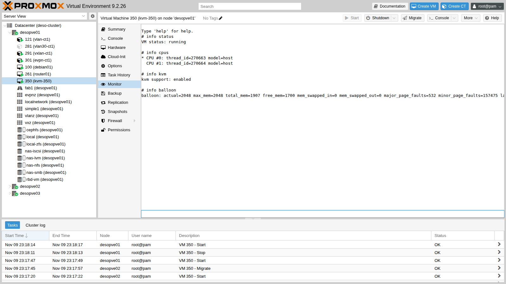
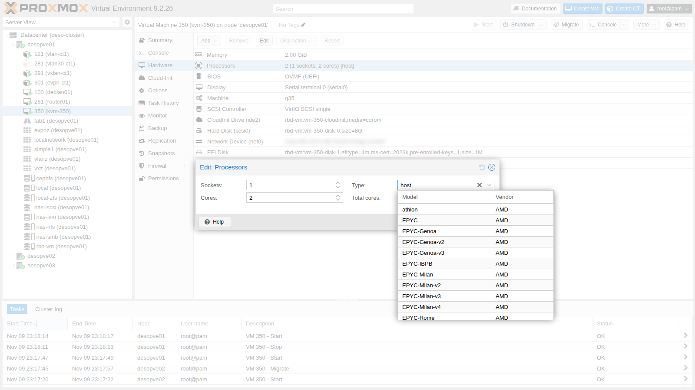
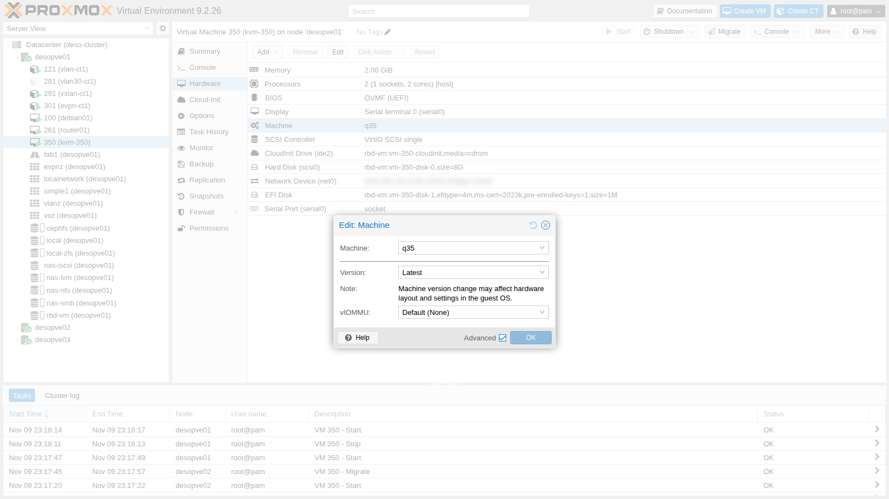

## Dependencies

- **Previous labs:**
  - [Lab 06](/06-cluster-corosync/): three-node cluster, because live migration requires at least two nodes;
  - [Lab 17](/17-ceph-installation/): shared Ceph pool `rbd-vm`, so that the migration does not have to copy the disk;
  - [Lab 22](/22-dedicated-networks/): dedicated migration network (VLAN 100).
- **Resources:** the cloud image `debian-13-genericcloud-amd64.qcow2` in `local:import` on `desopve01`, downloaded in [Lab 19](/19-fio-benchmark/); the DC's SSH key ([Lab 05](/05-ssh-shell-cli/)), authorized on the nodes. The image is used to create a test VM with cloud-init; cloud-init is covered in depth in Lab 40.
- **Addresses:** test VM `kvm-350` on 172.27.199.150.
- **Credentials:** `root` / `<lab-password>` on the nodes → [Appendix B](/b-credentials-and-addresses/).

## Objectives

- Recognize the pieces of a running VM: QEMU process, vCPU threads, `vhost` thread, systemd scope, `tap` interface.
- Query a VM from the QEMU monitor.
- Choose the **CPU type** knowing what the guest sees and what changes for migration.
- Create a **custom CPU model** for a cluster with different processors.
- Understand **machine type**, pinned versions, **SeaBIOS** and **OVMF** with Secure Boot.
- Verify **nested virtualization** inside a VM.

## How it works

A Proxmox VE VM is an ordinary **QEMU process** (`/usr/bin/kvm`) started by `qemu-server`. The process uses the kernel's **KVM** module to run the guest code directly on the CPU, with the Intel VT-x or AMD-V virtualization extensions.

```text
qm start 350
   └─► systemd creates the scope 350.scope (cgroup: CPU, memory, I/O limits)
         └─► kvm process (QEMU) ───── thread "CPU 0/KVM", "CPU 1/KVM"  ← one vCPU = one thread
                │                ├── thread vhost-<pid>                ← VirtIO networking in the kernel
                │                └── I/O threads (here: librbd for Ceph)
                ├─► /dev/kvm (kvm module + kvm_intel / kvm_amd)
                └─► tap350i0 ──► vmbr0                                 ← network device
```

**CPU type.** QEMU decides which CPU to show the guest: model, instructions (flags) and compatibility level.

- **`host`:** passes the physical CPU through to the guest as it is. It is the fastest, but it ties the VM to that processor model.
- **Generic models (`x86-64-v2-AES`, `x86-64-v3`, `kvm64`):** expose a fixed set of instructions, identical on any node that supports it.

During a live migration the guest **does not restart**: the instructions it saw at boot must also exist on the target node. This is why `x86-64-v2-AES` is the default for new VMs.

**Machine type.** It is the virtual motherboard: `pc` (i440FX, a 1996 chipset) or `q35` (ICH9, native PCI Express). Every QEMU release brings a new version of it. Proxmox VE adds the `+pveN` suffix. The version can be **pinned** to keep the hardware seen by the guest fixed: Proxmox VE does this automatically for Windows VMs.

**Firmware.** **SeaBIOS** is the traditional BIOS; **OVMF** is the UEFI firmware. OVMF needs a small `efidisk0` disk for the UEFI variables, including the certificates for Secure Boot.

## Procedure

### 1. The test VM

A Debian 13 VM created from the cloud image, with its disk on Ceph and CPU type `host`. No `machine` or `bios` in the configuration: the defaults are used, i440FX and SeaBIOS.

```bash
qm create 350 --name kvm-350 --memory 2048 --cores 2 --cpu host --ostype l26 \
  --net0 virtio,bridge=vmbr0 --scsihw virtio-scsi-single \
  --scsi0 rbd-vm:0,import-from=local:import/debian-13-genericcloud-amd64.qcow2 \
  --ide2 rbd-vm:cloudinit --boot order=scsi0 \
  --ipconfig0 ip=172.27.199.150/24,gw=172.27.199.1 --nameserver 172.27.199.20 \
  --searchdomain proxmox.community --ciuser labuser --sshkeys /root/.ssh/authorized_keys \
  --serial0 socket --vga serial0
qm resize 350 scsi0 8G
qm start 350
```

`--sshkeys` copies into the VM the keys already authorized on the node, including the DC's key: from the DC you log in to the guest with `ssh labuser@172.27.199.150`. Commands marked "in the guest" are run there.

### 2. The QEMU command

`qm showcmd` prints the exact command Proxmox VE uses to start the VM. It is the best way to understand what each configuration option produces. The main lines:

```bash
qm showcmd 350 --pretty
```

```text output
/usr/bin/kvm \
  -id 350 \
  -name kvm-350 \
  -chardev 'socket,id=qmp,path=/var/run/qemu-server/350.qmp,server=on,wait=off' \
  -pidfile /var/run/qemu-server/350.pid \
  -daemonize \
  -smp '2,sockets=1,cores=2,maxcpus=2' \
  -cpu host,+kvm_pv_eoi,+kvm_pv_unhalt \
  -m 2048 \
  -device 'virtio-balloon-pci,id=balloon0,bus=pci.0,addr=0x3,free-page-reporting=on' \
  -device 'virtio-scsi-pci,id=virtioscsi0,bus=pci.3,addr=0x1' \
  -blockdev '{"detect-zeroes":"on","discard":"ignore","driver":"throttle", ... "driver":"rbd","image":"vm-350-disk-0","pool":"rbd-vm" ...}' \
  -device 'scsi-hd,bus=virtioscsi0.0,channel=0,scsi-id=0,lun=0,drive=drive-scsi0,id=scsi0,...,write-cache=on' \
  -netdev 'type=tap,id=net0,ifname=tap350i0,script=/usr/libexec/qemu-server/pve-bridge,downscript=/usr/libexec/qemu-server/pve-bridgedown,vhost=on' \
  -device 'virtio-net-pci,mac=BC:24:11:BC:39:B2,netdev=net0,bus=pci.0,addr=0x12,id=net0,...' \
  -machine 'hpet=off,smm=off,type=pc+pve0'
```

Things to note:

- **`-cpu host,+kvm_pv_eoi,+kvm_pv_unhalt`:** the host CPU plus two paravirtualized optimizations that Proxmox VE always adds for Linux.
- **`-blockdev` with the `rbd` driver:** QEMU talks directly to Ceph through librbd, without going through the node's kernel.
- **`vhost=on`:** VirtIO networking is handled by a kernel thread (`vhost`), not by the QEMU process in user space.
- **`-machine type=pc+pve0`:** i440FX, latest available version.
- **`virtio-balloon-pci`:** present by default, used in [Lab 36](/36-memory/).

### 3. Process, threads and cgroup

```bash
PID=$(cat /var/run/qemu-server/350.pid)
ps -o pid,ppid,user,nlwp,rss,etime,comm -p $PID
ps -T -o spid,comm -p $PID
```

```text output
    PID    PPID USER     NLWP   RSS     ELAPSED COMMAND
 263691       1 root       36 1097572     02:17 kvm

   SPID COMMAND
 263691 kvm
 263692 call_rcu
 263695 msgr-worker-0
 263702 io_context_pool
 263704 ceph_timer
 263711 taskfin_librbd
 ...
 263757 vhost-263691
 263758 CPU 0/KVM
 263759 CPU 1/KVM
 263761 kvm-nx-lpage-re
```

- **Threads `CPU 0/KVM` and `CPU 1/KVM`:** each vCPU is a Linux thread. The node's scheduler treats them like any other thread, and this is where `cpulimit`, `cpuunits` and CPU affinity (`affinity`), covered in Lab 42, come from.
- **Thread `vhost-263691`:** with recent kernels, the `vhost` work appears as a thread of the QEMU process and no longer as a separate kernel process.
- **Threads `msgr-worker`, `ceph_timer`, `taskfin_librbd`…:** they belong to librbd, because the disk is on Ceph. With file or block storage they are not there.
- **RSS of about 1 GiB out of 2 configured:** the VM's memory is allocated only when the guest uses it.

Each VM has its own **systemd scope**, that is, a dedicated cgroup, and its own `tap` interface connected to the bridge:

```text
● 350.scope
     Loaded: loaded (/run/systemd/transient/350.scope; transient)
     Active: active (running) since Mon 2026-11-09 23:10:23 CET; 2min 17s ago
      Tasks: 36 (limit: 35002)

tap350i0         UNKNOWN        36:42:93:1e:22:31 <BROADCAST,MULTICAST,PROMISC,UP,LOWER_UP>
```

### 4. The QEMU monitor

The monitor is QEMU's control console. From the GUI: **VM → Monitor**; from the command line: `qm monitor 350`.



```text title="qm monitor" frame="terminal"
info status
```

```text output
VM status: running
```

```text title="qm monitor" frame="terminal"
info cpus
```

```text output
* CPU #0: thread_id=263758 model=host
  CPU #1: thread_id=263759 model=host
```

```text title="qm monitor" frame="terminal"
info kvm
```

```text output
kvm support: enabled
```

```text title="qm monitor" frame="terminal"
info balloon
```

```text output
balloon: actual=2048 max_mem=2048 total_mem=1974 free_mem=1111 ...
```

```text title="qm monitor" frame="terminal"
info version
```

```text output
11.1.3pve-qemu-kvm_11.1.3-1
```

The `thread_id` values of `info cpus` are exactly the `CPU 0/KVM` and `CPU 1/KVM` threads seen with `ps`. `info block` shows the cache mode of each disk:

```text
drive-scsi0: json:{... "driver": "rbd", "image": "vm-350-disk-0" ...} (throttle)
    Cache mode:       writeback
    Detect zeroes:    on
ecc0604f325c130c767a85510231093: json:{"pool": "rbd-vm", "image": "vm-350-disk-0", ...} (rbd)
    Cache mode:       writeback, direct
```

`writeback, direct` is the internal translation of `cache=none`, the default: QEMU opens the disk in direct mode (*direct*), bypassing the node's page cache, and leaves the management of the write cache to the guest. The cache modes are compared in [Lab 37](/37-virtual-disks-controllers/).

### 5. Which CPU the guest sees

**Hardware → Processors → Edit → Type** lists all the available models: generic, Intel, AMD and custom ones.



The same guest is tested with four CPU types. Each change requires a full restart of the VM (`qm reboot`, which stops and restarts the QEMU process). In the guest, read the model, some key instructions and the **x86-64 level** that the glibc loader recognizes as supported:

```bash
qm set 350 --cpu x86-64-v3 && qm reboot 350
# in the guest
grep -m1 "model name" /proc/cpuinfo
grep -m1 ^flags /proc/cpuinfo | wc -w
/lib64/ld-linux-x86-64.so.2 --help | grep x86-64-v
```

The summary below collects, for each type, the model, the key instructions present (`grep -o -w -E 'aes|avx|avx2|avx512f|hypervisor|pcid|popcnt|sse4_2|vmx|x2apic'` on the `flags` line) and the total number of flags:

```text
=== cpu: host
  model name	: <modello-CPU-del-nodo>
  flag: aes avx avx2 avx512f hypervisor pcid popcnt sse4_2 vmx x2apic
  totale flag: 101
  x86-64-v4 (supported, searched)
  x86-64-v3 (supported, searched)
  x86-64-v2 (supported, searched)
=== cpu: x86-64-v2-AES
  model name	: QEMU Virtual CPU version 2.5+
  flag: aes hypervisor popcnt sse4_2 x2apic
  totale flag: 44
  x86-64-v2 (supported, searched)
=== cpu: x86-64-v3
  model name	: QEMU Virtual CPU version 2.5+
  flag: aes avx avx2 hypervisor popcnt sse4_2 x2apic
  totale flag: 53
  x86-64-v3 (supported, searched)
  x86-64-v2 (supported, searched)
=== cpu: kvm64
  model name	: Common KVM processor
  flag: hypervisor x2apic
  totale flag: 40
  x86-64-v4
  x86-64-v3
  x86-64-v2
```

With `host` the guest sees the real model of the node's processor, replaced here by a placeholder (see *Redacted hardware data* in [Lab 01](/01-lab-architecture/#addressing-plan)); with the other types it sees a generic model.

| Type | Flags | Level | When to use it |
|---|---|---|---|
| `host` | 101 | v4 | Clusters with identical CPUs, maximum performance, nested virtualization |
| `x86-64-v3` | 53 | v3 | Clusters with recent CPUs (AVX2), even of different generations |
| `x86-64-v2-AES` | 44 | v2 | Default: compatible with almost all x86 CPUs of the last 10-15 years |
| `kvm64` | 40 | none | Only for very old systems |

With `kvm64` even `sse4_2` and `popcnt` are missing, so the guest does not even reach level v2. Modern distributions require at least v2, some already v3: a model that is too "low" slows the guest down or prevents it from booting.

### 6. Migration with CPU `host` between identical nodes

The three cluster nodes have the same processor, so a VM with `host` can be live-migrated. During the migration, from `netsvc`, the lab's network services server, ping the VM every 0.2 seconds (`ping -i 0.2 -c 200 172.27.199.150`):

```bash
qm migrate 350 desopve02 --online
```

```text output
2026-11-09 23:16:09 starting migration of VM 350 to node 'desopve02' (10.100.10.22)
2026-11-09 23:16:14 starting online/live migration on unix:/run/qemu-server/350.migrate
2026-11-09 23:16:14 migration downtime limit: 100 ms
2026-11-09 23:16:15 migration active, transferred 248.7 MiB of 2.0 GiB VM-state, 2.9 GiB/s
2026-11-09 23:16:16 average migration speed: 1.0 GiB/s - downtime 74 ms
2026-11-09 23:16:16 migration status: completed
2026-11-09 23:16:20 migration finished successfully (duration 00:00:11)

--- 172.27.199.150 ping statistics ---
200 packets transmitted, 196 received, 2% packet loss, time 40101ms
```

The migration runs over the dedicated network (10.100.10.22, [Lab 22](/22-dedicated-networks/)). The disk is on Ceph, so only the RAM is copied: copying the 2 GiB takes about 2 seconds and the whole task 11, with a guest downtime of 74 ms. The ping misses 4 replies, just under one second: besides the downtime, there is the time the network needs to learn where the VM is now.

**With different nodes.** If the target node has a CPU with fewer instructions, the VM with `host` remains "convinced" that it still has them. The first time it uses a missing instruction, the guest crashes or hangs. In clusters with different CPUs there are two solutions:

- a generic model (`x86-64-v2-AES` or `x86-64-v3`) that all nodes support;
- a **custom model**, based on the oldest CPU in the cluster.

### 7. A custom CPU model

Custom models live in `/etc/pve/virtual-guest/cpu-models.conf`, shared across the whole cluster. Here we create one based on the QEMU model `Cascadelake-Server-noTSX`, that is, the generation of the nodes' CPU, with the AES instruction:

```bash
cat > /etc/pve/virtual-guest/cpu-models.conf <<'EOF'
cpu-model: lab-cascadelake
	flags +aes
	phys-bits host
	reported-model Cascadelake-Server-noTSX
EOF
qm set 350 --cpu custom-lab-cascadelake
qm reboot 350
```

In the VM:

```text
model name	: Intel Xeon Processor (Cascadelake)
flag: 87
  x86-64-v4 (supported, searched)
  x86-64-v3 (supported, searched)
  x86-64-v2 (supported, searched)
```

The guest sees a generic "Cascadelake" processor, with 87 instructions instead of the 101 of `host`, but with the same level v4. In the GUI, the model appears in the type list with the `custom-` prefix. Live migration works as before:

```text
2026-11-09 23:17:51 migration downtime limit: 100 ms
2026-11-09 23:17:53 average migration speed: 1.0 GiB/s - downtime 9 ms
2026-11-09 23:17:57 migration finished successfully (duration 00:00:11)
```

If a node with an older CPU joined the cluster, it would be enough to change `reported-model` in the file: all the VMs using the model would align at their next restart.

### 8. Machine type, versions and firmware

With the defaults, the guest sees an i440FX motherboard and the traditional BIOS:

```text
-machine 'hpet=off,smm=off,type=pc+pve0'
00:00.0 Host bridge: Intel Corporation 440FX - 82441FX PMC [Natoma] (rev 02)
00:01.0 ISA bridge: Intel Corporation 82371SB PIIX3 ISA [Natoma/Triton II]
firmware: BIOS
```

QEMU lists the available versions: `pc` and `q35` are aliases of the latest one.

```bash
kvm -machine help | grep -E "^pc-q35-1[0-9]|^q35 |^pc "
```

```text output
pc                   Standard PC (i440FX + PIIX, 1996) (alias of pc-i440fx-11.1)
q35                  Standard PC (Q35 + ICH9, 2009) (alias of pc-q35-11.1)
pc-q35-11.1          Standard PC (Q35 + ICH9, 2009)
pc-q35-11.0          Standard PC (Q35 + ICH9, 2009)
pc-q35-10.2          Standard PC (Q35 + ICH9, 2009)
pc-q35-10.1          Standard PC (Q35 + ICH9, 2009)
pc-q35-10.0          Standard PC (Q35 + ICH9, 2009)
```

Switch to **q35** with **OVMF** firmware and an EFI disk with the Secure Boot keys already enrolled. The firmware change takes effect at the next boot, so a stop and start is needed:

```bash
qm set 350 --machine q35 --bios ovmf --efidisk0 rbd-vm:1,efitype=4m,pre-enrolled-keys=1
qm stop 350 && qm start 350
```

```text output
efidisk0: successfully created disk 'rbd-vm:vm-350-disk-1,efitype=4m,ms-cert=2023k,pre-enrolled-keys=1,size=1M'
  -blockdev '{"driver":"raw","file":{"driver":"file","filename":"/usr/share/pve-edk2-firmware//OVMF_CODE_4M.secboot.fd"},"node-name":"pflash0","read-only":true}' \
  -machine 'pflash0=pflash0,pflash1=drive-efidisk0,hpet=off,type=q35+pve0'
```

- **`OVMF_CODE_4M.secboot.fd`:** the firmware code, read-only, shared by all VMs.
- **`efidisk0`:** the UEFI variables of this VM.
- **`ms-cert=2023k`:** the EFI disk already contains the 2023 Microsoft certificates, needed to boot systems signed with the new keys.

In the guest:

```text
00:00.0 Host bridge: Intel Corporation 82G33/G31/P35/P31 Express DRAM Controller
00:1a.0 USB controller: Intel Corporation 82801I (ICH9 Family) USB UHCI Controller #4 (rev 03)
firmware: UEFI
[    0.000000] Kernel is locked down from EFI Secure Boot; see man kernel_lockdown.7
[    0.000000] secureboot: Secure boot enabled
SecureBoot efivar: 1
```

The Debian cloud image contains both the BIOS and the UEFI boot loaders, which is why it boots again without changes. A system installed with SeaBIOS usually does **not** have an EFI partition: the firmware change must be made before installation.

**Pinned version.** In **Hardware → Machine → Edit**, with **Advanced** enabled, the version appears: `Latest` always follows the latest installed QEMU version.



A fixed version (`machine: pc-q35-11.0+pve0`) keeps the hardware seen by the guest identical even after QEMU updates. It matters above all for Windows, which can detect "new hardware" and reset the network configuration or ask for a new activation: this is why Proxmox VE automatically pins the version of Windows VMs when they are created.

### 9. Nested virtualization

With CPU type `host` the guest sees the `vmx` instruction (Intel VT-x) and can load KVM itself:

```bash
cat /sys/module/kvm_intel/parameters/nested   # on the node
```

```text output
Y
```

```bash
sudo modprobe kvm_intel     # in the guest
ls -l /dev/kvm
cat /sys/module/kvm_intel/parameters/nested
```

```text output
crw-rw---- 1 root kvm 10, 232 Nov  9 22:15 /dev/kvm
Y
```

With the generic models `vmx` is not there (see the table in step 5): nested virtualization requires `host`, or a custom model with `+vmx`. It is useful for labs, CI, sandboxes, Proxmox VE inside Proxmox VE. The performance of a nested guest is lower, and live migration of a VM that itself hosts VMs is not supported.

## Verification and tests

- `qm showcmd` and `info cpus`: the number of `CPU n/KVM` threads matches the configured vCPUs.
- Each CPU type produces the expected model and x86-64 level in the guest, and `kvm64` does not even reach v2.
- Live migration with `host` and with the custom model succeeded between identical nodes, with downtimes of 74 and 9 ms.
- After switching to q35 and OVMF, the guest boots in UEFI mode with Secure Boot enabled.

## Final lab state

- **VM 350 `kvm-350`:** deleted at the end with `qm stop 350 && qm destroy 350 --purge`.
- **Custom CPU model `lab-cascadelake`:** remains in `/etc/pve/virtual-guest/cpu-models.conf`, available for the following labs; no VM uses it.
- No other changes to the nodes.

## What you learned

- A VM is a QEMU process with one thread per vCPU, a `vhost` thread for networking and a dedicated cgroup: you can observe it with ordinary Linux tools.
- `qm showcmd` and the QEMU monitor show what the configuration actually turns into.
- `host` is the fastest CPU type, but it restricts migration to nodes with the same CPU; generic and custom models make a heterogeneous cluster migratable.
- Machine type and version define the hardware seen by the guest; pinning the version avoids surprises for sensitive systems such as Windows.
- OVMF with `efidisk0` and pre-enrolled keys provides UEFI and Secure Boot; the firmware is chosen before installing the operating system.

## References

- [Proxmox VE – Virtual Machines: CPU](https://pve.proxmox.com/pve-docs/chapter-qm.html#qm_cpu)
- [Proxmox VE – Custom CPU models (`cpu-models.conf`)](https://pve.proxmox.com/pve-docs/cpu-models.conf.5.html)
- [Proxmox VE – Machine Type and BIOS/UEFI](https://pve.proxmox.com/pve-docs/chapter-qm.html#qm_machine_type)
- [QEMU – CPU models](https://www.qemu.org/docs/master/system/i386/cpu.html)
- [x86-64 microarchitecture levels](https://gitlab.com/x86-psABIs/x86-64-ABI)
