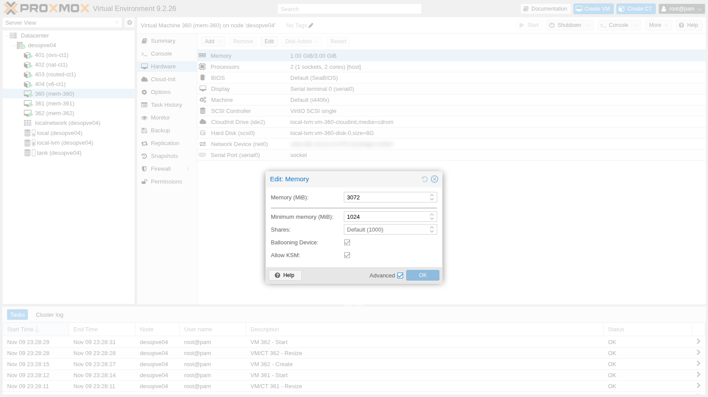
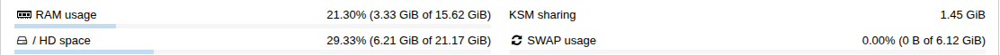

## Dependencies

- **Previous labs:**
  - [Lab 35](/35-kvm-qemu/): QEMU process and monitor;
  - [Lab 18](/18-ceph-growth-maintenance-failures/): `desopve04` is a standalone node again, with `local-lvm` and 16 GiB of RAM. All the tests in this lab are run there, so the memory pressure does not affect the cluster;
  - [Lab 19](/19-fio-benchmark/): the cloud image in `local:import` on `desopve04`;
  - [Lab 23](/23-open-vswitch/), [Lab 24](/24-routing-nat/) and [Lab 25](/25-ipv6/): CTs 401-404 running on `desopve04`, which count toward the node's used memory;
  - [Lab 05](/05-ssh-shell-cli/): the DC's SSH key, authorized on the node and copied into the VMs.
- **Resources:** the cloud image `debian-13-genericcloud-amd64.qcow2` in `local:import` on `desopve04`, used to create three identical VMs with cloud-init, covered in depth in Lab 40.
- **Addresses:** test VMs 360, 361 and 362 on 172.27.199.160-162.
- **Credentials:** `root` / `<lab-password>` → [Appendix B](/b-credentials-and-addresses/).

## Objectives

- Understand how Proxmox VE uses **ballooning** and when it triggers it on its own.
- Measure the savings of **KSM** on identical VMs.
- Use 2 MiB and 1 GiB **hugepages** and know what you give up.
- Give a VM a **NUMA topology** and read it from the guest.
- See what happens when the memory of the VMs exceeds that of the node, **with and without ballooning**.

## How it works

The RAM of a VM is memory of the QEMU process on the node. It is allocated only when the guest actually uses it; this is why the sum of the configured memory can exceed the physical memory (**overcommit**). The mechanisms to manage it:

- **Ballooning.** The guest runs a driver, `virtio_balloon`, that can "inflate" a memory balloon: it takes pages away from the guest and returns them to the node. In Proxmox VE you configure two values: **Memory**, the maximum, and **Minimum memory**, the minimum. The `pvestatd` service checks the node's RAM every 10 seconds:
  - above **80%** usage, it lowers the balloon target of the VMs, in proportion to their **Shares**, down to the minimum;
  - below 80%, it brings all the VMs back to the maximum.
- **KSM** (*Kernel Samepage Merging*). The kernel thread `ksmd` looks for identical memory pages across different processes and keeps a single copy of them, copy-on-write. With many identical VMs the savings are considerable. The `ksmtuned` service turns it on only when the node's free RAM drops below 20%.
- **Hugepages.** Pages of 2 MiB or 1 GiB instead of 4 KiB: fewer entries in the page tables and in the CPU's TLB, and therefore less overhead for large VMs with a lot of active memory. They are **reserved** memory: no ballooning, no KSM, no swap.
- **NUMA.** In servers with multiple processors, each socket has its own "nearby" memory. A VM that sees the same topology (`numa: 1`) can keep processes and memory on the same NUMA node.

## Procedure

### 1. The test VMs

Three identical Debian 13 VMs on `desopve04`, with 3 GiB of maximum memory and 1 GiB minimum, disk on `local-lvm`:

```bash
for id in 360 361 362; do
  qm create $id --name mem-$id --memory 3072 --balloon 1024 --cores 2 --cpu host --ostype l26 \
    --net0 virtio,bridge=vmbr0 --scsihw virtio-scsi-single \
    --scsi0 local-lvm:0,import-from=local:import/debian-13-genericcloud-amd64.qcow2 \
    --ide2 local-lvm:cloudinit --boot order=scsi0 \
    --ipconfig0 ip=172.27.199.$((id-200))/24,gw=172.27.199.1 --nameserver 172.27.199.20 \
    --ciuser labuser --sshkeys /root/.ssh/authorized_keys --serial0 socket --vga serial0
  qm resize $id scsi0 8G
  qm start $id
done
```

Log in to the guests from the DC with `ssh labuser@172.27.199.160` (and `.161`, `.162`) and install `stress-ng` and `numactl` through the lab proxy:

```bash
echo 'Acquire::http::Proxy "http://proxy.proxmox.community:3128";' | sudo tee /etc/apt/apt.conf.d/90proxy
sudo apt-get update && sudo apt-get install -y stress-ng numactl
```

In **Hardware → Memory → Edit**, with **Advanced** enabled, you find all the options:



- **Ballooning Device:** the `virtio-balloon` device. It is needed even if maximum and minimum are the same, because it provides the guest's memory statistics to the GUI.
- **Allow KSM:** allows KSM to merge the pages of this VM. Clear it for VMs with sensitive data, to avoid the *side channel* risks between VMs that share pages.

### 2. The balloon in action

The driver is loaded in the guest, and the monitor shows the memory the guest actually owns (`actual`):

```text
virtio_balloon         32768  0
               total        used        free      shared  buff/cache   available
Mem:            2979         248        2176           0         703        2731

balloon: actual=3072 max_mem=3072 total_mem=2979 free_mem=2179 ...
```

Ask the balloon to bring the VM down to 1.5 GiB and read `actual` every 2 seconds:

```bash
printf "balloon 1536\nquit\n" | qm monitor 360
```

```text output
 2s actual=2886
 4s actual=2886
 6s actual=2886
 8s actual=2986
10s actual=2986
12s actual=2986
14s actual=2986
16s actual=3072
```

```text output
Mem:            2793         333        1905           0         703        2459      ← in the guest, after 5 s
```

The guest starts giving up memory (the total drops to 2793 MiB), but after a few seconds it goes back to 3072. The reason: the node is idle, below 80%, so on its next cycle `pvestatd` sets the target back to the maximum. With Proxmox VE the balloon is **not** controlled by hand: the node manages it based on its RAM. You will see it at work in step 6.

### 3. KSM on three identical VMs

`ksmtuned` is active but KSM is stopped, because the node has more than 20% free RAM:

```text
/sys/kernel/mm/ksm/run: 0
KSM_THRES_COEF=20 (default)
Mem:           15991        5230        9647          47        1447       10760
```

For the test, stop `ksmtuned`, which would otherwise turn KSM off within a minute, and turn KSM on with a faster scan rate:

```bash
systemctl stop ksmtuned
K=/sys/kernel/mm/ksm
echo 1000 > $K/pages_to_scan; echo 20 > $K/sleep_millisecs; echo 1 > $K/run
```

```text output
 30s  pages_shared=82740   pages_sharing=98328   risparmio=384 MiB
 60s  pages_shared=165975  pages_sharing=378346  risparmio=1477 MiB
 90s  pages_shared=166168  pages_sharing=379811  risparmio=1483 MiB
120s  pages_shared=166168  pages_sharing=380078  risparmio=1484 MiB
180s  pages_shared=166170  pages_sharing=380495  risparmio=1486 MiB
general_profit: 1443 MiB
Mem:           15991        3395       11483          48        1447       12596
360 RSS=915 MiB
361 RSS=951 MiB
362 RSS=954 MiB
```

- **`pages_shared`:** the unique pages kept in memory.
- **`pages_sharing`:** how many process pages point to those copies, that is, the pages saved.
- **`general_profit`:** the net gain, after deducting the management overhead: 1443 MiB.

In three minutes the node's used RAM dropped from 5230 to 3395 MiB: three VMs that occupied about 2.8 GiB now use half of that. They are three VMs with the same freshly booted operating system, so kernel, libraries and zeroed pages almost all coincide. With different VMs and real workloads the savings are smaller. The value can also be read in the node's **Summary**, under **KSM sharing**:



The cost is CPU: `ksmd` scans memory continuously. This is why `ksmtuned` turns it on only under pressure. Return to the starting situation by unmerging the merged pages and restarting the service:

```bash
echo 2 > $K/run          # unmerges all merged pages and stops ksmd
echo 100 > $K/pages_to_scan
systemctl start ksmtuned
```

### 4. 2 MiB and 1 GiB hugepages

Reserve 1600 pages of 2 MiB (3.1 GiB) and configure VM 362. Hugepages require NUMA to be enabled; ballooning cannot be used, so it is disabled:

```bash
qm shutdown 362
echo 1600 > /proc/sys/vm/nr_hugepages
qm set 362 --numa 1 --hugepages 2 --balloon 0
qm start 362
```

```text output
HugePages_Total:    1600         ← before startup
HugePages_Free:     1600
  -object 'memory-backend-file,id=ram-node0,size=3072M,mem-path=/run/hugepages/kvm/2048kB,share=on,prealloc=yes' \
  -numa 'node,nodeid=0,cpus=0-1,memdev=ram-node0' \
HugePages_Total:    1536         ← after startup
HugePages_Free:        0
```

The VM's memory is now a file in the `hugetlbfs` filesystem (`/run/hugepages/kvm/2048kB`), entirely allocated at startup (`prealloc=yes`). The total dropped from 1600 to 1536, exactly 3072 MiB: Proxmox VE allocates and frees the hugepages on its own when the VM starts and shuts down, as many as needed. With `keephugepages: 1` it keeps them even after shutdown, to be sure they are still available.

**1 GiB** pages are even more efficient, but the memory must be found in contiguous blocks. With a CPU that has the `pdpe1gb` flag, and right after the node has booted, they can also be reserved at runtime:

```bash
qm shutdown 362      # it was running with the 2 MiB pages, which Proxmox VE frees at shutdown
H=/sys/kernel/mm/hugepages/hugepages-1048576kB
echo 3 > $H/nr_hugepages
qm set 362 --hugepages 1024 && qm start 362
```

```text output
1G richieste 3, allocate 3, libere 3
  -object 'memory-backend-file,id=ram-node0,size=3072M,mem-path=/run/hugepages/kvm/1048576kB,share=on,prealloc=yes' \
1G libere dopo l'avvio: 0
```

On a node that has been running for a long time, memory is fragmented and runtime allocation can fail. In production, 1 GiB pages are reserved at boot, on the kernel command line (`hugepagesz=1G hugepages=N` in `/etc/kernel/cmdline` with systemd-boot, or in GRUB). They make sense for large VMs with a lot of active memory (databases, analytics), not for small VMs.

At the end, VM 362 goes back to normal: no hugepages, NUMA off, ballooning with a 1 GiB minimum. The reserved pages are released:

```bash
qm shutdown 362
qm set 362 --delete hugepages,numa --balloon 1024
echo 0 > $H/nr_hugepages
qm start 362
```

### 5. NUMA

The node has a single NUMA node:

```bash
numactl -H | grep -E "available|size"
```

```text output
available: 1 nodes (0)
node 0 size: 15991 MB
```

Give VM 361 two virtual sockets with one NUMA node each. Each virtual node is bound (`policy=bind`) to host node 0:

```bash
qm set 361 --sockets 2 --cores 1 --numa 1 \
  --numa0 cpus=0,hostnodes=0,memory=1536,policy=bind \
  --numa1 cpus=1,hostnodes=0,memory=1536,policy=bind
qm reboot 361
```

```text output
  -smp '2,sockets=2,cores=1,maxcpus=2' \
  -object 'memory-backend-ram,id=ram-node0,size=1536M,host-nodes=0,policy=bind' \
  -numa 'node,nodeid=0,cpus=0,memdev=ram-node0' \
  -object 'memory-backend-ram,id=ram-node1,size=1536M,host-nodes=0,policy=bind' \
  -numa 'node,nodeid=1,cpus=1,memdev=ram-node1' \
```

In the guest:

```text
available: 2 nodes (0-1)
node 0 cpus: 0
node 0 size: 1335 MB
node 1 cpus: 1
node 1 size: 1511 MB
node distances:
node     0    1
   0:   10   20
   1:   20   10
Socket(s):                               2
NUMA node(s):                            2
```

The guest sees two nodes with the distance table (10 local, 20 remote) and can choose where to place processes and memory. On this node it is only a demonstration; on a two-socket server the rule is:

- if the VM fits within one physical socket (vCPUs and RAM), `numa: 1` is enough;
- if it is larger than one socket, give it the same topology as the host, with `numaN` and `hostnodes` matching the physical nodes.

This way the vCPUs use nearby memory and do not cross the interconnect between the sockets.

### 6. Overcommit: with and without ballooning

The three VMs are raised to **5 GiB** each, 15 GiB in total on a 16 GiB node that also hosts four containers and the system itself. In each VM, start a process that allocates and holds 4.5 GiB for almost three minutes:

```bash
stress-ng --vm 1 --vm-bytes 4500M --vm-keep --timeout 170s
```

On the node, every 20 seconds, read RAM, swap and the memory each VM actually owns (`actual`).

**Test 1 – ballooning enabled** (1 GiB minimum):

```text
  0s host usato= 7322 MiB libero= 7555 MiB swap=   0 MiB | balloon(MiB): 360=5081 361=4449 362=4842
 20s host usato=14643 MiB libero= 1194 MiB swap= 974 MiB | balloon(MiB): 360=5020 361=4449 362=4842
 40s host usato=15217 MiB libero=  619 MiB swap= 972 MiB | balloon(MiB): 360=5020 361=4178 362=4642
 60s host usato=14553 MiB libero= 1282 MiB swap= 971 MiB | balloon(MiB): 360=5020 361=4149 362=4442
 80s host usato=15003 MiB libero=  828 MiB swap= 970 MiB | balloon(MiB): 360=5020 361=4149 362=4242
100s host usato=13914 MiB libero= 1916 MiB swap= 970 MiB | balloon(MiB): 360=5020 361=4104 362=3942
120s host usato=13249 MiB libero= 2582 MiB swap= 969 MiB | balloon(MiB): 360=4920 361=3849 362=3742
140s host usato=10535 MiB libero= 5295 MiB swap= 969 MiB | balloon(MiB): 360=5020 361=3849 362=3642
```

In guests 361 and 362:

```text
[  193.834654] Out of memory: Killed process 753 (stress-ng-vm) total-vm:3627660kB, anon-rss:3538844kB, ... oom_score_adj:1000
[  174.139589] Out of memory: Killed process 749 (stress-ng-vm) total-vm:3405184kB, anon-rss:3331028kB, ... oom_score_adj:1000
```

Once 80% is exceeded, `pvestatd` inflates the balloons of 361 and 362 (from 4.4-4.8 to 3.6-3.8 GiB). The guests, which have no swap, run out of memory and their OOM killer terminates the largest process. The node stays up, with less than 1 GiB of swap used.

**Test 2 – ballooning disabled** (`balloon: 0`, fixed memory):

```text
  0s host usato= 3034 MiB libero=12731 MiB swap=  909 MiB load=1.50
 20s host usato=15672 MiB libero=  215 MiB swap= 1585 MiB load=2.22
 40s host usato=15713 MiB libero=  195 MiB swap= 2043 MiB load=2.88
 80s host usato=15759 MiB libero=  148 MiB swap= 2043 MiB load=3.98
120s host usato=15675 MiB libero=  232 MiB swap= 2043 MiB load=4.48
160s host usato=15707 MiB libero=  199 MiB swap= 2043 MiB load=4.45
```

```text
stress-ng: info:  [737] successful run completed in 2 mins, 50.18 secs    ← all three VMs
```

No process is killed in the guests, but the node runs at its limit: less than 250 MiB free for three minutes, 2 GiB in swap and a growing load. At that point the node is fragile: a container starting, a backup or a growing ZFS cache can trigger the **node's** OOM killer, which usually picks the largest process, that is, an entire VM, killed without warning.

| | Ballooning enabled | Ballooning disabled |
|---|---|---|
| Minimum free RAM on the node | 619 MiB | 148 MiB |
| Node swap | about 1 GiB | 2 GiB and more |
| Effect | the guests lose their largest process | the guests complete, the node risks losing a VM |
| Who pays | the guest that consumes the memory | the whole node |

Ballooning moves the problem into the VMs that consume too much, where an administrator can see it and deal with it, instead of leaving it to the node. It is no substitute for proper sizing: the sum of the VMs' **minimums** must fit comfortably in the node's RAM.

## Verification and tests

- The `virtio_balloon` driver is loaded in the guest and `info balloon` reports the actual memory.
- KSM: more than 380,000 shared pages and 1.44 GiB of net gain on three identical VMs, also visible in the node's Summary.
- 2 MiB and 1 GiB hugepages used by the VM (`memory-backend-file` on `hugetlbfs`) and released at shutdown.
- The guest with `numa: 1` and two sockets sees two NUMA nodes with the correct distances.
- Overcommit measured in both modes.

## Final lab state

- **VMs 360, 361 and 362:** deleted with `qm stop <id> && qm destroy <id> --purge`; the node's swap was emptied with `swapoff -a && swapon -a`.
- **desopve04:** back to how it was.
  - KSM: `run=0`, controlled by the active `ksmtuned`, default parameters.
  - Hugepages: none reserved.
  - Swap: emptied (`swapoff -a && swapon -a`).
  - CTs 401-404: running and untouched.
- No changes to the cluster.

## What you learned

- In Proxmox VE the balloon is driven by `pvestatd` based on the node's RAM: below 80% the VMs go back to the maximum, above it they shrink toward the minimum according to their Shares.
- KSM can save a lot of memory with similar VMs, at the cost of CPU; `ksmtuned` turns it on only under pressure, and the **Allow KSM** option excludes sensitive VMs.
- Hugepages reduce overhead for large VMs but are reserved memory: no ballooning, KSM or swap. Proxmox VE allocates them when the VM starts; 1 GiB pages are best reserved at node boot.
- The NUMA topology of the VM matters when the VM is larger than a physical socket.
- Overcommit works as long as the VMs do not actually use all their memory; with ballooning the problem stays inside the guests, without putting the whole node at risk.

## References

- [Proxmox VE – Virtual Machines: Memory](https://pve.proxmox.com/pve-docs/chapter-qm.html#qm_memory)
- [Proxmox VE – Kernel Samepage Merging (KSM)](https://pve.proxmox.com/pve-docs/chapter-sysadmin.html#kernel_samepage_merging)
- [Proxmox VE – NUMA](https://pve.proxmox.com/pve-docs/chapter-qm.html#qm_cpu)
- [Linux kernel – Kernel Samepage Merging](https://docs.kernel.org/admin-guide/mm/ksm.html)
- [Linux kernel – HugeTLB Pages](https://docs.kernel.org/admin-guide/mm/hugetlbpage.html)
