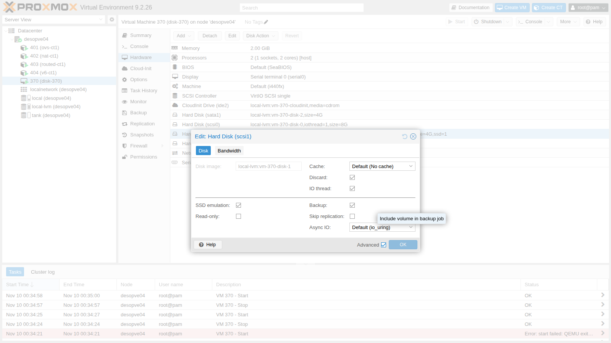
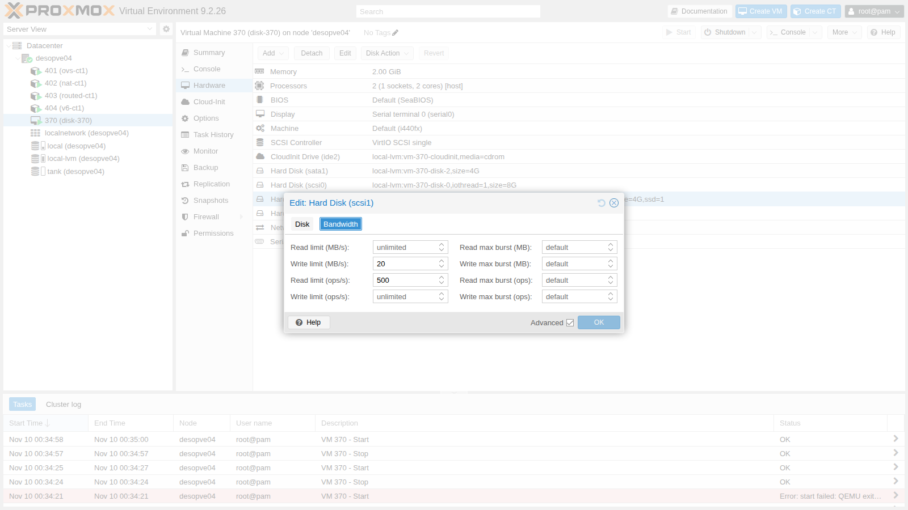

## Dependencies

- **Previous labs:**
  - [Lab 35](/35-kvm-qemu/): QEMU process, `qm showcmd` and monitor;
  - [Lab 09](/09-lvm-and-lvm-thin/): LVM thin pool and how it fills up;
  - [Lab 19](/19-fio-benchmark/): measurement method with `fio`.
- **Node and storage:** `desopve04`, standalone node, with the `local-lvm` storage (thin pool `pve/data`), so that the tests do not weigh on the cluster.
- **Resources:** the cloud image `debian-13-genericcloud-amd64.qcow2` in `local:import` on `desopve04`, downloaded in [Lab 19](/19-fio-benchmark/), and the DC's SSH key ([Lab 05](/05-ssh-shell-cli/)). The image is used to create a VM with cloud-init (covered in depth in Lab 40).
- **Addresses:** test VM 370 on 172.27.199.170.
- **Credentials:** `root` / `<lab-password>` → [Appendix B](/b-credentials-and-addresses/).

## Objectives

- A test VM with three disks on the same storage, one per controller (VirtIO SCSI, VirtIO Block, SATA), measured with the same script, and the ability to tell which differences exceed the run-to-run variability and which do not.
- For each of the five **cache** modes, knowing where the data is when the guest gets a write acknowledged, and checking it with the QEMU monitor and the node's dirty memory.
- An **Async IO** and cache combination that keeps the VM from starting, recognized from its error message and fixed.
- Space returned to the thin pool with **discard** and **fstrim**, confirmed with `lvs` on the node, and the disk exposed to the guest as an SSD.
- Bandwidth and IOPS limits applied to a running VM and confirmed with a measurement.

## How it works

A virtual disk goes through three layers:

```text
guest: disk driver ──► virtual controller (SCSI / VirtIO Block / SATA)
QEMU:  blockdev ──► cache (node page cache yes/no, flush yes/no) ──► aio (io_uring / native / threads)
node:  volume on the storage (here an LVM thin LV)
```

**Controllers.**

- **VirtIO SCSI:** a paravirtualized controller. With **VirtIO SCSI single** each disk gets its own controller and can have a dedicated **IO thread**. It supports discard, many disks and hotplug, and it is the recommended default.
- **VirtIO Block:** also paravirtualized, and simpler: one PCI device per disk (`/dev/vdX`), with no SCSI layer.
- **SATA (and IDE):** emulated controllers that every operating system recognizes without extra drivers. Each operation usually costs the QEMU process more, and they cannot have an IO thread: Proxmox VE offers that option only for VirtIO SCSI single and VirtIO Block. Use them to install systems that lack VirtIO drivers, or for compatibility.

**IO thread.** With `iothread=1` the disk's I/O runs in a dedicated thread instead of QEMU's main thread. Several disks then work in parallel, and I/O does not slow down the management of the VM.

**Cache.** The cache mode decides whether QEMU uses the node's page cache and how it handles *flushes*, the requests with which the guest asks for the data it has written to become stable:

| Mode | Node page cache | Guest flushes | What can be lost if the node crashes |
|---|---|---|---|
| `none` (default) | no (O_DIRECT) | honored | whatever the guest has not yet made durable with a flush, as with a physical disk that has a write cache |
| `writethrough` | yes, for reads only | not needed: a write is acknowledged only once it is on the storage | none of the acknowledged writes |
| `writeback` | yes | honored | the same as with `none`, but the data not yet flushed sits in the node's RAM and can be much larger |
| `directsync` | no (O_DIRECT) | not needed: a write is acknowledged only once it is on the storage | none of the acknowledged writes |
| `unsafe` | yes | **ignored** | even data the guest believes is already safe |

**Async IO.**

- **`io_uring`:** the default for most storage types, the modern asynchronous Linux interface.
- **`native`:** classic kernel AIO; it works only with O_DIRECT, that is with `cache=none` or `directsync`.
- **`threads`:** a pool of threads doing synchronous I/O, the most compatible option.

**Discard.** When the guest deletes data, it can tell the disk which blocks are now free (TRIM/UNMAP). With `discard=on` QEMU passes the request on to the storage, and a thin pool releases the space. With the default `discard=ignore` the guest believes it has freed the space, but the node never finds out.

### Test environment and versions

The results below come from a run carried out in November 2026 with the configuration described here. You need it to read them correctly: with other versions, options or hardware, the same commands give different numbers.

| Component | Configuration used |
|---|---|
| Proxmox VE | 9.2.26, kernel `7.0.14-28-pve` ([Lab 04](/04-first-access-repositories-updates/)); QEMU 11.1.3 ([Lab 35](/35-kvm-qemu/)) |
| Node | `desopve04`, a standalone node with 4 cores and 16 GB of RAM ([Lab 01](/01-lab-architecture/)) |
| Storage | `local-lvm`: 14 GiB thin pool `pve/data` on the system disk of `desopve04` ([Lab 03](/03-install-proxmox-ve/), [Lab 09](/09-lvm-and-lvm-thin/)), 23.7% full before the lab |
| Test VM | Debian 13 from the cloud image, 2 vCPUs of type `host`, 2 GiB of RAM; 4 GiB test disks: `scsi1` (VirtIO SCSI single, `iothread=1`), `virtio1` (VirtIO Block, `iothread=1`), `sata1` (SATA, no IO thread) |
| Disk options | defaults (`cache=none`, `aio=io_uring`, `discard=ignore`) unless a section says otherwise |
| Tool | `fio` from the Debian 13 repositories (version not recorded in this lab; [Lab 19](/19-fio-benchmark/), with the same image, has 3.39), with `--direct=1 --ioengine=libaio`, run through [`fiorun.sh`](/files/37/fiorun.sh) |
| Test area | 2 GiB per disk, written before the measurements; runs of 12-20 seconds plus a 2-second ramp-up; one or two rounds per configuration |

The models of the node's disks and controllers are redacted, as explained in the [manual's conventions](/the-lab/#conventions): read the numbers as properties of this configuration.

**What the test measures, and what it does not.** It measures the full path as the guest sees it: driver, virtual controller, QEMU (cache and aio), the LVM thin pool and the node's disk. It does not isolate the individual layers, so a high or low value does not tell you on its own which layer produced it. It measures a single VM and one disk at a time, and the activity of the node's other guests during the run was not recorded. With one or two short rounds, a difference between two configurations only counts if it is larger than the spread between rounds of the same configuration. For `scsi1` with the default options, sections 2-4 of this lab measured between 26,063 and 29,085 IOPS for random reads and between 8,247 and 14,864 IOPS for random writes.

## Procedure

### 1. The test VM

A VM with the system disk and three 4 GiB disks on the same storage, each on a different controller:

```bash
qm create 370 --name disk-370 --memory 2048 --cores 2 --cpu host --ostype l26 \
  --net0 virtio,bridge=vmbr0 --scsihw virtio-scsi-single \
  --scsi0 local-lvm:0,import-from=local:import/debian-13-genericcloud-amd64.qcow2,iothread=1 \
  --ide2 local-lvm:cloudinit --boot order=scsi0 \
  --ipconfig0 ip=172.27.199.170/24,gw=172.27.199.1 --nameserver 172.27.199.20 \
  --ciuser labuser --sshkeys /root/.ssh/authorized_keys --serial0 socket --vga serial0
qm resize 370 scsi0 8G
qm set 370 --scsi1 local-lvm:4,iothread=1 --virtio1 local-lvm:4,iothread=1 --sata1 local-lvm:4
qm start 370
```

```text output
  WARNING: Sum of all thin volume sizes (36.00 GiB) exceeds the size of thin pool pve/data and the amount of free space in volume group (<6.13 GiB).
scsi1: local-lvm:vm-370-disk-1,iothread=1,size=4G
virtio1: local-lvm:vm-370-disk-3,iothread=1,size=4G
sata1: local-lvm:vm-370-disk-2,size=4G
```

The warning is the overprovisioning seen in [Lab 09](/09-lvm-and-lvm-thin/): the volumes add up to 36 GiB on a 14 GiB pool. During the lab only part of each disk is ever written, and the pool is checked with `lvs`.

In the guest:

```text
NAME SIZE ROTA TRAN   MODEL         DISC-MAX
sda    8G    1        QEMU HARDDISK       1G
sdb    4G    1 sata   QEMU HARDDISK       2G
sdc    4G    1        QEMU HARDDISK       1G
vda    4G    1 virtio                     2G
```

`ROTA 1`: every disk presents itself as a rotational disk.

:::caution[Watch out for disk names in the guest]
After a VM restart, `sdb` and `sdc` swapped places in the lab: the SCSI and SATA disks can be detected in a different order from one boot to the next. A test run against `/dev/sdX` can then hit the wrong disk without any error. In tests and in `/etc/fstab`, use the stable names in `/dev/disk/by-id`: Proxmox VE gives each SCSI disk the identifier `drive-scsiN`.

```text
ata-QEMU_HARDDISK_QM00007 -> ../../sdc
scsi-0QEMU_QEMU_HARDDISK_drive-scsi1 -> ../../sdb
```
:::

The measurements run `fio` with O_DIRECT in the guest, on a 2 GiB area of each disk that is filled before the test. Each run lasts 12-20 seconds. They are driven by the script [`fiorun.sh`](/files/37/fiorun.sh), which you copy into the guest (for example with `scp` from the DC, which logs in with `ssh labuser@172.27.199.170`). It runs `fio` with `--direct=1 --ioengine=libaio --size=2G --time_based --ramp_time=2` and prints one line per run:

- `IOPS`: operations completed per second;
- `MB/s`: fio's bandwidth (`bw`, in KiB/s) divided by 1024, so the value is in **MiB/s**, the unit used in this lab's tables;
- `lat media` and `p99`: the mean and the 99th percentile of the **completion latency** (*clat*, from submitting an operation to its completion), in microseconds. They do not include the submission time; fio's three latencies are explained in [Lab 19](/19-fio-benchmark/);
- with `--fsync=1` the latency printed covers the write only: fio reports the time spent in `fsync` separately, and the script does not print it.

Install `fio` in the guest through the lab proxy, configured as in [Lab 36](/36-memory/):

```bash
sudo apt-get install -y fio
./fiorun.sh disk/by-id/scsi-0QEMU_QEMU_HARDDISK_drive-scsi1 r4k randread 4k 32 15
```

### 2. Controllers: VirtIO SCSI, VirtIO Block and SATA

Two consecutive rounds, with the default options:

```text
== giro 1
VirtIO-SCSI+iothread randread4k IOPS=   26867  MB/s=  105.0  lat media=   1161 us  p99=   2998 us
VirtIO-SCSI+iothread randwrite4k IOPS=    8247  MB/s=   32.2  lat media=   3865 us  p99=  45351 us
VirtIO-SCSI+iothread write1M IOPS=     284  MB/s=  284.9  lat media=  27874 us  p99= 379585 us
VirtIO-Block+iothread randread4k IOPS=   30766  MB/s=  120.2  lat media=   1014 us  p99=   2736 us
VirtIO-Block+iothread randwrite4k IOPS=    7546  MB/s=   29.5  lat media=   4220 us  p99=  32637 us
VirtIO-Block+iothread write1M IOPS=     563  MB/s=  563.1  lat media=  14024 us  p99=  71827 us
SATA randread4k              IOPS=    8155  MB/s=   31.9  lat media=   3804 us  p99=   6193 us
SATA randwrite4k             IOPS=    5767  MB/s=   22.5  lat media=   5436 us  p99=  32375 us
SATA write1M                 IOPS=     468  MB/s=  468.7  lat media=  17126 us  p99= 114819 us
== giro 2
VirtIO-SCSI+iothread randread4k IOPS=   29085  MB/s=  113.6  lat media=   1072 us  p99=   2671 us
VirtIO-SCSI+iothread randwrite4k IOPS=   10540  MB/s=   41.2  lat media=   3007 us  p99=  23200 us
VirtIO-SCSI+iothread write1M IOPS=     652  MB/s=  652.1  lat media=  12245 us  p99=  78119 us
VirtIO-Block+iothread randread4k IOPS=   29454  MB/s=  115.1  lat media=   1060 us  p99=   2736 us
VirtIO-Block+iothread randwrite4k IOPS=    7146  MB/s=   27.9  lat media=   4451 us  p99=  28705 us
VirtIO-Block+iothread write1M IOPS=     628  MB/s=  628.9  lat media=  12534 us  p99=  63701 us
SATA randread4k              IOPS=    7748  MB/s=   30.3  lat media=   4003 us  p99=   6128 us
SATA randwrite4k             IOPS=    2646  MB/s=   10.3  lat media=  11972 us  p99= 304087 us
SATA write1M                 IOPS=     344  MB/s=  344.2  lat media=  22930 us  p99= 214958 us
```

| Controller (both rounds) | 4k random reads | 4k random writes | 1M sequential write |
|---|---|---|---|
| VirtIO SCSI + iothread | 26,900-29,100 IOPS | 8,200-10,500 IOPS | 285-652 MiB/s |
| VirtIO Block + iothread | 29,500-30,800 IOPS | 7,100-7,500 IOPS | 563-629 MiB/s |
| SATA | 7,700-8,200 IOPS | 2,600-5,800 IOPS | 344-469 MiB/s |

Each point below separates what the test measured from how we interpret it, and names the check that would confirm the interpretation.

1. **4k random reads.**
   - **Measured:** VirtIO SCSI 26,867 and 29,085 IOPS, VirtIO Block 30,766 and 29,454, SATA 8,155 and 7,748. The mean completion latency is 1.0-1.2 ms for the two VirtIO controllers and 3.8-4.0 ms for SATA.
   - **Interpretation:** the two VirtIO controllers overlap. SATA reaches 25-30% of their reads, at 3-4 times the latency. That is consistent with the cost of an emulated controller, but the SATA disk is also the only one without an IO thread, and the test cannot separate the two factors.
   - **How to check:** repeat the run on `scsi1` with `iothread=0` to see what the IO thread alone is worth; during the run, `top -H -p $(cat /var/run/qemu-server/370.pid)` on the node shows which QEMU threads are busy (vCPUs, IO thread, main thread).
2. **4k random writes.**
   - **Measured:** VirtIO SCSI 8,247 and 10,540 IOPS, VirtIO Block 7,546 and 7,146, SATA 5,767 and 2,646.
   - **Interpretation:** VirtIO SCSI is ahead of VirtIO Block in both rounds, but the same disk with the same options produced anywhere between 8,247 and 14,864 IOPS across sections 2-4, so the difference is not established. In the second round SATA drops by half (from 5,767 to 2,646 IOPS, with a p99 of 304 ms), and the test does not say why.
   - **How to check:** more and longer rounds, changing the order of the disks; on the node, `iostat -x 1` (from the `sysstat` package) during the run shows whether the physical disk is saturated (`%util`, `w_await`).
3. **1M sequential writes.**
   - **Measured:** VirtIO SCSI 285 and 652 MiB/s, VirtIO Block 563 and 629, SATA 469 and 344.
   - **Interpretation:** the gap between the two rounds on the same disk (more than double for VirtIO SCSI) is larger than the differences between controllers, so this test cannot rank them. Write caches in the node's disk or controller and background writes are possible causes; the test does not isolate them.
   - **How to check:** as in point 2, with a write long enough to exceed the caches.

**In short:** the only thing this test shows with confidence is that SATA falls far behind both VirtIO controllers for random reads. Between VirtIO SCSI and VirtIO Block, the differences seen in this lab are within the variability of the test.

### 3. Cache modes

**Hardware → Hard Disk → Edit**, with **Advanced** enabled, shows all the disk options:



Test the five modes on `scsi1`. Every change requires stopping and starting the VM:

```bash
qm set 370 --scsi1 local-lvm:vm-370-disk-1,iothread=1,cache=writeback
qm stop 370 && qm start 370
```

Each mode gets four runs on `/dev/disk/by-id/scsi-0QEMU_QEMU_HARDDISK_drive-scsi1`. The first one writes one block at a time and follows every write with an `fsync`, the way a database commits transactions. In that line, `IOPS` counts write + `fsync` cycles per second.

```text
== cache=none
fsync ogni scrittura QD1     IOPS=     545  MB/s=    2.1  lat media=   1418 us  p99=   4014 us
randwrite 4k QD32            IOPS=    8693  MB/s=   34.0  lat media=   3654 us  p99=  22938 us
randread 4k QD32             IOPS=   26063  MB/s=  101.8  lat media=   1200 us  p99=   3097 us
write 1M QD8                 IOPS=     317  MB/s=  317.5  lat media=  24870 us  p99= 160432 us
== cache=writeback
fsync ogni scrittura QD1     IOPS=     575  MB/s=    2.2  lat media=    182 us  p99=    692 us
randwrite 4k QD32            IOPS=   30334  MB/s=  118.5  lat media=   1025 us  p99=   1679 us
randread 4k QD32             IOPS=   32097  MB/s=  125.4  lat media=    971 us  p99=   2867 us
write 1M QD8                 IOPS=    2508  MB/s= 2508.7  lat media=   3018 us  p99=   9241 us
== cache=writethrough
fsync ogni scrittura QD1     IOPS=     501  MB/s=    2.0  lat media=   1901 us  p99=  13042 us
randwrite 4k QD32            IOPS=    9728  MB/s=   38.0  lat media=   3366 us  p99=  17695 us
randread 4k QD32             IOPS=   27700  MB/s=  108.2  lat media=   1129 us  p99=   4686 us
write 1M QD8                 IOPS=     537  MB/s=  537.4  lat media=  15002 us  p99=  56361 us
== cache=directsync
fsync ogni scrittura QD1     IOPS=     717  MB/s=    2.8  lat media=   1315 us  p99=   3686 us
randwrite 4k QD32            IOPS=    5583  MB/s=   21.8  lat media=   5725 us  p99=  41157 us
randread 4k QD32             IOPS=   29685  MB/s=  116.0  lat media=   1054 us  p99=   2966 us
write 1M QD8                 IOPS=     430  MB/s=  430.6  lat media=  18228 us  p99=  57934 us
== cache=unsafe
fsync ogni scrittura QD1     IOPS=    4399  MB/s=   17.2  lat media=    101 us  p99=    387 us
randwrite 4k QD32            IOPS=   30261  MB/s=  118.2  lat media=   1028 us  p99=   1876 us
randread 4k QD32             IOPS=   30653  MB/s=  119.7  lat media=   1015 us  p99=   2310 us
write 1M QD8                 IOPS=    2386  MB/s= 2386.9  lat media=   3172 us  p99=   9241 us
```

| Cache | Write + fsync, QD1 (cycles per second) | 4k random writes QD32 | 1M sequential write QD8 |
|---|---|---|---|
| `none` | 545 | 8,700 IOPS | 318 MiB/s |
| `writethrough` | 501 | 9,700 IOPS | 537 MiB/s |
| `directsync` | 717 | 5,600 IOPS | 431 MiB/s |
| `writeback` | 575 | 30,300 IOPS | 2,509 MiB/s |
| `unsafe` | **4,399** | 30,300 IOPS | 2,387 MiB/s |

1. **`writeback` and `unsafe` without `fsync`.**
   - **Measured:** 1M sequential writes reach 2,509 MiB/s with `writeback` and 2,387 with `unsafe`, against 318-537 MiB/s for the other three modes; 4k random writes at QD32 reach about 30,300 IOPS, against 5,583-9,728.
   - **Interpretation:** consistent with the writes being absorbed by the node's page cache, which these two modes use for writes as well: the guest gets its acknowledgment before the data reaches the disk. The dirty-memory test further down points the same way.
   - **How to check:** during the run, on the node, read `grep -E '^(Dirty|Writeback):' /proc/meminfo` every second and watch the physical disk with `iostat -x 1`. If the guest writes at 2.5 GiB/s while the disk keeps writing at its usual pace, the difference is sitting in RAM.
2. **One write at a time, each followed by `fsync`.**
   - **Measured:** `none` completes 545 cycles per second, `writethrough` 501, `directsync` 717, `writeback` 575 and `unsafe` 4,399. The latency printed covers the write alone: 182 µs with `writeback`, 101 µs with `unsafe`, 1,315-1,901 µs with the other three.
   - **Interpretation:** with `writeback` the write completes in RAM (182 µs), yet each cycle takes about 1.7 ms (1/575 of a second), close to the 1.8 ms of `none`. The extra time is spent outside the write, which is consistent with an `fsync` that waits for the node to put the data on disk. With `unsafe` the node completes almost eight times as many cycles, consistent with flushes being ignored, as the monitor confirms below. With `writethrough` and `directsync` the write takes up nearly the whole cycle, because it is already synchronous.
   - **How to check:** fio measures the time spent in `fsync` separately (`jobs[0].sync.lat_ns` in the JSON output, which the script does not print); on the node, `iostat -x 1` shows the flush requests per second that reach the disk (the `f/s` column).
3. **The other measurements.**
   - **Measured:** `none`, `writethrough` and `directsync` give 5,583-9,728 IOPS for random writes and 318-537 MiB/s for sequential writes. Random reads land between 26,063 and 32,097 IOPS in all five modes.
   - **Interpretation:** these differences are of the same order as the spread measured for an unchanged configuration (see [Test environment and versions](#test-environment-and-versions)), so the test neither ranks these three modes nor shows any effect of the cache on reads. Nor does it tell what limits the reads: the disk, the thin pool, QEMU or the guest's two vCPUs.
   - **How to check:** run `iostat -x 1` on the node during the read test. If the physical disk serves reads at the same rate, they reach the disk; if it is nearly idle, they come from a cache.

The monitor shows the configuration actually in use: with `unsafe` on `scsi1`, that disk's nodes report `writeback, ignore flushes` (only the `Cache mode` lines are shown here):

```text title="qm monitor" frame="terminal"
info block -n
```

```text output
    Cache mode:       writeback
    Cache mode:       writeback, ignore flushes
    Cache mode:       writeback, ignore flushes
```

**Where the data is when the guest believes it has been written.** In the guest, write 1 GiB straight to the disk, ending with an `fsync` (`conv=fsync`). Right afterwards, look at the node's dirty memory, that is the data still waiting to be written to disk:

```bash
dd if=/dev/urandom of=/dev/disk/by-id/scsi-0QEMU_QEMU_HARDDISK_drive-scsi1 bs=1M count=1024 oflag=direct conv=fsync   # in the guest
grep ^Dirty: /proc/meminfo                                                                                         # on the node
```

```text output
== cache=writeback
1073741824 bytes (1.1 GB, 1.0 GiB) copied, 6.10631 s, 176 MB/s
  nodo subito dopo: Dirty: 1456 kB
== cache=unsafe
1073741824 bytes (1.1 GB, 1.0 GiB) copied, 4.60421 s, 233 MB/s
  nodo subito dopo: Dirty: 1050036 kB
```

- **Measured:** right after the `dd`, which ends with an `fsync`, the node's `Dirty` counter reads 1,456 kB with `writeback` and 1,050,036 kB with `unsafe`, roughly the GiB that was just written.
- **Interpretation:** with `writeback`, the guest's `fsync` forced the node to write the data out of its page cache, which is consistent with the data already being on the node's disk when `fsync` returns. With `unsafe`, the GiB the guest considers safe was still in the node's RAM: a power failure at that moment would wipe it out, and the guest would never know.
- **Limits of the test:** `Dirty` counts all the dirty memory of the node, and it was read only once. The `dd` throughput (176 and 233 MB/s) is not a storage measurement here: it includes generating random data with `/dev/urandom` in the guest, and it issues one 1 MiB write at a time.
- **How to check:** read `Dirty` and `Writeback` every second for a minute after the `dd`. With `unsafe` they should fall as the node's kernel writes the data out, within the interval set by `vm.dirty_expire_centisecs`.

**Which mode to choose.** `unsafe` is only for throwaway data, for example while installing a system that will become a template. `writeback` makes sense when the guest uses flushes correctly and the node's RAM is protected against power loss (a UPS), because the amount of data the guest has not yet flushed can be large. The default, `none`, is the safe choice.

### 4. Async IO

`scsi1` with `cache=none`, two rounds per mode:

```text
== aio=io_uring
randread 4k QD32             IOPS=   27460  MB/s=  107.3  lat media=   1137 us  p99=   3064 us
randwrite 4k QD32            IOPS=   13340  MB/s=   52.1  lat media=   2385 us  p99=  13959 us
randread 4k QD32             IOPS=   27121  MB/s=  106.0  lat media=   1155 us  p99=   3293 us
randwrite 4k QD32            IOPS=   14864  MB/s=   58.1  lat media=   2179 us  p99=  11600 us
== aio=native
randread 4k QD32             IOPS=   32438  MB/s=  126.7  lat media=    967 us  p99=   2933 us
randwrite 4k QD32            IOPS=    6043  MB/s=   23.6  lat media=   5268 us  p99=  50594 us
randread 4k QD32             IOPS=   33112  MB/s=  129.4  lat media=    948 us  p99=   3031 us
randwrite 4k QD32            IOPS=   12222  MB/s=   47.8  lat media=   2594 us  p99=  16908 us
== aio=threads
randread 4k QD32             IOPS=   31479  MB/s=  123.0  lat media=    996 us  p99=   2769 us
randwrite 4k QD32            IOPS=    6368  MB/s=   24.9  lat media=   4995 us  p99=  31326 us
randread 4k QD32             IOPS=   30716  MB/s=  120.0  lat media=   1021 us  p99=   3064 us
randwrite 4k QD32            IOPS=    7674  MB/s=   30.0  lat media=   4142 us  p99=  57410 us
```

1. **Reads.**
   - **Measured:** `io_uring` 27,460 and 27,121 IOPS, `native` 32,438 and 33,112, `threads` 31,479 and 30,716.
   - **Interpretation:** `native` and `threads` beat `io_uring` in both rounds, by 13-22%, and they also beat every read measured on `scsi1` with the default options (26,063-29,085 IOPS). That hints at an advantage for random reads in this configuration, but it is not proof: the modes were measured one after another, with only two rounds each.
   - **How to check:** more rounds that alternate the modes (`io_uring`, `native`, `threads`, then `io_uring` again), each after restarting the VM, and longer runs.
2. **Writes.**
   - **Measured:** `io_uring` 13,340 and 14,864 IOPS, `native` 6,043 and 12,222, `threads` 6,368 and 7,674.
   - **Interpretation:** the same `io_uring` configuration produced 8,247-10,540 IOPS in section 2 and 8,693 in section 3, and `native` doubles from one round to the next. The spread of an unchanged configuration covers the differences between modes, so this test names no winner for writes.
   - **How to check:** as in point 1.

**Which mode to choose.** `io_uring` remains the sensible default for this storage until a repeated measurement on your own storage shows a consistent advantage for another mode. `threads` is meant for storage types with which the other modes cause problems: for some of them, such as thick LVM and CIFS, Proxmox VE does not use `io_uring` even as the default. `qm showcmd 370 --pretty` shows the mode a disk actually uses.

#### A combination that prevents startup

**Configuration tried.** `aio=native` with `cache=writeback` on `scsi1`:

```bash
qm stop 370
qm set 370 --scsi1 local-lvm:vm-370-disk-1,iothread=1,aio=native,cache=writeback
qm start 370
```

**Error observed.** `qm set` accepts the configuration, but the start fails:

```text output
kvm: -blockdev {...,"file":{"aio":"native","cache":{"direct":false,"no-flush":false},...,"driver":"host_device","filename":"/dev/pve/vm-370-disk-1",...}: aio=native was specified, but it requires cache.direct=on, which was not specified.
start failed: QEMU exited with code 1
```

The message states the constraint: `native` needs `cache.direct=on`, that is O_DIRECT, which among the Proxmox VE cache modes only `none` and `directsync` provide. In this version (Proxmox VE 9.2.26 with QEMU 11.1.3) the combination is not rejected when the configuration is saved, only when the VM starts.

**Decision.** Go back to a valid combination before moving on; here, the defaults, by removing `aio` and `cache` from the disk line.

```bash
qm set 370 --scsi1 local-lvm:vm-370-disk-1,iothread=1
qm start 370
```

**Result.** The VM starts again with `cache=none` and `aio=io_uring`, and the next section starts from this configuration.

### 5. Discard, fstrim and SSD emulation

Create an ext4 filesystem on `scsi1`, write a 1 GiB file, delete it and ask the guest to report the free blocks with `fstrim`. On the node, watch how much of the thin volume is in use:

```bash
# in the guest
D=/dev/disk/by-id/scsi-0QEMU_QEMU_HARDDISK_drive-scsi1
sudo mkfs.ext4 -F $D && sudo mkdir -p /mnt/t && sudo mount $D /mnt/t
sudo dd if=/dev/urandom of=/mnt/t/prova bs=1M count=1024 conv=fsync
sudo rm /mnt/t/prova && sudo fstrim -v /mnt/t
# on the node, before and after
lvs pve/vm-370-disk-1
```

**With the default `discard=ignore`:**

```text
 vm-370-disk-1 50.00          ← before (area filled for the tests)
file-1GiB-scritto
 vm-370-disk-1 50.79
/mnt/t: 2.9 GiB (3068858368 bytes) trimmed
 vm-370-disk-1 50.79          ← after fstrim: no change
```

The guest reports 2.9 GiB freed, but the volume stays at 50.79%: with `discard=ignore`, QEMU does not pass the requests on to the storage.

**With `discard=on` and `ssd=1`** (stopping and starting the VM):

```bash
qm set 370 --scsi1 local-lvm:vm-370-disk-1,iothread=1,discard=on,ssd=1
```

```text output
sdb rotational=0
/mnt/t: 3.9 GiB (4142604288 bytes) trimmed
 vm-370-disk-1 3.46           ← the volume returns 1.9 GiB to the pool
file-1GiB-scritto
 vm-370-disk-1 28.46
/mnt/t: 6 MiB (6283264 bytes) trimmed
 vm-370-disk-1 28.46          ← fstrim run right after rm
/mnt/t: 1.1 GiB (1197453312 bytes) trimmed
 vm-370-disk-1 3.46           ← fstrim after sync and a few seconds
 data 65.69                   ← thin pool of the node: it was at 79%
```

- **`ssd=1`:** the guest sees a non-rotational disk (`rotational=0`). What changes as a result depends on the guest's operating system and applications, and this test does not measure it. According to the Proxmox VE documentation, some operating systems also need SSD emulation before they send TRIM. SSD emulation is not available on VirtIO Block disks.
- **`discard=on`:** the space freed in the guest goes back to the thin pool. The volume drops from 50.79% to 3.46% (1.9 GiB returned), and the node's thin pool from 79% to 65.69%.
- **Trimming right after `rm`:** it frees only 6 MiB, while after `sync` and a few seconds it frees 1.1 GiB. That is consistent with ext4 making the blocks of a deleted file available only when the journal commits, every 5 seconds by default. To check it, repeat the test with `sync` immediately before `fstrim` and no wait. Either way, Debian runs `fstrim` every week through `fstrim.timer`, which is `enabled` in the guest, so the space comes back without any intervention.

On thin storage (LVM-thin, ZFS, Ceph, qcow2), without `discard=on` the space freed inside the guest stays allocated on the node, as you saw here with `discard=ignore`. [Lab 09](/09-lvm-and-lvm-thin/) shows the same mechanism for containers (`pct fstrim`). When a thin pool fills up faster than the guests' data would justify, this is one of the first things to check: compare the space used inside the guest (`df`) with the usage of the volume on the node (`lvs`).

### 6. Bandwidth and IOPS limits

The **Bandwidth** tab of the same window limits reads and writes, in MB/s and in operations per second, with an optional temporary *burst*:



The limits are applied **live**, without restarting the VM:

```bash
qm set 370 --scsi1 local-lvm:vm-370-disk-1,iothread=1,discard=on,ssd=1,mbps_wr=20,iops_rd=500
```

```text output
== senza limiti
write 1M QD8                 IOPS=     723  MB/s=  724.0  lat media=  10849 us  p99=  67633 us
randread 4k QD32             IOPS=   27229  MB/s=  106.4  lat media=   1148 us  p99=   3031 us
update VM 370: -scsi1 local-lvm:vm-370-disk-1,iothread=1,discard=on,ssd=1,mbps_wr=20,iops_rd=500
status: running
== con limiti (applicati a caldo)
write 1M QD8                 IOPS=      19  MB/s=   20.0  lat media= 403898 us  p99= 599785 us
randread 4k QD32             IOPS=     497  MB/s=    2.0  lat media=  64070 us  p99=  66322 us
```

- **Measured:** with the limits in place, 1M writes at QD8 run at 20.0 MiB/s with a mean completion latency of 404 ms (p99 600 ms), and 4k reads at QD32 reach 497 IOPS with a 64 ms mean. Without limits they were 724 MiB/s and 27,229 IOPS. `fio` reported no errors.
- **Interpretation:** the limits hold. Proxmox VE converts `mbps_wr=20` into 20 × 1024 × 1024 bytes per second, that is 20 MiB/s, the same unit the script prints; the read limit was 500 operations per second. The latencies are what a queue predicts: at a fixed throughput, latency is roughly the queue depth divided by the rate, so 8 / 20 per second = 0.40 s and 32 / 497 per second ≈ 64 ms. The guest therefore gets no errors: its requests wait in the queue.
- **How to check:** `qm showcmd 370 --pretty` shows the limit in bytes per second (`bps-write` 20971520).

This keeps a noisy VM from saturating storage it shares with others; CPU limits and the rest are covered in Lab 42.

## Verification and tests

The lab has succeeded when every section has produced the `fiorun.sh` lines for all disks and modes, and the checks below give the expected result. The observed values are those of the run described in [Test environment and versions](#test-environment-and-versions).

| Check | Expected result | Observed in this run |
|---|---|---|
| Disk names in the guest | tests use `/dev/disk/by-id`, never `sdX` | `sdb` and `sdc` swapped after a restart; tests run on `drive-scsi1` |
| Controllers | every difference compared with the spread between the two rounds | SATA at 25-30% of VirtIO for random reads; VirtIO SCSI and Block indistinguishable |
| `unsafe` cache | `ignore flushes` in the monitor; data still in `Dirty` on the node after a guest `fsync` | `writeback, ignore flushes`; `Dirty` 1,050,036 kB (1,456 kB with `writeback`) |
| `aio=native` with `cache=writeback` | the VM does not start; with a valid combination it starts again | error `requires cache.direct=on`; VM restarted with the default options |
| Discard | with `discard=on`, the guest's `fstrim` lowers the volume usage; with `ignore`, it does not | from 50.79% to 3.46% with `on`; unchanged with `ignore` |
| I/O limits | applied to the running VM, measurement close to the limit, no errors in the guest | 20.0 MiB/s and 497 IOPS; mean latencies 404 ms and 64 ms |

## Final lab state

- **VM 370 `disk-370`:** deleted along with its four disks (`qm stop 370 && qm destroy 370 --purge`).
- **Thin pool `pve/data` on `desopve04`:** back to 23.7%, as before the lab.
- No changes to the cluster nodes.

## What you learned

- **Choosing a disk controller:** VirtIO SCSI single with an IO thread as the default, or VirtIO Block, which this test could not tell apart from it; SATA only until the guest has VirtIO drivers, since it delivered 25-30% of the VirtIO random reads.
- **Choosing a cache mode by where acknowledged data may sit:** `none` by default; `writeback` only if the guest uses flushes and the node's RAM is protected against power loss; `unsafe` only for throwaway data. The monitor (`info block`) and the node's `Dirty` counter show what actually happens.
- **Leaving `aio` at its default** until a repeated measurement on your own storage shows a consistent advantage, and using `native` only with `cache=none` or `directsync`, or the VM will not start.
- **Enabling `discard=on` on thin storage**, and making sure something in the guest sends the trims (`fstrim.timer`), by comparing the space used in the guest with `lvs` on the node.
- **Using I/O limits to protect shared storage**, knowing that the guest experiences them as latency (queue depth divided by the limit), not as errors.
- **Reading a performance comparison:** before attributing a difference to the option you changed, compare it with the spread between repeated runs of the same configuration.
- **Identifying disks in the guests** by `/dev/disk/by-id`, not by `sdX`.

## References

- [Proxmox VE – VM hard disks: cache, discard, IO thread, SSD emulation](https://pve.proxmox.com/pve-docs/chapter-qm.html#qm_hard_disk)
- [Proxmox VE wiki – Performance Tweaks: disk cache modes](https://pve.proxmox.com/wiki/Performance_Tweaks#Disk_Cache)
- [QEMU 11.1 – Block device options (`-drive`: cache, aio, discard, detect-zeroes)](https://qemu.readthedocs.io/en/stable-11.1/system/invocation.html#hxtool-1)
- [fio – interpreting the output: slat, clat and lat](https://fio.readthedocs.io/en/latest/fio_doc.html#interpreting-the-output)
- [`proc_meminfo(5)` – the `Dirty` and `Writeback` counters](https://man7.org/linux/man-pages/man5/proc_meminfo.5.html)
