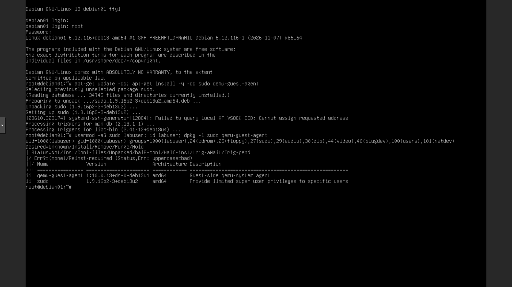
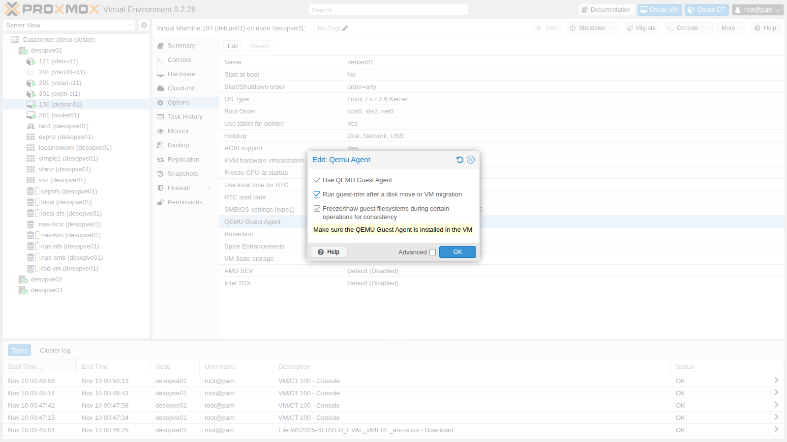
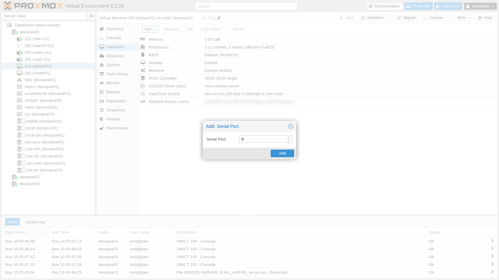
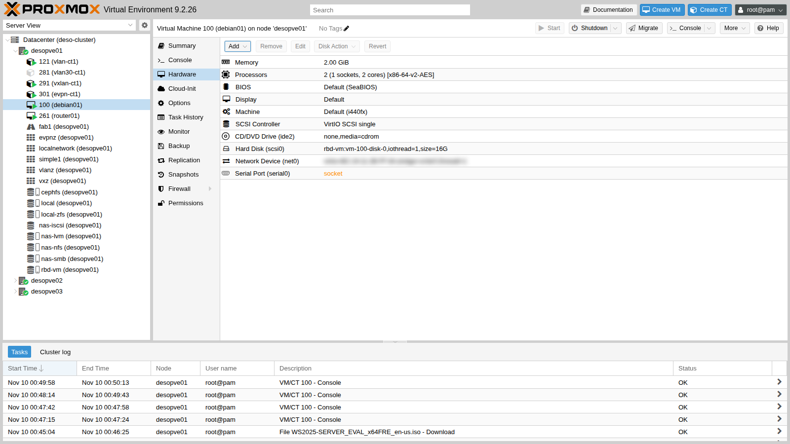
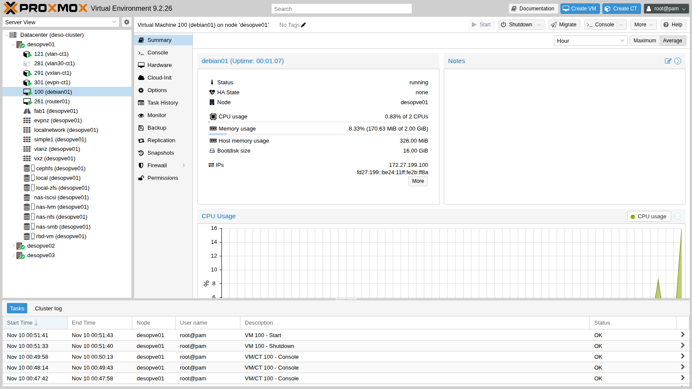
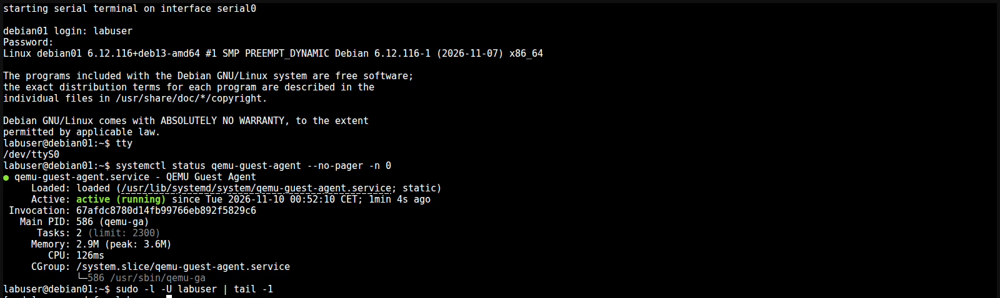
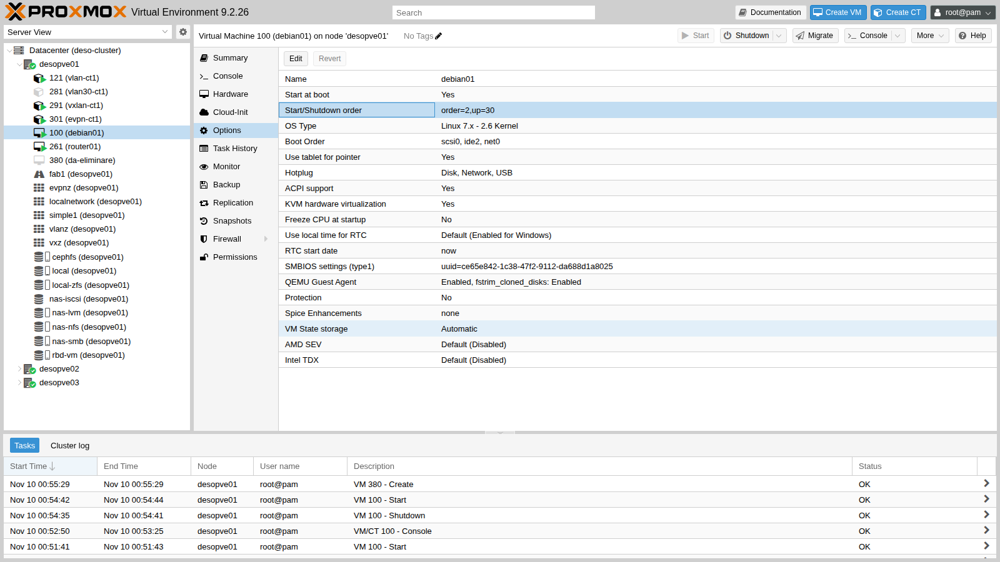
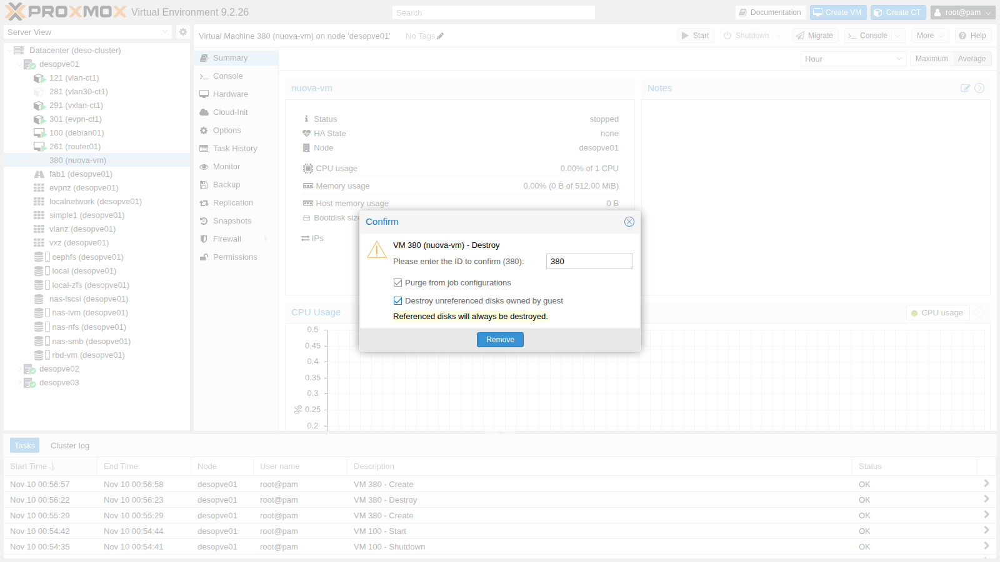

## Dependencies

- **Previous labs:**
  - [Lab 07](/07-first-vm-and-container/): VM 100 `debian01` (Debian 13), installed from ISO;
  - [Lab 05](/05-ssh-shell-cli/): SSH and `qm` commands;
  - [Lab 35](/35-kvm-qemu/): QEMU process, `qm showcmd` and monitor.
- **VMs and services:** VM 100 `debian01` on `desopve01`, disk on `rbd-vm` (Ceph, [Lab 17](/17-ceph-installation/)); storage `nas-nfs` ([Lab 13](/13-nfs/)) for a test backup job.
- **Addresses:** VM 100 on 172.27.199.100; test VM 380 without network.
- **Credentials:** `root` and `labuser` / `<lab-password>` → [Appendix B](/b-credentials-and-addresses/).

## Objectives

- Use the two consoles of a VM: **noVNC** (graphical screen) and **xterm.js** (serial port).
- Install and enable the **QEMU Guest Agent** and understand what Proxmox VE does with it: IP addresses, clean shutdown, commands in the guest, passwords, filesystem freeze.
- See with a real test how **fsfreeze** blocks the guest's writes during a backup.
- Configure **start at boot**, **start order** and **protection** of a VM.
- Delete a VM completely with **purge**, and understand what happens without it.

## How it works

**The guest agent.** `qemu-ga` is a small service that runs inside the guest. Proxmox VE talks to it through a dedicated channel, without going through the network:

```text
node:  /var/run/qemu-server/100.qga  (Unix socket)
QEMU:  virtio-serial device ──► port "org.qemu.guest_agent.0"
guest: qemu-ga reads the commands from the port and replies
```

With the agent enabled, Proxmox VE:

- shows the **guest IPs** in the Summary, without you having to look them up;
- **shuts down** the VM by asking the operating system, instead of simulating the power button (ACPI);
- **freezes the filesystems** before a snapshot or a backup, so that the data on disk is consistent;
- after a disk move or a migration, can run **`fstrim`** in the guest to return space to thin storage ([Lab 37](/37-virtual-disks-controllers/));
- runs **commands** in the guest (`qm guest exec`) and changes its **passwords** (`qm guest passwd`).

The agent must be enabled on both sides: the package in the guest and the **QEMU Guest Agent** option in the VM. The option adds the virtio-serial device, so it takes effect only when the QEMU process is started again.

**The consoles.**

- **noVNC** shows the graphical screen of the VM (the emulated graphics card). It always works, even during boot and without networking.
- **xterm.js** is a text terminal connected to the **serial port** of the VM. It requires a `serial0` port and a `getty` listening on `ttyS0` in the guest. Compared to noVNC, it supports copy and paste and has no keyboard layout issues.

**Removal.** `qm destroy` deletes the configuration and the disks. References to the VM in other cluster configurations (backup jobs, replication, HA) remain, unless you request a **purge**.

## Procedure

### 1. The starting point: `labuser` without sudo

In VM 100 from [Lab 07](/07-first-vm-and-container/), the user `labuser` cannot become an administrator. It is not a mistake: if you set a password for `root` in the Debian installer, the installer does **not** install `sudo` and does not add the first user to the `sudo` group. For `root`, on the other hand, SSH login with a password is disabled by default (`PermitRootLogin prohibit-password`).

Fix it from the **noVNC console** (VM 100 → **Console**), logging in as `root`:

```bash
apt-get update -qq; apt-get install -y -qq sudo qemu-guest-agent
usermod -aG sudo labuser; id labuser; dpkg -l sudo qemu-guest-agent
```



- `id labuser` now shows the group `27(sudo)`.
- `qemu-guest-agent` turns out to be **already installed** (`ii`): apt installed only `sudo`. The only thing still missing in the VM is enabling the agent on the Proxmox side.

:::note
The noVNC console transmits **keys**, not characters: if client and guest use different keyboard layouts, symbols come out wrong. To type long commands, use the serial console (section 5) or SSH.
:::

### 2. Enabling the agent in the VM

**Options → QEMU Guest Agent → Edit:**



- **Use QEMU Guest Agent:** adds the virtio-serial channel and makes Proxmox VE use the agent.
- **Run guest-trim after a disk move or VM migration:** after *Move disk* or a migration, runs `fstrim` in the guest.
- **Freeze/thaw guest filesystems… for consistency:** enabled by default, it is the freeze used by backups and snapshots (section 6).

From the CLI:

```bash
qm set 100 --agent enabled=1,fstrim_cloned_disks=1
```

### 3. Adding the serial port

**Hardware → Add → Serial Port**, port `0`:



Both changes require new hardware in the VM, so they remain **pending**: in the Hardware view the serial port appears in orange.



In the guest you need a login terminal on the serial port:

```bash
sudo systemctl enable serial-getty@ttyS0.service
```

```text output
Created symlink '/etc/systemd/system/getty.target.wants/serial-getty@ttyS0.service' → '/usr/lib/systemd/system/serial-getty@.service'.
```

A reboot from inside the guest is **not enough**: the QEMU process stays the same and the new hardware does not appear. You need to shut down the VM and start it again:

```bash
qm shutdown 100 && qm start 100
```

### 4. Verifying the agent

On the node, the agent socket and the serial port socket appear, and the QEMU command line contains the new devices:

```text
srwxr-x--- 1 root root  0 Nov 10 00:54 /var/run/qemu-server/100.qga
srwxr-x--- 1 root root  0 Nov 10 00:54 /var/run/qemu-server/100.serial0
```

```text
  -chardev 'socket,id=serial0,path=/var/run/qemu-server/100.serial0,server=on,wait=off' \
  -device 'isa-serial,chardev=serial0' \
  -chardev 'socket,path=/var/run/qemu-server/100.qga,server=on,wait=off,id=qga0' \
  -device 'virtio-serial,id=qga0,bus=pci.0,addr=0x8' \
  -device 'virtserialport,chardev=qga0,name=org.qemu.guest_agent.0' \
```

The agent commands (`qm agent` is an alias of `qm guest cmd`):

```bash
qm agent 100 ping            # no output and exit code 0 if the agent responds
qm guest cmd 100 get-osinfo
```

```text output
{
   "id" : "debian",
   "kernel-release" : "6.12.116+deb13-amd64",
   "kernel-version" : "#1 SMP PREEMPT_DYNAMIC Debian 6.12.116-1 (2026-11-07)",
   "machine" : "x86_64",
   "name" : "Debian GNU/Linux",
   "pretty-name" : "Debian GNU/Linux 13 (trixie)",
   "version" : "13 (trixie)",
   "version-id" : "13"
}
```

`network-get-interfaces` returns interfaces and addresses; in summary:

```text
lo 00:00:00:00:00:00 ['127.0.0.1/8', '::1/128']
ens18 bc:24:11:2b:ff:8a ['172.27.199.100/24', 'fd27:199::be24:11ff:fe2b:ff8a/64', 'fe80::be24:11ff:fe2b:ff8a/64']
```

The global IPv6 address is the SLAAC address received from the lab router ([Lab 25](/25-ipv6/)). The same addresses appear in the VM's **Summary**, under **IPs**:



A command run in the guest, with the output returned to the node:

```bash
qm guest exec 100 -- uname -r
```

```text output
{
   "exitcode" : 0,
   "exited" : 1,
   "out-data" : "6.12.116+deb13-amd64\n",
   "out-truncated" : 0
}
```

`get-fsinfo` lists the guest's filesystems and the disks they live on: the disk is recognized as `drive-scsi0`, the same name used by Proxmox VE.

```text
/ ext4 sda1 ['0QEMU_QEMU_HARDDISK_drive-scsi0'] 1315024896 15046635520
```

### 5. The serial console with xterm.js

**Console → xterm.js** (or the drop-down menu of the **Console** button). The serial port terminal opens directly:



`tty` returns `/dev/ttyS0`: it is the serial port, not the screen. You can copy and paste text as in an SSH terminal, but the console works even without networking in the guest.

### 6. fsfreeze: what the guest sees during a backup

A backup in *snapshot* mode (Lab 46) does this: it freezes the filesystems, takes the disk snapshot, thaws them. This way the saved disk is consistent, as after a `sync`. The test with the agent commands:

- from the node: `fsfreeze-freeze`, a 12-second wait, `fsfreeze-thaw`;
- in the guest, in an SSH session that is already open, a write with `sync` that starts during the freeze.

```bash
# on the node
qm guest cmd 100 fsfreeze-freeze      # replies with the number of frozen filesystems
qm guest cmd 100 fsfreeze-status
sleep 12
qm guest cmd 100 fsfreeze-thaw
# in the guest, right after the freeze
date +%T; dd if=/dev/zero of=~/prova bs=1M count=10 && sync; date +%T
```

```text output
nodo: 00:53:50 freeze
1
frozen
Agent error: Command guest-exec has been disabled: the command is not allowed
nodo: 00:54:06 thaw
1
thawed
guest: inizio scrittura 00:53:54
guest: fine scrittura 00:54:08
```

- `fsfreeze-freeze` replies with the number of frozen filesystems (1) and the status becomes `frozen`.
- **During the freeze the agent rejects other commands**, such as `guest-exec`: it accepts only status and thaw.
- The write in the guest started at 00:53:54 and **remained blocked** until the thaw at 00:54:06: applications receive no errors, they wait.

This is why a backup with the agent causes only a few seconds of write "pause". For databases, `qemu-ga` can run a script before and after the freeze (*fsfreeze hook*), for example to have the database write a consistent checkpoint.

### 7. Clean shutdown

With the agent enabled, `qm shutdown` (and the **Shutdown** button) asks the guest to shut down through the agent. Measure the time with `time qm shutdown 100`:

```text
spenta in 7 s
```

In the guest's journal, after the restart, you can see who requested the shutdown:

```bash
qm guest exec 100 -- journalctl -b -1 --no-pager -g "guest-shutdown|System is powering down"
```

```text output
Nov 10 00:54:35 debian01 qemu-ga[586]: info: guest-shutdown called, mode: (null)
Nov 10 00:54:35 debian01 systemd-logind[596]: System is powering down (hypervisor initiated shutdown).
```

Without the agent, Proxmox VE sends an ACPI event, like pressing the power button: it works only if the guest handles it (with systemd it does). If the guest does not respond within the timeout, the task fails and you need **Stop**, which is equivalent to pulling the plug.

### 8. Changing the password with the agent

`qm guest passwd` sets the password of a guest user without logging in to the guest. It reads the new password twice from standard input:

```bash
qm guest passwd 100 labuser
```

The test with a temporary password and an SSH login:

```text
login con la nuova password: ok (labuser@debian01)
```

The password was then set back to `<lab-password>` with the same command. This is useful when a password is lost and the VM has no other way in: all you need is an active agent.

### 9. Start at boot, order and protection

In **Options**:

- **Start at boot** (`onboot`): the VM starts when the node boots.
- **Start/Shutdown order** (`startup`): `order` is the position in the sequence (low numbers first; at shutdown the order is reversed), `up` the seconds to wait after startup before the next VM, `down` the shutdown timeout.

For VM 100: start at boot, position 2, 30-second delay.



```bash
qm set 100 --onboot 1 --startup order=2,up=30
```

**Protection** prevents the VM and its disks from being deleted. Test it on a throwaway VM, 380, created empty with a 1 GiB disk:

```bash
qm create 380 --name prova-380 --memory 512 --scsihw virtio-scsi-single --scsi0 rbd-vm:1 --ostype l26
qm set 380 --protection 1
qm destroy 380
```

```text output
can't remove VM 380 - protection mode enabled
```

Remove it with `qm set 380 --delete protection`.

### 10. Removal: without and with purge

VM 380 is added to a backup job (disabled, just for the test):

```bash
pvesh create /cluster/backup --vmid 380 --storage nas-nfs --schedule "sun 03:00" --enabled 0 --mode snapshot --comment "lab 38 prova purge"
```

**First removal, with the default options.** In the removal dialog (**More → Remove**), **Purge from job configurations** is disabled. The VM disappears, and so does the volume on Ceph, but the job remains:

```text
vzdump: 7da86c4c-424f-44c6-98bf-08d52b3a8af1
	comment lab 38 prova purge
	schedule sun 03:00
	enabled 0
	mode snapshot
	storage nas-nfs
	vmid 380
```

The problem shows up when you create a **new** VM with the same ID:

```bash
qm create 380 --name nuova-vm --memory 512 --scsihw virtio-scsi-single --scsi0 rbd-vm:1 --ostype l26
pvesh get /cluster/backup/7da86c4c-424f-44c6-98bf-08d52b3a8af1 --output-format json \
  | python3 -c 'import json,sys; print("job vmid:", json.load(sys.stdin)["vmid"])'
```

```text output
job vmid: 380
```

The new VM **silently inherits** the job of the old one: with an enabled job it would be backed up (or, if the storage ran out of space, it would make the job fail).

**Second removal, with purge.** Enable **Purge from job configurations** and **Destroy unreferenced disks owned by guest** (which also finds and deletes disks of the VM that are not referenced in the configuration):



```bash
echo "--- dopo la rimozione con purge"; cat /etc/pve/jobs.cfg; echo "(fine jobs.cfg)"
```

```text output
--- dopo la rimozione con purge
(fine jobs.cfg)
```

`/etc/pve/jobs.cfg` is empty: the job contained only VM 380, and the purge **deleted it entirely**. From the CLI:

```bash
qm destroy 380 --purge 1 --destroy-unreferenced-disks 1
```

The purge also removes the VM from replication and HA.

## Verification and tests

- `labuser` is in the `sudo` group; `qemu-guest-agent` is active in the guest.
- `qm agent 100 ping` responds; the Summary shows the VM's IPs.
- The xterm.js console opens a login on `/dev/ttyS0`.
- `qm shutdown` shuts down the VM in 7 seconds and the guest logs `guest-shutdown called`.
- During an `fsfreeze`, the writes in the guest wait until the thaw and the agent rejects `guest-exec`.
- `qm guest passwd` changes the password and login with the new one works.
- A protected VM cannot be deleted.
- Without purge, a backup job keeps the ID of the deleted VM and applies it to a new VM with the same ID; with purge the reference disappears.

## Final lab state

- **VM 100 `debian01`** on `desopve01`, running: `sudo` for `labuser`, agent enabled (`agent: 1,fstrim_cloned_disks=1`), `serial0` port with getty on `ttyS0`, `onboot: 1`, `startup: order=2,up=30`. The password of `labuser` is the same as before.
- **VM 380:** deleted, together with the test backup job.
- No other changes to the cluster.

## What you learned

- The guest agent communicates with the node over a virtio-serial channel and must be enabled both in the guest and in the VM options; the new hardware requires a shutdown and a fresh start.
- With the agent, Proxmox VE knows the guest's IPs, shuts it down cleanly, runs commands and changes passwords.
- Freezing the filesystems makes the guest's writes wait for the duration of the snapshot: this is what makes backups consistent.
- The xterm.js console uses the serial port and behaves like a real terminal; noVNC remains the emergency access.
- `onboot`, `startup` and `protection` control automatic start, sequence and safety of VMs.
- Deleting a VM without purge leaves orphaned references in jobs, which a new VM with the same ID inherits.

## References

- [Proxmox VE – Virtual Machines: QEMU Guest Agent](https://pve.proxmox.com/pve-docs/chapter-qm.html#qm_qemu_agent)
- [Proxmox VE wiki – Qemu-guest-agent](https://pve.proxmox.com/wiki/Qemu-guest-agent)
- [Proxmox VE wiki – Serial Terminal](https://pve.proxmox.com/wiki/Serial_Terminal)
- [Proxmox VE – qm(1)](https://pve.proxmox.com/pve-docs/qm.1.html)
- [QEMU – Guest Agent protocol reference](https://www.qemu.org/docs/master/interop/qemu-ga-ref.html)
