## Dependencies

- **Previous labs:**
  - [Lab 02](/02-domain-controller/): the initial screens of the Windows Server 2025 installation (language, edition, license);
  - [Lab 35](/35-kvm-qemu/): machine type, OVMF and Secure Boot;
  - [Lab 37](/37-virtual-disks-controllers/): VirtIO SCSI, IO thread, discard;
  - [Lab 38](/38-linux-vm-guest-agent/): QEMU Guest Agent.
- **Node and storage:** VM on `desopve02`; disks on `rbd-vm`; ISOs on `cephfs`, shared among the nodes ([Lab 17](/17-ceph-installation/)).
- **Network:** the lab proxy to download the ISOs ([Lab 01](/01-lab-architecture/)). The proxy whitelist must include `software-static.download.prss.microsoft.com` and `go.microsoft.com` for the Windows Server ISO, and `fedorapeople.org` for the VirtIO drivers ISO.
- **Addresses:** VM 390 `win2025` on 172.27.199.190. The address belonged to VM 190 from [Lab 19](/19-fio-benchmark/), deleted at the end of that lab, so it is free.
- **Credentials:** `Administrator` / `<lab-password>` → [Appendix B](/b-credentials-and-addresses/).

## Objectives

- Download the official ISOs of **Windows Server 2025 Evaluation** and of the **VirtIO drivers** directly into Proxmox VE storage.
- Create a Windows VM with the recommended settings: UEFI with Secure Boot, TPM 2.0, VirtIO SCSI single, VirtIO network device.
- Load the disk driver **during** the installation, when Windows does not see any disk.
- Install all the drivers and the guest agent with **virtio-win-guest-tools** and verify them in Device Manager and from Proxmox VE.
- Use the agent to configure Windows from the node with PowerShell.

## How it works

Windows does not include the drivers for the **paravirtualized** VirtIO devices, the ones that give the best performance ([Lab 37](/37-virtual-disks-controllers/)). Without drivers:

- the setup program **does not see the disk** on VirtIO SCSI;
- after installation, the VirtIO **network device**, the **balloon** and the **guest agent port** remain unknown devices.

The drivers are in the `virtio-win` ISO, maintained by the Fedora project and signed for Windows. The standard procedure:

1. two CD drives: the Windows ISO and the drivers ISO;
2. during installation, load only the disk driver (`vioscsi`);
3. once the system is installed, `virtio-win-guest-tools.exe` installs all the other drivers, the QEMU Guest Agent and the balloon service.

**Settings for modern Windows versions:**

| Setting | Value | Why |
|---|---|---|
| OS type | `win11` (Windows 11/2022/2025) | Proxmox VE applies the right defaults for Windows: q35 machine with pinned version, clock in local time, Hyper-V enlightenments |
| BIOS | OVMF (UEFI) with EFI disk and pre-enrolled Microsoft keys | Secure Boot enabled, as on a modern physical server |
| TPM | v2.0 | mandatory for Windows 11, useful for BitLocker on Windows Server too |
| Controller and disk | VirtIO SCSI single, IO thread, Discard, SSD emulation | better performance and space returned to thin storage |
| Network device | VirtIO (paravirtualized) | better performance, NetKVM driver |

## Procedure

### 1. The ISOs in the storage

The ISOs go on `cephfs`, so they are available on all nodes.

**Windows Server 2025 Evaluation.** Storage `cephfs` → **ISO Images** → **Download from URL**, with the direct URL of the Evaluation ISO (English) and **Query URL**, which reads the file name and size. The URL used in the lab is the one that the Windows Server 2025 Evaluation Center page offers for the 64-bit English ISO: `https://software-static.download.prss.microsoft.com/dbazure/888969d5-f34g-4e03-ac9d-1f9786c66749/26100.1742.240906-0331.ge_release_svc_refresh_SERVER_EVAL_x64FRE_en-us.iso`. Microsoft changes it with every new build: copy it again from the official page.

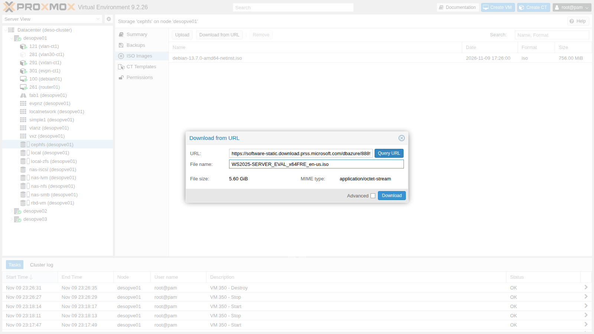

The node downloads it through the proxy configured in [Lab 04](/04-first-access-repositories-updates/):

```text
2026-11-10 00:46:25 (71.2 MB/s) - '/mnt/pve/cephfs/template/iso/WS2025-SERVER_EVAL_x64FRE_en-us.iso.tmp_dwnl.329677' saved [6014152704/6014152704]
TASK OK
```

**VirtIO drivers.** The *stable* version, from the command line, with the same API:

```bash
pvesh create /nodes/desopve02/storage/cephfs/download-url --content iso \
  --filename virtio-win-0.1.302.iso \
  --url https://fedorapeople.org/groups/virt/virtio-win/direct-downloads/archive-virtio/virtio-win-0.1.302-1/virtio-win-0.1.302.iso
```

```text output
2026-11-10 01:03:01 (12.8 MB/s) - '/mnt/pve/cephfs/template/iso/virtio-win-0.1.302.iso.tmp_dwnl.261762' saved [877373440/877373440]
```

The URL `.../stable-virtio/virtio-win.iso` always redirects to the latest stable version: here the exact URL is used, so the lab is repeatable. The checksums, to be noted down to verify any later copies:

```text
303f7ae40dad495d6ae474fdc571df58958a4dbc5c37a522d80f9a203867949d  virtio-win-0.1.302.iso
d0ef4502e350e3c6c53c15b1b3020d38a5ded011bf04998e950720ac8579b23d  WS2025-SERVER_EVAL_x64FRE_en-us.iso
```

No "lite" or modified versions of Windows: only official Microsoft ISOs are used.

### 2. The VM with the wizard

**Create VM** at the top right.

- **General:** node `desopve02`, VM ID `390`, name `win2025`.
- **OS:** Windows ISO from `cephfs`; Type **Microsoft Windows**, Version **11/2022/2025**; **Add additional drive for VirtIO drivers** with the `virtio-win` ISO. This way the wizard adds the second CD drive.

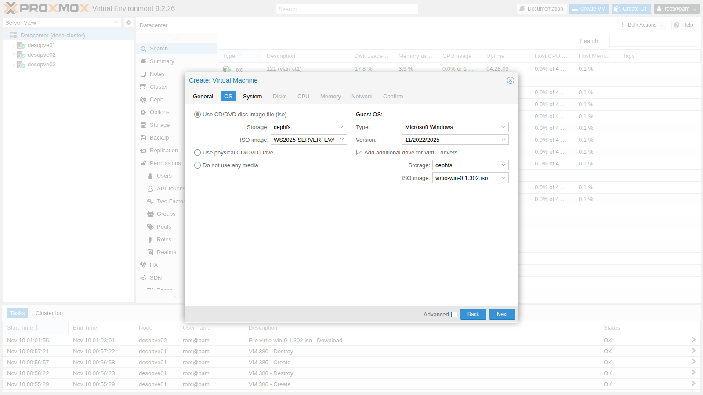

- **System:** when you choose Windows 11/2022/2025, the wizard automatically proposes **q35**, **OVMF (UEFI)**, **EFI disk** with **Pre-Enroll keys** and **TPM v2.0**. Only change the storage of the EFI disk and TPM to `rbd-vm`. **Qemu Agent** can be checked here; in this lab it is enabled after installing the drivers (section 7).

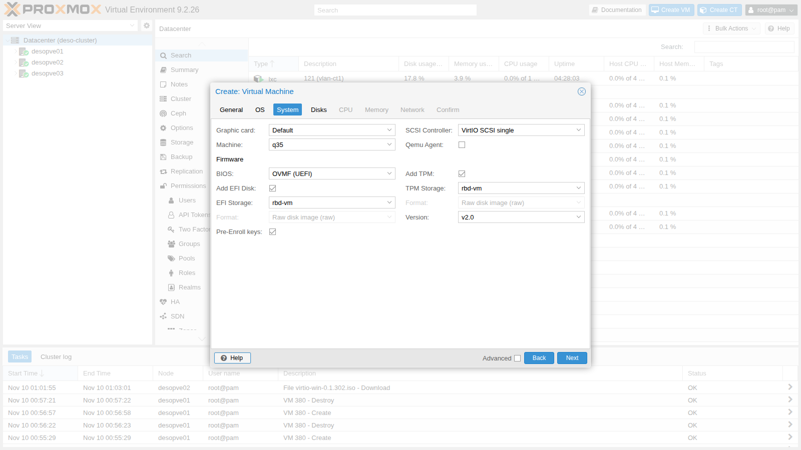

- **Disks:** SCSI bus, `rbd-vm`, 32 GiB, **Discard**, **SSD emulation** and **IO thread** (with **Advanced** enabled).

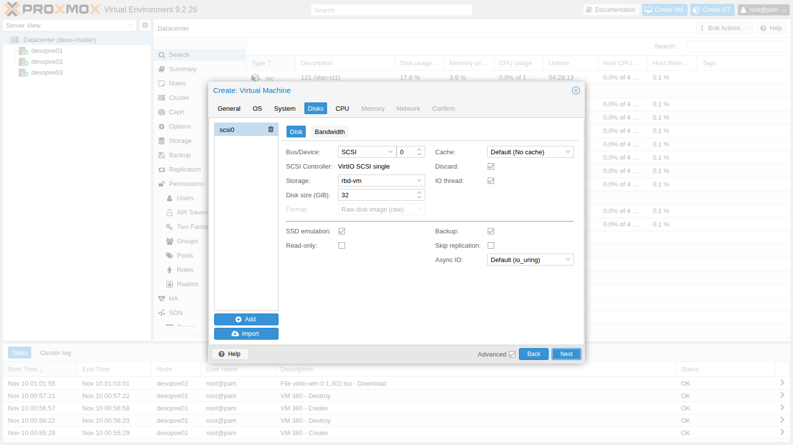

- **CPU:** 4 cores, type `x86-64-v2-AES`. **Memory:** 4096 MiB. **Network:** `vmbr0`, model **VirtIO (paravirtualized)**.

The resulting configuration:

```text
bios: ovmf
boot: order=scsi0;ide2;ide0;net0
cores: 4
cpu: x86-64-v2-AES
efidisk0: rbd-vm:vm-390-disk-0,efitype=4m,ms-cert=2023k,pre-enrolled-keys=1,size=1M
ide0: cephfs:iso/virtio-win-0.1.302.iso,media=cdrom,size=856810K
ide2: cephfs:iso/WS2025-SERVER_EVAL_x64FRE_en-us.iso,media=cdrom,size=5873196K
machine: pc-q35-11.1
memory: 4096
name: win2025
net0: virtio=BC:24:11:C6:80:3D,bridge=vmbr0,firewall=1
ostype: win11
scsi0: rbd-vm:vm-390-disk-1,discard=on,iothread=1,size=32G,ssd=1
scsihw: virtio-scsi-single
tpmstate0: rbd-vm:vm-390-disk-2,size=4M,version=v2.0
```

- **`machine: pc-q35-11.1`:** with Windows the machine version is pinned, so a QEMU update does not change the hardware seen by Windows ([Lab 35](/35-kvm-qemu/)).
- **`ms-cert=2023k`:** the EFI disk contains the Microsoft certificates for Secure Boot, including the 2023 ones.

### 3. The first boot from CD: mind the timing

With UEFI, the Windows CD asks you to press a key within a few seconds (**Press any key to boot from CD or DVD**). On the first boot OVMF initializes the new EFI disk and can take longer than usual: if you are not watching the console at that moment, the prompt times out and the firmware finds nothing else to boot:

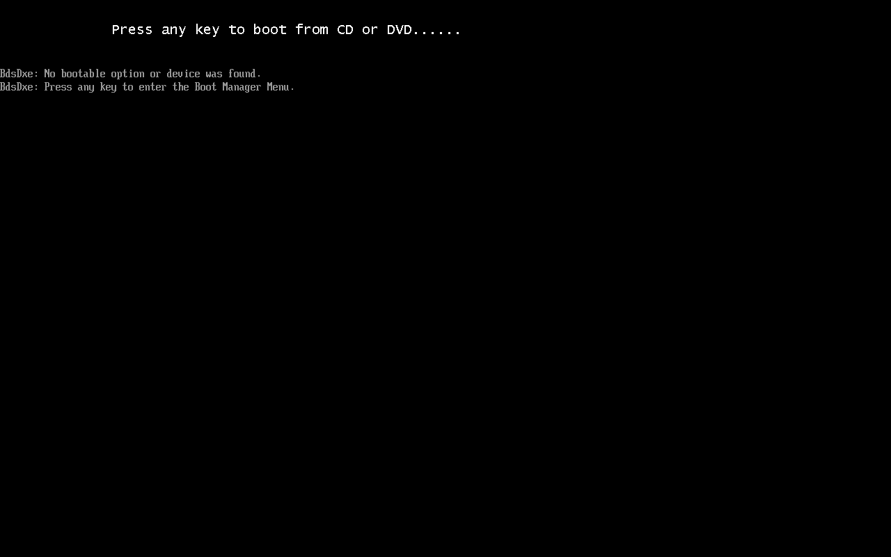

The firmware finds nothing else to boot and offers the **Boot Manager** at the press of any key. Choose the drive with the Windows ISO and press a key right away:

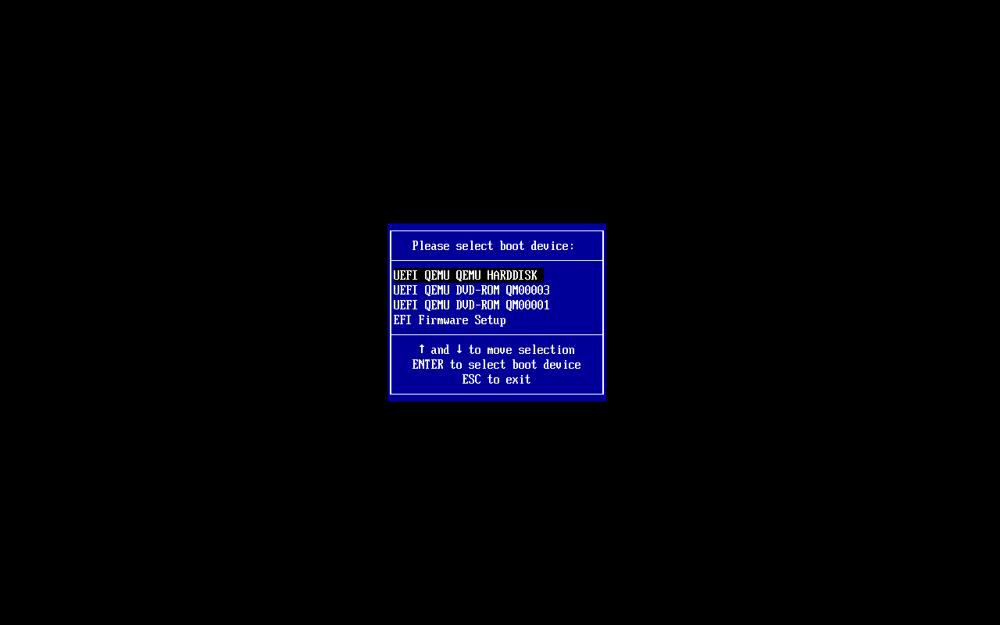

- **QM00003** is `ide2`, the Windows ISO; **QM00001** is `ide0`, the drivers.
- From the second boot onward OVMF is much faster (about 30 seconds to the operating system).

### 4. The installation: the disk is missing

The first screens are the same as in [Lab 02](/02-domain-controller/): language, keyboard, **Install Windows Server**, edition **Windows Server 2025 Standard Evaluation (Desktop Experience)**, license. When it is time to choose the disk, the list is **empty**: Windows does not have the driver for the VirtIO SCSI controller.

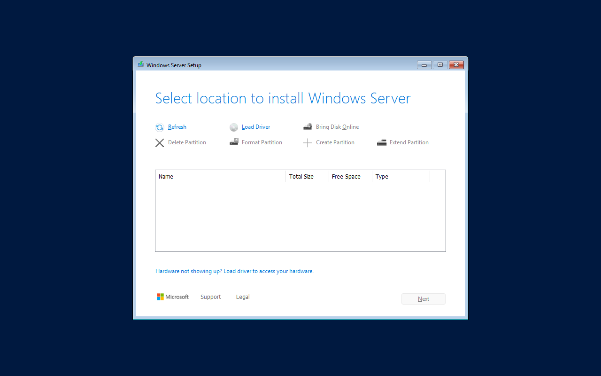

**Load Driver** → **Browse**. The CD drives are `D:` (`virtio-win`) and `E:` (Windows). Navigate to the driver folder for the right operating system: `D:\vioscsi\2k25\amd64`.

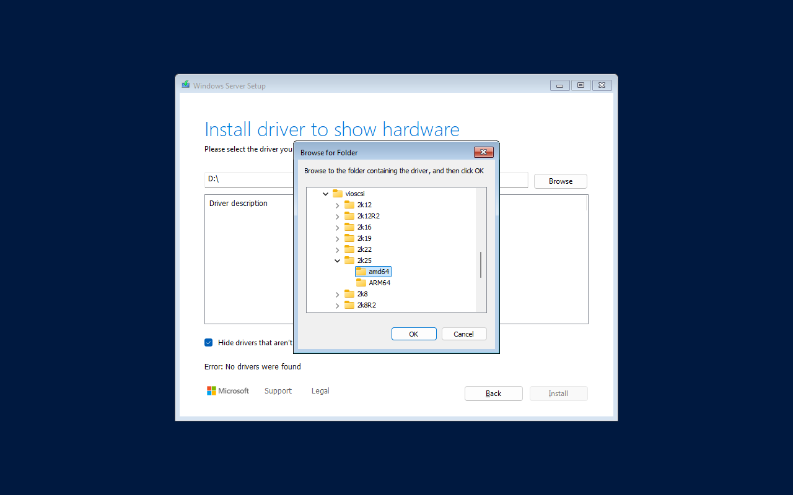

:::note
If you choose the root `D:\`, setup replies **"Error: No drivers were found"**: it does not search subfolders. You need the exact folder: `vioscsi` (VirtIO SCSI), `2k25` (Windows Server 2025), `amd64`.
:::

Setup shows **Red Hat VirtIO SCSI pass-through controller**; select it and click **Install**:

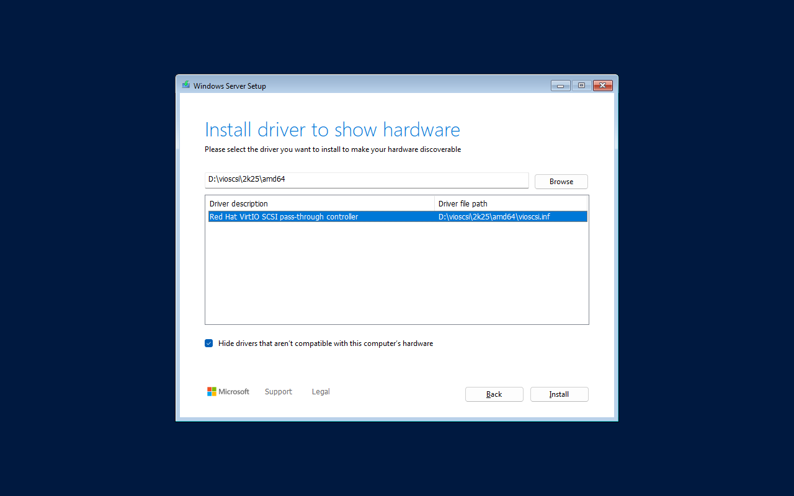

Now the 32 GB disk appears:

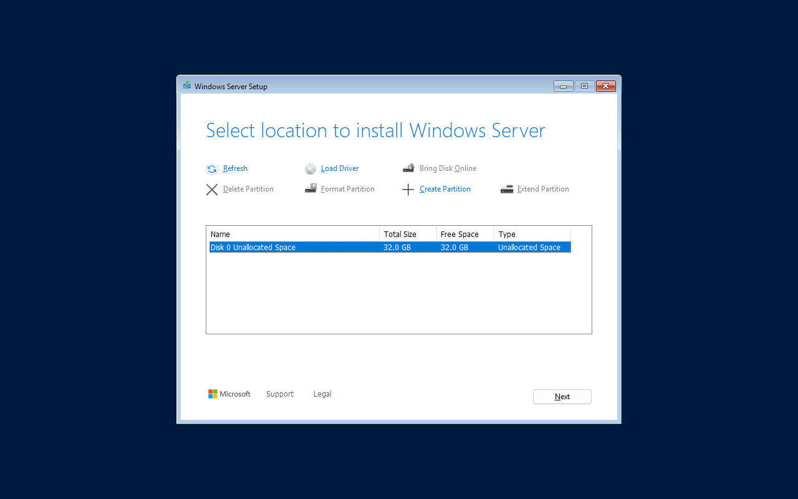

From here the installation proceeds normally: **Next**, **Install**. In the lab, on Ceph, it took about 40 minutes. If setup is restarted before installing, the driver must be **loaded again**: it lives only in memory until Windows is installed.

At first sign-in: the `Administrator` password, then **Send diagnostic data** with **Required only**, as in [Lab 02](/02-domain-controller/).

### 5. Device Manager before the drivers

`Win+R` → `devmgmt.msc`:


- **Ethernet Controller:** the VirtIO network device, so Windows has no network.
- **PCI Device:** the balloon device.
- The disk works because the `vioscsi` driver was installed together with the system.

### 6. virtio-win-guest-tools

From the drivers CD: `Win+R` → `D:\virtio-win-guest-tools.exe`. Accept the license and click **Install**:

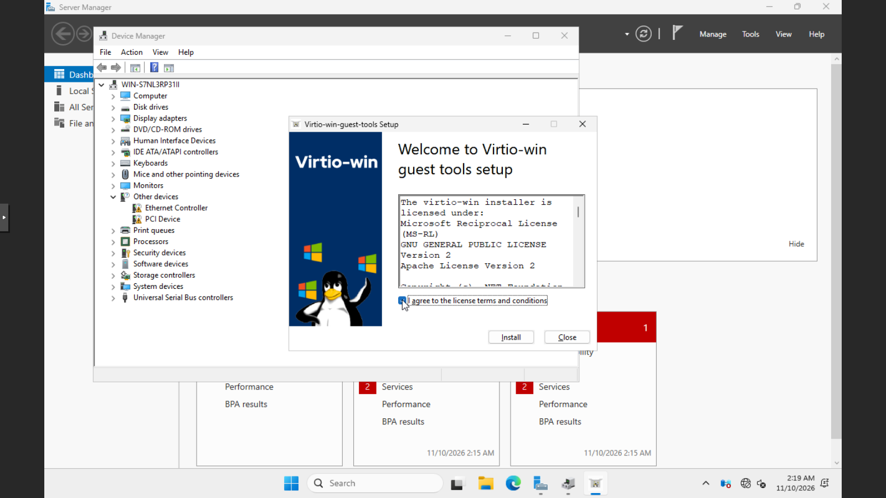

The driver package wizard opens (**Next**, license, **Custom Setup** with all components, **Install**, **Finish**); the package then installs the guest agent and ends with:

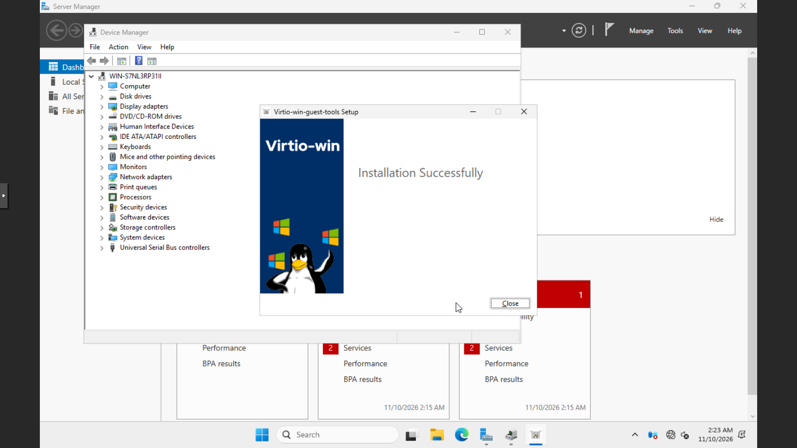

In Device Manager there are no more unknown devices: **Network adapters → Red Hat VirtIO Ethernet Adapter** and **Storage controllers → Red Hat VirtIO SCSI pass-through controller**.

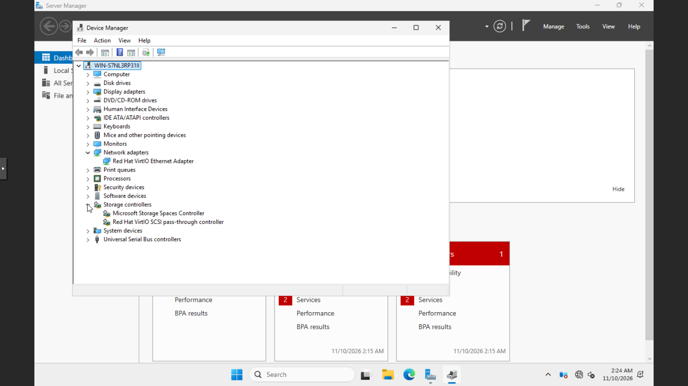

:::note
For repeated installations, the same installation can run unattended: `virtio-win-guest-tools.exe /install /passive /norestart`.
:::

### 7. Enabling the agent and removing the ISOs

Shut down the VM from Proxmox VE with `time qm shutdown 390`. Without the agent, the command sends the ACPI power button event, and Windows handles it:

```text
spenta via ACPI in 29 s
```

Then enable the agent, empty the Windows drive and remove the drivers drive:

```bash
qm set 390 --agent enabled=1 --ide2 none,media=cdrom --delete ide0
qm start 390
qm guest cmd 390 get-osinfo
```

The agent responds about 30 seconds after startup:

```text
{
   "id" : "mswindows",
   "kernel-release" : "26100",
   "kernel-version" : "10.0",
   "machine" : "x86_64",
   "name" : "Microsoft Windows",
   "pretty-name" : "Windows Server 2025 Standard Evaluation",
   "variant" : "server",
   "variant-id" : "server",
   "version" : "Microsoft Windows Server 2025",
   "version-id" : "2025"
}
```

### 8. Configuring Windows from the node with the agent

`qm guest exec` runs PowerShell in the guest. Static IP, DNS, time zone and name, without opening the console:

```bash
qm guest exec 390 --timeout 90 -- powershell -NoProfile -Command \
 "\$a=Get-NetAdapter | Select-Object -First 1;
  New-NetIPAddress -InterfaceIndex \$a.ifIndex -IPAddress 172.27.199.190 -PrefixLength 24 -DefaultGateway 172.27.199.1 | Out-Null;
  Set-DnsClientServerAddress -InterfaceIndex \$a.ifIndex -ServerAddresses 172.27.199.20;
  Set-TimeZone -Id 'W. Europe Standard Time';
  Rename-Computer -NewName WIN2025 -Force -WarningAction SilentlyContinue;
  \$a.Name + ' | ' + \$a.InterfaceDescription"
```

In the returned JSON, `exitcode` is `0` and `out-data` contains:

```text
Ethernet | Red Hat VirtIO Ethernet Adapter
```

The reboot also goes through the agent (`qm reboot 390`): 67 seconds until the agent is active again. Then the name and address:

```bash
qm guest cmd 390 get-host-name
qm guest cmd 390 network-get-interfaces    # summary: IPv4 only
```

```text output
{
   "host-name" : "WIN2025"
}
Ethernet ['172.27.199.190/24']
```

The VirtIO devices and the installed services, read through the agent:

```bash
qm guest exec 390 --timeout 90 -- powershell -NoProfile -Command \
 "Get-PnpDevice -PresentOnly | Where-Object FriendlyName -match 'VirtIO|Balloon|QEMU' |
    Sort-Object Class | Format-Table -AutoSize Status,Class,FriendlyName | Out-String -Width 120;
  Get-Service QEMU-GA,BalloonService | Format-Table -AutoSize Status,Name,DisplayName | Out-String -Width 120"
```

```text output
Status Class       FriendlyName
------ -----       ------------
OK     CDROM       QEMU QEMU DVD-ROM
OK     Computer    QEMU Standard PC (Q35 + ICH9, 2009)
OK     DiskDrive   QEMU QEMU HARDDISK SCSI Disk Device
OK     Net         Red Hat VirtIO Ethernet Adapter
OK     Processor   QEMU Virtual CPU version 2.5+
OK     Processor   QEMU Virtual CPU version 2.5+
OK     Processor   QEMU Virtual CPU version 2.5+
OK     Processor   QEMU Virtual CPU version 2.5+
OK     SCSIAdapter Red Hat VirtIO SCSI pass-through controller
OK     System      VirtIO Balloon Driver
OK     System      QEMU FwCfg Device
OK     System      VirtIO Serial Driver

 Status Name           DisplayName
 ------ ----           -----------
Running BalloonService BalloonService
Running QEMU-GA        QEMU Guest Agent
```

The four *Processor* lines are the four vCPUs. Networking works: `Test-NetConnection 172.27.199.20 -Port 53` from the guest returns `True`. Pinging the VM from the lab network, on the other hand, gets no reply: Windows Firewall blocks ICMP by default.

The **Summary** shows the addresses reported by the agent:

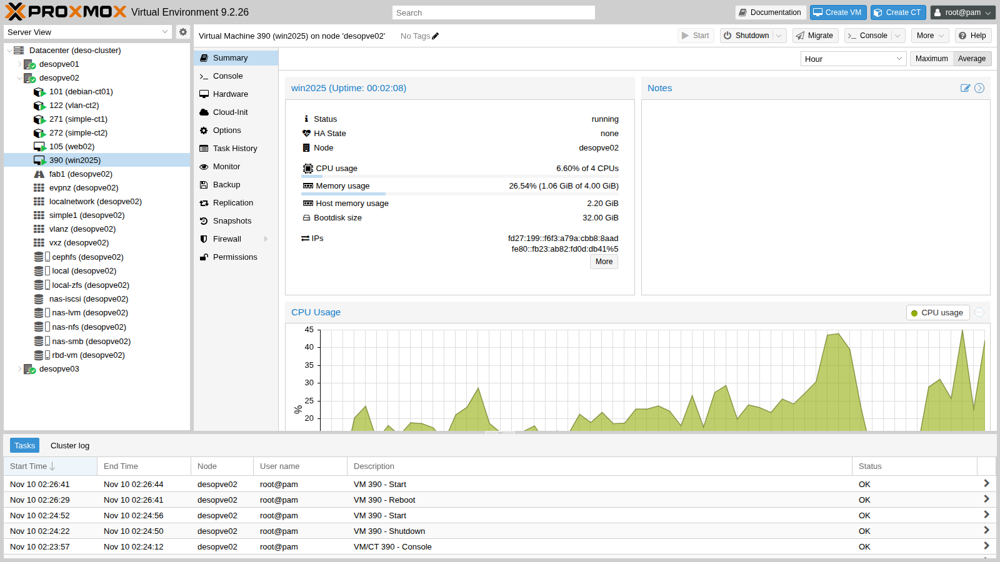

and the **Hardware** view sums up the final configuration, without the drivers drive:

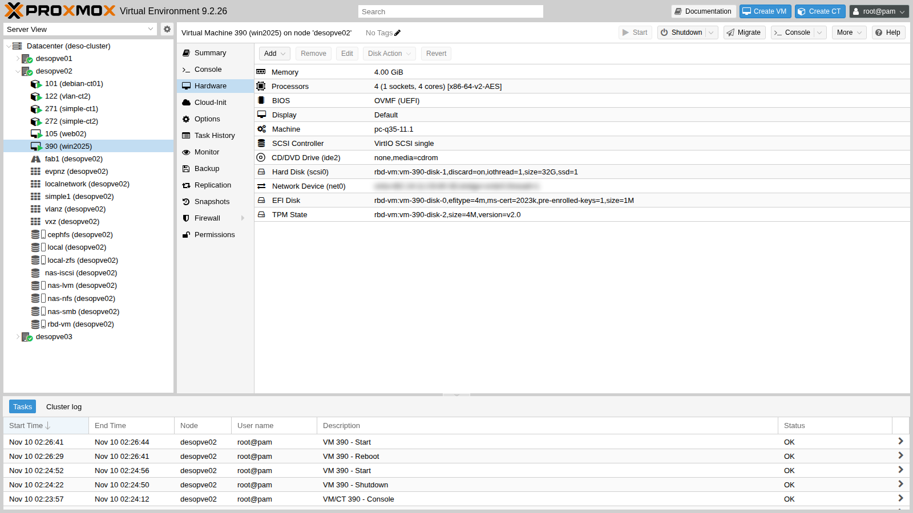

Final shutdown, now through the agent, again with `time qm shutdown 390`:

```text
VM 390 spenta via agent in 10 s
```

## Verification and tests

- The official ISOs of Windows Server 2025 Evaluation and virtio-win 0.1.302 are on `cephfs`, with their checksums noted down.
- The wizard with Windows 11/2022/2025 configures q35, OVMF with Secure Boot and TPM 2.0.
- Without drivers, setup does not see the VirtIO SCSI disk; with `vioscsi\2k25\amd64` it does. The root of the CD is not enough.
- After `virtio-win-guest-tools` there are no unknown devices: network, balloon, serial and guest agent are active.
- The agent responds, reports the system and addresses, runs PowerShell, reboots and shuts down the VM.

## Final lab state

- **VM 390 `win2025`** on `desopve02`, **powered off**: Windows Server 2025 Standard Evaluation (Desktop Experience), name `WIN2025`, IP 172.27.199.190, W. Europe time zone; VirtIO drivers and QEMU Guest Agent installed; disks on `rbd-vm`; no ISO attached. It is the reference Windows VM for the following labs (backup, migrations, HA).
- **ISOs on `cephfs`:** `WS2025-SERVER_EVAL_x64FRE_en-us.iso` and `virtio-win-0.1.302.iso`.
- **Lab proxy:** whitelist extended to `go.microsoft.com` and `software-static.download.prss.microsoft.com`.
- The Evaluation version lasts 180 days.

## What you learned

- ISOs can be downloaded directly into storage with **Download from URL** or `pvesh ... download-url`, even behind a proxy.
- For Windows, the wizard with type 11/2022/2025 sets UEFI, Secure Boot, TPM and a pinned q35 machine, and adds the VirtIO drivers CD.
- The VirtIO disk requires the `vioscsi` driver during installation, picked from the exact folder for the Windows version.
- With a UEFI firmware that is slow on first boot you can miss the "Press any key" prompt: the OVMF Boot Manager is the way out.
- `virtio-win-guest-tools` installs drivers, balloon and guest agent in one go.
- With the agent, Windows can be configured and managed from the node, even without working networking.

## References

- [Proxmox VE wiki – Windows 2022 guest best practices](https://pve.proxmox.com/wiki/Windows_2022_guest_best_practices) (also valid for Windows Server 2025)
- [Proxmox VE wiki – Windows VirtIO Drivers](https://pve.proxmox.com/wiki/Windows_VirtIO_Drivers)
- [Proxmox VE – OS type and VM settings](https://pve.proxmox.com/pve-docs/chapter-qm.html#qm_os_settings)
- [Fedora – virtio-win direct downloads](https://fedorapeople.org/groups/virt/virtio-win/direct-downloads/)
- [Microsoft – Windows Server 2025 Evaluation Center](https://www.microsoft.com/en-us/evalcenter/evaluate-windows-server-2025)
