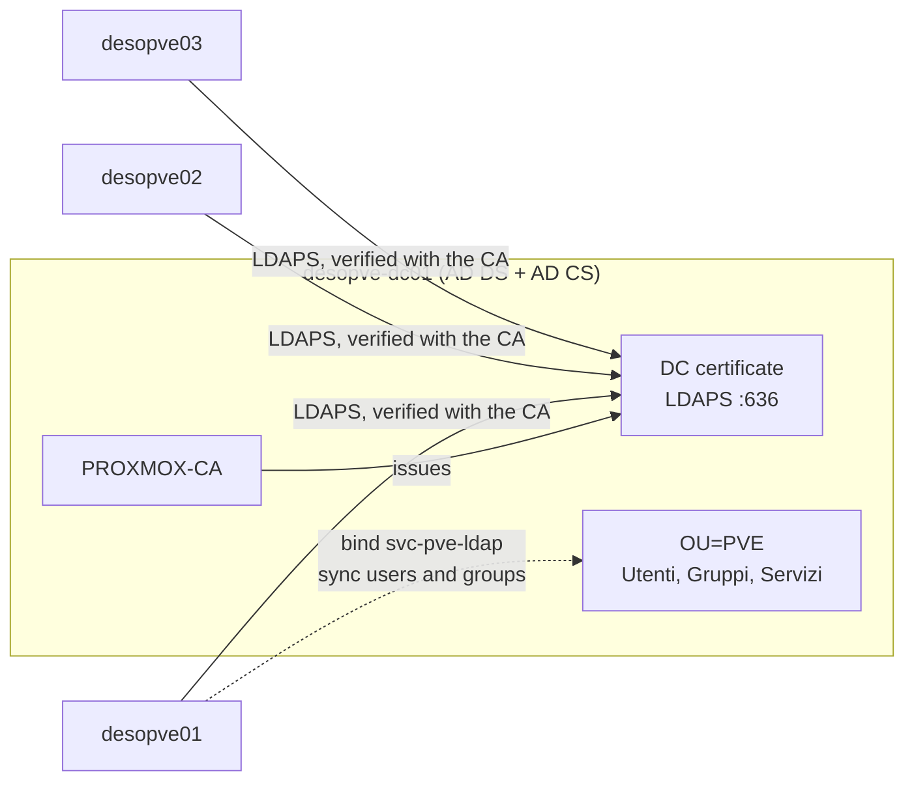
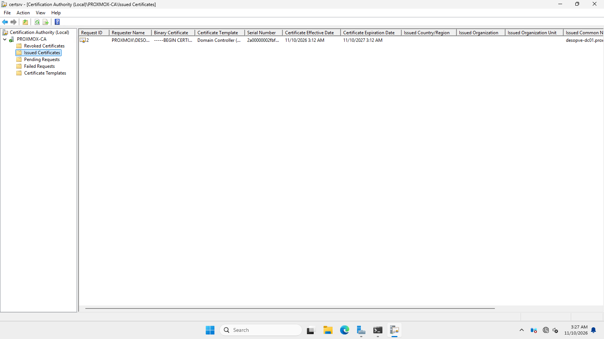
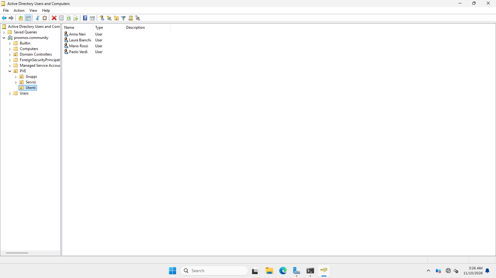
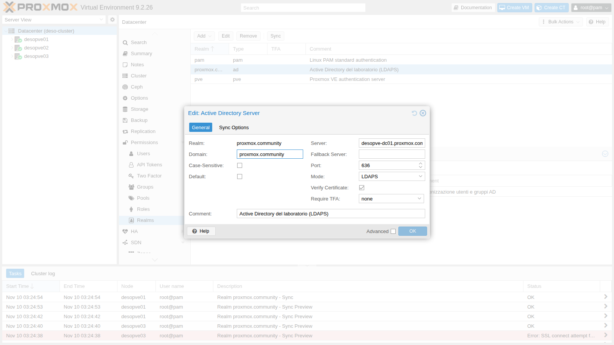
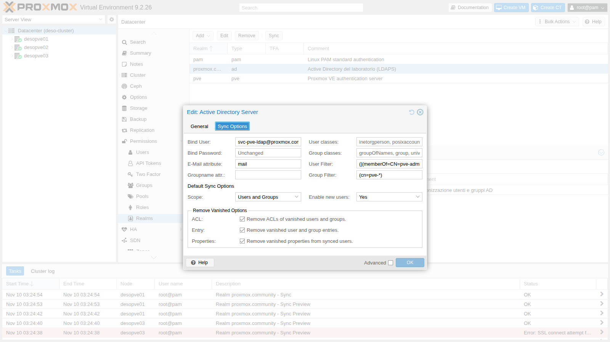
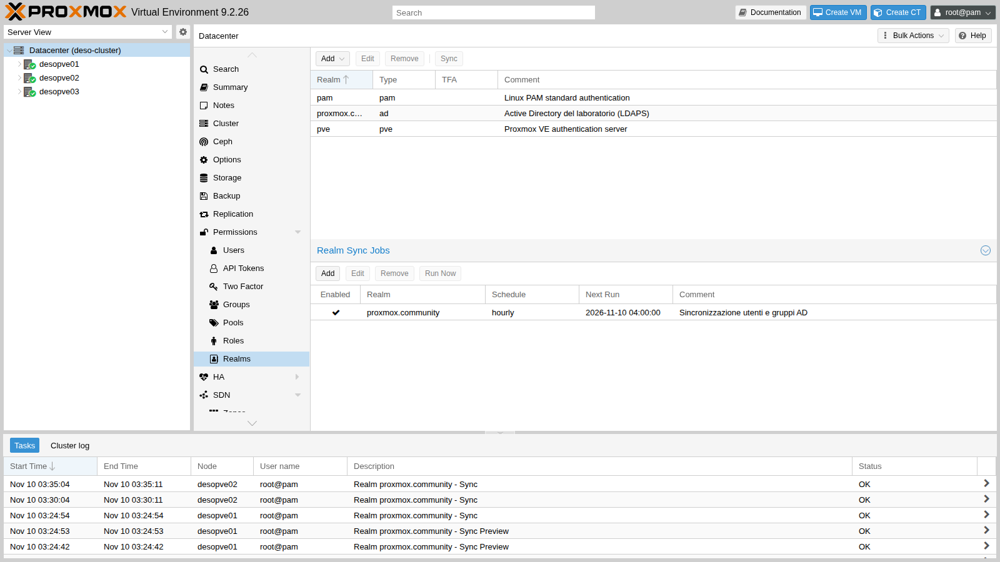
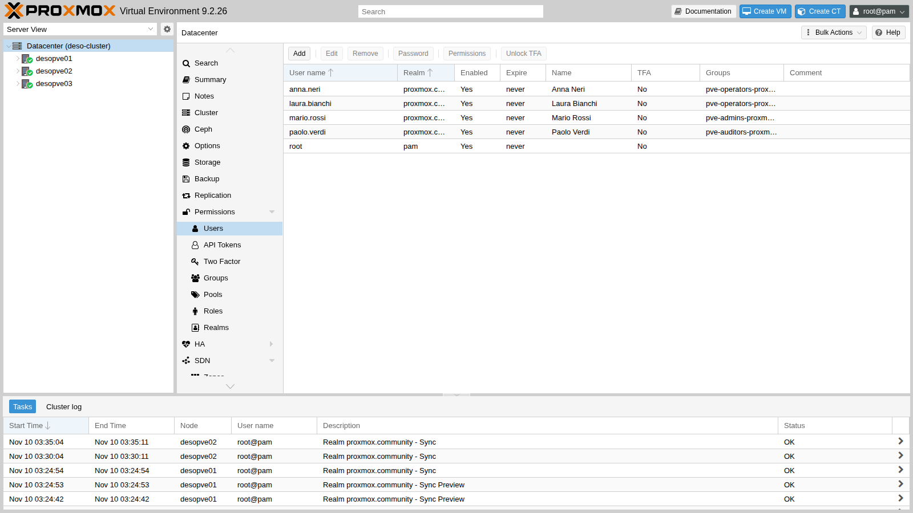
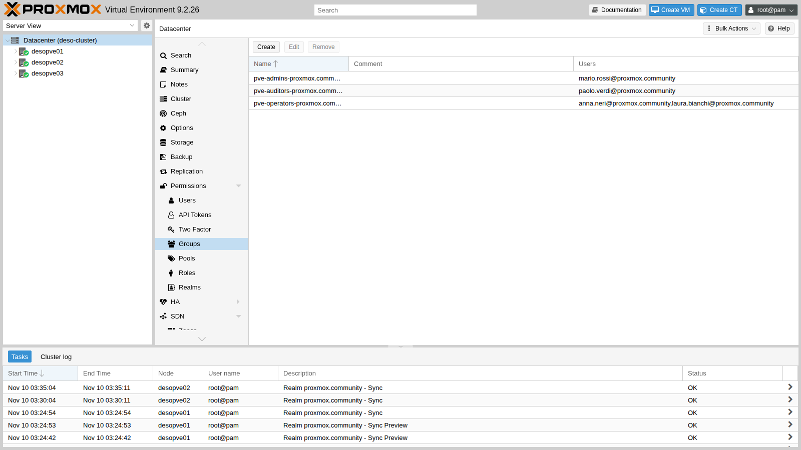
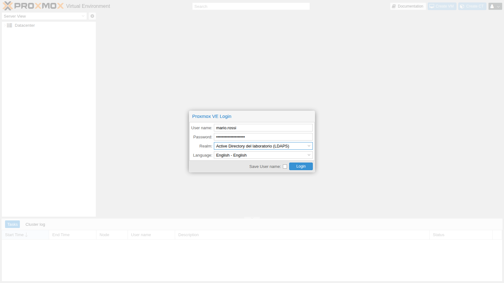
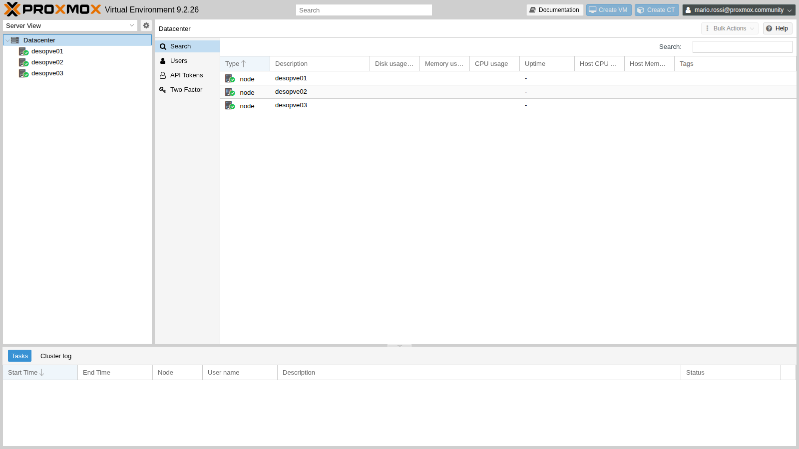

## Dependencies

- **Previous labs:**
  - [Lab 02](/02-domain-controller/): the domain controller `desopve-dc01` with the `proxmox.community` domain;
  - [Lab 05](/05-ssh-shell-cli/): SSH access to the nodes and the `pveum` CLI;
  - [Lab 06](/06-cluster-corosync/): the cluster `desopve01`-`03`, with the shared realm configuration;
  - [Lab 33](/33-firewall-2/): the node firewall. The traffic to the DC on port 636 originates from the nodes and is allowed by the outbound policy.
- **Systems:** DC `desopve-dc01.proxmox.community` (172.27.199.20), nodes `desopve01`-`03`.
- **Credentials:** the domain `Administrator`; service account `svc-pve-ldap`; domain test users, all with `<lab-password>` → [Appendix B](/b-credentials-and-addresses/).

## Objectives

- Install an **Enterprise CA** (AD CS) on the domain controller and obtain the certificate for **LDAPS**.
- Make the CA trusted on all nodes and verify the chain with `openssl`.
- Prepare a **dedicated OU** in AD with users, groups and a **service account** for the bind, not the Administrator.
- Create an **Active Directory** realm in Proxmox VE over LDAPS with certificate verification.
- Synchronize users and groups with filters and sync options, manually and with a **scheduled job**.
- Log in to the GUI as a domain user.

## How it works

**Realm.** A realm is an authentication source. Proxmox VE has two built-in ones, `pam` (Linux users of the node) and `pve` (its own users). A realm of type **Active Directory** verifies the password directly on the domain controller: Proxmox VE neither knows nor stores the users' passwords.

**Users and synchronization.** To log in, a domain user must also exist in Proxmox VE as `name@realm`. **Synchronization** reads users and groups from AD and creates or updates them in Proxmox VE. Groups become `groupname-realm` and bring their members with them. Permissions (ACLs), the topic of [Lab 44](/44-users-groups-roles-pools-tokens/), are assigned to the synchronized groups.

**Why LDAPS.** With plain LDAP (port 389), the bind password and the password of every login travel in clear text. LDAPS (port 636) encrypts the connection with TLS. For TLS to be of any use, the node must **verify** the DC's certificate, so it must trust the CA that issued it.

**AD CS and autoenrollment.** An *Enterprise Root* CA is integrated with Active Directory: as soon as it is installed, the domain controllers request a certificate with the *Domain Controller* template on their own. It is the one AD DS uses for LDAPS, with no additional configuration.

**Service account.** Reading users and groups requires a domain account. Every domain user can read the directory, so an ordinary account without privileges, dedicated to this purpose, is enough. The Administrator must never be used for the bind: its password would end up on the nodes.



## Procedure

### 1. Certification authority on the DC

In PowerShell as administrator on the DC:

```powershell
Install-WindowsFeature ADCS-Cert-Authority -IncludeManagementTools
Install-AdcsCertificationAuthority -CAType EnterpriseRootCA -CACommonName "PROXMOX-CA" `
  -KeyLength 4096 -HashAlgorithmName SHA256 -ValidityPeriod Years -ValidityPeriodUnits 10 -Force
Get-Service CertSvc
```

```text output
Install-WindowsFeature: Success=True Restart=No Features=Active Directory Certificate Services, Certification Authority, Active Directory Certificate Services Tools, Certification Authority Management Tools
Install-AdcsCertificationAuthority: ErrorId=0

Name     Status
----     ------
CertSvc Running
```

A 4096-bit root CA with SHA-256, valid for 10 years. No reboot is needed.

### 2. The DC certificate and LDAPS

The DC requests its certificate at the first autoenrollment cycle; `certutil -pulse` triggers it right away:

```powershell
certutil -pulse
Get-ChildItem Cert:\LocalMachine\My
```

```text output
CertUtil: -pulse command completed successfully.
CN=desopve-dc01.proxmox.community | CN=PROXMOX-CA, DC=proxmox, DC=community | Client Authentication,Server Authentication | 2027-11-10 | DNS Name=desopve-dc01.proxmox.community
```

The certificate has the **Server Authentication** usage and the DC name in the *Subject Alternative Name*: that is what LDAPS needs. In the **Certification Authority** console (`certsrv.msc`) it appears among the issued certificates, with the *Domain Controller* template:



AD DS uses it immediately, without a reboot. From node `desopve01`:

```bash
openssl s_client -connect desopve-dc01.proxmox.community:636 </dev/null 2>&1 | grep -E "subject=|issuer=|Verify return code"
```

```text output
subject=CN=desopve-dc01.proxmox.community
issuer=DC=community, DC=proxmox, CN=PROXMOX-CA
Verify return code: 21 (unable to verify the first certificate)
```

LDAPS responds, but the node does not know `PROXMOX-CA` and cannot verify the certificate.

### 3. The CA on the nodes

Export the CA certificate, in PEM format, from the DC:

```powershell
$c = Get-ChildItem Cert:\LocalMachine\Root | Where-Object { $_.Subject -like 'CN=PROXMOX-CA*' }
& {
  "-----BEGIN CERTIFICATE-----"
  [Convert]::ToBase64String($c.RawData, 'InsertLineBreaks')
  "-----END CERTIFICATE-----"
} | Set-Content -Encoding ascii C:\proxmox-ca.pem
foreach ($n in 1..3) { scp C:\proxmox-ca.pem root@desopve0$n.proxmox.community: }
```

The file lands in the home directory of `root` on each node, through the OpenSSH set up in [Lab 05](/05-ssh-shell-cli/). Before deploying it, check its fingerprint:

```bash
openssl x509 -in proxmox-ca.pem -noout -subject -dates -fingerprint -sha256
```

```text output
subject=DC = community, DC = proxmox, CN = PROXMOX-CA
notBefore=Nov 10 02:12:38 2026 GMT
notAfter=Nov 10 02:22:38 2036 GMT
sha256 Fingerprint=6E:73:BB:89:E6:54:BF:97:99:BE:19:01:E2:E9:0C:BA:BB:6D:92:66:A7:B3:33:9A:E1:43:64:A8:3B:8E:2F:56
```

On **every** cluster node, the file goes into `/usr/local/share/ca-certificates/` with the `.crt` extension; then update the system store:

```bash
cp proxmox-ca.pem /usr/local/share/ca-certificates/proxmox-ca.crt
update-ca-certificates
openssl s_client -connect desopve-dc01.proxmox.community:636 -verify_hostname desopve-dc01.proxmox.community </dev/null 2>&1 | grep -E "^depth|Verify return code"
```

```text output
== desopve01
depth=1 DC=community, DC=proxmox, CN=PROXMOX-CA
depth=0 CN=desopve-dc01.proxmox.community
Verify return code: 0 (ok)
== desopve02
Verify return code: 0 (ok)
== desopve03
Verify return code: 0 (ok)
```

The chain is complete and the name matches. The realm configuration is shared across the cluster, but the certificate store belongs to each node: the CA is needed on all of them.

### 4. OU, service account, users and groups in AD

A dedicated OU `PVE` with three sub-OUs, the service account, three groups and three users:

```powershell
$base = 'DC=proxmox,DC=community'
New-ADOrganizationalUnit -Name 'PVE' -Path $base
foreach ($ou in 'Utenti','Gruppi','Servizi') { New-ADOrganizationalUnit -Name $ou -Path "OU=PVE,$base" }
$pw = ConvertTo-SecureString '<lab-password>' -AsPlainText -Force
New-ADUser -Name 'svc-pve-ldap' -SamAccountName 'svc-pve-ldap' -UserPrincipalName 'svc-pve-ldap@proxmox.community' `
  -Path "OU=Servizi,OU=PVE,$base" -AccountPassword $pw -Enabled $true -PasswordNeverExpires $true `
  -CannotChangePassword $true -Description 'Bind LDAP dei nodi Proxmox VE (sola lettura)'
foreach ($g in 'pve-admins','pve-operators','pve-auditors') {
  New-ADGroup -Name $g -GroupScope Global -GroupCategory Security -Path "OU=Gruppi,OU=PVE,$base" }
New-ADUser -Name 'Mario Rossi' -GivenName Mario -Surname Rossi -SamAccountName mario.rossi `
  -UserPrincipalName mario.rossi@proxmox.community -EmailAddress mario.rossi@proxmox.community `
  -Path "OU=Utenti,OU=PVE,$base" -AccountPassword $pw -Enabled $true
Add-ADGroupMember pve-admins -Members mario.rossi
New-ADUser -Name 'Laura Bianchi' -GivenName Laura -Surname Bianchi -SamAccountName laura.bianchi `
  -UserPrincipalName laura.bianchi@proxmox.community -EmailAddress laura.bianchi@proxmox.community `
  -Path "OU=Utenti,OU=PVE,$base" -AccountPassword $pw -Enabled $true
Add-ADGroupMember pve-operators -Members laura.bianchi
New-ADUser -Name 'Paolo Verdi' -GivenName Paolo -Surname Verdi -SamAccountName paolo.verdi `
  -UserPrincipalName paolo.verdi@proxmox.community -EmailAddress paolo.verdi@proxmox.community `
  -Path "OU=Utenti,OU=PVE,$base" -AccountPassword $pw -Enabled $true
Add-ADGroupMember pve-auditors -Members paolo.verdi
```

For the filter test, also create a user **outside** the OU, `utente.esterno`, in the standard `CN=Users` container:

```powershell
New-ADUser -Name 'Utente Esterno' -SamAccountName utente.esterno -UserPrincipalName utente.esterno@proxmox.community `
  -Path "CN=Users,$base" -AccountPassword $pw -Enabled $true
```

```text output
ObjectClass        DistinguishedName
-----------        -----------------
user               CN=Laura Bianchi,OU=Utenti,OU=PVE,DC=proxmox,DC=community
user               CN=Mario Rossi,OU=Utenti,OU=PVE,DC=proxmox,DC=community
user               CN=Paolo Verdi,OU=Utenti,OU=PVE,DC=proxmox,DC=community
group              CN=pve-admins,OU=Gruppi,OU=PVE,DC=proxmox,DC=community
group              CN=pve-auditors,OU=Gruppi,OU=PVE,DC=proxmox,DC=community
group              CN=pve-operators,OU=Gruppi,OU=PVE,DC=proxmox,DC=community
user               CN=svc-pve-ldap,OU=Servizi,OU=PVE,DC=proxmox,DC=community
pve-admins: mario.rossi
pve-operators: laura.bianchi
pve-auditors: paolo.verdi
```

The structure in **Active Directory Users and Computers** (the user Anna Neri is added in step 7):



### 5. The Active Directory realm in Proxmox VE

From **Datacenter** → **Permissions** → **Realms** → **Add** → **Active Directory Server**, or from the CLI:

```bash
pveum realm add proxmox.community --type ad --domain proxmox.community \
  --server1 desopve-dc01.proxmox.community --port 636 --mode ldaps --verify 1 \
  --bind_dn 'svc-pve-ldap@proxmox.community' --password '<lab-password>' \
  --base_dn 'OU=PVE,DC=proxmox,DC=community' \
  --sync_attributes 'email=mail,firstname=givenName,lastname=sn' \
  --group_filter '(cn=pve-*)' \
  --sync-defaults-options 'scope=both,enable-new=1,remove-vanished=acl;entry;properties' \
  --case-sensitive 0 --check-connection 1 --comment 'Active Directory del laboratorio (LDAPS)'
```

- **`--mode ldaps --port 636 --verify 1`:** encrypted connection with certificate verification through the node's system store (`capath`, default `/etc/ssl/certs`).
- **`--bind_dn`:** the service account, in the `user@domain` form accepted by AD. The password is saved in `/etc/pve/priv/realm/proxmox.community.pw`, readable only by root.
- **`--base_dn`:** synchronization searches only inside the `PVE` OU.
- **`--sync_attributes`:** maps e-mail, first name and last name to the AD attributes.
- **`--group_filter '(cn=pve-*)'`:** only the groups whose name starts with `pve-`.
- **`--case-sensitive 0`:** in AD, user names are case-insensitive, and the realm must behave the same way.
- **`--check-connection 1`:** tests the bind before saving.

The **General** tab:



and the **Sync Options** tab, with the default synchronization options:



The **Remove Vanished** options decide what happens when a user or a group disappears from AD:

- **Entry:** the user or group is deleted from Proxmox VE;
- **ACL:** its permissions are removed;
- **Properties:** the fields (e-mail, name) that are no longer present in AD are cleared.

### 6. First synchronization

**Verification really matters.** On `desopve03`, temporarily remove the CA from the system store and try a dry-run synchronization:

```bash
mv /usr/local/share/ca-certificates/proxmox-ca.crt /root/ && update-ca-certificates --fresh
pveum realm sync proxmox.community --dry-run
```

```text output
(dry test run) starting sync for realm proxmox.community
SSL connect attempt failed error:0A000086:SSL routines::certificate verify failed
```

Without the CA, the node refuses the connection. Put the CA back on `desopve03`:

```bash
mv /root/proxmox-ca.crt /usr/local/share/ca-certificates/ && update-ca-certificates
```

The same test from `desopve01`:

```text
(dry test run) starting sync for realm proxmox.community
got data from server, updating users and groups
syncing users (remove-vanished opts: acl;entry;properties)
adding user 'laura.bianchi@proxmox.community'
adding user 'mario.rossi@proxmox.community'
adding user 'paolo.verdi@proxmox.community'
adding user 'svc-pve-ldap@proxmox.community'
syncing groups (remove-vanished opts: acl;entry;properties)
adding group 'pve-admins-proxmox.community'
adding group 'pve-auditors-proxmox.community'
adding group 'pve-operators-proxmox.community'

NOTE: Dry test run, changes were NOT written to the configuration.
```

`utente.esterno` does not appear because it is outside the OU, but the service account `svc-pve-ldap` does, and it must not be a Proxmox VE user. A **user filter** limits synchronization to the members of the `pve-*` groups:

```bash
G='OU=Gruppi,OU=PVE,DC=proxmox,DC=community'
pveum realm modify proxmox.community --filter \
  "(|(memberOf=CN=pve-admins,$G)(memberOf=CN=pve-operators,$G)(memberOf=CN=pve-auditors,$G))"
pveum realm sync proxmox.community --dry-run
```

```text output
adding user 'laura.bianchi@proxmox.community'
adding user 'mario.rossi@proxmox.community'
adding user 'paolo.verdi@proxmox.community'
adding group 'pve-admins-proxmox.community'
adding group 'pve-auditors-proxmox.community'
adding group 'pve-operators-proxmox.community'
NOTE: Dry test run, changes were NOT written to the configuration.
```

Now the real synchronization, from the **Sync** button in the GUI or from the CLI:

```bash
pveum realm sync proxmox.community
```

```text output
successfully updated users and groups configuration
laura.bianchi@proxmox.community Laura Bianchi laura.bianchi@proxmox.community enable=1
mario.rossi@proxmox.community Mario Rossi mario.rossi@proxmox.community enable=1
paolo.verdi@proxmox.community Paolo Verdi paolo.verdi@proxmox.community enable=1
pve-admins-proxmox.community mario.rossi@proxmox.community
pve-operators-proxmox.community laura.bianchi@proxmox.community
pve-auditors-proxmox.community paolo.verdi@proxmox.community
```

First name, last name and e-mail come from AD thanks to `sync_attributes`.

### 7. Scheduled synchronization

A **Realm Sync Job** repeats the synchronization automatically. For the test, schedule it every 5 minutes:

```bash
pvesh create /cluster/jobs/realm-sync/sync-ad --realm proxmox.community --schedule "*/5" \
  --scope both --enable-new 1 --remove-vanished "acl;entry;properties" \
  --comment "Sincronizzazione utenti e gruppi AD"
```

Then, in AD, add a user, Anna Neri, to the `pve-operators` group (`$base` and `$pw` as in step 4):

```powershell
New-ADUser -Name 'Anna Neri' -GivenName Anna -Surname Neri -SamAccountName anna.neri `
  -UserPrincipalName anna.neri@proxmox.community -EmailAddress anna.neri@proxmox.community `
  -Path "OU=Utenti,OU=PVE,$base" -AccountPassword $pw -Enabled $true
Add-ADGroupMember pve-operators -Members anna.neri
```

Without doing anything else, the job is run by one of the cluster nodes:

```text
desopve02 auth-realm-sync root@pam 03:35:04 OK
desopve02 auth-realm-sync root@pam 03:30:04 OK
desopve01 auth-realm-sync root@pam 03:24:54 OK
```

and the new user appears in Proxmox VE, already in the right group:

```text
anna.neri@proxmox.community anna.neri@proxmox.community
pve-operators-proxmox.community anna.neri@proxmox.community,laura.bianchi@proxmox.community
```

For normal use, set the job back to once an hour:

```bash
pvesh set /cluster/jobs/realm-sync/sync-ad --schedule hourly
```

The job appears under the realms, with **Run Now** to start it immediately:



Synchronized users and groups in **Permissions** → **Users** and **Groups**:





### 8. Login of a domain user

On the login page, the realm appears with its comment:



The login succeeds, but Mario has no permissions yet: he sees the nodes without data, no guests and no storage, and in the menu only his own settings.



Permissions are assigned to the groups in [Lab 44](/44-users-groups-roles-pools-tokens/).

## Verification and tests

Login through the API, which uses the same mechanism as the GUI:

```bash
t(){ curl -sk -o /dev/null -w "$1 -> HTTP %{http_code}\n" --data-urlencode "username=$1" \
  --data-urlencode "password=$2" https://desopve01.proxmox.community:8006/api2/json/access/ticket; }
t mario.rossi@proxmox.community '<lab-password>'
t mario.rossi@proxmox.community 'sbagliata'
t utente.esterno@proxmox.community '<lab-password>'
t svc-pve-ldap@proxmox.community '<lab-password>'
```

```text output
mario.rossi@proxmox.community -> HTTP 200
mario.rossi@proxmox.community -> HTTP 401
utente.esterno@proxmox.community -> HTTP 401
svc-pve-ldap@proxmox.community -> HTTP 401
```

- A synchronized user logs in with the domain password; with a wrong password, the login fails.
- `utente.esterno` has a valid password in AD but cannot log in: it does not exist in Proxmox VE, because it is outside the OU and the filter.
- The service account is not a Proxmox VE user and cannot log in to the GUI.
- Without the CA in the node's store, the LDAPS connection is refused (`certificate verify failed`).
- A user added in AD appears in Proxmox VE at the next run of the scheduled job.

## Final lab state

- **DC `desopve-dc01`:**
  - AD CS with the Enterprise Root CA `PROXMOX-CA` (4096 bits, SHA-256, valid until 2036);
  - *Domain Controller* certificate for LDAPS on port 636;
  - OU `OU=PVE,DC=proxmox,DC=community` with the sub-OUs `Utenti`, `Gruppi`, `Servizi`;
  - service account `svc-pve-ldap` (OU `Servizi`);
  - groups `pve-admins` (mario.rossi), `pve-operators` (laura.bianchi, anna.neri), `pve-auditors` (paolo.verdi);
  - `utente.esterno` in `CN=Users`, excluded from synchronization.
- **Nodes `desopve01`-`03`:** CA in `/usr/local/share/ca-certificates/proxmox-ca.crt`, in the system store.
- **Realm `proxmox.community`** (type `ad`, LDAPS with verification), user filter on the members of the `pve-*` groups, group filter `(cn=pve-*)`.
- **Synchronized users:** `mario.rossi`, `laura.bianchi`, `paolo.verdi`, `anna.neri` `@proxmox.community`, without permissions.
- **Synchronized groups:** `pve-admins-proxmox.community`, `pve-operators-proxmox.community`, `pve-auditors-proxmox.community`.
- **Job `sync-ad`:** hourly synchronization with `remove-vanished acl;entry;properties`.

## What you learned

- An Enterprise CA in AD lets the domain controllers obtain the LDAPS certificate on their own.
- LDAPS is only useful if the client verifies the certificate: the CA must be installed on **every** node.
- The bind uses a dedicated service account without privileges, never the Administrator.
- Base DN, user filter and group filter decide who gets into Proxmox VE; a dry run shows the effect before anything is written.
- Domain users log in with their AD password, but they must be synchronized to exist in Proxmox VE.
- A Realm Sync Job keeps users and groups aligned; Remove Vanished decides what happens to those who disappear from AD.

## References

- [Proxmox VE – User Management, Authentication Realms](https://pve.proxmox.com/pve-docs/chapter-pveum.html#pveum_authentication_realms)
- [Proxmox VE – Microsoft Active Directory (AD)](https://pve.proxmox.com/pve-docs/chapter-pveum.html#pveum_ad)
- [Proxmox VE – Syncing LDAP-Based Realms](https://pve.proxmox.com/pve-docs/chapter-pveum.html#pveum_ldap_sync)
- [Microsoft – Install the Certification Authority](https://learn.microsoft.com/windows-server/networking/core-network-guide/cncg/server-certs/install-the-certification-authority)
- [Microsoft – LDAP over SSL (LDAPS) certificate](https://learn.microsoft.com/troubleshoot/windows-server/active-directory/enable-ldap-over-ssl-3rd-certification-authority)
