## Dependencies

- **Previous labs:**
  - [Lab 43](/43-active-directory-realm-ldaps/): the `proxmox.community` realm with the synced domain users and groups;
  - [Lab 40](/40-templates-cloud-init-clones/): the VMs `web01`-`web03` (104-106), used as pool resources;
  - [Lab 20](/20-bridges-stable-names-vlans/) and [Lab 21](/21-bonding/): the VLAN-aware bridge `vmbr1`, used to test the SDN permissions;
  - [Lab 13](/13-nfs/): the `nas-nfs` storage.
- **Systems:** nodes `desopve01`-`03`, DC `desopve-dc01`. The API tests run with `curl` from a machine on the management network.
- **Credentials:** `root@pam`; the domain users `mario.rossi`, `laura.bianchi` and `paolo.verdi`, all with `<lab-password>` → [Appendix B](/b-credentials-and-addresses/).

## Objectives

- Understand the Proxmox VE permission model: **privileges**, **roles**, **paths** and **ACLs**.
- Create a **custom role** and a **resource pool**.
- Grant permissions to the **groups synced from AD** and check with a real login what each user sees.
- Read a user's **effective permissions**, from the GUI and from the CLI.
- Understand **propagation** and the **SDN.Use** permission on bridges.
- Tell apart users of the **pve** and **pam** realms.
- Create and use an **API token** with *privilege separation*, then revoke it the right way.

## How it works

**Privileges and roles.** A *privilege* is the right to do one specific thing, for example `VM.PowerMgmt` (start and stop a VM) or `Datastore.AllocateSpace` (write to a storage). A *role* is a named set of privileges. Proxmox VE ships about twenty built-in roles; the most commonly used are:

| Role | What it allows |
|---|---|
| `Administrator` | everything |
| `PVEAdmin` | almost everything, except system and permission management |
| `PVEVMAdmin` | full VM management: creation, configuration, migration |
| `PVEVMUser` | VM usage: console, start and stop, backup, CD-ROM, cloud-init |
| `PVEDatastoreUser` | space on storages and reading their content |
| `PVESDNUser` | use of networks (bridges and VNets) |
| `PVEAuditor` | read-only access to everything |
| `NoAccess` | no access, useful to shut a user out of a branch |

**Paths and ACLs.** Every object has a path: `/` (the whole datacenter), `/nodes/<nodo>`, `/vms/<vmid>`, `/storage/<storage>`, `/pool/<pool>`, `/sdn/zones/<zona>/<vnet>[/<vlan>]`. An ACL states: *on this path*, *this user, group or token* has *this role*. With **propagate** enabled, the ACL also applies to the child paths (`/` applies to everything, `/vms` to all VMs).

**Resource pools.** A pool groups VMs, containers and storages. An ACL on `/pool/<pool>` applies to all its members: it is the simplest way to give a group of people "their own" machines.

**SDN.Use.** To connect a network device to a bridge, whoever configures the VM needs `SDN.Use` on that bridge. Classic Linux bridges have a path too: `/sdn/zones/localnetwork/<bridge>`, with a sub-entry for each VLAN.

**The pve and pam realms.** For users of the `pve` realm, Proxmox VE stores the password in the cluster file system, so these users work on all nodes. `pam` users are Linux users: Proxmox VE checks the password against the operating system of the node you log in to, so the Linux user must exist on **every** node.

**API tokens.** A token is a credential for scripts and automation, with a secret that does not expire by default (you can set an expiration date with `--expire`) and is not subject to 2FA. With *privilege separation* (recommended), the token has its own ACLs and its effective permissions are the **intersection** of the token's ACLs and the user's: a token can never do more than its user.

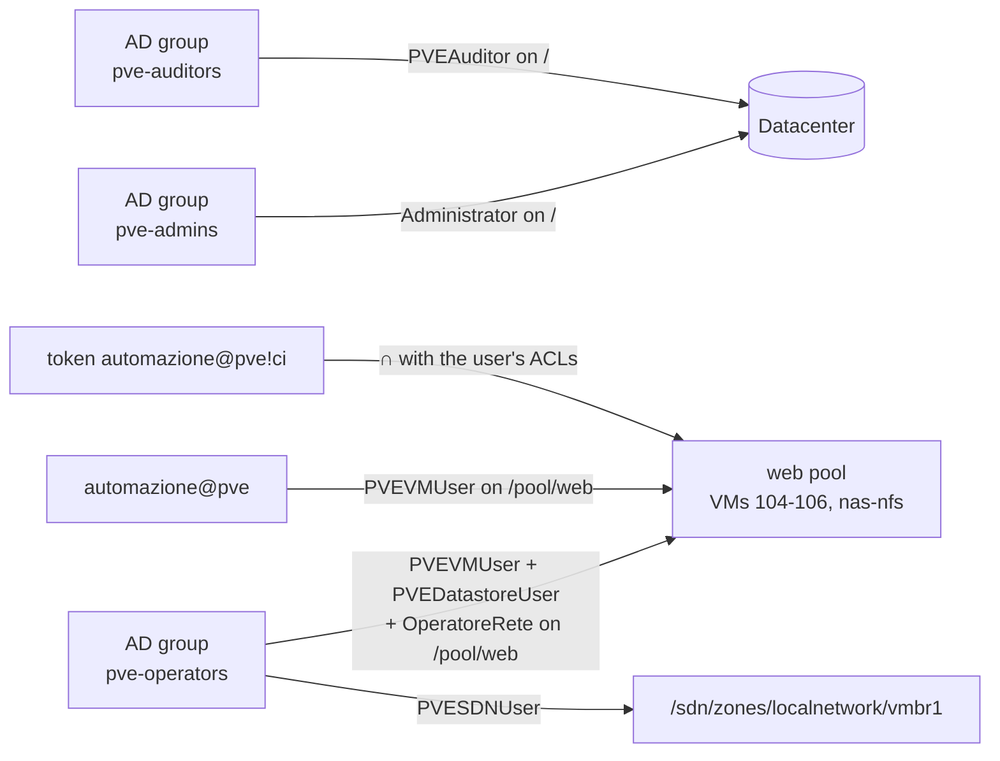

## Procedure

### 1. The built-in roles

From the CLI of a node, the list of roles (in the GUI: **Datacenter → Permissions → Roles**):

```bash
pveum role list --noborder 1 | awk '{print $1, $NF}'
```

```text output
roleid special
Administrator 1
NoAccess 1
PVEAdmin 1
PVEAuditor 1
PVEDatastoreAdmin 1
PVEDatastoreUser 1
PVEMappingAdmin 1
PVEMappingUser 1
PVEPoolAdmin 1
PVEPoolUser 1
PVESDNAdmin 1
PVESDNUser 1
PVESysAdmin 1
PVETemplateUser 1
PVEUserAdmin 1
PVEVMAdmin 1
PVEVMUser 1
```

`special 1` marks the built-in roles, which cannot be modified. The privileges of some of them:

```text
PVEAuditor        Datastore.Audit,Mapping.Audit,Pool.Audit,SDN.Audit,Sys.Audit,VM.Audit,VM.GuestAgent.Audit
PVEDatastoreUser  Datastore.AllocateSpace,Datastore.Audit
PVESDNUser        SDN.Audit,SDN.Use
PVEVMUser         VM.Audit,VM.Backup,VM.Config.CDROM,VM.Config.Cloudinit,VM.Console,VM.GuestAgent.Audit,VM.GuestAgent.FileRead,VM.GuestAgent.FileSystemMgmt,VM.GuestAgent.FileWrite,VM.PowerMgmt
```

`PVEVMUser` can start and stop a VM, but cannot change its hardware configuration: for example, it does not have `VM.Config.Network`.

### 2. A custom role

We want the operators to be able to manage the network devices of their VMs as well. Let's create the `OperatoreRete` role with only the privileges it needs:

```bash
pveum role add OperatoreRete --privs "VM.Audit,VM.Config.Network"
```

In the GUI: **Datacenter → Permissions → Roles → Create**. The role appears in the list with *Built-In = No*:

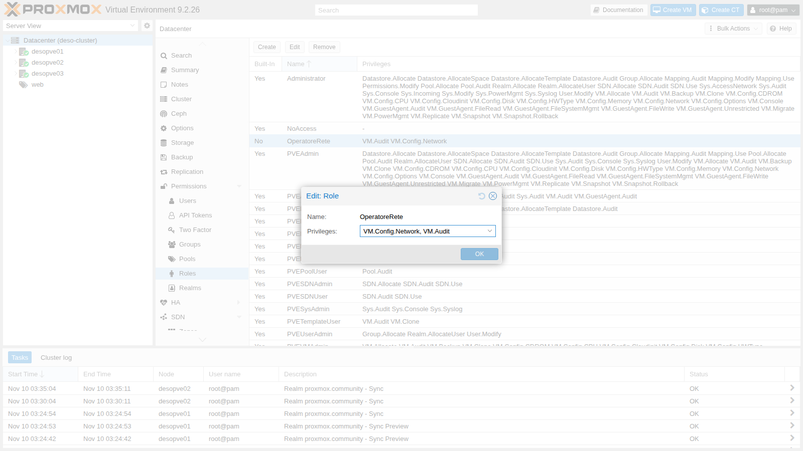

### 3. The `web` resource pool

Let's add the three web VMs and the `nas-nfs` storage to the pool:

```bash
pveum pool add web --comment "Server web del laboratorio"
pveum pool modify web --vms 104,105,106 --storage nas-nfs
pvesh get /pools/web --output-format json | python3 -c 'import sys, json
p = json.load(sys.stdin); print(p["comment"])
for m in p["members"]: print(m["type"], m.get("vmid", ""), m.get("name", m.get("storage")), m["node"])'
```

```text output
Server web del laboratorio
qemu 104 web01 desopve01
qemu 105 web02 desopve02
qemu 106 web03 desopve03
storage  nas-nfs desopve01
```

In the GUI, you create the pool from **Datacenter → Permissions → Pools → Create**, and you add the members by selecting the pool in the tree, **Members** tab:

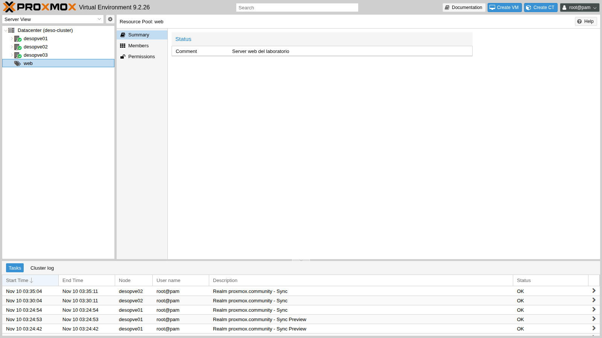

### 4. Permissions for the domain groups

Let's assign the roles to the three groups synced in Lab 43. The group IDs carry the realm suffix (`-proxmox.community`).

The first three from the CLI:

```bash
pveum acl modify / --groups pve-auditors-proxmox.community --roles PVEAuditor
pveum acl modify /pool/web --groups pve-operators-proxmox.community --roles PVEVMUser,PVEDatastoreUser
pveum acl modify /pool/web --groups pve-operators-proxmox.community --roles OperatoreRete
pveum acl list
```

```text output
┌───────────┬──────────────────┬───────┬─────────────────────────────────┬───────────┐
│ path      │ roleid           │ type  │ ugid                            │ propagate │
╞═══════════╪══════════════════╪═══════╪═════════════════════════════════╪═══════════╡
│ /         │ PVEAuditor       │ group │ pve-auditors-proxmox.community  │ 1         │
├───────────┼──────────────────┼───────┼─────────────────────────────────┼───────────┤
│ /pool/web │ PVEDatastoreUser │ group │ pve-operators-proxmox.community │ 1         │
├───────────┼──────────────────┼───────┼─────────────────────────────────┼───────────┤
│ /pool/web │ PVEVMUser        │ group │ pve-operators-proxmox.community │ 1         │
├───────────┼──────────────────┼───────┼─────────────────────────────────┼───────────┤
│ /pool/web │ OperatoreRete    │ group │ pve-operators-proxmox.community │ 1         │
└───────────┴──────────────────┴───────┴─────────────────────────────────┴───────────┘
```

The fourth from the GUI: **Datacenter → Permissions → Add → Group Permission**, path `/`, group `pve-admins-proxmox.community`, role `Administrator`, *Propagate* enabled:

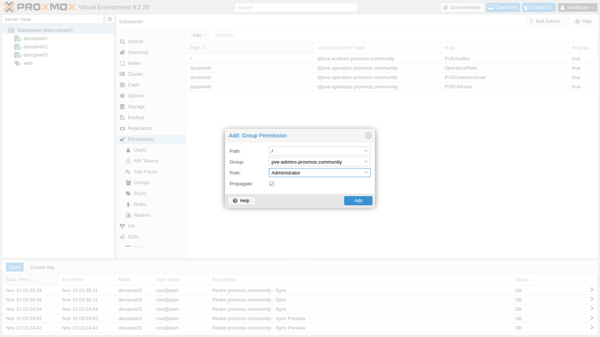

Now `pveum acl list` shows five rows: the four above plus `/ │ Administrator │ group │ pve-admins-proxmox.community`.

The complete list in **Datacenter → Permissions**:

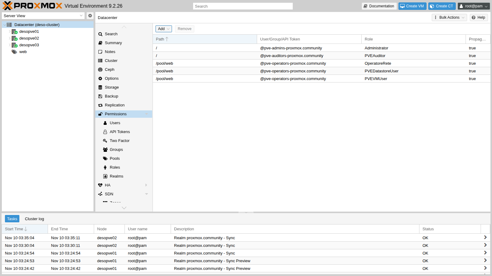

:::note[Why groups and not users]
If a colleague joins `pve-operators` in AD tomorrow, the next sync adds them to the group in Proxmox VE and the permissions follow on their own. Nobody has to touch the ACLs.
:::

### 5. Effective permissions

To find out what a user can actually do on an object, you ask Proxmox VE to compute the **effective permissions**, which combine all the ACLs, both direct and group ones:

```bash
pveum user permissions laura.bianchi@proxmox.community --path /vms/104
pveum user permissions laura.bianchi@proxmox.community --path /vms/100
```

```text output
┌──────────┬──────────────────────────────┐
│ ACL path │ Permissions                  │
╞══════════╪══════════════════════════════╡
│ /vms/104 │ Datastore.AllocateSpace      │
│          │ Datastore.Audit              │
│          │ VM.Audit                     │
│          │ VM.Backup                    │
│          │ VM.Config.CDROM              │
│          │ VM.Config.Cloudinit          │
│          │ VM.Config.Network            │
│          │ VM.Console                   │
│          │ VM.GuestAgent.Audit          │
│          │ VM.GuestAgent.FileRead       │
│          │ VM.GuestAgent.FileSystemMgmt │
│          │ VM.GuestAgent.FileWrite      │
│          │ VM.PowerMgmt                 │
└──────────┴──────────────────────────────┘
┌──────────┬─────────────┐
│ ACL path │ Permissions │
╞══════════╪═════════════╡
│ /vms/100 │             │
└──────────┴─────────────┘
```

On VM 104, which is in the pool, Laura has the sum of the three roles; on VM 100, outside the pool, she has nothing. In the GUI: **Datacenter → Permissions → Users**, select the user and click **Permissions**:

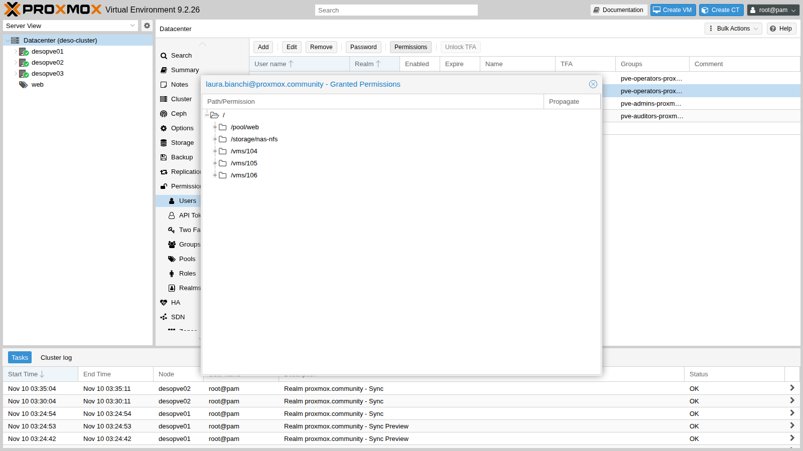

### 6. What each user sees: real logins

Let's log in to the GUI as the three domain users, choosing the *Active Directory* realm in the login window.

**Mario Rossi** (`pve-admins`) sees everything and can do everything:

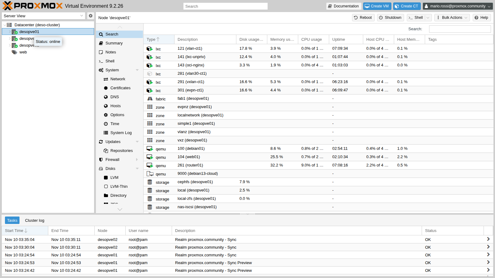

**Laura Bianchi** (`pve-operators`) sees only `web01` and the `nas-nfs` storage under `desopve01`; under the other nodes she finds `web02` and `web03`. The *Shutdown* and *Console* buttons are enabled, *Create VM* and *Migrate* are not.

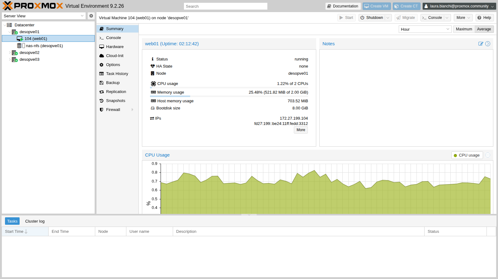

**Paolo Verdi** (`pve-auditors`) sees the whole datacenter, but every action is disabled:

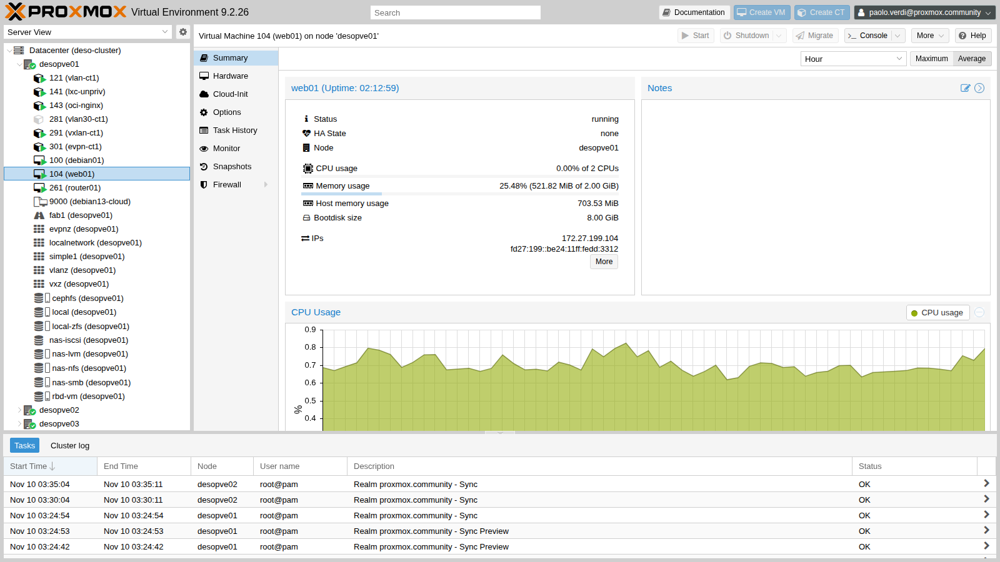

### 7. API tests: the pool boundary

The GUI uses the same REST API that you can call with `curl`. From a machine on the management network, let's request a ticket for Laura and try two reboots:

```bash
N1=https://172.27.199.21:8006/api2/json
read TK CS < <(curl -sk --data-urlencode "username=laura.bianchi@proxmox.community" \
  --data-urlencode "password=<lab-password>" $N1/access/ticket |
  python3 -c 'import sys,json; d=json.load(sys.stdin)["data"]; print(d["ticket"], d["CSRFPreventionToken"])')
api() { m=$1; p=$2; shift 2; curl -sk -X $m -b "PVEAuthCookie=$TK" -H "CSRFPreventionToken: $CS" "$@" "$N1$p" -w '\nHTTP %{http_code}\n'; }

api POST /nodes/desopve01/qemu/104/status/reboot
api POST /nodes/desopve01/qemu/100/status/reboot
```

```text output
{"data":"UPID:desopve01:000727C6:004946EC:6AF286BF:qmreboot:104:laura.bianchi@proxmox.community:"}
HTTP 200
{"data":null,"message":"Permission check failed (/vms/100, VM.PowerMgmt)\n"}
HTTP 403
```

The error message states exactly **which privilege is missing and on which path**: it is the first thing to read when a user reports "it won't let me do X".

### 8. SDN.Use: the permission on the bridge

Laura has `VM.Config.Network` on the pool VMs (`OperatoreRete` role). Let's try to add a second network device to `web01`, on `vmbr1`, VLAN 10:

```bash
api PUT /nodes/desopve01/qemu/104/config --data-urlencode "net1=virtio,bridge=vmbr1,tag=10"
```

```text output
{"message":"Permission check failed (/sdn/zones/localnetwork/vmbr1/10, SDN.Use)\n","data":null}
HTTP 403
```

The privilege on the VM is not enough: `SDN.Use` on the bridge (and on the VLAN) is required too. We grant it to the group on the bridge, with propagation, so it applies to all its VLANs:

```bash
pveum acl modify /sdn/zones/localnetwork/vmbr1 --groups pve-operators-proxmox.community --roles PVESDNUser
```

Laura tries again, and this time the network device is hot-plugged:

```bash
api PUT /nodes/desopve01/qemu/104/config --data-urlencode "net1=virtio,bridge=vmbr1,tag=10"
qm config 104 | grep ^net
```

```text output
{"data":null}
HTTP 200
net0: virtio=BC:24:11:DD:33:12,bridge=vmbr0
net1: virtio=BC:24:11:6E:FA:D0,bridge=vmbr1,tag=10
```

Then she removes it:

```bash
api PUT /nodes/desopve01/qemu/104/config --data-urlencode "delete=net1"
```

The first time, the guest was still finishing the reboot from step 7 and did not release the device:

```text
{"errors":{"net1":"hotplug problem - error on hot-unplugging device 'net1' - still busy in guest?\n"},"data":null,"message":"Parameter verification failed.\n"}
HTTP 400
```

```bash
qm pending 104 | grep -i net
```

```text output
cur net0: virtio=BC:24:11:DD:33:12,bridge=vmbr0
del net1: virtio=BC:24:11:6E:FA:D0,bridge=vmbr1,tag=10
```

The removal was left **pending** (`del`): it would be applied at the next shutdown. Repeated once the guest is up, it goes through immediately (`HTTP 200`) and `qm pending` shows only `net0`.

### 9. Propagation

An ACL on `/vms` with *propagate* disabled applies only to the `/vms` path itself, not to the individual VMs. Let's verify it with a local user of the `pve` realm:

```bash
pveum user add stagista@pve --password '<lab-password>' --comment 'Utente locale del realm pve'
pveum acl modify /vms --users stagista@pve --roles PVEAuditor --propagate 0
pveum user permissions stagista@pve --path /vms/104
pveum acl modify /vms --users stagista@pve --roles PVEAuditor --propagate 1
pveum user permissions stagista@pve --path /vms/104
```

```text output
┌──────────┬─────────────┐
│ ACL path │ Permissions │
╞══════════╪═════════════╡
│ /vms/104 │             │
└──────────┴─────────────┘
┌──────────┬─────────────────────────┐
│ ACL path │ Permissions             │
╞══════════╪═════════════════════════╡
│ /vms/104 │ Datastore.Audit (*)     │
│          │ Mapping.Audit (*)       │
│          │ Pool.Audit (*)          │
│          │ SDN.Audit (*)           │
│          │ Sys.Audit (*)           │
│          │ VM.Audit (*)            │
│          │ VM.GuestAgent.Audit (*) │
└──────────┴─────────────────────────┘
```

The asterisk marks the privileges inherited through propagation. Finally, we leave `stagista@pve` with read access to the `web` pool only (it will be needed in Lab 45):

```bash
pveum acl delete /vms --users stagista@pve --roles PVEAuditor
pveum acl modify /pool/web --users stagista@pve --roles PVEAuditor
```

### 10. pve versus pam realm

Let's request a ticket from two different nodes, with a small function that prints only the HTTP status code:

```bash
t(){ curl -sk -o /dev/null -w "$1 su $3: HTTP %{http_code}\n" --data-urlencode "username=$1" \
  --data-urlencode "password=$2" https://$3:8006/api2/json/access/ticket; }
t stagista@pve '<lab-password>' 172.27.199.21
t stagista@pve '<lab-password>' 172.27.199.22
```

The `pve` realm user works everywhere:

```text
stagista@pve su 172.27.199.21: HTTP 200
stagista@pve su 172.27.199.22: HTTP 200
```

Now let's create `operatore@pam` in Proxmox VE and try to log in before and after creating the Linux user **only** on `desopve01`:

```bash
pveum user add operatore@pam --comment "Utente PAM: serve un utente Linux sul nodo"
t operatore@pam '<lab-password>' 172.27.199.21
useradd -m -s /bin/bash operatore && echo 'operatore:<lab-password>' | chpasswd    # only on desopve01
t operatore@pam '<lab-password>' 172.27.199.21
t operatore@pam '<lab-password>' 172.27.199.22
```

```text output
operatore@pam su 172.27.199.21: HTTP 401
operatore@pam su 172.27.199.21: HTTP 200
operatore@pam su 172.27.199.22: HTTP 401
```

The `pam` user can log in only where its Linux account exists. That is why, apart from `root@pam`, the accounts of people are managed in `pve` or, better, in a directory realm such as AD. Let's clean up:

```bash
userdel -r operatore
pveum user delete operatore@pam
```

### 11. API token with privilege separation

Let's create a user for automation, without a password, with `PVEVMUser` on the `web` pool, and a token for it with privilege separation:

```bash
pveum user add automazione@pve --comment 'Utente per script e CI'
pveum acl modify /pool/web --users automazione@pve --roles PVEVMUser
pveum user token add automazione@pve ci --privsep 1 --comment 'Pipeline CI' --output-format json
```

```json
{"full-tokenid":"automazione@pve!ci","info":{"comment":"Pipeline CI","privsep":"1"},"value":"<segreto>"}
```

The secret is shown **only once**. In the GUI, you create the token from **Datacenter → Permissions → API Tokens → Add**:

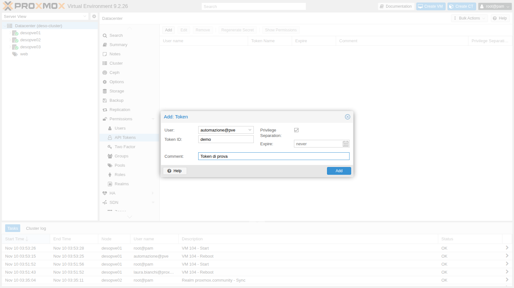

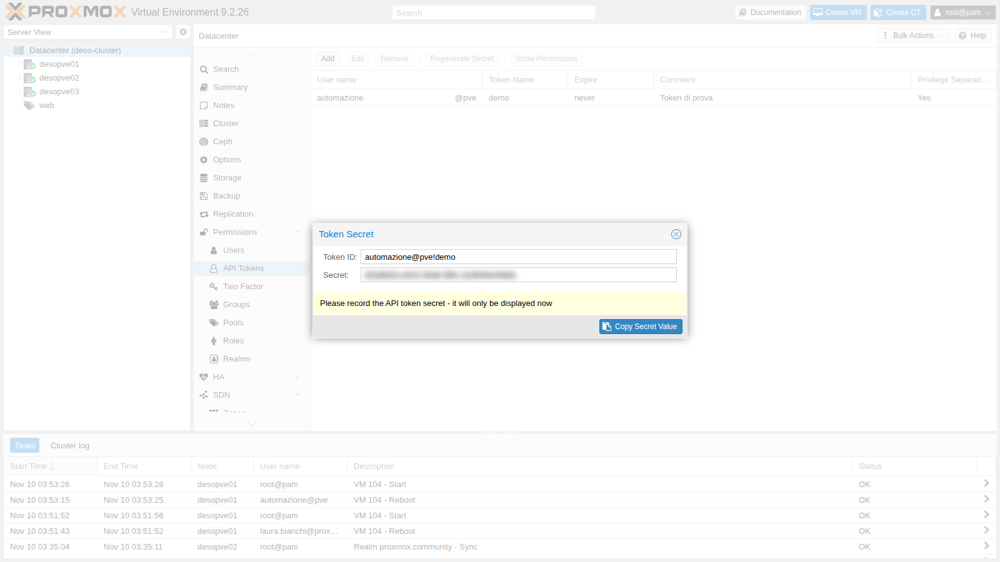

We give the token `PVEAuditor` on the whole datacenter and `PVEVMUser` on VM 104 only:

```bash
pveum acl modify / --tokens 'automazione@pve!ci' --roles PVEAuditor
pveum acl modify /vms/104 --tokens 'automazione@pve!ci' --roles PVEVMUser
pveum user token permissions automazione@pve ci --path /vms/104
pveum user token permissions automazione@pve ci --path /vms/100
```

```text output
┌──────────┬──────────────────────────────┐
│ ACL path │ Permissions                  │
╞══════════╪══════════════════════════════╡
│ /vms/104 │ VM.Audit                     │
│          │ VM.Backup                    │
│          │ VM.Config.CDROM              │
│          │ VM.Config.Cloudinit          │
│          │ VM.Console                   │
│          │ VM.GuestAgent.Audit          │
│          │ VM.GuestAgent.FileRead       │
│          │ VM.GuestAgent.FileSystemMgmt │
│          │ VM.GuestAgent.FileWrite      │
│          │ VM.PowerMgmt                 │
└──────────┴──────────────────────────────┘
┌──────────┬─────────────┐
│ ACL path │ Permissions │
╞══════════╪═════════════╡
│ /vms/100 │             │
└──────────┴─────────────┘
```

On VM 100 the token has `PVEAuditor`, but the user has nothing: the intersection is empty. Let's use the token with `curl`, through the `Authorization` header:

```bash
H='Authorization: PVEAPIToken=automazione@pve!ci=<segreto>'
curl -sk -H "$H" "$N1/cluster/resources?type=vm" | python3 -c 'import sys,json; print(sorted(r["vmid"] for r in json.load(sys.stdin)["data"]))'
curl -sk -H "$H" -X POST $N1/nodes/desopve01/qemu/104/status/reboot -w '\nHTTP %{http_code}\n'
curl -sk -H "$H" -X POST $N1/nodes/desopve02/qemu/105/status/reboot -w '\nHTTP %{http_code}\n'
```

```text output
[104, 105, 106]
{"data":"UPID:desopve01:00072DA3:00496ABE:6AF2871B:qmreboot:104:automazione@pve!ci:"}
HTTP 200
{"data":null,"message":"Permission check failed (/vms/105, VM.PowerMgmt)\n"}
HTTP 403
```

- The token "sees" only the three VMs in the pool, despite `PVEAuditor` on `/`: the user sees nothing else.
- It can reboot 104 (both the token and the user have `VM.PowerMgmt`), but not 105 (the token does not have it). In the task log the author is `automazione@pve!ci`, so the actions of each automation can be traced.
- Requests made with a token do not need the `CSRFPreventionToken`.

### 12. Revoking a token without leaving anything behind

Let's remove the token and try again:

```bash
pveum user token remove automazione@pve ci
curl -sk -H "$H" "$N1/version" -w '\nHTTP %{http_code}\n'
```

```text output
user config - ignore invalid acl token 'automazione@pve!ci'
user config - ignore invalid acl token 'automazione@pve!ci'

HTTP 401
```

The token no longer works, but its **ACLs are still there** in `/etc/pve/user.cfg` and trigger a warning at every command. You cannot even remove them, because the token no longer exists:

```text
ACL update failed: no such token 'ci' for user 'automazione@pve'
```

The correct order is the reverse: **first** remove the ACLs, **then** the token. If it has already happened, create a token with the same name again, delete the ACLs and remove the token once more:

```bash
pveum user token add automazione@pve ci --privsep 1 >/dev/null
pveum acl delete / --tokens 'automazione@pve!ci' --roles PVEAuditor
pveum acl delete /vms/104 --tokens 'automazione@pve!ci' --roles PVEVMUser
pveum user token remove automazione@pve ci
grep -c 'automazione@pve!ci' /etc/pve/user.cfg
```

```text output
0
```

## Verification and tests

| Test | Expected result | Outcome |
|---|---|---|
| Laura reboots VM 104, in the pool | `HTTP 200` | ok |
| Laura reboots VM 100, outside the pool | `HTTP 403`, `VM.PowerMgmt` missing on `/vms/100` | ok |
| Laura adds a network device on `vmbr1` without `SDN.Use` | `HTTP 403` on `/sdn/zones/localnetwork/vmbr1/10` | ok |
| The same operation with `PVESDNUser` on the bridge | `HTTP 200`, device added | ok |
| ACL on `/vms` without and with propagate | permissions on `/vms/104` empty, then present | ok |
| `operatore@pam` with a Linux user only on `desopve01` | 200 on `desopve01`, 401 on `desopve02` | ok |
| Token with privsep | sees 104-106, reboots 104, `403` on 105 | ok |
| Revoked token | `HTTP 401`; no ACLs left after the cleanup | ok |

## Final lab state

- **Custom role** `OperatoreRete` (`VM.Audit`, `VM.Config.Network`).
- **Pool `web`:** VMs 104, 105, 106 and the `nas-nfs` storage.
- **ACLs:**
  - `/` → `pve-admins-proxmox.community`: `Administrator`; `pve-auditors-proxmox.community`: `PVEAuditor`;
  - `/pool/web` → `pve-operators-proxmox.community`: `PVEVMUser`, `PVEDatastoreUser`, `OperatoreRete`; `automazione@pve`: `PVEVMUser`; `stagista@pve`: `PVEAuditor`;
  - `/sdn/zones/localnetwork/vmbr1` → `pve-operators-proxmox.community`: `PVESDNUser`.
- **Local users:** `stagista@pve` (with a password, read access to the `web` pool), `automazione@pve` (without a password and, at the end of the lab, without tokens).
- `operatore@pam` and its Linux user have been removed; VM 104 again has only `net0`.

## What you learned

- Permissions are ACLs: **path + user/group/token + role**, with propagation to the child paths.
- The built-in roles cover the common cases; a custom role adds exactly the privileges that are missing.
- A pool is the simplest way to give a group "its own" VMs and storages.
- Permissions are granted to the **groups** synced from AD, not to individual users.
- `Permission check failed (percorso, privilegio)` messages state exactly what is missing; `pveum user permissions` confirms it.
- To connect a network device to a bridge you need `SDN.Use`, on classic Linux bridges too.
- `pam` users exist only where the Linux user exists; for people, use `pve` or a directory realm.
- A token with privilege separation can do at most what its user can do; you revoke it by removing **first** the ACLs and **then** the token.

## References

- [Proxmox VE – User Management](https://pve.proxmox.com/pve-docs/chapter-pveum.html)
- [Proxmox VE – Permission Management](https://pve.proxmox.com/pve-docs/chapter-pveum.html#pveum_permission_management)
- [Proxmox VE – API Tokens](https://pve.proxmox.com/pve-docs/chapter-pveum.html#pveum_tokens)
- [Proxmox VE – Pools](https://pve.proxmox.com/pve-docs/chapter-pveum.html#pveum_pools)
- [Proxmox VE API Viewer](https://pve.proxmox.com/pve-docs/api-viewer/)
