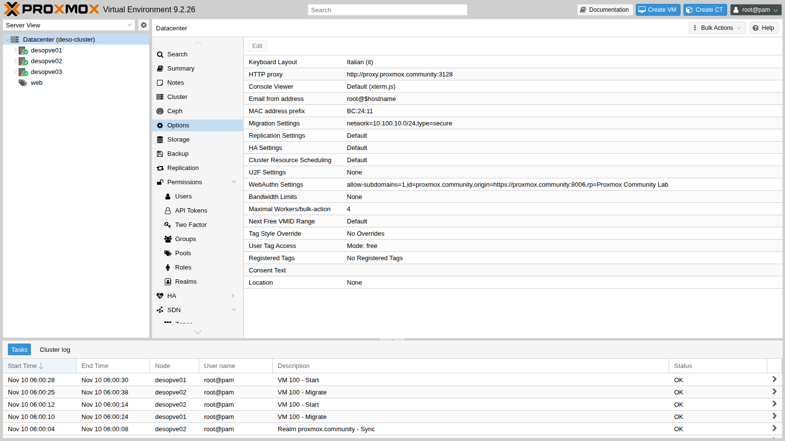
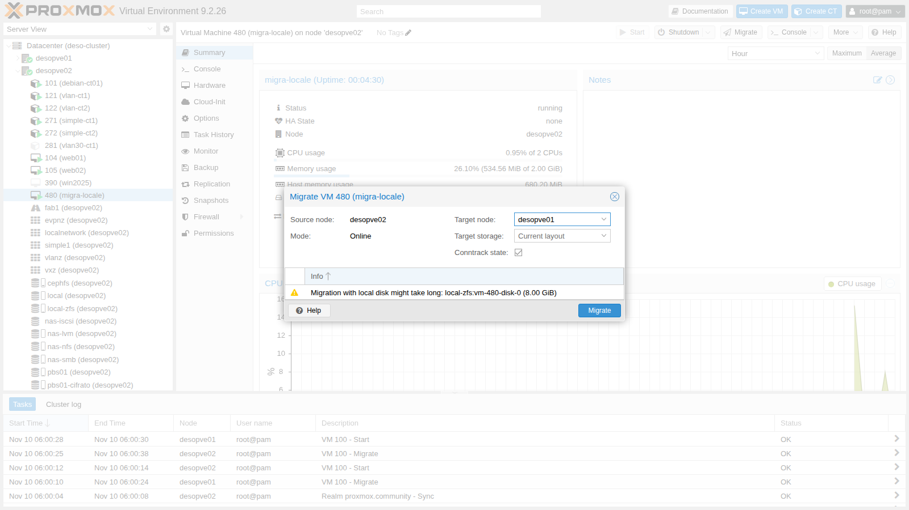
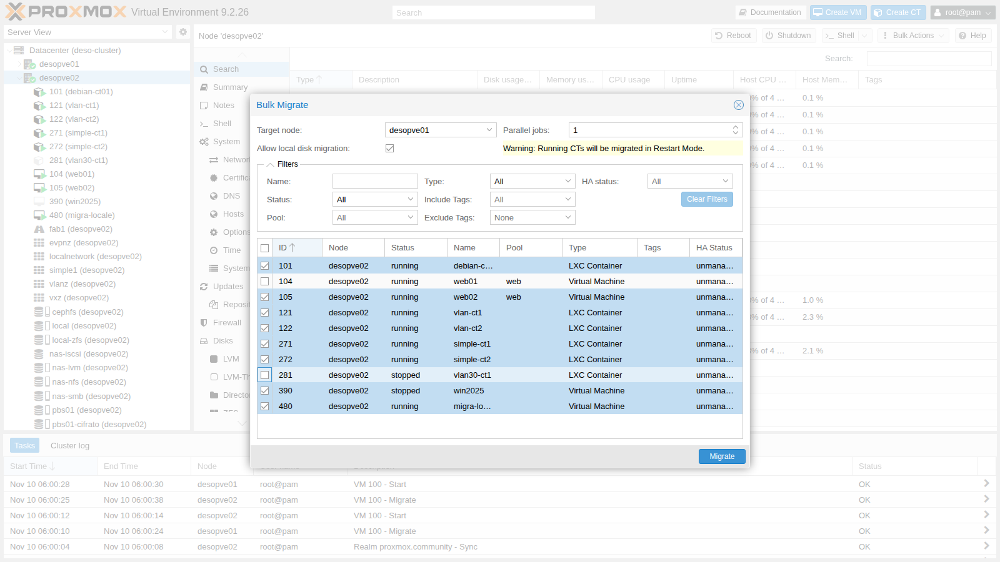
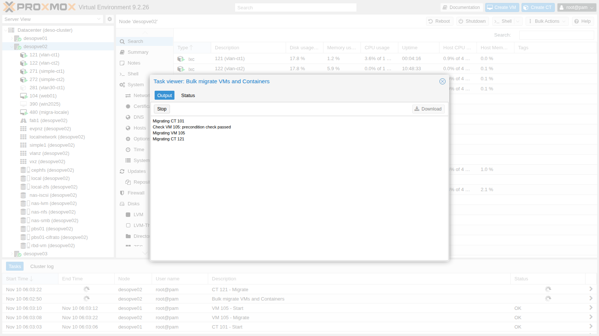

## Dependencies

- **Previous labs:**
  - [Lab 06](/06-cluster-corosync/): the `deso-cluster` cluster and the standalone node `desopve04`;
  - [Lab 11](/11-zfs-replication/): migration with ZFS replication;
  - [Lab 17](/17-ceph-installation/): the shared storage `rbd-vm`;
  - [Lab 22](/22-dedicated-networks/): the migration network on VLAN 100 (10.100.10.0/24);
  - [Lab 33](/33-firewall-2/): the nftables firewall, which opens ports 60000-60050 on the migration network;
  - [Lab 40](/40-templates-cloud-init-clones/): template 9000 and the VMs `web01`-`web03`.
- **Systems:**
  - nodes `desopve01`-`03` and `desopve04`;
  - VM 100 `debian01` and VM 104 `web01`, both on `rbd-vm`;
  - CT 121 and 122 on VLAN 10 ([Lab 20](/20-bridges-stable-names-vlans/)), CT 101 ([Lab 07](/07-first-vm-and-container/)), CT 271 and 272 ([Lab 27](/27-sdn-simple/)), CT 281 ([Lab 28](/28-sdn-vlan-qinq/)), VM 390 ([Lab 39](/39-windows-vm-virtio/)): they are needed for the bulk migration;
  - the ZFS pool `tank` on `desopve04` ([Lab 10](/10-zfs/)) and the `web-vendor.yaml` snippet on `cephfs` ([Lab 40](/40-templates-cloud-init-clones/));
  - a test VM on `local-zfs`, created in this lab.
- **Measurements:** the log of each migration task and a `ping` every 0.2 s to the guest, from the management network or from another CT. *How it works* explains what each of them measures.
- **Credentials:** `root@pam` → [Appendix B](/b-credentials-and-addresses/).

## Objectives

- VM 104 **live**-migrated with shared storage and CT 281 migrated **offline**, with the task duration, the downtime reported by QEMU and the longest ping gap recorded separately.
- A running VM with a **local disk** migrated to another node together with its disk, with the time spent copying the disk read from the log.
- A **container** moved in restart mode, knowing how long its service stays unreachable.
- A **bulk migration** started with only the intended guests selected.
- The **secure** and **insecure** modes compared on the dedicated network, knowing what the task log can and cannot tell about their speed.
- A VM moved **to another cluster** with `qm remote-migrate` and back, with the two errors met on the way explained and solved.

## How it works

**Live migration of a VM.** An empty QEMU process starts on the target node. The RAM is copied while the VM keeps working; the pages that get rewritten are copied again, until so little is left that the migration can finish within a very short pause (*downtime*, default limit 100 ms). With shared storage the disks do not move.

**Local disks.** With `--with-local-disks` the disks are copied **before** the RAM, with a *drive-mirror* over NBD. Once they are in sync, the RAM is migrated as above. The time grows with the size of the disks.

**Containers.** LXC has no live migration: the CT is **shut down, moved and started again** (*restart mode*). With shared storage only the configuration moves.

**Migration network.** In **Datacenter → Options → Migration Settings** you choose the network (here VLAN 100) and the type:

- **secure**: the RAM travels through an SSH tunnel;
- **insecure**: the RAM travels unencrypted over TCP (ports 60000-60050), which is lighter on the CPU. It only makes sense on a dedicated, trusted network.



**Between clusters.** `qm remote-migrate` uses the API of the target cluster with an **API token** and the certificate fingerprint. All the traffic, disks and RAM, travels through a *websocket* tunnel on port 8006. It is still an *experimental* feature, available only from the CLI (in a GUI it is offered by Proxmox Datacenter Manager, Lab 53).

**What the task log and the ping measure.** Three figures are easy to confuse, and this lab keeps them apart:

- **task duration**: the `duration` in the last line of the log, in whole seconds, from the start of the task to its end, preparation and cleanup included;
- **downtime reported by QEMU**: the `downtime N ms` at the end of the memory phase, the time the VM stays paused on the source for the final switchover. Proxmox VE then resumes the VM on the target only after a few more steps, such as moving the configuration and, with local disks, closing the disk mirror, so the pause seen by the guest's clients can be longer than this figure;
- **longest ping gap**: the longest interval between two replies of a `ping` sent every 0.2 seconds. It is what a client on the network sees, with a resolution of 0.2 seconds.

The `average migration speed` on the same line as the downtime is not a measured throughput either: Proxmox VE computes it as the total RAM of the guest divided by the duration of the memory phase, counted in whole seconds (see the source of `QemuMigrate.pm` in the references).

### Test environment and versions

The outputs and times in this lab come from a run carried out on 10 November 2026 (last checked in November 2026), with this configuration:

| Component | Configuration used |
|---|---|
| Proxmox VE | 9.2.26, kernel `7.0.14-28-pve` ([Lab 04](/04-first-access-repositories-updates/)), on the cluster nodes and on `desopve04` |
| Migrations within the cluster | VLAN 100 on `vmbr1`, over `bond0` in *active-backup* with two 10 Gbit/s cards, MTU 1500 ([Lab 21](/21-bonding/), [Lab 22](/22-dedicated-networks/)); type `secure` unless stated otherwise |
| Migrations between clusters | `qm remote-migrate` to the API of the other node (port 8006), over the management network |
| Storages | `rbd-vm`: Ceph 20.2.5, pool `size 3` / `min_size 2` ([Lab 17](/17-ceph-installation/)); `local-zfs`: ZFS mirror on the system disks ([Lab 03](/03-install-proxmox-ve/)); on `desopve04`, `local-lvm` (LVM-thin) and `tank` (ZFS RAIDZ1) ([Lab 09](/09-lvm-and-lvm-thin/), [Lab 10](/10-zfs/)) |
| Guests | VMs 104 and 480, clones of template 9000: Debian 13, 2 GiB of RAM, 8 GiB disk ([Lab 40](/40-templates-cloud-init-clones/)); VM 100 with 2 GiB of RAM; CT 121 with a static address on VLAN 10 ([Lab 21](/21-bonding/)) |

**What the test measures, and what it does not.** Each migration was run once, the secure/insecure comparison twice, with small guests (2 GiB of RAM, 653 MiB of data on the local disk) that were idle, except VM 100 in step 6. The test does not cover guests that rewrite their memory quickly, large disks or a busy network, and one or two runs do not show how much the times vary.

## Procedure

### 1. Live with shared storage

`web01` (VM 104) has its disk on Ceph (`rbd-vm`):

```bash
qm migrate 104 desopve02 --online
```

```text output
2026-11-10 05:55:53 conntrack state migration not supported or disabled, active connections might get dropped
2026-11-10 05:55:53 use dedicated network address for sending migration traffic (10.100.10.22)
2026-11-10 05:55:58 migration downtime limit: 100 ms
2026-11-10 05:56:00 average migration speed: 1.0 GiB/s - downtime 33 ms
2026-11-10 05:56:00 migration completed, transferred 281.4 MiB VM-state
2026-11-10 05:56:03 migration finished successfully (duration 00:00:10)
```

- **10 s** of task duration: only 281 MiB of RAM are transferred (`transferred 281.4 MiB VM-state`), over VLAN 100.
- **33 ms** of downtime reported by QEMU.
- **0.84 s**: the longest gap between two replies of the `ping`, sent every 0.2 s from the management network.

The ping gap is much longer than the downtime: the two figures measure different things and should be kept apart. Two explanations are possible, and this test does not tell them apart: Proxmox VE resumes the VM on the target only after the memory phase and a few more steps (see *How it works*), and after the move the network has to learn where the VM's MAC address is now, which is why QEMU sends announcement packets. To check:

- a much denser `ping` (for example every 10 ms, `ping -i 0.01`), to measure the gap with a resolution comparable to the downtime;
- the timestamps of the ping (`ping -D`) compared with those of the last lines of the task log;
- a capture on the bridge of the target node during the migration (`tcpdump -eni vmbr0 arp or rarp`), to see when the VM announces its new location.

**Conntrack (new in 9.x).** The first line warns that the state of the connections tracked by the firewall is **not** migrated. With the nftables firewall (Lab 33) you can ask for it to move together with the VM:

```bash
qm migrate 104 desopve01 --online --with-conntrack-state 1     # from desopve02: this also brings the VM back to its node
```

```text output
2026-11-10 06:11:33 average migration speed: 1.0 GiB/s - downtime 93 ms
2026-11-10 06:11:33 migrated 0 conntrack state entries
2026-11-10 06:11:36 flushing conntrack state for guest on source node
2026-11-10 06:11:40 migration finished successfully (duration 00:00:14)
```

0 entries were migrated. This is consistent with the configuration of `web01`, which does not have the firewall enabled on its network device: the option is meant for guests with the firewall enabled, because without their conntrack entries the firewall on the target node would drop the packets of the connections already open as *invalid*. The documentation describes the feature as best-effort. To see it at work, repeat the test with a guest that has `firewall=1` on its network device and an open connection, such as an SSH session, and check that the session survives the move. In the GUI the **Conntrack state** option is checked by default.

### 2. Offline

CT 281 is stopped and has its disk on Ceph:

```bash
time pct migrate 281 desopve02
```

```text output
2026-11-10 05:56:17 volume 'rbd-vm:vm-281-disk-0' is on shared storage 'rbd-vm'
2026-11-10 05:56:18 migration finished successfully (duration 00:00:01)
real	0m3.636s
```

With shared storage a stopped guest moves in a second: only the node that owns its configuration changes.

### 3. Live with local disks

A test VM (480 `migra-locale`) cloned from the template onto `local-zfs`, so its disk exists **only** on `desopve01`:

```bash
qm clone 9000 480 --name migra-locale --full 1 --storage local-zfs
qm set 480 --ipconfig0 ip=172.27.199.148/24,gw=172.27.199.1 --agent enabled=1 --cicustom vendor=cephfs:snippets/web-vendor.yaml
qm start 480
```

In the GUI, the **Migrate** button warns that the disk has to be copied and asks for the target storage.



```bash
qm migrate 480 desopve02 --online --with-local-disks --targetstorage local-zfs
```

```text output
2026-11-10 05:58:03 scsi0: start migration to nbd:unix:/run/qemu-server/480_nbd.migrate:exportname=drive-scsi0
mirror-scsi0: successfully switched to actively synced mode
2026-11-10 05:58:28 starting online/live migration on unix:/run/qemu-server/480.migrate
2026-11-10 05:58:30 average migration speed: 1.0 GiB/s - downtime 88 ms
2026-11-10 05:58:30 migration completed, transferred 611.1 MiB VM-state
mirror-scsi0: Completed successfully.
2026-11-10 05:58:37 migration finished successfully (duration 00:00:45)
```

| | Shared storage (VM 104) | Local disk (VM 480) |
|---|---|---|
| Task duration | 10 s | 45 s, 25 s of which for the disk (05:58:03 → 05:58:28 in the log) |
| Downtime reported by QEMU | 33 ms | 88 ms |
| Longest ping gap (one ping every 0.2 s) | 0.84 s | 3.73 s |

The disk held only 653 MiB of data (thin provisioning), and copying it took 25 seconds. The copy time grows with the amount of data, but this lab did not measure a large disk: before planning the migration of disks with hundreds of GB, measure that time on your own system. With ZFS replication ([Lab 11](/11-zfs-replication/)) only the changes since the last replication are copied: in that lab, the migration took **20 s instead of 1 min 13 s**.

With the local disk the ping gap is longer as well (3.73 s against 0.84 s), while the downtime reported by QEMU stays under 100 ms. With one run per case, there is no way to tell why. One of the steps that precede the resume on the target, closing the disk mirror, exists only in this case; the checks are the same as in step 1.

### 4. Containers: restart mode

CT 121 (VLAN 10) is measured **from CT 122**, which is on the same VLAN:

```bash
pct exec 122 -- sh -c "ping -D -i 0.2 10.10.10.121 > /tmp/p121.log &"   # on the node of CT 122
pct migrate 121 desopve02 --restart                                    # on the node of CT 121
```

```text output
2026-11-10 05:59:03 starting migration of CT 121 to node 'desopve02' (10.100.10.22)
2026-11-10 05:59:03 volume 'rbd-vm:vm-121-disk-0' is on shared storage 'rbd-vm'
2026-11-10 05:59:04 start container on target node
2026-11-10 05:59:09 migration finished successfully (duration 00:00:10)
```

The task lasts 10 s; the `ping` from CT 122, one every 0.2 s, has a longest gap of **11.65 s**. For a CT, "moving" always means **restarting**: its services must tolerate the interruption. The documentation speaks of a downtime of normally a few hundred milliseconds for a restart migration; here the gap is much longer, and this test does not break it down. It covers at least the shutdown of the CT on the source, its start on the target (the log shows the start at 05:59:04 and the end of the task at 05:59:09), and the time the CT needs before it answers on the network again. To check: compare the timestamps that `ping -D` wrote in `/tmp/p121.log` with the full task log, and look inside the CT at when its network came up (`journalctl -b`).

Without `--restart`, the migration of a running CT is refused ("not implemented", [Lab 41](/41-lxc-containers/)).

### 5. Bulk migration (and its trap)

**Node → Bulk Actions → Bulk Migrate** moves several guests in one go, with a number of jobs running in parallel (*Parallel jobs*) and the **Allow local disk migration** option.



:::caution
When the window opens, **all the guests of the node are already selected**: clicking a guest **deselects** it. A guided test of the trap: on `desopve02` open **Bulk Migrate** toward `desopve01` and, as if you wanted to move only CT 281, click it. You have actually deselected it: with **Migrate**, all the other eight are migrated. The CTs are restarted on the target node, because restart mode applies here too (the yellow notice warns about it).
:::



```text
Check VM 105: precondition check passed
Migrating VM 105
Migrating CT 121
Migrating CT 122
Migrating CT 271
Migrating CT 272
Check VM 390: precondition check passed
Migrating VM 390
Check VM 480: precondition check passed
Migrating VM 480
All jobs finished, used 8 workers in total.
TASK OK
```

8 guests in **137 s** with 1 job at a time. To put them back, use the CLI equivalent, with an explicit list and 2 parallel jobs:

```bash
pvesh create /nodes/desopve01/migrateall --target desopve02 --vms 101,105,122,271,272,390 --maxworkers 2
```

6 guests in **43 s**. The two runs move different guests, eight and six, and only the first one includes VM 480, whose local disk has to be copied: they do not isolate the effect of the parallel jobs. To measure it, move the same set of guests with 1 and with 2 jobs.

Before confirming a bulk migration, check the selection column or use the filters (status, pool, tags).

### 6. Secure versus insecure

VM 100 has 2 GiB of RAM. To make the test meaningful, the RAM inside the guest is filled with 900 MiB of random, incompressible data:

```bash
qm guest exec 100 -- sh -c "dd if=/dev/urandom of=/dev/shm/riempi bs=1M count=900"
qm migrate 100 desopve02 --online --migration_type secure
qm migrate 100 desopve01 --online --migration_type insecure     # from node 02
```

```text output
== insecure 100 02->01
2026-11-10 05:59:59 starting online/live migration on tcp:10.100.10.21:60000
2026-11-10 06:00:04 average migration speed: 413.0 MiB/s - downtime 21 ms
2026-11-10 06:00:04 migration completed, transferred 1.1 GiB VM-state
```

| Test | `average migration speed` (log) | Task duration |
|---|---|---|
| secure | 413 MiB/s | 14 s |
| insecure | 413 MiB/s | 14 s |
| secure (repeated) | 413 MiB/s | 14 s |
| insecure (repeated) | 688 MiB/s | 12 s |

The values come from the `average migration speed` line of the task logs, and three tests out of four gave exactly 413 MiB/s. As explained in *How it works*, that figure is the guest's RAM divided by the duration of the memory phase in whole seconds: with about 2 GiB of RAM, 413 MiB/s means 5 seconds and 688 MiB/s means 3 seconds. Three identical values are three memory phases of the same length, rounded to the second, not three identical throughputs.

- **What the test shows:** with 1.1 GiB of memory to transfer, the memory phase lasts 3-5 seconds and the whole task 12-14 seconds in both modes. At this resolution there is no clear difference between *secure* and *insecure*, and the test does not tell whether the network or the encryption limits the transfer.
- **What the documentation says:** encryption takes a lot of computing power, and the impact shows above all on fast networks, from 10 Gbit/s up; it is lower on CPUs that implement AES in hardware. Storage migration always uses the encrypted channel, whatever the setting.
- **How to check it on your system:** migrate a VM with much more memory in use, so that the memory phase lasts minutes; read the actual throughput on the migration interface, for example from the byte counters of `ip -s link show vmbr1.100` before and after; during a *secure* migration, watch the CPU usage of the `ssh` process on the source node (`top`); measure the network alone with `iperf3` between two nodes on VLAN 100.

In *insecure* mode the target opens port 60000: the firewall must allow it on the migration network (the `servizi-cluster` group, Lab 33).

### 7. Migration between clusters: `qm remote-migrate`

Target: `desopve04`, which is a separate "datacenter" with its own `local-lvm` and the ZFS pool `tank`.

**On the target node**, create a token and read the certificate fingerprint:

```bash
pveum user token add root@pam migra --privsep 0 --comment "migrazione remota dal cluster"
pvenode cert info | grep -B1 -A1 pve-ssl.pem
```

The token must be able to create VMs, allocate storage and use the bridge on the target. Here we use `root@pam` without privilege separation; in production a dedicated user is a better choice.

**First attempt: to `local-lvm`.**

```bash
qm remote-migrate 480 480 \
  'host=172.27.199.24,apitoken=PVEAPIToken=root@pam!migra=<segreto>,fingerprint=84:D3:F2:…' \
  --target-bridge vmbr0 --target-storage local-lvm --online
```

```text output
ERROR: … failed to handle 'disk-import' command - no matching import/export format found for storage 'local-lvm'
migration aborted
```

**Error observed.** The log shows that the failing disk is the **cloud-init** disk (`ide2`, on `local-zfs`). The main disk, attached to the running VM, is copied live through the NBD mirror; the cloud-init disk instead goes through a storage **export and import**. In this combination (ZFS source, LVM-thin target, PVE 9.2) the source offered it only in the `zfs` format, which LVM-thin cannot import. This is not a general rule: it depends on the formats the two storages have in common. [Lab 53](/53-datacenter-manager/) hits the same error from the PDM GUI and shows how to check it.

**Decision.** Use a ZFS storage on the target as well, `tank`, so that the `zfs` format is common to the two storages.

**Second attempt: to `tank` (ZFS).**

```text
ERROR: … failed to handle 'config' command - storage 'cephfs' does not exist
migration aborted
```

**Error observed.** The VM configuration references a snippet on `cephfs` (`cicustom`), a storage that does not exist on the target.

**Decision.** The snippet was needed only at the first boot: remove the reference and try again with the same options.

```bash
qm set 480 --delete cicustom
```

**Third attempt**, successful:

```text
2026-11-10 06:08:35 start migrate command to unix:/run/qemu-server/480.migrate
tunnel: established new WS for forwarding '/run/qemu-server/480.migrate'
2026-11-10 06:08:38 average migration speed: 682.9 MiB/s - downtime 31 ms
2026-11-10 06:08:38 migration completed, transferred 624.6 MiB VM-state
mirror-scsi0: Completed successfully.
2026-11-10 06:08:41 migration finished successfully (duration 00:00:52)
```

**Result.** The task completes in 52 seconds, with 31 ms of downtime reported by QEMU. The longest ping gap is 3.11 s, here too much longer than the downtime: step 1 lists the possible explanations and the checks. After the migration, the VM's web page answers from the other "datacenter".

On the cluster the VM **remains**, stopped and locked (`lock: migrate`): by default `remote-migrate` does not delete the original. Delete it by hand after checking the copy:

```bash
qm unlock 480 && qm destroy 480 --purge
```

**Return** to the cluster, run on `desopve04` with a token of the cluster and `--delete 1`, which deletes the source at the end of the migration. Prepare the token and the fingerprint on `desopve01`:

```bash
pveum user token add root@pam rientro --privsep 0 --comment "rientro dalla migrazione remota"
pvenode cert info | grep -B1 -A1 pve-ssl.pem
```

Then on `desopve04`:

```bash
qm remote-migrate 480 480 \
  'host=172.27.199.21,apitoken=PVEAPIToken=root@pam!rientro=<segreto>,fingerprint=14:32:84:…' \
  --target-bridge vmbr0 --target-storage local-zfs --online --delete 1
```

```text output
2026-11-10 06:10:46 average migration speed: 682.9 MiB/s - downtime 62 ms
2026-11-10 06:10:46 migration completed, transferred 626.2 MiB VM-state
2026-11-10 06:10:50 migration finished successfully (duration 00:00:32)
```

The return takes 32 seconds, with 62 ms of downtime reported by QEMU, and the VM is no longer on `desopve04`.

:::caution
Do not run `remote-migrate` in a pipe that can close before the end (for example `| head`): the command is interrupted halfway and leaves an empty VM on the target, locked with `lock: create`, which you then have to clean up with `qm unlock` and `qm destroy`. It is better to run it inside `screen` or `tmux`.
:::

**Limits of `remote-migrate` seen in the lab:**

- CLI only, and labeled as experimental;
- it needs a token, the fingerprint and permissions on the target;
- configurations that reference storages, snippets or bridges missing on the target fail;
- disks that are not live-migrated (cloud-init, stopped VMs) require export formats that are compatible between the storages;
- the source remains by default; with `--delete 1` it is removed.

### 8. Putting everything back

At the end of the lab, put the guests back where they were. VM 104 already went back to `desopve01` with the conntrack test, and CT 121 with the bulk migration; what is left is CT 281, VM 480 that came back from the remote "datacenter", and the tokens:

```bash
pct migrate 281 desopve01                    # on desopve02 (the CT is stopped)
qm stop 480 && qm destroy 480 --purge        # on desopve01
pveum user token remove root@pam rientro     # on desopve01
pveum user token remove root@pam migra       # on desopve04
```

## Verification and tests

The lab has succeeded when every migration ends with `migration finished successfully` (the bulk migration with `TASK OK`), each guest answers on its target, and after the migration between clusters the source has been removed deliberately.

| Test | Success criterion | Result in the lab |
|---|---|---|
| Live, shared storage (VM 104) | VM running and reachable on the target | task 10 s; downtime reported by QEMU 33 ms; longest ping gap 0.84 s |
| Offline, shared storage (CT 281) | only the configuration moves | task 1 s |
| Live, local disk (VM 480, 8 GiB thin) | disk copied, VM reachable on the target | task 45 s, 25 s of which for the disk; downtime 88 ms; longest ping gap 3.73 s |
| CT in restart mode (CT 121) | CT running on the target | task 10 s; longest ping gap seen from CT 122: 11.65 s |
| Bulk migration | only the selected guests migrated | 8 guests in 137 s with 1 job at a time; 6 other guests in 43 s with 2 |
| secure versus insecure | both modes work on VLAN 100 | tasks of 12-14 s; `average migration speed` 413-688 MiB/s, that is memory phases of 3-5 s |
| Remote-migrate to `desopve04` | VM running on the target, source stopped and locked | after 2 errors: task 52 s; downtime 31 ms; longest ping gap 3.11 s |
| Remote-migrate back with `--delete 1` | VM back on the cluster, source deleted | task 32 s; downtime 62 ms |

## Final lab state

- Guests back in their initial location:
  - VMs 100, 104 and 261 and CTs 121, 141, 143, 281, 291, 301 on `desopve01`;
  - CTs 101, 122, 271, 272 and VMs 105 and 390 on `desopve02`;
  - VM 106 and CTs 123, 282, 292, 302 on `desopve03`.
- Test VM 480 deleted; nothing left behind on `desopve04`.
- Tokens `root@pam!migra` (on `desopve04`) and `root@pam!rientro` (on the cluster) removed.
- Datacenter: `migration: secure,network=10.100.10.0/24`, unchanged.
- PBS and the jobs from Lab 47 unchanged.

## What you learned

- **How to estimate a migration window.** With shared storage only the memory moves: here 10 seconds of task and 33 ms of downtime reported by QEMU. With local disks the disk is copied first and the time grows with its data; ZFS replication ([Lab 11](/11-zfs-replication/)) shortens it. A container always restarts: plan for an interruption of its service, 11.65 seconds in this lab.
- **How to read the downtime of a migration.** The downtime in the task, the gap a client sees and the `average migration speed` are different things: the first is measured by QEMU, the second needs a tool with enough resolution, the third is not a throughput. A gap of seconds, like the 3.73 s with the local disk, has to be checked before you attribute it to a cause.
- **When *insecure* is worth it.** Only on a dedicated, trusted network, and only if a measurement on your hardware shows that encryption is the bottleneck: the test in this lab could not tell. The firewall must open ports 60000-60050.
- **How to start a bulk migration safely.** The window preselects **all** the guests: check the selection before confirming.
- **What to check before a migration between clusters.** Storages with an export format in common for the disks that are not copied live, the resources named in the configuration (snippets, ISOs, storages), the permissions of the token, and what happens to the source: it stays, stopped and locked, unless you use `--delete 1`.
- **Whether to migrate the conntrack state.** It is new in 9.x, works on a best-effort basis and is meant for guests with the firewall enabled.

## References

- [Proxmox VE – Migration (qm)](https://pve.proxmox.com/pve-docs/chapter-qm.html#qm_migration)
- [Proxmox VE – Conntrack state migration](https://pve.proxmox.com/pve-docs/chapter-qm.html#_conntrack_state_migration)
- [Proxmox VE – Container migration and restart mode](https://pve.proxmox.com/pve-docs/chapter-pct.html#pct_migration)
- [Proxmox VE – Guest migration: type (secure/insecure) and network](https://pve.proxmox.com/pve-docs/chapter-pvecm.html#_guest_migration)
- [Proxmox VE – qm(1), remote-migrate](https://pve.proxmox.com/pve-docs/qm.1.html#cli_qm_remote-migrate)
- [Proxmox VE source code – `QemuMigrate.pm`: how the task log computes `average migration speed`, and when the VM is resumed on the target](https://git.proxmox.com/?p=qemu-server.git;a=blob;f=src/PVE/QemuMigrate.pm;hb=HEAD)
